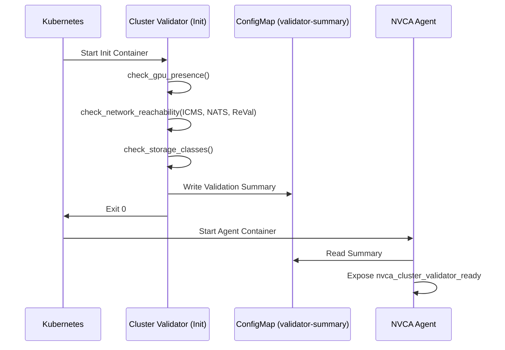

<!-- source: DeepWiki mcp.deepwiki.com · repo NVIDIA/nvcf · page 4.1 NVIDIA Cluster Agent (NVCA) and Operator · fetched 2026-10-26 -->

# NVIDIA Cluster Agent (NVCA) and Operator

<details>
<summary>Relevant source files</summary>

The following files were used as context for generating this wiki page:

- [deploy/helm/nvca-operator/README.md](deploy/helm/nvca-operator/README.md)
- [deploy/helm/nvca-operator/nvca-operator/README.md](deploy/helm/nvca-operator/nvca-operator/README.md)
- [deploy/helm/nvca-operator/nvca-operator/templates/_helpers.tpl](deploy/helm/nvca-operator/nvca-operator/templates/_helpers.tpl)
- [deploy/helm/nvca-operator/nvca-operator/templates/agent-config-merge-cm.yaml](deploy/helm/nvca-operator/nvca-operator/templates/agent-config-merge-cm.yaml)
- [deploy/helm/nvca-operator/nvca-operator/templates/deployment.yaml](deploy/helm/nvca-operator/nvca-operator/templates/deployment.yaml)
- [deploy/helm/nvca-operator/nvca-operator/templates/helm-managed-nvcfbackend-cm.yaml](deploy/helm/nvca-operator/nvca-operator/templates/helm-managed-nvcfbackend-cm.yaml)
- [deploy/helm/nvca-operator/nvca-operator/templates/image-pull-secret.yaml](deploy/helm/nvca-operator/nvca-operator/templates/image-pull-secret.yaml)
- [deploy/helm/nvca-operator/nvca-operator/templates/ngc-service-key.yaml](deploy/helm/nvca-operator/nvca-operator/templates/ngc-service-key.yaml)
- [deploy/helm/nvca-operator/nvca-operator/templates/otel_config_secret.yaml](deploy/helm/nvca-operator/nvca-operator/templates/otel_config_secret.yaml)
- [deploy/helm/nvca-operator/nvca-operator/templates/pre-delete-cleanup-job.yaml](deploy/helm/nvca-operator/nvca-operator/templates/pre-delete-cleanup-job.yaml)
- [deploy/helm/nvca-operator/nvca-operator/templates/pre-delete-cleanup-rbac.yaml](deploy/helm/nvca-operator/nvca-operator/templates/pre-delete-cleanup-rbac.yaml)
- [deploy/helm/nvca-operator/nvca-operator/templates/rbac_allowed_extra_types.yaml](deploy/helm/nvca-operator/nvca-operator/templates/rbac_allowed_extra_types.yaml)
- [deploy/helm/nvca-operator/nvca-operator/templates/sa.yaml](deploy/helm/nvca-operator/nvca-operator/templates/sa.yaml)
- [deploy/helm/nvca-operator/nvca-operator/templates/self-managed-nvcfbackend-cm.yaml](deploy/helm/nvca-operator/nvca-operator/templates/self-managed-nvcfbackend-cm.yaml)
- [deploy/helm/nvca-operator/nvca-operator/values.schema.json](deploy/helm/nvca-operator/nvca-operator/values.schema.json)
- [deploy/helm/nvca-operator/nvca-operator/values.yaml](deploy/helm/nvca-operator/nvca-operator/values.yaml)
- [deploy/helm/nvca-operator/scripts/ci_vendor_nvca_operator_chart](deploy/helm/nvca-operator/scripts/ci_vendor_nvca_operator_chart)
- [deploy/helm/nvca-operator/scripts/render_release_supplemental_images.sh](deploy/helm/nvca-operator/scripts/render_release_supplemental_images.sh)
- [deploy/helm/nvca-operator/tests/cluster_source_defaults_test.sh](deploy/helm/nvca-operator/tests/cluster_source_defaults_test.sh)
- [deploy/helm/nvca-operator/tests/release_image_manifest_test.sh](deploy/helm/nvca-operator/tests/release_image_manifest_test.sh)
- [deploy/helm/nvca-operator/tests/self_managed_nvca_image_reference_test.sh](deploy/helm/nvca-operator/tests/self_managed_nvca_image_reference_test.sh)
- [docs/user/cluster-management/container-cache.md](docs/user/cluster-management/container-cache.md)
- [docs/v0.6.0/release-notes/0.5.0-to-0.6.0-upgrade.md](docs/v0.6.0/release-notes/0.5.0-to-0.6.0-upgrade.md)
- [src/compute-plane-services/nvca/AGENTS.md](src/compute-plane-services/nvca/AGENTS.md)
- [src/compute-plane-services/nvca/ci/validate-release-tag/main.go](src/compute-plane-services/nvca/ci/validate-release-tag/main.go)
- [src/compute-plane-services/nvca/ci/validate-release-tag/main_test.go](src/compute-plane-services/nvca/ci/validate-release-tag/main_test.go)
- [src/compute-plane-services/nvca/deployments/nvca-operator/README.md](src/compute-plane-services/nvca/deployments/nvca-operator/README.md)
- [src/compute-plane-services/nvca/deployments/nvca-operator/templates/_helpers.tpl](src/compute-plane-services/nvca/deployments/nvca-operator/templates/_helpers.tpl)
- [src/compute-plane-services/nvca/deployments/nvca-operator/templates/cluster-validator-network-checks-cm.yaml](src/compute-plane-services/nvca/deployments/nvca-operator/templates/cluster-validator-network-checks-cm.yaml)
- [src/compute-plane-services/nvca/deployments/nvca-operator/templates/cronjob.yaml](src/compute-plane-services/nvca/deployments/nvca-operator/templates/cronjob.yaml)
- [src/compute-plane-services/nvca/deployments/nvca-operator/templates/deployment.yaml](src/compute-plane-services/nvca/deployments/nvca-operator/templates/deployment.yaml)
- [src/compute-plane-services/nvca/deployments/nvca-operator/templates/helm-managed-nvcfbackend-cm.yaml](src/compute-plane-services/nvca/deployments/nvca-operator/templates/helm-managed-nvcfbackend-cm.yaml)
- [src/compute-plane-services/nvca/deployments/nvca-operator/templates/pre-delete-cleanup-job.yaml](src/compute-plane-services/nvca/deployments/nvca-operator/templates/pre-delete-cleanup-job.yaml)
- [src/compute-plane-services/nvca/deployments/nvca-operator/templates/pre-delete-cleanup-rbac.yaml](src/compute-plane-services/nvca/deployments/nvca-operator/templates/pre-delete-cleanup-rbac.yaml)
- [src/compute-plane-services/nvca/deployments/nvca-operator/templates/rbac.yaml](src/compute-plane-services/nvca/deployments/nvca-operator/templates/rbac.yaml)
- [src/compute-plane-services/nvca/deployments/nvca-operator/templates/self-managed-nvcfbackend-cm.yaml](src/compute-plane-services/nvca/deployments/nvca-operator/templates/self-managed-nvcfbackend-cm.yaml)
- [src/compute-plane-services/nvca/deployments/nvca-operator/values.schema.json](src/compute-plane-services/nvca/deployments/nvca-operator/values.schema.json)
- [src/compute-plane-services/nvca/deployments/nvca-operator/values.yaml](src/compute-plane-services/nvca/deployments/nvca-operator/values.yaml)
- [src/compute-plane-services/nvca/internal/clustervalidator/checks.go](src/compute-plane-services/nvca/internal/clustervalidator/checks.go)
- [src/compute-plane-services/nvca/internal/clustervalidator/checks_test.go](src/compute-plane-services/nvca/internal/clustervalidator/checks_test.go)
- [src/compute-plane-services/nvca/internal/clustervalidator/validator.go](src/compute-plane-services/nvca/internal/clustervalidator/validator.go)
- [src/compute-plane-services/nvca/internal/clustervalidator/validator_test.go](src/compute-plane-services/nvca/internal/clustervalidator/validator_test.go)
- [src/compute-plane-services/nvca/internal/metrics/METRICS.md](src/compute-plane-services/nvca/internal/metrics/METRICS.md)
- [src/compute-plane-services/nvca/internal/metrics/metrics.go](src/compute-plane-services/nvca/internal/metrics/metrics.go)
- [src/compute-plane-services/nvca/internal/metrics/metrics_test.go](src/compute-plane-services/nvca/internal/metrics/metrics_test.go)
- [src/compute-plane-services/nvca/internal/util/envutil/envutil.go](src/compute-plane-services/nvca/internal/util/envutil/envutil.go)
- [src/compute-plane-services/nvca/internal/util/envutil/envutil_test.go](src/compute-plane-services/nvca/internal/util/envutil/envutil_test.go)
- [src/compute-plane-services/nvca/internal/util/k8sutil/BUILD.bazel](src/compute-plane-services/nvca/internal/util/k8sutil/BUILD.bazel)
- [src/compute-plane-services/nvca/internal/util/k8sutil/affinity.go](src/compute-plane-services/nvca/internal/util/k8sutil/affinity.go)
- [src/compute-plane-services/nvca/internal/util/k8sutil/affinity_test.go](src/compute-plane-services/nvca/internal/util/k8sutil/affinity_test.go)
- [src/compute-plane-services/nvca/pkg/nvca/agent.go](src/compute-plane-services/nvca/pkg/nvca/agent.go)
- [src/compute-plane-services/nvca/pkg/nvca/agent_metrics_test.go](src/compute-plane-services/nvca/pkg/nvca/agent_metrics_test.go)
- [src/compute-plane-services/nvca/pkg/nvca/agent_test.go](src/compute-plane-services/nvca/pkg/nvca/agent_test.go)
- [src/compute-plane-services/nvca/pkg/nvca/backendk8scache.go](src/compute-plane-services/nvca/pkg/nvca/backendk8scache.go)
- [src/compute-plane-services/nvca/pkg/nvca/backendk8scache_test.go](src/compute-plane-services/nvca/pkg/nvca/backendk8scache_test.go)
- [src/compute-plane-services/nvca/pkg/nvca/cli.go](src/compute-plane-services/nvca/pkg/nvca/cli.go)
- [src/compute-plane-services/nvca/pkg/nvca/cli_test.go](src/compute-plane-services/nvca/pkg/nvca/cli_test.go)
- [src/compute-plane-services/nvca/pkg/nvca/jwks_updater.go](src/compute-plane-services/nvca/pkg/nvca/jwks_updater.go)
- [src/compute-plane-services/nvca/pkg/nvca/jwks_updater_test.go](src/compute-plane-services/nvca/pkg/nvca/jwks_updater_test.go)
- [src/compute-plane-services/nvca/pkg/nvca/k8scomputebackend.go](src/compute-plane-services/nvca/pkg/nvca/k8scomputebackend.go)
- [src/compute-plane-services/nvca/pkg/nvca/k8scomputebackend_task_container.go](src/compute-plane-services/nvca/pkg/nvca/k8scomputebackend_task_container.go)
- [src/compute-plane-services/nvca/pkg/operator/reconcile/nvcaagent_reconcile.go](src/compute-plane-services/nvca/pkg/operator/reconcile/nvcaagent_reconcile.go)
- [src/compute-plane-services/nvca/pkg/operator/reconcile/nvcaagent_reconcile_test.go](src/compute-plane-services/nvca/pkg/operator/reconcile/nvcaagent_reconcile_test.go)
- [src/compute-plane-services/nvca/pkg/types/types.go](src/compute-plane-services/nvca/pkg/types/types.go)
- [src/compute-plane-services/nvca/pkg/webhook/miniservice_mutating_webhook.go](src/compute-plane-services/nvca/pkg/webhook/miniservice_mutating_webhook.go)
- [src/compute-plane-services/nvca/pkg/webhook/miniservice_mutating_webhook_test.go](src/compute-plane-services/nvca/pkg/webhook/miniservice_mutating_webhook_test.go)
- [src/compute-plane-services/nvca/scripts/lint_helm.sh](src/compute-plane-services/nvca/scripts/lint_helm.sh)
- [src/compute-plane-services/nvca/test/test-reuse-values-no-service-oauth.yaml](src/compute-plane-services/nvca/test/test-reuse-values-no-service-oauth.yaml)
- [src/compute-plane-services/nvca/vendor/github.com/NVIDIA/nvcf/src/libraries/go/lib/pkg/types/nvca/config/types.go](src/compute-plane-services/nvca/vendor/github.com/NVIDIA/nvcf/src/libraries/go/lib/pkg/types/nvca/config/types.go)
- [src/compute-plane-services/nvca/vendor/github.com/NVIDIA/nvcf/src/libraries/go/lib/pkg/types/nvca/config/zz_generated.deepcopy.go](src/compute-plane-services/nvca/vendor/github.com/NVIDIA/nvcf/src/libraries/go/lib/pkg/types/nvca/config/zz_generated.deepcopy.go)
- [src/libraries/go/lib/pkg/types/nvca/config/config_test.go](src/libraries/go/lib/pkg/types/nvca/config/config_test.go)
- [src/libraries/go/lib/pkg/types/nvca/config/types.go](src/libraries/go/lib/pkg/types/nvca/config/types.go)
- [src/libraries/go/lib/pkg/types/nvca/config/types_additional_test.go](src/libraries/go/lib/pkg/types/nvca/config/types_additional_test.go)
- [src/libraries/go/lib/pkg/types/nvca/config/types_test.go](src/libraries/go/lib/pkg/types/nvca/config/types_test.go)
- [src/libraries/go/lib/pkg/types/nvca/config/zz_generated.deepcopy.go](src/libraries/go/lib/pkg/types/nvca/config/zz_generated.deepcopy.go)

</details>


The NVIDIA Cluster Agent (NVCA) and its corresponding Operator form the backbone of the NVCF Compute Plane. They are responsible for registering Kubernetes clusters with the NVCF Control Plane, managing the lifecycle of NVCF workloads (Functions and Tasks), and ensuring the cluster environment meets the technical requirements for GPU-accelerated execution.

## System Architecture and Components

The NVCA architecture consists of the **NVCA Operator**, which manages the deployment and configuration of the **NVCA Agent**. The Agent itself interacts with the Kubernetes API and the NVCF Control Plane (via ICMS and NATS) to reconcile the desired state of workloads.

### Code-to-Entity Mapping: Component Interaction
This diagram illustrates how code entities in the `nvca` package interact with Kubernetes resources and external NVCF services.

```mermaid
graph TD
    subgraph "NVCA Operator Pod"
        [NVCAOperator] -->|reconciles| [NVCFBackendCRD]
        [NVCAOperator] -->|deploys| [NVCAAgentPod]
    end

    subgraph "NVCA Agent Pod"
        [AgentManager] -- "pkg/nvca/agent.go" --> [K8sComputeBackend]
        [K8sComputeBackend] -- "pkg/nvca/k8scomputebackend.go" --> [K8sAPI]
        [JWKSUpdater] -- "pkg/nvca/jwks_updater.go" --> [ICMS]
        [MetricsCollector] -- "internal/metrics/metrics.go" --> [Prometheus]
    end

    subgraph "Kubernetes Resources"
        [NVCFBackendCRD] -->|defines| [ClusterConfig]
        [K8sAPI] -->|manages| [MiniServicePods]
        [K8sAPI] -->|manages| [TaskPods]
    end

    [ICMS] -- "Registration/JWKS" --> [AgentManager]
    [NATS] -- "Workload Events" --> [AgentManager]
```
**Sources:** `src/compute-plane-services/nvca/pkg/nvca/agent.go` [1-50](), `src/compute-plane-services/nvca/pkg/nvca/k8scomputebackend.go` [1-40](), `src/compute-plane-services/nvca/pkg/operator/reconcile/nvcaagent_reconcile.go` [1-100]().

---

## NVCA Operator and NVCFBackend CRD

The **NVCA Operator** is deployed via the `nvca-operator` Helm chart. Its primary responsibility is to watch for `NVCFBackend` Custom Resources and manage the lifecycle of the NVCA Agent pods based on the configuration provided in that CRD.

### NVCFBackend Source Modes
The operator supports three distinct cluster source modes defined in `ngcConfig.clusterSource`:

| Mode | Description | Key Configuration |
| :--- | :--- | :--- |
| `ngc-managed` | Cluster is fully managed via the NVIDIA GPU Cloud (NGC) portal. | `ngcConfig.apiURL` |
| `helm-managed` | Configuration is provided primarily through Helm values during installation. | `clusterName`, `clusterGroupID` |
| `self-managed` | Used for local or private clusters where the agent manages its own registration. | `clusterID`, `ncaID`, `selfManaged.*` |

**Sources:** `deploy/helm/nvca-operator/nvca-operator/values.yaml` [68-79](), `deploy/helm/nvca-operator/nvca-operator/templates/self-managed-nvcfbackend-cm.yaml` [37-52]().

---

## Cluster Validator

Before the NVCA Agent starts, a `cluster-validator` init container runs to ensure the environment is sane. This prevents the agent from registering a "broken" cluster (e.g., missing GPU drivers, restricted network access) into the NVCF pool.

### Validation Workflow
The validator performs checks and writes a summary to a ConfigMap which the Agent later reads to expose metrics.


**Sources:** `deploy/helm/nvca-operator/nvca-operator/templates/deployment.yaml` [61-101](), `src/compute-plane-services/nvca/internal/metrics/metrics.go` [85-95](), `src/compute-plane-services/nvca/internal/clustervalidator/validator.go` [1-50]().

---

## NVCA Agent Core Functions

### JWKS Updater
The `JWKSUpdater` is a background routine in the Agent that periodically fetches the JSON Web Key Set (JWKS) from ICMS. This is critical for verifying the identity of workloads and ensuring secure communication between the compute plane and the control plane.
**Sources:** `src/compute-plane-services/nvca/pkg/nvca/jwks_updater.go` [1-60]().

### K8s Compute Backend
The `K8sComputeBackend` implements the interface for interacting with the Kubernetes cluster. It handles:
*   **Pod Creation:** Translating NVCF workload specs into K8s Pod definitions.
*   **Affinity Management:** Applying GPU-specific node selectors and tolerations via `internal/util/k8sutil/affinity.go`.
*   **Resource Tracking:** Monitoring GPU capacity and allocatable slots via metrics like `nvca_instance_type_allocatable`.

**Sources:** `src/compute-plane-services/nvca/pkg/nvca/k8scomputebackend.go` [1-100](), `src/compute-plane-services/nvca/internal/metrics/metrics.go` [42-45]().

### Graceful Shutdown
The Agent implements a graceful shutdown mechanism controlled by `terminationGracePeriodSeconds` (default 600s). This allows the agent to finish processing in-flight NATS messages and update the status of active workloads before the pod is terminated.
**Sources:** `deploy/helm/nvca-operator/nvca-operator/templates/deployment.yaml` [60-60]().

---

## Observability and Metrics

NVCA exposes a comprehensive set of Prometheus metrics to monitor the health of the compute plane.

### Key Metrics Defined in `internal/metrics/metrics.go`

| Metric Name | Type | Description |
| :--- | :--- | :--- |
| `nvca_instance_type_allocatable` | Gauge | Available GPU slots per instance type. |
| `nvca_container_crash_total` | Counter | Total count of workload container crashes. |
| `nvca_miniservice_controller_reconcile_phase_total` | Counter | Tracks MiniService lifecycle transitions. |
| `nvca_queue_message_processed_total` | Counter | NATS messages successfully handled by the agent. |
| `nvca_cluster_validator_check_status` | Gauge | Binary status of specific cluster pre-flight checks. |

**Sources:** `src/compute-plane-services/nvca/internal/metrics/metrics.go` [41-95]().

---

## Configuration and Mirroring

### nvca-mirror and Transport TLS
For high-security environments, the operator supports `transportTLS` configuration. This allows the cluster to use a private trust bundle for workload communication. The `operatorConfig.workload.transportTLS` section in `values.yaml` defines the secret and fingerprint for the CA bundle.

### BYOO OTel Collector
The agent supports an OpenTelemetry (OTel) collector sidecar for Kubernetes event collection. This is configured via the `otelCollector` block, which includes resource limits and image overrides.
**Sources:** `deploy/helm/nvca-operator/nvca-operator/values.yaml` [29-47](), `src/libraries/go/lib/pkg/types/nvca/config/types.go` [190-200]().

### Data Flow: Workload Deployment
1.  **NATS Message:** Agent receives a deployment request.
2.  **Translation:** `icms-translate` library converts the request into a `MiniService` or `Task` object.
3.  **K8s Backend:** `K8sComputeBackend` calls the K8s API to create the resources.
4.  **Reconciliation:** The `MiniServiceController` (documented in 4.2) handles the pod lifecycle.

**Sources:** `src/compute-plane-services/nvca/pkg/nvca/agent.go` [100-150](), `src/compute-plane-services/nvca/pkg/nvca/k8scomputebackend.go` [150-200]().

---

