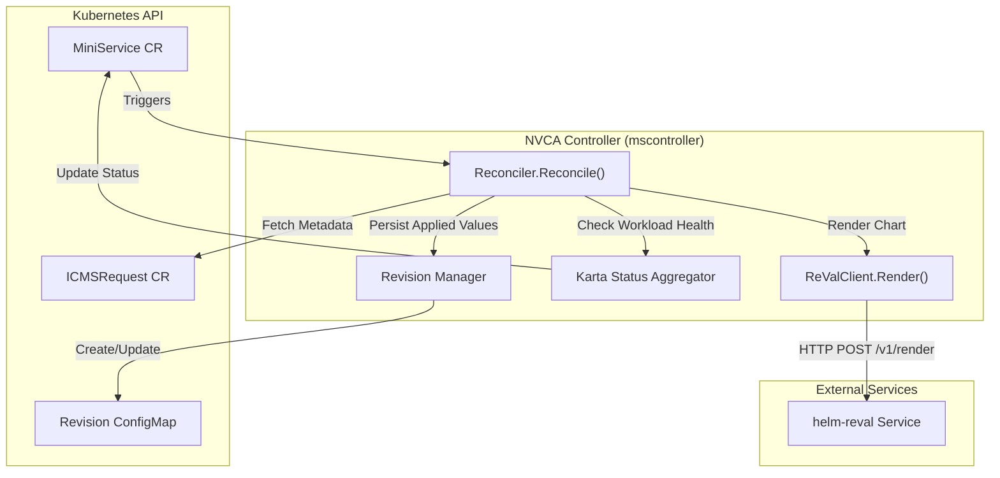

<!-- source: DeepWiki mcp.deepwiki.com · repo NVIDIA/nvcf · page 4.2 MiniService Controller and Helm Function Lifecycle · fetched 2026-10-26 -->

# MiniService Controller and Helm Function Lifecycle

Relevant source files

The following files were used as context for generating this wiki page:

- [docs/user/cluster-management/gxcache.md](docs/user/cluster-management/gxcache.md)
- [src/compute-plane-services/nvca/internal/miniservice/BUILD.bazel](src/compute-plane-services/nvca/internal/miniservice/BUILD.bazel)
- [src/compute-plane-services/nvca/internal/miniservice/controller.go](src/compute-plane-services/nvca/internal/miniservice/controller.go)
- [src/compute-plane-services/nvca/internal/miniservice/karta/dynamo/nvidia.com_dynamographdeployment_v1alpha1.yaml](src/compute-plane-services/nvca/internal/miniservice/karta/dynamo/nvidia.com_dynamographdeployment_v1alpha1.yaml)
- [src/compute-plane-services/nvca/internal/miniservice/karta/dynamo/nvidia.com_dynamographdeployment_v1beta1.yaml](src/compute-plane-services/nvca/internal/miniservice/karta/dynamo/nvidia.com_dynamographdeployment_v1beta1.yaml)
- [src/compute-plane-services/nvca/internal/miniservice/karta/grove/grove_io_podcliqueset_v1alpha1.yaml](src/compute-plane-services/nvca/internal/miniservice/karta/grove/grove_io_podcliqueset_v1alpha1.yaml)
- [src/compute-plane-services/nvca/internal/miniservice/karta/kai-scheduler/scheduling-run-ai-podgroup-v2alpha2.yaml](src/compute-plane-services/nvca/internal/miniservice/karta/kai-scheduler/scheduling-run-ai-podgroup-v2alpha2.yaml)
- [src/compute-plane-services/nvca/internal/miniservice/prereqs.go](src/compute-plane-services/nvca/internal/miniservice/prereqs.go)
- [src/compute-plane-services/nvca/internal/miniservice/reconcile.go](src/compute-plane-services/nvca/internal/miniservice/reconcile.go)
- [src/compute-plane-services/nvca/internal/miniservice/reconcile_test.go](src/compute-plane-services/nvca/internal/miniservice/reconcile_test.go)
- [src/compute-plane-services/nvca/internal/miniservice/reconcile_update_test.go](src/compute-plane-services/nvca/internal/miniservice/reconcile_update_test.go)
- [src/compute-plane-services/nvca/internal/miniservice/reval_client.go](src/compute-plane-services/nvca/internal/miniservice/reval_client.go)
- [src/compute-plane-services/nvca/internal/miniservice/reval_client_test.go](src/compute-plane-services/nvca/internal/miniservice/reval_client_test.go)
- [src/compute-plane-services/nvca/internal/miniservice/revision.go](src/compute-plane-services/nvca/internal/miniservice/revision.go)
- [src/compute-plane-services/nvca/internal/miniservice/revision_test.go](src/compute-plane-services/nvca/internal/miniservice/revision_test.go)
- [src/compute-plane-services/nvca/internal/miniservice/status.go](src/compute-plane-services/nvca/internal/miniservice/status.go)
- [src/compute-plane-services/nvca/internal/miniservice/status_karta.go](src/compute-plane-services/nvca/internal/miniservice/status_karta.go)
- [src/compute-plane-services/nvca/internal/miniservice/status_karta_test.go](src/compute-plane-services/nvca/internal/miniservice/status_karta_test.go)
- [src/compute-plane-services/nvca/internal/miniservice/status_test.go](src/compute-plane-services/nvca/internal/miniservice/status_test.go)
- [src/compute-plane-services/nvca/internal/miniservice/translate_workload_test.go](src/compute-plane-services/nvca/internal/miniservice/translate_workload_test.go)
- [src/compute-plane-services/nvca/internal/miniservice/transport_tls.go](src/compute-plane-services/nvca/internal/miniservice/transport_tls.go)
- [src/compute-plane-services/nvca/internal/util/k8sutil/pod.go](src/compute-plane-services/nvca/internal/util/k8sutil/pod.go)
- [src/compute-plane-services/nvca/internal/util/k8sutil/pod_test.go](src/compute-plane-services/nvca/internal/util/k8sutil/pod_test.go)
- [src/compute-plane-services/nvca/pkg/apis/nvca/v1alpha1/generated.openapi.go](src/compute-plane-services/nvca/pkg/apis/nvca/v1alpha1/generated.openapi.go)
- [src/compute-plane-services/nvca/pkg/apis/nvca/v1alpha1/miniservice_json.go](src/compute-plane-services/nvca/pkg/apis/nvca/v1alpha1/miniservice_json.go)
- [src/compute-plane-services/nvca/pkg/apis/nvca/v1alpha1/miniservice_json_test.go](src/compute-plane-services/nvca/pkg/apis/nvca/v1alpha1/miniservice_json_test.go)
- [src/compute-plane-services/nvca/pkg/apis/nvca/v1alpha1/zz_generated.deepcopy.go](src/compute-plane-services/nvca/pkg/apis/nvca/v1alpha1/zz_generated.deepcopy.go)
- [src/compute-plane-services/nvca/pkg/miniservice/miniservice.go](src/compute-plane-services/nvca/pkg/miniservice/miniservice.go)
- [src/compute-plane-services/nvca/pkg/nvca/k8scomputebackend_test.go](src/compute-plane-services/nvca/pkg/nvca/k8scomputebackend_test.go)
- [src/compute-plane-services/nvca/pkg/storage/BUILD.bazel](src/compute-plane-services/nvca/pkg/storage/BUILD.bazel)
- [src/compute-plane-services/nvca/pkg/storage/translate_workload_test.go](src/compute-plane-services/nvca/pkg/storage/translate_workload_test.go)
- [src/compute-plane-services/nvca/pkg/webhook/BUILD.bazel](src/compute-plane-services/nvca/pkg/webhook/BUILD.bazel)
- [src/compute-plane-services/nvca/pkg/webhook/helm_mini_service_validate_webhook.go](src/compute-plane-services/nvca/pkg/webhook/helm_mini_service_validate_webhook.go)
- [src/compute-plane-services/nvca/pkg/webhook/helm_mini_service_validate_webhook_test.go](src/compute-plane-services/nvca/pkg/webhook/helm_mini_service_validate_webhook_test.go)
- [src/libraries/go/lib/pkg/icms-translate/translate/function/llm.go](src/libraries/go/lib/pkg/icms-translate/translate/function/llm.go)
- [src/libraries/go/lib/pkg/icms-translate/translate/function/llm_test.go](src/libraries/go/lib/pkg/icms-translate/translate/function/llm_test.go)
- [src/libraries/go/lib/pkg/icms-translate/translate/function/translate.go](src/libraries/go/lib/pkg/icms-translate/translate/function/translate.go)
- [src/libraries/go/lib/pkg/icms-translate/translate/function/translate_tolerations_test.go](src/libraries/go/lib/pkg/icms-translate/translate/function/translate_tolerations_test.go)
- [src/libraries/go/lib/testdata/icms-translate/function/container/llm/exp.yaml](src/libraries/go/lib/testdata/icms-translate/function/container/llm/exp.yaml)
- [src/libraries/go/lib/testdata/icms-translate/function/helmchart/llm/exp.yaml](src/libraries/go/lib/testdata/icms-translate/function/helmchart/llm/exp.yaml)
- [src/libraries/go/lib/testdata/icms-translate/function/helmchart/llm/message.json](src/libraries/go/lib/testdata/icms-translate/function/helmchart/llm/message.json)
- [src/libraries/go/lib/testdata/icms-translate/function/helmchart/llm/worker.env](src/libraries/go/lib/testdata/icms-translate/function/helmchart/llm/worker.env)

The **MiniService Controller** is a Kubernetes operator within the NVIDIA Cluster Agent (NVCA) responsible for managing the lifecycle of workloads deployed via Helm charts. It bridges the gap between the NVCF Control Plane's deployment requests and the actual Kubernetes resources (Deployments, Pods, Services) running on the compute plane.

## Overview and Purpose

The `MiniService` Custom Resource Definition (CRD) represents a logical unit of a function or task deployment that is packaged as a Helm chart. The controller automates the rendering of these charts, application of manifests, and monitoring of the resulting workload status.

Key responsibilities include:
*   **Helm Rendering**: Interfacing with the `helm-reval` service to securely render charts.
*   **Revision Management**: Tracking deployment history to detect changes and manage updates.
*   **Status Reporting**: Aggregating complex workload states (e.g., from Dynamo or Grove operators) into a unified `MiniService` status using **Karta**.
*   **Security**: Enforcing transport TLS and validating requests via a mutating webhook.

### System Architecture Flow

The following diagram illustrates the interaction between the `Reconciler` and external components.

**MiniService Reconcile Architecture**

Sources: [src/compute-plane-services/nvca/internal/miniservice/reconcile.go:153-174](), [src/compute-plane-services/nvca/internal/miniservice/reval_client.go:50-70](), [src/compute-plane-services/nvca/internal/miniservice/revision.go:54-70]()

---

## The Reconcile Loop

The `Reconciler` struct in `src/compute-plane-services/nvca/internal/miniservice/reconcile.go` implements the core logic. It is triggered by changes to `MiniService` objects or their owned resources.

### Execution Phases
1.  **Initialization**: Retrieves the `MiniService` and associated `ICMSRequest` to obtain metadata like `NCA_ID` and function details [src/compute-plane-services/nvca/internal/miniservice/reconcile.go:159-174]().
2.  **Finalizer Management**: Ensures clean deletion of resources [src/compute-plane-services/nvca/internal/miniservice/reconcile.go:210-225]().
3.  **Preparation**: Fetches Helm charts and prepares the environment.
4.  **Workload Update**: If the spec or Helm values have changed, the controller calls `doUpdateWorkload` [src/compute-plane-services/nvca/internal/miniservice/reconcile.go:344-360]().
5.  **Status Sync**: Updates the `MiniService` status based on the underlying Kubernetes resources [src/compute-plane-services/nvca/internal/miniservice/reconcile.go:410-430]().

### Revision Management
To prevent unnecessary re-rendering and provide auditability, the controller maintains a revision history using ConfigMaps named `miniservice-revision-v{N}` [src/compute-plane-services/nvca/internal/miniservice/revision.go:40-49]().
*   **`helmValuesChanged`**: Compares the current `ms.Spec.HelmChartConfig.Values` with the stored values in the latest ConfigMap [src/compute-plane-services/nvca/internal/miniservice/revision.go:107-126]().
*   **`saveRevisionHistory`**: Persists the successfully applied values and render hashes [src/compute-plane-services/nvca/internal/miniservice/revision.go:54-102]().

Sources: [src/compute-plane-services/nvca/internal/miniservice/reconcile.go:83-119](), [src/compute-plane-services/nvca/internal/miniservice/revision.go:1-184]()

---

## Helm Revalidation (ReVal) Integration

The controller does not render Helm charts locally. Instead, it uses the `ReValClient` to communicate with the `helm-reval` service. This ensures that chart rendering is performed in a secure, SSRF-safe environment.

### ReVal Client Implementation
The `ReValClient` performs an HTTP POST to the `/v1/render` endpoint [src/compute-plane-services/nvca/internal/miniservice/reval_client.go:103-120]().

**Data Flow: Chart Rendering**
| Step | Entity | Action |
| :--- | :--- | :--- |
| 1 | `Reconciler` | Detects update needed; calls `ReValClient.Render` |
| 2 | `ReValClient` | Encapsulates `HelmChartConfig` and `ICMSRequest` metadata into `HelmReValRenderInput` |
| 3 | `helm-reval` | Fetches chart, templates with values, and returns JSON-encoded Kubernetes objects |
| 4 | `Reconciler` | Decodes objects and applies them to the cluster via `Client.Patch` |

Sources: [src/compute-plane-services/nvca/internal/miniservice/reval_client.go:34-50](), [src/compute-plane-services/nvca/internal/miniservice/reval_types.go:18-45]()

---

## Status Reporting with Karta

Workloads deployed via Helm often involve complex resource hierarchies (e.g., `DynamoGraphDeployment` creating `LeaderWorkerSet` creating `Pods`). NVCF uses **Karta** to aggregate these statuses into the `MiniService` phase.

### Karta Configuration
Karta configurations are stored as YAML manifests and embedded into the controller [src/compute-plane-services/nvca/internal/miniservice/BUILD.bazel:26-26](). These files define how to map the status of custom resources to standard phases:
*   **Dynamo**: Maps `nvidia.com/v1beta1` `DynamoGraphDeployment` states [src/compute-plane-services/nvca/internal/miniservice/karta/dynamo/nvidia.com_dynamographdeployment_v1beta1.yaml:15-26]().
*   **Grove**: Maps `grove.io/v1alpha1` `PodCliqueSet` availability [src/compute-plane-services/nvca/internal/miniservice/karta/grove/grove_io_podcliqueset_v1alpha1.yaml:13-36]().
*   **Kai Scheduler**: Monitors `scheduling.run.ai/v2alpha2` `PodGroup` scheduling conditions [src/compute-plane-services/nvca/internal/miniservice/karta/kai-scheduler/scheduling-run-ai-podgroup-v2alpha2.yaml:13-40]().

Sources: [src/compute-plane-services/nvca/internal/miniservice/status_karta.go:28-50](), [src/compute-plane-services/nvca/internal/miniservice/karta/dynamo/nvidia.com_dynamographdeployment_v1beta1.yaml:1-75]()

---

## LLM Function Support

For LLM workloads, the controller ensures that necessary sidecars for protocol translation (Stargate/Pylon) and credential management are injected or configured.

### Sidecar Injection and Environment
The `src/libraries/go/lib/pkg/icms-translate/translate/function/llm.go` file provides helpers for LLM-specific containers:
*   **`llm-worker`**: Runs the Stargate client (`stargate-client`) to handle reverse-tunneling and model-routing [src/libraries/go/lib/pkg/icms-translate/translate/function/llm.go:30-37]().
*   **`llm-credential-manager`**: Manages worker tokens and model-specific credentials [src/libraries/go/lib/pkg/icms-translate/translate/function/llm.go:216-218]().

**LLM Container Configuration**
| Parameter | Code Entity | Default Value |
| :--- | :--- | :--- |
| Worker Image | `llmRouterClientImageDefault` | `nvcr.io/.../stargate-client:0.4.0` |
| Credential Image | `llmCredentialManagerImageDefault` | `nvcr.io/.../nvcf_worker_llm_credentials:2.109.0` |
| Mount Path | `llmDirMountPath` | `/var/run/llm` |
| Token Path | `llmWorkerTokenPath` | `/var/run/llm/worker-token` |

Sources: [src/libraries/go/lib/pkg/icms-translate/translate/function/llm.go:29-43](), [src/libraries/go/lib/pkg/icms-translate/translate/function/llm.go:61-108]()

---

## Security and Validation

### Transport TLS
The controller handles secure communication using `TransportTLS`. It generates or retrieves certificates required for services to communicate securely within the compute plane [src/compute-plane-services/nvca/internal/miniservice/transport_tls.go:24-40]().

### Mutating Webhook
The `MiniService` mutating webhook validates the structure of incoming objects before they are persisted. This includes:
*   Ensuring the `ICMSRequest` reference is valid.
*   Validating the `HelmChartConfig` (URL and Values).
*   Checking for required annotations like `nca-id`.

Sources: [src/compute-plane-services/nvca/pkg/webhook/helm_mini_service_validate_webhook.go:30-60](), [src/compute-plane-services/nvca/internal/miniservice/controller.go:40-65]()

---

