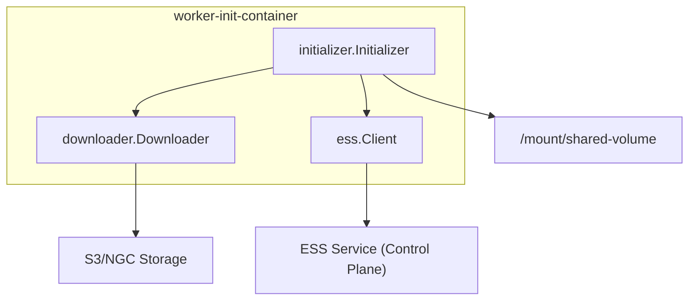
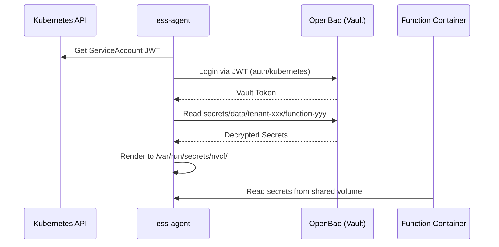

<!-- source: DeepWiki mcp.deepwiki.com · repo NVIDIA/nvcf · page 4.3 Worker Sidecars: Init, Utils, Task, and ESS Agent · fetched 2026-10-26 -->

# Worker Sidecars: Init, Utils, Task, and ESS Agent

Relevant source files

The following files were used as context for generating this wiki page:

- [.github/CODEOWNERS](.github/CODEOWNERS)
- [deploy/helm/admin-token-issuer-proxy/chart/Chart.yaml](deploy/helm/admin-token-issuer-proxy/chart/Chart.yaml)
- [deploy/helm/openbao/helm/Chart.yaml](deploy/helm/openbao/helm/Chart.yaml)
- [migrations/cassandra/Dockerfile](migrations/cassandra/Dockerfile)
- [src/compute-plane-services/ess-agent/BUILD.bazel](src/compute-plane-services/ess-agent/BUILD.bazel)
- [src/compute-plane-services/image-credential-helper/cmd/image-credential-helper/BUILD.bazel](src/compute-plane-services/image-credential-helper/cmd/image-credential-helper/BUILD.bazel)
- [src/compute-plane-services/image-credential-helper/cmd/image-credential-helper/image_entrypoint_mode_test.sh](src/compute-plane-services/image-credential-helper/cmd/image-credential-helper/image_entrypoint_mode_test.sh)
- [src/compute-plane-services/image-credential-helper/go.mod](src/compute-plane-services/image-credential-helper/go.mod)
- [src/compute-plane-services/nvcf-unbound/cmd/webhook/BUILD.bazel](src/compute-plane-services/nvcf-unbound/cmd/webhook/BUILD.bazel)
- [src/compute-plane-services/nvcf-unbound/cmd/webhook/image_entrypoint_mode_test.sh](src/compute-plane-services/nvcf-unbound/cmd/webhook/image_entrypoint_mode_test.sh)
- [src/compute-plane-services/nvsnap/README.md](src/compute-plane-services/nvsnap/README.md)
- [src/compute-plane-services/nvsnap/docs/BENCHMARK.md](src/compute-plane-services/nvsnap/docs/BENCHMARK.md)
- [src/compute-plane-services/worker-init/go.mod](src/compute-plane-services/worker-init/go.mod)
- [src/compute-plane-services/worker-init/go.sum](src/compute-plane-services/worker-init/go.sum)
- [src/compute-plane-services/worker-init/internal/downloader/downloader_chunk_test.go](src/compute-plane-services/worker-init/internal/downloader/downloader_chunk_test.go)
- [src/compute-plane-services/worker-init/internal/downloader/downloader_flow_test.go](src/compute-plane-services/worker-init/internal/downloader/downloader_flow_test.go)
- [src/compute-plane-services/worker-init/internal/downloader/downloader_test.go](src/compute-plane-services/worker-init/internal/downloader/downloader_test.go)
- [src/compute-plane-services/worker-init/internal/downloader/downloader_units_test.go](src/compute-plane-services/worker-init/internal/downloader/downloader_units_test.go)
- [src/compute-plane-services/worker-init/internal/metrics/metrics_test.go](src/compute-plane-services/worker-init/internal/metrics/metrics_test.go)
- [src/compute-plane-services/worker-init/internal/workerinit/initializer.go](src/compute-plane-services/worker-init/internal/workerinit/initializer.go)
- [src/compute-plane-services/worker-init/internal/workerinit/initializer_test.go](src/compute-plane-services/worker-init/internal/workerinit/initializer_test.go)
- [src/compute-plane-services/worker-init/internal/workerinit/nvcf_init_integration_test.go](src/compute-plane-services/worker-init/internal/workerinit/nvcf_init_integration_test.go)
- [src/compute-plane-services/worker-init/internal/workerinit/nvct_init_integration_test.go](src/compute-plane-services/worker-init/internal/workerinit/nvct_init_integration_test.go)
- [src/compute-plane-services/worker-init/pkg/ess/ess_test.go](src/compute-plane-services/worker-init/pkg/ess/ess_test.go)
- [src/compute-plane-services/worker-init/service/service_command_test.go](src/compute-plane-services/worker-init/service/service_command_test.go)
- [src/compute-plane-services/worker-init/service/service_test.go](src/compute-plane-services/worker-init/service/service_test.go)
- [src/compute-plane-services/worker-llm-credentials/go.mod](src/compute-plane-services/worker-llm-credentials/go.mod)
- [src/compute-plane-services/worker-llm-credentials/go.sum](src/compute-plane-services/worker-llm-credentials/go.sum)
- [src/compute-plane-services/worker-task/go.mod](src/compute-plane-services/worker-task/go.mod)
- [src/compute-plane-services/worker-task/go.sum](src/compute-plane-services/worker-task/go.sum)
- [src/compute-plane-services/worker-task/internal/secrets/secrets.go](src/compute-plane-services/worker-task/internal/secrets/secrets.go)
- [src/compute-plane-services/worker-task/internal/worker/worker.go](src/compute-plane-services/worker-task/internal/worker/worker.go)
- [src/compute-plane-services/worker-task/internal/worker/worker_newnvctworker_test.go](src/compute-plane-services/worker-task/internal/worker/worker_newnvctworker_test.go)
- [src/compute-plane-services/worker-utils/go.mod](src/compute-plane-services/worker-utils/go.mod)
- [src/compute-plane-services/worker-utils/go.sum](src/compute-plane-services/worker-utils/go.sum)
- [src/compute-plane-services/worker-utils/worker/BUILD.bazel](src/compute-plane-services/worker-utils/worker/BUILD.bazel)
- [src/compute-plane-services/worker-utils/worker/newworker_test.go](src/compute-plane-services/worker-utils/worker/newworker_test.go)
- [src/compute-plane-services/worker-utils/worker/worker.go](src/compute-plane-services/worker-utils/worker/worker.go)

This page documents the sidecar containers injected into NVCF function pods. These sidecars manage the lifecycle of a function execution environment, including resource downloading, secret management, messaging proxies, and asynchronous task processing.

## Overview of Sidecar Architecture

NVCF pods are composed of the primary function container and several supporting sidecars. These sidecars abstract infrastructure concerns (like NATS messaging or Vault secret retrieval) away from the user's function code.

| Container | Role | Key Responsibilities |
| :--- | :--- | :--- |
| `worker-init` | Initializer | Downloads models/assets, fetches ESS secrets, prepares filesystem. |
| `worker-utils` | NATS Proxy | Provides a local gRPC/HTTP interface to NATS JetStream for the function. |
| `worker-task` | Async Worker | Handles NVCT (Container Task) logic, pulling work from queues. |
| `ess-agent` | Secret Agent | Renders secrets from HashiCorp Vault/OpenBao into the pod. |
| `worker-llm-credentials` | LLM Auth | Manages credentials for LLM-specific routing and gateways. |

Sources: `[src/compute-plane-services/worker-init/go.mod:1-30]()`, `[src/compute-plane-services/worker-utils/go.mod:1-33]()`, `[src/compute-plane-services/worker-task/go.mod:1-24]()`.

---

## 1. Worker Initializer (worker-init)

The `worker-init` container is responsible for the "warm-up" phase of a function pod. It ensures that all required external resources are present before the main function container starts.

### Initializer Lifecycle and Data Flow

The `Initializer` struct in `internal/workerinit/initializer.go` coordinates the sequence of setup operations. It interacts with the `Downloader` to pull assets and the `ESS` client to retrieve encrypted secrets.

**Pod Initialization Sequence:**
1.  **Secret Retrieval:** Fetches tenant secrets from the Encrypted Secret Store (ESS).
2.  **Asset Manifest Parsing:** Reads the required models and files defined in the function deployment.
3.  **Parallel Download:** Uses the `downloader` package to pull assets from S3-compatible storage or NGC.
4.  **Signal Completion:** Once finished, it writes a signal (often a file or successful exit) to allow the main container to proceed.

### Key Components

*   **`Initializer`**: The main entry point that manages the execution flow `[src/compute-plane-services/worker-init/internal/workerinit/initializer.go:1-50]()`.
*   **`Downloader`**: Handles chunked, parallel downloads with retry logic `[src/compute-plane-services/worker-init/internal/downloader/downloader_test.go:1-30]()`.
*   **`ESS Client`**: Authenticates with the ESS service to decrypt function-scoped secrets `[src/compute-plane-services/worker-init/pkg/ess/ess_test.go:1-20]()`.

**Code Entity Mapping: Initializer Components**

Sources: `[src/compute-plane-services/worker-init/internal/workerinit/initializer.go:1-50]()`, `[src/compute-plane-services/worker-init/internal/downloader/downloader_test.go:1-30]()`.

---

## 2. Worker Utils (worker-utils)

The `worker-utils` sidecar acts as a networking and messaging bridge. Instead of the function container connecting directly to the NATS cluster, it communicates with `worker-utils` over localhost.

### NATS Proxying
The sidecar runs a local NATS proxy. This allows for:
*   **Authentication Offloading:** `worker-utils` handles the NATS JWT/NKey authentication.
*   **Protocol Translation:** Providing simplified HTTP or gRPC interfaces to the function for publishing results or heartbeats.
*   **Health Monitoring:** The `health-go` library is used to provide pod-level health checks `[src/compute-plane-services/worker-utils/go.mod:15-15]()`.

### Implementation
The core logic resides in the `worker` package, which initializes the connection to the NATS JetStream `[src/compute-plane-services/worker-utils/worker/worker.go:1-40]()`. It uses `ants` for goroutine pooling to handle high-concurrency messaging `[src/compute-plane-services/worker-utils/go.mod:19-19]()`.

Sources: `[src/compute-plane-services/worker-utils/go.mod:1-33]()`, `[src/compute-plane-services/worker-utils/worker/worker.go:1-40]()`.

---

## 3. Worker Task (worker-task)

The `worker-task` sidecar is specific to **NVCT (NVIDIA Container Tasks)**. While standard functions are request-response, tasks are long-running asynchronous workloads.

### Task Execution Flow
`worker-task` implements a pull-based worker pattern:
1.  **Queue Subscription:** It subscribes to a specific NATS JetStream subject assigned to the task.
2.  **Message Acknowledgment:** It manages JetStream `Ack` and `Nak` signals based on task success or failure.
3.  **Secret Injection:** It manages task-specific secrets during the execution phase `[src/compute-plane-services/worker-task/internal/secrets/secrets.go:1-20]()`.
4.  **Process Management:** It monitors the execution of the task binary and reports status back to the NVCF Control Plane.

### Code Structure
The `worker` internal package manages the subscription loop and task lifecycle `[src/compute-plane-services/worker-task/internal/worker/worker.go:1-50]()`. It utilizes `zap` for structured logging of task progress `[src/compute-plane-services/worker-task/go.mod:21-21]()`.

Sources: `[src/compute-plane-services/worker-task/internal/worker/worker.go:1-50]()`, `[src/compute-plane-services/worker-task/internal/secrets/secrets.go:1-20]()`.

---

## 4. ESS Agent and Secret Management

The `ess-agent` sidecar is responsible for integrating with the **Encrypted Secret Store (ESS)** and the underlying **OpenBao (Vault)** infrastructure.

### Secret Rendering
The agent uses a sidecar pattern to:
*   Authenticate using the Pod's Kubernetes Service Account (via JWT).
*   Retrieve secrets from Vault/OpenBao `[deploy/helm/openbao/helm/Chart.yaml:17-28]()`.
*   Render these secrets into a shared volume (typically `tmpfs`) accessible by the function container.

### Component Interaction Diagram

Sources: `[deploy/helm/openbao/helm/Chart.yaml:17-28]()`, `[deploy/helm/admin-token-issuer-proxy/chart/Chart.yaml:17-21]()`.

---

## 5. Image Credential Helper

While not a sidecar in every pod, the `image-credential-helper` is a critical compute-plane utility that allows the Kubelet to pull images from private registries (like NGC) without static credentials `[src/compute-plane-services/image-credential-helper/cmd/image-credential-helper/main.go:1-30]()`.

It translates NVCF-specific identity into registry-compatible credentials using the `icms-translate` library `[src/compute-plane-services/image-credential-helper/cmd/image-credential-helper/BUILD.bazel:26-27]()`.

Sources: `[src/compute-plane-services/image-credential-helper/cmd/image-credential-helper/main.go:1-30]()`, `[src/compute-plane-services/image-credential-helper/cmd/image-credential-helper/BUILD.bazel:1-65]()`.

---

