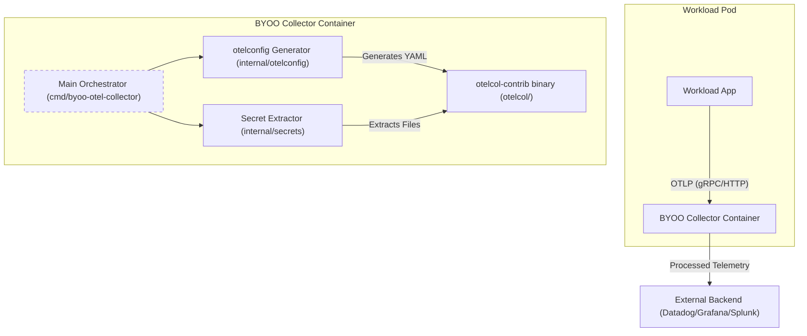
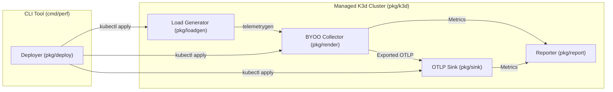

<!-- source: DeepWiki mcp.deepwiki.com · repo NVIDIA/nvcf · page 4.4 BYOO OpenTelemetry Collector · fetched 2026-10-26 -->

# BYOO OpenTelemetry Collector

<details>
<summary>Relevant source files</summary>

The following files were used as context for generating this wiki page:

- [.github/workflows/byoo-otel-collector.yml](.github/workflows/byoo-otel-collector.yml)
- [src/compute-plane-services/byoo-otel-collector/Dockerfile](src/compute-plane-services/byoo-otel-collector/Dockerfile)
- [src/compute-plane-services/byoo-otel-collector/Dockerfile.nvcf-otel-collector](src/compute-plane-services/byoo-otel-collector/Dockerfile.nvcf-otel-collector)
- [src/compute-plane-services/byoo-otel-collector/Makefile](src/compute-plane-services/byoo-otel-collector/Makefile)
- [src/compute-plane-services/byoo-otel-collector/README.md](src/compute-plane-services/byoo-otel-collector/README.md)
- [src/compute-plane-services/byoo-otel-collector/VERSION](src/compute-plane-services/byoo-otel-collector/VERSION)
- [src/compute-plane-services/byoo-otel-collector/examples/otelconfigs/k8s/config_function_container_metric_subset.yaml](src/compute-plane-services/byoo-otel-collector/examples/otelconfigs/k8s/config_function_container_metric_subset.yaml)
- [src/compute-plane-services/byoo-otel-collector/internal/otelconfig/embed_config.go](src/compute-plane-services/byoo-otel-collector/internal/otelconfig/embed_config.go)
- [src/compute-plane-services/byoo-otel-collector/internal/otelconfig/otelconfig.go](src/compute-plane-services/byoo-otel-collector/internal/otelconfig/otelconfig.go)
- [src/compute-plane-services/byoo-otel-collector/internal/otelconfig/otelconfig_test.go](src/compute-plane-services/byoo-otel-collector/internal/otelconfig/otelconfig_test.go)
- [src/compute-plane-services/byoo-otel-collector/internal/otelconfig/render.go](src/compute-plane-services/byoo-otel-collector/internal/otelconfig/render.go)
- [src/compute-plane-services/byoo-otel-collector/internal/otelconfig/render_test.go](src/compute-plane-services/byoo-otel-collector/internal/otelconfig/render_test.go)
- [src/compute-plane-services/byoo-otel-collector/otel-collector-build.yaml](src/compute-plane-services/byoo-otel-collector/otel-collector-build.yaml)
- [src/compute-plane-services/byoo-otel-collector/otelcol/BUILD.bazel](src/compute-plane-services/byoo-otel-collector/otelcol/BUILD.bazel)
- [src/compute-plane-services/byoo-otel-collector/otelcol/components.go](src/compute-plane-services/byoo-otel-collector/otelcol/components.go)
- [src/compute-plane-services/byoo-otel-collector/otelcol/go.mod](src/compute-plane-services/byoo-otel-collector/otelcol/go.mod)
- [src/compute-plane-services/byoo-otel-collector/otelcol/go.sum](src/compute-plane-services/byoo-otel-collector/otelcol/go.sum)
- [src/compute-plane-services/byoo-otel-collector/otelcol/main.go](src/compute-plane-services/byoo-otel-collector/otelcol/main.go)
- [src/compute-plane-services/byoo-otel-collector/otelcol/main_others.go](src/compute-plane-services/byoo-otel-collector/otelcol/main_others.go)
- [src/compute-plane-services/byoo-otel-collector/otelcol/main_windows.go](src/compute-plane-services/byoo-otel-collector/otelcol/main_windows.go)
- [src/compute-plane-services/byoo-otel-collector/perf/README.md](src/compute-plane-services/byoo-otel-collector/perf/README.md)
- [src/compute-plane-services/byoo-otel-collector/perf/cmd/perf/main.go](src/compute-plane-services/byoo-otel-collector/perf/cmd/perf/main.go)
- [src/compute-plane-services/byoo-otel-collector/perf/cmd/perf/main_test.go](src/compute-plane-services/byoo-otel-collector/perf/cmd/perf/main_test.go)
- [src/compute-plane-services/byoo-otel-collector/perf/go.mod](src/compute-plane-services/byoo-otel-collector/perf/go.mod)
- [src/compute-plane-services/byoo-otel-collector/perf/go.sum](src/compute-plane-services/byoo-otel-collector/perf/go.sum)
- [src/compute-plane-services/byoo-otel-collector/perf/pkg/deploy/deploy.go](src/compute-plane-services/byoo-otel-collector/perf/pkg/deploy/deploy.go)
- [src/compute-plane-services/byoo-otel-collector/perf/pkg/deploy/deploy_loadgen_test.go](src/compute-plane-services/byoo-otel-collector/perf/pkg/deploy/deploy_loadgen_test.go)
- [src/compute-plane-services/byoo-otel-collector/perf/pkg/deploy/deploy_test.go](src/compute-plane-services/byoo-otel-collector/perf/pkg/deploy/deploy_test.go)
- [src/compute-plane-services/byoo-otel-collector/perf/pkg/k3d/k3d.go](src/compute-plane-services/byoo-otel-collector/perf/pkg/k3d/k3d.go)
- [src/compute-plane-services/byoo-otel-collector/perf/pkg/k3d/k3d_test.go](src/compute-plane-services/byoo-otel-collector/perf/pkg/k3d/k3d_test.go)
- [src/compute-plane-services/byoo-otel-collector/perf/pkg/labels/labels.go](src/compute-plane-services/byoo-otel-collector/perf/pkg/labels/labels.go)
- [src/compute-plane-services/byoo-otel-collector/perf/pkg/loadgen/loadgen.go](src/compute-plane-services/byoo-otel-collector/perf/pkg/loadgen/loadgen.go)
- [src/compute-plane-services/byoo-otel-collector/perf/pkg/loadgen/loadgen_test.go](src/compute-plane-services/byoo-otel-collector/perf/pkg/loadgen/loadgen_test.go)
- [src/compute-plane-services/byoo-otel-collector/perf/pkg/profile/profile.go](src/compute-plane-services/byoo-otel-collector/perf/pkg/profile/profile.go)
- [src/compute-plane-services/byoo-otel-collector/perf/pkg/profile/profile_test.go](src/compute-plane-services/byoo-otel-collector/perf/pkg/profile/profile_test.go)
- [src/compute-plane-services/byoo-otel-collector/perf/pkg/render/render.go](src/compute-plane-services/byoo-otel-collector/perf/pkg/render/render.go)
- [src/compute-plane-services/byoo-otel-collector/perf/pkg/render/render_test.go](src/compute-plane-services/byoo-otel-collector/perf/pkg/render/render_test.go)
- [src/compute-plane-services/byoo-otel-collector/perf/pkg/report/prom.go](src/compute-plane-services/byoo-otel-collector/perf/pkg/report/prom.go)
- [src/compute-plane-services/byoo-otel-collector/perf/pkg/report/prom_test.go](src/compute-plane-services/byoo-otel-collector/perf/pkg/report/prom_test.go)
- [src/compute-plane-services/byoo-otel-collector/perf/pkg/sink/sink.go](src/compute-plane-services/byoo-otel-collector/perf/pkg/sink/sink.go)
- [src/compute-plane-services/byoo-otel-collector/scripts/regenerate-otelcol.sh](src/compute-plane-services/byoo-otel-collector/scripts/regenerate-otelcol.sh)

</details>


The Bring-Your-Own-OTel (BYOO) Collector is a specialized observability component designed to handle telemetry (logs, metrics, and traces) for NVCF workloads [src/compute-plane-services/byoo-otel-collector/README.md:88-91](). It orchestrates the generation of OpenTelemetry configurations, manages secrets from the Encrypted Secret Store (ESS), and executes a custom-built OpenTelemetry Collector binary [src/compute-plane-services/byoo-otel-collector/README.md:97-101]().

## System Architecture

The system is composed of two primary container images:
1.  **`byoo-otel-collector`**: The full orchestrator image containing the configuration generator, ESS secret extractor, and the collector binary [src/compute-plane-services/byoo-otel-collector/README.md:94-101]().
2.  **`nvcf-otel-collector`**: A lightweight image containing only the `otelcol` binary, used as a sidecar in NVCA pods for Kubernetes event collection [src/compute-plane-services/byoo-otel-collector/README.md:116-119]().

### Deployment Shapes
The collector is deployed in two distinct "shapes" depending on the workload type:
*   **Container Sidecar**: For container-based functions, the collector runs as a sidecar within the workload pod [src/compute-plane-services/byoo-otel-collector/perf/README.md:20-20]().
*   **Helm Utils Pod**: For Helm-based functions, the collector is deployed on a generated `utils` pod and is fronted by a `ClusterIP` OTLP Service [src/compute-plane-services/byoo-otel-collector/perf/README.md:21-22]().

### Data Flow and Code Entities

The following diagram illustrates how telemetry flows from a workload through the BYOO components to an external backend.

**Telemetry Processing Pipeline**

Sources: [src/compute-plane-services/byoo-otel-collector/README.md:94-105](), [src/compute-plane-services/byoo-otel-collector/internal/otelconfig/render.go:52-66]()

## OTelConfig Rendering Pipeline

The configuration for the collector is dynamically rendered based on the function's requirements and the target environment. The `internal/otelconfig` package handles this logic.

### Key Rendering Logic
*   **`RenderOtelConfig`**: The entry point that executes YAML templates and generates exporters and services [src/compute-plane-services/byoo-otel-collector/internal/otelconfig/render.go:123-138]().
*   **`initializeConfigMaps`**: Ensures that the `OpenTelemetryConfig` structure (Receivers, Exporters, Processors, Extensions) is correctly initialized [src/compute-plane-services/byoo-otel-collector/internal/otelconfig/render.go:89-112]().
*   **Log Chunking**: A custom `logchunk/byoo` processor can be inserted to split oversized log entries into correlated chunks [src/compute-plane-services/byoo-otel-collector/README.md:130-133](). This is configured via `BYOO_LOG_CHUNKING_ENABLED` [src/compute-plane-services/byoo-otel-collector/README.md:135-135]().
*   **Metric Subsetting**: Supports filtering specific metrics via the `filter/metric_subset` processor and exporting them to a dedicated Prometheus endpoint on port `19091` [src/compute-plane-services/byoo-otel-collector/internal/otelconfig/render.go:76-82]().

Sources: [src/compute-plane-services/byoo-otel-collector/internal/otelconfig/render.go:114-151](), [src/compute-plane-services/byoo-otel-collector/internal/otelconfig/render.go:179-188]()

## Performance Testing Framework (`perf` CLI)

The `perf` tool is a standalone Go module located in `src/compute-plane-services/byoo-otel-collector/perf/` [src/compute-plane-services/byoo-otel-collector/perf/README.md:49-50](). It provides a repeatable suite to exercise the collector under controlled OTLP load using production-authentic workload shapes.

### CLI Commands
| Command | Purpose |
| :--- | :--- |
| `render` | Translates a synthetic launch spec and validates the resulting manifest locally without a cluster [src/compute-plane-services/byoo-otel-collector/perf/cmd/perf/main.go:85-92](). |
| `run` | Provisions a cluster, deploys an OTLP sink, deploys the collector, and drives `telemetrygen` load [src/compute-plane-services/byoo-otel-collector/perf/cmd/perf/main.go:130-143](). |
| `cleanup` | Removes suite-created resources based on shared labels [src/compute-plane-services/byoo-otel-collector/perf/cmd/perf/main.go:19-21](). |

### Test Topology and Packages
The suite uses a specific topology involving a "Sink" (destination) and a "Load Generator" (source).

**Perf Test Deployment Topology**

Sources: [src/compute-plane-services/byoo-otel-collector/perf/README.md:28-47](), [src/compute-plane-services/byoo-otel-collector/perf/pkg/deploy/deploy.go:170-180]()

### Key Perf Packages
*   **`pkg/render`**: Uses the shared `icms-translate` library to produce the identical collector spec used in production [src/compute-plane-services/byoo-otel-collector/perf/README.md:32-32]().
*   **`pkg/sink`**: Deploys a stock `collector-contrib` that accepts OTLP, discards it, and exposes receiver counters for measurement [src/compute-plane-services/byoo-otel-collector/perf/pkg/sink/sink.go:18-23]().
*   **`pkg/deploy`**: Manages Kubernetes operations, including creating namespaces, applying manifests, and mounting "dummy" credentials into the collector's secret volume [src/compute-plane-services/byoo-otel-collector/perf/pkg/deploy/deploy.go:18-20](), [src/compute-plane-services/byoo-otel-collector/perf/pkg/deploy/deploy.go:157-162]().
*   **`pkg/report`**: Scrapes Prometheus metrics from the collector and sink to calculate throughput, drop rates, and resource utilization [src/compute-plane-services/byoo-otel-collector/perf/README.md:44-46]().

## Build and Development

### Bazel Build Pipeline
The collector uses a 100% Bazel-based build and image publish pipeline [src/compute-plane-services/byoo-otel-collector/README.md:5-10]().
*   **`otelcol-contrib-bin`**: Built via a `genrule` that invokes `go build` directly. This bypasses issues with `rules_go` when dealing with the collector's complex transitive dependency graph (>250 modules) [src/compute-plane-services/byoo-otel-collector/otelcol/BUILD.bazel:8-17]().
*   **Multi-arch Support**: The build produces OCI image indexes for both `amd64` and `arm64` [src/compute-plane-services/byoo-otel-collector/otelcol/BUILD.bazel:49-53]().

### Local Development
To run the performance suite locally, use `GOWORK=off` since it is a standalone module [src/compute-plane-services/byoo-otel-collector/perf/README.md:49-52]():
```bash
cd src/compute-plane-services/byoo-otel-collector/perf
GOWORK=off go run ./cmd/perf render --shape both
```

Sources: [src/compute-plane-services/byoo-otel-collector/README.md:12-25](), [src/compute-plane-services/byoo-otel-collector/perf/README.md:53-56]()

---

