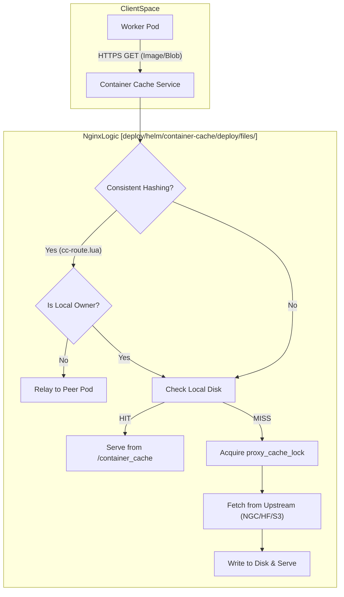

<!-- source: DeepWiki mcp.deepwiki.com · repo NVIDIA/nvcf · page 4.5 Container Cache, Image Credential Helper, and NvSnap · fetched 2026-10-26 -->

# Container Cache, Image Credential Helper, and NvSnap

Relevant source files

The following files were used as context for generating this wiki page:

- [.github/CODEOWNERS](.github/CODEOWNERS)
- [deploy/helm/admin-token-issuer-proxy/chart/Chart.yaml](deploy/helm/admin-token-issuer-proxy/chart/Chart.yaml)
- [deploy/helm/container-cache/deploy/Chart.yaml](deploy/helm/container-cache/deploy/Chart.yaml)
- [deploy/helm/container-cache/deploy/files/container-cache.conf](deploy/helm/container-cache/deploy/files/container-cache.conf)
- [deploy/helm/container-cache/deploy/files/default.conf](deploy/helm/container-cache/deploy/files/default.conf)
- [deploy/helm/container-cache/deploy/files/hf.conf](deploy/helm/container-cache/deploy/files/hf.conf)
- [deploy/helm/container-cache/deploy/files/lua/cc-route.lua](deploy/helm/container-cache/deploy/files/lua/cc-route.lua)
- [deploy/helm/container-cache/deploy/files/ngc.conf](deploy/helm/container-cache/deploy/files/ngc.conf)
- [deploy/helm/container-cache/deploy/files/nginx.conf](deploy/helm/container-cache/deploy/files/nginx.conf)
- [deploy/helm/container-cache/deploy/files/proxy-cache.conf](deploy/helm/container-cache/deploy/files/proxy-cache.conf)
- [deploy/helm/container-cache/deploy/files/proxy-common.conf](deploy/helm/container-cache/deploy/files/proxy-common.conf)
- [deploy/helm/container-cache/deploy/files/proxy-nucleus-cache.conf](deploy/helm/container-cache/deploy/files/proxy-nucleus-cache.conf)
- [deploy/helm/container-cache/deploy/templates/configmap.yaml](deploy/helm/container-cache/deploy/templates/configmap.yaml)
- [deploy/helm/container-cache/deploy/templates/daemonset.yaml](deploy/helm/container-cache/deploy/templates/daemonset.yaml)
- [deploy/helm/container-cache/deploy/templates/service-peer.yaml](deploy/helm/container-cache/deploy/templates/service-peer.yaml)
- [deploy/helm/container-cache/deploy/templates/statefulset.yaml](deploy/helm/container-cache/deploy/templates/statefulset.yaml)
- [deploy/helm/container-cache/deploy/values.yaml](deploy/helm/container-cache/deploy/values.yaml)
- [deploy/helm/container-cache/tests/render-consistent-hash-test.sh](deploy/helm/container-cache/tests/render-consistent-hash-test.sh)
- [deploy/helm/nvca-operator/nvca-operator/templates/chart-defaults-nvcfbackend-cm.yaml](deploy/helm/nvca-operator/nvca-operator/templates/chart-defaults-nvcfbackend-cm.yaml)
- [deploy/helm/nvcf-unbound/values.yaml](deploy/helm/nvcf-unbound/values.yaml)
- [deploy/helm/openbao/helm/Chart.yaml](deploy/helm/openbao/helm/Chart.yaml)
- [migrations/cassandra/Dockerfile](migrations/cassandra/Dockerfile)
- [src/compute-plane-services/byoo-otel-collector/BUILD.bazel](src/compute-plane-services/byoo-otel-collector/BUILD.bazel)
- [src/compute-plane-services/ess-agent/BUILD.bazel](src/compute-plane-services/ess-agent/BUILD.bazel)
- [src/compute-plane-services/image-credential-helper/cmd/image-credential-helper/BUILD.bazel](src/compute-plane-services/image-credential-helper/cmd/image-credential-helper/BUILD.bazel)
- [src/compute-plane-services/image-credential-helper/cmd/image-credential-helper/image_entrypoint_mode_test.sh](src/compute-plane-services/image-credential-helper/cmd/image-credential-helper/image_entrypoint_mode_test.sh)
- [src/compute-plane-services/image-credential-helper/go.mod](src/compute-plane-services/image-credential-helper/go.mod)
- [src/compute-plane-services/nvca/pkg/nvca/agent_manager.go](src/compute-plane-services/nvca/pkg/nvca/agent_manager.go)
- [src/compute-plane-services/nvca/pkg/storage/controller_modelcache.go](src/compute-plane-services/nvca/pkg/storage/controller_modelcache.go)
- [src/compute-plane-services/nvca/pkg/storage/controller_modelcache_test.go](src/compute-plane-services/nvca/pkg/storage/controller_modelcache_test.go)
- [src/compute-plane-services/nvca/pkg/storage/modelcache.go](src/compute-plane-services/nvca/pkg/storage/modelcache.go)
- [src/compute-plane-services/nvca/pkg/storage/modelcache_test.go](src/compute-plane-services/nvca/pkg/storage/modelcache_test.go)
- [src/compute-plane-services/nvca/pkg/storage/reconcile.go](src/compute-plane-services/nvca/pkg/storage/reconcile.go)
- [src/compute-plane-services/nvca/pkg/storage/reconcile_test.go](src/compute-plane-services/nvca/pkg/storage/reconcile_test.go)
- [src/compute-plane-services/nvca/pkg/storage/types.go](src/compute-plane-services/nvca/pkg/storage/types.go)
- [src/compute-plane-services/nvcf-unbound/cmd/webhook/BUILD.bazel](src/compute-plane-services/nvcf-unbound/cmd/webhook/BUILD.bazel)
- [src/compute-plane-services/nvcf-unbound/cmd/webhook/image_entrypoint_mode_test.sh](src/compute-plane-services/nvcf-unbound/cmd/webhook/image_entrypoint_mode_test.sh)
- [src/compute-plane-services/nvsnap/internal/agent/agent.go](src/compute-plane-services/nvsnap/internal/agent/agent.go)
- [src/compute-plane-services/nvsnap/internal/agent/cascade_fetch.go](src/compute-plane-services/nvsnap/internal/agent/cascade_fetch.go)
- [src/compute-plane-services/nvsnap/internal/agent/pathsafe.go](src/compute-plane-services/nvsnap/internal/agent/pathsafe.go)
- [src/compute-plane-services/nvsnap/internal/agent/pathsafe_test.go](src/compute-plane-services/nvsnap/internal/agent/pathsafe_test.go)
- [src/compute-plane-services/nvsnap/internal/agent/range_fetch.go](src/compute-plane-services/nvsnap/internal/agent/range_fetch.go)
- [src/compute-plane-services/nvsnap/internal/agent/restore.go](src/compute-plane-services/nvsnap/internal/agent/restore.go)

This page documents the specialized components of the NVCF Compute Plane responsible for optimizing workload startup times and securing access to private container registries. These components include an Nginx-based OCI proxy (Container Cache), a Kubernetes credential provider for registry authentication (Image Credential Helper), and GPU-aware checkpoint/restore capabilities (NvSnap).

## Container Cache

The Container Cache is an Nginx-based OCI proxy and content cache designed to accelerate the pulling of large container images and model weights (NGC, HuggingFace, S3) [deploy/helm/container-cache/deploy/Chart.yaml:16-17](). It operates as a Man-in-the-Middle (MITM) proxy that caches content-addressed blobs to reduce upstream bandwidth and latency.

### Architecture and Consistent Hashing

The cache can be deployed as a StatefulSet to support **Consistent-Hash Routing**. When enabled, each pod computes the "owner" pod for a specific request using `md5(routing key) mod replicaCount` [deploy/helm/container-cache/deploy/values.yaml:156-160]().

*   **Relay Mechanism**: If a pod receives a request it does not "own," it relays the request to the owner pod via a peer service [deploy/helm/container-cache/deploy/values.yaml:160-162]().
*   **Deduplication**: This ensures each blob is cached on exactly one pod (R=1), maximizing the effective storage capacity of the cache tier [deploy/helm/container-cache/deploy/values.yaml:159-160]().
*   **Routing Keys**: Routing is performed on specific keys, such as `$request_method|$uri|$arg_versionId|$http_range` for NGC downloads [deploy/helm/container-cache/deploy/files/ngc.conf:70-72]().

### Configuration and Optimization

The cache includes specialized configurations for different content providers:

| Provider | Config File | Key Features |
| :--- | :--- | :--- |
| **NGC** | `ngc.conf` | Caches content-addressed immutable blobs; optimized for large Range requests (up to 512MiB) [deploy/helm/container-cache/deploy/files/ngc.conf:25-64](). |
| **HuggingFace** | `hf.conf` | Handles 302/307 redirects for presigned URLs; isolates cache by `Authorization` header hash; bypasses Xet CAS streaming [deploy/helm/container-cache/deploy/files/hf.conf:88-158](). |
| **S3** | `proxy-cache.conf` | Supports S3 signature verification by forwarding `If-Match` headers; uses `slice` module for range optimization [deploy/helm/container-cache/deploy/files/proxy-cache.conf:22-66](). |
| **Generic OCI** | `container-cache.conf` | Proxies registry traffic (e.g., `docker.io` to `registry-1.docker.io`); validates client rights before serving cached blobs [deploy/helm/container-cache/deploy/files/container-cache.conf:72-151](). |

### Cache Management Logic

The system uses Nginx `proxy_cache_lock` to prevent "thundering herd" issues where multiple concurrent requests for the same cold object trigger multiple upstream fetches [deploy/helm/container-cache/deploy/files/proxy-common.conf:126-134]().

**Data Flow: Cache Request Handling**

**Sources:** [deploy/helm/container-cache/deploy/values.yaml:156-170](), [deploy/helm/container-cache/deploy/files/proxy-common.conf:126-136](), [deploy/helm/container-cache/deploy/files/ngc.conf:66-73](), [deploy/helm/container-cache/deploy/files/hf.conf:88-110]().

---

## Image Credential Helper

The `image-credential-helper` is a Go-based utility that provides registry credentials to the Kubelet using the Kubernetes `CredentialProviderRequest` API [src/compute-plane-services/image-credential-helper/cmd/image-credential-helper/main.go]().

### Implementation Details
*   **Functionality**: It resolves credentials for private registries by interacting with the NVCF Control Plane or local secrets [src/compute-plane-services/image-credential-helper/cmd/image-credential-helper/BUILD.bazel:20-36]().
*   **Security**: Built as a distroless OCI image to minimize attack surface [src/compute-plane-services/image-credential-helper/cmd/image-credential-helper/BUILD.bazel:58-65]().
*   **Libraries**: Utilizes `pkg/imagecredential` and `pkg/icms-translate` from the shared Go library to handle manifest translation and credential formatting [src/compute-plane-services/image-credential-helper/cmd/image-credential-helper/BUILD.bazel:25-27]().

**Sources:** [src/compute-plane-services/image-credential-helper/cmd/image-credential-helper/BUILD.bazel:20-65]().

---

## NvSnap (GPU Checkpoint/Restore)

NvSnap provides mechanisms for checkpointing and restoring GPU-accelerated containers to enable "warm starts" for large models. This is critical for scale-to-zero workloads where cold-start latency (loading weights into GPU memory) is a bottleneck.

### Core Components
*   **Agent**: The `NvSnap Agent` manages the lifecycle of checkpoint/restore operations on the compute node [src/compute-plane-services/nvsnap/internal/agent/agent.go]().
*   **CRIU Integration**: Uses CRIU (Checkpoint/Restore In Userspace) alongside NVIDIA-specific `cuda-checkpoint` tools to capture the state of GPU memory and process registers.
*   **Data Transfer**:
    *   **Range Fetch**: Optimizes the restoration process by fetching specific byte ranges of checkpoint files [src/compute-plane-services/nvsnap/internal/agent/range_fetch.go]().
    *   **Cascade Fetch**: Supports multi-node or distributed fetching strategies to accelerate data movement [src/compute-plane-services/nvsnap/internal/agent/cascade_fetch.go]().

### Restoration Flow
The restoration process involves identifying the correct checkpoint blob, ensuring path safety [src/compute-plane-services/nvsnap/internal/agent/pathsafe.go](), and invoking the restore logic to rehydrate the container and GPU context [src/compute-plane-services/nvsnap/internal/agent/restore.go]().

**Entity Mapping: NvSnap Operations**

| Code Entity | Responsibility |
| :--- | :--- |
| `internal/agent/agent.go` | Main entry point for the snap agent service. |
| `internal/agent/restore.go` | Orchestrates the CRIU/CUDA restore sequence. |
| `internal/agent/range_fetch.go` | Implements `RangeFetch` for partial checkpoint retrieval. |
| `internal/agent/pathsafe.go` | Validates file paths to prevent directory traversal during restore. |

**Sources:** [src/compute-plane-services/nvsnap/internal/agent/agent.go](), [src/compute-plane-services/nvsnap/internal/agent/restore.go](), [src/compute-plane-services/nvsnap/internal/agent/range_fetch.go](), [src/compute-plane-services/nvsnap/internal/agent/pathsafe.go]().

---

