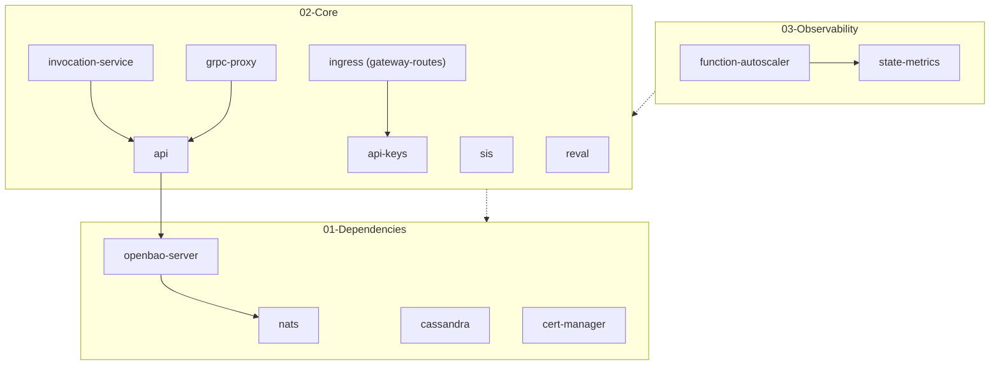
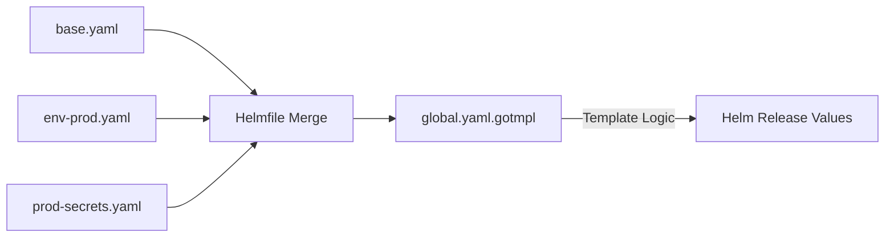

<!-- source: DeepWiki mcp.deepwiki.com · repo NVIDIA/nvcf · page 5.1 Self-Managed Stack Helmfile Deployment · fetched 2026-10-26 -->

# Self-Managed Stack Helmfile Deployment

Relevant source files

The following files were used as context for generating this wiki page:

- [ci/test/check-pr-issue.test.sh](ci/test/check-pr-issue.test.sh)
- [deploy/helm/admin-token-issuer-proxy/chart/values.yaml](deploy/helm/admin-token-issuer-proxy/chart/values.yaml)
- [deploy/helm/api-keys-colocated/api-keys/values.yaml](deploy/helm/api-keys-colocated/api-keys/values.yaml)
- [deploy/helm/cassandra/helm/values.yaml](deploy/helm/cassandra/helm/values.yaml)
- [deploy/helm/gateway-routes/README.md](deploy/helm/gateway-routes/README.md)
- [deploy/helm/gateway-routes/chart/templates/_helpers.tpl](deploy/helm/gateway-routes/chart/templates/_helpers.tpl)
- [deploy/helm/gateway-routes/chart/templates/grpcroute-nvcf-api.yaml](deploy/helm/gateway-routes/chart/templates/grpcroute-nvcf-api.yaml)
- [deploy/helm/gateway-routes/chart/templates/grpcroute-nvct-api.yaml](deploy/helm/gateway-routes/chart/templates/grpcroute-nvct-api.yaml)
- [deploy/helm/gateway-routes/chart/templates/httproute-nvcf-ui.yaml](deploy/helm/gateway-routes/chart/templates/httproute-nvcf-ui.yaml)
- [deploy/helm/gateway-routes/chart/templates/referencegrant-nvcf-ui.yaml](deploy/helm/gateway-routes/chart/templates/referencegrant-nvcf-ui.yaml)
- [deploy/helm/gateway-routes/chart/templates/referencegrant-nvcf.yaml](deploy/helm/gateway-routes/chart/templates/referencegrant-nvcf.yaml)
- [deploy/helm/gateway-routes/chart/templates/tcproute-grpc-worker.yaml](deploy/helm/gateway-routes/chart/templates/tcproute-grpc-worker.yaml)
- [deploy/helm/gateway-routes/chart/values.yaml](deploy/helm/gateway-routes/chart/values.yaml)
- [deploy/helm/grpc-proxy/README.md](deploy/helm/grpc-proxy/README.md)
- [deploy/helm/grpc-proxy/grpc-proxy/Chart.yaml](deploy/helm/grpc-proxy/grpc-proxy/Chart.yaml)
- [deploy/helm/grpc-proxy/grpc-proxy/templates/daemonset.yaml](deploy/helm/grpc-proxy/grpc-proxy/templates/daemonset.yaml)
- [deploy/helm/grpc-proxy/grpc-proxy/templates/deployment.yaml](deploy/helm/grpc-proxy/grpc-proxy/templates/deployment.yaml)
- [deploy/helm/grpc-proxy/grpc-proxy/values.yaml](deploy/helm/grpc-proxy/grpc-proxy/values.yaml)
- [deploy/helm/helm-reval/values.yaml](deploy/helm/helm-reval/values.yaml)
- [deploy/helm/llm-request-router/llm-request-router/Chart.yaml](deploy/helm/llm-request-router/llm-request-router/Chart.yaml)
- [deploy/helm/llm-request-router/llm-request-router/values.yaml](deploy/helm/llm-request-router/llm-request-router/values.yaml)
- [deploy/helm/nats-auth-callout/values.yaml](deploy/helm/nats-auth-callout/values.yaml)
- [deploy/helm/nats/values.yaml](deploy/helm/nats/values.yaml)
- [deploy/helm/openbao/helm/values.yaml](deploy/helm/openbao/helm/values.yaml)
- [deploy/stacks/self-managed/Makefile](deploy/stacks/self-managed/Makefile)
- [deploy/stacks/self-managed/Makefile.dist](deploy/stacks/self-managed/Makefile.dist)
- [deploy/stacks/self-managed/environments/base.yaml](deploy/stacks/self-managed/environments/base.yaml)
- [deploy/stacks/self-managed/global.yaml.gotmpl](deploy/stacks/self-managed/global.yaml.gotmpl)
- [deploy/stacks/self-managed/helmfile-docker.mk](deploy/stacks/self-managed/helmfile-docker.mk)
- [deploy/stacks/self-managed/helmfile.d/01-dependencies.yaml.gotmpl](deploy/stacks/self-managed/helmfile.d/01-dependencies.yaml.gotmpl)
- [deploy/stacks/self-managed/helmfile.d/02-core.yaml.gotmpl](deploy/stacks/self-managed/helmfile.d/02-core.yaml.gotmpl)
- [deploy/stacks/self-managed/helmfile.d/03-observability.yaml.gotmpl](deploy/stacks/self-managed/helmfile.d/03-observability.yaml.gotmpl)
- [deploy/stacks/self-managed/secrets/secrets.yaml.template](deploy/stacks/self-managed/secrets/secrets.yaml.template)
- [deploy/stacks/self-managed/tests/llm-router-worker-address.sh](deploy/stacks/self-managed/tests/llm-router-worker-address.sh)
- [docs/user/control-plane-installation.md](docs/user/control-plane-installation.md)
- [docs/user/csp-end-to-end-example-installation.md](docs/user/csp-end-to-end-example-installation.md)
- [docs/user/gateway-routing.md](docs/user/gateway-routing.md)
- [docs/user/grpc-invocation-enablement.md](docs/user/grpc-invocation-enablement.md)
- [docs/user/helmfile-installation.md](docs/user/helmfile-installation.md)
- [docs/user/installation.md](docs/user/installation.md)
- [docs/user/quickstart.md](docs/user/quickstart.md)
- [migrations/cassandra/keyspaces/nvcf_api/06_add_per_user_rate.up.sql](migrations/cassandra/keyspaces/nvcf_api/06_add_per_user_rate.up.sql)
- [src/invocation-plane-services/grpc-proxy/proxy/hijack_test.go](src/invocation-plane-services/grpc-proxy/proxy/hijack_test.go)
- [tests/bdd/features/single-cluster-up-oneclick.feature](tests/bdd/features/single-cluster-up-oneclick.feature)

The self-managed stack (located in `deploy/stacks/self-managed/`) provides a declarative, Helmfile-based orchestration layer for deploying the NVCF Control Plane. It manages the lifecycle of core services, infrastructure dependencies (Cassandra, NATS, OpenBao), and observability components across three distinct deployment layers.

## Deployment Architecture and Layers

The deployment is partitioned into three sequential layers to ensure that infrastructure is ready before services attempt to connect.

| Layer | File | Purpose | Key Components |
| :--- | :--- | :--- | :--- |
| **01-Dependencies** | `01-dependencies.yaml.gotmpl` | Bootstraps the persistent and security backbone. | NATS, OpenBao, Cassandra, Cert-Manager |
| **02-Core** | `02-core.yaml.gotmpl` | Deploys NVCF functional services. | NVCF API, SIS, API Keys, Invocation Service, gRPC Proxy, ReVal |
| **03-Observability** | `03-observability.yaml.gotmpl` | Installs monitoring and scaling logic. | State Metrics, Function Autoscaler |

### Layered Deployment Order
The following diagram illustrates the dependency flow between the Helmfile layers and specific releases.

**Deployment Dependency Graph**

**Sources:** [deploy/stacks/self-managed/helmfile.d/01-dependencies.yaml.gotmpl:44-72](), [deploy/stacks/self-managed/helmfile.d/02-core.yaml.gotmpl:43-228](), [deploy/stacks/self-managed/helmfile.d/03-observability.yaml.gotmpl:57-78]()

## Configuration Inheritance Model

The stack uses a hierarchical value merging strategy. This allows a single `base.yaml` to define platform-wide defaults while environment-specific files (e.g., `prod.yaml`) override specific endpoints or resource limits.

1.  **`environments/base.yaml`**: Contains global defaults like domain, storage sizes, and node selector structures [deploy/stacks/self-managed/environments/base.yaml:4-187]().
2.  **`environments/{{HELMFILE_ENV}}.yaml`**: Environment-specific overrides (e.g., `k3d`, `prod`, `staging`) [deploy/stacks/self-managed/helmfile.d/02-core.yaml.gotmpl:5-5]().
3.  **`global.yaml.gotmpl`**: A template that dynamically constructs complex values (like image registry paths and node selectors) by reading from the environment values [deploy/stacks/self-managed/global.yaml.gotmpl:1-124]().
4.  **`secrets/{{HELMFILE_ENV}}-secrets.yaml`**: Encrypted or sensitive values like registry credentials and database passwords [deploy/stacks/self-managed/helmfile.d/02-core.yaml.gotmpl:39-39]().

### Configuration Flow

**Sources:** [deploy/stacks/self-managed/helmfile.d/02-core.yaml.gotmpl:1-5](), [deploy/stacks/self-managed/global.yaml.gotmpl:51-71]()

## Node Selectors and Tolerations

The stack provides a unified mechanism to pin NVCF components to specific node pools using `nodeSelectors` and `tolerations`. This is configured in `base.yaml` and processed via templates in `global.yaml.gotmpl`.

*   **Logic**: If `global.nodeSelectors.enabled` is true, the template checks for a specific type (e.g., `cassandra`). If no specific selector exists, it falls back to the `all` selector [deploy/stacks/self-managed/global.yaml.gotmpl:1-11]().
*   **Categories**:
    *   `vault`: Applied to OpenBao pods [deploy/stacks/self-managed/environments/base.yaml:86-88]().
    *   `cassandra`: Applied to Cassandra pods [deploy/stacks/self-managed/environments/base.yaml:89-91]().
    *   `controlplane`: Applied to all NVCF microservices [deploy/stacks/self-managed/environments/base.yaml:92-94]().

**Sources:** [deploy/stacks/self-managed/global.yaml.gotmpl:1-25](), [deploy/stacks/self-managed/environments/base.yaml:73-124]()

## Gateway API Ingress Setup

The stack utilizes the **Kubernetes Gateway API** for all ingress traffic. The `nvcf-gateway-routes` chart (deployed as `ingress` in `02-core.yaml.gotmpl`) creates the necessary `HTTPRoute`, `TCPRoute`, and `GRPCRoute` objects [deploy/stacks/self-managed/helmfile.d/02-core.yaml.gotmpl:213-228]().

### Route Mapping

| Service | Route Type | Hostname Pattern | Port |
| :--- | :--- | :--- | :--- |
| **NVCF API** | HTTPRoute | `api.{{domain}}` | 8080 |
| **Invocation** | HTTPRoute | `*.invocation.{{domain}}` | 8080 |
| **gRPC Proxy** | TCPRoute | N/A (Port-based) | 10081 |
| **SIS** | HTTPRoute | `sis.{{domain}}` | 8080 |

### Ingress Implementation Detail
The deployment expects a `Gateway` resource (e.g., managed by Envoy Gateway) to already exist in the cluster [docs/user/gateway-routing.md:121-163](). The Helmfile then attaches routes to specific listeners defined on that Gateway:
*   `shared`: For standard L7 HTTP traffic [deploy/helm/gateway-routes/chart/values.yaml:29-35]().
*   `grpc`: For L4 gRPC proxy traffic [deploy/helm/gateway-routes/chart/values.yaml:37-43]().

**Sources:** [deploy/helm/gateway-routes/chart/values.yaml:19-231](), [docs/user/gateway-routing.md:5-16]()

## Operational Management

Deployment is typically managed via `Makefile.dist` which wraps `helmfile` commands to ensure environment variables are correctly set.

### Key Makefile Targets
*   **`make template`**: Renders the Kubernetes manifests locally for inspection without applying them.
*   **`make diff`**: Runs `helmfile diff` to show pending changes against the live cluster.
*   **`make apply`**: Executes the sequential deployment of all three layers [docs/user/helmfile-installation.md:72-78]().

### Namespace Isolation
Services are strictly partitioned into namespaces. Changing these is not supported as OpenBao auth policies and internal DNS names are hardcoded to this layout [docs/user/helmfile-installation.md:34-58]().

| Namespace | Components |
| :--- | :--- |
| `nvcf` | api, invocation, grpc-proxy, reval |
| `vault-system` | openbao-server |
| `cassandra-system` | cassandra |
| `nats-system` | nats |

**Sources:** [deploy/stacks/self-managed/helmfile.d/02-core.yaml.gotmpl:46-205](), [docs/user/helmfile-installation.md:41-51]()

---

