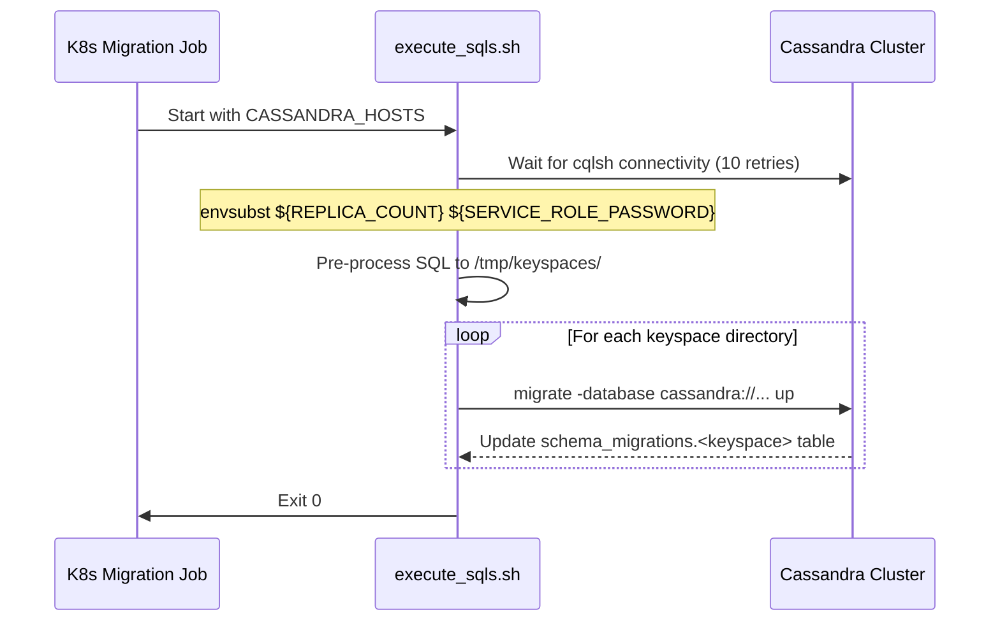
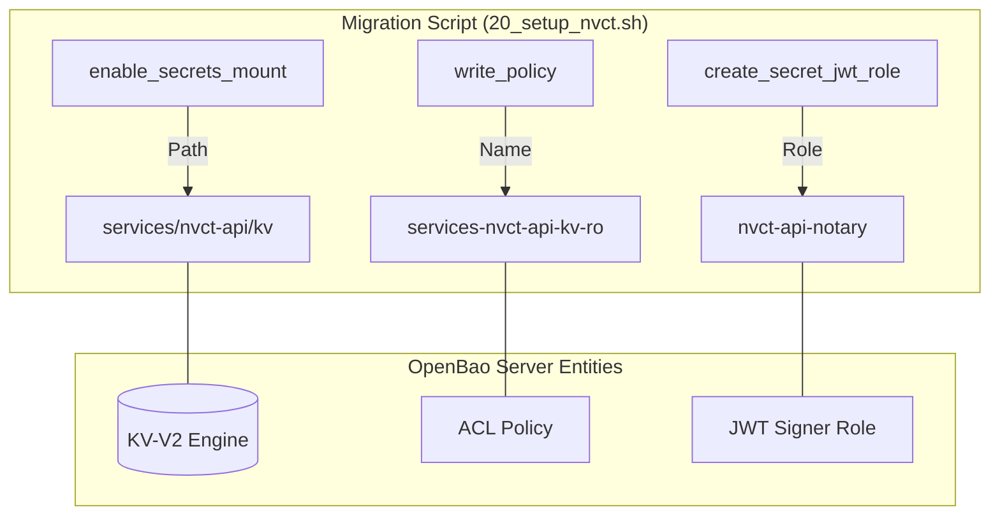

<!-- source: DeepWiki mcp.deepwiki.com · repo NVIDIA/nvcf · page 5.3 Database Migrations: Cassandra and OpenBao · fetched 2026-10-26 -->

# Database Migrations: Cassandra and OpenBao

Relevant source files

The following files were used as context for generating this wiki page:

- [migrations/cassandra/README.md](migrations/cassandra/README.md)
- [migrations/cassandra/execute_sqls.sh](migrations/cassandra/execute_sqls.sh)
- [migrations/cassandra/keyspaces/README.md](migrations/cassandra/keyspaces/README.md)
- [migrations/cassandra/keyspaces/api_keys_api/01_init_keyspace.up.sql](migrations/cassandra/keyspaces/api_keys_api/01_init_keyspace.up.sql)
- [migrations/cassandra/keyspaces/ess_api/01_init_keyspace.up.sql](migrations/cassandra/keyspaces/ess_api/01_init_keyspace.up.sql)
- [migrations/cassandra/keyspaces/event_ledger/01_init_keyspace.up.sql](migrations/cassandra/keyspaces/event_ledger/01_init_keyspace.up.sql)
- [migrations/cassandra/keyspaces/event_ledger/02_init_roles.up.sql](migrations/cassandra/keyspaces/event_ledger/02_init_roles.up.sql)
- [migrations/cassandra/keyspaces/event_ledger/03_init_tables.up.sql](migrations/cassandra/keyspaces/event_ledger/03_init_tables.up.sql)
- [migrations/cassandra/keyspaces/nvcf_api/01_init_keyspace.up.sql](migrations/cassandra/keyspaces/nvcf_api/01_init_keyspace.up.sql)
- [migrations/cassandra/keyspaces/nvcf_api/03_init_tables.up.sql](migrations/cassandra/keyspaces/nvcf_api/03_init_tables.up.sql)
- [migrations/cassandra/keyspaces/nvcf_api/07_drop_gpu_spec.up.sql](migrations/cassandra/keyspaces/nvcf_api/07_drop_gpu_spec.up.sql)
- [migrations/cassandra/keyspaces/nvcf_api/08_add_llm_config.up.sql](migrations/cassandra/keyspaces/nvcf_api/08_add_llm_config.up.sql)
- [migrations/cassandra/keyspaces/sis_api/01_init_keyspace.up.sql](migrations/cassandra/keyspaces/sis_api/01_init_keyspace.up.sql)
- [migrations/cassandra/keyspaces/sis_api/03_init_tables.up.sql](migrations/cassandra/keyspaces/sis_api/03_init_tables.up.sql)
- [migrations/cassandra/keyspaces/sis_api/06_add_cluster_auth_client_id.up.sql](migrations/cassandra/keyspaces/sis_api/06_add_cluster_auth_client_id.up.sql)
- [migrations/cassandra/keyspaces/sis_api/07_add_deployment_and_gpu_spec_id.up.sql](migrations/cassandra/keyspaces/sis_api/07_add_deployment_and_gpu_spec_id.up.sql)
- [migrations/cassandra/keyspaces/sis_api/08_add_indexes_for_deployment_and_gpu_spec_id.up.sql](migrations/cassandra/keyspaces/sis_api/08_add_indexes_for_deployment_and_gpu_spec_id.up.sql)
- [migrations/cassandra/keyspaces/sis_api/09_add_reservation_backup_disabled.up.sql](migrations/cassandra/keyspaces/sis_api/09_add_reservation_backup_disabled.up.sql)
- [migrations/openbao/Dockerfile](migrations/openbao/Dockerfile)
- [migrations/openbao/README.md](migrations/openbao/README.md)
- [migrations/openbao/addons/nvcf-ui/README.md](migrations/openbao/addons/nvcf-ui/README.md)
- [migrations/openbao/addons/nvcf-ui/setup_nvcf-ui.sh](migrations/openbao/addons/nvcf-ui/setup_nvcf-ui.sh)
- [migrations/openbao/entrypoint.sh](migrations/openbao/entrypoint.sh)
- [migrations/openbao/job.yaml](migrations/openbao/job.yaml)
- [migrations/openbao/migrations/07_setup_api-keys.sh](migrations/openbao/migrations/07_setup_api-keys.sh)
- [migrations/openbao/migrations/09_setup_nvcf-api.sh](migrations/openbao/migrations/09_setup_nvcf-api.sh)
- [migrations/openbao/migrations/14_setup_nvca.sh](migrations/openbao/migrations/14_setup_nvca.sh)
- [migrations/openbao/migrations/15_setup_nvca-operator.sh](migrations/openbao/migrations/15_setup_nvca-operator.sh)
- [migrations/openbao/migrations/20_setup_nvct.sh](migrations/openbao/migrations/20_setup_nvct.sh)
- [migrations/openbao/migrations/22_setup_event-ledger.sh](migrations/openbao/migrations/22_setup_event-ledger.sh)
- [migrations/openbao/migrations/utils/functions.sh](migrations/openbao/migrations/utils/functions.sh)
- [migrations/openbao/migrations/utils/issuer_discovery.sh](migrations/openbao/migrations/utils/issuer_discovery.sh)
- [src/control-plane-services/instance-cluster-management/icms-core/src/main/java/com/nvidia/icms/inbound/rest/controllers/InstanceController.java](src/control-plane-services/instance-cluster-management/icms-core/src/main/java/com/nvidia/icms/inbound/rest/controllers/InstanceController.java)
- [src/control-plane-services/instance-cluster-management/icms-core/src/main/java/com/nvidia/icms/inbound/rest/model/cluster/GpuReservation.java](src/control-plane-services/instance-cluster-management/icms-core/src/main/java/com/nvidia/icms/inbound/rest/model/cluster/GpuReservation.java)
- [src/control-plane-services/instance-cluster-management/icms-core/src/main/java/com/nvidia/icms/outbound/cassandra/reservation/entity/ReservationEntity.java](src/control-plane-services/instance-cluster-management/icms-core/src/main/java/com/nvidia/icms/outbound/cassandra/reservation/entity/ReservationEntity.java)
- [src/control-plane-services/instance-cluster-management/icms-core/src/main/java/com/nvidia/icms/service/DescribeAndCancelInstanceService.java](src/control-plane-services/instance-cluster-management/icms-core/src/main/java/com/nvidia/icms/service/DescribeAndCancelInstanceService.java)
- [src/control-plane-services/instance-cluster-management/icms-core/src/main/java/com/nvidia/icms/service/internal/ReservationCapacityValidationHelper.java](src/control-plane-services/instance-cluster-management/icms-core/src/main/java/com/nvidia/icms/service/internal/ReservationCapacityValidationHelper.java)
- [src/control-plane-services/instance-cluster-management/icms-core/src/test/java/com/nvidia/icms/inbound/rest/controllers/InstanceControllerTest.java](src/control-plane-services/instance-cluster-management/icms-core/src/test/java/com/nvidia/icms/inbound/rest/controllers/InstanceControllerTest.java)
- [src/control-plane-services/instance-cluster-management/icms-core/src/test/java/com/nvidia/icms/integration/IcmsTest.java](src/control-plane-services/instance-cluster-management/icms-core/src/test/java/com/nvidia/icms/integration/IcmsTest.java)
- [src/control-plane-services/instance-cluster-management/icms-core/src/test/java/com/nvidia/icms/outbound/cassandra/reservation/entity/ReservationEntityTest.java](src/control-plane-services/instance-cluster-management/icms-core/src/test/java/com/nvidia/icms/outbound/cassandra/reservation/entity/ReservationEntityTest.java)
- [src/control-plane-services/instance-cluster-management/icms-core/src/test/java/com/nvidia/icms/outbound/nats/NatsStreamManagerTest.java](src/control-plane-services/instance-cluster-management/icms-core/src/test/java/com/nvidia/icms/outbound/nats/NatsStreamManagerTest.java)

This page documents the automated migration systems for NVCF's primary state stores: Cassandra (distributed database) and OpenBao (secret management). Both systems utilize containerized migration jobs that run as part of the deployment lifecycle to ensure schema consistency and service onboarding.

## Cassandra Migrations

NVCF uses a containerized migration tool to bootstrap and evolve Cassandra schemas across multiple keyspaces. The system relies on the `golang-migrate` driver and follows a "clean-slate" model for fresh installations while supporting incremental deltas for upgrades.

### Architecture and Implementation

The migration container is built on a `cassandra:5.0.8` base and utilizes the `golang-migrate` CLI to apply DDL scripts located in `migrations/cassandra/keyspaces/` [migrations/cassandra/README.md:9-12]().

**Key Components:**
*   **Entrypoint (`execute_sqls.sh`):** Orchestrates the migration by pre-processing SQL files with `envsubst` to inject environment-specific values like `${SERVICE_ROLE_PASSWORD}` and `${REPLICA_COUNT}` [migrations/cassandra/execute_sqls.sh:51-72]().
*   **Keyspace Structure:** Each service has a dedicated directory containing its schema evolution. The standard sequence for a new keyspace includes `01_init_keyspace.up.sql`, `02_init_roles.up.sql`, and `03_init_tables.up.sql` [migrations/cassandra/keyspaces/README.md:41-45]().
*   **Clean-Slate Model:** `03_init_tables.up.sql` is maintained as the canonical, full schema for a service at a specific version. This avoids replaying hundreds of historical `ALTER TABLE` statements on new clusters [migrations/cassandra/keyspaces/README.md:52-57]().

### Data Flow: Cassandra Migration Execution

The following diagram illustrates how the `execute_sqls.sh` script processes migrations.

**Cassandra Migration Sequence**

Sources: [migrations/cassandra/execute_sqls.sh:31-95](), [migrations/cassandra/README.md:67-72]()

### Recovery from Dirty Migrations
If a migration fails, `golang-migrate` marks the keyspace as "dirty" in the `schema_migrations` table [migrations/cassandra/README.md:74-80](). 
1.  **Diagnose:** Check `SELECT version, dirty FROM schema_migrations.<service>` [migrations/cassandra/README.md:84-91]().
2.  **Reconcile:** Manually fix the schema to match either the failed version `<N>` or the previous version `<N-1>` [migrations/cassandra/README.md:93-99]().
3.  **Force:** Use the `migrate force <version>` command to clear the dirty flag before re-running the job [migrations/cassandra/README.md:101-111]().

### Keyspace Inventory
| Keyspace | Service | Primary Tables |
| :--- | :--- | :--- |
| `nvcf_api` | `nvcf-service` | `functions_v3`, `functions_deployment_v2`, `accounts` [migrations/cassandra/keyspaces/nvcf_api/03_init_tables.up.sql:48-102]() |
| `sis_api` | `icms` | `reservations`, `clusters` [migrations/cassandra/keyspaces/sis_api/09_add_reservation_backup_disabled.up.sql:8-8]() |
| `ess_api` | `ess-service` | Secret metadata and tenant scopes |
| `api_keys_api` | `api-keys-service` | API key lifecycle and validation |

Sources: [migrations/cassandra/keyspaces/README.md:22-30]()

---

## OpenBao Migrations

The OpenBao migration job configures the secret management plane, including auth methods, secret engines, and per-service policies.

### Implementation Details
The migration image (`migrations/openbao/Dockerfile`) bundles the `bao` (OpenBao) CLI, `kubectl`, and a custom utility called `jwker` for converting Kubernetes JWKS to PEM format [migrations/openbao/Dockerfile:37-49]().

**Onboarding Logic:**
1.  **JWT Auth Configuration:** The `01_setup_jwt_auth.sh` script (implied) uses `configure_auth_jwt` to bind OpenBao to the Kubernetes cluster's OIDC issuer [migrations/openbao/migrations/utils/functions.sh:71-123]().
2.  **Service Onboarding:** Each service has a numbered script (e.g., `20_setup_nvct.sh`) that calls helpers to mount KV-v2 engines and define ACL policies [migrations/openbao/migrations/20_setup_nvct.sh:45-57]().
3.  **Cross-Service Access:** Scripts configure JWT secret roles that allow one service (e.g., `nvct-api`) to request signed tokens from another service's issuer (e.g., `nvcf-api`) [migrations/openbao/migrations/20_setup_nvct.sh:75-80]().

### Code Entity Mapping: OpenBao Setup

The following diagram maps the shell script logic to the resulting OpenBao configuration entities.

**OpenBao Configuration Mapping**

Sources: [migrations/openbao/migrations/20_setup_nvct.sh:45-80](), [migrations/openbao/migrations/utils/functions.sh:131-149]()

### Service Setup Example: NVCT
The `20_setup_nvct.sh` script demonstrates the standard onboarding pattern:
*   **KV Mount:** Creates `services/nvct-api/kv` [migrations/openbao/migrations/20_setup_nvct.sh:45]().
*   **Seed Data:** Populates `cassandra/creds` using the `DEFAULT_CASSANDRA_PASSWORD` environment variable [migrations/openbao/migrations/20_setup_nvct.sh:50]().
*   **Permissions:** Generates an ACL policy for `read,list` on the service's KV path [migrations/openbao/migrations/20_setup_nvct.sh:56-57]().
*   **Inter-Service Auth:** Configures roles in the `nvcf-api` JWT engine to allow `nvct-api` to perform `notary-sign` operations [migrations/openbao/migrations/20_setup_nvct.sh:75-80]().

Sources: [migrations/openbao/migrations/20_setup_nvct.sh:29-80]()

---

