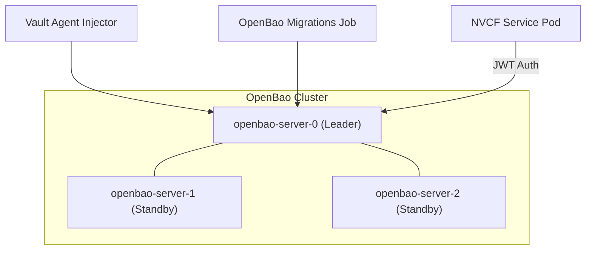
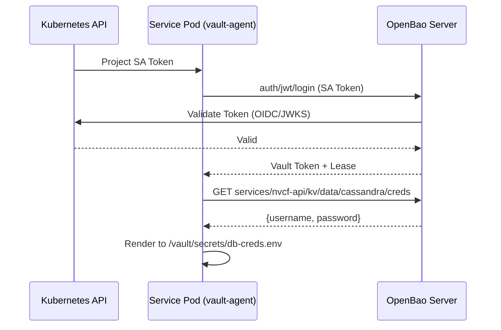

<!-- source: DeepWiki mcp.deepwiki.com · repo NVIDIA/nvcf · page 5.4 OpenBao (Vault) and Secret Management · fetched 2026-10-26 -->

# OpenBao (Vault) and Secret Management

Relevant source files

The following files were used as context for generating this wiki page:

- [deploy/helm/admin-token-issuer-proxy/chart/values.yaml](deploy/helm/admin-token-issuer-proxy/chart/values.yaml)
- [deploy/helm/api-keys-colocated/api-keys/values.yaml](deploy/helm/api-keys-colocated/api-keys/values.yaml)
- [deploy/helm/cassandra/helm/values.yaml](deploy/helm/cassandra/helm/values.yaml)
- [deploy/helm/grpc-proxy/README.md](deploy/helm/grpc-proxy/README.md)
- [deploy/helm/grpc-proxy/grpc-proxy/Chart.yaml](deploy/helm/grpc-proxy/grpc-proxy/Chart.yaml)
- [deploy/helm/grpc-proxy/grpc-proxy/templates/daemonset.yaml](deploy/helm/grpc-proxy/grpc-proxy/templates/daemonset.yaml)
- [deploy/helm/grpc-proxy/grpc-proxy/templates/deployment.yaml](deploy/helm/grpc-proxy/grpc-proxy/templates/deployment.yaml)
- [deploy/helm/grpc-proxy/grpc-proxy/values.yaml](deploy/helm/grpc-proxy/grpc-proxy/values.yaml)
- [deploy/helm/helm-reval/values.yaml](deploy/helm/helm-reval/values.yaml)
- [deploy/helm/llm-request-router/llm-request-router/Chart.yaml](deploy/helm/llm-request-router/llm-request-router/Chart.yaml)
- [deploy/helm/llm-request-router/llm-request-router/values.yaml](deploy/helm/llm-request-router/llm-request-router/values.yaml)
- [deploy/helm/nats-auth-callout/values.yaml](deploy/helm/nats-auth-callout/values.yaml)
- [deploy/helm/nats/values.yaml](deploy/helm/nats/values.yaml)
- [deploy/helm/openbao/helm/values.yaml](deploy/helm/openbao/helm/values.yaml)
- [deploy/stacks/self-managed/Makefile.dist](deploy/stacks/self-managed/Makefile.dist)
- [deploy/stacks/self-managed/environments/base.yaml](deploy/stacks/self-managed/environments/base.yaml)
- [deploy/stacks/self-managed/global.yaml.gotmpl](deploy/stacks/self-managed/global.yaml.gotmpl)
- [deploy/stacks/self-managed/helmfile-docker.mk](deploy/stacks/self-managed/helmfile-docker.mk)
- [deploy/stacks/self-managed/helmfile.d/01-dependencies.yaml.gotmpl](deploy/stacks/self-managed/helmfile.d/01-dependencies.yaml.gotmpl)
- [deploy/stacks/self-managed/helmfile.d/02-core.yaml.gotmpl](deploy/stacks/self-managed/helmfile.d/02-core.yaml.gotmpl)
- [deploy/stacks/self-managed/helmfile.d/03-observability.yaml.gotmpl](deploy/stacks/self-managed/helmfile.d/03-observability.yaml.gotmpl)
- [deploy/stacks/self-managed/secrets/secrets.yaml.template](deploy/stacks/self-managed/secrets/secrets.yaml.template)
- [migrations/cassandra/keyspaces/nvcf_api/06_add_per_user_rate.up.sql](migrations/cassandra/keyspaces/nvcf_api/06_add_per_user_rate.up.sql)
- [migrations/openbao/Dockerfile](migrations/openbao/Dockerfile)
- [migrations/openbao/README.md](migrations/openbao/README.md)
- [migrations/openbao/addons/nvcf-ui/README.md](migrations/openbao/addons/nvcf-ui/README.md)
- [migrations/openbao/addons/nvcf-ui/setup_nvcf-ui.sh](migrations/openbao/addons/nvcf-ui/setup_nvcf-ui.sh)
- [migrations/openbao/entrypoint.sh](migrations/openbao/entrypoint.sh)
- [migrations/openbao/job.yaml](migrations/openbao/job.yaml)
- [migrations/openbao/migrations/09_setup_nvcf-api.sh](migrations/openbao/migrations/09_setup_nvcf-api.sh)
- [migrations/openbao/migrations/14_setup_nvca.sh](migrations/openbao/migrations/14_setup_nvca.sh)
- [migrations/openbao/migrations/15_setup_nvca-operator.sh](migrations/openbao/migrations/15_setup_nvca-operator.sh)
- [migrations/openbao/migrations/20_setup_nvct.sh](migrations/openbao/migrations/20_setup_nvct.sh)
- [migrations/openbao/migrations/utils/functions.sh](migrations/openbao/migrations/utils/functions.sh)
- [migrations/openbao/migrations/utils/issuer_discovery.sh](migrations/openbao/migrations/utils/issuer_discovery.sh)
- [src/invocation-plane-services/grpc-proxy/proxy/hijack_test.go](src/invocation-plane-services/grpc-proxy/proxy/hijack_test.go)

This page documents the secret management architecture of NVIDIA Cloud Functions (NVCF), centered around **OpenBao** (an open-source fork of HashiCorp Vault). It covers the automated migration pipeline, the custom JWT-based authentication mechanism, and the delivery of secrets to services via sidecars.

## Overview

NVCF utilizes OpenBao as its central secrets engine. The system is designed to be self-bootstrapping: upon deployment, a migration job configures OpenBao with the necessary secret engines (KV-V2), authentication methods (JWT/OIDC), and granular ACL policies for every service in the control and compute planes.

### Key Components

*   **OpenBao Server**: Deployed as a High Availability (HA) Raft cluster [deploy/helm/openbao/helm/values.yaml:83-119]().
*   **OpenBao Migrations**: A Kubernetes Job that executes a sequence of shell scripts to initialize engines, policies, and service roles [migrations/openbao/README.md:1-23]().
*   **Vault Agent Injector**: A sidecar injector that renders secrets into service pods using `vault-agent` [deploy/stacks/self-managed/global.yaml.gotmpl:125-138]().
*   **JWT Secrets Plugin**: A mechanism allowing services to authenticate to OpenBao using their Kubernetes ServiceAccount tokens [migrations/openbao/migrations/utils/functions.sh:71-123]().

---

## OpenBao Deployment and Image

The OpenBao stack is deployed via the `01-dependencies` Helmfile [deploy/stacks/self-managed/helmfile.d/01-dependencies.yaml.gotmpl:59-66]().

### Image Build
The `infra/openbao` image is built using a multi-stage `Dockerfile` that incorporates security-hardened tools:
*   **jwker**: Converts Kubernetes JWKS material to PEM format for OpenBao configuration [migrations/openbao/Dockerfile:3-25]().
*   **kubectl**: Used by migrations to interact with the cluster API [migrations/openbao/Dockerfile:27-35]().
*   **Base**: Uses `openbao/openbao:2.5.5` [migrations/openbao/Dockerfile:37]().

### HA Configuration
The server runs in HA mode with Raft storage. Standby reads are explicitly disabled to ensure consistency for the JWT secrets plugin lease state [deploy/helm/openbao/helm/values.yaml:115-118]().

*Sources: [deploy/helm/openbao/helm/values.yaml:83-119](), [deploy/stacks/self-managed/global.yaml.gotmpl:125-138]()*

---

## OpenBao Migrations Pipeline

The `openbao-migrations` job applies numbered shell scripts in order to the OpenBao leader. These scripts reside in `migrations/openbao/migrations/`.

### Migration Sequence
1.  **Core Setup**: Enables the `jwt` auth mount and configures it with the cluster's OIDC issuer [migrations/openbao/migrations/utils/functions.sh:71-123]().
2.  **Service Onboarding**: Each service (e.g., `nvcf-api`, `nvct-api`, `sis-api`) has a dedicated script that:
    *   Enables a KV-V2 engine at `services/<service-name>/kv` [migrations/openbao/migrations/20_setup_nvct.sh:45]().
    *   Populates initial secrets (e.g., Cassandra credentials) [migrations/openbao/migrations/20_setup_nvct.sh:50]().
    *   Creates ACL policies for read/write access [migrations/openbao/migrations/20_setup_nvct.sh:56-57]().
    *   Binds these policies to a JWT role matching the service's Kubernetes ServiceAccount [migrations/openbao/migrations/20_setup_nvct.sh:79-80]().

### Helper Functions
The `migrations/openbao/migrations/utils/functions.sh` script provides the abstraction layer for these operations:
*   `enable_secrets_mount`: Checks if an engine exists before enabling [migrations/openbao/migrations/utils/functions.sh:131-149]().
*   `write_secrets_kv`: Writes data to KV-V2 engines [migrations/openbao/migrations/utils/functions.sh:220-234]().
*   `generate_jwt_secret_role`: Constructs the JSON payload for binding Kubernetes identities to OpenBao roles [migrations/openbao/migrations/utils/functions.sh:317-347]().

*Sources: [migrations/openbao/README.md:82-91](), [migrations/openbao/migrations/20_setup_nvct.sh:1-110]()*

---

## Secret Flow to Services

NVCF services do not interact with the OpenBao API directly for standard secrets. Instead, they use `vault-agent` sidecars.

### Authentication Flow
1.  **Pod Startup**: The pod is injected with a `vault-agent` sidecar.
2.  **JWT Login**: The agent reads the projected ServiceAccount token from `/var/run/secrets/kubernetes.io/serviceaccount/token`.
3.  **OpenBao Exchange**: The agent performs a login against `auth/jwt/login` using the token.
4.  **Token Management**: OpenBao validates the token against the configured JWKS/PEM and returns a Vault token with policies defined during migrations.

### Secret Rendering
The `vault-agent` uses templates to render secrets into a shared memory volume (typically `/vault/secrets/`). For example, `nvct-api` accesses its Cassandra credentials via the path `services/nvct-api/kv/cassandra/creds` [migrations/openbao/migrations/20_setup_nvct.sh:50]().

*Sources: [migrations/openbao/README.md:92-95](), [migrations/openbao/migrations/utils/functions.sh:71-123](), [deploy/stacks/self-managed/global.yaml.gotmpl:125-138]()*

---

## Specialized Engines

### PKI Engine for Stargate
OpenBao acts as a Certificate Authority (CA) for internal TLS. This is critical for **Stargate** (LLM Router) which uses QUIC for low-latency transport. The migrations configure the PKI engine to issue short-lived certificates to Stargate instances, ensuring secure cluster-to-cluster communication.

### ESS Integration
The **Encrypted Secret Store (ESS)** manages tenant-scoped secrets. While OpenBao stores infrastructure secrets, ESS provides the API for users to upload secrets used by their functions. The `ess-api` service itself retrieves its master encryption keys and database credentials from OpenBao [deploy/stacks/self-managed/helmfile.d/02-core.yaml.gotmpl:101-106]().

### API Key Management
The `api-keys` service relies on OpenBao to store the HMAC keys and JWKS material used to sign and validate NVCF API keys [migrations/openbao/migrations/20_setup_nvct.sh:37-40]().

---

## Configuration Summary

| Feature | Code Entity / Path | Role |
| :--- | :--- | :--- |
| **HA Storage** | `storage "raft"` | Distributed state for OpenBao [deploy/helm/openbao/helm/values.yaml:90-101]() |
| **Auth Method** | `auth/jwt` | Kubernetes-native authentication [migrations/openbao/migrations/utils/functions.sh:71]() |
| **Migration Job** | `openbao-migrations` | Orchestrates OpenBao state initialization [deploy/stacks/self-managed/global.yaml.gotmpl:106-123]() |
| **Sidecar Injector** | `vault-agent-injector` | Injects secret-rendering sidecars [deploy/stacks/self-managed/global.yaml.gotmpl:125-131]() |
| **Credential Seed** | `DEFAULT_CASSANDRA_PASSWORD` | Seed for DB credentials in migrations [deploy/stacks/self-managed/secrets/secrets.yaml.template:29-30]() |

*Sources: [deploy/stacks/self-managed/global.yaml.gotmpl:100-138](), [deploy/helm/openbao/helm/values.yaml:1-180](), [migrations/openbao/migrations/20_setup_nvct.sh:1-160]()*

---

