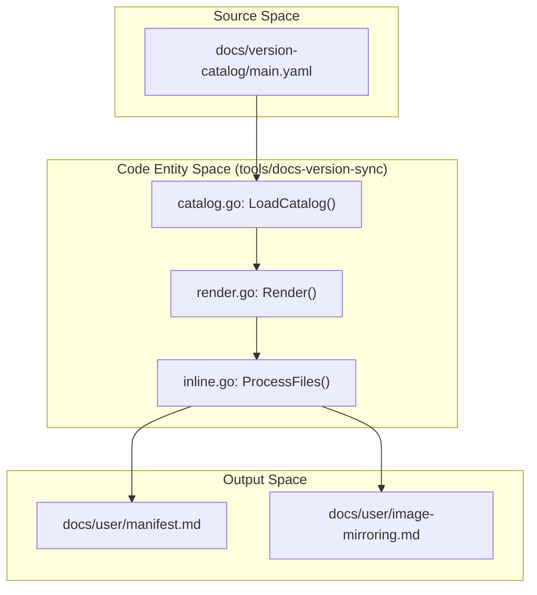
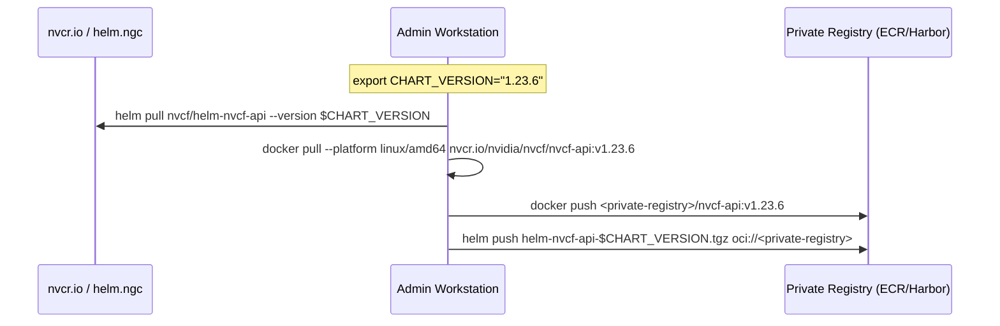

<!-- source: DeepWiki mcp.deepwiki.com · repo NVIDIA/nvcf · page 5.5 Artifact Manifest and Version Catalog · fetched 2026-10-26 -->

# Artifact Manifest and Version Catalog

<details>
<summary>Relevant source files</summary>

The following files were used as context for generating this wiki page:

- [deploy/helm/nvca-operator/nvca-operator/Chart.yaml](deploy/helm/nvca-operator/nvca-operator/Chart.yaml)
- [deploy/helm/nvca-operator/nvca-operator/templates/cluster-validator-network-checks-cm.yaml](deploy/helm/nvca-operator/nvca-operator/templates/cluster-validator-network-checks-cm.yaml)
- [deploy/helm/nvca-operator/nvca-operator/templates/cronjob.yaml](deploy/helm/nvca-operator/nvca-operator/templates/cronjob.yaml)
- [deploy/helm/nvca-operator/nvca-operator/templates/rbac.yaml](deploy/helm/nvca-operator/nvca-operator/templates/rbac.yaml)
- [docs/user/cluster-management/nsight-profiling.md](docs/user/cluster-management/nsight-profiling.md)
- [docs/user/cluster-management/self-managed.md](docs/user/cluster-management/self-managed.md)
- [docs/user/image-mirroring.md](docs/user/image-mirroring.md)
- [docs/user/manifest.md](docs/user/manifest.md)
- [docs/v0.6.0/cluster-management/configuration.md](docs/v0.6.0/cluster-management/configuration.md)
- [docs/v0.6.0/csp-end-to-end-example-installation.md](docs/v0.6.0/csp-end-to-end-example-installation.md)
- [docs/v0.6.0/gateway-routing.md](docs/v0.6.0/gateway-routing.md)
- [docs/v0.6.0/helmfile-installation.md](docs/v0.6.0/helmfile-installation.md)
- [docs/v0.6.0/image-mirroring.md](docs/v0.6.0/image-mirroring.md)
- [docs/v0.6.0/images/nvcf-http-invocation-path.svg](docs/v0.6.0/images/nvcf-http-invocation-path.svg)
- [docs/v0.6.0/images/nvcf-llm-invocation-path.svg](docs/v0.6.0/images/nvcf-llm-invocation-path.svg)
- [docs/v0.6.0/installation.md](docs/v0.6.0/installation.md)
- [docs/v0.6.0/manifest.md](docs/v0.6.0/manifest.md)
- [docs/v0.6.0/optional-enhancements.md](docs/v0.6.0/optional-enhancements.md)
- [docs/v0.6.1/cluster-management/configuration.md](docs/v0.6.1/cluster-management/configuration.md)
- [docs/v0.6.1/manifest.md](docs/v0.6.1/manifest.md)
- [docs/v0.6.1/optional-enhancements.md](docs/v0.6.1/optional-enhancements.md)
- [docs/version-catalog/main.yaml](docs/version-catalog/main.yaml)
- [tools/docs-version-sync/catalog.go](tools/docs-version-sync/catalog.go)
- [tools/docs-version-sync/inline.go](tools/docs-version-sync/inline.go)
- [tools/docs-version-sync/main_test.go](tools/docs-version-sync/main_test.go)
- [tools/docs-version-sync/render.go](tools/docs-version-sync/render.go)

</details>


The Artifact Manifest and Version Catalog serve as the single source of truth for all software components required to deploy and operate NVIDIA Cloud Functions (NVCF). This system ensures that all services, Helm charts, and supporting utilities are pinned to QA-qualified versions, enabling reproducible deployments across different environments.

## Version Catalog Overview

The version catalog is defined in a centralized YAML file that tracks every artifact produced by the NVCF build system or consumed from upstream sources.

### Catalog Structure
The primary catalog file, `docs/version-catalog/main.yaml`, contains the following top-level sections:
*   **`registries`**: Defines the source OCI registries and Helm repositories (e.g., `nvcr.io`, `docker.io`, `https://helm.ngc.nvidia.com`) [docs/version-catalog/main.yaml:6-28]().
*   **`publications`**: Maps specific artifact names to their versions and the registry they inhabit [docs/version-catalog/main.yaml:29-252]().
*   **`manifest`**: Organizes artifacts into deployment planes (Control, Compute, Shared) and provides descriptions for documentation rendering [docs/version-catalog/main.yaml:257-280]().
*   **`stack`**: Defines metadata for the umbrella release bundles like `nvcf-self-managed-stack` [docs/version-catalog/main.yaml:281-286]().

### Data Flow: Catalog to Documentation
The following diagram illustrates how the `docs-version-sync` tool transforms the raw catalog into user-facing documentation.

**Catalog Synchronization Pipeline**

**Sources:** [tools/docs-version-sync/catalog.go:166-184](), [tools/docs-version-sync/render.go:28-48](), [docs/user/manifest.md:107-107]()

---

## Documentation Synchronization Tool (`docs-version-sync`)

The `docs-version-sync` utility is a Go-based tool responsible for maintaining consistency between the version catalog and the Markdown documentation.

### Key Implementation Details
*   **Catalog Loading**: The `LoadCatalog` function in `catalog.go` uses `yaml.v3` to decode the catalog and validates it against supported versions [tools/docs-version-sync/catalog.go:166-184]().
*   **Rendering Logic**: `render.go` contains specialized renderers like `renderManifestArtifactRegistryPaths`, which generates the Markdown tables seen in the user documentation [tools/docs-version-sync/render.go:33-34]().
*   **In-place Updates**: The tool searches for specific markers in `.md` files, such as `{/* docs-version-sync:BEGIN ... */}`, and replaces the content between the markers with the newly rendered tables [docs/user/manifest.md:107-107]().

### Artifact Types
The system categorizes artifacts into three types [tools/docs-version-sync/catalog.go:41-47]():
1.  **`image`**: Container images for services (e.g., `nvcf-api`, `nvca`).
2.  **`chart`**: Helm charts (OCI or HTTP format).
3.  **`resource`**: Compressed bundles for CLI binaries or Helmfile stacks.

**Sources:** [tools/docs-version-sync/catalog.go:41-65](), [tools/docs-version-sync/render.go:28-48]()

---

## Release Artifact Manifest

The manifest defines the "Umbrella Release"—a set of artifact versions that have been QA-qualified to work together.

### Deployment Planes
Artifacts are grouped into planes to help operators understand where components reside [tools/docs-version-sync/catalog.go:53-56]():
*   **Control Plane**: Core services like `nvcf-api`, `sis`, and `api-keys` [docs/user/manifest.md:109-130]().
*   **Compute Plane**: Components running on GPU clusters, including `nvca` and the `nvca-operator` [docs/user/manifest.md:131-140]().
*   **Shared/Infrastructure**: Supporting components like `nats`, `cassandra`, and `cert-manager` [docs/user/manifest.md:116-123]().

### Manifest Entry Structure
Each entry in the manifest contains metadata used for both deployment and documentation:
| Field | Purpose |
| :--- | :--- |
| `artifact_id` | Unique identifier for the artifact |
| `plane` | `control`, `compute`, or `shared` |
| `kind` | `chart`, `service-image`, or `resource` |
| `requirement` | `required` or `optional` |
| `description` | Human-readable explanation of the component's role |

**Sources:** [tools/docs-version-sync/catalog.go:71-82](), [docs/version-catalog/main.yaml:257-280]()

---

## Image Mirroring and Registry Management

For self-hosted and air-gapped environments, artifacts must be mirrored from NVIDIA's public registries (`nvcr.io` and `https://helm.ngc.nvidia.com`) to a private registry (e.g., ECR, Harbor).

### Mirroring Workflow
The documentation provides specific commands for pulling and pushing artifacts to ensure compatibility.

**Artifact Mirroring Sequence**

**Sources:** [docs/user/manifest.md:30-43](), [docs/user/image-mirroring.md:91-103]()

### Registry Configuration
Operators configure the target registry in the Helmfile `global.yaml.gotmpl` or environment files:
```yaml
global:
  helm:
    sources:
      registry: "<registry-host>"
      repository: "<repository>"
  image:
    registry: "<image-registry>"
```
**Sources:** [docs/user/manifest.md:50-56](), [docs/user/cluster-management/self-managed.md:100-110]()

### Multi-Architecture Support
When mirroring images, operators must specify the target platform (typically `linux/amd64` for EKS/GKE clusters) to avoid `exec format error` at runtime [docs/user/image-mirroring.md:72-87]().

---

## Artifact Inventory (Reference)

The following table summarizes the primary artifacts managed by the version catalog for a standard deployment.

| Artifact | Type | Plane | Description |
| :--- | :--- | :--- | :--- |
| `helm-nvcf-api` | Chart | Control | Core NVCF API Service [docs/user/manifest.md:114-114]() |
| `nvcf-api` | Image | Control | Backend for Cloud Functions Service [docs/version-catalog/main.yaml:96-96]() |
| `helm-nvca-operator` | Chart | Compute | GPU Cluster Agent Operator [docs/user/manifest.md:131-131]() |
| `nvca` | Image | Compute | NVIDIA Cluster Agent [docs/version-catalog/main.yaml:66-66]() |
| `helm-nvcf-nats` | Chart | Shared | Messaging backbone [docs/user/manifest.md:123-123]() |
| `nvcf-cli` | Resource | N/A | Management CLI tool [tools/docs-version-sync/catalog.go:38-38]() |

**Sources:** [docs/user/manifest.md:109-140](), [docs/version-catalog/main.yaml:29-252]()

---

