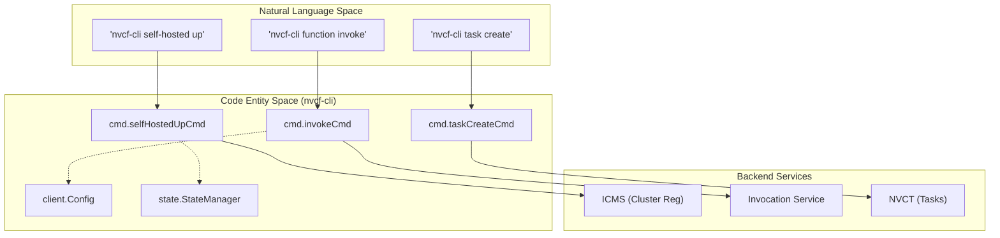
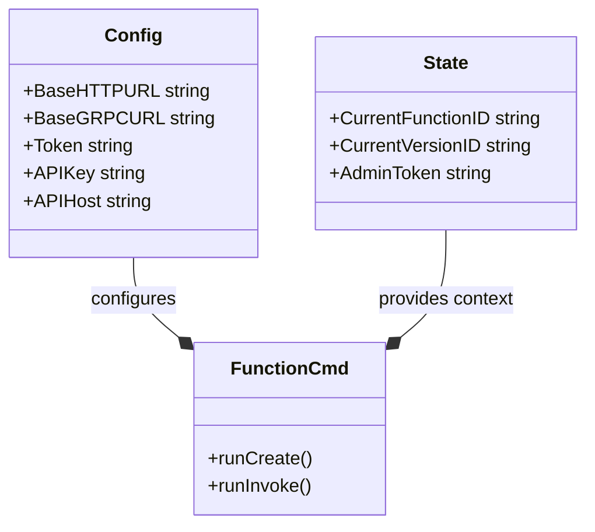

<!-- source: DeepWiki mcp.deepwiki.com · repo NVIDIA/nvcf · page 6 nvcf-cli: Command-Line Interface · fetched 2026-10-26 -->

# nvcf-cli: Command-Line Interface

Relevant source files

The following files were used as context for generating this wiki page:

- [ai-tooling/user/skills/nvcf-self-managed-cli/SKILL.md](ai-tooling/user/skills/nvcf-self-managed-cli/SKILL.md)
- [ai-tooling/user/skills/nvcf-self-managed-cli/prompts/deploy-and-invoke.md](ai-tooling/user/skills/nvcf-self-managed-cli/prompts/deploy-and-invoke.md)
- [ai-tooling/user/skills/nvcf-self-managed-cli/reference/commands.md](ai-tooling/user/skills/nvcf-self-managed-cli/reference/commands.md)
- [ai-tooling/user/skills/nvcf-self-managed-cli/reference/flags.md](ai-tooling/user/skills/nvcf-self-managed-cli/reference/flags.md)
- [docs/user/cli.md](docs/user/cli.md)
- [docs/user/function-creation.md](docs/user/function-creation.md)
- [docs/user/llm-gateway.md](docs/user/llm-gateway.md)
- [src/clis/nvcf-cli/README.md](src/clis/nvcf-cli/README.md)
- [src/clis/nvcf-cli/USAGE-GUIDE.md](src/clis/nvcf-cli/USAGE-GUIDE.md)
- [src/clis/nvcf-cli/cmd/deploy.go](src/clis/nvcf-cli/cmd/deploy.go)
- [src/clis/nvcf-cli/cmd/deploy_test.go](src/clis/nvcf-cli/cmd/deploy_test.go)
- [src/clis/nvcf-cli/cmd/function.go](src/clis/nvcf-cli/cmd/function.go)
- [src/clis/nvcf-cli/cmd/function_llm_model_test.go](src/clis/nvcf-cli/cmd/function_llm_model_test.go)
- [src/clis/nvcf-cli/cmd/init.go](src/clis/nvcf-cli/cmd/init.go)
- [src/clis/nvcf-cli/cmd/refresh.go](src/clis/nvcf-cli/cmd/refresh.go)
- [src/clis/nvcf-cli/cmd/root.go](src/clis/nvcf-cli/cmd/root.go)
- [src/clis/nvcf-cli/cmd/root_test.go](src/clis/nvcf-cli/cmd/root_test.go)
- [src/clis/nvcf-cli/cmd/undeploy.go](src/clis/nvcf-cli/cmd/undeploy.go)
- [src/clis/nvcf-cli/internal/agentskill/skilldata_generated.go](src/clis/nvcf-cli/internal/agentskill/skilldata_generated.go)
- [src/clis/nvcf-cli/internal/client/client.go](src/clis/nvcf-cli/internal/client/client.go)
- [src/clis/nvcf-cli/internal/client/client_test.go](src/clis/nvcf-cli/internal/client/client_test.go)

The `nvcf-cli` is a Go-based command-line tool designed to manage the full lifecycle of NVIDIA Cloud Functions (NVCF) deployments. It serves as the primary interface for both cluster operators (managing infrastructure) and developers (managing functions and tasks).

## Overview and Purpose

The CLI facilitates interaction with the NVCF Control Plane and Invocation Plane via direct HTTPS/gRPC calls, eliminating the need for direct `kubectl` access for most function management operations [src/clis/nvcf-cli/README.md:21-31](). It handles complex workflows such as cluster registration, automatic token generation, and state management to simplify developer experience [src/clis/nvcf-cli/README.md:19-25]().

### Key Features
*   **Self-Hosted Management**: Tools for installing and checking the health of control and compute planes [ai-tooling/user/skills/nvcf-self-managed-cli/reference/commands.md:5-24]().
*   **Function Lifecycle**: Commands to create, deploy, update, and delete functions [src/clis/nvcf-cli/cmd/function.go:55-93]().
*   **Task Management**: Support for NVIDIA Cloud Tasks (NVCT) for batch workloads [src/clis/nvcf-cli/README.md:30-31]().
*   **Authentication**: Integrated management of Admin JWTs (`NVCF_TOKEN`) and API Keys (`NVCF_API_KEY`) [src/clis/nvcf-cli/internal/client/client.go:82-96]().

## System Interaction Diagram

The following diagram illustrates how `nvcf-cli` bridges user commands to specific code entities and backend services.

**CLI to Backend Mapping**

Sources: [src/clis/nvcf-cli/cmd/root.go:38-41](), [src/clis/nvcf-cli/cmd/function.go:195-210](), [src/clis/nvcf-cli/internal/client/client.go:63-104]().

## Configuration and Authentication

The CLI uses a layered configuration approach, prioritizing command-line flags over environment variables and local YAML files [src/clis/nvcf-cli/README.md:137-146]().

### Configuration Search Order
1.  **Flags**: `--config <path>` [src/clis/nvcf-cli/cmd/root.go:59-67]().
2.  **Environment Variables**: e.g., `NVCF_TOKEN`, `NVCF_API_KEY`, `NVCF_BASE_HTTP_URL` [src/clis/nvcf-cli/internal/client/client.go:130-147]().
3.  **Local File**: `./.nvcf-cli.yaml` [src/clis/nvcf-cli/README.md:103]().
4.  **Global File**: `~/.nvcf-cli.yaml` [src/clis/nvcf-cli/README.md:104]().

### Token Resolution Flow
The `client.getTokenWithFallback` function manages credentials with the following precedence:
| Priority | Source | Description |
| :--- | :--- | :--- |
| 1 | Env Vars | `NVCF_TOKEN` (Admin) or `NVCF_API_KEY` (Function) |
| 2 | Config File | Stored in `.nvcf-cli.yaml` |
| 3 | State File | `~/.nvcf-cli.state` (populated via `nvcf-cli init`) |

Sources: [src/clis/nvcf-cli/internal/client/client.go:130-147](), [ai-tooling/user/skills/nvcf-self-managed-cli/SKILL.md:82-96]().

## Command Groups

The CLI is organized into several primary command groups managed via `cobra.Command` structures.

### Self-Hosted Stack Management
Used for managing the NVCF infrastructure itself. It supports `up`, `down`, and `install` subcommands for both Control Plane and Compute Plane roles.
*   **Key Logic**: Renders Helmfile manifests and coordinates cluster registration with ICMS.
*   **Details**: For more information, see [Self-Hosted Stack Management Commands](#6.1).

### Function and Task Management
Handles developer workloads.
*   **Functions**: Supports standard container functions and LLM-specific functions (OpenAI-compatible) [docs/user/llm-gateway.md:50-71]().
*   **Tasks**: Manages asynchronous batch jobs via the NVCT API [ai-tooling/user/skills/nvcf-self-managed-cli/reference/commands.md:51-68]().
*   **Details**: For more information, see [Function, Task, and API Key Commands](#6.2).

### Internal Architecture and State
The CLI maintains a persistent state in `~/.nvcf-cli.state` using the `internal/state` package [src/clis/nvcf-cli/cmd/root.go:177-194](). This state tracks the "current" function ID and version ID, allowing users to run `deploy` or `invoke` without repeatedly specifying IDs [src/clis/nvcf-cli/cmd/function.go:166-167]().

**Entity Relationship: CLI Client to API**

Sources: [src/clis/nvcf-cli/internal/client/client.go:63-104](), [src/clis/nvcf-cli/internal/state/state.go](), [src/clis/nvcf-cli/cmd/function.go:55-93]().

## AI Skill Integration
The CLI embeds `agentskill` data to assist AI agents in performing complex deployment tasks. The `skilldata_generated.go` file contains base64-encoded Markdown documentation that agents can query to understand installation and troubleshooting steps [src/clis/nvcf-cli/internal/agentskill/skilldata_generated.go:31-106]().

Sources: [src/clis/nvcf-cli/internal/agentskill/skilldata_generated.go:1-30](), [ai-tooling/user/skills/nvcf-self-managed-cli/SKILL.md:1-27]().

---

