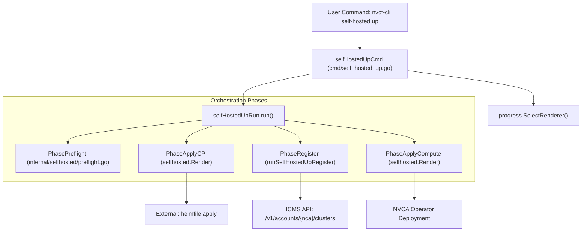
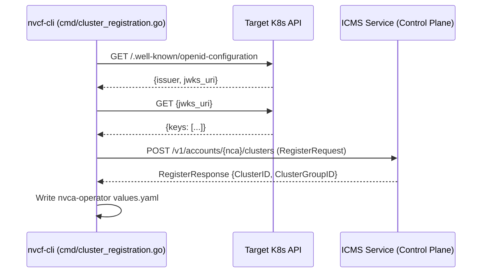

<!-- source: DeepWiki mcp.deepwiki.com · repo NVIDIA/nvcf · page 6.1 Self-Hosted Stack Management Commands · fetched 2026-10-26 -->

# Self-Hosted Stack Management Commands

Relevant source files

The following files were used as context for generating this wiki page:

- [ai-tooling/user/skills/nvcf-self-managed-cli/reference/exit-codes.md](ai-tooling/user/skills/nvcf-self-managed-cli/reference/exit-codes.md)
- [src/clis/nvcf-cli/.nvcf-cli.yaml.template](src/clis/nvcf-cli/.nvcf-cli.yaml.template)
- [src/clis/nvcf-cli/cmd/BUILD.bazel](src/clis/nvcf-cli/cmd/BUILD.bazel)
- [src/clis/nvcf-cli/cmd/cluster_agent.go](src/clis/nvcf-cli/cmd/cluster_agent.go)
- [src/clis/nvcf-cli/cmd/cluster_agent_maintenance.go](src/clis/nvcf-cli/cmd/cluster_agent_maintenance.go)
- [src/clis/nvcf-cli/cmd/cluster_agent_maintenance_test.go](src/clis/nvcf-cli/cmd/cluster_agent_maintenance_test.go)
- [src/clis/nvcf-cli/cmd/cluster_agent_test.go](src/clis/nvcf-cli/cmd/cluster_agent_test.go)
- [src/clis/nvcf-cli/cmd/cluster_registration.go](src/clis/nvcf-cli/cmd/cluster_registration.go)
- [src/clis/nvcf-cli/cmd/main_test.go](src/clis/nvcf-cli/cmd/main_test.go)
- [src/clis/nvcf-cli/cmd/self_hosted.go](src/clis/nvcf-cli/cmd/self_hosted.go)
- [src/clis/nvcf-cli/cmd/self_hosted_check.go](src/clis/nvcf-cli/cmd/self_hosted_check.go)
- [src/clis/nvcf-cli/cmd/self_hosted_compute_plane.go](src/clis/nvcf-cli/cmd/self_hosted_compute_plane.go)
- [src/clis/nvcf-cli/cmd/self_hosted_compute_plane_test.go](src/clis/nvcf-cli/cmd/self_hosted_compute_plane_test.go)
- [src/clis/nvcf-cli/cmd/self_hosted_control_plane.go](src/clis/nvcf-cli/cmd/self_hosted_control_plane.go)
- [src/clis/nvcf-cli/cmd/self_hosted_control_plane_profile.go](src/clis/nvcf-cli/cmd/self_hosted_control_plane_profile.go)
- [src/clis/nvcf-cli/cmd/self_hosted_control_plane_test.go](src/clis/nvcf-cli/cmd/self_hosted_control_plane_test.go)
- [src/clis/nvcf-cli/cmd/self_hosted_down.go](src/clis/nvcf-cli/cmd/self_hosted_down.go)
- [src/clis/nvcf-cli/cmd/self_hosted_down_test.go](src/clis/nvcf-cli/cmd/self_hosted_down_test.go)
- [src/clis/nvcf-cli/cmd/self_hosted_install.go](src/clis/nvcf-cli/cmd/self_hosted_install.go)
- [src/clis/nvcf-cli/cmd/self_hosted_install_test.go](src/clis/nvcf-cli/cmd/self_hosted_install_test.go)
- [src/clis/nvcf-cli/cmd/self_hosted_test.go](src/clis/nvcf-cli/cmd/self_hosted_test.go)
- [src/clis/nvcf-cli/cmd/self_hosted_up.go](src/clis/nvcf-cli/cmd/self_hosted_up.go)
- [src/clis/nvcf-cli/cmd/self_hosted_up_test.go](src/clis/nvcf-cli/cmd/self_hosted_up_test.go)
- [src/clis/nvcf-cli/internal/client/clusters.go](src/clis/nvcf-cli/internal/client/clusters.go)
- [src/clis/nvcf-cli/internal/client/clusters_test.go](src/clis/nvcf-cli/internal/client/clusters_test.go)
- [src/clis/nvcf-cli/internal/clusteragent/BUILD.bazel](src/clis/nvcf-cli/internal/clusteragent/BUILD.bazel)
- [src/clis/nvcf-cli/internal/clusteragent/k8s_inspector.go](src/clis/nvcf-cli/internal/clusteragent/k8s_inspector.go)
- [src/clis/nvcf-cli/internal/clusteragent/k8s_inspector_test.go](src/clis/nvcf-cli/internal/clusteragent/k8s_inspector_test.go)
- [src/clis/nvcf-cli/internal/clusteragent/k8s_maintainer.go](src/clis/nvcf-cli/internal/clusteragent/k8s_maintainer.go)
- [src/clis/nvcf-cli/internal/clusteragent/k8s_maintainer_test.go](src/clis/nvcf-cli/internal/clusteragent/k8s_maintainer_test.go)
- [src/clis/nvcf-cli/internal/clusteragent/maintainer.go](src/clis/nvcf-cli/internal/clusteragent/maintainer.go)
- [src/clis/nvcf-cli/internal/clusteragent/phase.go](src/clis/nvcf-cli/internal/clusteragent/phase.go)
- [src/clis/nvcf-cli/internal/clusteragent/phase_test.go](src/clis/nvcf-cli/internal/clusteragent/phase_test.go)
- [src/clis/nvcf-cli/internal/clusteragent/types.go](src/clis/nvcf-cli/internal/clusteragent/types.go)
- [src/clis/nvcf-cli/internal/k8s/client.go](src/clis/nvcf-cli/internal/k8s/client.go)
- [src/clis/nvcf-cli/internal/selfhosted/BUILD.bazel](src/clis/nvcf-cli/internal/selfhosted/BUILD.bazel)
- [src/clis/nvcf-cli/internal/selfhosted/clustervalidator.go](src/clis/nvcf-cli/internal/selfhosted/clustervalidator.go)
- [src/clis/nvcf-cli/internal/selfhosted/clustervalidator_test.go](src/clis/nvcf-cli/internal/selfhosted/clustervalidator_test.go)
- [src/clis/nvcf-cli/internal/selfhosted/controlplaneprofile/BUILD.bazel](src/clis/nvcf-cli/internal/selfhosted/controlplaneprofile/BUILD.bazel)
- [src/clis/nvcf-cli/internal/selfhosted/controlplaneprofile/profile.go](src/clis/nvcf-cli/internal/selfhosted/controlplaneprofile/profile.go)
- [src/clis/nvcf-cli/internal/selfhosted/controlplaneprofile/profile_test.go](src/clis/nvcf-cli/internal/selfhosted/controlplaneprofile/profile_test.go)
- [src/clis/nvcf-cli/internal/selfhosted/inotify_probe.go](src/clis/nvcf-cli/internal/selfhosted/inotify_probe.go)
- [src/clis/nvcf-cli/internal/selfhosted/inotify_probe_test.go](src/clis/nvcf-cli/internal/selfhosted/inotify_probe_test.go)
- [src/clis/nvcf-cli/internal/selfhosted/nvca/values.go](src/clis/nvcf-cli/internal/selfhosted/nvca/values.go)
- [src/clis/nvcf-cli/internal/selfhosted/preflight.go](src/clis/nvcf-cli/internal/selfhosted/preflight.go)
- [src/clis/nvcf-cli/internal/selfhosted/preflight_test.go](src/clis/nvcf-cli/internal/selfhosted/preflight_test.go)
- [src/clis/nvcf-cli/internal/selfhosted/pullsecret.go](src/clis/nvcf-cli/internal/selfhosted/pullsecret.go)
- [src/clis/nvcf-cli/internal/selfhosted/register.go](src/clis/nvcf-cli/internal/selfhosted/register.go)
- [src/clis/nvcf-cli/internal/selfhosted/register_test.go](src/clis/nvcf-cli/internal/selfhosted/register_test.go)

The `nvcf-cli self-hosted` command group provides a comprehensive orchestration layer for deploying and managing NVCF stacks in self-managed environments. It abstracts complex multi-cluster Kubernetes operations, OIDC-based cluster registration, and Helmfile execution into high-level commands.

## Overview and Orchestration

The `self-hosted` command group [src/clis/nvcf-cli/cmd/self_hosted.go:39-44]() is designed to manage the lifecycle of both the **Control Plane** (core services like ICMS and NVCF Service) and the **Compute Plane** (GPU clusters running NVCA).

### Core Subcommands
*   `up`: A one-shot orchestrator that performs preflight checks, installs the control plane, registers the cluster, and installs the compute plane [src/clis/nvcf-cli/cmd/self_hosted_up.go:126-131]().
*   `down`: The inverse of `up`, handling the graceful teardown, draining of active deployments, and unregistration [src/clis/nvcf-cli/cmd/self_hosted_down.go:56-61]().
*   `install`: Low-level command to render or apply specific plane manifests [src/clis/nvcf-cli/cmd/self_hosted_install.go:95-100]().
*   `compute-plane`: Sub-group for compute-plane specific registration and installation [src/clis/nvcf-cli/cmd/self_hosted_compute_plane.go:52-56]().

### Command Flow Architecture
The following diagram illustrates the logical flow from the user invocation to the internal orchestrator and external system interactions.

**Natural Language to Code Entity Space: Orchestration Flow**

**Sources:** [src/clis/nvcf-cli/cmd/self_hosted_up.go:142-181](), [src/clis/nvcf-cli/internal/selfhosted/preflight.go:1-50](), [src/clis/nvcf-cli/cmd/self_hosted_install.go:139-150]()

---

## Control Plane Profile System

The Control Plane Profile is a critical artifact generated during `install --control-plane`. It serves as the "source of truth" for compute clusters to discover and trust the control plane.

### Profile Structure
Defined in `controlplaneprofile.ControlPlaneProfile` [src/clis/nvcf-cli/internal/selfhosted/controlplaneprofile/profile.go](), the profile includes:
*   **Endpoints**: Separate ICMS, ReVal, and NATS URLs for `InCluster` (local service DNS) and `ComputeReachable` (external ingress) scopes [src/clis/nvcf-cli/internal/selfhosted/register.go:68-82]().
*   **Management TLS**: Root CA certificates required to verify the control plane's identity [src/clis/nvcf-cli/cmd/self_hosted_install.go:151-163]().

### Scope Selection Logic
When registering a compute cluster, the CLI uses `SelectControlPlaneProfileEndpointScope` to determine which URLs to provide to the NVCA operator:
1.  If `targetClusterName` matches the control plane's cluster name, it uses `EndpointScopeInCluster`.
2.  Otherwise, it uses `EndpointScopeComputeReachable` [src/clis/nvcf-cli/internal/selfhosted/register.go:72-81]().

**Sources:** [src/clis/nvcf-cli/internal/selfhosted/controlplaneprofile/profile.go:1-50](), [src/clis/nvcf-cli/internal/selfhosted/register.go:33-44]()

---

## Cluster Registration Flow

Registration bridges the gap between a Kubernetes cluster and the NVCF Control Plane. It involves discovering the cluster's identity and persisting it in the Instance and Cluster Management Service (ICMS).

### Implementation Steps
1.  **OIDC Discovery**: The CLI probes the target cluster to find the OIDC issuer (e.g., K8s API server or SPIRE) and fetches the public JWKS [src/clis/nvcf-cli/cmd/cluster_registration.go:43-47]().
2.  **ICMS Registration**: The CLI calls the ICMS `RegisterCluster` endpoint, providing the cluster name, region, OIDC issuer URL, and JWKS [src/clis/nvcf-cli/internal/selfhosted/register.go:47-60]().
3.  **Values Generation**: ICMS returns a `ClusterID` and `ClusterGroupID`. The CLI then writes these into a `register-values.yaml` file (or equivalent) used to configure the NVCA operator [src/clis/nvcf-cli/cmd/self_hosted_compute_plane.go:215-235]().

**Data Flow: Registration Sequence**

**Sources:** [src/clis/nvcf-cli/cmd/cluster_registration.go:157-187](), [src/clis/nvcf-cli/internal/selfhosted/register.go:182-200]()

---

## Preflight and Diagnostics

Before any installation begins, the CLI executes a series of preflight checks to ensure the environment is capable of hosting NVCF.

### Key Components
*   **Preflight Checks**: Validates system dependencies (Docker, Helm, Helmfile), Kubernetes connectivity, and available resources [src/clis/nvcf-cli/internal/selfhosted/preflight.go:1-50]().
*   **Inotify Probe**: A specialized check (`inotify_probe.go`) that ensures the host system's `fs.inotify.max_user_instances` and `max_user_watches` are sufficient for the large number of sidecars and volumes used by NVCF workloads [src/clis/nvcf-cli/internal/selfhosted/inotify_probe.go:1-40]().
*   **Cluster Validator**: Uses the `ClusterValidator` struct to verify that the target cluster meets specific CRD and namespace requirements [src/clis/nvcf-cli/internal/selfhosted/clustervalidator.go:1-30]().

**Sources:** [src/clis/nvcf-cli/internal/selfhosted/preflight.go:1-20](), [src/clis/nvcf-cli/internal/selfhosted/inotify_probe.go:20-35](), [src/clis/nvcf-cli/internal/selfhosted/clustervalidator.go:20-40]()

---

## Teardown and Drain Logic

The `down` command ensures that a cluster is decommissioned cleanly without leaving orphaned resources or inconsistent state in ICMS.

### Execution Phases
1.  **Drain**: (Optional) Attempts to remove active function deployments. Currently implemented as a best-effort check before uninstallation [src/clis/nvcf-cli/cmd/self_hosted_down.go:71-72]().
2.  **Helmfile Destroy**: Invokes `helmfile destroy` to remove all releases associated with the plane [src/clis/nvcf-cli/cmd/self_hosted_down.go:171-174]().
3.  **Unregister**: Calls ICMS to delete the cluster registration. The CLI supports `--ignore-missing` to allow re-runs of failed teardowns [src/clis/nvcf-cli/cmd/cluster_registration.go:112-113]().
4.  **Namespace Cleanup**: Deletes the namespaces created by the stack unless `--keep-namespaces` is specified [src/clis/nvcf-cli/cmd/self_hosted_down.go:81-82]().

**Sources:** [src/clis/nvcf-cli/cmd/self_hosted_down.go:87-99](), [src/clis/nvcf-cli/cmd/cluster_registration.go:59-64](), [src/clis/nvcf-cli/internal/selfhosted/teardown/teardown.go:1-50]()

---

