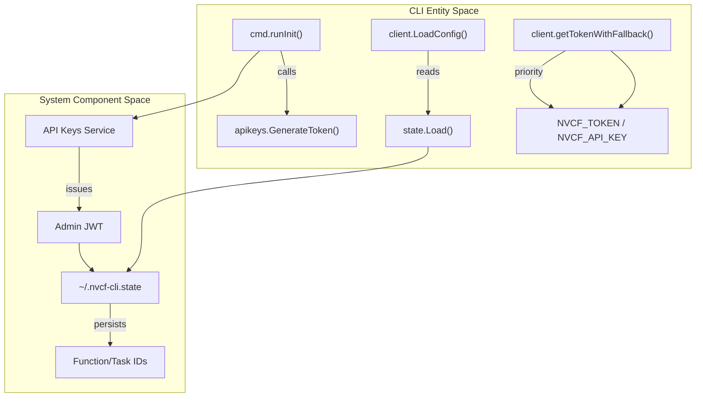
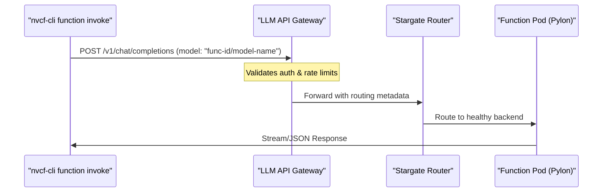
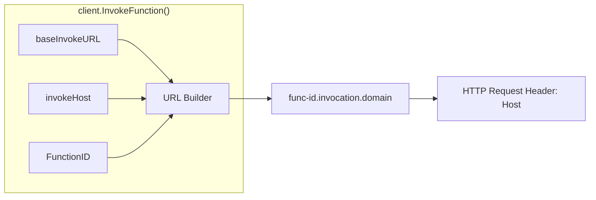

<!-- source: DeepWiki mcp.deepwiki.com · repo NVIDIA/nvcf · page 6.2 Function, Task, and API Key Commands · fetched 2026-10-26 -->

# Function, Task, and API Key Commands

Relevant source files

The following files were used as context for generating this wiki page:

- [ai-tooling/user/skills/nvcf-self-managed-cli/SKILL.md](ai-tooling/user/skills/nvcf-self-managed-cli/SKILL.md)
- [ai-tooling/user/skills/nvcf-self-managed-cli/prompts/create-and-run-task.md](ai-tooling/user/skills/nvcf-self-managed-cli/prompts/create-and-run-task.md)
- [ai-tooling/user/skills/nvcf-self-managed-cli/prompts/deploy-and-invoke.md](ai-tooling/user/skills/nvcf-self-managed-cli/prompts/deploy-and-invoke.md)
- [ai-tooling/user/skills/nvcf-self-managed-cli/reference/commands.md](ai-tooling/user/skills/nvcf-self-managed-cli/reference/commands.md)
- [ai-tooling/user/skills/nvcf-self-managed-cli/reference/flags.md](ai-tooling/user/skills/nvcf-self-managed-cli/reference/flags.md)
- [deploy/helm/api-keys-colocated/api-keys/templates/deployment.yaml](deploy/helm/api-keys-colocated/api-keys/templates/deployment.yaml)
- [docs/user/cli.md](docs/user/cli.md)
- [docs/user/container-tasks.md](docs/user/container-tasks.md)
- [docs/user/function-creation.md](docs/user/function-creation.md)
- [docs/user/helm-tasks.md](docs/user/helm-tasks.md)
- [docs/user/llm-gateway.md](docs/user/llm-gateway.md)
- [docs/user/task-creation.md](docs/user/task-creation.md)
- [docs/v0.5/cluster-management/samples/nvca-operator-values.yaml](docs/v0.5/cluster-management/samples/nvca-operator-values.yaml)
- [docs/v0.5/cluster-management/self-managed.md](docs/v0.5/cluster-management/self-managed.md)
- [docs/v0.5/image-mirroring.md](docs/v0.5/image-mirroring.md)
- [docs/v0.5/manifest.md](docs/v0.5/manifest.md)
- [docs/v0.6.0/container-tasks.md](docs/v0.6.0/container-tasks.md)
- [examples/function-samples/fastapi-echo-sample/README.md](examples/function-samples/fastapi-echo-sample/README.md)
- [examples/task-samples/task-helmchart-sample/README.md](examples/task-samples/task-helmchart-sample/README.md)
- [examples/task-samples/task-simple-sample/README.md](examples/task-samples/task-simple-sample/README.md)
- [src/clis/nvcf-cli/README.md](src/clis/nvcf-cli/README.md)
- [src/clis/nvcf-cli/USAGE-GUIDE.md](src/clis/nvcf-cli/USAGE-GUIDE.md)
- [src/clis/nvcf-cli/cmd/apikey.go](src/clis/nvcf-cli/cmd/apikey.go)
- [src/clis/nvcf-cli/cmd/apikey_test.go](src/clis/nvcf-cli/cmd/apikey_test.go)
- [src/clis/nvcf-cli/cmd/function.go](src/clis/nvcf-cli/cmd/function.go)
- [src/clis/nvcf-cli/cmd/function_llm_model_test.go](src/clis/nvcf-cli/cmd/function_llm_model_test.go)
- [src/clis/nvcf-cli/cmd/task.go](src/clis/nvcf-cli/cmd/task.go)
- [src/clis/nvcf-cli/internal/agentskill/skilldata_generated.go](src/clis/nvcf-cli/internal/agentskill/skilldata_generated.go)
- [src/clis/nvcf-cli/internal/apikeys/client.go](src/clis/nvcf-cli/internal/apikeys/client.go)
- [src/clis/nvcf-cli/internal/client/client.go](src/clis/nvcf-cli/internal/client/client.go)
- [src/clis/nvcf-cli/internal/client/client_test.go](src/clis/nvcf-cli/internal/client/client_test.go)
- [src/clis/nvcf-cli/internal/client/tasks.go](src/clis/nvcf-cli/internal/client/tasks.go)
- [src/clis/nvcf-cli/internal/client/tasks_test.go](src/clis/nvcf-cli/internal/client/tasks_test.go)
- [src/compute-plane-services/ess-agent/api/go.mod](src/compute-plane-services/ess-agent/api/go.mod)
- [src/compute-plane-services/ess-agent/api/go.sum](src/compute-plane-services/ess-agent/api/go.sum)
- [src/compute-plane-services/ess-agent/go.mod](src/compute-plane-services/ess-agent/go.mod)

This page documents the `nvcf-cli` command groups for managing the lifecycle of functions, asynchronous tasks, and authentication credentials. It covers the technical implementation of function deployment, invocation protocols (REST, gRPC, and LLM Gateway), and the underlying client library architecture.

## 1. Authentication and Token Management

The `nvcf-cli` utilizes two distinct credential types to interact with the Control Plane and Invocation Plane. These are managed via the `internal/client` library and stored in a persistent state file.

### 1.1 Token Types and Scopes
| Env Var | Token Type | Purpose | File Reference |
|---|---|---|---|
| `NVCF_TOKEN` | Admin JWT | Management ops: `function create`, `deploy`, `cluster register`. | [ai-tooling/user/skills/nvcf-self-managed-cli/SKILL.md:92-94]() |
| `NVCF_API_KEY` | `nvapi-...` | Runtime ops: `function invoke`, `task` operations, queue status. | [ai-tooling/user/skills/nvcf-self-managed-cli/SKILL.md:95-95]() |

### 1.2 Credential Resolution Logic
The `client.LoadConfig` function resolves credentials using a strict priority order:
1. **Environment Variables**: `NVCF_TOKEN` or `NVCF_API_KEY`.
2. **Configuration File**: `~/.nvcf-cli.yaml` or `./.nvcf-cli.yaml`.
3. **State File**: `~/.nvcf-cli.state` (populated via `nvcf-cli init`).

[src/clis/nvcf-cli/internal/client/client.go:129-147]()

### 1.3 Code-to-System Mapping: Auth Flow
The following diagram maps CLI code entities to the authentication system components.

**CLI Auth Implementation**

Sources: [src/clis/nvcf-cli/internal/client/client.go:129-174](), [src/clis/nvcf-cli/README.md:221-236]()

---

## 2. Function Lifecycle Commands

The `function` command group manages the transition of code from a container image or Helm chart to an active endpoint.

### 2.1 Creation and Deployment
Functions are created as immutable versions. A deployment then maps that version to specific hardware requirements (GPU type, instance count).

*   **Create**: `nvcf-cli function create` sends a POST to `/v2/nvcf/accounts/{accountId}/functions`. [src/clis/nvcf-cli/cmd/function.go:96-143]()
*   **Deploy**: `nvcf-cli function deploy create` targets `/v2/nvcf/functions/{id}/versions/{versionId}/deployments`. [src/clis/nvcf-cli/cmd/function.go:55-93]()

### 2.2 Invocation Protocols
The CLI supports three primary invocation methods handled in `src/clis/nvcf-cli/cmd/function.go`:

1.  **REST (Default)**: Standard HTTP POST to the invocation URL.
2.  **gRPC**: Native gRPC client invocation using the `--grpc` flag. [src/clis/nvcf-cli/cmd/function.go:207-208]()
3.  **LLM Gateway**: OpenAI-compatible routing via the `llm.invocation.<domain>` endpoint.

**LLM Invocation Data Flow**

Sources: [docs/user/llm-gateway.md:24-35](), [src/clis/nvcf-cli/cmd/function.go:195-209]()

---

## 3. Task Commands (NVCT)

The `task` command group interacts with the NVIDIA Cloud Tasks (NVCT) API for asynchronous batch processing.

### 3.1 Implementation Details
Task operations require a specific `NVCF_NVCT_API_KEY` and target the `BaseNVCTURL`.
*   **Create**: Submits a container or Helm-based task. [src/clis/nvcf-cli/cmd/task.go:57-59]()
*   **Monitor**: `task get` and `task events` poll for lifecycle transitions (e.g., `QUEUED` -> `RUNNING` -> `COMPLETED`). [ai-tooling/user/skills/nvcf-self-managed-cli/reference/commands.md:60-62]()
*   **Management**: Supports `cancel`, `delete`, and `update-secrets`. [src/clis/nvcf-cli/cmd/task.go:64-66]()

### 3.2 Task Configuration
Tasks utilize `CreateTaskRequest` structures, allowing specification of `gpu`, `instanceType`, and `resultHandlingStrategy`. [ai-tooling/user/skills/nvcf-self-managed-cli/prompts/create-and-run-task.md]()

Sources: [src/clis/nvcf-cli/internal/client/client.go:72-82](), [ai-tooling/user/skills/nvcf-self-managed-cli/reference/commands.md:51-67]()

---

## 4. Technical Reference: `client.go`

The `Config` struct in `internal/client/client.go` is the central configuration entity for all CLI operations.

### 4.1 Key Configuration Fields
| Field | Purpose |
|---|---|
| `BaseHTTPURL` | Primary Control Plane API endpoint. |
| `BaseInvokeURL` | Endpoint for standard function invocations. |
| `BaseNVCTURL` | Endpoint for Task API. |
| `APIHost` / `InvokeHost` | Overrides for `Host:` header routing in self-hosted Envoy gateways. |
| `TLSConfig` | Management-API TLS trust established via system roots or CA bundle. |

[src/clis/nvcf-cli/internal/client/client.go:63-104]()

### 4.2 Function Hostname Routing
In self-hosted environments, the CLI dynamically modifies the request hostname for invocations. If `invoke_host` is `invocation.example.com`, a call to function `func-123` results in a `Host` header of `func-123.invocation.example.com`.

**Hostname Routing Implementation**

Sources: [src/clis/nvcf-cli/internal/client/client_test.go:194-230](), [docs/user/cli.md:168-188]()

---

