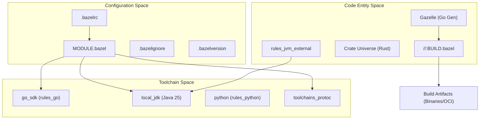
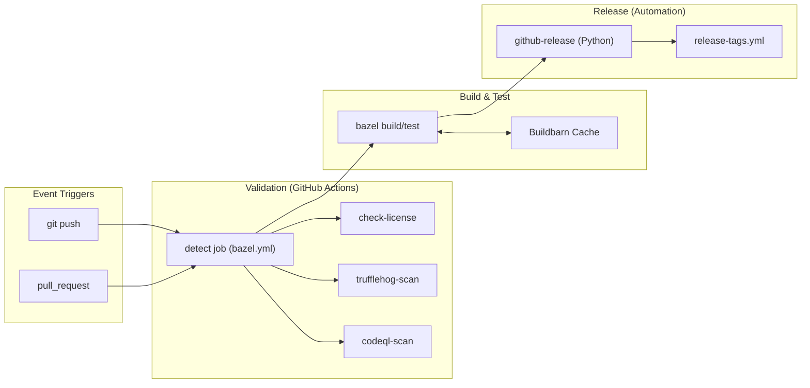

<!-- source: DeepWiki mcp.deepwiki.com · repo NVIDIA/nvcf · page 7 Build System and CI/CD · fetched 2026-10-26 -->

# Build System and CI/CD

Relevant source files

The following files were used as context for generating this wiki page:

- [.bazelignore](.bazelignore)
- [.bazelrc](.bazelrc)
- [.bazelversion](.bazelversion)
- [.coderabbit.yaml](.coderabbit.yaml)
- [.github/workflows/actionlint.yml](.github/workflows/actionlint.yml)
- [.github/workflows/bazel.yml](.github/workflows/bazel.yml)
- [.github/workflows/build-test.yml](.github/workflows/build-test.yml)
- [.github/workflows/codeql-comment.yml](.github/workflows/codeql-comment.yml)
- [.github/workflows/codeql.yml](.github/workflows/codeql.yml)
- [.github/workflows/license-dependencies.yml](.github/workflows/license-dependencies.yml)
- [.github/workflows/secret-scan.yml](.github/workflows/secret-scan.yml)
- [MODULE.bazel](MODULE.bazel)
- [MODULE.bazel.lock](MODULE.bazel.lock)
- [maven_install.json](maven_install.json)
- [src/control-plane-services/helm-reval/go.mod](src/control-plane-services/helm-reval/go.mod)
- [src/control-plane-services/helm-reval/go.sum](src/control-plane-services/helm-reval/go.sum)
- [src/control-plane-services/helm-reval/pkg/reval/config/config.go](src/control-plane-services/helm-reval/pkg/reval/config/config.go)
- [src/control-plane-services/helm-reval/pkg/reval/service/models.go](src/control-plane-services/helm-reval/pkg/reval/service/models.go)
- [src/control-plane-services/helm-reval/pkg/reval/service/service.go](src/control-plane-services/helm-reval/pkg/reval/service/service.go)
- [src/control-plane-services/helm-reval/reval/BUILD.bazel](src/control-plane-services/helm-reval/reval/BUILD.bazel)
- [src/control-plane-services/helm-reval/reval/helm_template.go](src/control-plane-services/helm-reval/reval/helm_template.go)
- [src/control-plane-services/helm-reval/reval/helm_template_test.go](src/control-plane-services/helm-reval/reval/helm_template_test.go)
- [src/control-plane-services/helm-reval/reval/run.go](src/control-plane-services/helm-reval/reval/run.go)
- [src/control-plane-services/helm-reval/reval/run_test.go](src/control-plane-services/helm-reval/reval/run_test.go)
- [src/control-plane-services/instance-cluster-management/BAZEL.md](src/control-plane-services/instance-cluster-management/BAZEL.md)
- [src/control-plane-services/instance-cluster-management/icms-core/BUILD.bazel](src/control-plane-services/instance-cluster-management/icms-core/BUILD.bazel)
- [tools/bazel/BUILD.bazel](tools/bazel/BUILD.bazel)
- [tools/bazel/patches/gazelle_go_work_dev_dependency.patch](tools/bazel/patches/gazelle_go_work_dev_dependency.patch)
- [tools/ci/check-license](tools/ci/check-license)
- [tools/ci/check-mpl-audit](tools/ci/check-mpl-audit)
- [tools/ci/check-nested-modules](tools/ci/check-nested-modules)
- [tools/ci/check-oci-pins](tools/ci/check-oci-pins)
- [tools/ci/nested-modules.txt](tools/ci/nested-modules.txt)
- [tools/ci/test-check-nested-modules](tools/ci/test-check-nested-modules)
- [tools/scripts/test/test-check-mpl-audit](tools/scripts/test/test-check-mpl-audit)

This section provides a high-level overview of the NVCF build system and the continuous integration and delivery (CI/CD) pipelines that govern the monorepo. The system is designed to handle a polyglot codebase (Go, Java, Rust, Node.js) while maintaining strict dependency boundaries and ensuring fast, hermetic builds.

## Bazel Build System

NVCF uses **Bazel** as its primary build tool to provide reproducible builds across different environments. The repository is structured as a monorepo, managed through a root `MODULE.bazel` file using **Bzlmod** for external dependency management [.github/workflows/bazel.yml:6-12]().

### Core Configuration
*   **Toolchains**: The system manages hermetic toolchains for Go, Java 25, Rust, and Node.js. The Java baseline is pinned to Java 25 across all control-plane services [.bazelrc:70-82]().
*   **Remote Caching**: CI utilizes a remote build cache (Buildbarn) to accelerate builds. The `.bazelrc` defines profiles for `remote` (read-only for devs/PRs) and `remote-write` (internal CI only) to prevent cache poisoning [.bazelrc:46-59](), [.bazelrc:111-134]().
*   **Stamping**: Build metadata such as version, git commit, and OCI tags are injected via `workspace_status.sh` [.bazelrc:67-68]().
*   **Multi-Arch Images**: Container images are built using `rules_oci` and the `oci_image_index` pattern to support both `amd64` and `arm64` architectures [MODULE.bazel:36-40]().

For deep technical details on toolchain setup and specific `.bazelrc` flags, see **[Bazel Build Configuration](#7.1)**.

### Build Entity Relationship
The following diagram illustrates how Bazel entities and configuration files interact to produce build artifacts.

**Bazel Build Logic Flow**

**Sources:** [MODULE.bazel:16-107](), [.bazelrc:17-82](), [.bazelignore:16-39]().

---

## CI Pipelines and Governance

Continuous Integration is managed via GitHub Actions, focusing on change-aware testing and strict compliance auditing.

### Change-Aware CI Matrix
The primary `bazel.yml` workflow uses a `detect` job to compute dependency-aware subtrees. Instead of building the entire monorepo on every commit, it schedules jobs only for the components affected by the changes [.github/workflows/bazel.yml:6-18]().

### Security and Compliance
*   **Static Analysis**: `codeql.yml` performs language-aware security scanning for Go, Rust, and Java [.github/workflows/codeql.yml:43-50]().
*   **Secret Scanning**: `secret-scan.yml` uses TruffleHog to detect accidental credential leaks [.github/workflows/secret-scan.yml:25-37]().
*   **License Auditing**: `license-dependencies.yml` ensures all source files have appropriate headers and that third-party dependencies comply with NVIDIA's open-source policies [.github/workflows/license-dependencies.yml:23-35]().
*   **Module Governance**: Tools like `check-nested-modules` maintain the ledger of Bazel modules to prevent dependency cycles [.github/workflows/build-test.yml:67-71]().

For details on workflow triggers and governance scripts, see **[CI Pipelines and Governance](#7.2)**.

---

## Release Process

NVCF employs an automated release pipeline based on **Conventional Commits** and semantic versioning.

### Release Automation
*   **GitHub Release Helper**: A Python-based `github-release` tool manages the lifecycle of releases, including branch cutting, version bumping, and tag anchoring [.github/workflows/build-test.yml:53-62]().
*   **Dual Pipeline**: Releases are synchronized across GitHub and internal GitLab mirrors to ensure availability for internal NVIDIA infrastructure.
*   **Subproject Configuration**: The `github-release-subprojects.json` file defines which components are released independently or as part of the core stack.

For details on the release script subcommands and the tagging lifecycle, see **[Release Process and GitHub Release Automation](#7.3)**.

### CI/CD System Mapping
This diagram maps the high-level CI/CD stages to the specific scripts and workflows in the codebase.

**CI/CD Pipeline Architecture**

**Sources:** [.github/workflows/bazel.yml:70-76](), [.github/workflows/license-dependencies.yml:33-35](), [.github/workflows/secret-scan.yml:35-49](), [.github/workflows/build-test.yml:53-62]().

---

