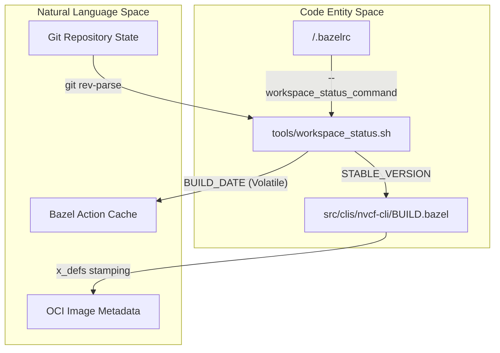
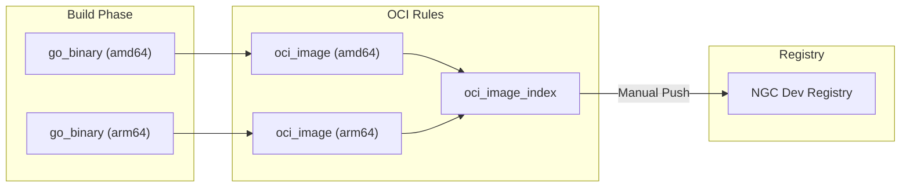

<!-- source: DeepWiki mcp.deepwiki.com · repo NVIDIA/nvcf · page 7.1 Bazel Build Configuration · fetched 2026-10-26 -->

# Bazel Build Configuration

Relevant source files

The following files were used as context for generating this wiki page:

- [.bazelignore](.bazelignore)
- [.bazelrc](.bazelrc)
- [.bazelversion](.bazelversion)
- [.github/workflows/chart-push-manual.yml](.github/workflows/chart-push-manual.yml)
- [.github/workflows/image-push-manual.yml](.github/workflows/image-push-manual.yml)
- [BAZEL.md](BAZEL.md)
- [BUILD.bazel](BUILD.bazel)
- [MODULE.bazel](MODULE.bazel)
- [MODULE.bazel.lock](MODULE.bazel.lock)
- [maven_install.json](maven_install.json)
- [src/clis/nvcf-cli/internal/apikeys/BUILD.bazel](src/clis/nvcf-cli/internal/apikeys/BUILD.bazel)
- [src/clis/nvcf-cli/internal/client/BUILD.bazel](src/clis/nvcf-cli/internal/client/BUILD.bazel)
- [src/clis/nvcf-cli/internal/openbao/BUILD.bazel](src/clis/nvcf-cli/internal/openbao/BUILD.bazel)
- [src/clis/nvcf-cli/scripts/admin-mock/BUILD.bazel](src/clis/nvcf-cli/scripts/admin-mock/BUILD.bazel)
- [src/clis/nvcf-cli/test/e2e/README.md](src/clis/nvcf-cli/test/e2e/README.md)
- [src/control-plane-services/helm-reval/go.mod](src/control-plane-services/helm-reval/go.mod)
- [src/control-plane-services/helm-reval/go.sum](src/control-plane-services/helm-reval/go.sum)
- [src/control-plane-services/helm-reval/pkg/reval/config/config.go](src/control-plane-services/helm-reval/pkg/reval/config/config.go)
- [src/control-plane-services/helm-reval/pkg/reval/service/models.go](src/control-plane-services/helm-reval/pkg/reval/service/models.go)
- [src/control-plane-services/helm-reval/pkg/reval/service/service.go](src/control-plane-services/helm-reval/pkg/reval/service/service.go)
- [src/control-plane-services/helm-reval/reval/BUILD.bazel](src/control-plane-services/helm-reval/reval/BUILD.bazel)
- [src/control-plane-services/helm-reval/reval/helm_template.go](src/control-plane-services/helm-reval/reval/helm_template.go)
- [src/control-plane-services/helm-reval/reval/helm_template_test.go](src/control-plane-services/helm-reval/reval/helm_template_test.go)
- [src/control-plane-services/helm-reval/reval/run.go](src/control-plane-services/helm-reval/reval/run.go)
- [src/control-plane-services/helm-reval/reval/run_test.go](src/control-plane-services/helm-reval/reval/run_test.go)
- [src/control-plane-services/instance-cluster-management/BAZEL.md](src/control-plane-services/instance-cluster-management/BAZEL.md)
- [src/control-plane-services/instance-cluster-management/icms-core/BUILD.bazel](src/control-plane-services/instance-cluster-management/icms-core/BUILD.bazel)
- [src/invocation-plane-services/grpc-proxy/proxy/h2.go](src/invocation-plane-services/grpc-proxy/proxy/h2.go)
- [src/invocation-plane-services/grpc-proxy/proxy/info_test.go](src/invocation-plane-services/grpc-proxy/proxy/info_test.go)
- [src/libraries/go/lib/BUILD.bazel](src/libraries/go/lib/BUILD.bazel)
- [src/libraries/go/lib/pkg/icms-translate/translate/cache/BUILD.bazel](src/libraries/go/lib/pkg/icms-translate/translate/cache/BUILD.bazel)
- [src/libraries/go/lib/pkg/icms-translate/translate/function/BUILD.bazel](src/libraries/go/lib/pkg/icms-translate/translate/function/BUILD.bazel)
- [src/libraries/go/lib/pkg/icms-translate/translate/task/BUILD.bazel](src/libraries/go/lib/pkg/icms-translate/translate/task/BUILD.bazel)
- [src/libraries/go/lib/pkg/icms-translate/translate/util/BUILD.bazel](src/libraries/go/lib/pkg/icms-translate/translate/util/BUILD.bazel)
- [src/libraries/go/lib/pkg/imagecredential/BUILD.bazel](src/libraries/go/lib/pkg/imagecredential/BUILD.bazel)
- [src/libraries/go/lib/pkg/nvkit/auth/BUILD.bazel](src/libraries/go/lib/pkg/nvkit/auth/BUILD.bazel)
- [src/libraries/go/lib/pkg/nvkit/servers/BUILD.bazel](src/libraries/go/lib/pkg/nvkit/servers/BUILD.bazel)
- [src/libraries/go/lib/pkg/nvkit/test/certs/BUILD.bazel](src/libraries/go/lib/pkg/nvkit/test/certs/BUILD.bazel)
- [tools/bazel/BUILD.bazel](tools/bazel/BUILD.bazel)
- [tools/bazel/patches/gazelle_go_work_dev_dependency.patch](tools/bazel/patches/gazelle_go_work_dev_dependency.patch)
- [tools/ci/check-gazelle](tools/ci/check-gazelle)
- [tools/ci/check-oci-pins](tools/ci/check-oci-pins)
- [tools/ci/test-check-gazelle](tools/ci/test-check-gazelle)
- [tools/scripts/test/test-workspace-status.sh](tools/scripts/test/test-workspace-status.sh)
- [tools/workspace_status.sh](tools/workspace_status.sh)

NVIDIA Cloud Functions (NVCF) uses **Bazel** as its primary build engine for core services and libraries. The repository utilizes **Bzlmod** for modular dependency management, replacing the legacy `WORKSPACE` system. The build configuration is designed to support a multi-language monorepo environment (Go, Java, Rust, Node.js) with features like remote caching, multi-arch OCI image generation, and hermetic toolchains.

## 1. Core Module Definition (Bzlmod)

The root `MODULE.bazel` file defines the NVCF monorepo as a single Bazel module named `nvcf` [MODULE.bazel:27-30](). It pins critical build rules and dependencies, ensuring reproducibility across developer environments and CI/CD pipelines.

### Key Module Dependencies
| Module | Version | Purpose |
| :--- | :--- | :--- |
| `rules_go` | 0.60.0 | Go toolchain and build rules [MODULE.bazel:98-102]() |
| `gazelle` | 0.48.0 | Automatic `BUILD.bazel` generation for Go [MODULE.bazel:103-107]() |
| `rules_oci` | 2.2.7 | OCI container image construction [MODULE.bazel:39-39]() |
| `rules_python` | 1.7.0 | Python toolchain (version 3.11) [MODULE.bazel:32-32](), [MODULE.bazel:57-58]() |
| `rules_java` | N/A | Java build rules, autoloaded for Bazel 9 compatibility [/.bazelrc:87-87]() |

### Protoc Toolchain Optimization
To avoid building the C++ protobuf compiler from source (which adds ~1500 actions to cold builds), NVCF uses `toolchains_protoc` to download official prebuilt binaries [MODULE.bazel:60-88]().

**Sources:** [MODULE.bazel:1-120](), [/.bazelrc:60-64]()

## 2. Bazel Profiles and Toolchains

The monorepo enforces specific toolchain versions and build behaviors via the root `.bazelrc`.

### Java 25 Pinning
NVCF is standardized on **Java 25**. The build configuration forces the use of a local JDK 25 and disables header compilation (`Turbine`) to ensure compatibility with Lombok-generated APIs [/.bazelrc:70-82]().
*   **Flag:** `--java_language_version=25`
*   **Flag:** `--java_runtime_version=local_jdk`

### Remote Caching and Execution
The build system supports a tiered remote cache strategy defined in `.bazelrc` [/.bazelrc:110-135]():
*   `--config=remote`: Read-only access for developers to pull hits from the public EC2 Buildbarn cache without poisoning it with local environment artifacts [/.bazelrc:135-135]().
*   `--config=remote-write`: Read-write access reserved for CI pipelines [/.bazelrc:123-127]().
*   **Compression:** ZSTD compression is enabled for cache blobs to reduce bandwidth [/.bazelrc:142-142]().

### Build Isolation (`.bazelignore`)
The `.bazelignore` file prevents Bazel from scanning subtrees that are not yet migrated to the root module or contain conflicting nested `MODULE.bazel` files, such as `src/libraries/rust/stargate` and `tests/bdd` [/.bazelignore:37-58]().

**Sources:** [/.bazelrc:1-145](), [/.bazelignore:1-145](), [BAZEL.md:73-114]()

## 3. Workspace Status and Stamping

NVCF uses a custom `tools/workspace_status.sh` script to inject metadata into binaries and OCI images during the build process. This is enabled via the `--stamp` flag in CI [/.bazelrc:66-68]().

### Stamping Data Flow
The script outputs key-value pairs that Bazel uses to populate variables in the build graph.

| Variable | Source | Example Value |
| :--- | :--- | :--- |
| `STABLE_VERSION` | `NVCF_VERSION` env or git commit | `0.5.1` or `mr-a1b2c3d` |
| `STABLE_GIT_COMMIT` | `git rev-parse --short HEAD` | `a1b2c3d-dirty` |
| `STABLE_OCI_TAG` | Version + Commit | `0.5.1-a1b2c3d` |
| `BUILD_DATE` | `date -u` (Volatile) | `2024-03-20T12:00:00Z` |

**Note:** `BUILD_DATE` is treated as a **volatile** key (no `STABLE_` prefix), meaning changes to the date do not invalidate the action cache for linked binaries like `nvcf-cli` [tools/workspace_status.sh:63-69]().

### System Relationship: Metadata Injection

**Sources:** [tools/workspace_status.sh:1-69](), [/.bazelrc:66-69]()

## 4. Multi-Language Toolchain Setup

### Go and Gazelle
Go services use `rules_go`. Gazelle is configured to manage `BUILD.bazel` files automatically.
*   **Toolchain Version:** Derived from `//tools/go-toolchain:go.mod` to ensure consistency with CI `setup-go` [MODULE.bazel:127-130]().
*   **Gazelle Overrides:** Used to fix issues in third-party modules, such as disabling global proto generation for `containerd/cgroups` [MODULE.bazel:155-158]().

### Java (nv-boot)
Java services like `icms-core` use the `nv_boot_library` macro.
*   **Dependency Management:** All third-party JARs are managed via a central `@nv_third_party_deps` hub defined in `maven_install.json` [src/control-plane-services/instance-cluster-management/icms-core/BUILD.bazel:14-22](), [maven_install.json:1-20]().
*   **Source Labels:** First-party libraries are referenced via direct labels (e.g., `//src/libraries/java/nv-boot-parent/nv-boot-starter-core`) [BAZEL.md:138-146]().

### Rust (Crate Universe)
Rust services like `function-autoscaler` and `stargate` currently operate as nested Bazel modules to isolate their specific crate dependencies (managed via `rules_rust` and Crate Universe) from the root module [/.bazelignore:37-46]().

**Sources:** [MODULE.bazel:91-175](), [src/control-plane-services/instance-cluster-management/icms-core/BUILD.bazel:1-110](), [BAZEL.md:116-146]()

## 5. OCI Image Multi-Arch Pattern

NVCF utilizes `rules_oci` to build multi-architecture container images (typically `linux/amd64` and `linux/arm64`).

### Multi-Arch Build Process
1.  **Platform Definition:** `platforms` module defines the target architectures [MODULE.bazel:38-39]().
2.  **Binary Compilation:** Services are compiled for both architectures using the `hermetic_cc_toolchain` (Zig-based) to ensure cross-compilation works seamlessly on both Linux and macOS [BAZEL.md:69-71]().
3.  **Image Index:** The `oci_image_index` rule combines architecture-specific images into a single manifest, allowing Kubernetes to pull the correct image for the node's architecture.

### Multi-Arch Data Flow

**Sources:** [MODULE.bazel:35-52](), [.github/workflows/image-push-manual.yml:4-35](), [BAZEL.md:69-71]()

---

