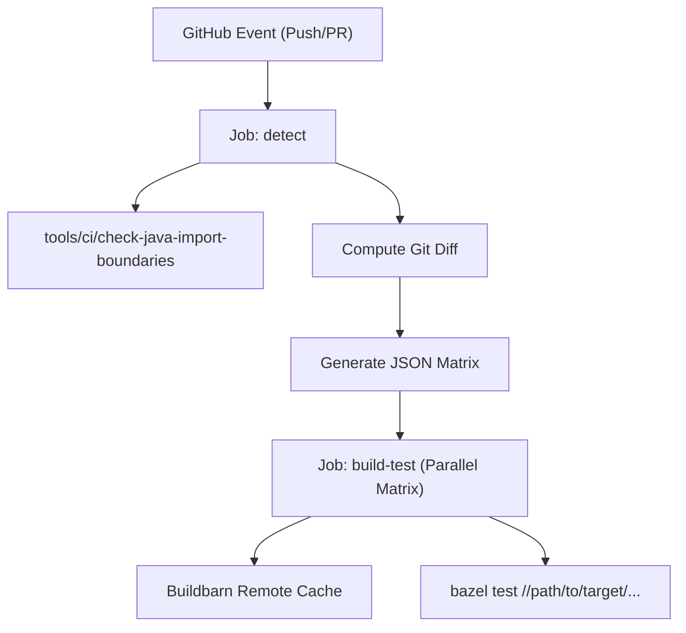
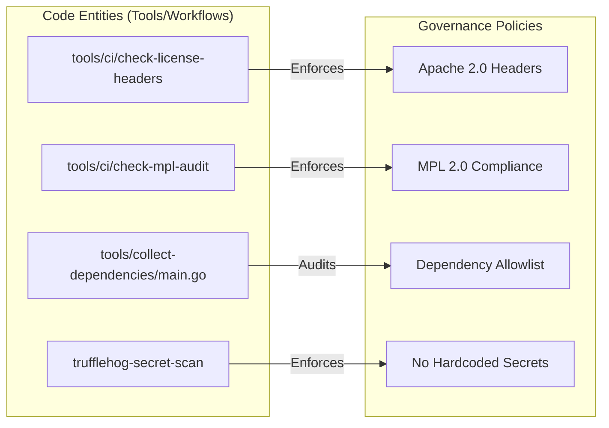
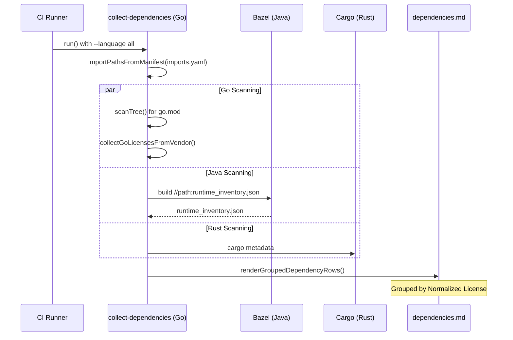

<!-- source: DeepWiki mcp.deepwiki.com · repo NVIDIA/nvcf · page 7.2 CI Pipelines and Governance · fetched 2026-10-26 -->

# CI Pipelines and Governance

Relevant source files

The following files were used as context for generating this wiki page:

- [.coderabbit.yaml](.coderabbit.yaml)
- [.github/workflows/actionlint.yml](.github/workflows/actionlint.yml)
- [.github/workflows/bazel.yml](.github/workflows/bazel.yml)
- [.github/workflows/build-test.yml](.github/workflows/build-test.yml)
- [.github/workflows/codeql-comment.yml](.github/workflows/codeql-comment.yml)
- [.github/workflows/codeql.yml](.github/workflows/codeql.yml)
- [.github/workflows/license-dependencies.yml](.github/workflows/license-dependencies.yml)
- [.github/workflows/secret-scan.yml](.github/workflows/secret-scan.yml)
- [dependencies.md](dependencies.md)
- [license-compliance.md](license-compliance.md)
- [src/control-plane-services/function-autoscaler/.gitignore](src/control-plane-services/function-autoscaler/.gitignore)
- [src/control-plane-services/instance-cluster-management/NOTICE](src/control-plane-services/instance-cluster-management/NOTICE)
- [src/control-plane-services/instance-cluster-management/notice_metadata.json](src/control-plane-services/instance-cluster-management/notice_metadata.json)
- [tools/bazel/java/generate_notice.py](tools/bazel/java/generate_notice.py)
- [tools/bazel/java/generate_notice_test.py](tools/bazel/java/generate_notice_test.py)
- [tools/ci/check-dependency-docs](tools/ci/check-dependency-docs)
- [tools/ci/check-license](tools/ci/check-license)
- [tools/ci/check-license-headers](tools/ci/check-license-headers)
- [tools/ci/check-mpl-audit](tools/ci/check-mpl-audit)
- [tools/ci/check-nested-modules](tools/ci/check-nested-modules)
- [tools/ci/nested-modules.txt](tools/ci/nested-modules.txt)
- [tools/ci/test-check-nested-modules](tools/ci/test-check-nested-modules)
- [tools/collect-dependencies/README.md](tools/collect-dependencies/README.md)
- [tools/collect-dependencies/common.go](tools/collect-dependencies/common.go)
- [tools/collect-dependencies/go_deps.go](tools/collect-dependencies/go_deps.go)
- [tools/collect-dependencies/java_deps.go](tools/collect-dependencies/java_deps.go)
- [tools/collect-dependencies/main.go](tools/collect-dependencies/main.go)
- [tools/collect-dependencies/main_test.go](tools/collect-dependencies/main_test.go)
- [tools/collect-dependencies/node-deps.go](tools/collect-dependencies/node-deps.go)
- [tools/collect-dependencies/rust_deps.go](tools/collect-dependencies/rust_deps.go)
- [tools/collect-dependencies/scan.go](tools/collect-dependencies/scan.go)
- [tools/scripts/test/test-check-license-headers](tools/scripts/test/test-check-license-headers)
- [tools/scripts/test/test-check-mpl-audit](tools/scripts/test/test-check-mpl-audit)

This page documents the GitHub Actions workflows and governance tools that ensure code quality, security, and license compliance for the NVCF repository. The CI system is designed around a Bazel-centric monorepo model, utilizing change-aware subtree selection to optimize build times and strict static analysis to maintain architectural boundaries.

## Bazel CI Pipeline (`bazel.yml`)

The core CI pipeline is defined in `.github/workflows/bazel.yml`. It handles the building and testing of all components using a dependency-aware matrix.

### Implementation and Data Flow
The pipeline uses a two-stage approach:
1.  **Detect Job**: Executes `tools/ci/check-java-import-boundaries` [[.github/workflows/bazel.yml:85-85]()] and computes a matrix of changed subtrees based on the git diff [[.github/workflows/bazel.yml:70-76]()].
2.  **Build/Test Job**: Spawns parallel workers for each identified subtree. It uses a shared `BAZEL_CI_IMAGE` defined in repository variables [[.github/workflows/bazel.yml:55-57]()] and connects to a Buildbarn remote cache to accelerate execution [[.github/workflows/bazel.yml:21-21]()].

### Subtree Matrix Logic
The `ROWS` variable in the `detect` job defines the mapping between service IDs and their filesystem paths.

| ID | Path | Component Kind |
| :--- | :--- | :--- |
| `root` | `.` | `root` |
| `grpc-proxy` | `src/invocation-plane-services/grpc-proxy` | `go-root` |
| `http-invocation` | `src/invocation-plane-services/http-invocation` | `go-root` |
| `byoo-otel-collector` | `src/compute-plane-services/byoo-otel-collector` | `custom` |

Sources: [[.github/workflows/bazel.yml:104-146]()]

### CI Execution Flow

Sources: [[.github/workflows/bazel.yml:21-35](), [.github/workflows/bazel.yml:69-76]()]

---

## Static Analysis and Linting

### CodeQL Static Analysis (`codeql.yml`)
The `codeql.yml` workflow performs language-aware security scanning.
*   **Language Detection**: A `detect` job determines which languages (Go, Rust, Java) were modified [[.github/workflows/codeql.yml:51-60]()].
*   **Build Modes**: Rust and Java utilize `build-mode: none` for faster analysis, while Go requires `autobuild` [[.github/workflows/codeql.yml:88-90]()].
*   **Advisory Feedback**: On PRs, `fail-on-findings` is set to `false` to provide advisory feedback without blocking merges during rollout [[.github/workflows/codeql.yml:125-125]()].

### Actionlint (`actionlint.yml`)
Validates the GitHub Actions workflows themselves. It downloads a pinned version of `actionlint` and runs `shellcheck` over `run:` blocks with a severity threshold of `warning` [[.github/workflows/actionlint.yml:38-55]()].

Sources: [[.github/workflows/codeql.yml:2-106](), [.github/workflows/actionlint.yml:1-59]()]

---

## Governance and Compliance

The repository maintains strict governance over dependencies and licensing through automated checks.

### License and Header Enforcement
The `license-dependencies.yml` workflow executes several critical checks:
*   **check-license**: Runs `tools/ci/check-license` to verify Apache 2.0 SPDX headers in source files [[.github/workflows/license-dependencies.yml:33-34]()].
*   **check-mpl-audit**: Audits files covered by the Mozilla Public License (MPL) 2.0, ensuring that modifications include the required "Not a contribution" header [[license-compliance.md:35-42]()].
*   **check-dependency-docs**: Ensures that the `dependencies.md` file is up to date with the current state of the codebase [[.github/workflows/license-dependencies.yml:107-108]()].

### Dependency Inventory Generation
The `collect-dependencies` tool (`tools/collect-dependencies/main.go`) scans the repository to generate a unified audit rollup.

| Feature | Implementation |
| :--- | :--- |
| **Go** | Scans `go.mod` and `vendor/` directories [[tools/collect-dependencies/README.md:84-91]()] |
| **Java** | Scans `bazel-java-ci.json` descriptors and builds `runtime_inventory.json` targets [[tools/collect-dependencies/README.md:48-52]()] |
| **Rust** | Executes `cargo metadata` and queries the crates.io API [[tools/collect-dependencies/README.md:99-100]()] |
| **Helm** | Reads `Chart.yaml` and `Chart.lock` files [[tools/collect-dependencies/main_test.go:108-120]()] |

### Nested Module Ledger
The `build-test.yml` workflow includes a check for the nested Bazel module inventory using `tools/ci/check-nested-modules` [[.github/workflows/build-test.yml:67-70]()]. This ensures that all sub-modules are correctly registered in the CI system and that no "orphaned" code exists that isn't being tested.

### Secret Scanning
`secret-scan.yml` utilizes **TruffleHog** to detect hardcoded credentials. It is configured to fail the gate on findings and specifically handles `merge_group` events by passing the explicit `base` and `head` SHA range [[.github/workflows/secret-scan.yml:25-49]()].

Sources: [[.github/workflows/license-dependencies.yml:23-50](), [license-compliance.md:116-132](), [tools/collect-dependencies/README.md:40-57](), [.github/workflows/build-test.yml:67-70](), [.github/workflows/secret-scan.yml:35-49]()]

---

## Code Entity to Governance Mapping

The following diagram maps specific CI tools and scripts to the governance policies they enforce.

Sources: [[tools/ci/check-license-headers:17-19](), [tools/ci/check-mpl-audit:1-5](), [tools/collect-dependencies/main.go:34-66](), [.github/workflows/secret-scan.yml:25-26]()]

---

## CI Data Flow: Dependency Collection

The dependency collection process bridges multiple package managers into a single Markdown report.

Sources: [[tools/collect-dependencies/main.go:34-103](), [tools/collect-dependencies/README.md:48-52](), [tools/collect-dependencies/README.md:99-100]()]

---

