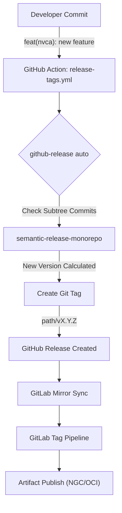
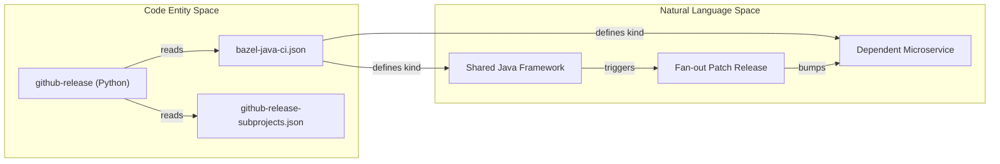

<!-- source: DeepWiki mcp.deepwiki.com · repo NVIDIA/nvcf · page 7.3 Release Process and GitHub Release Automation · fetched 2026-10-26 -->

# Release Process and GitHub Release Automation

Relevant source files

The following files were used as context for generating this wiki page:

- [.github/workflows/release-tags.yml](.github/workflows/release-tags.yml)
- [docs/dev/github-release-process.md](docs/dev/github-release-process.md)
- [docs/dev/release-process.md](docs/dev/release-process.md)
- [docs/user/metrics/ess/metrics.md](docs/user/metrics/ess/metrics.md)
- [docs/v0.6.0/metrics/ess/metrics.md](docs/v0.6.0/metrics/ess/metrics.md)
- [src/compute-plane-services/nvca/VERSION](src/compute-plane-services/nvca/VERSION)
- [src/invocation-plane-services/llm-api-gateway/BUILD.bazel](src/invocation-plane-services/llm-api-gateway/BUILD.bazel)
- [src/invocation-plane-services/llm-api-gateway/Dockerfile](src/invocation-plane-services/llm-api-gateway/Dockerfile)
- [src/invocation-plane-services/llm-api-gateway/kustomize/bases/rate-limit-sync-worker/deployment.yaml](src/invocation-plane-services/llm-api-gateway/kustomize/bases/rate-limit-sync-worker/deployment.yaml)
- [src/libraries/python/nv-cloud-function-helpers/AGENTS.md](src/libraries/python/nv-cloud-function-helpers/AGENTS.md)
- [src/libraries/python/nv-cloud-function-helpers/CLAUDE.md](src/libraries/python/nv-cloud-function-helpers/CLAUDE.md)
- [src/libraries/python/nv-cloud-function-helpers/nv_cloud_function_helpers/__init__.py](src/libraries/python/nv-cloud-function-helpers/nv_cloud_function_helpers/__init__.py)
- [src/libraries/python/nv-cloud-function-helpers/nv_cloud_function_helpers/nvcf_container/__init__.py](src/libraries/python/nv-cloud-function-helpers/nv_cloud_function_helpers/nvcf_container/__init__.py)
- [src/libraries/python/nv-cloud-function-helpers/nv_cloud_function_helpers/nvcf_container/helpers.py](src/libraries/python/nv-cloud-function-helpers/nv_cloud_function_helpers/nvcf_container/helpers.py)
- [src/libraries/python/nv-cloud-function-helpers/pyproject.toml](src/libraries/python/nv-cloud-function-helpers/pyproject.toml)
- [src/libraries/python/nv-cloud-function-helpers/setup.py](src/libraries/python/nv-cloud-function-helpers/setup.py)
- [tools/changelog-site/README.md](tools/changelog-site/README.md)
- [tools/changelog-site/changelog-site](tools/changelog-site/changelog-site)
- [tools/changelog-site/go.mod](tools/changelog-site/go.mod)
- [tools/changelog-site/go.sum](tools/changelog-site/go.sum)
- [tools/changelog-site/main.go](tools/changelog-site/main.go)
- [tools/changelog-site/main_test.go](tools/changelog-site/main_test.go)
- [tools/ci/github-release](tools/ci/github-release)
- [tools/ci/github-release-subprojects.json](tools/ci/github-release-subprojects.json)
- [tools/ci/test-github-release.py](tools/ci/test-github-release.py)

The NVIDIA Cloud Functions (NVCF) release process is a multi-stage, automated pipeline designed to handle a large-scale monorepo containing dozens of services. It leverages **Conventional Commits** to automate versioning, GitHub Actions for orchestration, and a custom Python tool, `github-release`, to manage the complexities of monorepo tagging and cross-service dependencies.

## Overview and Purpose

The primary goal of the release automation is to ensure that every service, library, and deployment stack in the monorepo can be released independently without manual intervention or version collisions [docs/dev/release-process.md:8-10](). The system supports:
*   **Semantic Versioning**: Automated bumping based on commit messages [tools/ci/github-release:16-27]().
*   **Path-Scoped Tagging**: Preventing collisions by prefixing tags with the service's repository path [docs/dev/release-process.md:32-42]().
*   **Dependency-Triggered Releases**: Automatically releasing Java services when shared frameworks are updated [docs/dev/github-release-process.md:146-163]().
*   **Dual-Pipeline Execution**: Synchronizing releases between GitHub (public) and GitLab (internal) [docs/dev/github-release-process.md:61-64]().

---

## Release Core Components

The release system is driven by two main entities: the `github-release` script and the `github-release-subprojects.json` configuration.

### 1. github-release Script
This Python script serves as the engine for all release operations. It supports several subcommands:
*   `auto`: Scans the commit history to determine if any subprojects require a new release [tools/ci/github-release:105]().
*   `branch-cut`: Creates a new release branch (e.g., `release-nvca/v3.3`) and prepares a PR to bump versions [tools/ci/github-release:137]().
*   `tag`: Validates a newly pushed tag and generates release notes [tools/ci/github-release:180]().
*   `anchor`: Used to establish historical version points during migration [docs/dev/github-release-process.md:46-47]().

### 2. github-release-subprojects.json
This generated file is the source of truth for all releasable artifacts. It defines the relationship between service IDs, their paths, and their versioning strategies [tools/ci/github-release-subprojects.json:8-56]().

| Field | Description |
| :--- | :--- |
| `id` | Unique identifier for the service (e.g., `nvca`, `grpc-proxy`) |
| `path` | Repository-relative path used for commit scoping |
| `tag_format` | Template for git tags, typically `<path>/v${version}` |
| `version_file` | Path to a static version file (for non-semantic-release services) |
| `dev_prerelease` | Boolean flag to enable `-dev.N` suffixing on the main branch |

**Sources:** [tools/ci/github-release:1-114](), [tools/ci/github-release-subprojects.json:1-80](), [docs/dev/github-release-process.md:74-91]()

---

## Release Logic and Versioning

### Conventional Commits Mapping
The system uses the `COMMIT_SUBJECT_PATTERN` [tools/ci/github-release:45]() to parse commits. Version increments are determined by the following rules [tools/ci/github-release:16-27]():

| Commit Type | Release Impact |
| :--- | :--- |
| `feat` | Minor bump (0.x.0) |
| `fix`, `perf` | Patch bump (0.0.x) |
| `chore`, `docs`, `refactor`, `test` | No release |
| `!` (Breaking Change) | Major bump (x.0.0) |

### Release Flow Diagram
The following diagram illustrates the transition from a developer commit to a published release.

**Release Lifecycle Flow**

**Sources:** [docs/dev/release-process.md:17-23](), [tools/ci/github-release:16-27](), [docs/dev/github-release-process.md:61-64]()

---

## Java Framework Dependency Release

A unique feature of the NVCF release process is the handling of shared Java libraries. Since `semantic-release-monorepo` only looks at a service's specific subtree, changes to the shared `nv-boot` framework [src/libraries/java/]() would normally be ignored.

The `github-release` script solves this by:
1.  Loading `bazel-java-ci.json` descriptors to identify `java-framework` vs `java-service` components [tools/ci/github-release:37-40]().
2.  Scanning framework paths for release-worthy commits [tools/ci/github-release:43]().
3.  Forcing a patch release for every dependent service if the framework has changed since the service's last tag [docs/dev/github-release-process.md:146-163]().

**Java Release Logic Association**

**Sources:** [tools/ci/github-release:32-43](), [tools/ci/test-github-release.py:122-143](), [docs/dev/github-release-process.md:155-163]()

---

## Release Branch Management

For core infrastructure like the NVIDIA Cluster Agent (`nvca`) or the `self-managed-stack`, releases are managed via dedicated branches.

1.  **Branch Cut**: Triggered via `workflow_dispatch` in `release-tags.yml` [release-tags.yml:107-137]().
2.  **Version Update**: The script cuts a branch named `release-<service>/v<major>.<minor>` and opens a PR to update the `VERSION` file in that branch [tools/ci/github-release:137](), [src/compute-plane-services/nvca/VERSION:1]().
3.  **Tagging**: 
    *   On `main`, the system creates `-dev.N` tags [docs/dev/github-release-process.md:117-122]().
    *   On `release-*` branches, the system creates stable patch tags [docs/dev/github-release-process.md:124-125]().

### Subproject Configuration Example
Excerpts from the subproject metadata showing different versioning strategies:
| ID | Path | Version Source |
| :--- | :--- | :--- |
| `nvca` | `src/compute-plane-services/nvca` | `VERSION` file + dev_prerelease [tools/ci/github-release-subprojects.json:155-161]() |
| `grpc-proxy` | `src/invocation-plane-services/grpc-proxy` | Semantic Commits [tools/ci/github-release-subprojects.json:58-62]() |
| `nvcf-cli` | `src/clis/nvcf-cli` | Semantic Commits [tools/ci/github-release-subprojects.json:28-32]() |

---

## Dual Pipeline and Migration

The system operates across GitHub and GitLab to utilize different runner capabilities (e.g., specialized GPU runners or internal NGC tokens available only in GitLab).

*   **GitHub**: Acts as the source of truth for code and release tagging [docs/dev/github-release-process.md:61]().
*   **GitLab Mirror**: Receives tags from GitHub. The GitLab tag pipeline is responsible for the final artifact publish to the NVIDIA GPU Cloud (NGC) [docs/dev/release-process.md:23](), [docs/dev/github-release-process.md:62-64]().

### Cutover Controls
Release automation is protected by several safety gates to prevent accidental tag explosions during migration [docs/dev/github-release-process.md:9-20]():
*   `NVCF_GITHUB_AUTO_TAGGING_ENABLED`: Global kill-switch (defaults to `false`).
*   `NVCF_GITHUB_RELEASE_DRY_RUN`: If `true`, the script logs what it *would* do without writing to the Git API.
*   `NVCF_GITHUB_RELEASE_DRAFT`: Creates draft releases for manual review.

**Sources:** [release-tags.yml:38-46](), [docs/dev/github-release-process.md:32-59](), [tools/ci/github-release:55-60]()

---

