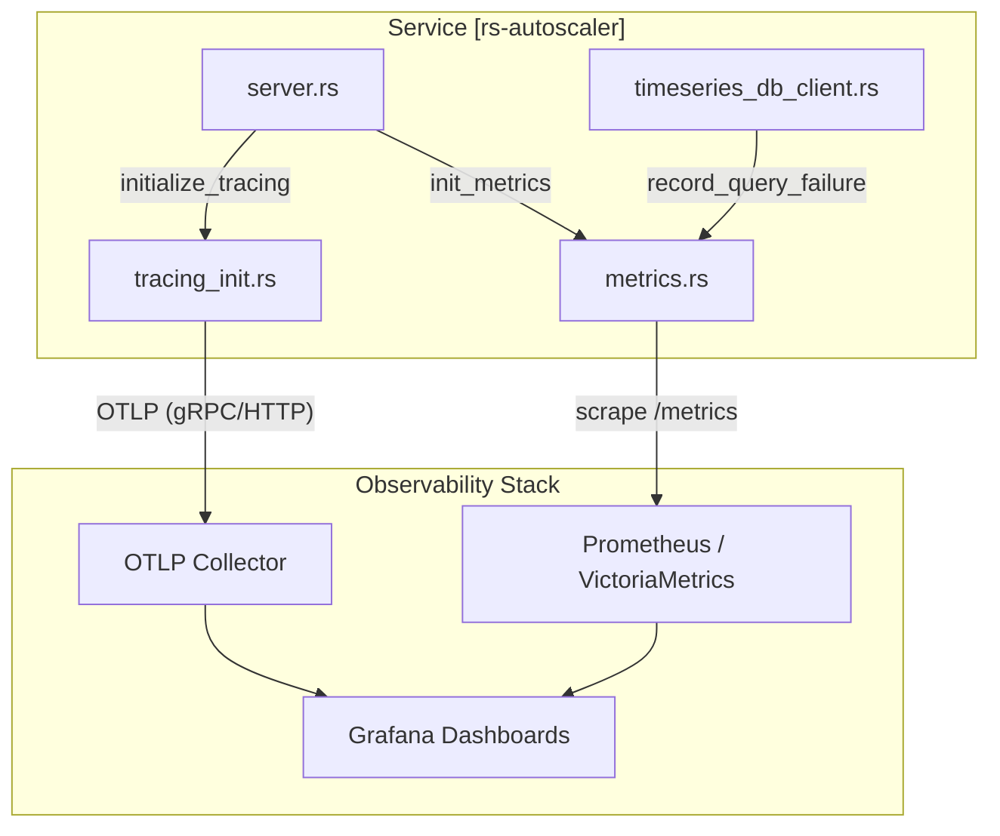
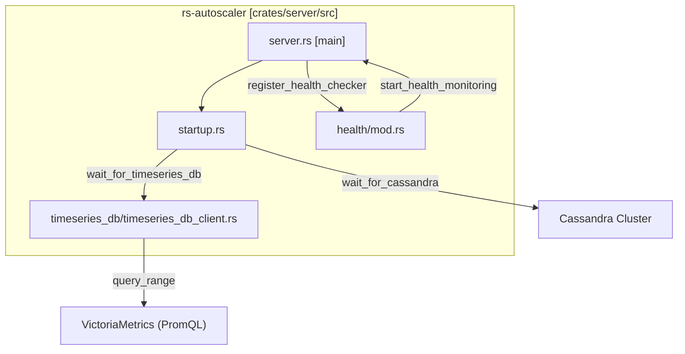

<!-- source: DeepWiki mcp.deepwiki.com · repo NVIDIA/nvcf · page 8 Observability and Autoscaling · fetched 2026-10-26 -->

# Observability and Autoscaling

Relevant source files

The following files were used as context for generating this wiki page:

- [docs/user/autoscaling/architecture.md](docs/user/autoscaling/architecture.md)
- [docs/user/autoscaling/index.md](docs/user/autoscaling/index.md)
- [docs/user/autoscaling/observability.md](docs/user/autoscaling/observability.md)
- [docs/user/autoscaling/operations.md](docs/user/autoscaling/operations.md)
- [docs/user/configure-autoscaling.md](docs/user/configure-autoscaling.md)
- [docs/user/example-dashboards.md](docs/user/example-dashboards.md)
- [docs/user/metrics/grpc-proxy/metrics.md](docs/user/metrics/grpc-proxy/metrics.md)
- [docs/user/metrics/metrics-index.md](docs/user/metrics/metrics-index.md)
- [docs/user/observability.md](docs/user/observability.md)
- [docs/v0.5/installation.md](docs/v0.5/installation.md)
- [docs/v0.5/observability.md](docs/v0.5/observability.md)
- [src/control-plane-services/function-autoscaler/Cargo.lock](src/control-plane-services/function-autoscaler/Cargo.lock)
- [src/control-plane-services/function-autoscaler/crates/server/Cargo.toml](src/control-plane-services/function-autoscaler/crates/server/Cargo.toml)
- [src/control-plane-services/function-autoscaler/crates/server/src/health/mod.rs](src/control-plane-services/function-autoscaler/crates/server/src/health/mod.rs)
- [src/control-plane-services/function-autoscaler/crates/server/src/secrets/secrets_config.rs](src/control-plane-services/function-autoscaler/crates/server/src/secrets/secrets_config.rs)
- [src/control-plane-services/function-autoscaler/crates/server/src/server.rs](src/control-plane-services/function-autoscaler/crates/server/src/server.rs)
- [src/control-plane-services/function-autoscaler/crates/server/src/startup.rs](src/control-plane-services/function-autoscaler/crates/server/src/startup.rs)
- [src/control-plane-services/function-autoscaler/crates/server/src/timeseries_db/mod.rs](src/control-plane-services/function-autoscaler/crates/server/src/timeseries_db/mod.rs)
- [src/control-plane-services/function-autoscaler/crates/server/src/timeseries_db/timeseries_db_client.rs](src/control-plane-services/function-autoscaler/crates/server/src/timeseries_db/timeseries_db_client.rs)
- [src/control-plane-services/function-autoscaler/crates/server/src/tracing_init.rs](src/control-plane-services/function-autoscaler/crates/server/src/tracing_init.rs)

This section provides a high-level overview of the NVCF observability stack and the automated scaling system. The observability framework is designed to be cloud-agnostic and offline-capable, supporting open standards such as Prometheus and OpenTelemetry (OTLP) [docs/user/observability.md:20-25](). The autoscaling system leverages these metrics to dynamically adjust function instance counts based on demand.

## Observability Architecture

The observability stack provides visibility into the Control Plane, Invocation Plane, and Compute Plane services. It is primarily composed of three pillars: metrics, logging, and tracing.

### Metrics and Monitoring
All NVCF control-plane services expose Prometheus-compatible metrics endpoints [docs/user/observability.md:91-93](). These metrics follow the RED method (Rate, Errors, Duration) to provide a consistent view of service health.

*   **State Metrics Service**: A specialized service that aggregates and exports NVCF-specific application signals, such as per-function instance counts, queue depth, and request latency [docs/user/observability.md:73-74](), [docs/user/metrics/metrics-index.md:11-11]().
*   **Service-Specific Metrics**: Detailed metrics are available for the `nvcf-api`, `invocation-service`, `gRPC Proxy`, and `ESS` [docs/user/metrics/metrics-index.md:7-10]().
*   **Datastore Metrics**: Monitoring for the underlying infrastructure, including Cassandra and OpenBao (Vault) [docs/user/metrics/metrics-index.md:28-29]().

### Logging and Tracing
*   **Logging**: Services emit structured logs to `stdout`/`stderr`, which can be collected by standard Kubernetes log aggregators like Fluent Bit or Promtail [docs/user/observability.md:107-119]().
*   **Tracing**: NVCF uses OpenTelemetry for distributed tracing, propagating W3C Trace Context across service boundaries. Traces are exported via OTLP to backends like Tempo or Jaeger [docs/user/observability.md:125-133]().

For detailed metrics documentation and dashboard setup, see [Metrics, Tracing, and Dashboards](#8.1).

### Observability Data Flow
The following diagram illustrates how telemetry data flows from the Rust-based `rs-autoscaler` and other services to the observability backend.

**Telemetry Data Flow Diagram**

Sources: [src/control-plane-services/function-autoscaler/crates/server/src/server.rs:65-84](), [src/control-plane-services/function-autoscaler/crates/server/src/tracing_init.rs:32-103](), [src/control-plane-services/function-autoscaler/crates/server/src/timeseries_db/timeseries_db_client.rs:19-22]()

---

## Function Autoscaling

The Function Autoscaler is a Rust-based service (`rs-autoscaler`) responsible for maintaining the desired number of function instances across compute clusters [src/control-plane-services/function-autoscaler/crates/server/Cargo.toml:17-21]().

### Core Components
1.  **Discovery Loop**: Scans the time-series database (e.g., VictoriaMetrics) to identify active functions requiring scaling actions.
2.  **Scaling Loop**: Calculates the required instance counts based on configured scaling policies (e.g., target concurrency) and writes these values back to the NVCF API.
3.  **Timeseries DB Integration**: The autoscaler queries PromQL endpoints to retrieve real-time metrics like request rates and queue depths [src/control-plane-services/function-autoscaler/crates/server/src/server.rs:151-160]().
4.  **Health Monitoring**: The service includes a coordinated health system that tracks the status of its dependencies, such as Cassandra and the Time-series DB [src/control-plane-services/function-autoscaler/crates/server/src/server.rs:93-165]().

### Scaling Logic and Dependencies
The autoscaler relies on `CassandraServiceManager` for state management and `TimeseriesDbClient` for metric retrieval.

**Autoscaler Internal Logic Diagram**

Sources: [src/control-plane-services/function-autoscaler/crates/server/src/server.rs:125-165](), [src/control-plane-services/function-autoscaler/crates/server/src/startup.rs:38-96](), [src/control-plane-services/function-autoscaler/crates/server/src/timeseries_db/timeseries_db_client.rs:78-82]()

For configuration guides and operational runbooks, see [Function Autoscaling Configuration and Operations](#8.2).

---

## Sub-pages

| Page | Description |
| :--- | :--- |
| **[Metrics, Tracing, and Dashboards](#8.1)** | Technical details on RED metrics, OTel tracing, and reference Grafana dashboards. |
| **[Function Autoscaling Configuration and Operations](#8.2)** | Guide for configuring scaling policies, scale-to-zero, and managing quota limits. |

---

