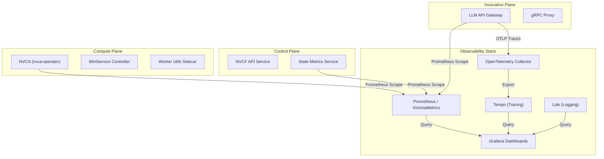
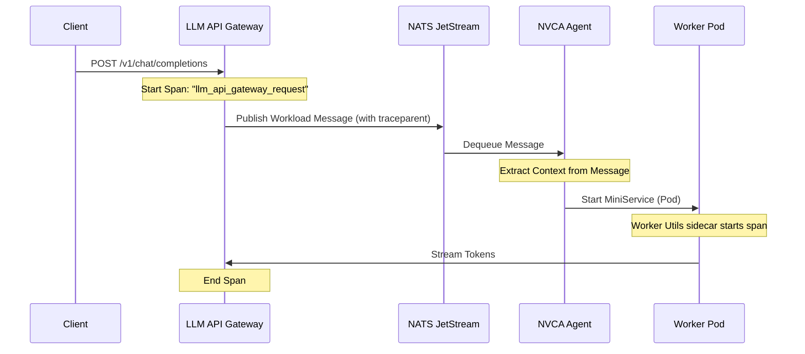

<!-- source: DeepWiki mcp.deepwiki.com · repo NVIDIA/nvcf · page 8.1 Metrics, Tracing, and Dashboards · fetched 2026-10-26 -->

# Metrics, Tracing, and Dashboards

<details>
<summary>Relevant source files</summary>

The following files were used as context for generating this wiki page:

- [deploy/helm/nvca-operator/nvca-operator/templates/pre-delete-cleanup-job.yaml](deploy/helm/nvca-operator/nvca-operator/templates/pre-delete-cleanup-job.yaml)
- [deploy/helm/nvca-operator/nvca-operator/templates/pre-delete-cleanup-rbac.yaml](deploy/helm/nvca-operator/nvca-operator/templates/pre-delete-cleanup-rbac.yaml)
- [docs/user/autoscaling/architecture.md](docs/user/autoscaling/architecture.md)
- [docs/user/autoscaling/index.md](docs/user/autoscaling/index.md)
- [docs/user/autoscaling/observability.md](docs/user/autoscaling/observability.md)
- [docs/user/autoscaling/operations.md](docs/user/autoscaling/operations.md)
- [docs/user/cluster-management/container-cache.md](docs/user/cluster-management/container-cache.md)
- [docs/user/configure-autoscaling.md](docs/user/configure-autoscaling.md)
- [docs/user/example-dashboards.md](docs/user/example-dashboards.md)
- [docs/user/metrics/grpc-proxy/metrics.md](docs/user/metrics/grpc-proxy/metrics.md)
- [docs/user/metrics/metrics-index.md](docs/user/metrics/metrics-index.md)
- [docs/user/observability.md](docs/user/observability.md)
- [docs/v0.5/installation.md](docs/v0.5/installation.md)
- [docs/v0.5/observability.md](docs/v0.5/observability.md)
- [src/compute-plane-services/nvca/AGENTS.md](src/compute-plane-services/nvca/AGENTS.md)
- [src/compute-plane-services/nvca/internal/metrics/METRICS.md](src/compute-plane-services/nvca/internal/metrics/METRICS.md)
- [src/compute-plane-services/nvca/internal/metrics/metrics.go](src/compute-plane-services/nvca/internal/metrics/metrics.go)
- [src/compute-plane-services/nvca/internal/metrics/metrics_test.go](src/compute-plane-services/nvca/internal/metrics/metrics_test.go)
- [src/compute-plane-services/nvca/pkg/nvca/agent.go](src/compute-plane-services/nvca/pkg/nvca/agent.go)
- [src/compute-plane-services/nvca/pkg/nvca/agent_metrics_test.go](src/compute-plane-services/nvca/pkg/nvca/agent_metrics_test.go)
- [src/compute-plane-services/nvca/pkg/nvca/agent_test.go](src/compute-plane-services/nvca/pkg/nvca/agent_test.go)
- [src/compute-plane-services/nvca/pkg/nvca/cli.go](src/compute-plane-services/nvca/pkg/nvca/cli.go)
- [src/compute-plane-services/nvca/pkg/nvca/cli_test.go](src/compute-plane-services/nvca/pkg/nvca/cli_test.go)
- [src/compute-plane-services/nvca/pkg/nvca/jwks_updater.go](src/compute-plane-services/nvca/pkg/nvca/jwks_updater.go)
- [src/compute-plane-services/nvca/pkg/nvca/jwks_updater_test.go](src/compute-plane-services/nvca/pkg/nvca/jwks_updater_test.go)
- [src/compute-plane-services/nvca/pkg/types/types.go](src/compute-plane-services/nvca/pkg/types/types.go)
- [src/invocation-plane-services/llm-api-gateway/cmd/llm-api-gateway/main.go](src/invocation-plane-services/llm-api-gateway/cmd/llm-api-gateway/main.go)
- [src/invocation-plane-services/llm-api-gateway/config/config_test.go](src/invocation-plane-services/llm-api-gateway/config/config_test.go)
- [src/invocation-plane-services/llm-api-gateway/telemetry/BUILD.bazel](src/invocation-plane-services/llm-api-gateway/telemetry/BUILD.bazel)
- [src/invocation-plane-services/llm-api-gateway/telemetry/auth_metrics_test.go](src/invocation-plane-services/llm-api-gateway/telemetry/auth_metrics_test.go)
- [src/invocation-plane-services/llm-api-gateway/telemetry/metrics_test.go](src/invocation-plane-services/llm-api-gateway/telemetry/metrics_test.go)
- [src/invocation-plane-services/llm-api-gateway/telemetry/runtime.go](src/invocation-plane-services/llm-api-gateway/telemetry/runtime.go)

</details>


This page documents the observability architecture and configuration for self-hosted NVCF. The system utilizes open standards, including Prometheus for metrics and OpenTelemetry (OTel) for distributed tracing, to provide visibility into the health and performance of the Control, Invocation, and Compute planes.

## Observability Architecture

The NVCF observability stack is designed to be cloud-agnostic and offline-capable, integrating with existing platforms via standard protocols (OTLP, Prometheus scrape endpoints) [docs/user/observability.md:18-27]().

### Data Flow Overview

The following diagram illustrates how telemetry data flows from NVCF services to the observability backend.

**Diagram: Telemetry Data Flow**

**Sources:** [docs/user/observability.md:89-135](), [docs/user/metrics/metrics-index.md:5-25]()

---

## Metrics Collection

NVCF follows the **RED method** (Rate, Errors, Duration) for service monitoring. Metrics are exposed via `/metrics` endpoints in Prometheus format [docs/user/observability.md:93-104]().

### Metrics Naming and Labels
All services use standardized labels to allow cross-service correlation:
- `nvca_nca_id`: Unique identifier for the agent instance [src/compute-plane-services/nvca/internal/metrics/metrics.go:130]().
- `nvca_cluster_name`: The name of the Kubernetes cluster [src/compute-plane-services/nvca/internal/metrics/metrics.go:125]().
- `function_id`: The UUID of the NVCF function [src/compute-plane-services/nvca/internal/metrics/metrics.go:141]().

### Key Service Metrics

#### 1. NVCA (NVIDIA Cloud Functions Agent)
The NVCA tracks the health of the compute node and workload lifecycle.
- `nvca_instance_type_capacity`: Total instances deployable on node resources [src/compute-plane-services/nvca/internal/metrics/metrics.go:43]().
- `nvca_queue_message_processed_total`: Counter for messages (FunctionCreation, TaskCreation) processed from NATS/SQS [src/compute-plane-services/nvca/internal/metrics/metrics.go:51]().
- `nvca_miniservice_controller_reconcile_phase_total`: Transitions in the MiniService state machine [src/compute-plane-services/nvca/internal/metrics/metrics.go:59]().

#### 2. LLM API Gateway
The gateway provides OpenAI-compatible endpoints and tracks token usage.
- `llm_api_gateway_http_requests_total`: Total request count [src/invocation-plane-services/llm-api-gateway/telemetry/metrics_test.go:85]().
- `llm_api_gateway_llm_tokens_total`: Counter for generated and prompt tokens [src/invocation-plane-services/llm-api-gateway/telemetry/metrics_test.go:90]().
- `llm_api_gateway_stream_first_token_seconds`: Time to first token (TTFT) latency [src/invocation-plane-services/llm-api-gateway/telemetry/metrics_test.go:92]().

#### 3. State Metrics Service
Aggregates application-level NVCF statistics:
- Per-function instance counts and queue depths [docs/user/observability.md:11]().
- Request latency and function-level signals [docs/user/metrics/metrics-index.md:11]().

**Sources:** [src/compute-plane-services/nvca/internal/metrics/metrics.go:41-145](), [src/invocation-plane-services/llm-api-gateway/telemetry/metrics_test.go:40-112](), [docs/user/metrics/metrics-index.md:1-25]()

---

## Tracing and Context Propagation

NVCF uses **OpenTelemetry** with **W3C Trace Context** propagation to track requests across the Invocation and Compute planes [docs/user/observability.md:127-135]().

### Implementation Details
- **W3C Propagation**: Services utilize `go.opentelemetry.io/otel/propagation` to inject/extract trace headers (`traceparent`) [src/compute-plane-services/nvca/pkg/nvca/jwks_updater.go:45]().
- **Instrumented Clients**: HTTP clients are wrapped with `otelhttp` to automatically start spans and propagate context [src/compute-plane-services/nvca/pkg/nvca/jwks_updater.go:118-121]().
- **Exporter**: Traces are exported via OTLP (HTTP/gRPC) to a configured collector endpoint, typically defined in `global.observability.tracing.collectorEndpoint` [docs/user/example-dashboards.md:71-86]().

**Diagram: Request Tracing Flow**

**Sources:** [src/compute-plane-services/nvca/pkg/nvca/jwks_updater.go:107-125](), [docs/user/observability.md:125-135](), [docs/user/example-dashboards.md:71-86]()

---

## Structured Logging

All services are required to emit structured logs to `stdout` and `stderr` in JSON format for collection by tools like Fluent Bit or Promtail [docs/user/observability.md:105-121]().

- **Redaction**: Sensitive data (API keys, secrets) must be redacted before logs reach the aggregator [docs/user/observability.md:110]().
- **Correlation**: Logs should include `trace_id` and `span_id` when available to allow correlation with distributed traces [docs/user/observability.md:12]().

---

## Dashboards and Visualization

NVCF provides a reference observability stack via Helm (`nvcf-observability-reference-stack`) which includes pre-configured Grafana dashboards [docs/user/example-dashboards.md:23-34]().

### Reference Dashboards
| Dashboard | Key Visualizations |
|-----------|--------------------|
| **NVCF Overview** | Global request rate, error rate, and active function counts. |
| **LLM Gateway** | Token throughput, TTFT, and routing success rates. |
| **Compute Health** | GPU node allocation, instance capacity, and container restart rates. |
| **gRPC Proxy** | Connection counts and NATS pipe health [docs/user/metrics/metrics-index.md:10](). |

### Configuration via Helmfile
Observability is enabled globally in the Helmfile environment configuration:
```yaml
global:
  observability:
    metrics:
      enabled: true
    tracing:
      enabled: true
      collectorEndpoint: "otel-collector.observability.svc.cluster.local"
```
**Sources:** [docs/user/observability.md:141-150](), [docs/user/example-dashboards.md:71-86](), [docs/user/example-dashboards.md:100-117]()

---

