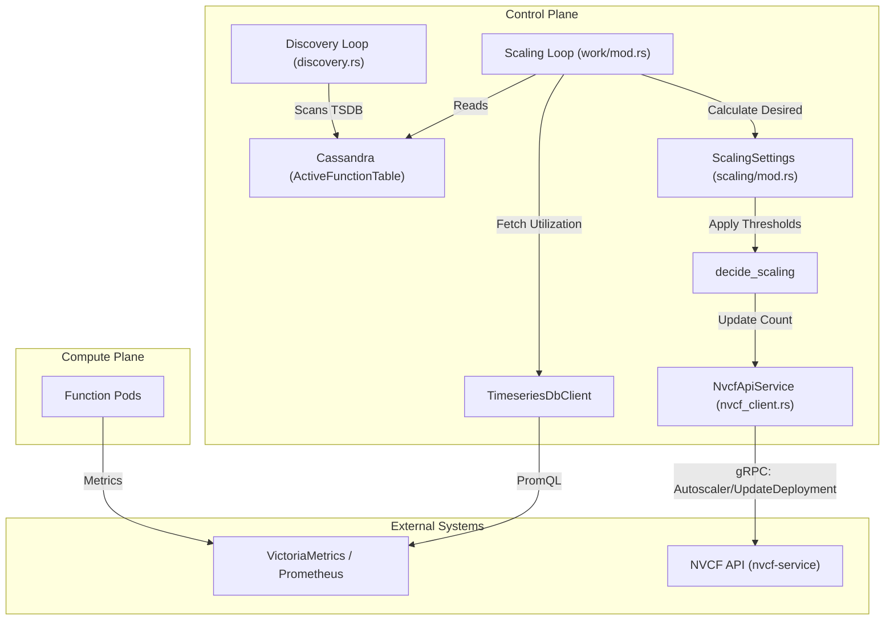

<!-- source: DeepWiki mcp.deepwiki.com · repo NVIDIA/nvcf · page 8.2 Function Autoscaling Configuration and Operations · fetched 2026-10-26 -->

# Function Autoscaling Configuration and Operations

<details>
<summary>Relevant source files</summary>

The following files were used as context for generating this wiki page:

- [deploy/helm/function-autoscaler/Chart.yaml](deploy/helm/function-autoscaler/Chart.yaml)
- [deploy/helm/function-autoscaler/values.yaml](deploy/helm/function-autoscaler/values.yaml)
- [deploy/helm/function-autoscaler/vault-agent-templates/secrets.json.tmpl](deploy/helm/function-autoscaler/vault-agent-templates/secrets.json.tmpl)
- [deploy/stacks/self-managed/tests/observability-autoscaler.sh](deploy/stacks/self-managed/tests/observability-autoscaler.sh)
- [docs/user/autoscaling/architecture.md](docs/user/autoscaling/architecture.md)
- [docs/user/autoscaling/index.md](docs/user/autoscaling/index.md)
- [docs/user/autoscaling/observability.md](docs/user/autoscaling/observability.md)
- [docs/user/autoscaling/operations.md](docs/user/autoscaling/operations.md)
- [docs/user/configure-autoscaling.md](docs/user/configure-autoscaling.md)
- [docs/user/example-dashboards.md](docs/user/example-dashboards.md)
- [docs/user/metrics/grpc-proxy/metrics.md](docs/user/metrics/grpc-proxy/metrics.md)
- [docs/user/metrics/llm-api-gateway/metrics.md](docs/user/metrics/llm-api-gateway/metrics.md)
- [docs/user/metrics/metrics-index.md](docs/user/metrics/metrics-index.md)
- [docs/user/observability.md](docs/user/observability.md)
- [docs/user/runbooks/index.md](docs/user/runbooks/index.md)
- [docs/user/runbooks/update-nvcf-account-quota-limits.md](docs/user/runbooks/update-nvcf-account-quota-limits.md)
- [docs/v0.5/installation.md](docs/v0.5/installation.md)
- [docs/v0.5/observability.md](docs/v0.5/observability.md)
- [src/compute-plane-services/nvca/vendor/github.com/NVIDIA/nvcf/src/libraries/go/lib/pkg/otelconfig/config/render.go](src/compute-plane-services/nvca/vendor/github.com/NVIDIA/nvcf/src/libraries/go/lib/pkg/otelconfig/config/render.go)
- [src/control-plane-services/function-autoscaler/crates/server/proto/nvcf.proto](src/control-plane-services/function-autoscaler/crates/server/proto/nvcf.proto)
- [src/control-plane-services/function-autoscaler/crates/server/resources/settings-local.yaml](src/control-plane-services/function-autoscaler/crates/server/resources/settings-local.yaml)
- [src/control-plane-services/function-autoscaler/crates/server/src/nvcf_api/mod.rs](src/control-plane-services/function-autoscaler/crates/server/src/nvcf_api/mod.rs)
- [src/control-plane-services/function-autoscaler/crates/server/src/nvcf_api/nvcf_client.rs](src/control-plane-services/function-autoscaler/crates/server/src/nvcf_api/nvcf_client.rs)
- [src/control-plane-services/function-autoscaler/crates/server/src/nvcf_api/oauth2_client.rs](src/control-plane-services/function-autoscaler/crates/server/src/nvcf_api/oauth2_client.rs)
- [src/control-plane-services/function-autoscaler/crates/server/src/scaling/mod.rs](src/control-plane-services/function-autoscaler/crates/server/src/scaling/mod.rs)
- [src/control-plane-services/function-autoscaler/crates/server/src/scaling/policy_client.rs](src/control-plane-services/function-autoscaler/crates/server/src/scaling/policy_client.rs)
- [src/control-plane-services/function-autoscaler/crates/server/src/work/discovery.rs](src/control-plane-services/function-autoscaler/crates/server/src/work/discovery.rs)
- [src/control-plane-services/function-autoscaler/crates/server/src/work/mod.rs](src/control-plane-services/function-autoscaler/crates/server/src/work/mod.rs)
- [src/control-plane-services/function-autoscaler/local_env/AGENTS.md](src/control-plane-services/function-autoscaler/local_env/AGENTS.md)
- [src/invocation-plane-services/vanity-gateway/middleware/metrics.go](src/invocation-plane-services/vanity-gateway/middleware/metrics.go)
- [src/invocation-plane-services/vanity-gateway/middleware/metrics_test.go](src/invocation-plane-services/vanity-gateway/middleware/metrics_test.go)
- [src/invocation-plane-services/vanity-gateway/middleware/middleware.go](src/invocation-plane-services/vanity-gateway/middleware/middleware.go)

</details>


The Function Autoscaler is a Rust-based service within the NVCF control plane responsible for dynamically adjusting the number of running function instances based on real-time utilization and demand. It integrates with time-series databases (VictoriaMetrics/Prometheus) to fetch metrics and communicates with the NVCF API to update deployment states.

## Architecture and Core Loops

The autoscaler operates through two primary distributed loops: the **Discovery Loop** and the **Scaling Loop**. To ensure high availability and prevent duplicate work, it uses Cassandra-backed distributed locking and sharding.

### System Architecture Diagram

This diagram illustrates the flow from metric ingestion to scaling commands, mapping code entities to their roles.


**Sources:** [src/control-plane-services/function-autoscaler/crates/server/src/work/mod.rs:25-31](), [src/control-plane-services/function-autoscaler/crates/server/src/work/discovery.rs:18-23](), [src/control-plane-services/function-autoscaler/crates/server/src/nvcf_api/nvcf_client.rs:43-46]()

### Discovery Loop
The discovery loop identifies functions that require autoscaling. It queries the time-series database for functions that have received traffic within a configured lookback window (default 5 minutes) `[src/control-plane-services/function-autoscaler/crates/server/src/work/discovery.rs:39]()`. 

Key features include:
*   **Leader Election**: Uses a distributed lock named `function_discovery` in Cassandra to ensure only one replica performs discovery `[src/control-plane-services/function-autoscaler/crates/server/src/work/discovery.rs:35]()`.
*   **Sharding**: Queries are split into hex-based shards (e.g., `Hex0To3`, `Hex4To7`) using regex on `function_id` to distribute the load on the metrics backend `[src/control-plane-services/function-autoscaler/crates/server/src/work/discovery.rs:43-79]()`.
*   **Sources**: Aggregates data from both the `Invocation Service` and `gRPC Proxy` metrics `[src/control-plane-services/function-autoscaler/crates/server/src/work/discovery.rs:82-101]()`.

### Scaling Loop and Sharding
Once functions are discovered and stored in the `ActiveFunctionTable`, the scaling loop processes them.
*   **Bucket Sharding**: Functions are assigned to one of 1024 buckets `[src/control-plane-services/function-autoscaler/crates/server/src/nvcf_api/nvcf_client.rs:26]()`. 
*   **Concurrency**: Multiple workers process buckets in parallel, using a semaphore to limit concurrent scaling operations per bucket `[src/control-plane-services/function-autoscaler/crates/server/src/work/mod.rs:38-39]()`.
*   **Locking**: A lock with the prefix `util_lock` is acquired per function during utilization calculation to prevent race conditions between autoscaler replicas `[src/control-plane-services/function-autoscaler/crates/server/src/work/mod.rs:63]()`.

**Sources:** [src/control-plane-services/function-autoscaler/crates/server/src/work/mod.rs:57-63](), [src/control-plane-services/function-autoscaler/crates/server/src/work/discovery.rs:109-127]()

## Configuration

The autoscaler is configured via a YAML file (e.g., `settings-local.yaml`). Key configuration blocks include:

### Scaling Policy Settings
| Parameter | Default | Description |
|-----------|---------|-------------|
| `scaling_loop_interval_seconds` | 15s | Frequency of the scaling evaluation. |
| `lookback_seconds` | 600s | Historical data window for utilization calculation. |
| `scale_up_threshold` | 70.0 | Utilization % above which instances are added. |
| `scale_down_threshold` | 30.0 | Utilization % below which instances are removed. |
| `scale_to_zero_idle_timeout_seconds` | 1800s | Time of inactivity before scaling to zero. |

**Sources:** [src/control-plane-services/function-autoscaler/crates/server/src/scaling/mod.rs:64-110](), [src/control-plane-services/function-autoscaler/crates/server/resources/settings-local.yaml:61-75]()

### PromQL Endpoint Configuration
The autoscaler requires a `timeseries_db` configuration to fetch utilization. In self-managed stacks, this typically points to the bundled VictoriaMetrics service.

```yaml
timeseries_db:
  timeseries_db_url: "http://vmsingle.monitoring.svc.cluster.local:8428"
  ignore_env: true
  disable_auth: true
```
**Sources:** [src/control-plane-services/function-autoscaler/crates/server/resources/settings-local.yaml:55-60](), [deploy/stacks/self-managed/tests/observability-autoscaler.sh:79-81]()

## Utilization Calculation

Utilization is calculated by querying the time-series database. The service supports two metric sources:
1.  **Control Plane Metrics**: Based on request latency and concurrency `[src/control-plane-services/function-autoscaler/crates/server/src/work/mod.rs:88-95]()`.
2.  **Worker Metrics**: Based on internal worker thread busy seconds `[src/control-plane-services/function-autoscaler/crates/server/src/work/mod.rs:97-104]()`.

The resulting value is sanitized and passed to `decide_scaling` to determine the new desired instance count `[src/control-plane-services/function-autoscaler/crates/server/src/work/mod.rs:25-27]()`.

## Scale-to-Zero Behavior

Scale-to-zero is a critical cost-saving feature. 
1.  **Inactivity Tracking**: If a function has no active requests and utilization is 0 for the duration of `scale_to_zero_idle_timeout_seconds`, the autoscaler sets the desired instance count to 0 `[src/control-plane-services/function-autoscaler/crates/server/src/scaling/mod.rs:90-94]()`.
2.  **Re-activation**: When a new request arrives for a function at zero instances, the Invocation Plane triggers a "cold start" by updating the function's recently invoked status, which the Discovery Loop picks up.

## Operational Runbooks

### Updating Quota Limits
If an operation fails because an account has reached its function limit, operators must update the account quota in the NVCF API.

**Error Message:**
`Account 'nvcf-default': Reached or exceeded the max limit for the number of functions allowed: 10.` `[docs/user/runbooks/update-nvcf-account-quota-limits.md:6-10]()`

**Resolution using `nvcf-cli`:**
```bash
export NVCF_CLI_ENABLE_ADMIN=1
nvcf-cli admin accounts update --nca-id nvcf-default --max-functions 50
```
**Sources:** [docs/user/runbooks/update-nvcf-account-quota-limits.md:39-46]()

### Verifying Autoscaler Health
The autoscaler provides standard Kubernetes probes:
*   **Liveness**: `/admin/health/liveness` on port 8181 `[deploy/helm/function-autoscaler/values.yaml:73-77]()`.
*   **Readiness**: `/admin/health/readiness` on port 8181 `[deploy/helm/function-autoscaler/values.yaml:79-83]()`.
*   **Metrics**: Prometheus metrics are exposed on port 41338 `[deploy/helm/function-autoscaler/values.yaml:100-102]()`.

**Sources:** [deploy/helm/function-autoscaler/values.yaml:72-119]()

---

