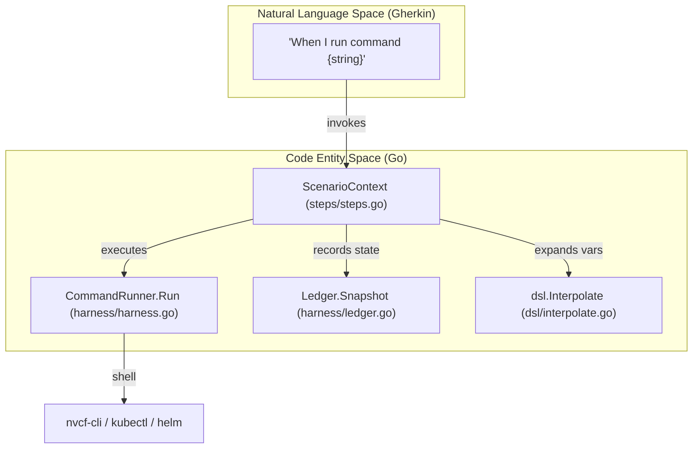
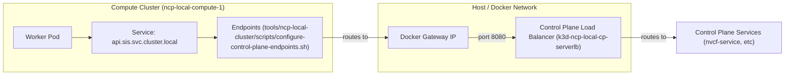

<!-- source: DeepWiki mcp.deepwiki.com · repo NVIDIA/nvcf · page 9 Testing and Local Development · fetched 2026-10-26 -->

# Testing and Local Development

Relevant source files

The following files were used as context for generating this wiki page:

- [tests/bdd/PLAN.md](tests/bdd/PLAN.md)
- [tests/bdd/PLAN_DESTRUCTIVE_CLEANUP.md](tests/bdd/PLAN_DESTRUCTIVE_CLEANUP.md)
- [tests/bdd/README.md](tests/bdd/README.md)
- [tests/bdd/dsl/kubectl.go](tests/bdd/dsl/kubectl.go)
- [tests/bdd/dsl/kubectl_test.go](tests/bdd/dsl/kubectl_test.go)
- [tests/bdd/dsl/yamledit.go](tests/bdd/dsl/yamledit.go)
- [tests/bdd/dsl/yamledit_test.go](tests/bdd/dsl/yamledit_test.go)
- [tests/bdd/features/observability-control.feature](tests/bdd/features/observability-control.feature)
- [tests/bdd/godog_test.go](tests/bdd/godog_test.go)
- [tests/bdd/steps/assertion_steps.go](tests/bdd/steps/assertion_steps.go)
- [tests/bdd/steps/file_steps.go](tests/bdd/steps/file_steps.go)
- [tests/bdd/steps/infra_steps.go](tests/bdd/steps/infra_steps.go)
- [tests/bdd/steps/steps_test.go](tests/bdd/steps/steps_test.go)
- [tools/ncp-local-cluster/.gitignore](tools/ncp-local-cluster/.gitignore)
- [tools/ncp-local-cluster/Makefile](tools/ncp-local-cluster/Makefile)
- [tools/ncp-local-cluster/README.md](tools/ncp-local-cluster/README.md)
- [tools/ncp-local-cluster/apps/compute-control-plane-endpoints/kustomization.yaml](tools/ncp-local-cluster/apps/compute-control-plane-endpoints/kustomization.yaml)
- [tools/ncp-local-cluster/apps/compute-control-plane-endpoints/service-grpc.yaml](tools/ncp-local-cluster/apps/compute-control-plane-endpoints/service-grpc.yaml)
- [tools/ncp-local-cluster/apps/compute-control-plane-endpoints/service-nvct-api.yaml](tools/ncp-local-cluster/apps/compute-control-plane-endpoints/service-nvct-api.yaml)
- [tools/ncp-local-cluster/apps/control-plane-endpoints/kustomization.yaml](tools/ncp-local-cluster/apps/control-plane-endpoints/kustomization.yaml)
- [tools/ncp-local-cluster/apps/envoy-gateway/gateway-grpc.yaml](tools/ncp-local-cluster/apps/envoy-gateway/gateway-grpc.yaml)
- [tools/ncp-local-cluster/docs/multi-cluster-local-cluster-design.md](tools/ncp-local-cluster/docs/multi-cluster-local-cluster-design.md)
- [tools/ncp-local-cluster/k3d-config-control-plane.yaml](tools/ncp-local-cluster/k3d-config-control-plane.yaml)
- [tools/ncp-local-cluster/k3d-config.yaml](tools/ncp-local-cluster/k3d-config.yaml)
- [tools/ncp-local-cluster/sample/deployment.yaml](tools/ncp-local-cluster/sample/deployment.yaml)
- [tools/ncp-local-cluster/sample/kustomization.yaml](tools/ncp-local-cluster/sample/kustomization.yaml)
- [tools/ncp-local-cluster/scripts/configure-control-plane-endpoints.sh](tools/ncp-local-cluster/scripts/configure-control-plane-endpoints.sh)
- [tools/ncp-local-cluster/scripts/render-sample.sh](tools/ncp-local-cluster/scripts/render-sample.sh)
- [tools/ncp-local-cluster/tests/test-multicluster-make.sh](tools/ncp-local-cluster/tests/test-multicluster-make.sh)

This page provides an overview of the NVCF testing strategy and the local development environment. The testing ecosystem is designed to support rapid iteration via local k3d clusters while maintaining high confidence through a strict Behavior-Driven Development (BDD) integration suite that can target both local and remote (EKS) environments.

## BDD Integration Test Suite

The NVCF BDD suite, located in `tests/bdd/`, uses [Godog](https://github.com/cucumber/godog) to execute Gherkin feature files against live or mocked environments [tests/bdd/README.md:1-5](). It follows a "Strict-DSL" philosophy where step handlers are thin wrappers around CLI calls and file operations, ensuring that business logic remains in the feature files rather than hidden in Go code [tests/bdd/PLAN.md:1-6]().

### Core Components
*   **Feature Catalog**: Covers single-cluster and multi-cluster CLI workflows, Helmfile-based installations, and EKS-specific scenarios [tests/bdd/README.md:13-15]().
*   **Harness**: Manages the suite lifecycle, including building the `nvcf-cli` binary and managing the `CommandRunner`, `Ledger` (for file state tracking), and `CommandCache` [tests/bdd/harness/]() [tests/bdd/README.md:17-19]().
*   **DSL Helpers**: Pure Go functions for `${VAR}` interpolation, dotted-path YAML manipulation, and JSON row matching [tests/bdd/dsl/]() [tests/bdd/README.md:20-22]().

For details on writing and running integration tests, see **[BDD Integration Test Suite](#9.1)**.

### BDD Execution Model
The following diagram illustrates how a Gherkin step is translated into system actions via the `ScenarioContext` [tests/bdd/steps/steps_test.go:54-66]().

Sources: [tests/bdd/PLAN.md:109-115](), [tests/bdd/steps/steps_test.go:54-66](), [tests/bdd/harness/harness.go]()

---

## Local Development Cluster (ncp-local-cluster)

The `ncp-local-cluster` tooling, found in `tools/ncp-local-cluster/`, provides a standardized k3d-based environment for developers. It supports both a single-cluster mode (where control and compute planes share one cluster) and a multi-cluster mode that mimics production split topologies [tools/ncp-local-cluster/README.md:3-12]().

### Key Capabilities
*   **Generic Credential Provider**: A Go-based Kubelet plugin that allows pulling images from private registries (like NGC) using local Docker credentials [tools/ncp-local-cluster/README.md:5-6]().
*   **Multi-Cluster Networking**: Uses `Endpoints` and `Service` aliases to route traffic between local k3d clusters (e.g., `ncp-local-cp` to `ncp-local-compute-1`) using standard in-cluster DNS names [tools/ncp-local-cluster/docs/multi-cluster-local-cluster-design.md:48-52]().
*   **Addon Management**: Automated deployment of Envoy Gateway, CSI SMB drivers, and fake GPU operators to simulate production hardware [tools/ncp-local-cluster/Makefile:16]().

For cluster setup and configuration instructions, see **[Local Development Cluster (ncp-local-cluster)](#9.2)**.

### Local Topology Mapping
This diagram maps the local networking components used to bridge multiple k3d clusters on a single host.

Sources: [tools/ncp-local-cluster/docs/multi-cluster-local-cluster-design.md:63-78](), [tools/ncp-local-cluster/scripts/configure-control-plane-endpoints.sh:58-168]()

---

## Examples and Sample Workloads

The `examples/` directory contains a collection of reference implementations for functions and tasks. These samples serve as both documentation for users and test payloads for the BDD suite.

*   **Function Samples**: Includes FastAPI implementations for sync, streaming, and multi-endpoint functions, as well as gRPC echo services [examples/]() [tests/bdd/README.md:16]().
*   **Task Samples**: Demonstrates asynchronous "Bring-Your-Own-Output" (BYOO) tasks and multi-node Helm-based workloads [examples/]() [tests/bdd/README.md:112-114]().
*   **Load Testing**: Includes `k6` scripts for performance benchmarking of the invocation plane.

For a catalog of available samples and how to deploy them, see **[Examples and Sample Workloads](#9.3)**.

### Summary of Testing Tools

| Tool | Location | Primary Purpose |
| :--- | :--- | :--- |
| `nvcf-cli` | `src/cmd/nvcf-cli/` | Primary interface for cluster lifecycle and function management [tests/bdd/harness/harness.go](). |
| `godog` | `tests/bdd/` | Runner for BDD integration tests [tests/bdd/godog_test.go:30](). |
| `k3d` | `tools/ncp-local-cluster/` | Local Kubernetes distribution for development [tools/ncp-local-cluster/Makefile:93](). |
| `generic-credential-provider` | `tools/ncp-local-cluster/credential-provider-go/` | Registry auth for Kubelet [tools/ncp-local-cluster/README.md:5](). |

Sources: [tests/bdd/README.md:17-19](), [tools/ncp-local-cluster/Makefile:16](), [tools/ncp-local-cluster/README.md:3-6]()

---

