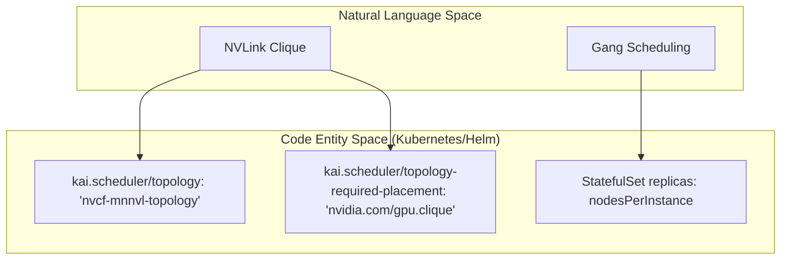
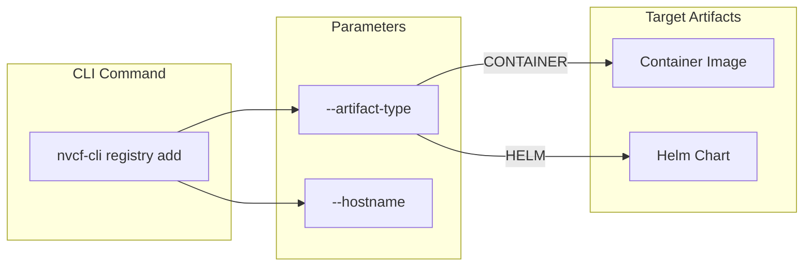

<!-- source: DeepWiki mcp.deepwiki.com · repo NVIDIA/nvcf · page 9.3 Examples and Sample Workloads · fetched 2026-10-26 -->

# Examples and Sample Workloads

<details>
<summary>Relevant source files</summary>

The following files were used as context for generating this wiki page:

- [ai-tooling/user/skills/nvcf-self-managed-cli/prompts/create-and-run-task.md](ai-tooling/user/skills/nvcf-self-managed-cli/prompts/create-and-run-task.md)
- [docs/dev/fake-gpu-operator.md](docs/dev/fake-gpu-operator.md)
- [docs/user/cluster-management/topology-aware-scheduling.md](docs/user/cluster-management/topology-aware-scheduling.md)
- [docs/user/container-tasks.md](docs/user/container-tasks.md)
- [docs/user/helm-functions.md](docs/user/helm-functions.md)
- [docs/user/helm-tasks.md](docs/user/helm-tasks.md)
- [docs/user/task-creation.md](docs/user/task-creation.md)
- [docs/v0.6.0/container-tasks.md](docs/v0.6.0/container-tasks.md)
- [examples/AGENTS.md](examples/AGENTS.md)
- [examples/README.md](examples/README.md)
- [examples/function-samples/fastapi-echo-sample/README.md](examples/function-samples/fastapi-echo-sample/README.md)
- [examples/function-samples/helmchart-samples/dynamo-operator-sample/README.md](examples/function-samples/helmchart-samples/dynamo-operator-sample/README.md)
- [examples/function-samples/helmchart-samples/dynamo-operator-sample/dynamo-operator-test/.helmignore](examples/function-samples/helmchart-samples/dynamo-operator-sample/dynamo-operator-test/.helmignore)
- [examples/function-samples/helmchart-samples/dynamo-operator-sample/dynamo-operator-test/Chart.yaml](examples/function-samples/helmchart-samples/dynamo-operator-sample/dynamo-operator-test/Chart.yaml)
- [examples/function-samples/helmchart-samples/dynamo-operator-sample/dynamo-operator-test/templates/disagg_router.yaml](examples/function-samples/helmchart-samples/dynamo-operator-sample/dynamo-operator-test/templates/disagg_router.yaml)
- [examples/function-samples/helmchart-samples/dynamo-operator-sample/dynamo-operator-test/templates/hf_token_secret.yaml](examples/function-samples/helmchart-samples/dynamo-operator-sample/dynamo-operator-test/templates/hf_token_secret.yaml)
- [examples/function-samples/helmchart-samples/dynamo-operator-sample/dynamo-operator-test/values.yaml](examples/function-samples/helmchart-samples/dynamo-operator-sample/dynamo-operator-test/values.yaml)
- [examples/function-samples/helmchart-samples/inference-test-sample/README.md](examples/function-samples/helmchart-samples/inference-test-sample/README.md)
- [examples/function-samples/helmchart-samples/multi-node-helm-function-test/README.md](examples/function-samples/helmchart-samples/multi-node-helm-function-test/README.md)
- [examples/function-samples/helmchart-samples/multi-node-helm-function-test/config.env.sample](examples/function-samples/helmchart-samples/multi-node-helm-function-test/config.env.sample)
- [examples/function-samples/helmchart-samples/multi-node-helm-function-test/container/CONTAINER.md](examples/function-samples/helmchart-samples/multi-node-helm-function-test/container/CONTAINER.md)
- [examples/function-samples/helmchart-samples/multi-node-helm-function-test/container/Dockerfile](examples/function-samples/helmchart-samples/multi-node-helm-function-test/container/Dockerfile)
- [examples/function-samples/helmchart-samples/multi-node-helm-function-test/container/run.sh](examples/function-samples/helmchart-samples/multi-node-helm-function-test/container/run.sh)
- [examples/function-samples/helmchart-samples/multi-node-helm-function-test/container/server.py](examples/function-samples/helmchart-samples/multi-node-helm-function-test/container/server.py)
- [examples/function-samples/helmchart-samples/multi-node-helm-function-test/container/test_server_command_safety.py](examples/function-samples/helmchart-samples/multi-node-helm-function-test/container/test_server_command_safety.py)
- [examples/function-samples/helmchart-samples/multi-node-helm-function-test/multi-node-test/Chart.yaml](examples/function-samples/helmchart-samples/multi-node-helm-function-test/multi-node-test/Chart.yaml)
- [examples/function-samples/helmchart-samples/multi-node-helm-function-test/multi-node-test/templates/_helpers.tpl](examples/function-samples/helmchart-samples/multi-node-helm-function-test/multi-node-test/templates/_helpers.tpl)
- [examples/function-samples/helmchart-samples/multi-node-helm-function-test/multi-node-test/templates/resourceclaimtemplate.yaml](examples/function-samples/helmchart-samples/multi-node-helm-function-test/multi-node-test/templates/resourceclaimtemplate.yaml)
- [examples/function-samples/helmchart-samples/multi-node-helm-function-test/multi-node-test/templates/statefulset.yaml](examples/function-samples/helmchart-samples/multi-node-helm-function-test/multi-node-test/templates/statefulset.yaml)
- [examples/function-samples/helmchart-samples/multi-node-helm-function-test/multi-node-test/values.yaml](examples/function-samples/helmchart-samples/multi-node-helm-function-test/multi-node-test/values.yaml)
- [examples/function-samples/helmchart-samples/multi-node-helm-function-test/override.yaml.sample](examples/function-samples/helmchart-samples/multi-node-helm-function-test/override.yaml.sample)
- [examples/function-samples/helmchart-samples/ray-serve-sample/README.md](examples/function-samples/helmchart-samples/ray-serve-sample/README.md)
- [examples/task-samples/task-byoo-sample/main.py](examples/task-samples/task-byoo-sample/main.py)
- [examples/task-samples/task-byoo-sample/test_main.py](examples/task-samples/task-byoo-sample/test_main.py)
- [examples/task-samples/task-helmchart-sample/README.md](examples/task-samples/task-helmchart-sample/README.md)
- [examples/task-samples/task-simple-sample/Dockerfile](examples/task-samples/task-simple-sample/Dockerfile)
- [examples/task-samples/task-simple-sample/README.md](examples/task-samples/task-simple-sample/README.md)
- [examples/task-samples/task-simple-sample/main.py](examples/task-samples/task-simple-sample/main.py)
- [examples/task-samples/task-simple-sample/requirements.txt](examples/task-samples/task-simple-sample/requirements.txt)
- [src/clis/nvcf-cli/cmd/task.go](src/clis/nvcf-cli/cmd/task.go)
- [src/clis/nvcf-cli/internal/client/tasks.go](src/clis/nvcf-cli/internal/client/tasks.go)
- [src/clis/nvcf-cli/internal/client/tasks_test.go](src/clis/nvcf-cli/internal/client/tasks_test.go)

</details>


This section documents the `examples/` directory, which contains runnable sample containers, Helm charts, and load tests for NVIDIA Cloud Functions (NVCF) and NVIDIA Cloud Tasks (NVCT) [examples/README.md:1-3](). These samples are designed to be driven by `nvcf-cli` and target self-hosted control plane environments [examples/README.md:3-3]().

## Function Samples

Functions are long-running services that respond to repeated HTTP or gRPC invocation requests [docs/user/task-creation.md:39-41]().

### Container Functions
NVCF supports various FastAPI-based and gRPC-based samples to demonstrate different invocation patterns:
*   **FastAPI Echo**: A minimal function that echoes back request payloads [examples/README.md:13-13]().
*   **FastAPI Streaming**: Demonstrates Server-Sent Event (SSE) streaming responses [examples/README.md:14-14]().
*   **FastAPI Multi-Endpoint**: Exposes multiple endpoints using query parameters [examples/README.md:15-15]().
*   **gRPC Echo**: Served via Triton Inference Server with a Gradio client [examples/README.md:16-16]().
*   **Secrets**: Demonstrates how to read NVCF-managed secrets from `/var/secrets/secrets.json` inside the container [docs/user/container-tasks.md:115-124](), [examples/README.md:17-17]().

### Helm Functions
Helm functions allow for multi-container orchestration [docs/user/helm-functions.md:3-3]().
*   **Inference Test Sample**: Wraps the FastAPI Echo sample in a Helm chart [examples/README.md:19-19]().
*   **Multi-Node Helm Function**: Designed for NCCL and GPU bandwidth tests requiring multiple nodes [examples/README.md:20-20]().
*   **Dynamo Operator Sample**: Demonstrates a vLLM disaggregated router using Grove and KAI Scheduler for orchestration [examples/function-samples/helmchart-samples/dynamo-operator-sample/README.md:3-6]().

**Sources:** [examples/README.md:7-24](), [docs/user/helm-functions.md:1-13](), [examples/function-samples/helmchart-samples/dynamo-operator-sample/README.md:1-10]()

---

## Task Samples

Tasks are one-shot batch jobs that run to completion [docs/user/task-creation.md:3-5](). Unlike functions, their lifecycle ends when the container exits or a timeout is reached [docs/user/task-creation.md:42-43]().

### The Progress File Mechanism
Every task (container or Helm-based) must communicate its state via a progress file located at the path defined by the `NVCT_PROGRESS_FILE_PATH` environment variable [docs/user/container-tasks.md:153-153]().

**Progress Data Flow**
The container must perform atomic writes (write to temp, then rename) to the progress file to signal heartbeats and completion [docs/user/container-tasks.md:192-195]().

| Event | Action |
| :--- | :--- |
| **Heartbeat** | Update `lastUpdatedAt` (RFC3339Nano) at least every 3 minutes [docs/user/container-tasks.md:176-178](). |
| **Progress** | Update `percentComplete` (1-99) and optionally `name` for intermediate results [docs/user/container-tasks.md:185-187](). |
| **Completion** | Set `percentComplete` to `100` [docs/user/container-tasks.md:181-183](). |

### Sample Workloads
*   **Task Simple**: A Python-based task that writes progress updates until it reaches 100% [examples/task-samples/task-simple-sample/main.py:181-205]().
*   **Task BYOO**: A task instrumented with OpenTelemetry for "Bring Your Own Observability" (BYOO), demonstrating custom metric and trace exporting [examples/task-samples/task-byoo-sample/main.py:50-65]().
*   **Multi-Node Helm Task**: Orchestrates multi-node NCCL tests using Kubernetes Jobs [examples/README.md:35-35]().

**Sources:** [docs/user/container-tasks.md:1-195](), [docs/user/task-creation.md:1-78](), [examples/task-samples/task-simple-sample/main.py:1-180](), [examples/task-samples/task-byoo-sample/main.py:1-65]()

---

## Multi-Node and Topology-Aware Scheduling

For complex multi-node workloads, NVCF utilizes KAI Scheduler and Grove to ensure Pods are placed within high-bandwidth domains (e.g., NVLink cliques) [docs/user/cluster-management/topology-aware-scheduling.md:3-6]().

### Multi-Node Implementation (StatefulSet)
Multi-node functions often use a `StatefulSet` with `podManagementPolicy: Parallel` to manage replicas across nodes [examples/function-samples/helmchart-samples/multi-node-helm-function-test/multi-node-test/templates/statefulset.yaml:21-37]().

**Entity Mapping: Scheduling Constraints**



**Sources:** [examples/function-samples/helmchart-samples/multi-node-helm-function-test/multi-node-test/templates/statefulset.yaml:21-40](), [docs/user/cluster-management/topology-aware-scheduling.md:80-102]()

---

## Load Testing with k6

The `load-tests/` directory contains k6 scripts for benchmarking both function and task endpoints [examples/README.md:39-39]().
*   **Function Tests**: Covers standard HTTP, gRPC, and SSE streaming [examples/AGENTS.md:11-14]().
*   **Task Tests**: Validates task creation, listing, and event retrieval [examples/AGENTS.md:14-14]().

Scripts must read credentials from environment variables; hardcoding tokens is prohibited [examples/AGENTS.md:73-75]().

**Sources:** [examples/README.md:37-39](), [examples/AGENTS.md:66-75]()

---

## Build and Registry Operations

### Multi-Arch Builds
To support both `amd64` and `arm64` compute nodes, images should be built using `docker buildx` [examples/README.md:43-49]():

```bash
docker buildx build --platform linux/amd64,linux/arm64 -t <image-name> .
```

### Registry Management
Private OCI registries (e.g., Harbor, ECR) require registration of credentials via `nvcf-cli` to allow the compute plane to pull images [examples/README.md:51-64]().

**Entity Mapping: Artifact Registration**



**Sources:** [examples/README.md:41-67](), [examples/AGENTS.md:21-57]()

---

