# Page: NVCF Overview

# NVCF Overview

<details>
<summary>Relevant source files</summary>

The following files were used as context for generating this wiki page:

- [.github/ISSUE_TEMPLATE/config.yml](.github/ISSUE_TEMPLATE/config.yml)
- [.github/PULL_REQUEST_TEMPLATE.md](.github/PULL_REQUEST_TEMPLATE.md)
- [.github/workflows/stale.yaml](.github/workflows/stale.yaml)
- [.rumdl.toml](.rumdl.toml)
- [AGENTS.md](AGENTS.md)
- [CONTRIBUTING.md](CONTRIBUTING.md)
- [README.md](README.md)
- [ai-tooling/AGENTS.md](ai-tooling/AGENTS.md)
- [ai-tooling/CLAUDE.md](ai-tooling/CLAUDE.md)
- [ai-tooling/README.md](ai-tooling/README.md)
- [ai-tooling/dev/skills/documentation-style/SKILL.md](ai-tooling/dev/skills/documentation-style/SKILL.md)
- [deploy/helm/nvca-operator/nvca-operator/Chart.yaml](deploy/helm/nvca-operator/nvca-operator/Chart.yaml)
- [deploy/helm/nvca-operator/nvca-operator/templates/cluster-validator-network-checks-cm.yaml](deploy/helm/nvca-operator/nvca-operator/templates/cluster-validator-network-checks-cm.yaml)
- [deploy/helm/nvca-operator/nvca-operator/templates/cronjob.yaml](deploy/helm/nvca-operator/nvca-operator/templates/cronjob.yaml)
- [deploy/helm/nvca-operator/nvca-operator/templates/rbac.yaml](deploy/helm/nvca-operator/nvca-operator/templates/rbac.yaml)
- [docs/dev/architecture.md](docs/dev/architecture.md)
- [docs/dev/assets/architecture-overview.svg](docs/dev/assets/architecture-overview.svg)
- [docs/user/cluster-management/nsight-profiling.md](docs/user/cluster-management/nsight-profiling.md)
- [docs/user/cluster-management/self-managed.md](docs/user/cluster-management/self-managed.md)
- [docs/user/image-mirroring.md](docs/user/image-mirroring.md)
- [docs/user/images/nvcf-gpu-cluster-targeting.svg](docs/user/images/nvcf-gpu-cluster-targeting.svg)
- [docs/user/images/nvcf-high-level-stack.svg](docs/user/images/nvcf-high-level-stack.svg)
- [docs/user/images/nvcf-multi-region-multi-cluster.svg](docs/user/images/nvcf-multi-region-multi-cluster.svg)
- [docs/user/manifest.md](docs/user/manifest.md)
- [docs/version-catalog/main.yaml](docs/version-catalog/main.yaml)
- [setup.sh](setup.sh)
- [tools/ci/check-doc-version-sync](tools/ci/check-doc-version-sync)
- [tools/ci/check-private-go-module-paths](tools/ci/check-private-go-module-paths)
- [tools/ci/preview-docs](tools/ci/preview-docs)
- [tools/docs-version-sync/catalog.go](tools/docs-version-sync/catalog.go)
- [tools/docs-version-sync/inline.go](tools/docs-version-sync/inline.go)
- [tools/docs-version-sync/main_test.go](tools/docs-version-sync/main_test.go)
- [tools/docs-version-sync/render.go](tools/docs-version-sync/render.go)
- [tools/scripts/cut-docs-version.sh](tools/scripts/cut-docs-version.sh)
- [tools/scripts/test/test-check-doc-version-sync](tools/scripts/test/test-check-doc-version-sync)
- [tools/scripts/test/test-cut-docs-version](tools/scripts/test/test-cut-docs-version)

</details>


NVIDIA Cloud Functions (NVCF) is a high-scale platform for deploying, managing, and running GPU-accelerated workloads. It provides the infrastructure to route inference, streaming, and other GPU-heavy tasks to distributed worker clusters, enabling seamless scaling of demanding AI workloads [README.md:7-12]().

The platform is designed to handle multiple protocols (HTTP, gRPC, and LLM-compatible gateways) and supports diverse workload types, from single-container functions to complex multi-container Helm-based deployments [README.md:39-66]().

## Three-Plane Architecture

NVCF follows a decoupled three-plane architecture to ensure scalability, resilience, and multi-cluster support [README.md:14-38]().

1.  **Control Plane**: The administrative hub. It exposes the NVCF API, manages the lifecycle of functions and deployments, handles secret management (via OpenBao), and maintains global state in Cassandra [README.md:24-25](), [docs/user/cluster-management/self-managed.md:10-15]().
2.  **Invocation Plane**: The request handling layer. It receives incoming traffic (HTTP, gRPC, or LLM requests), applies rate limiting and authorization, and routes work to the appropriate compute resources [README.md:26-27]().
3.  **Compute Plane**: The execution layer. Located on GPU clusters, this plane runs the **NVIDIA Cluster Agent (NVCA)**, which registers GPU resources and manages the lifecycle of worker pods [README.md:28-29](), [docs/user/cluster-management/self-managed.md:76-79]().

### System Component Map
The following diagram maps high-level system concepts to their primary code entities and service names.

**System to Code Mapping**
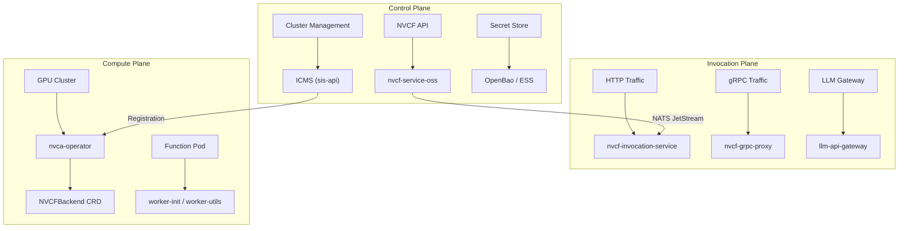
**Sources:** [README.md:88-98](), [docs/version-catalog/main.yaml:42-136](), [docs/user/cluster-management/self-managed.md:58-79]()

## Key Concepts

### Workload Types
NVCF distinguishes between two primary execution patterns:
*   **Functions**: Long-running, invokable workloads designed for inference or streaming. They provide persistent endpoints [README.md:41-47]().
*   **Tasks**: Asynchronous, run-to-completion jobs (e.g., fine-tuning or batch data prep) [README.md:48-54]().

Both types can be packaged as simple **Containers** or complex **Helm charts** [README.md:44-46]().

### Artifact Management
The platform uses a **Version Catalog** (`docs/version-catalog/main.yaml`) as the single source of truth for all qualified component versions [docs/user/manifest.md:13-16](). These artifacts (images and Helm charts) are typically mirrored from NVIDIA's NGC registry to local OCI-compatible registries for self-hosted deployments [docs/user/image-mirroring.md:3-12]().

### Cluster Registration
GPU clusters are not static; they register themselves with the Control Plane using `nvcf-cli`. During registration, the CLI discovers the cluster's OIDC issuer and JWKS, allowing the Control Plane to securely validate the **NVIDIA Cluster Agent (NVCA)** using Projected Service Account Tokens (PSAT) [docs/user/cluster-management/self-managed.md:58-69]().

## Navigation Guide

The wiki is organized into the following detailed sections:

| Section | Description |
| :--- | :--- |
| **[Architecture and System Planes](#1.1)** | Deep dive into the three planes, NATS messaging, and the request lifecycle. |
| **[Key Custom Resources and CRDs](#1.2)** | Technical details on `NVCFBackend`, `ICMSRequest`, and `MiniService`. |
| **[Getting Started and Quickstart](#1.3)** | One-click local setup using `nvcf-cli` and `k3d`. |
| **[Control Plane Services](#2)** | Details on `nvcf-service`, ICMS, and secret management. |
| **[Invocation Plane Services](#3)** | Routing, gRPC proxying, and the LLM API gateway. |
| **[Compute Plane Services](#4)** | NVCA, worker sidecars, and container caching. |
| **[nvcf-cli: Command-Line Interface](#6)** | Reference for the command-line interface used by operators and users. |

For a full list of terminology, see the **[Glossary](#12)**.

**Sources:** [README.md:88-98](), [AGENTS.md:5-13](), [docs/user/manifest.md:109-128]()

---

# Page: Architecture and System Planes

# Architecture and System Planes

<details>
<summary>Relevant source files</summary>

The following files were used as context for generating this wiki page:

- [.github/ISSUE_TEMPLATE/config.yml](.github/ISSUE_TEMPLATE/config.yml)
- [.github/PULL_REQUEST_TEMPLATE.md](.github/PULL_REQUEST_TEMPLATE.md)
- [.github/workflows/stale.yaml](.github/workflows/stale.yaml)
- [.rumdl.toml](.rumdl.toml)
- [AGENTS.md](AGENTS.md)
- [CONTRIBUTING.md](CONTRIBUTING.md)
- [README.md](README.md)
- [ai-tooling/AGENTS.md](ai-tooling/AGENTS.md)
- [ai-tooling/CLAUDE.md](ai-tooling/CLAUDE.md)
- [ai-tooling/README.md](ai-tooling/README.md)
- [ai-tooling/dev/skills/documentation-style/SKILL.md](ai-tooling/dev/skills/documentation-style/SKILL.md)
- [deploy/helm/nvca-operator/nvca-operator/Chart.yaml](deploy/helm/nvca-operator/nvca-operator/Chart.yaml)
- [deploy/helm/nvca-operator/nvca-operator/templates/cluster-validator-network-checks-cm.yaml](deploy/helm/nvca-operator/nvca-operator/templates/cluster-validator-network-checks-cm.yaml)
- [deploy/helm/nvca-operator/nvca-operator/templates/cronjob.yaml](deploy/helm/nvca-operator/nvca-operator/templates/cronjob.yaml)
- [deploy/helm/nvca-operator/nvca-operator/templates/rbac.yaml](deploy/helm/nvca-operator/nvca-operator/templates/rbac.yaml)
- [docs/dev/architecture.md](docs/dev/architecture.md)
- [docs/dev/assets/architecture-overview.svg](docs/dev/assets/architecture-overview.svg)
- [docs/user/cluster-management/nsight-profiling.md](docs/user/cluster-management/nsight-profiling.md)
- [docs/user/cluster-management/self-managed.md](docs/user/cluster-management/self-managed.md)
- [docs/user/image-mirroring.md](docs/user/image-mirroring.md)
- [docs/user/images/nvcf-gpu-cluster-targeting.svg](docs/user/images/nvcf-gpu-cluster-targeting.svg)
- [docs/user/images/nvcf-high-level-stack.svg](docs/user/images/nvcf-high-level-stack.svg)
- [docs/user/images/nvcf-multi-region-multi-cluster.svg](docs/user/images/nvcf-multi-region-multi-cluster.svg)
- [docs/user/manifest.md](docs/user/manifest.md)
- [docs/version-catalog/main.yaml](docs/version-catalog/main.yaml)
- [setup.sh](setup.sh)
- [tools/ci/check-doc-version-sync](tools/ci/check-doc-version-sync)
- [tools/ci/check-private-go-module-paths](tools/ci/check-private-go-module-paths)
- [tools/ci/preview-docs](tools/ci/preview-docs)
- [tools/docs-version-sync/catalog.go](tools/docs-version-sync/catalog.go)
- [tools/docs-version-sync/inline.go](tools/docs-version-sync/inline.go)
- [tools/docs-version-sync/main_test.go](tools/docs-version-sync/main_test.go)
- [tools/docs-version-sync/render.go](tools/docs-version-sync/render.go)
- [tools/scripts/cut-docs-version.sh](tools/scripts/cut-docs-version.sh)
- [tools/scripts/test/test-check-doc-version-sync](tools/scripts/test/test-check-doc-version-sync)
- [tools/scripts/test/test-cut-docs-version](tools/scripts/test/test-cut-docs-version)

</details>


This page provides a detailed technical explanation of the NVIDIA Cloud Functions (NVCF) three-plane architecture. NVCF is designed to manage GPU-accelerated workloads at scale by decoupling the management of functions, the routing of requests, and the execution of code on GPU resources [README.md:7-13]().

## Three-Plane Architecture Overview

NVCF is structured into three distinct logical planes: the **Control Plane**, the **Invocation Plane**, and the **Compute Plane**. This separation allows for independent scaling, multi-region deployments, and support for diverse GPU cluster types [README.md:14-22]().

### High-Level System Diagram

The following diagram illustrates the relationship between the three planes and the external entities they interact with.

**NVCF Three-Plane Architecture**
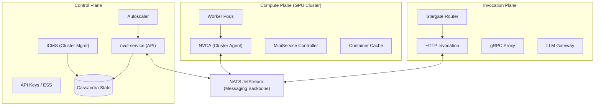
**Sources:** [README.md:16-38](), [docs/user/cluster-management/self-managed.md:56-84]()

---

## 1. Control Plane
The Control Plane is the "brain" of NVCF. It manages the lifecycle of functions, deployment states, secret management, and cluster registration [README.md:24-25]().

### Key Components
*   **nvcf-service**: The core Java/Spring Boot service providing the REST/gRPC APIs for function creation, deployment, and management [docs/version-catalog/main.yaml:96-98]().
*   **ICMS (Instance and Cluster Management Service)**: Responsible for registering GPU clusters, tracking OIDC/JWKS for authentication, and managing GPU reservations [docs/user/cluster-management/self-managed.md:66-69]().
*   **Autoscaler**: A Rust-based service that monitors active functions via VictoriaMetrics and adjusts the desired instance count to meet demand, including **scale-to-zero** [README.md:63-64]().
*   **ESS (Encrypted Secret Store)**: Manages tenant-scoped secrets injected into worker pods [docs/version-catalog/main.yaml:42-44]().

**Sources:** [README.md:24-25](), [docs/user/cluster-management/self-managed.md:66-84](), [docs/version-catalog/main.yaml:42-101]()

---

## 2. Invocation Plane
The Invocation Plane handles the routing of incoming requests to the appropriate worker instances. It supports multiple protocols including HTTP, gRPC, and OpenAI-compatible LLM streams [README.md:26-27]().

### Request Lifecycle (Sync HTTP)
When a client invokes a function, the request follows this sequence:

**Synchronous HTTP Invocation Sequence**
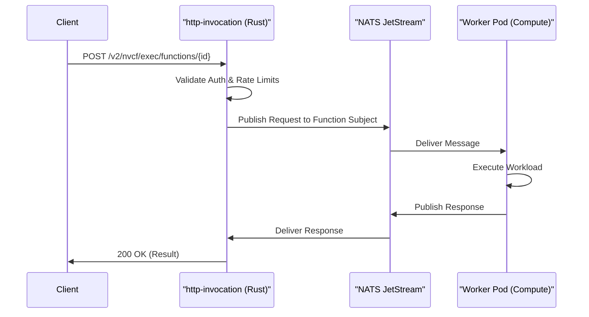
**Sources:** [README.md:72-80](), [docs/user/cluster-management/self-managed.md:120-122]()

### Key Components
*   **HTTP Invocation Service**: Handles standard RESTful execution requests [docs/version-catalog/main.yaml:51-53]().
*   **gRPC Proxy**: Directs gRPC calls to worker pods using a director pattern [docs/version-catalog/main.yaml:48-50]().
*   **Stargate Router**: A high-performance Rust router for LLM requests, utilizing Pylon for QUIC-HTTP tunneling [docs/version-catalog/main.yaml:114-116](), [docs/version-catalog/main.yaml:127-129]().

---

## 3. Compute Plane
The Compute Plane consists of the actual GPU clusters where workloads are executed. These clusters can be self-managed, NGC-managed, or Helm-managed [README.md:28-29]().

### The NVIDIA Cluster Agent (NVCA)
NVCA is the primary bridge between the GPU cluster and the NVCF Control Plane. It registers GPU resources and manages the execution of workloads on Kubernetes nodes [docs/user/cluster-management/self-managed.md:3-9]().

**Compute Plane Code Entities**
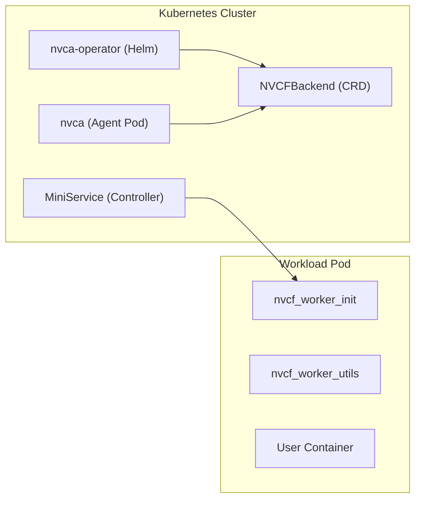
**Sources:** [docs/user/cluster-management/self-managed.md:56-84](), [docs/version-catalog/main.yaml:66-71](), [docs/version-catalog/main.yaml:102-109]()

### Workload Types
NVCF supports four primary workload shapes, defined by how they are packaged and their execution lifecycle:

| Workload Type | Packaging | Lifecycle |
| :--- | :--- | :--- |
| **Container Function** | Single OCI Image | Long-running, synchronous invocation |
| **Helm Function** | Helm Chart | Long-running, multi-container (MiniService) |
| **Container Task** | Single OCI Image | Asynchronous, run-to-completion |
| **Helm Task** | Helm Chart | Asynchronous, complex orchestration |

**Sources:** [README.md:41-55]()

---

## Messaging Backbone: NATS JetStream
NVCF uses **NATS JetStream** as the high-performance messaging backbone connecting all three planes.
*   **Control Plane to Compute Plane**: Deployment instructions and configuration updates are published to NATS subjects monitored by NVCA [docs/user/cluster-management/self-managed.md:120-122]().
*   **Invocation Plane to Compute Plane**: Invocation requests are distributed via NATS queues to ensure load balancing across available worker pods [docs/version-catalog/main.yaml:45-47]().

**Sources:** [README.md:123](), [docs/user/cluster-management/self-managed.md:75-76]()

---

## Multi-Cluster Routing
NVCF supports multi-region and multi-cluster topologies. The Control Plane maintains a global view of all registered clusters via ICMS. When a function is deployed, the Control Plane can target specific `clusterGroupIDs` or distribute the workload across multiple clusters for high availability and low-latency access [README.md:34-38](), [docs/user/cluster-management/self-managed.md:66-69]().

**Sources:** [README.md:37](), [docs/user/cluster-management/self-managed.md:96-122]()

---

# Page: Key Custom Resources and CRDs

# Key Custom Resources and CRDs

<details>
<summary>Relevant source files</summary>

The following files were used as context for generating this wiki page:

- [deploy/helm/nvca-operator/nvca-operator/README.md](deploy/helm/nvca-operator/nvca-operator/README.md)
- [deploy/helm/nvca-operator/nvca-operator/templates/_helpers.tpl](deploy/helm/nvca-operator/nvca-operator/templates/_helpers.tpl)
- [deploy/helm/nvca-operator/nvca-operator/templates/deployment.yaml](deploy/helm/nvca-operator/nvca-operator/templates/deployment.yaml)
- [deploy/helm/nvca-operator/nvca-operator/values.schema.json](deploy/helm/nvca-operator/nvca-operator/values.schema.json)
- [deploy/helm/nvca-operator/nvca-operator/values.yaml](deploy/helm/nvca-operator/nvca-operator/values.yaml)
- [deploy/helm/nvca-operator/scripts/ci_vendor_nvca_operator_chart](deploy/helm/nvca-operator/scripts/ci_vendor_nvca_operator_chart)
- [deploy/helm/nvca-operator/scripts/render_release_supplemental_images.sh](deploy/helm/nvca-operator/scripts/render_release_supplemental_images.sh)
- [deploy/helm/nvca-operator/tests/release_image_manifest_test.sh](deploy/helm/nvca-operator/tests/release_image_manifest_test.sh)
- [deploy/helm/nvca-operator/tests/self_managed_nvca_image_reference_test.sh](deploy/helm/nvca-operator/tests/self_managed_nvca_image_reference_test.sh)
- [docs/user/cluster-management/gxcache.md](docs/user/cluster-management/gxcache.md)
- [src/compute-plane-services/nvca/deployments/nvca-operator/README.md](src/compute-plane-services/nvca/deployments/nvca-operator/README.md)
- [src/compute-plane-services/nvca/deployments/nvca-operator/templates/_helpers.tpl](src/compute-plane-services/nvca/deployments/nvca-operator/templates/_helpers.tpl)
- [src/compute-plane-services/nvca/deployments/nvca-operator/templates/deployment.yaml](src/compute-plane-services/nvca/deployments/nvca-operator/templates/deployment.yaml)
- [src/compute-plane-services/nvca/deployments/nvca-operator/values.schema.json](src/compute-plane-services/nvca/deployments/nvca-operator/values.schema.json)
- [src/compute-plane-services/nvca/deployments/nvca-operator/values.yaml](src/compute-plane-services/nvca/deployments/nvca-operator/values.yaml)
- [src/compute-plane-services/nvca/internal/miniservice/BUILD.bazel](src/compute-plane-services/nvca/internal/miniservice/BUILD.bazel)
- [src/compute-plane-services/nvca/internal/miniservice/reconcile.go](src/compute-plane-services/nvca/internal/miniservice/reconcile.go)
- [src/compute-plane-services/nvca/internal/miniservice/reconcile_test.go](src/compute-plane-services/nvca/internal/miniservice/reconcile_test.go)
- [src/compute-plane-services/nvca/internal/miniservice/reconcile_update_test.go](src/compute-plane-services/nvca/internal/miniservice/reconcile_update_test.go)
- [src/compute-plane-services/nvca/internal/miniservice/reval_client.go](src/compute-plane-services/nvca/internal/miniservice/reval_client.go)
- [src/compute-plane-services/nvca/internal/miniservice/reval_client_test.go](src/compute-plane-services/nvca/internal/miniservice/reval_client_test.go)
- [src/compute-plane-services/nvca/internal/miniservice/revision.go](src/compute-plane-services/nvca/internal/miniservice/revision.go)
- [src/compute-plane-services/nvca/internal/miniservice/revision_test.go](src/compute-plane-services/nvca/internal/miniservice/revision_test.go)
- [src/compute-plane-services/nvca/internal/miniservice/status.go](src/compute-plane-services/nvca/internal/miniservice/status.go)
- [src/compute-plane-services/nvca/internal/miniservice/status_karta.go](src/compute-plane-services/nvca/internal/miniservice/status_karta.go)
- [src/compute-plane-services/nvca/internal/miniservice/status_karta_test.go](src/compute-plane-services/nvca/internal/miniservice/status_karta_test.go)
- [src/compute-plane-services/nvca/internal/miniservice/status_test.go](src/compute-plane-services/nvca/internal/miniservice/status_test.go)
- [src/compute-plane-services/nvca/internal/miniservice/transport_tls.go](src/compute-plane-services/nvca/internal/miniservice/transport_tls.go)
- [src/compute-plane-services/nvca/internal/util/k8sutil/BUILD.bazel](src/compute-plane-services/nvca/internal/util/k8sutil/BUILD.bazel)
- [src/compute-plane-services/nvca/internal/util/k8sutil/affinity.go](src/compute-plane-services/nvca/internal/util/k8sutil/affinity.go)
- [src/compute-plane-services/nvca/internal/util/k8sutil/affinity_test.go](src/compute-plane-services/nvca/internal/util/k8sutil/affinity_test.go)
- [src/compute-plane-services/nvca/internal/util/k8sutil/pod.go](src/compute-plane-services/nvca/internal/util/k8sutil/pod.go)
- [src/compute-plane-services/nvca/internal/util/k8sutil/pod_test.go](src/compute-plane-services/nvca/internal/util/k8sutil/pod_test.go)
- [src/compute-plane-services/nvca/pkg/apis/nvca/v1alpha1/generated.openapi.go](src/compute-plane-services/nvca/pkg/apis/nvca/v1alpha1/generated.openapi.go)
- [src/compute-plane-services/nvca/pkg/apis/nvca/v1alpha1/miniservice_json.go](src/compute-plane-services/nvca/pkg/apis/nvca/v1alpha1/miniservice_json.go)
- [src/compute-plane-services/nvca/pkg/apis/nvca/v1alpha1/miniservice_json_test.go](src/compute-plane-services/nvca/pkg/apis/nvca/v1alpha1/miniservice_json_test.go)
- [src/compute-plane-services/nvca/pkg/apis/nvca/v1alpha1/zz_generated.deepcopy.go](src/compute-plane-services/nvca/pkg/apis/nvca/v1alpha1/zz_generated.deepcopy.go)
- [src/compute-plane-services/nvca/pkg/nvca/k8scomputebackend.go](src/compute-plane-services/nvca/pkg/nvca/k8scomputebackend.go)
- [src/compute-plane-services/nvca/pkg/nvca/k8scomputebackend_task_container.go](src/compute-plane-services/nvca/pkg/nvca/k8scomputebackend_task_container.go)
- [src/compute-plane-services/nvca/pkg/operator/reconcile/nvcaagent_reconcile.go](src/compute-plane-services/nvca/pkg/operator/reconcile/nvcaagent_reconcile.go)
- [src/compute-plane-services/nvca/pkg/operator/reconcile/nvcaagent_reconcile_test.go](src/compute-plane-services/nvca/pkg/operator/reconcile/nvcaagent_reconcile_test.go)
- [src/compute-plane-services/nvca/pkg/webhook/miniservice_mutating_webhook.go](src/compute-plane-services/nvca/pkg/webhook/miniservice_mutating_webhook.go)
- [src/compute-plane-services/nvca/pkg/webhook/miniservice_mutating_webhook_test.go](src/compute-plane-services/nvca/pkg/webhook/miniservice_mutating_webhook_test.go)
- [src/compute-plane-services/nvca/vendor/github.com/NVIDIA/nvcf/src/libraries/go/lib/pkg/types/nvca/config/types.go](src/compute-plane-services/nvca/vendor/github.com/NVIDIA/nvcf/src/libraries/go/lib/pkg/types/nvca/config/types.go)
- [src/compute-plane-services/nvca/vendor/github.com/NVIDIA/nvcf/src/libraries/go/lib/pkg/types/nvca/config/zz_generated.deepcopy.go](src/compute-plane-services/nvca/vendor/github.com/NVIDIA/nvcf/src/libraries/go/lib/pkg/types/nvca/config/zz_generated.deepcopy.go)
- [src/libraries/go/lib/pkg/types/nvca/config/config_test.go](src/libraries/go/lib/pkg/types/nvca/config/config_test.go)
- [src/libraries/go/lib/pkg/types/nvca/config/types.go](src/libraries/go/lib/pkg/types/nvca/config/types.go)
- [src/libraries/go/lib/pkg/types/nvca/config/types_additional_test.go](src/libraries/go/lib/pkg/types/nvca/config/types_additional_test.go)
- [src/libraries/go/lib/pkg/types/nvca/config/types_test.go](src/libraries/go/lib/pkg/types/nvca/config/types_test.go)
- [src/libraries/go/lib/pkg/types/nvca/config/zz_generated.deepcopy.go](src/libraries/go/lib/pkg/types/nvca/config/zz_generated.deepcopy.go)

</details>


This page documents the primary Kubernetes Custom Resource Definitions (CRDs) that drive the NVIDIA Cloud Functions (NVCF) compute plane. These resources allow the NVCF Control Plane to communicate desired workload states to the Compute Plane and allow the NVIDIA Cluster Agent (NVCA) to manage the lifecycle of functions and tasks.

## NVCFBackend

The `NVCFBackend` resource represents a specific compute backend (cluster) registered within the NVCF ecosystem. It is the primary mechanism for the **NVCA Operator** to configure and manage the **NVCA Agent** on a per-cluster basis.

### Purpose and Implementation
The `NVCFBackend` CRD is managed by the `nvca-operator` [deploy/helm/nvca-operator/nvca-operator/README.md:1-4](). It acts as a bridge between the global NVCF configuration and the local cluster environment. The operator uses this resource to determine which version of the NVCA agent to deploy, which OIDC discovery endpoints to use for authentication, and how to configure cluster-wide settings like GPU validation policies [deploy/helm/nvca-operator/nvca-operator/values.yaml:72-97]().

### Key Lifecycle States
The `NVCFBackend` lifecycle is tied to the `nvca-operator` reconciliation loop.
*   **Self-Managed vs. Helm-Managed**: Backends can be provisioned via NGC (managed) or directly via Helm for self-hosted environments [deploy/helm/nvca-operator/nvca-operator/values.yaml:72-79]().
*   **Configuration Merging**: The operator allows merging complex agent configurations (e.g., OTel sampling, log chunking) into the backend spec, which the operator then projects into the NVCA Agent's configuration [deploy/helm/nvca-operator/nvca-operator/values.yaml:92-128]().

**Sources:**
* [deploy/helm/nvca-operator/nvca-operator/values.yaml:68-128]()
* [deploy/helm/nvca-operator/nvca-operator/README.md:1-5]()

---

## ICMSRequest

The `ICMSRequest` (Instance and Cluster Management Service Request) is a resource used to signal deployment intents from the Control Plane to the Compute Plane.

### Purpose
When a user deploys a function or task, the Control Plane (specifically the `nvcf-service` and `ICMS`) creates an `ICMSRequest` in the target cluster. The `mscontroller` (MiniService Controller) watches these requests to initiate the deployment of the corresponding `MiniService` [src/compute-plane-services/nvca/internal/miniservice/reconcile.go:172-174]().

### Data Flow: ICMSRequest to MiniService
The `ICMSRequest` contains the raw workload manifest provided by the Control Plane. The `mscontroller` uses the `icms-translate` library to convert this request into a concrete `MiniService` specification [src/compute-plane-services/nvca/internal/miniservice/reconcile.go:36-39]().

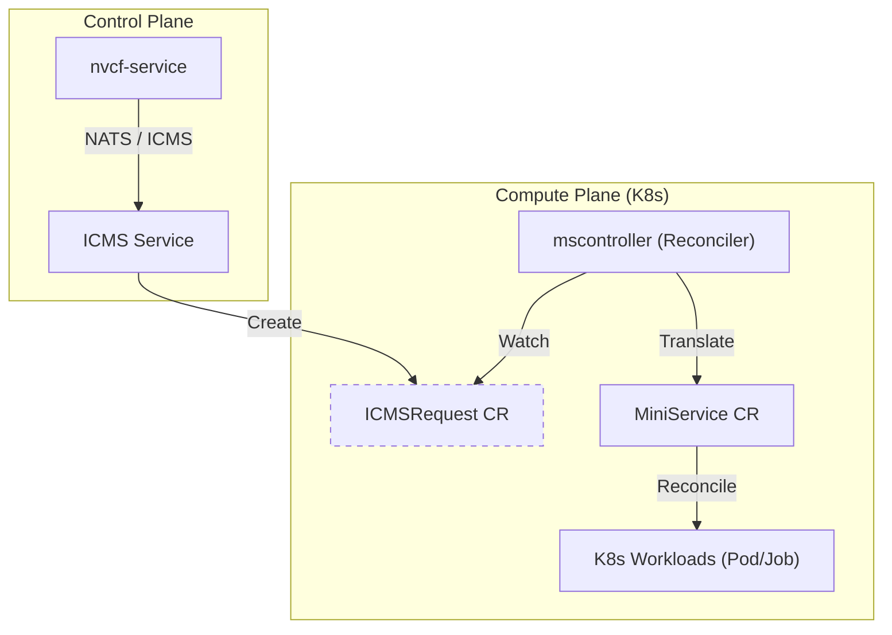
**Sources:**
* [src/compute-plane-services/nvca/internal/miniservice/reconcile.go:172-175]()
* [src/compute-plane-services/nvca/internal/miniservice/reconcile.go:36-39]()

---

## MiniService

The `MiniService` is the core workload abstraction in NVCF. It encapsulates the deployment of a single function version or task execution, regardless of whether it is packaged as a raw container or a Helm chart.

### Technical Implementation
The `MiniService` lifecycle is managed by the `Reconciler` struct in the `mscontroller` package [src/compute-plane-services/nvca/internal/miniservice/reconcile.go:83-119](). It integrates with several sub-systems:
*   **ReVal Client**: Communicates with the Helm Revalidation service to fetch and validate charts [src/compute-plane-services/nvca/internal/miniservice/reconcile.go:91]().
*   **Karta Integration**: Uses the Karta library for advanced status reporting and resource tracking [src/compute-plane-services/nvca/internal/miniservice/reconcile.go:21]().
*   **Revision Management**: Tracks workload versions to avoid redundant rendering and updates [src/compute-plane-services/nvca/internal/miniservice/reconcile.go:116-118]().

### Lifecycle State Machine
The `MiniService` progresses through several phases defined in `v1alpha1.MiniServicePhase` [src/compute-plane-services/nvca/internal/miniservice/reconcile.go:130-136]().

| Phase | Description | Metric Value |
| :--- | :--- | :--- |
| `Installed` | The Helm chart or container resources have been applied to K8s. | 1 |
| `Running` | The workload is active and healthy. | 2 |
| `Completed` | The task (batch job) has finished successfully. | 2 |
| `InstallFailed` | Failure during the initial application of resources. | -1 |
| `Failed` | The workload crashed or failed health checks after installation. | -2 |

### Workload Translation and Mutation
The controller performs complex translations from the `MiniService` spec to Kubernetes primitives:
1.  **Translation**: Converts NVCF-specific requirements (like GPU counts and secrets) into Pod specs [src/compute-plane-services/nvca/internal/miniservice/reconcile.go:23-39]().
2.  **Mutation**: A Mutating Webhook (`miniservice_mutating_webhook.go`) injects standard NVCF sidecars, such as the `worker-utils` NATS proxy and `otel-collector` [src/compute-plane-services/nvca/pkg/webhook/miniservice_mutating_webhook.go:1-20]().
3.  **Transport TLS**: Injects certificates for secure communication between the invocation plane and the worker pods [src/compute-plane-services/nvca/internal/miniservice/transport_tls.go:1-20]().

### Code Entity Space Mapping
The following diagram maps the logical MiniService operations to the specific Go classes and functions responsible for them.

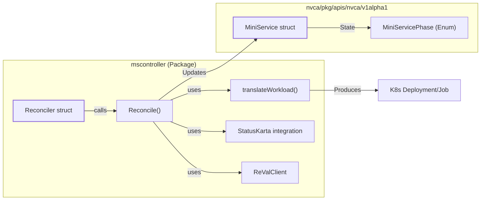

**Sources:**
* [src/compute-plane-services/nvca/internal/miniservice/reconcile.go:83-150]()
* [src/compute-plane-services/nvca/internal/miniservice/reconcile.go:130-136]()
* [src/compute-plane-services/nvca/internal/miniservice/BUILD.bazel:6-25]()
* [src/compute-plane-services/nvca/pkg/webhook/miniservice_mutating_webhook.go:1-20]()

---

# Page: Getting Started and Quickstart

# Getting Started and Quickstart

<details>
<summary>Relevant source files</summary>

The following files were used as context for generating this wiki page:

- [ai-tooling/user/skills/BUILD.bazel](ai-tooling/user/skills/BUILD.bazel)
- [ai-tooling/user/skills/nvcf-self-managed-installation/SKILL.md](ai-tooling/user/skills/nvcf-self-managed-installation/SKILL.md)
- [ai-tooling/user/skills/nvcf-self-managed-installation/evals/evals.json](ai-tooling/user/skills/nvcf-self-managed-installation/evals/evals.json)
- [ai-tooling/user/skills/nvcf-self-managed-installation/examples.md](ai-tooling/user/skills/nvcf-self-managed-installation/examples.md)
- [ai-tooling/user/skills/nvcf-self-managed-installation/references/compute-plane-installation.md](ai-tooling/user/skills/nvcf-self-managed-installation/references/compute-plane-installation.md)
- [ai-tooling/user/skills/nvcf-self-managed-installation/references/debugging.md](ai-tooling/user/skills/nvcf-self-managed-installation/references/debugging.md)
- [ai-tooling/user/skills/nvcf-self-managed-installation/references/helmfile-structure.md](ai-tooling/user/skills/nvcf-self-managed-installation/references/helmfile-structure.md)
- [ai-tooling/user/skills/nvcf-self-managed-installation/references/nvcf-ui-addon.md](ai-tooling/user/skills/nvcf-self-managed-installation/references/nvcf-ui-addon.md)
- [ai-tooling/user/skills/nvcf-self-managed-installation/references/pull-secrets.md](ai-tooling/user/skills/nvcf-self-managed-installation/references/pull-secrets.md)
- [ai-tooling/user/skills/nvcf-self-managed-prerequisite/SKILL.md](ai-tooling/user/skills/nvcf-self-managed-prerequisite/SKILL.md)
- [ai-tooling/user/skills/nvcf-self-managed-prerequisite/references/kai-scheduler.md](ai-tooling/user/skills/nvcf-self-managed-prerequisite/references/kai-scheduler.md)
- [ai-tooling/user/skills/nvcf-self-managed-prerequisite/references/smb-csi.md](ai-tooling/user/skills/nvcf-self-managed-prerequisite/references/smb-csi.md)
- [deploy/stacks/self-managed/Makefile](deploy/stacks/self-managed/Makefile)
- [deploy/stacks/self-managed/tests/llm-router-worker-address.sh](deploy/stacks/self-managed/tests/llm-router-worker-address.sh)
- [docs/ngc-managed/cluster-management/container-cache.md](docs/ngc-managed/cluster-management/container-cache.md)
- [docs/ngc-managed/cluster-management/gxcache.md](docs/ngc-managed/cluster-management/gxcache.md)
- [docs/ngc-managed/cluster-management/kai-scheduler.md](docs/ngc-managed/cluster-management/kai-scheduler.md)
- [docs/ngc-managed/cluster-management/samples/kai-scheduler-queues.yaml](docs/ngc-managed/cluster-management/samples/kai-scheduler-queues.yaml)
- [docs/ngc-managed/cluster-management/samples/nvca-operator-values.yaml](docs/ngc-managed/cluster-management/samples/nvca-operator-values.yaml)
- [docs/ngc-managed/downloads/function-sharing-postman.json](docs/ngc-managed/downloads/function-sharing-postman.json)
- [docs/ngc-managed/function-lifecycle.md](docs/ngc-managed/function-lifecycle.md)
- [docs/ngc-managed/images/1-ngc-managed-from-helm-managed.png](docs/ngc-managed/images/1-ngc-managed-from-helm-managed.png)
- [docs/user/cluster-management/kai-scheduler.md](docs/user/cluster-management/kai-scheduler.md)
- [docs/user/control-plane-installation.md](docs/user/control-plane-installation.md)
- [docs/user/csp-end-to-end-example-installation.md](docs/user/csp-end-to-end-example-installation.md)
- [docs/user/gateway-routing.md](docs/user/gateway-routing.md)
- [docs/user/grpc-invocation-enablement.md](docs/user/grpc-invocation-enablement.md)
- [docs/user/helmfile-installation.md](docs/user/helmfile-installation.md)
- [docs/user/installation.md](docs/user/installation.md)
- [docs/user/quickstart.md](docs/user/quickstart.md)
- [docs/v0.5/cluster-management/kai-scheduler.md](docs/v0.5/cluster-management/kai-scheduler.md)
- [src/clis/nvcf-cli/internal/agentskill/BUILD.bazel](src/clis/nvcf-cli/internal/agentskill/BUILD.bazel)
- [src/clis/nvcf-cli/internal/agentskill/skilldatagen/BUILD.bazel](src/clis/nvcf-cli/internal/agentskill/skilldatagen/BUILD.bazel)
- [tests/bdd/features/single-cluster-up-oneclick.feature](tests/bdd/features/single-cluster-up-oneclick.feature)

</details>


This page serves as the primary onboarding guide for engineers and operators setting up NVIDIA Cloud Functions (NVCF). It covers the prerequisite tooling, the local development "one-click" quickstart, and the path toward full production Helmfile deployments.

## Prerequisites

Before deploying any NVCF components, the following tools must be installed and configured on the operator's workstation.

### Required Tooling
| Tool | Version Requirement | Purpose |
| :--- | :--- | :--- |
| `kubectl` | Within 1 minor version of cluster [docs/user/helmfile-installation.md:93-107]() | Kubernetes cluster management |
| `helm` | `>= 3.12` (Helm 4 not supported for some hooks) [ai-tooling/user/skills/nvcf-self-managed-prerequisite/SKILL.md:46-47]() | Package management |
| `helmfile` | `1.1.x` (Recommended for sequential mode) [ai-tooling/user/skills/nvcf-self-managed-installation/SKILL.md:61-61]() | Multi-chart orchestration |
| `helm-diff` | `>= 3.11` [ai-tooling/user/skills/nvcf-self-managed-installation/SKILL.md:63-63]() | Idempotency checks for Helmfile |
| `k3d` | `v5.x+` [docs/user/quickstart.md:29-29]() | Local Kubernetes clusters |
| `nvcf-cli` | Latest [docs/user/quickstart.md:34-35]() | NVCF lifecycle management |
| `Docker` | Latest [docs/user/quickstart.md:28-28]() | Container runtime for k3d |

### Registry Authentication
NVCF artifacts are hosted on the NVIDIA GPU Cloud (NGC). You must authenticate both Docker and Helm to `nvcr.io` using an NGC API Key.

```bash
# Both logins are required as helmfile uses helm for OCI charts
docker login nvcr.io -u '$oauthtoken' -p "${NGC_API_KEY}"
helm registry login nvcr.io -u '$oauthtoken' -p "${NGC_API_KEY}"
```
[ai-tooling/user/skills/nvcf-self-managed-installation/SKILL.md:121-128]()

**Sources:**
- [ai-tooling/user/skills/nvcf-self-managed-installation/SKILL.md:61-65]()
- [docs/user/helmfile-installation.md:93-107]()
- [docs/user/quickstart.md:28-36]()
- [ai-tooling/user/skills/nvcf-self-managed-prerequisite/SKILL.md:46-47]()

---

## Local Quickstart (k3d)

The fastest way to experience NVCF is via the `nvcf-cli self-hosted up` command. This "one-click" flow automates the creation of a local `k3d` cluster, installs the control plane, registers the cluster, and installs the compute plane (NVCA).

### Quickstart Data Flow
The following diagram illustrates how the `nvcf-cli` orchestrates the local stack setup.

**Diagram: Quickstart Execution Flow**
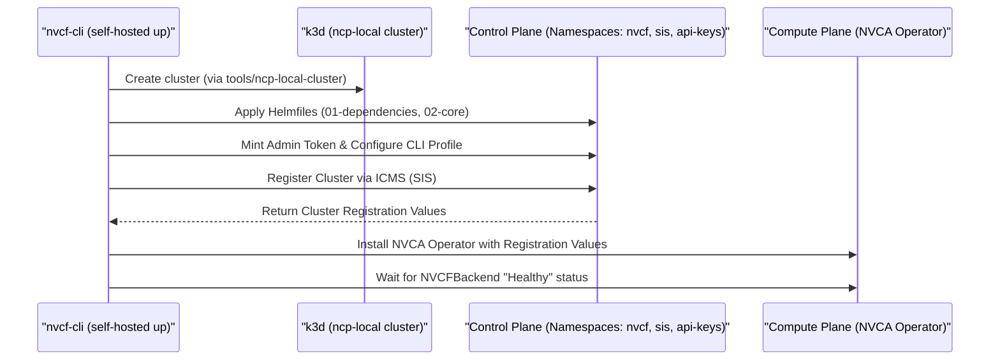
[docs/user/quickstart.md:109-216]()

### Execution Steps
1. **Bootstrap Cluster**: Uses `make` to provision the local environment including fake GPUs and Envoy Gateway.
   ```bash
   make -C tools/ncp-local-cluster build-and-deploy-cluster
   kubectl config use-context k3d-ncp-local
   ```
   [docs/user/quickstart.md:119-125]()

2. **Prepare Secrets**: Initialize the `local-secrets.yaml` with your base64-encoded NGC credentials.
   ```bash
   # Generates secrets for the local-secrets.yaml file
   BASE64_CRED="$(printf '%s' "\$oauthtoken:${NGC_API_KEY}" | base64 | tr -d '\n')"
   ```
   [docs/user/quickstart.md:173-181]()

3. **Deploy Stack**: Run the `up` command to automate the installation.
   ```bash
   nvcf-cli self-hosted up \
     --control-plane-stack=deploy/stacks/self-managed \
     --compute-plane-stack=deploy/stacks/nvcf-compute-plane \
     --env=local \
     --cluster-name=ncp-local
   ```
   [docs/user/quickstart.md:198-207]()

**Sources:**
- [docs/user/quickstart.md:109-216]()
- [docs/user/installation.md:5-12]()

---

## Production Helmfile Installation

For production or remote environments (e.g., AWS EKS, Azure AKS), the "one-click" CLI command is replaced by a structured Helmfile deployment. This provides granular control over the three system planes.

### System Plane Mapping
The following diagram maps the logical NVCF planes to the specific Helmfile stacks and Kubernetes namespaces used in the codebase.

**Diagram: Natural Language to Code Entity Mapping**
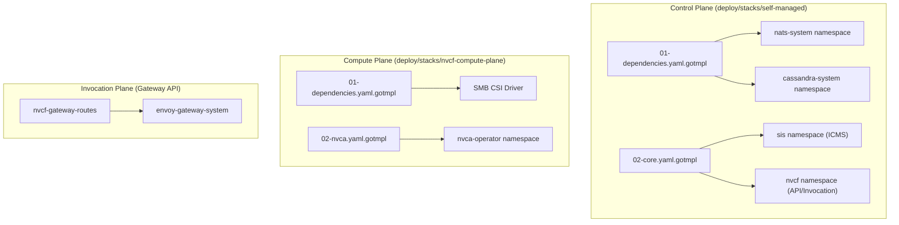
[ai-tooling/user/skills/nvcf-self-managed-installation/references/helmfile-structure.md:5-26](), [docs/user/helmfile-installation.md:41-51]()

### Deployment Phases
The control plane installation is split into phases to manage dependencies like Cassandra and OpenBao.

| Phase | Stack File | Primary Components |
| :--- | :--- | :--- |
| **01** | `01-dependencies.yaml.gotmpl` | NATS JetStream, Cassandra, OpenBao (Vault) |
| **02** | `02-core.yaml.gotmpl` | `nvcf-api`, `invocation-service`, `sis` (ICMS), `api-keys` |
| **03** | `03-observability.yaml.gotmpl` | Prometheus, Grafana, VictoriaMetrics |

[ai-tooling/user/skills/nvcf-self-managed-installation/references/helmfile-structure.md:35-70]()

### Values Flow and Precedence
Configuration is merged in the following order (highest index wins):
1. `environments/base.yaml` (Defaults)
2. `environments/<env>.yaml` (Environment overrides)
3. `global.yaml.gotmpl` (Go template logic)
4. `secrets/<env>-secrets.yaml` (Sensitive data)
5. Inline `values:` blocks in the Helmfile release definition.

[ai-tooling/user/skills/nvcf-self-managed-installation/SKILL.md:82-92]()

**Sources:**
- [docs/user/helmfile-installation.md:34-51]()
- [ai-tooling/user/skills/nvcf-self-managed-installation/SKILL.md:82-97]()
- [ai-tooling/user/skills/nvcf-self-managed-installation/references/helmfile-structure.md:1-125]()

---

## Post-Installation Verification

Once the stack is deployed, use the `nvcf-cli` to verify the health of the system.

### Health Checks
The `self-hosted check` command performs a suite of tests including:
- **Pre-flight**: Verifies tool versions and Kubernetes access.
- **Control Plane**: Checks service reachability and database connectivity.
- **Compute Plane**: Validates `NVCFBackend` CRD status and agent health.

```bash
# Run all health checks for a specific cluster
nvcf-cli self-hosted check --all --cluster-name=ncp-local
```
[docs/user/quickstart.md:223-225]()

### Key Code Entities for Verification
- **`NVCFBackend`**: A Custom Resource in the compute cluster whose `.status.conditions` indicate if the cluster is ready to receive workloads. [docs/user/quickstart.md:215-216]()
- **`sis.localhost`**: The local endpoint for the Instance and Cluster Management Service (ICMS), responsible for cluster registration. [docs/user/quickstart.md:147-147]()

**Sources:**
- [docs/user/quickstart.md:215-236]()
- [docs/user/installation.md:45-48]()

---

# Page: Control Plane Services

# Control Plane Services

<details>
<summary>Relevant source files</summary>

The following files were used as context for generating this wiki page:

- [deploy/helm/nvca-operator/nvca-operator/Chart.yaml](deploy/helm/nvca-operator/nvca-operator/Chart.yaml)
- [deploy/helm/nvca-operator/nvca-operator/templates/cluster-validator-network-checks-cm.yaml](deploy/helm/nvca-operator/nvca-operator/templates/cluster-validator-network-checks-cm.yaml)
- [deploy/helm/nvca-operator/nvca-operator/templates/cronjob.yaml](deploy/helm/nvca-operator/nvca-operator/templates/cronjob.yaml)
- [deploy/helm/nvca-operator/nvca-operator/templates/rbac.yaml](deploy/helm/nvca-operator/nvca-operator/templates/rbac.yaml)
- [deploy/stacks/self-managed/Makefile.dist](deploy/stacks/self-managed/Makefile.dist)
- [deploy/stacks/self-managed/environments/base.yaml](deploy/stacks/self-managed/environments/base.yaml)
- [deploy/stacks/self-managed/global.yaml.gotmpl](deploy/stacks/self-managed/global.yaml.gotmpl)
- [deploy/stacks/self-managed/helmfile-docker.mk](deploy/stacks/self-managed/helmfile-docker.mk)
- [deploy/stacks/self-managed/helmfile.d/01-dependencies.yaml.gotmpl](deploy/stacks/self-managed/helmfile.d/01-dependencies.yaml.gotmpl)
- [deploy/stacks/self-managed/helmfile.d/02-core.yaml.gotmpl](deploy/stacks/self-managed/helmfile.d/02-core.yaml.gotmpl)
- [deploy/stacks/self-managed/helmfile.d/03-observability.yaml.gotmpl](deploy/stacks/self-managed/helmfile.d/03-observability.yaml.gotmpl)
- [deploy/stacks/self-managed/secrets/secrets.yaml.template](deploy/stacks/self-managed/secrets/secrets.yaml.template)
- [docs/user/cluster-management/nsight-profiling.md](docs/user/cluster-management/nsight-profiling.md)
- [docs/user/cluster-management/self-managed.md](docs/user/cluster-management/self-managed.md)
- [docs/user/image-mirroring.md](docs/user/image-mirroring.md)
- [docs/user/manifest.md](docs/user/manifest.md)
- [docs/version-catalog/main.yaml](docs/version-catalog/main.yaml)
- [tools/docs-version-sync/catalog.go](tools/docs-version-sync/catalog.go)
- [tools/docs-version-sync/inline.go](tools/docs-version-sync/inline.go)
- [tools/docs-version-sync/main_test.go](tools/docs-version-sync/main_test.go)
- [tools/docs-version-sync/render.go](tools/docs-version-sync/render.go)

</details>


The NVCF Control Plane is a collection of microservices responsible for managing the lifecycle of functions, handling cluster registrations, managing secrets, and coordinating autoscaling across the Compute Plane. These services provide the administrative and operational APIs that allow users to deploy workloads and operators to manage infrastructure.

## Service Catalog Overview

The Control Plane is composed of several specialized services, most of which are deployed via Helm charts defined in the `deploy/helm/` directory and orchestrated using the `02-core.yaml.gotmpl` Helmfile stack [deploy/stacks/self-managed/helmfile.d/02-core.yaml.gotmpl:43-211]().

### Core Management Services
*   **Cloud Functions Service (`nvcf-service` / `api`)**: The central orchestrator for function versions, deployments, and state.
*   **Instance and Cluster Management Service (ICMS / `sis`)**: Manages GPU cluster registrations and identity providers.
*   **Helm Revalidation Service (`reval`)**: A Go-based service that validates and templates Helm charts before they are deployed to GPU clusters.
*   **Tenant API (`nvct-api`)**: Handles tenant-scoped operations and metadata.

### Security and Supporting Services
*   **API Keys Service**: Manages the lifecycle of NVCF API keys used for authentication.
*   **Encrypted Secret Store (ESS)**: Provides secure, tenant-scoped secret management for function workloads.
*   **NATS Auth Callout**: Handles authorization for the NATS JetStream messaging backbone.
*   **Notary Service**: Responsible for signing and validating artifacts.

### Operational Services
*   **Function Autoscaler**: A Rust-based service that monitors demand and adjusts the number of active function instances.
*   **State Metrics**: Exports real-time function information for Prometheus scraping [deploy/stacks/self-managed/helmfile.d/03-observability.yaml.gotmpl:60-68]().

## System Interaction Diagram

The following diagram illustrates how the primary Control Plane services interact with the shared data and messaging layers.

### Control Plane Service Architecture
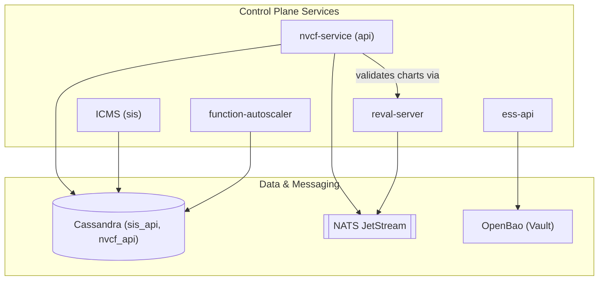
**Sources:** [deploy/stacks/self-managed/helmfile.d/02-core.yaml.gotmpl:43-153](), [deploy/stacks/self-managed/environments/base.yaml:146-188]()

## Code Entity Mapping

This diagram maps the high-level service names to their specific Helm releases and container image identifiers used in the codebase.

### Service to Code Entity Mapping
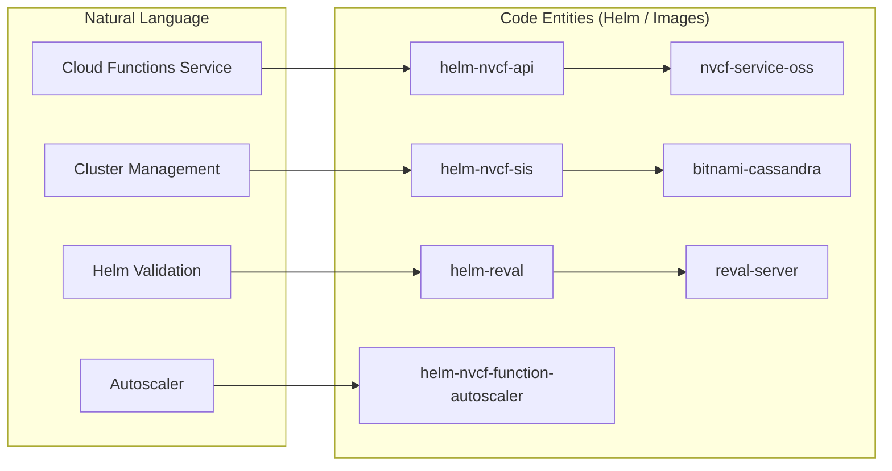
**Sources:** [docs/version-catalog/main.yaml:49-113](), [deploy/stacks/self-managed/helmfile.d/02-core.yaml.gotmpl:46-153]()

## Deployment Dependencies

The Control Plane services rely on a foundation of "Dependency" services (NATS, Cassandra, OpenBao) that must be healthy before core logic services start.

| Service Group | Components | Purpose |
| :--- | :--- | :--- |
| **Dependencies** | `nats`, `cassandra`, `openbao-server`, `cert-manager` | Foundational data, messaging, and security layers [deploy/stacks/self-managed/helmfile.d/01-dependencies.yaml.gotmpl:44-72](). |
| **Core Services** | `api`, `sis`, `nvct-api`, `reval`, `ess-api` | Primary business logic for function and cluster management [deploy/stacks/self-managed/helmfile.d/02-core.yaml.gotmpl:46-153](). |
| **Observability** | `state-metrics`, `function-autoscaler` | Monitoring and dynamic scaling of workloads [deploy/stacks/self-managed/helmfile.d/03-observability.yaml.gotmpl:57-78](). |

**Sources:** [deploy/stacks/self-managed/helmfile.d/01-dependencies.yaml.gotmpl:1-72](), [deploy/stacks/self-managed/helmfile.d/02-core.yaml.gotmpl:1-228]()

---

## Child Pages

For detailed technical documentation on specific service groups, refer to the following pages:

*   **[Cloud Functions Service (nvcf-service)](#2.1)**: Core Java/Spring Boot service for function lifecycle.
*   **[Instance and Cluster Management Service (ICMS)](#2.2)**: GPU cluster registration and OIDC management.
*   **[Helm Revalidation Service (helm-reval)](#2.3)**: Secure Helm chart templating and validation.
*   **[API Keys, ESS, and Supporting Services](#2.4)**: Secret management, API keys, and NATS authorization.
*   **[Function Autoscaler](#2.5)**: Rust-based scaling logic driven by PromQL metrics.

---

# Page: Cloud Functions Service (nvcf-service)

# Cloud Functions Service (nvcf-service)

<details>
<summary>Relevant source files</summary>

The following files were used as context for generating this wiki page:

- [.bazelignore](.bazelignore)
- [.bazelrc](.bazelrc)
- [.bazelversion](.bazelversion)
- [MODULE.bazel](MODULE.bazel)
- [MODULE.bazel.lock](MODULE.bazel.lock)
- [deploy/stacks/self-managed/Makefile.dist](deploy/stacks/self-managed/Makefile.dist)
- [deploy/stacks/self-managed/environments/base.yaml](deploy/stacks/self-managed/environments/base.yaml)
- [deploy/stacks/self-managed/global.yaml.gotmpl](deploy/stacks/self-managed/global.yaml.gotmpl)
- [deploy/stacks/self-managed/helmfile-docker.mk](deploy/stacks/self-managed/helmfile-docker.mk)
- [deploy/stacks/self-managed/helmfile.d/01-dependencies.yaml.gotmpl](deploy/stacks/self-managed/helmfile.d/01-dependencies.yaml.gotmpl)
- [deploy/stacks/self-managed/helmfile.d/02-core.yaml.gotmpl](deploy/stacks/self-managed/helmfile.d/02-core.yaml.gotmpl)
- [deploy/stacks/self-managed/helmfile.d/03-observability.yaml.gotmpl](deploy/stacks/self-managed/helmfile.d/03-observability.yaml.gotmpl)
- [deploy/stacks/self-managed/secrets/secrets.yaml.template](deploy/stacks/self-managed/secrets/secrets.yaml.template)
- [maven_install.json](maven_install.json)
- [migrations/cassandra/README.md](migrations/cassandra/README.md)
- [migrations/cassandra/execute_sqls.sh](migrations/cassandra/execute_sqls.sh)
- [migrations/cassandra/keyspaces/README.md](migrations/cassandra/keyspaces/README.md)
- [migrations/cassandra/keyspaces/api_keys_api/01_init_keyspace.up.sql](migrations/cassandra/keyspaces/api_keys_api/01_init_keyspace.up.sql)
- [migrations/cassandra/keyspaces/ess_api/01_init_keyspace.up.sql](migrations/cassandra/keyspaces/ess_api/01_init_keyspace.up.sql)
- [migrations/cassandra/keyspaces/event_ledger/01_init_keyspace.up.sql](migrations/cassandra/keyspaces/event_ledger/01_init_keyspace.up.sql)
- [migrations/cassandra/keyspaces/event_ledger/02_init_roles.up.sql](migrations/cassandra/keyspaces/event_ledger/02_init_roles.up.sql)
- [migrations/cassandra/keyspaces/event_ledger/03_init_tables.up.sql](migrations/cassandra/keyspaces/event_ledger/03_init_tables.up.sql)
- [migrations/cassandra/keyspaces/nvcf_api/01_init_keyspace.up.sql](migrations/cassandra/keyspaces/nvcf_api/01_init_keyspace.up.sql)
- [migrations/cassandra/keyspaces/nvcf_api/03_init_tables.up.sql](migrations/cassandra/keyspaces/nvcf_api/03_init_tables.up.sql)
- [migrations/cassandra/keyspaces/nvcf_api/07_drop_gpu_spec.up.sql](migrations/cassandra/keyspaces/nvcf_api/07_drop_gpu_spec.up.sql)
- [migrations/cassandra/keyspaces/nvcf_api/08_add_llm_config.up.sql](migrations/cassandra/keyspaces/nvcf_api/08_add_llm_config.up.sql)
- [migrations/cassandra/keyspaces/sis_api/01_init_keyspace.up.sql](migrations/cassandra/keyspaces/sis_api/01_init_keyspace.up.sql)
- [migrations/cassandra/keyspaces/sis_api/06_add_cluster_auth_client_id.up.sql](migrations/cassandra/keyspaces/sis_api/06_add_cluster_auth_client_id.up.sql)
- [src/control-plane-services/helm-reval/go.mod](src/control-plane-services/helm-reval/go.mod)
- [src/control-plane-services/helm-reval/go.sum](src/control-plane-services/helm-reval/go.sum)
- [src/control-plane-services/helm-reval/pkg/reval/config/config.go](src/control-plane-services/helm-reval/pkg/reval/config/config.go)
- [src/control-plane-services/helm-reval/pkg/reval/service/models.go](src/control-plane-services/helm-reval/pkg/reval/service/models.go)
- [src/control-plane-services/helm-reval/pkg/reval/service/service.go](src/control-plane-services/helm-reval/pkg/reval/service/service.go)
- [src/control-plane-services/helm-reval/reval/BUILD.bazel](src/control-plane-services/helm-reval/reval/BUILD.bazel)
- [src/control-plane-services/helm-reval/reval/helm_template.go](src/control-plane-services/helm-reval/reval/helm_template.go)
- [src/control-plane-services/helm-reval/reval/helm_template_test.go](src/control-plane-services/helm-reval/reval/helm_template_test.go)
- [src/control-plane-services/helm-reval/reval/run.go](src/control-plane-services/helm-reval/reval/run.go)
- [src/control-plane-services/helm-reval/reval/run_test.go](src/control-plane-services/helm-reval/reval/run_test.go)
- [src/control-plane-services/instance-cluster-management/BAZEL.md](src/control-plane-services/instance-cluster-management/BAZEL.md)
- [src/control-plane-services/instance-cluster-management/icms-core/BUILD.bazel](src/control-plane-services/instance-cluster-management/icms-core/BUILD.bazel)
- [tools/bazel/BUILD.bazel](tools/bazel/BUILD.bazel)
- [tools/bazel/patches/gazelle_go_work_dev_dependency.patch](tools/bazel/patches/gazelle_go_work_dev_dependency.patch)
- [tools/ci/check-oci-pins](tools/ci/check-oci-pins)

</details>


The Cloud Functions Service (internally referred to as `nvcf-service` or `api`) is the primary Control Plane component responsible for managing the lifecycle of functions, deployments, and account-level resources. It provides the RESTful interface for users to create and manage workloads and integrates with NATS for asynchronous communication with the Compute Plane.

## Service Overview

The `nvcf-service` is a Java Spring Boot application that serves as the central orchestrator for NVIDIA Cloud Functions. It manages metadata for functions, versions, deployments, and account quotas. It interacts with the Instance and Cluster Management Service (ICMS) to bridge the Control Plane's desired state with the Compute Plane's actual resources.

### Key Responsibilities
*   **Function Lifecycle Management:** Handles creation, versioning, and deletion of functions (Container and Helm-based) [migrations/cassandra/keyspaces/nvcf_api/03_init_tables.up.sql:73-102]().
*   **Deployment Orchestration:** Manages `functions_deployment_v2` and `gpu_specifications` to define how and where functions should run [migrations/cassandra/keyspaces/nvcf_api/03_init_tables.up.sql:114-150]().
*   **Account & Quota Management:** Tracks `nca_id` (NVIDIA Cloud Account) limits for functions, tasks, and telemetries [migrations/cassandra/keyspaces/nvcf_api/03_init_tables.up.sql:48-59]().
*   **Compute Plane Integration:** Issues requests to ICMS via NATS to trigger workload deployments on GPU clusters [deploy/stacks/self-managed/helmfile.d/02-core.yaml.gotmpl:58-65]().

**Sources:** [deploy/stacks/self-managed/helmfile.d/02-core.yaml.gotmpl:58-65](), [migrations/cassandra/keyspaces/nvcf_api/03_init_tables.up.sql:1-192]()

---

## Architecture and Data Flow

The service follows a standard Spring Boot architecture, utilizing a Cassandra backend for persistent state and NATS JetStream for event-driven orchestration.

### System Interaction Diagram
This diagram shows how `nvcf-service` (labeled as `api` in the codebase) interacts with other Control Plane components.

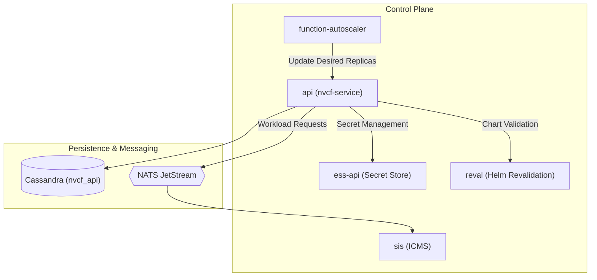
**Sources:** [deploy/stacks/self-managed/helmfile.d/02-core.yaml.gotmpl:52-106](), [deploy/stacks/self-managed/helmfile.d/03-observability.yaml.gotmpl:70-77]()

---

## Data Model (Cassandra)

The service utilizes the `nvcf_api` keyspace. The schema is designed for high-throughput metadata management and tracking deployment status across distributed backends.

### Primary Tables

| Table | Purpose | Key Columns |
| :--- | :--- | :--- |
| `accounts` | Provisions customer/partner accounts and defines limits. | `nca_id`, `max_functions_allowed` |
| `functions_v3` | The primary store for function versions, including container images and Helm charts. | `function_id`, `function_version_id`, `nca_id` |
| `functions_deployment_v2` | Tracks the deployment state and health of a specific function version. | `function_version_id`, `deployment_id` |
| `gpu_specifications` | Defines hardware requirements (GPU type, min/max instances) per deployment. | `gpu_specification_id`, `nca_id`, `backend` |
| `sis_requests_by_function_v2` | Tracks active SIS (ICMS) requests for deployment orchestration. | `function_version_id`, `sis_request_id` |

### User-Defined Types (UDTs)
The schema utilizes several UDTs to handle complex configurations:
*   `ratelimit_udt_v2`: Manages per-NCA and per-user rate limits [migrations/cassandra/keyspaces/nvcf_api/03_init_tables.up.sql:29-35]().
*   `health_udt`: Defines liveness/readiness probe protocols and ports [migrations/cassandra/keyspaces/nvcf_api/03_init_tables.up.sql:21-27]().
*   `resource_udt`: Tracks external resources (URLs/versions) associated with a function [migrations/cassandra/keyspaces/nvcf_api/03_init_tables.up.sql:7-11]().

**Sources:** [migrations/cassandra/keyspaces/nvcf_api/03_init_tables.up.sql:7-169]()

---

## Implementation Details

### Module Structure
The service is built using the `nv-boot` framework, a custom Spring Boot starter provided in `src/libraries/java/`.
*   **nvcf-core:** Contains shared business logic, data models, and Cassandra repositories used across control plane Java services.
*   **nvcf-service:** The main Spring Boot application containing REST controllers and NATS publishers.

### Build System (Bazel)
The Java components are built using Bazel, pinning to **Java 25** and using the `local_jdk` runtime [.bazelrc:78-82]().
*   Dependency management is handled via `rules_jvm_external` and documented in `maven_install.json` [maven_install.json:1-123]().
*   Lombok is supported, but requires `java_header_compilation=false` due to compatibility issues with Bazel's Turbine compiler [.bazelrc:82]().

### Local Development Setup
For local development, the service can be run against a k3d cluster managed by `nvcf-cli`.
1.  **Dependencies:** Requires Cassandra and NATS to be running. These are typically deployed in the `cassandra-system` and `nats-system` namespaces [deploy/stacks/self-managed/helmfile.d/01-dependencies.yaml.gotmpl:47-72]().
2.  **Configuration:** Service endpoints are injected via environment variables such as `NVCF_FQDN` and `NVCF_FQDN_NATS` [deploy/stacks/self-managed/environments/base.yaml:52-58]().
3.  **Migrations:** Cassandra schemas are applied using the `nvcf-cassandra-migrations` image, which executes SQL files in `migrations/cassandra/keyspaces/nvcf_api/` [deploy/stacks/self-managed/global.yaml.gotmpl:51-54]().

**Sources:** [.bazelrc:78-82](), [deploy/stacks/self-managed/helmfile.d/01-dependencies.yaml.gotmpl:47-72](), [deploy/stacks/self-managed/environments/base.yaml:52-58]()

---

## Deployment Configuration

The service is deployed via Helm using the `nvcf/helm-nvcf-api` chart [deploy/stacks/self-managed/helmfile.d/02-core.yaml.gotmpl:58-62]().

### Helm Release Definition
```yaml
  - name: api
    version: 1.23.9
    namespace: nvcf
    inherit:
      - template: service
    needs:
      - ess/ess-api
```
The service depends on `ess-api` for bootstrapping account secrets [deploy/stacks/self-managed/helmfile.d/02-core.yaml.gotmpl:63-65]().

### Resource Presets
In self-managed environments, Cassandra (the primary backend) is configured with the `xlarge` resource preset (1 CPU, 3072Mi memory request) to prevent OOM errors during migration [deploy/stacks/self-managed/environments/base.yaml:173-187]().

**Sources:** [deploy/stacks/self-managed/helmfile.d/02-core.yaml.gotmpl:58-65](), [deploy/stacks/self-managed/environments/base.yaml:173-187]()

---

# Page: Instance and Cluster Management Service (ICMS)

# Instance and Cluster Management Service (ICMS)

<details>
<summary>Relevant source files</summary>

The following files were used as context for generating this wiki page:

- [.bazelignore](.bazelignore)
- [.bazelrc](.bazelrc)
- [.bazelversion](.bazelversion)
- [MODULE.bazel](MODULE.bazel)
- [MODULE.bazel.lock](MODULE.bazel.lock)
- [maven_install.json](maven_install.json)
- [migrations/cassandra/keyspaces/sis_api/03_init_tables.up.sql](migrations/cassandra/keyspaces/sis_api/03_init_tables.up.sql)
- [migrations/cassandra/keyspaces/sis_api/09_add_reservation_backup_disabled.up.sql](migrations/cassandra/keyspaces/sis_api/09_add_reservation_backup_disabled.up.sql)
- [src/clis/nvcf-cli/cmd/cluster_registration_test.go](src/clis/nvcf-cli/cmd/cluster_registration_test.go)
- [src/clis/nvcf-cli/cmd/cluster_utils.go](src/clis/nvcf-cli/cmd/cluster_utils.go)
- [src/control-plane-services/helm-reval/go.mod](src/control-plane-services/helm-reval/go.mod)
- [src/control-plane-services/helm-reval/go.sum](src/control-plane-services/helm-reval/go.sum)
- [src/control-plane-services/helm-reval/pkg/reval/config/config.go](src/control-plane-services/helm-reval/pkg/reval/config/config.go)
- [src/control-plane-services/helm-reval/pkg/reval/service/models.go](src/control-plane-services/helm-reval/pkg/reval/service/models.go)
- [src/control-plane-services/helm-reval/pkg/reval/service/service.go](src/control-plane-services/helm-reval/pkg/reval/service/service.go)
- [src/control-plane-services/helm-reval/reval/BUILD.bazel](src/control-plane-services/helm-reval/reval/BUILD.bazel)
- [src/control-plane-services/helm-reval/reval/helm_template.go](src/control-plane-services/helm-reval/reval/helm_template.go)
- [src/control-plane-services/helm-reval/reval/helm_template_test.go](src/control-plane-services/helm-reval/reval/helm_template_test.go)
- [src/control-plane-services/helm-reval/reval/run.go](src/control-plane-services/helm-reval/reval/run.go)
- [src/control-plane-services/helm-reval/reval/run_test.go](src/control-plane-services/helm-reval/reval/run_test.go)
- [src/control-plane-services/instance-cluster-management/BAZEL.md](src/control-plane-services/instance-cluster-management/BAZEL.md)
- [src/control-plane-services/instance-cluster-management/icms-core/BUILD.bazel](src/control-plane-services/instance-cluster-management/icms-core/BUILD.bazel)
- [src/control-plane-services/instance-cluster-management/icms-core/src/main/java/com/nvidia/icms/inbound/rest/controllers/InstanceController.java](src/control-plane-services/instance-cluster-management/icms-core/src/main/java/com/nvidia/icms/inbound/rest/controllers/InstanceController.java)
- [src/control-plane-services/instance-cluster-management/icms-core/src/main/java/com/nvidia/icms/inbound/rest/model/cluster/GpuReservation.java](src/control-plane-services/instance-cluster-management/icms-core/src/main/java/com/nvidia/icms/inbound/rest/model/cluster/GpuReservation.java)
- [src/control-plane-services/instance-cluster-management/icms-core/src/main/java/com/nvidia/icms/outbound/cassandra/reservation/entity/ReservationEntity.java](src/control-plane-services/instance-cluster-management/icms-core/src/main/java/com/nvidia/icms/outbound/cassandra/reservation/entity/ReservationEntity.java)
- [src/control-plane-services/instance-cluster-management/icms-core/src/main/java/com/nvidia/icms/service/DescribeAndCancelInstanceService.java](src/control-plane-services/instance-cluster-management/icms-core/src/main/java/com/nvidia/icms/service/DescribeAndCancelInstanceService.java)
- [src/control-plane-services/instance-cluster-management/icms-core/src/main/java/com/nvidia/icms/service/internal/ReservationCapacityValidationHelper.java](src/control-plane-services/instance-cluster-management/icms-core/src/main/java/com/nvidia/icms/service/internal/ReservationCapacityValidationHelper.java)
- [src/control-plane-services/instance-cluster-management/icms-core/src/test/java/com/nvidia/icms/inbound/rest/controllers/InstanceControllerTest.java](src/control-plane-services/instance-cluster-management/icms-core/src/test/java/com/nvidia/icms/inbound/rest/controllers/InstanceControllerTest.java)
- [src/control-plane-services/instance-cluster-management/icms-core/src/test/java/com/nvidia/icms/integration/IcmsTest.java](src/control-plane-services/instance-cluster-management/icms-core/src/test/java/com/nvidia/icms/integration/IcmsTest.java)
- [src/control-plane-services/instance-cluster-management/icms-core/src/test/java/com/nvidia/icms/outbound/cassandra/reservation/entity/ReservationEntityTest.java](src/control-plane-services/instance-cluster-management/icms-core/src/test/java/com/nvidia/icms/outbound/cassandra/reservation/entity/ReservationEntityTest.java)
- [src/control-plane-services/instance-cluster-management/icms-core/src/test/java/com/nvidia/icms/outbound/nats/NatsStreamManagerTest.java](src/control-plane-services/instance-cluster-management/icms-core/src/test/java/com/nvidia/icms/outbound/nats/NatsStreamManagerTest.java)
- [tools/bazel/BUILD.bazel](tools/bazel/BUILD.bazel)
- [tools/bazel/patches/gazelle_go_work_dev_dependency.patch](tools/bazel/patches/gazelle_go_work_dev_dependency.patch)
- [tools/ci/check-oci-pins](tools/ci/check-oci-pins)

</details>


The Instance and Cluster Management Service (ICMS) is a core Control Plane service responsible for the lifecycle management of compute clusters and GPU reservations within NVIDIA Cloud Functions (NVCF). It serves as the source of truth for cluster registration, OIDC/JWKS security metadata, and the inventory of available GPU resources.

## Service Overview

ICMS is a Java-based application built on the `nv-boot` Spring Boot framework [src/control-plane-services/instance-cluster-management/icms-core/BUILD.bazel:15-22](). It manages the state of compute clusters and their associated GPU capacities, providing a REST API for the NVCF CLI and other control plane components to query and reserve resources.

### Key Responsibilities
*   **Cluster Registration:** Handling the onboarding of new compute clusters, including OIDC discovery and JWKS tracking for secure communication [src/clis/nvcf-cli/cmd/cluster_registration_test.go:38-55]().
*   **GPU Reservation Management:** Tracking and enforcing GPU quotas and reservations across different cluster groups [src/control-plane-services/instance-cluster-management/icms-core/src/main/java/com/nvidia/icms/service/internal/ReservationCapacityValidationHelper.java:1-5]().
*   **Instance Controller API:** Providing REST endpoints for managing function instances and their deployment state [src/control-plane-services/instance-cluster-management/icms-core/src/main/java/com/nvidia/icms/inbound/rest/controllers/InstanceController.java:1-5]().
*   **Persistence:** Utilizing Cassandra (`sis_api` keyspace) for storing cluster metadata and reservation state [src/control-plane-services/instance-cluster-management/icms-core/BUILD.bazel:16]().
*   **Messaging:** Integrating with NATS for event streaming and inter-service notifications [src/control-plane-services/instance-cluster-management/icms-core/src/test/java/com/nvidia/icms/outbound/nats/NatsStreamManagerTest.java:1-5]().

Sources: [src/control-plane-services/instance-cluster-management/icms-core/BUILD.bazel:1-110](), [src/control-plane-services/instance-cluster-management/BAZEL.md:1-183](), [src/clis/nvcf-cli/cmd/cluster_registration_test.go:38-55]()

## Architecture and Data Flow

ICMS operates as a multi-module Java project consisting of `icms-core` (business logic, entities, and repositories) and `icms-service` (the executable Spring Boot application) [src/control-plane-services/instance-cluster-management/BAZEL.md:3-6]().

### Component Interaction Diagram
This diagram illustrates how ICMS interacts with external entities and internal storage.

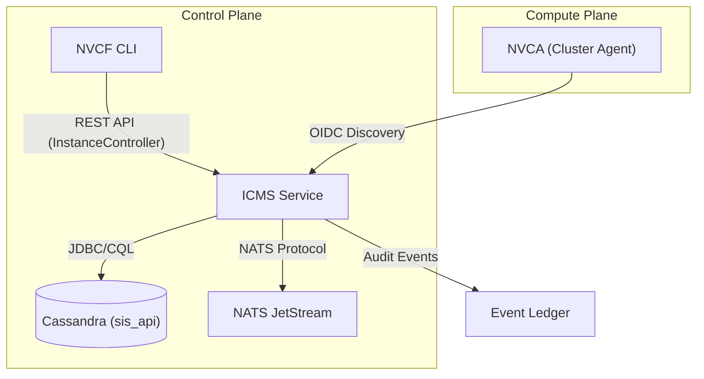
Sources: [src/control-plane-services/instance-cluster-management/icms-core/src/main/java/com/nvidia/icms/inbound/rest/controllers/InstanceController.java:1-5](), [src/control-plane-services/instance-cluster-management/icms-core/BUILD.bazel:15-18](), [src/clis/nvcf-cli/cmd/cluster_registration_test.go:143-161]()

## Cluster Registration and Security

A critical function of ICMS is the secure registration of clusters. This involves discovering the cluster's OIDC (OpenID Connect) configuration to validate tokens issued by the cluster-side agents (NVCA).

### OIDC Discovery Flow
When a cluster is registered via `nvcf-cli`, ICMS performs the following steps:
1.  **Discovery:** Fetches the `.well-known/openid-configuration` from the cluster's issuer URL [src/clis/nvcf-cli/cmd/cluster_registration_test.go:143-151]().
2.  **JWKS Retrieval:** Extracts the `jwks_uri` to fetch the public keys used for signing tokens [src/clis/nvcf-cli/cmd/cluster_registration_test.go:152-161]().
3.  **Validation:** Ensures the issuer in the discovery document matches the requested issuer [src/clis/nvcf-cli/cmd/cluster_registration_test.go:183-201]().

### Code Entity Mapping: Registration
| Logic | Code Entity |
| :--- | :--- |
| REST Controller | `InstanceController` [src/control-plane-services/instance-cluster-management/icms-core/src/main/java/com/nvidia/icms/inbound/rest/controllers/InstanceController.java:1-5]() |
| Reservation Logic | `DescribeAndCancelInstanceService` [src/control-plane-services/instance-cluster-management/icms-core/src/main/java/com/nvidia/icms/service/DescribeAndCancelInstanceService.java:1-5]() |
| Capacity Validation | `ReservationCapacityValidationHelper` [src/control-plane-services/instance-cluster-management/icms-core/src/main/java/com/nvidia/icms/service/internal/ReservationCapacityValidationHelper.java:1-5]() |

Sources: [src/clis/nvcf-cli/cmd/cluster_registration_test.go:1-205](), [src/control-plane-services/instance-cluster-management/icms-core/src/main/java/com/nvidia/icms/inbound/rest/controllers/InstanceController.java:1-5]()

## Data Model (Cassandra sis_api)

ICMS persists cluster and reservation data in the `sis_api` keyspace. The schema is managed via migrations located in `migrations/cassandra/keyspaces/sis_api/` [migrations/cassandra/keyspaces/sis_api/03_init_tables.up.sql:1-5]().

### Key Entities
*   **ReservationEntity:** Tracks GPU reservations, including cluster IDs, GPU types, and counts [src/control-plane-services/instance-cluster-management/icms-core/src/main/java/com/nvidia/icms/outbound/cassandra/reservation/entity/ReservationEntity.java:1-5]().
*   **Cluster Metadata:** Stores OIDC issuer URLs and JWKS data for registered compute backends.

### Reservation Schema Updates
The schema supports advanced reservation features, such as disabling backup reservations:
*   **Field:** `reservation_backup_disabled` added to the reservation table [migrations/cassandra/keyspaces/sis_api/09_add_reservation_backup_disabled.up.sql:1-5]().

Sources: [src/control-plane-services/instance-cluster-management/icms-core/src/main/java/com/nvidia/icms/outbound/cassandra/reservation/entity/ReservationEntity.java:1-5](), [migrations/cassandra/keyspaces/sis_api/09_add_reservation_backup_disabled.up.sql:1-5]()

## Implementation Details

### Build System
ICMS is built using Bazel. The build definition utilizes `nv_boot_library` for Spring Boot compatibility [src/control-plane-services/instance-cluster-management/icms-core/BUILD.bazel:1-2](). 

*   **Executable Jar:** The service is packaged as a Spring Boot executable jar named `app.jar` [src/control-plane-services/instance-cluster-management/BAZEL.md:77-83]().
*   **Integration Testing:** Tests use `Testcontainers` to orchestrate Cassandra and NATS instances during the build process [src/control-plane-services/instance-cluster-management/BAZEL.md:88-93]().

### NATS Integration
ICMS uses NATS JetStream for reliable messaging. The `NatsStreamManager` handles the creation and management of streams used to broadcast cluster status changes and reservation updates [src/control-plane-services/instance-cluster-management/icms-core/src/test/java/com/nvidia/icms/outbound/nats/NatsStreamManagerTest.java:1-5]().

### Code Entity Mapping: Core Logic
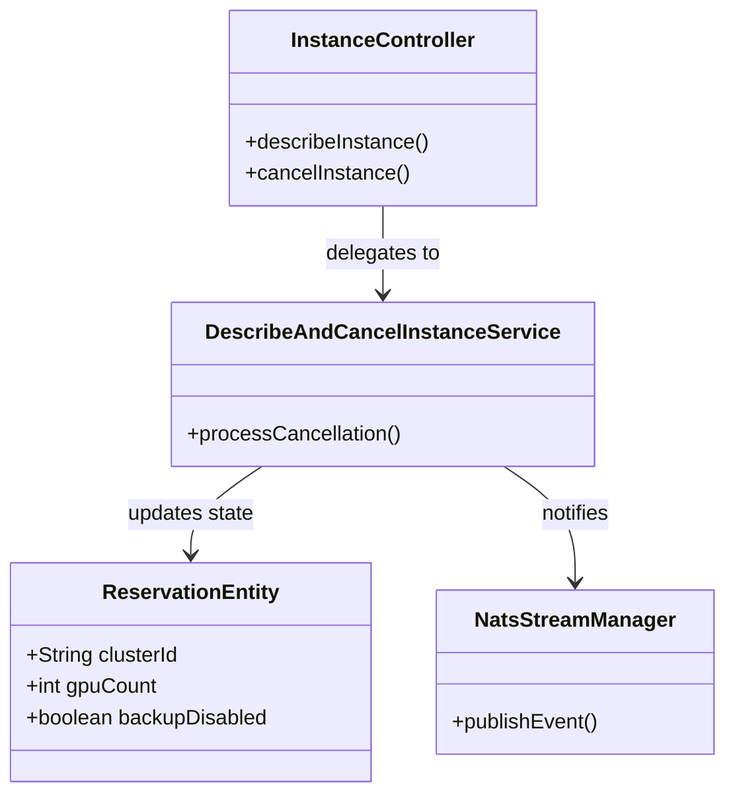
Sources: [src/control-plane-services/instance-cluster-management/icms-core/src/main/java/com/nvidia/icms/inbound/rest/controllers/InstanceController.java:1-5](), [src/control-plane-services/instance-cluster-management/icms-core/src/main/java/com/nvidia/icms/service/DescribeAndCancelInstanceService.java:1-5](), [src/control-plane-services/instance-cluster-management/icms-core/src/main/java/com/nvidia/icms/outbound/cassandra/reservation/entity/ReservationEntity.java:1-5](), [src/control-plane-services/instance-cluster-management/icms-core/src/test/java/com/nvidia/icms/outbound/nats/NatsStreamManagerTest.java:1-5]()

## Development and Testing

### Local Setup
Developers can run ICMS locally using the `local` Spring profile. This requires a local Docker environment to host the backing services defined in the `local_env` compose bundle [src/control-plane-services/instance-cluster-management/BAZEL.md:160-170]().

```bash
# Start local Cassandra and NATS
docker compose -f src/control-plane-services/instance-cluster-management/local_env/docker-compose.yml up -d

# Run ICMS with local profile
bazel run //src/control-plane-services/instance-cluster-management/icms-service:app -- --spring.profiles.active=local
```

### Integration Tests
The `IcmsTest` class provides comprehensive integration testing, covering the full flow from REST request to database persistence [src/control-plane-services/instance-cluster-management/icms-core/src/test/java/com/nvidia/icms/integration/IcmsTest.java:1-5]().

Sources: [src/control-plane-services/instance-cluster-management/BAZEL.md:88-100](), [src/control-plane-services/instance-cluster-management/icms-core/src/test/java/com/nvidia/icms/integration/IcmsTest.java:1-5]()

---

# Page: Helm Revalidation Service (helm-reval)

# Helm Revalidation Service (helm-reval)

<details>
<summary>Relevant source files</summary>

The following files were used as context for generating this wiki page:

- [.bazelignore](.bazelignore)
- [.bazelrc](.bazelrc)
- [.bazelversion](.bazelversion)
- [MODULE.bazel](MODULE.bazel)
- [MODULE.bazel.lock](MODULE.bazel.lock)
- [maven_install.json](maven_install.json)
- [src/control-plane-services/helm-reval/cmd/reval-service/BUILD.bazel](src/control-plane-services/helm-reval/cmd/reval-service/BUILD.bazel)
- [src/control-plane-services/helm-reval/cmd/reval-service/image_entrypoint_mode_test.sh](src/control-plane-services/helm-reval/cmd/reval-service/image_entrypoint_mode_test.sh)
- [src/control-plane-services/helm-reval/cmd/reval-service/main.go](src/control-plane-services/helm-reval/cmd/reval-service/main.go)
- [src/control-plane-services/helm-reval/cmd/reval/cli/BUILD.bazel](src/control-plane-services/helm-reval/cmd/reval/cli/BUILD.bazel)
- [src/control-plane-services/helm-reval/cmd/reval/cli/server.go](src/control-plane-services/helm-reval/cmd/reval/cli/server.go)
- [src/control-plane-services/helm-reval/cmd/reval/cli/server_internal_test.go](src/control-plane-services/helm-reval/cmd/reval/cli/server_internal_test.go)
- [src/control-plane-services/helm-reval/go.mod](src/control-plane-services/helm-reval/go.mod)
- [src/control-plane-services/helm-reval/go.sum](src/control-plane-services/helm-reval/go.sum)
- [src/control-plane-services/helm-reval/pkg/reval/config/config.go](src/control-plane-services/helm-reval/pkg/reval/config/config.go)
- [src/control-plane-services/helm-reval/pkg/reval/service/models.go](src/control-plane-services/helm-reval/pkg/reval/service/models.go)
- [src/control-plane-services/helm-reval/pkg/reval/service/service.go](src/control-plane-services/helm-reval/pkg/reval/service/service.go)
- [src/control-plane-services/helm-reval/reval/BUILD.bazel](src/control-plane-services/helm-reval/reval/BUILD.bazel)
- [src/control-plane-services/helm-reval/reval/helm_template.go](src/control-plane-services/helm-reval/reval/helm_template.go)
- [src/control-plane-services/helm-reval/reval/helm_template_test.go](src/control-plane-services/helm-reval/reval/helm_template_test.go)
- [src/control-plane-services/helm-reval/reval/run.go](src/control-plane-services/helm-reval/reval/run.go)
- [src/control-plane-services/helm-reval/reval/run_test.go](src/control-plane-services/helm-reval/reval/run_test.go)
- [src/control-plane-services/instance-cluster-management/BAZEL.md](src/control-plane-services/instance-cluster-management/BAZEL.md)
- [src/control-plane-services/instance-cluster-management/icms-core/BUILD.bazel](src/control-plane-services/instance-cluster-management/icms-core/BUILD.bazel)
- [tools/bazel/BUILD.bazel](tools/bazel/BUILD.bazel)
- [tools/bazel/patches/gazelle_go_work_dev_dependency.patch](tools/bazel/patches/gazelle_go_work_dev_dependency.patch)
- [tools/ci/check-oci-pins](tools/ci/check-oci-pins)

</details>


The Helm Revalidation Service (`helm-reval`) is a Go-based microservice within the NVCF Control Plane responsible for the secure acquisition, templating, and validation of Helm charts. It ensures that workloads intended for the Compute Plane adhere to security policies, contain valid Kubernetes manifests, and reference accessible container images before they are deployed as `MiniService` or `NVCFBackend` resources.

## Service Architecture and Pipeline

`helm-reval` operates as a stateless validation engine. It exposes a REST API used primarily by `nvcf-service` and the `MiniService` controller to verify that a function's deployment artifacts are sound.

### Chart Acquisition and Validation Flow

The service implements a multi-stage pipeline for processing Helm charts:
1.  **Acquisition**: Fetches charts from remote HTTPS or OCI registries using an SSRF-safe dialer.
2.  **Rendering**: Templates the chart using provided values via the Helm SDK.
3.  **Manifest Validation**: Parses the resulting YAML into Kubernetes objects and validates them against specific `ValidationPolicy` sets.
4.  **Image Verification**: Extracts image references from the manifests and checks their existence/accessibility in remote registries.

### Data Flow Diagram

The following diagram illustrates the internal processing flow when a request hits the `/v1/validate` or `/v1/render` endpoints.

**Internal ReVal Processing Pipeline**
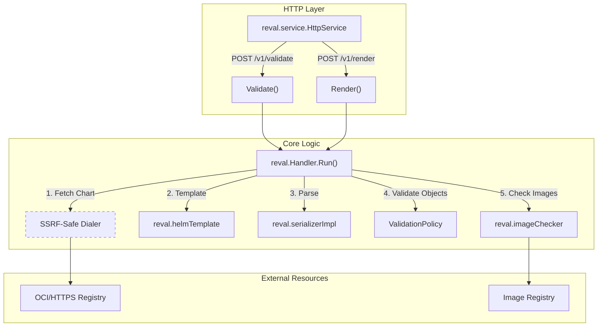
Sources: [src/control-plane-services/helm-reval/pkg/reval/service/service.go:151-152](), [src/control-plane-services/helm-reval/reval/run.go:74-88](), [src/control-plane-services/helm-reval/reval/run.go:209-225]()

## Key Implementation Details

### SSRF-Safe Dialer
To prevent Server-Side Request Forgery (SSRF), `helm-reval` uses a custom `net.Dialer` that validates destination IP addresses before establishing a connection. It explicitly blocks access to loopback addresses, link-local addresses, and private network ranges (RFC1918) unless specifically configured otherwise. This dialer is used for both chart downloads and OCI registry interactions.

Sources: [src/control-plane-services/helm-reval/reval/run.go:209-232]()

### Validation Policies
The service supports two primary levels of validation defined in `reval.ValidationPolicy`:
*   **Default Policy**: Applies strict checks, ensuring that only a subset of allowed Kubernetes Kind/GVKs (e.g., `Deployment`, `Service`, `ConfigMap`) are present in the chart.
*   **Unrestricted Policy**: Allows a broader set of Kubernetes resources, typically used for internal or trusted system components.

Sources: [src/control-plane-services/helm-reval/reval/run.go:136-147]()

### Image Checker
The `imageChecker` component identifies all container images referenced in `PodSpec` fields (including init containers). It performs a "head" check against the remote registry using credentials provided in the request (`ImageRegistryAuthConfig`) to confirm the image exists and the compute plane will be able to pull it.

Sources: [src/control-plane-services/helm-reval/reval/run.go:126-127](), [src/control-plane-services/helm-reval/reval/run.go:74-88]()

## Code Entity Map

This diagram bridges the conceptual service components to their specific Go implementations.

**Entity Mapping**
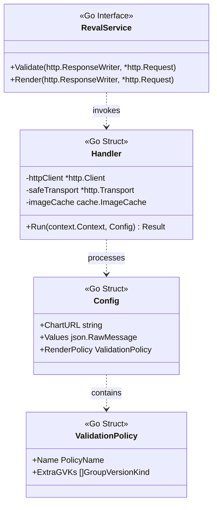
Sources: [src/control-plane-services/helm-reval/pkg/reval/service/service.go:151-152](), [src/control-plane-services/helm-reval/reval/run.go:74-88](), [src/control-plane-services/helm-reval/reval/run.go:103-134]()

## API Endpoints

| Endpoint | Method | Description |
| :--- | :--- | :--- |
| `/v1/validate` | `POST` | Fetches, templates, and validates a chart against policies and image checks. Returns a `Result` object. |
| `/v1/render` | `POST` | Similar to validate, but returns the rendered Kubernetes manifests in the response. |
| `/info` | `GET` | Returns service version, git commit, and build timestamp. |
| `/healthz` | `GET` | Liveness and readiness probe (returns `OK`). |

Sources: [src/control-plane-services/helm-reval/cmd/reval/cli/server.go:151-155](), [src/control-plane-services/helm-reval/cmd/reval/cli/server.go:177-188]()

## Configuration and Deployment

`helm-reval` is configured via `viper` and environment variables. Key configuration parameters include:
*   `SkipValidateObjects`: Disables GVK-based manifest validation.
*   `SkipValidateImages`: Disables remote registry image checks.
*   `PreserveLabels` / `PreserveAnnotations`: A whitelist of metadata keys that should not be stripped during the sanitization phase.

The service is packaged as a multi-arch OCI image using Bazel's `go_oci_image` rule, based on a distroless base image for a minimal security footprint.

Sources: [src/control-plane-services/helm-reval/pkg/reval/config/config.go](), [src/control-plane-services/helm-reval/cmd/reval-service/BUILD.bazel:42-49](), [src/control-plane-services/helm-reval/cmd/reval/cli/server.go:106-112]()

---

# Page: API Keys, ESS, and Supporting Services

# API Keys, ESS, and Supporting Services

<details>
<summary>Relevant source files</summary>

The following files were used as context for generating this wiki page:

- [deploy/helm/api-keys-colocated/api-keys/templates/deployment.yaml](deploy/helm/api-keys-colocated/api-keys/templates/deployment.yaml)
- [deploy/helm/encrypted-secret-store/ess-api/Chart.yaml](deploy/helm/encrypted-secret-store/ess-api/Chart.yaml)
- [deploy/helm/encrypted-secret-store/ess-api/values.yaml](deploy/helm/encrypted-secret-store/ess-api/values.yaml)
- [docs/v0.5/cluster-management/samples/nvca-operator-values.yaml](docs/v0.5/cluster-management/samples/nvca-operator-values.yaml)
- [docs/v0.5/cluster-management/self-managed.md](docs/v0.5/cluster-management/self-managed.md)
- [docs/v0.5/image-mirroring.md](docs/v0.5/image-mirroring.md)
- [docs/v0.5/manifest.md](docs/v0.5/manifest.md)
- [migrations/cassandra/keyspaces/ess_api/03_init_tables.up.sql](migrations/cassandra/keyspaces/ess_api/03_init_tables.up.sql)
- [migrations/cassandra/keyspaces/ess_api/04_init_ncp_namespace.up.sql](migrations/cassandra/keyspaces/ess_api/04_init_ncp_namespace.up.sql)
- [migrations/cassandra/keyspaces/ess_api/06_fix_nvcf_api_notary_issuer.up.sql](migrations/cassandra/keyspaces/ess_api/06_fix_nvcf_api_notary_issuer.up.sql)
- [migrations/cassandra/keyspaces/ess_api/07_alter_table_namespace.up.sql](migrations/cassandra/keyspaces/ess_api/07_alter_table_namespace.up.sql)
- [migrations/cassandra/keyspaces/ess_api/08_add_oauth_authorizations.up.sql](migrations/cassandra/keyspaces/ess_api/08_add_oauth_authorizations.up.sql)
- [migrations/openbao/migrations/07_setup_api-keys.sh](migrations/openbao/migrations/07_setup_api-keys.sh)
- [migrations/openbao/migrations/22_setup_event-ledger.sh](migrations/openbao/migrations/22_setup_event-ledger.sh)
- [src/clis/nvcf-cli/cmd/apikey.go](src/clis/nvcf-cli/cmd/apikey.go)
- [src/clis/nvcf-cli/cmd/apikey_test.go](src/clis/nvcf-cli/cmd/apikey_test.go)
- [src/clis/nvcf-cli/internal/apikeys/client.go](src/clis/nvcf-cli/internal/apikeys/client.go)
- [src/compute-plane-services/ess-agent/api/go.mod](src/compute-plane-services/ess-agent/api/go.mod)
- [src/compute-plane-services/ess-agent/api/go.sum](src/compute-plane-services/ess-agent/api/go.sum)
- [src/compute-plane-services/ess-agent/go.mod](src/compute-plane-services/ess-agent/go.mod)
- [src/control-plane-services/nats-auth-callout/cmd/nvcf-nats-auth-callout-service/BUILD.bazel](src/control-plane-services/nats-auth-callout/cmd/nvcf-nats-auth-callout-service/BUILD.bazel)
- [src/control-plane-services/nats-auth-callout/go.mod](src/control-plane-services/nats-auth-callout/go.mod)
- [src/control-plane-services/nats-auth-callout/go.sum](src/control-plane-services/nats-auth-callout/go.sum)
- [src/control-plane-services/nats-auth-callout/internal/router/BUILD.bazel](src/control-plane-services/nats-auth-callout/internal/router/BUILD.bazel)
- [src/control-plane-services/nats-auth-callout/internal/router/info_test.go](src/control-plane-services/nats-auth-callout/internal/router/info_test.go)
- [src/control-plane-services/nats-auth-callout/internal/router/router.go](src/control-plane-services/nats-auth-callout/internal/router/router.go)

</details>


This section documents the supporting services of the NVCF Control Plane responsible for identity, secret management, and secure communication. These include the API Keys service, the Encrypted Secret Store (ESS), the NATS Auth Callout service, the Event Ledger, and the Notary service.

## API Keys Service

The API Keys service manages the lifecycle of NVCF API keys, providing authentication for users and services. It is a Java-based service that integrates with OpenBao for key generation and Cassandra for persistence.

### Key Configuration and Provisioning
During deployment, the `openbao-migrations` job configures the API Keys service. It generates a 136-byte `data-domain-key` and registers internal services (nvcf-api, nvct-api, event-ledger) that are allowed to authenticate using these keys [migrations/openbao/migrations/07_setup_api-keys.sh:83-93]().

### API Keys CLI Integration
The `nvcf-cli` provides commands to manage API keys, including creation, listing, and revocation [src/clis/nvcf-cli/cmd/apikey.go:1-20](). The CLI communicates with the API Keys service via a dedicated client [src/clis/nvcf-cli/internal/apikeys/client.go:1-15]().

**Sources:** [migrations/openbao/migrations/07_setup_api-keys.sh:1-94](), [src/clis/nvcf-cli/cmd/apikey.go:1-20](), [src/clis/nvcf-cli/internal/apikeys/client.go:1-15]()

---

## Encrypted Secret Store (ESS)

ESS provides tenant-scoped secret management. It allows functions to access sensitive data (like API tokens or database credentials) without exposing them in the function definition.

### Architecture and Data Flow
ESS is implemented as a Spring Boot application (`ess-api`) [deploy/helm/encrypted-secret-store/ess-api/values.yaml:35-35](). It uses a multi-layered encryption approach where secret values are encrypted with a Key Encryption Key (KEK) managed within the `ess_api` keyspace.

#### ESS Secret Retrieval Flow
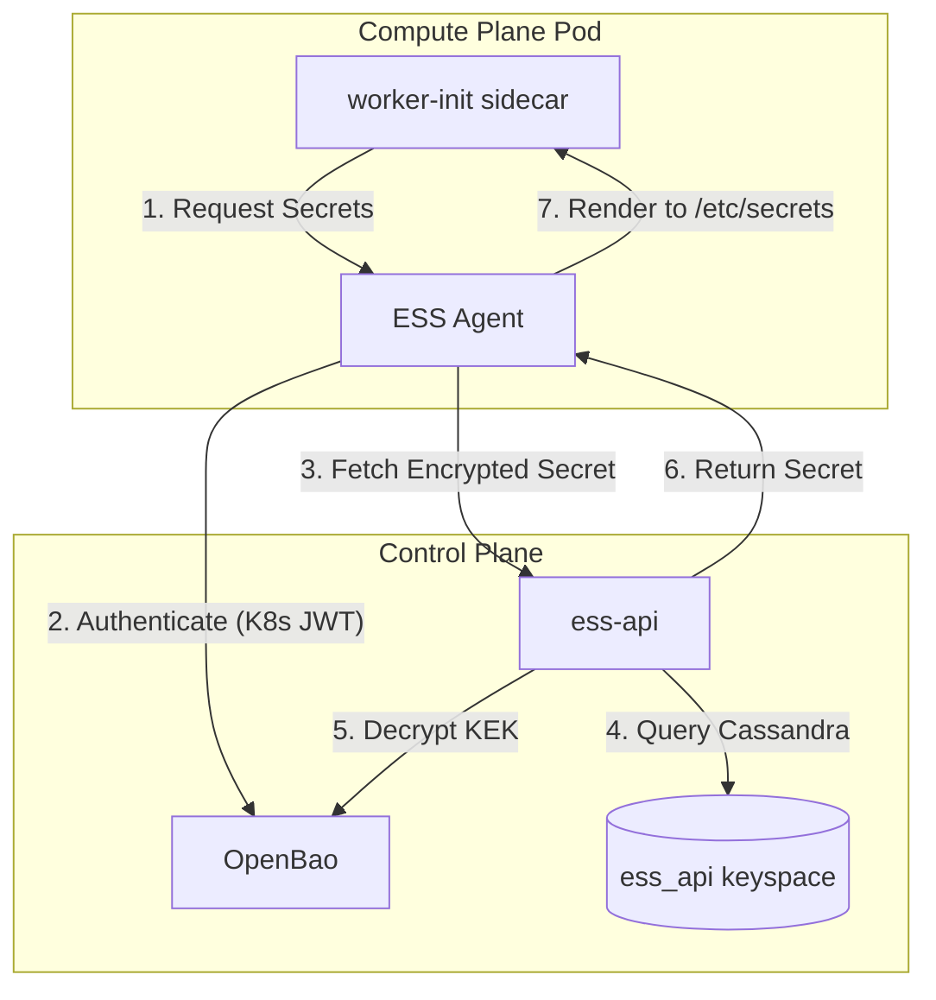
**Sources:** [docs/v0.5/cluster-management/self-managed.md:53-55](), [deploy/helm/encrypted-secret-store/ess-api/Chart.yaml:1-23]()

### Cassandra Schema: ess_api
The ESS schema is designed for multi-tenancy using namespaces and hash-bucketed entities to ensure scalability.

| Table | Purpose | Key Columns |
| :--- | :--- | :--- |
| `namespaces` | Top-level registry scoping secrets and auth. | `namespace` (PK), `oauth_authorizations`, `notary_authorizations` |
| `entities` | Registry of entities (functions/tasks) within a namespace. | `(namespace, entity_type, hash_bucket)` (Partition Key) |
| `secret_paths_by_entity` | Directory-style index of secret paths. | `(namespace, entity)` (Partition Key), `path` (Clustering) |
| `secret_versions_by_entity_and_path` | Versioned secret values (encrypted). | `(namespace, entity, secret_path)` (Partition Key), `version` (Clustering DESC) |
| `encryption_keys_by_kid` | Lookup for KEKs by Key ID. | `(namespace)` (Partition Key), `kid` (Clustering) |

**Sources:** [migrations/cassandra/keyspaces/ess_api/03_init_tables.up.sql:27-110](), [migrations/cassandra/keyspaces/ess_api/04_init_ncp_namespace.up.sql:1-18]()

---

## NATS Auth Callout Service

The `nvcf-nats-auth-callout-service` is a Go-based microservice that implements the NATS Auth Callout protocol. It validates NATS connection requests by verifying JWTs against the system's identity providers.

### Implementation Details
The service uses the `gin` framework [src/control-plane-services/nats-auth-callout/internal/router/router.go:63-63]() and integrates with OpenTelemetry for tracing and Prometheus for metrics [src/control-plane-services/nats-auth-callout/internal/router/router.go:76-85]().

#### Service Entry Points
| Route | Function | Description |
| :--- | :--- | :--- |
| `/healthz` | `handleHealthz` | Basic liveness check [src/control-plane-services/nats-auth-callout/internal/router/router.go:201-205](). |
| `/info` | `golibversion.Handler` | Returns build information (version, git commit) [src/control-plane-services/nats-auth-callout/internal/router/router.go:135-135](). |
| `/v1/ping` | `handlePing` | Connectivity test returning a timestamp [src/control-plane-services/nats-auth-callout/internal/router/router.go:180-186](). |

### Build and Deployment
The service is built using Bazel, with versioning information injected at build time from the workspace status [src/control-plane-services/nats-auth-callout/cmd/nvcf-nats-auth-callout-service/BUILD.bazel:32-39](). It is deployed as a distroless OCI image [src/control-plane-services/nats-auth-callout/cmd/nvcf-nats-auth-callout-service/BUILD.bazel:59-66]().

**Sources:** [src/control-plane-services/nats-auth-callout/cmd/nvcf-nats-auth-callout-service/main.go:1-25](), [src/control-plane-services/nats-auth-callout/internal/router/router.go:128-165](), [src/control-plane-services/nats-auth-callout/cmd/nvcf-nats-auth-callout-service/BUILD.bazel:20-77]()

---

## Event Ledger and Notary

### Event Ledger
The Event Ledger provides an auditable record of system events. It is a Java service that persists events to Cassandra.
- **Auth Provisioning:** The `openbao-migrations` job sets up JWT roles for `sis-api` and `nvca` to allow them to create and archive events [migrations/openbao/migrations/22_setup_event-ledger.sh:68-100]().
- **Cassandra Storage:** Uses the `event_ledger_app_v0` user for database operations [migrations/openbao/migrations/22_setup_event-ledger.sh:44-44]().

### Notary Service
The Notary service provides cryptographic signing for workload manifests. It ensures that only authorized workloads are executed on the compute plane.
- **Integration with ESS:** The `nvcf` namespace in ESS is pre-configured to trust the Notary service (`nvcf-api` client) for authorization [migrations/cassandra/keyspaces/ess_api/04_init_ncp_namespace.up.sql:17-17]().

**Sources:** [migrations/openbao/migrations/22_setup_event-ledger.sh:1-107](), [migrations/cassandra/keyspaces/ess_api/04_init_ncp_namespace.up.sql:1-18]()

---

# Page: Function Autoscaler

# Function Autoscaler

<details>
<summary>Relevant source files</summary>

The following files were used as context for generating this wiki page:

- [deploy/helm/function-autoscaler/Chart.yaml](deploy/helm/function-autoscaler/Chart.yaml)
- [deploy/helm/function-autoscaler/values.yaml](deploy/helm/function-autoscaler/values.yaml)
- [deploy/helm/function-autoscaler/vault-agent-templates/secrets.json.tmpl](deploy/helm/function-autoscaler/vault-agent-templates/secrets.json.tmpl)
- [deploy/stacks/self-managed/tests/observability-autoscaler.sh](deploy/stacks/self-managed/tests/observability-autoscaler.sh)
- [migrations/openbao/migrations/21_setup_autoscaler.sh](migrations/openbao/migrations/21_setup_autoscaler.sh)
- [src/compute-plane-services/nvca/vendor/github.com/NVIDIA/nvcf/src/libraries/go/lib/pkg/otelconfig/config/render.go](src/compute-plane-services/nvca/vendor/github.com/NVIDIA/nvcf/src/libraries/go/lib/pkg/otelconfig/config/render.go)
- [src/control-plane-services/function-autoscaler/Cargo.lock](src/control-plane-services/function-autoscaler/Cargo.lock)
- [src/control-plane-services/function-autoscaler/crates/server/Cargo.toml](src/control-plane-services/function-autoscaler/crates/server/Cargo.toml)
- [src/control-plane-services/function-autoscaler/crates/server/proto/nvcf.proto](src/control-plane-services/function-autoscaler/crates/server/proto/nvcf.proto)
- [src/control-plane-services/function-autoscaler/crates/server/resources/settings-local.yaml](src/control-plane-services/function-autoscaler/crates/server/resources/settings-local.yaml)
- [src/control-plane-services/function-autoscaler/crates/server/src/cassandra/cassandra_service.rs](src/control-plane-services/function-autoscaler/crates/server/src/cassandra/cassandra_service.rs)
- [src/control-plane-services/function-autoscaler/crates/server/src/cassandra/distributed_lock.rs](src/control-plane-services/function-autoscaler/crates/server/src/cassandra/distributed_lock.rs)
- [src/control-plane-services/function-autoscaler/crates/server/src/cassandra/statements.rs](src/control-plane-services/function-autoscaler/crates/server/src/cassandra/statements.rs)
- [src/control-plane-services/function-autoscaler/crates/server/src/health/mod.rs](src/control-plane-services/function-autoscaler/crates/server/src/health/mod.rs)
- [src/control-plane-services/function-autoscaler/crates/server/src/models/mod.rs](src/control-plane-services/function-autoscaler/crates/server/src/models/mod.rs)
- [src/control-plane-services/function-autoscaler/crates/server/src/nvcf_api/mod.rs](src/control-plane-services/function-autoscaler/crates/server/src/nvcf_api/mod.rs)
- [src/control-plane-services/function-autoscaler/crates/server/src/nvcf_api/nvcf_client.rs](src/control-plane-services/function-autoscaler/crates/server/src/nvcf_api/nvcf_client.rs)
- [src/control-plane-services/function-autoscaler/crates/server/src/nvcf_api/oauth2_client.rs](src/control-plane-services/function-autoscaler/crates/server/src/nvcf_api/oauth2_client.rs)
- [src/control-plane-services/function-autoscaler/crates/server/src/scaling/mod.rs](src/control-plane-services/function-autoscaler/crates/server/src/scaling/mod.rs)
- [src/control-plane-services/function-autoscaler/crates/server/src/scaling/policy_cache.rs](src/control-plane-services/function-autoscaler/crates/server/src/scaling/policy_cache.rs)
- [src/control-plane-services/function-autoscaler/crates/server/src/scaling/policy_client.rs](src/control-plane-services/function-autoscaler/crates/server/src/scaling/policy_client.rs)
- [src/control-plane-services/function-autoscaler/crates/server/src/secrets/secrets_config.rs](src/control-plane-services/function-autoscaler/crates/server/src/secrets/secrets_config.rs)
- [src/control-plane-services/function-autoscaler/crates/server/src/server.rs](src/control-plane-services/function-autoscaler/crates/server/src/server.rs)
- [src/control-plane-services/function-autoscaler/crates/server/src/startup.rs](src/control-plane-services/function-autoscaler/crates/server/src/startup.rs)
- [src/control-plane-services/function-autoscaler/crates/server/src/timeseries_db/mod.rs](src/control-plane-services/function-autoscaler/crates/server/src/timeseries_db/mod.rs)
- [src/control-plane-services/function-autoscaler/crates/server/src/timeseries_db/timeseries_db_client.rs](src/control-plane-services/function-autoscaler/crates/server/src/timeseries_db/timeseries_db_client.rs)
- [src/control-plane-services/function-autoscaler/crates/server/src/tracing_init.rs](src/control-plane-services/function-autoscaler/crates/server/src/tracing_init.rs)
- [src/control-plane-services/function-autoscaler/crates/server/src/work/discovery.rs](src/control-plane-services/function-autoscaler/crates/server/src/work/discovery.rs)
- [src/control-plane-services/function-autoscaler/crates/server/src/work/mod.rs](src/control-plane-services/function-autoscaler/crates/server/src/work/mod.rs)
- [src/control-plane-services/function-autoscaler/local_env/AGENTS.md](src/control-plane-services/function-autoscaler/local_env/AGENTS.md)

</details>


The Function Autoscaler is a Rust-based service [src/control-plane-services/function-autoscaler/crates/server/Cargo.toml:17-21]() responsible for dynamically adjusting the number of instances for NVIDIA Cloud Functions (NVCF). It operates by continuously monitoring function utilization via PromQL queries against a Time Series Database (TSDB) and updating the desired instance counts through the NVCF Control Plane API.

## Architecture and Control Flow

The autoscaler is designed as a distributed system that uses Cassandra for state persistence and leader election. It splits its responsibilities into two primary loops: the **Discovery Loop** and the **Scaling Loop**.

### System Components Overview

| Component | Responsibility |
| :--- | :--- |
| **Discovery Loop** | Scans VictoriaMetrics for functions with recent traffic and registers them in Cassandra [src/control-plane-services/function-autoscaler/crates/server/src/work/discovery.rs:159-222](). |
| **Scaling Loop** | Processes "buckets" of active functions, calculates utilization, and applies scaling policies [src/control-plane-services/function-autoscaler/crates/server/src/work/mod.rs:232-315](). |
| **Cassandra** | Stores the `ActiveFunctionTable` and provides distributed locking via `DistributedLockManager` [src/control-plane-services/function-autoscaler/crates/server/src/cassandra/distributed_lock.rs:1-18](). |
| **VictoriaMetrics** | Acts as the `TimeseriesDb` source for utilization metrics (PromQL) [src/control-plane-services/function-autoscaler/crates/server/src/timeseries_db/timeseries_db_client.rs:18-26](). |
| **NVCF API Client** | Writes the calculated `desired_instance_count` back to the NVCF core service [src/control-plane-services/function-autoscaler/crates/server/src/nvcf_api/nvcf_client.rs:1-23](). |

### Code-to-Entity Mapping: Discovery and Scaling

The following diagram maps the logical scaling process to the specific Rust structs and functions that implement them.

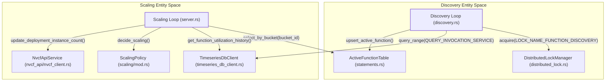
**Sources:** [src/control-plane-services/function-autoscaler/crates/server/src/work/discovery.rs:35-40](), [src/control-plane-services/function-autoscaler/crates/server/src/work/mod.rs:67-116](), [src/control-plane-services/function-autoscaler/crates/server/src/server.rs:169-210]()

---

## Discovery Loop

The discovery loop is a leader-elected process that identifies functions requiring autoscaling. It queries VictoriaMetrics for functions that have received requests within the last `lookback_minutes` (default: 5) [src/control-plane-services/function-autoscaler/crates/server/src/work/discovery.rs:37-40]().

1.  **Distributed Locking**: The service attempts to acquire a lock named `function_discovery` in Cassandra [src/control-plane-services/function-autoscaler/crates/server/src/work/discovery.rs:35]().
2.  **Sharded Queries**: To handle high cardinality, queries are split into shards using regex on the `function_id` (e.g., `[0-3].*`, `[4-7].*`) [src/control-plane-services/function-autoscaler/crates/server/src/work/discovery.rs:50-79]().
3.  **Metric Sources**: It scans both `function_request` (HTTP) and `function_request_total` (gRPC) metrics [src/control-plane-services/function-autoscaler/crates/server/src/work/discovery.rs:109-127]().
4.  **State Sync**: Functions found in metrics are added to the `active_functions` table in Cassandra, while functions that have been idle longer than the `scale_to_zero_idle_timeout` are marked for removal [src/control-plane-services/function-autoscaler/crates/server/src/scaling/mod.rs:90-94]().

**Sources:** [src/control-plane-services/function-autoscaler/crates/server/src/work/discovery.rs:159-222](), [src/control-plane-services/function-autoscaler/crates/server/src/scaling/mod.rs:71-76]()

---

## Scaling Loop and Sharding

Scaling is performed in parallel across multiple replicas. Each function is assigned to one of 1024 buckets based on its `function_id` hash [src/control-plane-services/function-autoscaler/crates/server/src/work/mod.rs:232-240](). Replicas coordinate to ensure only one instance processes a specific bucket at a time using a distributed lock [src/control-plane-services/function-autoscaler/crates/server/src/work/mod.rs:63-64]().

### Scaling Logic Flow

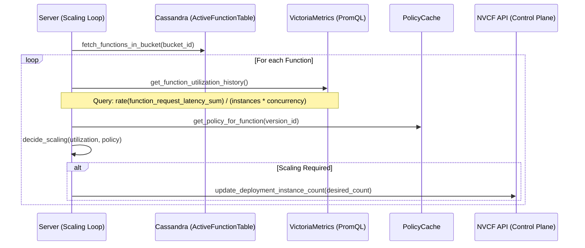

### Utilization Calculation
The autoscaler supports two metric sources for utilization [src/control-plane-services/function-autoscaler/crates/server/src/work/mod.rs:88-105]():
*   **Control Plane Metrics**: Calculated as `rate(latency_sum) / (current_instances * concurrency)`.
*   **Worker Metrics**: Calculated as `increase(worker_thread_busy_seconds) / window / worker_thread_count`.

**Sources:** [src/control-plane-services/function-autoscaler/crates/server/src/work/mod.rs:88-105](), [src/control-plane-services/function-autoscaler/crates/server/src/server.rs:220-250]()

---

## Configuration and Scaling Policies

The service is configured via `settings-local.yaml` (or environment-specific overrides) [src/control-plane-services/function-autoscaler/crates/server/resources/settings-local.yaml:4-28]().

### Policy Types
The `ScalingSettings` struct defines how the autoscaler behaves [src/control-plane-services/function-autoscaler/crates/server/src/scaling/mod.rs:64-113]():
1.  **Static Policy**: A global set of thresholds applied to all functions (e.g., Scale Up at 70%, Scale Down at 30%) [src/control-plane-services/function-autoscaler/crates/server/resources/settings-local.yaml:69-74]().
2.  **Custom Policy**: Fetches function-specific thresholds from an external gRPC service, with a local `PolicyCache` for performance [src/control-plane-services/function-autoscaler/crates/server/src/scaling/mod.rs:159-170]().

### Key Parameters
*   **`scaling_loop_interval_seconds`**: Frequency of the scaling check (default 15s) [src/control-plane-services/function-autoscaler/crates/server/src/scaling/mod.rs:28-30]().
*   **`lookback_seconds`**: Duration of historical data used for decisions (default 600s) [src/control-plane-services/function-autoscaler/crates/server/src/scaling/mod.rs:34-36]().
*   **`scale_to_zero_idle_timeout_seconds`**: Time a function must be idle before scaling to zero (default 1800s) [src/control-plane-services/function-autoscaler/crates/server/src/scaling/mod.rs:40-42]().

**Sources:** [src/control-plane-services/function-autoscaler/crates/server/src/scaling/mod.rs:28-113](), [src/control-plane-services/function-autoscaler/crates/server/resources/settings-local.yaml:61-75]()

---

## Observability and Health

The autoscaler provides several endpoints for monitoring its internal state:
*   **Liveness/Readiness**: `/admin/health/liveness` and `/admin/health/readiness` on port `8181` [src/control-plane-services/function-autoscaler/crates/server/src/server.rs:102-107](). Readiness depends on successful connections to Cassandra and VictoriaMetrics [src/control-plane-services/function-autoscaler/crates/server/src/server.rs:97-98]().
*   **Metrics**: A Prometheus exporter runs on port `41338` [src/control-plane-services/function-autoscaler/crates/server/resources/settings-local.yaml:12]().
*   **Tracing**: Integrated with OpenTelemetry via gRPC (OTLP) [src/control-plane-services/function-autoscaler/crates/server/src/tracing_init.rs:32-58]().

### Health Checks
The `Health` struct tracks the status of critical dependencies [src/control-plane-services/function-autoscaler/crates/server/src/health/mod.rs:18-20](). If Cassandra or the TSDB client fails, the service reports itself as unhealthy to Kubernetes [src/control-plane-services/function-autoscaler/crates/server/src/server.rs:129-160]().

**Sources:** [src/control-plane-services/function-autoscaler/crates/server/src/server.rs:92-123](), [src/control-plane-services/function-autoscaler/crates/server/src/tracing_init.rs:100-103]()

---

# Page: Invocation Plane Services

# Invocation Plane Services

<details>
<summary>Relevant source files</summary>

The following files were used as context for generating this wiki page:

- [ai-tooling/user/skills/nvcf-self-managed-cli/reference/troubleshooting.md](ai-tooling/user/skills/nvcf-self-managed-cli/reference/troubleshooting.md)
- [deploy/stacks/self-managed/Makefile.dist](deploy/stacks/self-managed/Makefile.dist)
- [deploy/stacks/self-managed/environments/base.yaml](deploy/stacks/self-managed/environments/base.yaml)
- [deploy/stacks/self-managed/global.yaml.gotmpl](deploy/stacks/self-managed/global.yaml.gotmpl)
- [deploy/stacks/self-managed/helmfile-docker.mk](deploy/stacks/self-managed/helmfile-docker.mk)
- [deploy/stacks/self-managed/helmfile.d/01-dependencies.yaml.gotmpl](deploy/stacks/self-managed/helmfile.d/01-dependencies.yaml.gotmpl)
- [deploy/stacks/self-managed/helmfile.d/02-core.yaml.gotmpl](deploy/stacks/self-managed/helmfile.d/02-core.yaml.gotmpl)
- [deploy/stacks/self-managed/helmfile.d/03-observability.yaml.gotmpl](deploy/stacks/self-managed/helmfile.d/03-observability.yaml.gotmpl)
- [deploy/stacks/self-managed/secrets/secrets.yaml.template](deploy/stacks/self-managed/secrets/secrets.yaml.template)
- [docs/user/generic-http-function-invocation.md](docs/user/generic-http-function-invocation.md)
- [docs/user/grpc-function-invocation.md](docs/user/grpc-function-invocation.md)
- [docs/user/images/nvcf-grpc-invocation-path.svg](docs/user/images/nvcf-grpc-invocation-path.svg)
- [docs/user/images/nvcf-grpc-multicluster-invocation.svg](docs/user/images/nvcf-grpc-multicluster-invocation.svg)
- [docs/user/images/nvcf-http-invocation-path.svg](docs/user/images/nvcf-http-invocation-path.svg)
- [docs/user/images/nvcf-http-multicluster-invocation.svg](docs/user/images/nvcf-http-multicluster-invocation.svg)
- [docs/user/images/nvcf-llm-invocation-path.svg](docs/user/images/nvcf-llm-invocation-path.svg)
- [docs/user/images/nvcf-llm-multicluster-invocation.svg](docs/user/images/nvcf-llm-multicluster-invocation.svg)
- [docs/user/streaming-functions.md](docs/user/streaming-functions.md)
- [docs/user/third-party-registries.md](docs/user/third-party-registries.md)
- [docs/user/troubleshooting.md](docs/user/troubleshooting.md)

</details>


The Invocation Plane is the request-handling layer of NVIDIA Cloud Functions (NVCF). It is responsible for receiving client requests, performing authentication and rate limiting, and routing traffic to the appropriate function workers in the Compute Plane. This plane supports multiple protocols including standard HTTP, gRPC, and OpenAI-compatible LLM APIs.

The services in this plane act as the "front door" for all function executions, translating external requests into internal messaging via NATS or direct proxy connections to worker pods.

### Invocation Architecture Overview

The following diagram illustrates how external requests flow through the various Invocation Plane services to reach function workers.

**Diagram: Request Routing and Service Association**
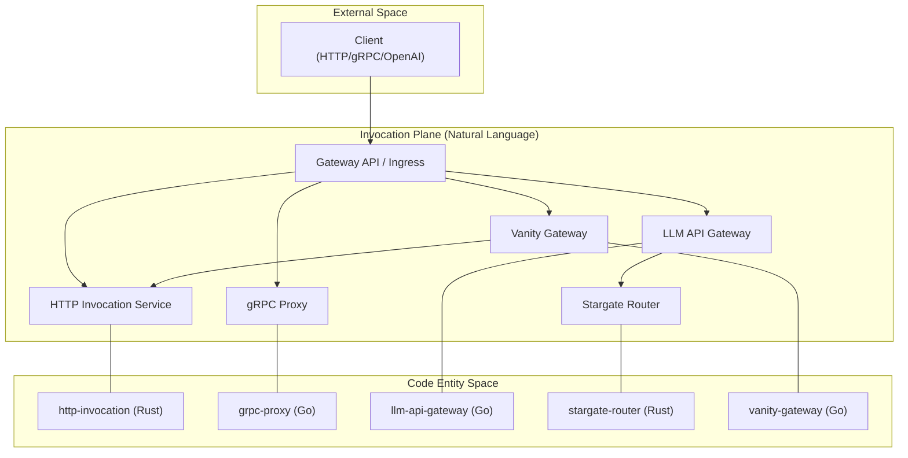
Sources: [deploy/stacks/self-managed/helmfile.d/02-core.yaml.gotmpl:73-201](), [docs/user/images/nvcf-llm-invocation-path.svg:73-91]()

---

## 3.1 HTTP Invocation Service
The **HTTP Invocation Service** (`invocation-service`) is a Rust-based high-performance service that handles standard RESTful function executions. It exposes the primary execution endpoints, such as `/v2/nvcf/exec/functions/{id}`, and manages the lifecycle of synchronous and asynchronous (pexec) requests. It integrates with the Rate Limiter to enforce tenant quotas and publishes requests to NATS for consumption by the Compute Plane.

For details, see [HTTP Invocation Service](#3.1).

**Sources:** [deploy/stacks/self-managed/helmfile.d/02-core.yaml.gotmpl:73-80](), [docs/user/images/nvcf-http-invocation-path.svg:1-113]()

---

## 3.2 gRPC Proxy
The **gRPC Proxy** (`grpc-proxy`) is a Go-based service designed for low-latency, stateful streaming connections. Unlike the HTTP service, it uses a "director" pattern to hijack gRPC calls and route them to specific worker pods. It supports session resumption via the `nvcf-reqid` metadata, allowing clients to reconnect to the same worker after network interruptions.

For details, see [gRPC Proxy](#3.2).

**Sources:** [deploy/stacks/self-managed/helmfile.d/02-core.yaml.gotmpl:81-88](), [docs/user/grpc-function-invocation.md:1-150]()

---

## 3.3 LLM API Gateway and Stargate Router
This sub-system provides specialized handling for Large Language Model (LLM) workloads.
*   **LLM API Gateway**: A Go service that provides OpenAI-compatible endpoints (e.g., `/v1/chat/completions`). It handles model ID mapping and initial request validation.
*   **Stargate Router**: A Rust-based router that receives traffic from the LLM Gateway and performs advanced load balancing across multiple backend clusters. It uses the Pylon QUIC-HTTP tunnel to maintain efficient communication with LLM workers.

For details, see [LLM API Gateway and Stargate Router](#3.3).

**Sources:** [deploy/stacks/self-managed/helmfile.d/02-core.yaml.gotmpl:167-190](), [docs/user/images/nvcf-llm-invocation-path.svg:83-95]()

---

## 3.4 Vanity Gateway and Rate Limiter
*   **Vanity Gateway**: Provides customizable "vanity" URLs and supports OpenAI-compatible routes that shadow traffic to the standard HTTP invocation service. It acts as a lightweight translation layer for specific deployment aliases.
*   **Rate Limiter**: A dedicated service that tracks and enforces request limits across the invocation plane. It uses a gRPC-based protocol to provide real-time quota checks for the other invocation services.

For details, see [Vanity Gateway and Rate Limiter](#3.4).

**Sources:** [deploy/stacks/self-managed/helmfile.d/02-core.yaml.gotmpl:89-100](), [deploy/stacks/self-managed/helmfile.d/02-core.yaml.gotmpl:191-201]()

---

## Service Interactions

The following diagram maps the high-level service names to their specific implementation names and deployment namespaces used in the Helm stacks.

**Diagram: Service Implementation Mapping**
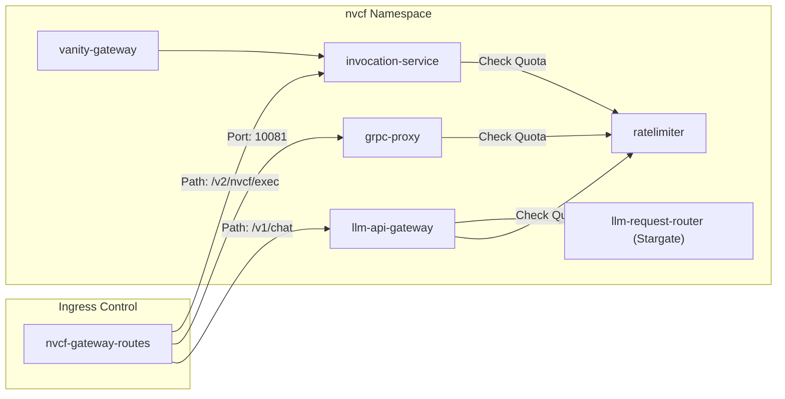
Sources: [deploy/stacks/self-managed/helmfile.d/02-core.yaml.gotmpl:73-228](), [deploy/stacks/self-managed/environments/base.yaml:52-72]()

---

# Page: HTTP Invocation Service

# HTTP Invocation Service

<details>
<summary>Relevant source files</summary>

The following files were used as context for generating this wiki page:

- [src/control-plane-services/function-autoscaler/crates/server/BUILD.bazel](src/control-plane-services/function-autoscaler/crates/server/BUILD.bazel)
- [src/invocation-plane-services/http-invocation/.cargo/config.toml](src/invocation-plane-services/http-invocation/.cargo/config.toml)
- [src/invocation-plane-services/http-invocation/.gitignore](src/invocation-plane-services/http-invocation/.gitignore)
- [src/invocation-plane-services/http-invocation/crates/server/BUILD.bazel](src/invocation-plane-services/http-invocation/crates/server/BUILD.bazel)
- [src/invocation-plane-services/http-invocation/crates/server/resources/settings.yaml](src/invocation-plane-services/http-invocation/crates/server/resources/settings.yaml)
- [src/invocation-plane-services/http-invocation/crates/server/src/metrics/mod.rs](src/invocation-plane-services/http-invocation/crates/server/src/metrics/mod.rs)
- [src/invocation-plane-services/http-invocation/crates/server/src/routes/app_error.rs](src/invocation-plane-services/http-invocation/crates/server/src/routes/app_error.rs)
- [src/invocation-plane-services/http-invocation/crates/server/src/routes/get_pexec.rs](src/invocation-plane-services/http-invocation/crates/server/src/routes/get_pexec.rs)
- [src/invocation-plane-services/http-invocation/crates/server/src/routes/post_pexec.rs](src/invocation-plane-services/http-invocation/crates/server/src/routes/post_pexec.rs)
- [src/invocation-plane-services/http-invocation/crates/server/src/telemetry/mod.rs](src/invocation-plane-services/http-invocation/crates/server/src/telemetry/mod.rs)
- [src/invocation-plane-services/ratelimiter/cmd/BUILD.bazel](src/invocation-plane-services/ratelimiter/cmd/BUILD.bazel)
- [src/invocation-plane-services/ratelimiter/cmd/info_test.go](src/invocation-plane-services/ratelimiter/cmd/info_test.go)
- [src/invocation-plane-services/ratelimiter/cmd/main.go](src/invocation-plane-services/ratelimiter/cmd/main.go)
- [src/invocation-plane-services/ratelimiter/go.mod](src/invocation-plane-services/ratelimiter/go.mod)
- [src/invocation-plane-services/ratelimiter/go.sum](src/invocation-plane-services/ratelimiter/go.sum)
- [src/invocation-plane-services/vanity-gateway/gateway/vanity_director.go](src/invocation-plane-services/vanity-gateway/gateway/vanity_director.go)
- [src/invocation-plane-services/vanity-gateway/gateway/vanity_director_test.go](src/invocation-plane-services/vanity-gateway/gateway/vanity_director_test.go)
- [src/libraries/go/lib/cmd/icms-translate/BUILD.bazel](src/libraries/go/lib/cmd/icms-translate/BUILD.bazel)
- [src/libraries/go/lib/pkg/auth/BUILD.bazel](src/libraries/go/lib/pkg/auth/BUILD.bazel)
- [src/libraries/go/lib/pkg/core/BUILD.bazel](src/libraries/go/lib/pkg/core/BUILD.bazel)
- [src/libraries/go/lib/pkg/nvkit/config/BUILD.bazel](src/libraries/go/lib/pkg/nvkit/config/BUILD.bazel)
- [src/libraries/go/lib/pkg/nvkit/encrypt/BUILD.bazel](src/libraries/go/lib/pkg/nvkit/encrypt/BUILD.bazel)
- [src/libraries/go/lib/pkg/oauth/BUILD.bazel](src/libraries/go/lib/pkg/oauth/BUILD.bazel)

</details>


The HTTP Invocation Service (`http-invocation`) is a high-performance Rust-based component within the NVCF Invocation Plane. Its primary responsibility is to receive incoming HTTP requests from users, validate them against the NVCF API (Control Plane), enforce rate limits, and publish the invocation tasks to NATS JetStream for execution by the Compute Plane [src/invocation-plane-services/http-invocation/crates/server/src/routes/post_pexec.rs:179-188]().

## System Architecture and Data Flow

The service acts as the entry point for synchronous and asynchronous function executions. It handles complex request lifecycles, including large payload streaming and early client disconnect management.

### Request Lifecycle Diagram
The following diagram illustrates the flow of a request through the `http-invocation` service.

**HTTP Invocation Flow**
```mermaid
sequenceDiagram
    participant Client
    participant HI as "http-invocation (Rust/Axum)"
    participant RL as "ratelimiter (Go/gRPC)"
    participant NVCF as "nvcf-service (Java/Control Plane)"
    participant NATS as "NATS JetStream"

    Client->>HI: POST /v2/nvcf/pexec/functions/{id}
    HI->>NVCF: Validate Function & Auth
    NVCF-->>HI: AllowedFunctionInvocations
    HI->>RL: Check Rate Limit (gRPC)
    RL-->>HI: LimitResult (OK/RateLimited)
    
    alt is Rate Limited
        HI-->>Client: 429 Too Many Requests
    else is Allowed
        HI->>HI: Create InflightRequestGuard
        HI->>NATS: Publish WorkerInvokeFunctionRequest
        NATS-->>HI: ACK
        HI-->>Client: 202 Accepted / Response Stream
    end

    Note over HI, Client: If Client disconnects, InflightRequestGuard drops
    HI->>NATS: Publish Cancel Request
```
Sources: [src/invocation-plane-services/http-invocation/crates/server/src/routes/post_pexec.rs:179-210](), [src/invocation-plane-services/http-invocation/crates/server/src/routes/post_pexec.rs:116-176](), [src/invocation-plane-services/http-invocation/crates/server/src/rate_limit/mod.rs:31-31]()

## Key Implementation Details

### Invocation Endpoints
The service implements the following primary routes using the Axum framework:
*   **`pexec` (POST)**: The main entry point for function execution. It performs authentication, asset reference resolution, and NATS publishing [src/invocation-plane-services/http-invocation/crates/server/src/routes/post_pexec.rs:179-188]().
*   **`get_pexec` (GET)**: Used for polling or retrieving status/results for specific invocation types [src/invocation-plane-services/http-invocation/crates/server/src/routes/get_pexec.rs:1-10]().

### Inflight Request Management
A critical feature of the service is the `InflightRequestGuard`. This RAII (Resource Acquisition Is Initialization) guard tracks the lifecycle of an active request [src/invocation-plane-services/http-invocation/crates/server/src/routes/post_pexec.rs:74-84]().

If a client disconnects before the request is fulfilled, the guard's `Drop` implementation:
1.  Records a `499 Client Closed Request` metric [src/invocation-plane-services/http-invocation/crates/server/src/routes/post_pexec.rs:128-140]().
2.  Spawns an async task to publish a cancellation message to NATS, ensuring compute resources are not wasted on abandoned requests [src/invocation-plane-services/http-invocation/crates/server/src/routes/post_pexec.rs:145-173]().

### Rate Limit Integration
The service integrates with the `ratelimiter` service via gRPC. Before publishing to NATS, it calls `RateLimitService` to verify if the tenant/function has exceeded its quota [src/invocation-plane-services/http-invocation/crates/server/src/routes/post_pexec.rs:31-31]().

Sources: [src/invocation-plane-services/http-invocation/crates/server/src/routes/post_pexec.rs:1-176](), [src/invocation-plane-services/ratelimiter/cmd/main.go:225-230]()

## Telemetry and Observability

The service uses a custom telemetry stack based on `tracing` and `opentelemetry-rust` [src/invocation-plane-services/http-invocation/crates/server/src/telemetry/mod.rs:51-56]().

### Metrics
Prometheus metrics are exposed on a dedicated port (default `41337`) [src/invocation-plane-services/http-invocation/crates/server/src/metrics/mod.rs:171-183](). Key metrics include:
*   `function.request.latency`: Histogram of request durations [src/invocation-plane-services/http-invocation/crates/server/src/metrics/mod.rs:70-73]().
*   `app.invocation.error`: Counter for errors, including the internal `499` status for client disconnects [src/invocation-plane-services/http-invocation/crates/server/src/metrics/mod.rs:75-78](), [src/invocation-plane-services/http-invocation/crates/server/src/metrics/mod.rs:32-36]().
*   `nats.jetstream.publish`: Counter for successful NATS message handoffs [src/invocation-plane-services/http-invocation/crates/server/src/metrics/mod.rs:105-108]().

### Tracing
W3C Trace Context propagation is implemented to ensure distributed traces flow from the caller through `http-invocation` and into the NATS backbone [src/invocation-plane-services/http-invocation/crates/server/src/telemetry/mod.rs:127-132]().

Sources: [src/invocation-plane-services/http-invocation/crates/server/src/metrics/mod.rs:1-170](), [src/invocation-plane-services/http-invocation/crates/server/src/telemetry/mod.rs:1-120]()

## Build and Deployment

The service is built using Bazel and packaged as a multi-arch OCI image.

### OCI Image Configuration
The image is based on `distroless/cc` to provide the necessary C standard libraries for `jemalloc` and `openssl` while maintaining a minimal security footprint [src/invocation-plane-services/http-invocation/crates/server/BUILD.bazel:115-120]().

**Component Mapping**
```mermaid
graph TD
    subgraph "Bazel Build Workspace"
        B_RS["rust_binary(:server)"]
        B_LIB["rust_library(:nvcf_invocation_service_lib)"]
        B_IMG["rust_oci_image(:image)"]
    end

    subgraph "Container Runtime"
        SH["/usr/bin/shelless_ulimit"]
        BIN["/usr/local/bin/server"]
        CONF["/etc/server/config/*.yaml"]
    end

    B_RS --> BIN
    B_LIB --> B_RS
    B_IMG --> SH
    B_IMG --> BIN
    B_IMG --> CONF
```

The image uses a specialized entrypoint `/usr/bin/shelless_ulimit` with `ULIMIT_FLAG=1` to ensure the file descriptor limit is raised to 65536, preventing "Too many open files" errors under high concurrency [src/invocation-plane-services/http-invocation/crates/server/BUILD.bazel:128-145]().

Sources: [src/invocation-plane-services/http-invocation/crates/server/BUILD.bazel:1-150]()

---

# Page: gRPC Proxy

# gRPC Proxy

<details>
<summary>Relevant source files</summary>

The following files were used as context for generating this wiki page:

- [src/invocation-plane-services/grpc-proxy/BUILD.bazel](src/invocation-plane-services/grpc-proxy/BUILD.bazel)
- [src/invocation-plane-services/grpc-proxy/go.mod](src/invocation-plane-services/grpc-proxy/go.mod)
- [src/invocation-plane-services/grpc-proxy/go.sum](src/invocation-plane-services/grpc-proxy/go.sum)
- [src/invocation-plane-services/grpc-proxy/main.go](src/invocation-plane-services/grpc-proxy/main.go)
- [src/invocation-plane-services/grpc-proxy/proxy/BUILD.bazel](src/invocation-plane-services/grpc-proxy/proxy/BUILD.bazel)
- [src/invocation-plane-services/grpc-proxy/proxy/credentials/bearer.go](src/invocation-plane-services/grpc-proxy/proxy/credentials/bearer.go)
- [src/invocation-plane-services/grpc-proxy/proxy/credentials/bearer_test.go](src/invocation-plane-services/grpc-proxy/proxy/credentials/bearer_test.go)
- [src/invocation-plane-services/grpc-proxy/proxy/director.go](src/invocation-plane-services/grpc-proxy/proxy/director.go)
- [src/invocation-plane-services/grpc-proxy/proxy/director_test.go](src/invocation-plane-services/grpc-proxy/proxy/director_test.go)
- [src/invocation-plane-services/grpc-proxy/proxy/geo/BUILD.bazel](src/invocation-plane-services/grpc-proxy/proxy/geo/BUILD.bazel)
- [src/invocation-plane-services/grpc-proxy/proxy/geo/glps.go](src/invocation-plane-services/grpc-proxy/proxy/geo/glps.go)
- [src/invocation-plane-services/grpc-proxy/proxy/health.go](src/invocation-plane-services/grpc-proxy/proxy/health.go)
- [src/invocation-plane-services/grpc-proxy/proxy/hijack.go](src/invocation-plane-services/grpc-proxy/proxy/hijack.go)
- [src/invocation-plane-services/grpc-proxy/proxy/invocation/BUILD.bazel](src/invocation-plane-services/grpc-proxy/proxy/invocation/BUILD.bazel)
- [src/invocation-plane-services/grpc-proxy/proxy/invocation/function_invoker.go](src/invocation-plane-services/grpc-proxy/proxy/invocation/function_invoker.go)
- [src/invocation-plane-services/grpc-proxy/proxy/metrics/metrics.go](src/invocation-plane-services/grpc-proxy/proxy/metrics/metrics.go)
- [src/invocation-plane-services/grpc-proxy/proxy/proxy.go](src/invocation-plane-services/grpc-proxy/proxy/proxy.go)
- [src/invocation-plane-services/grpc-proxy/proxy/proxy_test.go](src/invocation-plane-services/grpc-proxy/proxy/proxy_test.go)
- [src/invocation-plane-services/grpc-proxy/proxy/worker/connections.go](src/invocation-plane-services/grpc-proxy/proxy/worker/connections.go)
- [src/invocation-plane-services/grpc-proxy/proxy/worker/connections_test.go](src/invocation-plane-services/grpc-proxy/proxy/worker/connections_test.go)
- [src/invocation-plane-services/grpc-proxy/proxy/worker/worker.go](src/invocation-plane-services/grpc-proxy/proxy/worker/worker.go)
- [src/invocation-plane-services/http-invocation/crates/server/proto/ratelimiter.proto](src/invocation-plane-services/http-invocation/crates/server/proto/ratelimiter.proto)
- [src/invocation-plane-services/http-invocation/crates/server/src/rate_limit/mod.rs](src/invocation-plane-services/http-invocation/crates/server/src/rate_limit/mod.rs)
- [src/invocation-plane-services/http-invocation/crates/server/tests/test_pexec.rs](src/invocation-plane-services/http-invocation/crates/server/tests/test_pexec.rs)
- [src/invocation-plane-services/ratelimiter/BUILD.bazel](src/invocation-plane-services/ratelimiter/BUILD.bazel)
- [src/invocation-plane-services/ratelimiter/README.md](src/invocation-plane-services/ratelimiter/README.md)
- [src/invocation-plane-services/ratelimiter/cmd/main_test.go](src/invocation-plane-services/ratelimiter/cmd/main_test.go)
- [src/invocation-plane-services/ratelimiter/cmd/nvcf_api_server_mock.go](src/invocation-plane-services/ratelimiter/cmd/nvcf_api_server_mock.go)
- [src/invocation-plane-services/ratelimiter/credentials/bearer.go](src/invocation-plane-services/ratelimiter/credentials/bearer.go)
- [src/invocation-plane-services/ratelimiter/credentials/bearer_test.go](src/invocation-plane-services/ratelimiter/credentials/bearer_test.go)
- [src/invocation-plane-services/ratelimiter/nvcf/pb/nvcf.pb.go](src/invocation-plane-services/ratelimiter/nvcf/pb/nvcf.pb.go)
- [src/invocation-plane-services/ratelimiter/nvcf/pb/nvcf.proto](src/invocation-plane-services/ratelimiter/nvcf/pb/nvcf.proto)
- [src/invocation-plane-services/ratelimiter/pb/ratelimiter.pb.go](src/invocation-plane-services/ratelimiter/pb/ratelimiter.pb.go)
- [src/invocation-plane-services/ratelimiter/pb/ratelimiter.proto](src/invocation-plane-services/ratelimiter/pb/ratelimiter.proto)
- [src/invocation-plane-services/ratelimiter/rate_limiter.go](src/invocation-plane-services/ratelimiter/rate_limiter.go)
- [src/invocation-plane-services/ratelimiter/version.go](src/invocation-plane-services/ratelimiter/version.go)
- [src/invocation-plane-services/ratelimiter/version_test.go](src/invocation-plane-services/ratelimiter/version_test.go)

</details>


The gRPC Proxy is a high-performance Go-based service within the NVCF Invocation Plane. Its primary purpose is to route gRPC calls from clients to function worker pods by acting as a bidirectional stream director. It implements the "director pattern," where incoming gRPC requests trigger the allocation of a worker, and the worker subsequently "dials back" to the proxy to establish a persistent tunnel for the request duration.

## Architecture and Data Flow

The gRPC Proxy does not simply forward packets; it manages a complex lifecycle involving authentication, geo-routing, and connection hijacking.

### Invocation Sequence

1.  **Client Request**: A client sends a gRPC request to the proxy.
2.  **Authentication & Authorization**: The proxy calls the NVCF Control Plane (`AuthStatefulWork`) to validate the client's token and retrieve function metadata [src/invocation-plane-services/grpc-proxy/proxy/invocation/function_invoker.go:115-122]().
3.  **Worker Signaling**: The proxy publishes a message to NATS JetStream to trigger a worker pod [src/invocation-plane-services/grpc-proxy/proxy/invocation/function_invoker.go:145]().
4.  **Worker Dial-back (Hijacking)**: The worker pod receives the signal and initiates an HTTP `CONNECT` request back to the proxy's `/v1/proxy` endpoint [src/invocation-plane-services/grpc-proxy/proxy/hijack.go:38-45]().
5.  **Tunneling**: The proxy hijacks the `CONNECT` stream (supporting HTTP/1.1, HTTP/2, and HTTP/3) and pairs it with the original client gRPC stream [src/invocation-plane-services/grpc-proxy/proxy/hijack.go:140-151]().

### Component Interaction Diagram

```mermaid
graph TD
    subgraph "Client Space"
        Client["gRPC Client"]
    end

    subgraph "Invocation Plane (gRPC Proxy)"
        Director["StreamDirector (proxy/director.go)"]
        Invoker["FunctionInvoker (proxy/invocation/function_invoker.go)"]
        Hijack["HijackHandler (proxy/hijack.go)"]
        Cache["WorkerConnection Cache (TTL Cache)"]
    end

    subgraph "Compute Plane"
        Worker["Worker Pod"]
    end

    subgraph "Infrastructure"
        NATS["NATS JetStream"]
        NVCF["NVCF Control Plane (gRPC)"]
    end

    Client -- "gRPC Call" --> Director
    Director -- "Auth Check" --> Invoker
    Invoker -- "AuthStatefulWork" --> NVCF
    Invoker -- "Trigger Worker" --> NATS
    NATS -- "Signal" --> Worker
    Worker -- "HTTP CONNECT /v1/proxy" --> Hijack
    Hijack -- "Hijack Stream" --> Cache
    Director -- "Route Data" --> Cache
    Cache -- "Tunnel" --> Worker
```
**Sources:** [src/invocation-plane-services/grpc-proxy/proxy/director.go:72-79](), [src/invocation-plane-services/grpc-proxy/proxy/invocation/function_invoker.go:104-154](), [src/invocation-plane-services/grpc-proxy/proxy/hijack.go:38-62]()

## Key Implementation Details

### Stream Director and Connection Hijacking
The `StreamDirector` is the central coordinator. It maintains a `ttlcache` of `WorkerConnection` objects [src/invocation-plane-services/grpc-proxy/proxy/director.go:76](). When a worker pod connects via `HijackHandler`, the proxy validates the `workerAuthToken` and uses `http.Hijacker` (for H1/H2) or `http3.HTTPStreamer` (for H3) to take control of the underlying network socket [src/invocation-plane-services/grpc-proxy/proxy/hijack.go:55-56]().

*   **HTTP/3 Support**: The proxy uses `quic-go` to support QUIC-based tunnels, which are more resilient to packet loss in multi-region environments [src/invocation-plane-services/grpc-proxy/proxy/quicconn/quicconn.go]().
*   **Token Management**: The `workerAuth` cache stores minted tokens with a TTL defined by `consts.Timeout` (default 30s) to ensure workers connect promptly or the request fails [src/invocation-plane-services/grpc-proxy/proxy/director.go:94-98]().

### Geo-Routing (GLPS)
The proxy integrates with a Geo-IP lookup service to ensure low-latency routing.
*   **Lookup**: It uses `geo.NewGeoIPLookupService` to determine the best region for a worker based on the client's IP [src/invocation-plane-services/grpc-proxy/proxy/geo/geo.go]().
*   **GLPS Integration**: The proxy can query Global Load Positioning System (GLPS) endpoints to refine routing decisions [src/invocation-plane-services/grpc-proxy/proxy/geo/glps.go]().

### Rate Limiting
The proxy implements a `rateLimiter` interface that interacts with the `ratelimiter` service [src/invocation-plane-services/grpc-proxy/proxy/ratelimit/ratelimit.go](). It checks limits per `ClientNcaId` and `FunctionId` before triggering worker pods [src/invocation-plane-services/grpc-proxy/proxy/invocation/function_invoker.go:137-141]().

## Code Structure and Entities

| Entity | File Path | Responsibility |
| :--- | :--- | :--- |
| `StreamDirector` | [src/invocation-plane-services/grpc-proxy/proxy/director.go:72]() | Manages worker connection lifecycle and cache. |
| `FunctionInvoker` | [src/invocation-plane-services/grpc-proxy/proxy/invocation/function_invoker.go:57]() | Handles NATS signaling and NVCF auth integration. |
| `WorkerConnection` | [src/invocation-plane-services/grpc-proxy/proxy/worker/worker.go]() | Represents the hijacked tunnel to a specific worker pod. |
| `HijackHandler` | [src/invocation-plane-services/grpc-proxy/proxy/hijack.go:38]() | Entry point for workers to upgrade HTTP to a tunnel. |
| `NVCFProxy` | [src/invocation-plane-services/grpc-proxy/proxy/proxy.go:84]() | Main server struct aggregating H2C and H3 servers. |

### Logic Flow: Worker Registration

```mermaid
sequenceDiagram
    participant D as StreamDirector
    participant H as HijackHandler
    participant C as WorkerConnection Cache
    participant W as Worker Pod

    W->>H: HTTP CONNECT /v1/proxy (with Bearer Token)
    H->>D: Validate Token (workerAuth cache)
    D-->>H: Valid
    H->>H: Hijack net.Conn
    H->>D: RegisterWorker(requestId, conn)
    D->>C: Store WorkerConnection (NoTTL once active)
    Note over D,C: Connection is now ready for gRPC data
```
**Sources:** [src/invocation-plane-services/grpc-proxy/proxy/hijack.go:92-177](), [src/invocation-plane-services/grpc-proxy/proxy/director.go:123-134]()

## Observability and Endpoints

### Metrics
The service exports Prometheus metrics under the `nvcf_grpc_proxy_service` namespace [src/invocation-plane-services/grpc-proxy/proxy/metrics/metrics.go:33]().
*   `worker_connections_active`: Current number of open tunnels [src/invocation-plane-services/grpc-proxy/proxy/metrics/metrics.go:146]().
*   `worker_connection_closed_total`: Counter partitioned by reason (e.g., `client_closed`, `worker_closed`, `ttl_expired`) [src/invocation-plane-services/grpc-proxy/proxy/metrics/metrics.go:160]().
*   `session_init_seconds_total`: Latency for setting up the stateful session [src/invocation-plane-services/grpc-proxy/proxy/metrics/metrics.go:56]().

### Endpoints
*   **Health**: `/health` provides service readiness and liveness checks [src/invocation-plane-services/grpc-proxy/proxy/health.go]().
*   **Info**: `/info` returns version information and build metadata [src/invocation-plane-services/grpc-proxy/proxy/proxy.go]().
*   **Proxy Tunnel**: `/v1/proxy` (CONNECT method only) used by workers [src/invocation-plane-services/grpc-proxy/proxy/hijack.go:41]().

## Build and Deployment
The service is built using Bazel and produces a multi-arch OCI image (amd64/arm64) [src/invocation-plane-services/grpc-proxy/BUILD.bazel:82]().
*   **Base Image**: Uses `distroless/go` for a minimal attack surface [src/invocation-plane-services/grpc-proxy/BUILD.bazel:94]().
*   **Ulimit Shim**: Includes a `shelless_ulimit` shim to increase `RLIMIT_NOFILE`, essential for handling thousands of concurrent gRPC streams [src/invocation-plane-services/grpc-proxy/BUILD.bazel:97-101]().

**Sources:** [src/invocation-plane-services/grpc-proxy/BUILD.bazel:1-104](), [src/invocation-plane-services/grpc-proxy/proxy/metrics/metrics.go:1-200]()

---

# Page: LLM API Gateway and Stargate Router

# LLM API Gateway and Stargate Router

<details>
<summary>Relevant source files</summary>

The following files were used as context for generating this wiki page:

- [docs/user/llm-function-enablement.md](docs/user/llm-function-enablement.md)
- [docs/user/llm-request-router-load-balancing.md](docs/user/llm-request-router-load-balancing.md)
- [src/invocation-plane-services/llm-api-gateway/README.md](src/invocation-plane-services/llm-api-gateway/README.md)
- [src/invocation-plane-services/llm-api-gateway/api/BUILD.bazel](src/invocation-plane-services/llm-api-gateway/api/BUILD.bazel)
- [src/invocation-plane-services/llm-api-gateway/api/auth_middleware.go](src/invocation-plane-services/llm-api-gateway/api/auth_middleware.go)
- [src/invocation-plane-services/llm-api-gateway/api/auth_middleware_test.go](src/invocation-plane-services/llm-api-gateway/api/auth_middleware_test.go)
- [src/invocation-plane-services/llm-api-gateway/api/chat_handler.go](src/invocation-plane-services/llm-api-gateway/api/chat_handler.go)
- [src/invocation-plane-services/llm-api-gateway/api/embeddings_handler_test.go](src/invocation-plane-services/llm-api-gateway/api/embeddings_handler_test.go)
- [src/invocation-plane-services/llm-api-gateway/api/handlers.go](src/invocation-plane-services/llm-api-gateway/api/handlers.go)
- [src/invocation-plane-services/llm-api-gateway/api/info_test.go](src/invocation-plane-services/llm-api-gateway/api/info_test.go)
- [src/invocation-plane-services/llm-api-gateway/api/middleware.go](src/invocation-plane-services/llm-api-gateway/api/middleware.go)
- [src/invocation-plane-services/llm-api-gateway/api/middleware_telemetry_test.go](src/invocation-plane-services/llm-api-gateway/api/middleware_telemetry_test.go)
- [src/invocation-plane-services/llm-api-gateway/api/model_ids.go](src/invocation-plane-services/llm-api-gateway/api/model_ids.go)
- [src/invocation-plane-services/llm-api-gateway/api/model_ids_test.go](src/invocation-plane-services/llm-api-gateway/api/model_ids_test.go)
- [src/invocation-plane-services/llm-api-gateway/api/model_uris.go](src/invocation-plane-services/llm-api-gateway/api/model_uris.go)
- [src/invocation-plane-services/llm-api-gateway/api/model_uris_test.go](src/invocation-plane-services/llm-api-gateway/api/model_uris_test.go)
- [src/invocation-plane-services/llm-api-gateway/api/observability.go](src/invocation-plane-services/llm-api-gateway/api/observability.go)
- [src/invocation-plane-services/llm-api-gateway/api/openai_endpoint_handlers.go](src/invocation-plane-services/llm-api-gateway/api/openai_endpoint_handlers.go)
- [src/invocation-plane-services/llm-api-gateway/api/openai_routes_test.go](src/invocation-plane-services/llm-api-gateway/api/openai_routes_test.go)
- [src/invocation-plane-services/llm-api-gateway/api/priority_guard.go](src/invocation-plane-services/llm-api-gateway/api/priority_guard.go)
- [src/invocation-plane-services/llm-api-gateway/api/priority_guard_test.go](src/invocation-plane-services/llm-api-gateway/api/priority_guard_test.go)
- [src/invocation-plane-services/llm-api-gateway/api/responses_handler.go](src/invocation-plane-services/llm-api-gateway/api/responses_handler.go)
- [src/invocation-plane-services/llm-api-gateway/api/responses_handler_test.go](src/invocation-plane-services/llm-api-gateway/api/responses_handler_test.go)
- [src/invocation-plane-services/llm-api-gateway/api/routes.go](src/invocation-plane-services/llm-api-gateway/api/routes.go)
- [src/invocation-plane-services/llm-api-gateway/api/routing_key_case_test.go](src/invocation-plane-services/llm-api-gateway/api/routing_key_case_test.go)
- [src/invocation-plane-services/llm-api-gateway/cmd/llm-api-gateway/BUILD.bazel](src/invocation-plane-services/llm-api-gateway/cmd/llm-api-gateway/BUILD.bazel)
- [src/invocation-plane-services/llm-api-gateway/cmd/llm-api-gateway/main.go](src/invocation-plane-services/llm-api-gateway/cmd/llm-api-gateway/main.go)
- [src/invocation-plane-services/llm-api-gateway/config/config.go](src/invocation-plane-services/llm-api-gateway/config/config.go)
- [src/invocation-plane-services/llm-api-gateway/config/config_test.go](src/invocation-plane-services/llm-api-gateway/config/config_test.go)
- [src/invocation-plane-services/llm-api-gateway/go.mod](src/invocation-plane-services/llm-api-gateway/go.mod)
- [src/invocation-plane-services/llm-api-gateway/go.sum](src/invocation-plane-services/llm-api-gateway/go.sum)
- [src/invocation-plane-services/llm-api-gateway/kustomize/overlays/local/gateway.env](src/invocation-plane-services/llm-api-gateway/kustomize/overlays/local/gateway.env)
- [src/invocation-plane-services/llm-api-gateway/nvcf/BUILD.bazel](src/invocation-plane-services/llm-api-gateway/nvcf/BUILD.bazel)
- [src/invocation-plane-services/llm-api-gateway/nvcf/client.go](src/invocation-plane-services/llm-api-gateway/nvcf/client.go)
- [src/invocation-plane-services/llm-api-gateway/nvcf/client_test.go](src/invocation-plane-services/llm-api-gateway/nvcf/client_test.go)
- [src/invocation-plane-services/llm-api-gateway/nvcf/pb/llm_gateway.pb.go](src/invocation-plane-services/llm-api-gateway/nvcf/pb/llm_gateway.pb.go)
- [src/invocation-plane-services/llm-api-gateway/nvcf/pb/llm_gateway.proto](src/invocation-plane-services/llm-api-gateway/nvcf/pb/llm_gateway.proto)
- [src/invocation-plane-services/llm-api-gateway/nvcf/pb/llm_gateway_grpc.pb.go](src/invocation-plane-services/llm-api-gateway/nvcf/pb/llm_gateway_grpc.pb.go)
- [src/invocation-plane-services/llm-api-gateway/nvcf/types.go](src/invocation-plane-services/llm-api-gateway/nvcf/types.go)
- [src/invocation-plane-services/llm-api-gateway/provider/BUILD.bazel](src/invocation-plane-services/llm-api-gateway/provider/BUILD.bazel)
- [src/invocation-plane-services/llm-api-gateway/provider/stargate.go](src/invocation-plane-services/llm-api-gateway/provider/stargate.go)
- [src/invocation-plane-services/llm-api-gateway/provider/stargate_test.go](src/invocation-plane-services/llm-api-gateway/provider/stargate_test.go)
- [src/invocation-plane-services/llm-api-gateway/telemetry/BUILD.bazel](src/invocation-plane-services/llm-api-gateway/telemetry/BUILD.bazel)
- [src/invocation-plane-services/llm-api-gateway/telemetry/auth_metrics_test.go](src/invocation-plane-services/llm-api-gateway/telemetry/auth_metrics_test.go)
- [src/invocation-plane-services/llm-api-gateway/telemetry/metrics.go](src/invocation-plane-services/llm-api-gateway/telemetry/metrics.go)
- [src/invocation-plane-services/llm-api-gateway/telemetry/metrics_test.go](src/invocation-plane-services/llm-api-gateway/telemetry/metrics_test.go)
- [src/invocation-plane-services/llm-api-gateway/telemetry/runtime.go](src/invocation-plane-services/llm-api-gateway/telemetry/runtime.go)
- [src/libraries/rust/stargate/Cargo.lock](src/libraries/rust/stargate/Cargo.lock)
- [src/libraries/rust/stargate/Cargo.toml](src/libraries/rust/stargate/Cargo.toml)
- [src/libraries/rust/stargate/Dockerfile](src/libraries/rust/stargate/Dockerfile)
- [src/libraries/rust/stargate/README.md](src/libraries/rust/stargate/README.md)
- [src/libraries/rust/stargate/crates/mock-dynamo/src/main.rs](src/libraries/rust/stargate/crates/mock-dynamo/src/main.rs)
- [src/libraries/rust/stargate/crates/mock-dynamo/src/openai.rs](src/libraries/rust/stargate/crates/mock-dynamo/src/openai.rs)
- [src/libraries/rust/stargate/crates/mock-dynamo/src/test_control.rs](src/libraries/rust/stargate/crates/mock-dynamo/src/test_control.rs)
- [src/libraries/rust/stargate/crates/mock-dynamo/src/tests.rs](src/libraries/rust/stargate/crates/mock-dynamo/src/tests.rs)
- [src/libraries/rust/stargate/crates/protocol/src/lib.rs](src/libraries/rust/stargate/crates/protocol/src/lib.rs)
- [src/libraries/rust/stargate/crates/pylon-lib/src/bringup/upstream.rs](src/libraries/rust/stargate/crates/pylon-lib/src/bringup/upstream.rs)
- [src/libraries/rust/stargate/crates/pylon-lib/src/lib.rs](src/libraries/rust/stargate/crates/pylon-lib/src/lib.rs)
- [src/libraries/rust/stargate/crates/pylon-lib/src/queue_admission.rs](src/libraries/rust/stargate/crates/pylon-lib/src/queue_admission.rs)
- [src/libraries/rust/stargate/crates/pylon-lib/src/quic_http_tunnel.rs](src/libraries/rust/stargate/crates/pylon-lib/src/quic_http_tunnel.rs)
- [src/libraries/rust/stargate/crates/pylon-lib/src/quic_http_tunnel/backend.rs](src/libraries/rust/stargate/crates/pylon-lib/src/quic_http_tunnel/backend.rs)
- [src/libraries/rust/stargate/crates/pylon-lib/src/quic_http_tunnel/core.rs](src/libraries/rust/stargate/crates/pylon-lib/src/quic_http_tunnel/core.rs)
- [src/libraries/rust/stargate/crates/pylon-lib/src/quic_http_tunnel/raw_quic.rs](src/libraries/rust/stargate/crates/pylon-lib/src/quic_http_tunnel/raw_quic.rs)
- [src/libraries/rust/stargate/crates/pylon-lib/src/quic_http_tunnel/tests.rs](src/libraries/rust/stargate/crates/pylon-lib/src/quic_http_tunnel/tests.rs)
- [src/libraries/rust/stargate/crates/pylon-lib/src/request_observer.rs](src/libraries/rust/stargate/crates/pylon-lib/src/request_observer.rs)
- [src/libraries/rust/stargate/crates/pylon-lib/src/request_observer/headers.rs](src/libraries/rust/stargate/crates/pylon-lib/src/request_observer/headers.rs)
- [src/libraries/rust/stargate/crates/pylon-lib/src/stats/collector.rs](src/libraries/rust/stargate/crates/pylon-lib/src/stats/collector.rs)
- [src/libraries/rust/stargate/crates/pylon/src/main.rs](src/libraries/rust/stargate/crates/pylon/src/main.rs)
- [src/libraries/rust/stargate/crates/pylon/src/startup.rs](src/libraries/rust/stargate/crates/pylon/src/startup.rs)
- [src/libraries/rust/stargate/crates/stargate-bench/src/config.rs](src/libraries/rust/stargate/crates/stargate-bench/src/config.rs)
- [src/libraries/rust/stargate/crates/stargate-bench/src/main.rs](src/libraries/rust/stargate/crates/stargate-bench/src/main.rs)
- [src/libraries/rust/stargate/crates/stargate-telemetry/src/lib.rs](src/libraries/rust/stargate/crates/stargate-telemetry/src/lib.rs)
- [src/libraries/rust/stargate/crates/stargate/src/load_balancer/config.rs](src/libraries/rust/stargate/crates/stargate/src/load_balancer/config.rs)
- [src/libraries/rust/stargate/crates/stargate/src/load_balancer/tests.rs](src/libraries/rust/stargate/crates/stargate/src/load_balancer/tests.rs)
- [src/libraries/rust/stargate/crates/stargate/src/main.rs](src/libraries/rust/stargate/crates/stargate/src/main.rs)
- [src/libraries/rust/stargate/crates/stargate/src/runtime.rs](src/libraries/rust/stargate/crates/stargate/src/runtime.rs)
- [src/libraries/rust/stargate/docs/README.md](src/libraries/rust/stargate/docs/README.md)
- [src/libraries/rust/stargate/docs/api-gateway-contract.md](src/libraries/rust/stargate/docs/api-gateway-contract.md)
- [src/libraries/rust/stargate/docs/load-balancer-configuration.md](src/libraries/rust/stargate/docs/load-balancer-configuration.md)
- [src/libraries/rust/stargate/docs/multi-backend-clusters.md](src/libraries/rust/stargate/docs/multi-backend-clusters.md)

</details>


The LLM (Large Language Model) invocation stack provides OpenAI-compatible endpoints for NVCF functions. It consists of the **LLM API Gateway** (a Go-based service for request validation, authentication, and protocol translation) and the **Stargate Router** (a Rust-based high-performance request router). Together, they enable model-aware routing, session affinity, and sophisticated load balancing across heterogeneous GPU clusters.

## LLM API Gateway

The LLM API Gateway is the entry point for OpenAI-compatible requests. It translates standard LLM payloads (Chat Completions, Embeddings) into internal NVCF routing primitives.

### Request Lifecycle and Middleware
The gateway uses the Echo framework to process requests through a series of specialized middlewares:
1.  **Context Middleware**: Initializes the `GatewayContext` and extracts basic request metadata [src/invocation-plane-services/llm-api-gateway/api/BUILD.bazel:23-25]().
2.  **NVCF Auth Middleware**: Calls the NVCF Control Plane via gRPC to authorize the token against the requested `routingKey`. It enriches the request context with `OrgID`, `ProjectID`, and model-specific rate limits [src/invocation-plane-services/llm-api-gateway/api/auth_middleware.go:73-92]().
3.  **Model ID Parsing**: Extracts the `function-id` and `model-name` from the OpenAI `model` field (e.g., `fn-id/model-name`) [docs/user/llm-function-enablement.md:18-20]().
4.  **Priority Guard**: Resolves and propagates the `x-priority` header based on authenticated metadata [src/invocation-plane-services/llm-api-gateway/api/auth_middleware_test.go:167-202]().

### OpenAI Endpoint Handlers
The gateway implements standard OpenAI routes [src/invocation-plane-services/llm-api-gateway/api/openai_routes_test.go:48-52]():
*   `POST /v1/chat/completions`: Handles stateful or stateless chat requests.
*   `POST /v1/responses`: A native NVCF extension for optimized LLM interaction.
*   `POST /v1/embeddings`: Routes embedding requests without session affinity [docs/user/llm-request-router-load-balancing.md:130-132]().

### LLM API Gateway Entity Mapping
The following diagram maps the logical request flow to specific Go entities and files.

**LLM API Gateway Request Flow**
```mermaid
graph TD
    subgraph "Entrypoint"
        A["HTTP Request"] --> B["Echo Router [routes.go]"]
    end

    subgraph "Middleware Chain"
        B --> C["NewNVCFAuthMiddleware [auth_middleware.go]"]
        C --> D["NewContextMiddleware [context.go]"]
    end

    subgraph "NVCF Auth Interaction"
        C --> E["AuthorizeInvocation [client.go]"]
        E -.-> F["NVCF Control Plane (gRPC)"]
    end

    subgraph "Handlers"
        D --> G["CreateChatCompletion [chat_handler.go]"]
        D --> H["CreateResponse [responses_handler.go]"]
    end

    subgraph "Upstream Dispatch"
        G --> I["Stargate Proxy [stargate.go]"]
        H --> I
    end

    I --> J["Stargate Router (HTTP/QUIC)"]
```
Sources: [src/invocation-plane-services/llm-api-gateway/api/routes.go:39-42](), [src/invocation-plane-services/llm-api-gateway/api/auth_middleware.go:44-77](), [src/invocation-plane-services/llm-api-gateway/api/responses_handler.go:62-104]().

## Stargate LLM Request Router

Stargate is a Rust-based service responsible for selecting the optimal backend cluster for an LLM request. It uses real-time statistics (KV cache utilization, RTT, queue depth) to perform load balancing.

### Load Balancing Algorithms
Stargate supports several sophisticated algorithms configured via `lb-config.json` [src/libraries/rust/stargate/docs/load-balancer-configuration.md:37-39]():

| Algorithm | Description | Key Signals |
| :--- | :--- | :--- |
| `wait-and-widen` | Estimates Time to First Token (TTFT) and groups candidates into buckets. | RTT, Queue Delay, Prefill Time [src/libraries/rust/stargate/docs/load-balancer-configuration.md:118-128](). |
| `pulsar` | Stable weighted rendezvous ranking based on cluster capacity. | `last_mean_input_tps` [src/libraries/rust/stargate/docs/load-balancer-configuration.md:159-163](). |
| `pulsar-wait-and-widen` | Combines Pulsar affinity with latency-based escaping for overloaded clusters. | Hybrid of Pulsar and TTFT metrics [src/libraries/rust/stargate/docs/load-balancer-configuration.md:112-113](). |
| `power-of-two` | Default algorithm; picks two random candidates and selects the better one. | Random sampling [src/libraries/rust/stargate/docs/load-balancer-configuration.md:114-115](). |

### Pylon Sidecar and QUIC Tunnel
On the compute plane, LLM worker pods run a **Pylon** sidecar. Pylon establishes a QUIC-based HTTP tunnel back to the Stargate router [docs/user/llm-function-enablement.md:31-32](). This tunnel allows Stargate to:
1.  Receive health and capacity telemetry from the model container.
2.  Route requests directly to the `inferencePort` of the function container [docs/user/llm-function-enablement.md:31-32]().
3.  Implement model-aware admission control [src/libraries/rust/stargate/docs/load-balancer-configuration.md:84-87]().

### Stargate Routing Entity Mapping
The following diagram maps the Rust routing logic to the codebase.

**Stargate Routing Logic**
```mermaid
graph TD
    subgraph "Request Admission"
        A["Inbound HTTP"] --> B["LoadBalancerRequest [tests.rs]"]
        B --> C["LoadBalancerAlgorithmConfig [config.rs]"]
    end

    subgraph "Selection Logic"
        C --> D{"Algorithm Selection"}
        D -- "wait-and-widen" --> E["WaitAndWidenLoadBalancer [tests.rs]"]
        D -- "pulsar" --> F["PulsarLoadBalancer [tests.rs]"]
    end

    subgraph "Backend Signals"
        E & F --> G["ModelStats [tests.rs]"]
        G --> H["kv_cache_free_tokens"]
        G --> I["last_mean_input_tps"]
    end

    subgraph "Tunneling"
        E & F --> J["Pylon QUIC Tunnel"]
        J --> K["Function Pod (GPU Cluster)"]
    end
```
Sources: [src/libraries/rust/stargate/crates/stargate/src/load_balancer/tests.rs:86-95](), [src/libraries/rust/stargate/crates/stargate/src/load_balancer/config.rs:50-60](), [src/libraries/rust/stargate/crates/stargate/src/load_balancer/tests.rs:177-187]().

## Configuration and Deployment

### Load Balancer Configuration (`lb-config.json`)
Operators can define global or per-model routing policies. The configuration is managed via Helm and mounted as a ConfigMap to the Stargate StatefulSet [docs/user/llm-request-router-load-balancing.md:38-40]().

```json
{
  "default": "power-of-two",
  "models": {
    "foundation/llama-3-70b": {
      "algorithm": "wait-and-widen",
      "require_cache_affinity_key": true,
      "max_input_work_seconds": 30.0
    }
  }
}
```
Sources: [src/libraries/rust/stargate/docs/load-balancer-configuration.md:48-79]().

### Trusted Headers
The Gateway communicates with Stargate using a set of trusted `x-` headers. These must be stripped at the ingress edge to prevent spoofing [docs/user/llm-request-router-load-balancing.md:76-88]().

| Header | Description |
| :--- | :--- |
| `x-routing-key` | Authorized NVCF routing key. |
| `x-model` | Normalized model name. |
| `x-routing-method` | Algorithm selected by the function metadata. |
| `x-input-tokens` | Estimated token count for prefill calculation. |
| `x-cache-affinity-key` | Key used for consistent hashing/session stickiness. |
| `x-priority` | Request priority (0-3). |

Sources: [docs/user/llm-request-router-load-balancing.md:76-88](), [src/invocation-plane-services/llm-api-gateway/api/responses_handler.go:46-56]().

### Multi-Cluster Support
Stargate supports routing across multiple backend clusters. The `RoutedClusterSnapshot` contains the health status and RTT for each cluster, allowing the router to "widen" its search to remote clusters if local ones are congested [src/libraries/rust/stargate/crates/stargate/src/load_balancer/tests.rs:177-193]().

Sources: [docs/user/llm-function-enablement.md:1-13](), [src/invocation-plane-services/llm-api-gateway/config/config.go:33-50](), [src/libraries/rust/stargate/docs/load-balancer-configuration.md:1-25]().

---

# Page: Vanity Gateway and Rate Limiter

# Vanity Gateway and Rate Limiter

<details>
<summary>Relevant source files</summary>

The following files were used as context for generating this wiki page:

- [docs/user/metrics/llm-api-gateway/metrics.md](docs/user/metrics/llm-api-gateway/metrics.md)
- [docs/user/runbooks/index.md](docs/user/runbooks/index.md)
- [docs/user/runbooks/update-nvcf-account-quota-limits.md](docs/user/runbooks/update-nvcf-account-quota-limits.md)
- [src/compute-plane-services/ess-agent/KNOWN_TEST_ISSUES.md](src/compute-plane-services/ess-agent/KNOWN_TEST_ISSUES.md)
- [src/invocation-plane-services/http-invocation/crates/server/src/metrics/mod.rs](src/invocation-plane-services/http-invocation/crates/server/src/metrics/mod.rs)
- [src/invocation-plane-services/http-invocation/crates/server/src/routes/app_error.rs](src/invocation-plane-services/http-invocation/crates/server/src/routes/app_error.rs)
- [src/invocation-plane-services/http-invocation/crates/server/src/routes/get_pexec.rs](src/invocation-plane-services/http-invocation/crates/server/src/routes/get_pexec.rs)
- [src/invocation-plane-services/http-invocation/crates/server/src/routes/post_pexec.rs](src/invocation-plane-services/http-invocation/crates/server/src/routes/post_pexec.rs)
- [src/invocation-plane-services/vanity-gateway/BUILD.bazel](src/invocation-plane-services/vanity-gateway/BUILD.bazel)
- [src/invocation-plane-services/vanity-gateway/README.md](src/invocation-plane-services/vanity-gateway/README.md)
- [src/invocation-plane-services/vanity-gateway/gateway/BUILD.bazel](src/invocation-plane-services/vanity-gateway/gateway/BUILD.bazel)
- [src/invocation-plane-services/vanity-gateway/gateway/gateway.go](src/invocation-plane-services/vanity-gateway/gateway/gateway.go)
- [src/invocation-plane-services/vanity-gateway/gateway/h2.go](src/invocation-plane-services/vanity-gateway/gateway/h2.go)
- [src/invocation-plane-services/vanity-gateway/gateway/h2_test.go](src/invocation-plane-services/vanity-gateway/gateway/h2_test.go)
- [src/invocation-plane-services/vanity-gateway/gateway/info_test.go](src/invocation-plane-services/vanity-gateway/gateway/info_test.go)
- [src/invocation-plane-services/vanity-gateway/gateway/openai_director.go](src/invocation-plane-services/vanity-gateway/gateway/openai_director.go)
- [src/invocation-plane-services/vanity-gateway/gateway/openai_director_test.go](src/invocation-plane-services/vanity-gateway/gateway/openai_director_test.go)
- [src/invocation-plane-services/vanity-gateway/gateway/shadow.go](src/invocation-plane-services/vanity-gateway/gateway/shadow.go)
- [src/invocation-plane-services/vanity-gateway/gateway/shadow_test.go](src/invocation-plane-services/vanity-gateway/gateway/shadow_test.go)
- [src/invocation-plane-services/vanity-gateway/gateway/tracing_attrs.go](src/invocation-plane-services/vanity-gateway/gateway/tracing_attrs.go)
- [src/invocation-plane-services/vanity-gateway/gateway/vanity_director.go](src/invocation-plane-services/vanity-gateway/gateway/vanity_director.go)
- [src/invocation-plane-services/vanity-gateway/gateway/vanity_director_test.go](src/invocation-plane-services/vanity-gateway/gateway/vanity_director_test.go)
- [src/invocation-plane-services/vanity-gateway/gateway_config/gateway_config.go](src/invocation-plane-services/vanity-gateway/gateway_config/gateway_config.go)
- [src/invocation-plane-services/vanity-gateway/gateway_config/gateway_config_test.go](src/invocation-plane-services/vanity-gateway/gateway_config/gateway_config_test.go)
- [src/invocation-plane-services/vanity-gateway/go.mod](src/invocation-plane-services/vanity-gateway/go.mod)
- [src/invocation-plane-services/vanity-gateway/go.sum](src/invocation-plane-services/vanity-gateway/go.sum)
- [src/invocation-plane-services/vanity-gateway/main.go](src/invocation-plane-services/vanity-gateway/main.go)
- [src/invocation-plane-services/vanity-gateway/middleware/BUILD.bazel](src/invocation-plane-services/vanity-gateway/middleware/BUILD.bazel)
- [src/invocation-plane-services/vanity-gateway/middleware/metrics.go](src/invocation-plane-services/vanity-gateway/middleware/metrics.go)
- [src/invocation-plane-services/vanity-gateway/middleware/metrics_test.go](src/invocation-plane-services/vanity-gateway/middleware/metrics_test.go)
- [src/invocation-plane-services/vanity-gateway/middleware/middleware.go](src/invocation-plane-services/vanity-gateway/middleware/middleware.go)

</details>


The Vanity Gateway and Rate Limiter are critical components of the NVCF Invocation Plane. The Vanity Gateway (Go) provides OpenAI-compatible endpoints and vanity URL routing for NVIDIA Cloud Functions, while also managing "shadow traffic" for model evaluation. The Rate Limiter (Rust) enforces throughput policies for incoming requests.

## Vanity Gateway Architecture

The Vanity Gateway acts as a reverse proxy that translates incoming public-facing routes into internal NVCF `pexec` or standard execution calls. It is built using the `chi` router and utilizes a `SwappableRouter` to allow for zero-downtime configuration reloads when model mappings change.

### System Components and Data Flow

The following diagram illustrates the relationship between the Gateway's internal directors and the upstream NVCF services.

**Vanity Gateway Component Mapping**
```mermaid
graph TD
    subgraph "Vanity Gateway (Go)"
        [main.go] --> [gateway/h2.go]
        [gateway/h2.go] -- "OpenAI Routes" --> [OpenAIDirector]
        [gateway/h2.go] -- "Vanity Routes" --> [VanityDirector]
        [OpenAIDirector] -- "Shadow Traffic" --> [TrafficShadower]
        [OpenAIDirector] -- "Primary Traffic" --> [VanityDirector]
        [VanityDirector] -- "ReverseProxy" --> [httputil.ReverseProxy]
    end

    subgraph "Invocation Plane"
        [httputil.ReverseProxy] -- "v2/nvcf/pexec" --> [http-invocation]
    end

    [gateway_config.go] -- "YAML Mapping" --> [OpenAIDirector]
    [gateway_config.go] -- "YAML Mapping" --> [VanityDirector]
```
Sources: `[src/invocation-plane-services/vanity-gateway/gateway/h2.go:49-116]()`, `[src/invocation-plane-services/vanity-gateway/gateway/openai_director.go:61-78]()`, `[src/invocation-plane-services/vanity-gateway/gateway/vanity_director.go:119-123]()`

### OpenAI Director
The `OpenAIDirector` handles requests to `/v1/chat/completions`, `/v1/completions`, `/v1/embeddings`, and other OpenAI-standard endpoints. 

*   **Model Mapping**: It maintains a `ModelMapping` struct that correlates OpenAI model names to NVCF `FunctionID` and `FunctionVersionID`. `[src/invocation-plane-services/vanity-gateway/gateway/openai_director.go:108-111]()`
*   **Body Extraction**: It parses incoming JSON or Multipart bodies to identify the requested model before forwarding. `[src/invocation-plane-services/vanity-gateway/gateway/openai_director_test.go:77-149]()`
*   **Shadow Traffic**: It can mirror a percentage of traffic to a "shadow" model for testing purposes without affecting the primary response. `[src/invocation-plane-services/vanity-gateway/gateway/openai_director.go:71-72]()`

### Vanity Director
The `VanityDirector` manages general pass-through routes defined in the configuration. 

*   **Path Rewriting**: It can override the outgoing path and inject custom headers (e.g., `function-id`, `function-version-id`) based on the `VanityExecRequest` configuration. `[src/invocation-plane-services/vanity-gateway/gateway/vanity_director.go:170-191]()`
*   **Protocol Support**: Supports both standard NVCF execution and `pexec` (Post-Execution) routes. `[src/invocation-plane-services/vanity-gateway/gateway/vanity_director.go:133-142]()`
*   **Polling**: Handles status polling for asynchronous requests via `/v1/status/{requestId}`. `[src/invocation-plane-services/vanity-gateway/gateway/h2.go:150]()`

## Rate Limiting and Error Handling

The system integrates rate limiting and handles specific termination scenarios like client disconnects and End-of-Life (EOL) models.

### Client Disconnects (499 Status)
The Gateway and the HTTP Invocation service explicitly track client disconnects. If a client closes a connection before a response is produced, the system records a `499 Client Closed Request` status for telemetry, distinguishing it from upstream `502 Bad Gateway` errors.

*   **Gateway Implementation**: `writeProxyError` in `vanity_director.go` checks `request.Context().Err()` for `context.Canceled`. `[src/invocation-plane-services/vanity-gateway/gateway/vanity_director.go:91-105]()`
*   **Invocation Service Implementation**: The Rust-based `http-invocation` service uses an `InflightRequestGuard` to publish a NATS cancellation message if the request is dropped before completion. `[src/invocation-plane-services/http-invocation/crates/server/src/routes/post_pexec.rs:74-114]()`

### Implementation of Inflight Guard
**Inflight Request Lifecycle**
```mermaid
sequenceDiagram
    participant C as Client
    participant H as http-invocation (Rust)
    participant N as NATS JetStream
    
    C->>H: POST /v2/nvcf/pexec
    H->>H: Create InflightRequestGuard
    Note over H: Guard tracks request_id and function_id
    
    alt Client Disconnects Early
        C--xH: Connection Closed
        H->>H: Drop InflightRequestGuard
        H->>N: nats_service.publish_cancel(req_id)
        H->>H: metrics::record_nvcf_application_error("499")
    else Request Completes
        H->>C: 200 OK
        H->>H: guard.mark_completed()
        Note over H: No cancellation sent on Drop
    end
```
Sources: `[src/invocation-plane-services/http-invocation/crates/server/src/routes/post_pexec.rs:117-176]()`, `[src/invocation-plane-services/http-invocation/crates/server/src/metrics/mod.rs:32-36]()`

## Middleware and Metrics

The Vanity Gateway uses a suite of middleware for observability and security:

| Middleware | Purpose | File Reference |
| :--- | :--- | :--- |
| `ServerTelemetryMiddleware` | Captures RED metrics (Rate, Errors, Duration) for all routes. | `[src/invocation-plane-services/vanity-gateway/gateway/h2.go:108]()` |
| `RejectSpoofedShadowRequests` | Ensures external clients cannot manually trigger shadow headers. | `[src/invocation-plane-services/vanity-gateway/gateway/h2.go:96]()` |
| `HostRouter` | Dispatches requests to specific handlers based on the `Host` header (OpenAI vs. Vanity). | `[src/invocation-plane-services/vanity-gateway/gateway/h2.go:107-113]()` |
| `TracedRoundTripper` | Propagates OpenTelemetry trace contexts to upstream services. | `[src/invocation-plane-services/vanity-gateway/gateway/h2.go:69-73]()` |

Sources: `[src/invocation-plane-services/vanity-gateway/gateway/h2.go:95-116]()`

## Configuration and Deployment

The gateway is configured via a YAML file defined by the `MAPPING_PATH` environment variable. 

### Key Configuration Fields
*   **v2config.openai**: Defines the host and mappings for OpenAI-compatible routes. `[src/invocation-plane-services/vanity-gateway/README.md:125-151]()`
*   **v2config.vanity**: Defines custom host and path mappings. `[src/invocation-plane-services/vanity-gateway/README.md:152-167]()`
*   **Shadow Configuration**: Per-model settings for `shadowPercentage` and `shadowSamplingMethod` (e.g., `perBearerKey`). `[src/invocation-plane-services/vanity-gateway/README.md:138-141]()`

### Build and Containerization
The service is built using Bazel and packaged as a multi-arch OCI image. It uses a `distroless/go` base with a custom entrypoint `shelless_ulimit` to ensure high file descriptor limits for high-concurrency proxying. `[src/invocation-plane-services/vanity-gateway/BUILD.bazel:23-44]()`

Sources: `[src/invocation-plane-services/vanity-gateway/README.md:3-26]()`, `[src/invocation-plane-services/vanity-gateway/BUILD.bazel:32-44]()`

---

# Page: Compute Plane Services

# Compute Plane Services

<details>
<summary>Relevant source files</summary>

The following files were used as context for generating this wiki page:

- [deploy/helm/nvca-operator/Makefile](deploy/helm/nvca-operator/Makefile)
- [deploy/helm/nvca-operator/nvca-operator/README.md](deploy/helm/nvca-operator/nvca-operator/README.md)
- [deploy/helm/nvca-operator/nvca-operator/templates/_helpers.tpl](deploy/helm/nvca-operator/nvca-operator/templates/_helpers.tpl)
- [deploy/helm/nvca-operator/nvca-operator/templates/deployment.yaml](deploy/helm/nvca-operator/nvca-operator/templates/deployment.yaml)
- [deploy/helm/nvca-operator/nvca-operator/values.schema.json](deploy/helm/nvca-operator/nvca-operator/values.schema.json)
- [deploy/helm/nvca-operator/nvca-operator/values.yaml](deploy/helm/nvca-operator/nvca-operator/values.yaml)
- [deploy/helm/nvca-operator/scripts/ci_vendor_nvca_operator_chart](deploy/helm/nvca-operator/scripts/ci_vendor_nvca_operator_chart)
- [deploy/helm/nvca-operator/scripts/render_release_supplemental_images.sh](deploy/helm/nvca-operator/scripts/render_release_supplemental_images.sh)
- [deploy/helm/nvca-operator/tests/image_pull_secret_defaults_test.sh](deploy/helm/nvca-operator/tests/image_pull_secret_defaults_test.sh)
- [deploy/helm/nvca-operator/tests/release_image_manifest_test.sh](deploy/helm/nvca-operator/tests/release_image_manifest_test.sh)
- [deploy/helm/nvca-operator/tests/self_managed_nvca_image_reference_test.sh](deploy/helm/nvca-operator/tests/self_managed_nvca_image_reference_test.sh)
- [deploy/stacks/nvcf-compute-plane/Makefile](deploy/stacks/nvcf-compute-plane/Makefile)
- [deploy/stacks/nvcf-compute-plane/README.md](deploy/stacks/nvcf-compute-plane/README.md)
- [deploy/stacks/nvcf-compute-plane/environments/base.yaml](deploy/stacks/nvcf-compute-plane/environments/base.yaml)
- [deploy/stacks/nvcf-compute-plane/helmfile.d/02-nvca.yaml.gotmpl](deploy/stacks/nvcf-compute-plane/helmfile.d/02-nvca.yaml.gotmpl)
- [deploy/stacks/nvcf-compute-plane/testdata/golden/local/02-nvca.yaml-nvca-operator/helm-nvca-operator/templates/agent-config-merge-cm.yaml](deploy/stacks/nvcf-compute-plane/testdata/golden/local/02-nvca.yaml-nvca-operator/helm-nvca-operator/templates/agent-config-merge-cm.yaml)
- [deploy/stacks/nvcf-compute-plane/testdata/golden/local/02-nvca.yaml-nvca-operator/helm-nvca-operator/templates/rbac_allowed_extra_types.yaml](deploy/stacks/nvcf-compute-plane/testdata/golden/local/02-nvca.yaml-nvca-operator/helm-nvca-operator/templates/rbac_allowed_extra_types.yaml)
- [deploy/stacks/nvcf-compute-plane/testdata/golden/local/02-nvca.yaml-nvca-operator/helm-nvca-operator/templates/self-managed-nvcfbackend-cm.yaml](deploy/stacks/nvcf-compute-plane/testdata/golden/local/02-nvca.yaml-nvca-operator/helm-nvca-operator/templates/self-managed-nvcfbackend-cm.yaml)
- [deploy/stacks/nvcf-compute-plane/tests/observability-profile.sh](deploy/stacks/nvcf-compute-plane/tests/observability-profile.sh)
- [src/compute-plane-services/nvca/deployments/nvca-operator/README.md](src/compute-plane-services/nvca/deployments/nvca-operator/README.md)
- [src/compute-plane-services/nvca/deployments/nvca-operator/templates/_helpers.tpl](src/compute-plane-services/nvca/deployments/nvca-operator/templates/_helpers.tpl)
- [src/compute-plane-services/nvca/deployments/nvca-operator/templates/deployment.yaml](src/compute-plane-services/nvca/deployments/nvca-operator/templates/deployment.yaml)
- [src/compute-plane-services/nvca/deployments/nvca-operator/values.schema.json](src/compute-plane-services/nvca/deployments/nvca-operator/values.schema.json)
- [src/compute-plane-services/nvca/deployments/nvca-operator/values.yaml](src/compute-plane-services/nvca/deployments/nvca-operator/values.yaml)

</details>


The **Compute Plane** is the execution layer of NVIDIA Cloud Functions (NVCF). It consists of GPU-enabled Kubernetes clusters that host the physical workloads. Services in this plane are responsible for cluster registration, workload lifecycle management (MiniServices), worker sidecar injection, observability, and specialized caching.

## Architecture Overview

The Compute Plane interacts with the Control Plane via the **NVIDIA Cluster Agent (NVCA)**. It receives workload definitions, pulls necessary container images and models, and provides execution environments for both containerized and Helm-packaged functions.

### Component Relationship

The following diagram illustrates how the compute plane components interact to prepare and execute a workload pod.

**Workload Execution Flow**
```mermaid
graph TD
    subgraph "Kubernetes Cluster (Compute Plane)"
        [NVCA-Operator] --> |"Deploys"| [NVCA-Agent]
        [NVCA-Agent] --> |"Watches"| [NVCFBackend-CRD]
        [MiniService-Controller] --> |"Manages"| [Function-Pods]
        
        subgraph "Function Pod"
            [worker-init] --> |"Downloads"| [Model-Cache]
            [ESS-Agent] --> |"Fetches"| [Secrets]
            [worker-task] --> |"Executes"| [User-Container]
            [BYOO-OTel] --> |"Exports"| [Telemetry]
        end
    end

    [Control-Plane] <--> |"NATS / ICMS"| [NVCA-Agent]
```
**Sources:** [deploy/helm/nvca-operator/nvca-operator/values.yaml:68-75](), [deploy/stacks/nvcf-compute-plane/helmfile.d/02-nvca.yaml.gotmpl:3-5]()

---

## 4.1 NVIDIA Cluster Agent (NVCA) and Operator

The **NVCA Operator** is the primary entry point for a GPU cluster into the NVCF ecosystem. It manages the lifecycle of the **NVCA Agent**, which handles the actual registration and communication with the Control Plane.

*   **Cluster Source Modes:** Supports `ngc-managed`, `helm-managed`, and `self-managed` modes for registration [deploy/helm/nvca-operator/nvca-operator/values.yaml:74-80]().
*   **NVCFBackend CRD:** The operator watches this Custom Resource to configure the cluster's connection to the Control Plane.
*   **Cluster Validator:** An init container that ensures the cluster meets hardware and software requirements before the agent starts [deploy/helm/nvca-operator/nvca-operator/templates/deployment.yaml:69-101]().
*   **Graceful Shutdown:** Implements a `terminationGracePeriodSeconds` (default 600s) to allow active workloads to complete before agent exit [deploy/helm/nvca-operator/nvca-operator/templates/deployment.yaml:60-60]().

For details, see [NVIDIA Cluster Agent (NVCA) and Operator](#4.1).

**Sources:** [deploy/helm/nvca-operator/nvca-operator/values.yaml:1-100](), [deploy/helm/nvca-operator/nvca-operator/templates/deployment.yaml:16-163]()

---

## 4.2 MiniService Controller and Helm Function Lifecycle

The **MiniService Controller** manages complex workloads defined as Helm charts. Unlike standard container functions, MiniServices allow for multi-pod deployments, custom sidecars, and advanced Kubernetes resources (like `PodGroups` or `PodCliques`).

*   **Reconcile Loop:** Monitors `MiniService` objects and ensures the desired Helm release state is maintained.
*   **Feature Gates:** Supports specialized scheduling and operators like `KAIScheduler` and `DynamoOperatorSupport` [deploy/stacks/nvcf-compute-plane/helmfile.d/02-nvca.yaml.gotmpl:31-56]().
*   **Validation Policy:** Enforces restrictions on which Kubernetes types can be deployed within a function's Helm chart [deploy/stacks/nvcf-compute-plane/helmfile.d/02-nvca.yaml.gotmpl:108-130]().

For details, see [MiniService Controller and Helm Function Lifecycle](#4.2).

**Sources:** [deploy/stacks/nvcf-compute-plane/helmfile.d/02-nvca.yaml.gotmpl:95-130]()

---

## 4.3 Worker Sidecars: Init, Utils, Task, and ESS Agent

Every function pod is injected with a suite of sidecars that handle infrastructure concerns, allowing the user container to focus solely on the compute logic.

*   **worker-init:** Responsible for downloading large model assets and resources before the main container starts.
*   **ESS Agent:** Renders secrets from the Encrypted Secret Store (ESS) into the pod's environment or filesystem.
*   **worker-task:** The async task worker (NVCT) that pulls jobs from the messaging backbone.
*   **worker-utils:** Provides a local NATS proxy and other utility services.

For details, see [Worker Sidecars: Init, Utils, Task, and ESS Agent](#4.3).

---

## 4.4 BYOO OpenTelemetry Collector

The **Bring-Your-Own-OTel (BYOO)** collector allows tenants to export logs, metrics, and traces to their own observability backends.

*   **Deployment Shapes:** Can be deployed as a sidecar within the function pod or as a standalone utility pod in the cluster [deploy/helm/nvca-operator/nvca-operator/values.yaml:30-40]().
*   **Config Rendering:** The `otelconfig` pipeline dynamically generates collector configurations based on the tenant's requirements.
*   **Sampling:** Supports configurable log and trace sampling percentages to manage data volume [deploy/helm/nvca-operator/nvca-operator/values.yaml:118-128]().

For details, see [BYOO OpenTelemetry Collector](#4.4).

**Sources:** [deploy/helm/nvca-operator/nvca-operator/values.yaml:37-47](), [deploy/helm/nvca-operator/nvca-operator/templates/deployment.yaml:151-162]()

---

## 4.5 Container Cache, Image Credential Helper, and NvSnap

These services optimize workload startup times and provide secure access to private registries.

*   **Container Cache:** An Nginx-based OCI proxy that caches images from registries like NGC and HuggingFace to reduce external bandwidth and speed up pod scheduling.
*   **Image Credential Helper:** A Kubernetes credential provider that handles authentication for private registries automatically [deploy/helm/nvca-operator/nvca-operator/templates/_helpers.tpl:130-142]().
*   **NvSnap:** Provides GPU checkpoint/restore capabilities using CRIU, enabling "warm starts" for models with massive memory footprints.

For details, see [Container Cache, Image Credential Helper, and NvSnap](#4.5).

**Sources:** [deploy/helm/nvca-operator/nvca-operator/templates/_helpers.tpl:130-142]()

---

## Code Entity Mapping

| System Name | Code Entity / CRD | Primary Configuration |
| :--- | :--- | :--- |
| **NVCA Operator** | `nvca-operator` | [deploy/helm/nvca-operator/nvca-operator/values.yaml]() |
| **Cluster Agent** | `nvca` | `agentConfig.mergeConfig` |
| **Registration State** | `NVCFBackend` | `systemNamespace` [deploy/helm/nvca-operator/nvca-operator/values.yaml:69]() |
| **Helm Workload** | `MiniService` | `featureGateValues` [deploy/stacks/nvcf-compute-plane/helmfile.d/02-nvca.yaml.gotmpl:31]() |
| **Credential Helper** | `nvcf-image-credential-helper` | [deploy/helm/nvca-operator/nvca-operator/templates/_helpers.tpl:138]() |
| **OTel Sidecar** | `nvcf-otel-collector` | [deploy/helm/nvca-operator/nvca-operator/templates/_helpers.tpl:153]() |

**Sources:** [deploy/helm/nvca-operator/nvca-operator/values.yaml:20-69](), [deploy/stacks/nvcf-compute-plane/helmfile.d/02-nvca.yaml.gotmpl:31-55](), [deploy/helm/nvca-operator/nvca-operator/templates/_helpers.tpl:130-157]()

---

# Page: NVIDIA Cluster Agent (NVCA) and Operator

# NVIDIA Cluster Agent (NVCA) and Operator

<details>
<summary>Relevant source files</summary>

The following files were used as context for generating this wiki page:

- [deploy/helm/nvca-operator/README.md](deploy/helm/nvca-operator/README.md)
- [deploy/helm/nvca-operator/nvca-operator/README.md](deploy/helm/nvca-operator/nvca-operator/README.md)
- [deploy/helm/nvca-operator/nvca-operator/templates/_helpers.tpl](deploy/helm/nvca-operator/nvca-operator/templates/_helpers.tpl)
- [deploy/helm/nvca-operator/nvca-operator/templates/agent-config-merge-cm.yaml](deploy/helm/nvca-operator/nvca-operator/templates/agent-config-merge-cm.yaml)
- [deploy/helm/nvca-operator/nvca-operator/templates/deployment.yaml](deploy/helm/nvca-operator/nvca-operator/templates/deployment.yaml)
- [deploy/helm/nvca-operator/nvca-operator/templates/helm-managed-nvcfbackend-cm.yaml](deploy/helm/nvca-operator/nvca-operator/templates/helm-managed-nvcfbackend-cm.yaml)
- [deploy/helm/nvca-operator/nvca-operator/templates/image-pull-secret.yaml](deploy/helm/nvca-operator/nvca-operator/templates/image-pull-secret.yaml)
- [deploy/helm/nvca-operator/nvca-operator/templates/ngc-service-key.yaml](deploy/helm/nvca-operator/nvca-operator/templates/ngc-service-key.yaml)
- [deploy/helm/nvca-operator/nvca-operator/templates/otel_config_secret.yaml](deploy/helm/nvca-operator/nvca-operator/templates/otel_config_secret.yaml)
- [deploy/helm/nvca-operator/nvca-operator/templates/pre-delete-cleanup-job.yaml](deploy/helm/nvca-operator/nvca-operator/templates/pre-delete-cleanup-job.yaml)
- [deploy/helm/nvca-operator/nvca-operator/templates/pre-delete-cleanup-rbac.yaml](deploy/helm/nvca-operator/nvca-operator/templates/pre-delete-cleanup-rbac.yaml)
- [deploy/helm/nvca-operator/nvca-operator/templates/rbac_allowed_extra_types.yaml](deploy/helm/nvca-operator/nvca-operator/templates/rbac_allowed_extra_types.yaml)
- [deploy/helm/nvca-operator/nvca-operator/templates/sa.yaml](deploy/helm/nvca-operator/nvca-operator/templates/sa.yaml)
- [deploy/helm/nvca-operator/nvca-operator/templates/self-managed-nvcfbackend-cm.yaml](deploy/helm/nvca-operator/nvca-operator/templates/self-managed-nvcfbackend-cm.yaml)
- [deploy/helm/nvca-operator/nvca-operator/values.schema.json](deploy/helm/nvca-operator/nvca-operator/values.schema.json)
- [deploy/helm/nvca-operator/nvca-operator/values.yaml](deploy/helm/nvca-operator/nvca-operator/values.yaml)
- [deploy/helm/nvca-operator/scripts/ci_vendor_nvca_operator_chart](deploy/helm/nvca-operator/scripts/ci_vendor_nvca_operator_chart)
- [deploy/helm/nvca-operator/scripts/render_release_supplemental_images.sh](deploy/helm/nvca-operator/scripts/render_release_supplemental_images.sh)
- [deploy/helm/nvca-operator/tests/cluster_source_defaults_test.sh](deploy/helm/nvca-operator/tests/cluster_source_defaults_test.sh)
- [deploy/helm/nvca-operator/tests/release_image_manifest_test.sh](deploy/helm/nvca-operator/tests/release_image_manifest_test.sh)
- [deploy/helm/nvca-operator/tests/self_managed_nvca_image_reference_test.sh](deploy/helm/nvca-operator/tests/self_managed_nvca_image_reference_test.sh)
- [docs/user/cluster-management/container-cache.md](docs/user/cluster-management/container-cache.md)
- [docs/v0.6.0/release-notes/0.5.0-to-0.6.0-upgrade.md](docs/v0.6.0/release-notes/0.5.0-to-0.6.0-upgrade.md)
- [src/compute-plane-services/nvca/AGENTS.md](src/compute-plane-services/nvca/AGENTS.md)
- [src/compute-plane-services/nvca/ci/validate-release-tag/main.go](src/compute-plane-services/nvca/ci/validate-release-tag/main.go)
- [src/compute-plane-services/nvca/ci/validate-release-tag/main_test.go](src/compute-plane-services/nvca/ci/validate-release-tag/main_test.go)
- [src/compute-plane-services/nvca/deployments/nvca-operator/README.md](src/compute-plane-services/nvca/deployments/nvca-operator/README.md)
- [src/compute-plane-services/nvca/deployments/nvca-operator/templates/_helpers.tpl](src/compute-plane-services/nvca/deployments/nvca-operator/templates/_helpers.tpl)
- [src/compute-plane-services/nvca/deployments/nvca-operator/templates/cluster-validator-network-checks-cm.yaml](src/compute-plane-services/nvca/deployments/nvca-operator/templates/cluster-validator-network-checks-cm.yaml)
- [src/compute-plane-services/nvca/deployments/nvca-operator/templates/cronjob.yaml](src/compute-plane-services/nvca/deployments/nvca-operator/templates/cronjob.yaml)
- [src/compute-plane-services/nvca/deployments/nvca-operator/templates/deployment.yaml](src/compute-plane-services/nvca/deployments/nvca-operator/templates/deployment.yaml)
- [src/compute-plane-services/nvca/deployments/nvca-operator/templates/helm-managed-nvcfbackend-cm.yaml](src/compute-plane-services/nvca/deployments/nvca-operator/templates/helm-managed-nvcfbackend-cm.yaml)
- [src/compute-plane-services/nvca/deployments/nvca-operator/templates/pre-delete-cleanup-job.yaml](src/compute-plane-services/nvca/deployments/nvca-operator/templates/pre-delete-cleanup-job.yaml)
- [src/compute-plane-services/nvca/deployments/nvca-operator/templates/pre-delete-cleanup-rbac.yaml](src/compute-plane-services/nvca/deployments/nvca-operator/templates/pre-delete-cleanup-rbac.yaml)
- [src/compute-plane-services/nvca/deployments/nvca-operator/templates/rbac.yaml](src/compute-plane-services/nvca/deployments/nvca-operator/templates/rbac.yaml)
- [src/compute-plane-services/nvca/deployments/nvca-operator/templates/self-managed-nvcfbackend-cm.yaml](src/compute-plane-services/nvca/deployments/nvca-operator/templates/self-managed-nvcfbackend-cm.yaml)
- [src/compute-plane-services/nvca/deployments/nvca-operator/values.schema.json](src/compute-plane-services/nvca/deployments/nvca-operator/values.schema.json)
- [src/compute-plane-services/nvca/deployments/nvca-operator/values.yaml](src/compute-plane-services/nvca/deployments/nvca-operator/values.yaml)
- [src/compute-plane-services/nvca/internal/clustervalidator/checks.go](src/compute-plane-services/nvca/internal/clustervalidator/checks.go)
- [src/compute-plane-services/nvca/internal/clustervalidator/checks_test.go](src/compute-plane-services/nvca/internal/clustervalidator/checks_test.go)
- [src/compute-plane-services/nvca/internal/clustervalidator/validator.go](src/compute-plane-services/nvca/internal/clustervalidator/validator.go)
- [src/compute-plane-services/nvca/internal/clustervalidator/validator_test.go](src/compute-plane-services/nvca/internal/clustervalidator/validator_test.go)
- [src/compute-plane-services/nvca/internal/metrics/METRICS.md](src/compute-plane-services/nvca/internal/metrics/METRICS.md)
- [src/compute-plane-services/nvca/internal/metrics/metrics.go](src/compute-plane-services/nvca/internal/metrics/metrics.go)
- [src/compute-plane-services/nvca/internal/metrics/metrics_test.go](src/compute-plane-services/nvca/internal/metrics/metrics_test.go)
- [src/compute-plane-services/nvca/internal/util/envutil/envutil.go](src/compute-plane-services/nvca/internal/util/envutil/envutil.go)
- [src/compute-plane-services/nvca/internal/util/envutil/envutil_test.go](src/compute-plane-services/nvca/internal/util/envutil/envutil_test.go)
- [src/compute-plane-services/nvca/internal/util/k8sutil/BUILD.bazel](src/compute-plane-services/nvca/internal/util/k8sutil/BUILD.bazel)
- [src/compute-plane-services/nvca/internal/util/k8sutil/affinity.go](src/compute-plane-services/nvca/internal/util/k8sutil/affinity.go)
- [src/compute-plane-services/nvca/internal/util/k8sutil/affinity_test.go](src/compute-plane-services/nvca/internal/util/k8sutil/affinity_test.go)
- [src/compute-plane-services/nvca/pkg/nvca/agent.go](src/compute-plane-services/nvca/pkg/nvca/agent.go)
- [src/compute-plane-services/nvca/pkg/nvca/agent_metrics_test.go](src/compute-plane-services/nvca/pkg/nvca/agent_metrics_test.go)
- [src/compute-plane-services/nvca/pkg/nvca/agent_test.go](src/compute-plane-services/nvca/pkg/nvca/agent_test.go)
- [src/compute-plane-services/nvca/pkg/nvca/backendk8scache.go](src/compute-plane-services/nvca/pkg/nvca/backendk8scache.go)
- [src/compute-plane-services/nvca/pkg/nvca/backendk8scache_test.go](src/compute-plane-services/nvca/pkg/nvca/backendk8scache_test.go)
- [src/compute-plane-services/nvca/pkg/nvca/cli.go](src/compute-plane-services/nvca/pkg/nvca/cli.go)
- [src/compute-plane-services/nvca/pkg/nvca/cli_test.go](src/compute-plane-services/nvca/pkg/nvca/cli_test.go)
- [src/compute-plane-services/nvca/pkg/nvca/jwks_updater.go](src/compute-plane-services/nvca/pkg/nvca/jwks_updater.go)
- [src/compute-plane-services/nvca/pkg/nvca/jwks_updater_test.go](src/compute-plane-services/nvca/pkg/nvca/jwks_updater_test.go)
- [src/compute-plane-services/nvca/pkg/nvca/k8scomputebackend.go](src/compute-plane-services/nvca/pkg/nvca/k8scomputebackend.go)
- [src/compute-plane-services/nvca/pkg/nvca/k8scomputebackend_task_container.go](src/compute-plane-services/nvca/pkg/nvca/k8scomputebackend_task_container.go)
- [src/compute-plane-services/nvca/pkg/operator/reconcile/nvcaagent_reconcile.go](src/compute-plane-services/nvca/pkg/operator/reconcile/nvcaagent_reconcile.go)
- [src/compute-plane-services/nvca/pkg/operator/reconcile/nvcaagent_reconcile_test.go](src/compute-plane-services/nvca/pkg/operator/reconcile/nvcaagent_reconcile_test.go)
- [src/compute-plane-services/nvca/pkg/types/types.go](src/compute-plane-services/nvca/pkg/types/types.go)
- [src/compute-plane-services/nvca/pkg/webhook/miniservice_mutating_webhook.go](src/compute-plane-services/nvca/pkg/webhook/miniservice_mutating_webhook.go)
- [src/compute-plane-services/nvca/pkg/webhook/miniservice_mutating_webhook_test.go](src/compute-plane-services/nvca/pkg/webhook/miniservice_mutating_webhook_test.go)
- [src/compute-plane-services/nvca/scripts/lint_helm.sh](src/compute-plane-services/nvca/scripts/lint_helm.sh)
- [src/compute-plane-services/nvca/test/test-reuse-values-no-service-oauth.yaml](src/compute-plane-services/nvca/test/test-reuse-values-no-service-oauth.yaml)
- [src/compute-plane-services/nvca/vendor/github.com/NVIDIA/nvcf/src/libraries/go/lib/pkg/types/nvca/config/types.go](src/compute-plane-services/nvca/vendor/github.com/NVIDIA/nvcf/src/libraries/go/lib/pkg/types/nvca/config/types.go)
- [src/compute-plane-services/nvca/vendor/github.com/NVIDIA/nvcf/src/libraries/go/lib/pkg/types/nvca/config/zz_generated.deepcopy.go](src/compute-plane-services/nvca/vendor/github.com/NVIDIA/nvcf/src/libraries/go/lib/pkg/types/nvca/config/zz_generated.deepcopy.go)
- [src/libraries/go/lib/pkg/types/nvca/config/config_test.go](src/libraries/go/lib/pkg/types/nvca/config/config_test.go)
- [src/libraries/go/lib/pkg/types/nvca/config/types.go](src/libraries/go/lib/pkg/types/nvca/config/types.go)
- [src/libraries/go/lib/pkg/types/nvca/config/types_additional_test.go](src/libraries/go/lib/pkg/types/nvca/config/types_additional_test.go)
- [src/libraries/go/lib/pkg/types/nvca/config/types_test.go](src/libraries/go/lib/pkg/types/nvca/config/types_test.go)
- [src/libraries/go/lib/pkg/types/nvca/config/zz_generated.deepcopy.go](src/libraries/go/lib/pkg/types/nvca/config/zz_generated.deepcopy.go)

</details>


The NVIDIA Cluster Agent (NVCA) and its corresponding Operator form the backbone of the NVCF Compute Plane. They are responsible for registering Kubernetes clusters with the NVCF Control Plane, managing the lifecycle of NVCF workloads (Functions and Tasks), and ensuring the cluster environment meets the technical requirements for GPU-accelerated execution.

## System Architecture and Components

The NVCA architecture consists of the **NVCA Operator**, which manages the deployment and configuration of the **NVCA Agent**. The Agent itself interacts with the Kubernetes API and the NVCF Control Plane (via ICMS and NATS) to reconcile the desired state of workloads.

### Code-to-Entity Mapping: Component Interaction
This diagram illustrates how code entities in the `nvca` package interact with Kubernetes resources and external NVCF services.

```mermaid
graph TD
    subgraph "NVCA Operator Pod"
        [NVCAOperator] -->|reconciles| [NVCFBackendCRD]
        [NVCAOperator] -->|deploys| [NVCAAgentPod]
    end

    subgraph "NVCA Agent Pod"
        [AgentManager] -- "pkg/nvca/agent.go" --> [K8sComputeBackend]
        [K8sComputeBackend] -- "pkg/nvca/k8scomputebackend.go" --> [K8sAPI]
        [JWKSUpdater] -- "pkg/nvca/jwks_updater.go" --> [ICMS]
        [MetricsCollector] -- "internal/metrics/metrics.go" --> [Prometheus]
    end

    subgraph "Kubernetes Resources"
        [NVCFBackendCRD] -->|defines| [ClusterConfig]
        [K8sAPI] -->|manages| [MiniServicePods]
        [K8sAPI] -->|manages| [TaskPods]
    end

    [ICMS] -- "Registration/JWKS" --> [AgentManager]
    [NATS] -- "Workload Events" --> [AgentManager]
```
**Sources:** `src/compute-plane-services/nvca/pkg/nvca/agent.go` [1-50](), `src/compute-plane-services/nvca/pkg/nvca/k8scomputebackend.go` [1-40](), `src/compute-plane-services/nvca/pkg/operator/reconcile/nvcaagent_reconcile.go` [1-100]().

---

## NVCA Operator and NVCFBackend CRD

The **NVCA Operator** is deployed via the `nvca-operator` Helm chart. Its primary responsibility is to watch for `NVCFBackend` Custom Resources and manage the lifecycle of the NVCA Agent pods based on the configuration provided in that CRD.

### NVCFBackend Source Modes
The operator supports three distinct cluster source modes defined in `ngcConfig.clusterSource`:

| Mode | Description | Key Configuration |
| :--- | :--- | :--- |
| `ngc-managed` | Cluster is fully managed via the NVIDIA GPU Cloud (NGC) portal. | `ngcConfig.apiURL` |
| `helm-managed` | Configuration is provided primarily through Helm values during installation. | `clusterName`, `clusterGroupID` |
| `self-managed` | Used for local or private clusters where the agent manages its own registration. | `clusterID`, `ncaID`, `selfManaged.*` |

**Sources:** `deploy/helm/nvca-operator/nvca-operator/values.yaml` [68-79](), `deploy/helm/nvca-operator/nvca-operator/templates/self-managed-nvcfbackend-cm.yaml` [37-52]().

---

## Cluster Validator

Before the NVCA Agent starts, a `cluster-validator` init container runs to ensure the environment is sane. This prevents the agent from registering a "broken" cluster (e.g., missing GPU drivers, restricted network access) into the NVCF pool.

### Validation Workflow
The validator performs checks and writes a summary to a ConfigMap which the Agent later reads to expose metrics.

```mermaid
sequenceDiagram
    participant K8s as Kubernetes
    participant CV as Cluster Validator (Init)
    participant CM as ConfigMap (validator-summary)
    participant Agent as NVCA Agent

    K8s->>CV: Start Init Container
    CV->>CV: check_gpu_presence()
    CV->>CV: check_network_reachability(ICMS, NATS, ReVal)
    CV->>CV: check_storage_classes()
    CV->>CM: Write Validation Summary
    CV->>K8s: Exit 0
    K8s->>Agent: Start Agent Container
    Agent->>CM: Read Summary
    Agent->>Agent: Expose nvca_cluster_validator_ready
```
**Sources:** `deploy/helm/nvca-operator/nvca-operator/templates/deployment.yaml` [61-101](), `src/compute-plane-services/nvca/internal/metrics/metrics.go` [85-95](), `src/compute-plane-services/nvca/internal/clustervalidator/validator.go` [1-50]().

---

## NVCA Agent Core Functions

### JWKS Updater
The `JWKSUpdater` is a background routine in the Agent that periodically fetches the JSON Web Key Set (JWKS) from ICMS. This is critical for verifying the identity of workloads and ensuring secure communication between the compute plane and the control plane.
**Sources:** `src/compute-plane-services/nvca/pkg/nvca/jwks_updater.go` [1-60]().

### K8s Compute Backend
The `K8sComputeBackend` implements the interface for interacting with the Kubernetes cluster. It handles:
*   **Pod Creation:** Translating NVCF workload specs into K8s Pod definitions.
*   **Affinity Management:** Applying GPU-specific node selectors and tolerations via `internal/util/k8sutil/affinity.go`.
*   **Resource Tracking:** Monitoring GPU capacity and allocatable slots via metrics like `nvca_instance_type_allocatable`.

**Sources:** `src/compute-plane-services/nvca/pkg/nvca/k8scomputebackend.go` [1-100](), `src/compute-plane-services/nvca/internal/metrics/metrics.go` [42-45]().

### Graceful Shutdown
The Agent implements a graceful shutdown mechanism controlled by `terminationGracePeriodSeconds` (default 600s). This allows the agent to finish processing in-flight NATS messages and update the status of active workloads before the pod is terminated.
**Sources:** `deploy/helm/nvca-operator/nvca-operator/templates/deployment.yaml` [60-60]().

---

## Observability and Metrics

NVCA exposes a comprehensive set of Prometheus metrics to monitor the health of the compute plane.

### Key Metrics Defined in `internal/metrics/metrics.go`

| Metric Name | Type | Description |
| :--- | :--- | :--- |
| `nvca_instance_type_allocatable` | Gauge | Available GPU slots per instance type. |
| `nvca_container_crash_total` | Counter | Total count of workload container crashes. |
| `nvca_miniservice_controller_reconcile_phase_total` | Counter | Tracks MiniService lifecycle transitions. |
| `nvca_queue_message_processed_total` | Counter | NATS messages successfully handled by the agent. |
| `nvca_cluster_validator_check_status` | Gauge | Binary status of specific cluster pre-flight checks. |

**Sources:** `src/compute-plane-services/nvca/internal/metrics/metrics.go` [41-95]().

---

## Configuration and Mirroring

### nvca-mirror and Transport TLS
For high-security environments, the operator supports `transportTLS` configuration. This allows the cluster to use a private trust bundle for workload communication. The `operatorConfig.workload.transportTLS` section in `values.yaml` defines the secret and fingerprint for the CA bundle.

### BYOO OTel Collector
The agent supports an OpenTelemetry (OTel) collector sidecar for Kubernetes event collection. This is configured via the `otelCollector` block, which includes resource limits and image overrides.
**Sources:** `deploy/helm/nvca-operator/nvca-operator/values.yaml` [29-47](), `src/libraries/go/lib/pkg/types/nvca/config/types.go` [190-200]().

### Data Flow: Workload Deployment
1.  **NATS Message:** Agent receives a deployment request.
2.  **Translation:** `icms-translate` library converts the request into a `MiniService` or `Task` object.
3.  **K8s Backend:** `K8sComputeBackend` calls the K8s API to create the resources.
4.  **Reconciliation:** The `MiniServiceController` (documented in 4.2) handles the pod lifecycle.

**Sources:** `src/compute-plane-services/nvca/pkg/nvca/agent.go` [100-150](), `src/compute-plane-services/nvca/pkg/nvca/k8scomputebackend.go` [150-200]().

---

# Page: MiniService Controller and Helm Function Lifecycle

# MiniService Controller and Helm Function Lifecycle

<details>
<summary>Relevant source files</summary>

The following files were used as context for generating this wiki page:

- [docs/user/cluster-management/gxcache.md](docs/user/cluster-management/gxcache.md)
- [src/compute-plane-services/nvca/internal/miniservice/BUILD.bazel](src/compute-plane-services/nvca/internal/miniservice/BUILD.bazel)
- [src/compute-plane-services/nvca/internal/miniservice/controller.go](src/compute-plane-services/nvca/internal/miniservice/controller.go)
- [src/compute-plane-services/nvca/internal/miniservice/karta/dynamo/nvidia.com_dynamographdeployment_v1alpha1.yaml](src/compute-plane-services/nvca/internal/miniservice/karta/dynamo/nvidia.com_dynamographdeployment_v1alpha1.yaml)
- [src/compute-plane-services/nvca/internal/miniservice/karta/dynamo/nvidia.com_dynamographdeployment_v1beta1.yaml](src/compute-plane-services/nvca/internal/miniservice/karta/dynamo/nvidia.com_dynamographdeployment_v1beta1.yaml)
- [src/compute-plane-services/nvca/internal/miniservice/karta/grove/grove_io_podcliqueset_v1alpha1.yaml](src/compute-plane-services/nvca/internal/miniservice/karta/grove/grove_io_podcliqueset_v1alpha1.yaml)
- [src/compute-plane-services/nvca/internal/miniservice/karta/kai-scheduler/scheduling-run-ai-podgroup-v2alpha2.yaml](src/compute-plane-services/nvca/internal/miniservice/karta/kai-scheduler/scheduling-run-ai-podgroup-v2alpha2.yaml)
- [src/compute-plane-services/nvca/internal/miniservice/prereqs.go](src/compute-plane-services/nvca/internal/miniservice/prereqs.go)
- [src/compute-plane-services/nvca/internal/miniservice/reconcile.go](src/compute-plane-services/nvca/internal/miniservice/reconcile.go)
- [src/compute-plane-services/nvca/internal/miniservice/reconcile_test.go](src/compute-plane-services/nvca/internal/miniservice/reconcile_test.go)
- [src/compute-plane-services/nvca/internal/miniservice/reconcile_update_test.go](src/compute-plane-services/nvca/internal/miniservice/reconcile_update_test.go)
- [src/compute-plane-services/nvca/internal/miniservice/reval_client.go](src/compute-plane-services/nvca/internal/miniservice/reval_client.go)
- [src/compute-plane-services/nvca/internal/miniservice/reval_client_test.go](src/compute-plane-services/nvca/internal/miniservice/reval_client_test.go)
- [src/compute-plane-services/nvca/internal/miniservice/revision.go](src/compute-plane-services/nvca/internal/miniservice/revision.go)
- [src/compute-plane-services/nvca/internal/miniservice/revision_test.go](src/compute-plane-services/nvca/internal/miniservice/revision_test.go)
- [src/compute-plane-services/nvca/internal/miniservice/status.go](src/compute-plane-services/nvca/internal/miniservice/status.go)
- [src/compute-plane-services/nvca/internal/miniservice/status_karta.go](src/compute-plane-services/nvca/internal/miniservice/status_karta.go)
- [src/compute-plane-services/nvca/internal/miniservice/status_karta_test.go](src/compute-plane-services/nvca/internal/miniservice/status_karta_test.go)
- [src/compute-plane-services/nvca/internal/miniservice/status_test.go](src/compute-plane-services/nvca/internal/miniservice/status_test.go)
- [src/compute-plane-services/nvca/internal/miniservice/translate_workload_test.go](src/compute-plane-services/nvca/internal/miniservice/translate_workload_test.go)
- [src/compute-plane-services/nvca/internal/miniservice/transport_tls.go](src/compute-plane-services/nvca/internal/miniservice/transport_tls.go)
- [src/compute-plane-services/nvca/internal/util/k8sutil/pod.go](src/compute-plane-services/nvca/internal/util/k8sutil/pod.go)
- [src/compute-plane-services/nvca/internal/util/k8sutil/pod_test.go](src/compute-plane-services/nvca/internal/util/k8sutil/pod_test.go)
- [src/compute-plane-services/nvca/pkg/apis/nvca/v1alpha1/generated.openapi.go](src/compute-plane-services/nvca/pkg/apis/nvca/v1alpha1/generated.openapi.go)
- [src/compute-plane-services/nvca/pkg/apis/nvca/v1alpha1/miniservice_json.go](src/compute-plane-services/nvca/pkg/apis/nvca/v1alpha1/miniservice_json.go)
- [src/compute-plane-services/nvca/pkg/apis/nvca/v1alpha1/miniservice_json_test.go](src/compute-plane-services/nvca/pkg/apis/nvca/v1alpha1/miniservice_json_test.go)
- [src/compute-plane-services/nvca/pkg/apis/nvca/v1alpha1/zz_generated.deepcopy.go](src/compute-plane-services/nvca/pkg/apis/nvca/v1alpha1/zz_generated.deepcopy.go)
- [src/compute-plane-services/nvca/pkg/miniservice/miniservice.go](src/compute-plane-services/nvca/pkg/miniservice/miniservice.go)
- [src/compute-plane-services/nvca/pkg/nvca/k8scomputebackend_test.go](src/compute-plane-services/nvca/pkg/nvca/k8scomputebackend_test.go)
- [src/compute-plane-services/nvca/pkg/storage/BUILD.bazel](src/compute-plane-services/nvca/pkg/storage/BUILD.bazel)
- [src/compute-plane-services/nvca/pkg/storage/translate_workload_test.go](src/compute-plane-services/nvca/pkg/storage/translate_workload_test.go)
- [src/compute-plane-services/nvca/pkg/webhook/BUILD.bazel](src/compute-plane-services/nvca/pkg/webhook/BUILD.bazel)
- [src/compute-plane-services/nvca/pkg/webhook/helm_mini_service_validate_webhook.go](src/compute-plane-services/nvca/pkg/webhook/helm_mini_service_validate_webhook.go)
- [src/compute-plane-services/nvca/pkg/webhook/helm_mini_service_validate_webhook_test.go](src/compute-plane-services/nvca/pkg/webhook/helm_mini_service_validate_webhook_test.go)
- [src/libraries/go/lib/pkg/icms-translate/translate/function/llm.go](src/libraries/go/lib/pkg/icms-translate/translate/function/llm.go)
- [src/libraries/go/lib/pkg/icms-translate/translate/function/llm_test.go](src/libraries/go/lib/pkg/icms-translate/translate/function/llm_test.go)
- [src/libraries/go/lib/pkg/icms-translate/translate/function/translate.go](src/libraries/go/lib/pkg/icms-translate/translate/function/translate.go)
- [src/libraries/go/lib/pkg/icms-translate/translate/function/translate_tolerations_test.go](src/libraries/go/lib/pkg/icms-translate/translate/function/translate_tolerations_test.go)
- [src/libraries/go/lib/testdata/icms-translate/function/container/llm/exp.yaml](src/libraries/go/lib/testdata/icms-translate/function/container/llm/exp.yaml)
- [src/libraries/go/lib/testdata/icms-translate/function/helmchart/llm/exp.yaml](src/libraries/go/lib/testdata/icms-translate/function/helmchart/llm/exp.yaml)
- [src/libraries/go/lib/testdata/icms-translate/function/helmchart/llm/message.json](src/libraries/go/lib/testdata/icms-translate/function/helmchart/llm/message.json)
- [src/libraries/go/lib/testdata/icms-translate/function/helmchart/llm/worker.env](src/libraries/go/lib/testdata/icms-translate/function/helmchart/llm/worker.env)

</details>


The **MiniService Controller** is a Kubernetes operator within the NVIDIA Cluster Agent (NVCA) responsible for managing the lifecycle of workloads deployed via Helm charts. It bridges the gap between the NVCF Control Plane's deployment requests and the actual Kubernetes resources (Deployments, Pods, Services) running on the compute plane.

## Overview and Purpose

The `MiniService` Custom Resource Definition (CRD) represents a logical unit of a function or task deployment that is packaged as a Helm chart. The controller automates the rendering of these charts, application of manifests, and monitoring of the resulting workload status.

Key responsibilities include:
*   **Helm Rendering**: Interfacing with the `helm-reval` service to securely render charts.
*   **Revision Management**: Tracking deployment history to detect changes and manage updates.
*   **Status Reporting**: Aggregating complex workload states (e.g., from Dynamo or Grove operators) into a unified `MiniService` status using **Karta**.
*   **Security**: Enforcing transport TLS and validating requests via a mutating webhook.

### System Architecture Flow

The following diagram illustrates the interaction between the `Reconciler` and external components.

**MiniService Reconcile Architecture**
```mermaid
graph TD
    subgraph "Kubernetes API"
        MS["MiniService CR"]
        ICMS["ICMSRequest CR"]
        CM["Revision ConfigMap"]
    end

    subgraph "NVCA Controller (mscontroller)"
        REC["Reconciler.Reconcile()"]
        REVAL["ReValClient.Render()"]
        KARTA["Karta Status Aggregator"]
        REV_MAN["Revision Manager"]
    end

    subgraph "External Services"
        HELM_REVAL["helm-reval Service"]
    end

    MS -- "Triggers" --> REC
    REC -- "Fetch Metadata" --> ICMS
    REC -- "Render Chart" --> REVAL
    REVAL -- "HTTP POST /v1/render" --> HELM_REVAL
    REC -- "Persist Applied Values" --> REV_MAN
    REV_MAN -- "Create/Update" --> CM
    REC -- "Check Workload Health" --> KARTA
    KARTA -- "Update Status" --> MS
```
Sources: [src/compute-plane-services/nvca/internal/miniservice/reconcile.go:153-174](), [src/compute-plane-services/nvca/internal/miniservice/reval_client.go:50-70](), [src/compute-plane-services/nvca/internal/miniservice/revision.go:54-70]()

---

## The Reconcile Loop

The `Reconciler` struct in `src/compute-plane-services/nvca/internal/miniservice/reconcile.go` implements the core logic. It is triggered by changes to `MiniService` objects or their owned resources.

### Execution Phases
1.  **Initialization**: Retrieves the `MiniService` and associated `ICMSRequest` to obtain metadata like `NCA_ID` and function details [src/compute-plane-services/nvca/internal/miniservice/reconcile.go:159-174]().
2.  **Finalizer Management**: Ensures clean deletion of resources [src/compute-plane-services/nvca/internal/miniservice/reconcile.go:210-225]().
3.  **Preparation**: Fetches Helm charts and prepares the environment.
4.  **Workload Update**: If the spec or Helm values have changed, the controller calls `doUpdateWorkload` [src/compute-plane-services/nvca/internal/miniservice/reconcile.go:344-360]().
5.  **Status Sync**: Updates the `MiniService` status based on the underlying Kubernetes resources [src/compute-plane-services/nvca/internal/miniservice/reconcile.go:410-430]().

### Revision Management
To prevent unnecessary re-rendering and provide auditability, the controller maintains a revision history using ConfigMaps named `miniservice-revision-v{N}` [src/compute-plane-services/nvca/internal/miniservice/revision.go:40-49]().
*   **`helmValuesChanged`**: Compares the current `ms.Spec.HelmChartConfig.Values` with the stored values in the latest ConfigMap [src/compute-plane-services/nvca/internal/miniservice/revision.go:107-126]().
*   **`saveRevisionHistory`**: Persists the successfully applied values and render hashes [src/compute-plane-services/nvca/internal/miniservice/revision.go:54-102]().

Sources: [src/compute-plane-services/nvca/internal/miniservice/reconcile.go:83-119](), [src/compute-plane-services/nvca/internal/miniservice/revision.go:1-184]()

---

## Helm Revalidation (ReVal) Integration

The controller does not render Helm charts locally. Instead, it uses the `ReValClient` to communicate with the `helm-reval` service. This ensures that chart rendering is performed in a secure, SSRF-safe environment.

### ReVal Client Implementation
The `ReValClient` performs an HTTP POST to the `/v1/render` endpoint [src/compute-plane-services/nvca/internal/miniservice/reval_client.go:103-120]().

**Data Flow: Chart Rendering**
| Step | Entity | Action |
| :--- | :--- | :--- |
| 1 | `Reconciler` | Detects update needed; calls `ReValClient.Render` |
| 2 | `ReValClient` | Encapsulates `HelmChartConfig` and `ICMSRequest` metadata into `HelmReValRenderInput` |
| 3 | `helm-reval` | Fetches chart, templates with values, and returns JSON-encoded Kubernetes objects |
| 4 | `Reconciler` | Decodes objects and applies them to the cluster via `Client.Patch` |

Sources: [src/compute-plane-services/nvca/internal/miniservice/reval_client.go:34-50](), [src/compute-plane-services/nvca/internal/miniservice/reval_types.go:18-45]()

---

## Status Reporting with Karta

Workloads deployed via Helm often involve complex resource hierarchies (e.g., `DynamoGraphDeployment` creating `LeaderWorkerSet` creating `Pods`). NVCF uses **Karta** to aggregate these statuses into the `MiniService` phase.

### Karta Configuration
Karta configurations are stored as YAML manifests and embedded into the controller [src/compute-plane-services/nvca/internal/miniservice/BUILD.bazel:26-26](). These files define how to map the status of custom resources to standard phases:
*   **Dynamo**: Maps `nvidia.com/v1beta1` `DynamoGraphDeployment` states [src/compute-plane-services/nvca/internal/miniservice/karta/dynamo/nvidia.com_dynamographdeployment_v1beta1.yaml:15-26]().
*   **Grove**: Maps `grove.io/v1alpha1` `PodCliqueSet` availability [src/compute-plane-services/nvca/internal/miniservice/karta/grove/grove_io_podcliqueset_v1alpha1.yaml:13-36]().
*   **Kai Scheduler**: Monitors `scheduling.run.ai/v2alpha2` `PodGroup` scheduling conditions [src/compute-plane-services/nvca/internal/miniservice/karta/kai-scheduler/scheduling-run-ai-podgroup-v2alpha2.yaml:13-40]().

Sources: [src/compute-plane-services/nvca/internal/miniservice/status_karta.go:28-50](), [src/compute-plane-services/nvca/internal/miniservice/karta/dynamo/nvidia.com_dynamographdeployment_v1beta1.yaml:1-75]()

---

## LLM Function Support

For LLM workloads, the controller ensures that necessary sidecars for protocol translation (Stargate/Pylon) and credential management are injected or configured.

### Sidecar Injection and Environment
The `src/libraries/go/lib/pkg/icms-translate/translate/function/llm.go` file provides helpers for LLM-specific containers:
*   **`llm-worker`**: Runs the Stargate client (`stargate-client`) to handle reverse-tunneling and model-routing [src/libraries/go/lib/pkg/icms-translate/translate/function/llm.go:30-37]().
*   **`llm-credential-manager`**: Manages worker tokens and model-specific credentials [src/libraries/go/lib/pkg/icms-translate/translate/function/llm.go:216-218]().

**LLM Container Configuration**
| Parameter | Code Entity | Default Value |
| :--- | :--- | :--- |
| Worker Image | `llmRouterClientImageDefault` | `nvcr.io/.../stargate-client:0.4.0` |
| Credential Image | `llmCredentialManagerImageDefault` | `nvcr.io/.../nvcf_worker_llm_credentials:2.109.0` |
| Mount Path | `llmDirMountPath` | `/var/run/llm` |
| Token Path | `llmWorkerTokenPath` | `/var/run/llm/worker-token` |

Sources: [src/libraries/go/lib/pkg/icms-translate/translate/function/llm.go:29-43](), [src/libraries/go/lib/pkg/icms-translate/translate/function/llm.go:61-108]()

---

## Security and Validation

### Transport TLS
The controller handles secure communication using `TransportTLS`. It generates or retrieves certificates required for services to communicate securely within the compute plane [src/compute-plane-services/nvca/internal/miniservice/transport_tls.go:24-40]().

### Mutating Webhook
The `MiniService` mutating webhook validates the structure of incoming objects before they are persisted. This includes:
*   Ensuring the `ICMSRequest` reference is valid.
*   Validating the `HelmChartConfig` (URL and Values).
*   Checking for required annotations like `nca-id`.

Sources: [src/compute-plane-services/nvca/pkg/webhook/helm_mini_service_validate_webhook.go:30-60](), [src/compute-plane-services/nvca/internal/miniservice/controller.go:40-65]()

---

# Page: Worker Sidecars: Init, Utils, Task, and ESS Agent

# Worker Sidecars: Init, Utils, Task, and ESS Agent

<details>
<summary>Relevant source files</summary>

The following files were used as context for generating this wiki page:

- [.github/CODEOWNERS](.github/CODEOWNERS)
- [deploy/helm/admin-token-issuer-proxy/chart/Chart.yaml](deploy/helm/admin-token-issuer-proxy/chart/Chart.yaml)
- [deploy/helm/openbao/helm/Chart.yaml](deploy/helm/openbao/helm/Chart.yaml)
- [migrations/cassandra/Dockerfile](migrations/cassandra/Dockerfile)
- [src/compute-plane-services/ess-agent/BUILD.bazel](src/compute-plane-services/ess-agent/BUILD.bazel)
- [src/compute-plane-services/image-credential-helper/cmd/image-credential-helper/BUILD.bazel](src/compute-plane-services/image-credential-helper/cmd/image-credential-helper/BUILD.bazel)
- [src/compute-plane-services/image-credential-helper/cmd/image-credential-helper/image_entrypoint_mode_test.sh](src/compute-plane-services/image-credential-helper/cmd/image-credential-helper/image_entrypoint_mode_test.sh)
- [src/compute-plane-services/image-credential-helper/go.mod](src/compute-plane-services/image-credential-helper/go.mod)
- [src/compute-plane-services/nvcf-unbound/cmd/webhook/BUILD.bazel](src/compute-plane-services/nvcf-unbound/cmd/webhook/BUILD.bazel)
- [src/compute-plane-services/nvcf-unbound/cmd/webhook/image_entrypoint_mode_test.sh](src/compute-plane-services/nvcf-unbound/cmd/webhook/image_entrypoint_mode_test.sh)
- [src/compute-plane-services/nvsnap/README.md](src/compute-plane-services/nvsnap/README.md)
- [src/compute-plane-services/nvsnap/docs/BENCHMARK.md](src/compute-plane-services/nvsnap/docs/BENCHMARK.md)
- [src/compute-plane-services/worker-init/go.mod](src/compute-plane-services/worker-init/go.mod)
- [src/compute-plane-services/worker-init/go.sum](src/compute-plane-services/worker-init/go.sum)
- [src/compute-plane-services/worker-init/internal/downloader/downloader_chunk_test.go](src/compute-plane-services/worker-init/internal/downloader/downloader_chunk_test.go)
- [src/compute-plane-services/worker-init/internal/downloader/downloader_flow_test.go](src/compute-plane-services/worker-init/internal/downloader/downloader_flow_test.go)
- [src/compute-plane-services/worker-init/internal/downloader/downloader_test.go](src/compute-plane-services/worker-init/internal/downloader/downloader_test.go)
- [src/compute-plane-services/worker-init/internal/downloader/downloader_units_test.go](src/compute-plane-services/worker-init/internal/downloader/downloader_units_test.go)
- [src/compute-plane-services/worker-init/internal/metrics/metrics_test.go](src/compute-plane-services/worker-init/internal/metrics/metrics_test.go)
- [src/compute-plane-services/worker-init/internal/workerinit/initializer.go](src/compute-plane-services/worker-init/internal/workerinit/initializer.go)
- [src/compute-plane-services/worker-init/internal/workerinit/initializer_test.go](src/compute-plane-services/worker-init/internal/workerinit/initializer_test.go)
- [src/compute-plane-services/worker-init/internal/workerinit/nvcf_init_integration_test.go](src/compute-plane-services/worker-init/internal/workerinit/nvcf_init_integration_test.go)
- [src/compute-plane-services/worker-init/internal/workerinit/nvct_init_integration_test.go](src/compute-plane-services/worker-init/internal/workerinit/nvct_init_integration_test.go)
- [src/compute-plane-services/worker-init/pkg/ess/ess_test.go](src/compute-plane-services/worker-init/pkg/ess/ess_test.go)
- [src/compute-plane-services/worker-init/service/service_command_test.go](src/compute-plane-services/worker-init/service/service_command_test.go)
- [src/compute-plane-services/worker-init/service/service_test.go](src/compute-plane-services/worker-init/service/service_test.go)
- [src/compute-plane-services/worker-llm-credentials/go.mod](src/compute-plane-services/worker-llm-credentials/go.mod)
- [src/compute-plane-services/worker-llm-credentials/go.sum](src/compute-plane-services/worker-llm-credentials/go.sum)
- [src/compute-plane-services/worker-task/go.mod](src/compute-plane-services/worker-task/go.mod)
- [src/compute-plane-services/worker-task/go.sum](src/compute-plane-services/worker-task/go.sum)
- [src/compute-plane-services/worker-task/internal/secrets/secrets.go](src/compute-plane-services/worker-task/internal/secrets/secrets.go)
- [src/compute-plane-services/worker-task/internal/worker/worker.go](src/compute-plane-services/worker-task/internal/worker/worker.go)
- [src/compute-plane-services/worker-task/internal/worker/worker_newnvctworker_test.go](src/compute-plane-services/worker-task/internal/worker/worker_newnvctworker_test.go)
- [src/compute-plane-services/worker-utils/go.mod](src/compute-plane-services/worker-utils/go.mod)
- [src/compute-plane-services/worker-utils/go.sum](src/compute-plane-services/worker-utils/go.sum)
- [src/compute-plane-services/worker-utils/worker/BUILD.bazel](src/compute-plane-services/worker-utils/worker/BUILD.bazel)
- [src/compute-plane-services/worker-utils/worker/newworker_test.go](src/compute-plane-services/worker-utils/worker/newworker_test.go)
- [src/compute-plane-services/worker-utils/worker/worker.go](src/compute-plane-services/worker-utils/worker/worker.go)

</details>


This page documents the sidecar containers injected into NVCF function pods. These sidecars manage the lifecycle of a function execution environment, including resource downloading, secret management, messaging proxies, and asynchronous task processing.

## Overview of Sidecar Architecture

NVCF pods are composed of the primary function container and several supporting sidecars. These sidecars abstract infrastructure concerns (like NATS messaging or Vault secret retrieval) away from the user's function code.

| Container | Role | Key Responsibilities |
| :--- | :--- | :--- |
| `worker-init` | Initializer | Downloads models/assets, fetches ESS secrets, prepares filesystem. |
| `worker-utils` | NATS Proxy | Provides a local gRPC/HTTP interface to NATS JetStream for the function. |
| `worker-task` | Async Worker | Handles NVCT (Container Task) logic, pulling work from queues. |
| `ess-agent` | Secret Agent | Renders secrets from HashiCorp Vault/OpenBao into the pod. |
| `worker-llm-credentials` | LLM Auth | Manages credentials for LLM-specific routing and gateways. |

Sources: `[src/compute-plane-services/worker-init/go.mod:1-30]()`, `[src/compute-plane-services/worker-utils/go.mod:1-33]()`, `[src/compute-plane-services/worker-task/go.mod:1-24]()`.

---

## 1. Worker Initializer (worker-init)

The `worker-init` container is responsible for the "warm-up" phase of a function pod. It ensures that all required external resources are present before the main function container starts.

### Initializer Lifecycle and Data Flow

The `Initializer` struct in `internal/workerinit/initializer.go` coordinates the sequence of setup operations. It interacts with the `Downloader` to pull assets and the `ESS` client to retrieve encrypted secrets.

**Pod Initialization Sequence:**
1.  **Secret Retrieval:** Fetches tenant secrets from the Encrypted Secret Store (ESS).
2.  **Asset Manifest Parsing:** Reads the required models and files defined in the function deployment.
3.  **Parallel Download:** Uses the `downloader` package to pull assets from S3-compatible storage or NGC.
4.  **Signal Completion:** Once finished, it writes a signal (often a file or successful exit) to allow the main container to proceed.

### Key Components

*   **`Initializer`**: The main entry point that manages the execution flow `[src/compute-plane-services/worker-init/internal/workerinit/initializer.go:1-50]()`.
*   **`Downloader`**: Handles chunked, parallel downloads with retry logic `[src/compute-plane-services/worker-init/internal/downloader/downloader_test.go:1-30]()`.
*   **`ESS Client`**: Authenticates with the ESS service to decrypt function-scoped secrets `[src/compute-plane-services/worker-init/pkg/ess/ess_test.go:1-20]()`.

**Code Entity Mapping: Initializer Components**

```mermaid
graph TD
    subgraph "worker-init-container"
        Init["initializer.Initializer"] --> DL["downloader.Downloader"]
        Init --> ESS["ess.Client"]
    end
    
    DL --> S3["S3/NGC Storage"]
    ESS --> ESS_SVC["ESS Service (Control Plane)"]
    
    Init --> FS["/mount/shared-volume"]
```
Sources: `[src/compute-plane-services/worker-init/internal/workerinit/initializer.go:1-50]()`, `[src/compute-plane-services/worker-init/internal/downloader/downloader_test.go:1-30]()`.

---

## 2. Worker Utils (worker-utils)

The `worker-utils` sidecar acts as a networking and messaging bridge. Instead of the function container connecting directly to the NATS cluster, it communicates with `worker-utils` over localhost.

### NATS Proxying
The sidecar runs a local NATS proxy. This allows for:
*   **Authentication Offloading:** `worker-utils` handles the NATS JWT/NKey authentication.
*   **Protocol Translation:** Providing simplified HTTP or gRPC interfaces to the function for publishing results or heartbeats.
*   **Health Monitoring:** The `health-go` library is used to provide pod-level health checks `[src/compute-plane-services/worker-utils/go.mod:15-15]()`.

### Implementation
The core logic resides in the `worker` package, which initializes the connection to the NATS JetStream `[src/compute-plane-services/worker-utils/worker/worker.go:1-40]()`. It uses `ants` for goroutine pooling to handle high-concurrency messaging `[src/compute-plane-services/worker-utils/go.mod:19-19]()`.

Sources: `[src/compute-plane-services/worker-utils/go.mod:1-33]()`, `[src/compute-plane-services/worker-utils/worker/worker.go:1-40]()`.

---

## 3. Worker Task (worker-task)

The `worker-task` sidecar is specific to **NVCT (NVIDIA Container Tasks)**. While standard functions are request-response, tasks are long-running asynchronous workloads.

### Task Execution Flow
`worker-task` implements a pull-based worker pattern:
1.  **Queue Subscription:** It subscribes to a specific NATS JetStream subject assigned to the task.
2.  **Message Acknowledgment:** It manages JetStream `Ack` and `Nak` signals based on task success or failure.
3.  **Secret Injection:** It manages task-specific secrets during the execution phase `[src/compute-plane-services/worker-task/internal/secrets/secrets.go:1-20]()`.
4.  **Process Management:** It monitors the execution of the task binary and reports status back to the NVCF Control Plane.

### Code Structure
The `worker` internal package manages the subscription loop and task lifecycle `[src/compute-plane-services/worker-task/internal/worker/worker.go:1-50]()`. It utilizes `zap` for structured logging of task progress `[src/compute-plane-services/worker-task/go.mod:21-21]()`.

Sources: `[src/compute-plane-services/worker-task/internal/worker/worker.go:1-50]()`, `[src/compute-plane-services/worker-task/internal/secrets/secrets.go:1-20]()`.

---

## 4. ESS Agent and Secret Management

The `ess-agent` sidecar is responsible for integrating with the **Encrypted Secret Store (ESS)** and the underlying **OpenBao (Vault)** infrastructure.

### Secret Rendering
The agent uses a sidecar pattern to:
*   Authenticate using the Pod's Kubernetes Service Account (via JWT).
*   Retrieve secrets from Vault/OpenBao `[deploy/helm/openbao/helm/Chart.yaml:17-28]()`.
*   Render these secrets into a shared volume (typically `tmpfs`) accessible by the function container.

### Component Interaction Diagram

```mermaid
sequenceDiagram
    participant K8s as Kubernetes API
    participant Agent as ess-agent
    participant Vault as OpenBao (Vault)
    participant Func as Function Container

    Agent->>K8s: Get ServiceAccount JWT
    Agent->>Vault: Login via JWT (auth/kubernetes)
    Vault-->>Agent: Vault Token
    Agent->>Vault: Read secrets/data/tenant-xxx/function-yyy
    Vault-->>Agent: Decrypted Secrets
    Agent->>Agent: Render to /var/run/secrets/nvcf/
    Func->>Agent: Read secrets from shared volume
```
Sources: `[deploy/helm/openbao/helm/Chart.yaml:17-28]()`, `[deploy/helm/admin-token-issuer-proxy/chart/Chart.yaml:17-21]()`.

---

## 5. Image Credential Helper

While not a sidecar in every pod, the `image-credential-helper` is a critical compute-plane utility that allows the Kubelet to pull images from private registries (like NGC) without static credentials `[src/compute-plane-services/image-credential-helper/cmd/image-credential-helper/main.go:1-30]()`.

It translates NVCF-specific identity into registry-compatible credentials using the `icms-translate` library `[src/compute-plane-services/image-credential-helper/cmd/image-credential-helper/BUILD.bazel:26-27]()`.

Sources: `[src/compute-plane-services/image-credential-helper/cmd/image-credential-helper/main.go:1-30]()`, `[src/compute-plane-services/image-credential-helper/cmd/image-credential-helper/BUILD.bazel:1-65]()`.

---

# Page: BYOO OpenTelemetry Collector

# BYOO OpenTelemetry Collector

<details>
<summary>Relevant source files</summary>

The following files were used as context for generating this wiki page:

- [.github/workflows/byoo-otel-collector.yml](.github/workflows/byoo-otel-collector.yml)
- [src/compute-plane-services/byoo-otel-collector/Dockerfile](src/compute-plane-services/byoo-otel-collector/Dockerfile)
- [src/compute-plane-services/byoo-otel-collector/Dockerfile.nvcf-otel-collector](src/compute-plane-services/byoo-otel-collector/Dockerfile.nvcf-otel-collector)
- [src/compute-plane-services/byoo-otel-collector/Makefile](src/compute-plane-services/byoo-otel-collector/Makefile)
- [src/compute-plane-services/byoo-otel-collector/README.md](src/compute-plane-services/byoo-otel-collector/README.md)
- [src/compute-plane-services/byoo-otel-collector/VERSION](src/compute-plane-services/byoo-otel-collector/VERSION)
- [src/compute-plane-services/byoo-otel-collector/examples/otelconfigs/k8s/config_function_container_metric_subset.yaml](src/compute-plane-services/byoo-otel-collector/examples/otelconfigs/k8s/config_function_container_metric_subset.yaml)
- [src/compute-plane-services/byoo-otel-collector/internal/otelconfig/embed_config.go](src/compute-plane-services/byoo-otel-collector/internal/otelconfig/embed_config.go)
- [src/compute-plane-services/byoo-otel-collector/internal/otelconfig/otelconfig.go](src/compute-plane-services/byoo-otel-collector/internal/otelconfig/otelconfig.go)
- [src/compute-plane-services/byoo-otel-collector/internal/otelconfig/otelconfig_test.go](src/compute-plane-services/byoo-otel-collector/internal/otelconfig/otelconfig_test.go)
- [src/compute-plane-services/byoo-otel-collector/internal/otelconfig/render.go](src/compute-plane-services/byoo-otel-collector/internal/otelconfig/render.go)
- [src/compute-plane-services/byoo-otel-collector/internal/otelconfig/render_test.go](src/compute-plane-services/byoo-otel-collector/internal/otelconfig/render_test.go)
- [src/compute-plane-services/byoo-otel-collector/otel-collector-build.yaml](src/compute-plane-services/byoo-otel-collector/otel-collector-build.yaml)
- [src/compute-plane-services/byoo-otel-collector/otelcol/BUILD.bazel](src/compute-plane-services/byoo-otel-collector/otelcol/BUILD.bazel)
- [src/compute-plane-services/byoo-otel-collector/otelcol/components.go](src/compute-plane-services/byoo-otel-collector/otelcol/components.go)
- [src/compute-plane-services/byoo-otel-collector/otelcol/go.mod](src/compute-plane-services/byoo-otel-collector/otelcol/go.mod)
- [src/compute-plane-services/byoo-otel-collector/otelcol/go.sum](src/compute-plane-services/byoo-otel-collector/otelcol/go.sum)
- [src/compute-plane-services/byoo-otel-collector/otelcol/main.go](src/compute-plane-services/byoo-otel-collector/otelcol/main.go)
- [src/compute-plane-services/byoo-otel-collector/otelcol/main_others.go](src/compute-plane-services/byoo-otel-collector/otelcol/main_others.go)
- [src/compute-plane-services/byoo-otel-collector/otelcol/main_windows.go](src/compute-plane-services/byoo-otel-collector/otelcol/main_windows.go)
- [src/compute-plane-services/byoo-otel-collector/perf/README.md](src/compute-plane-services/byoo-otel-collector/perf/README.md)
- [src/compute-plane-services/byoo-otel-collector/perf/cmd/perf/main.go](src/compute-plane-services/byoo-otel-collector/perf/cmd/perf/main.go)
- [src/compute-plane-services/byoo-otel-collector/perf/cmd/perf/main_test.go](src/compute-plane-services/byoo-otel-collector/perf/cmd/perf/main_test.go)
- [src/compute-plane-services/byoo-otel-collector/perf/go.mod](src/compute-plane-services/byoo-otel-collector/perf/go.mod)
- [src/compute-plane-services/byoo-otel-collector/perf/go.sum](src/compute-plane-services/byoo-otel-collector/perf/go.sum)
- [src/compute-plane-services/byoo-otel-collector/perf/pkg/deploy/deploy.go](src/compute-plane-services/byoo-otel-collector/perf/pkg/deploy/deploy.go)
- [src/compute-plane-services/byoo-otel-collector/perf/pkg/deploy/deploy_loadgen_test.go](src/compute-plane-services/byoo-otel-collector/perf/pkg/deploy/deploy_loadgen_test.go)
- [src/compute-plane-services/byoo-otel-collector/perf/pkg/deploy/deploy_test.go](src/compute-plane-services/byoo-otel-collector/perf/pkg/deploy/deploy_test.go)
- [src/compute-plane-services/byoo-otel-collector/perf/pkg/k3d/k3d.go](src/compute-plane-services/byoo-otel-collector/perf/pkg/k3d/k3d.go)
- [src/compute-plane-services/byoo-otel-collector/perf/pkg/k3d/k3d_test.go](src/compute-plane-services/byoo-otel-collector/perf/pkg/k3d/k3d_test.go)
- [src/compute-plane-services/byoo-otel-collector/perf/pkg/labels/labels.go](src/compute-plane-services/byoo-otel-collector/perf/pkg/labels/labels.go)
- [src/compute-plane-services/byoo-otel-collector/perf/pkg/loadgen/loadgen.go](src/compute-plane-services/byoo-otel-collector/perf/pkg/loadgen/loadgen.go)
- [src/compute-plane-services/byoo-otel-collector/perf/pkg/loadgen/loadgen_test.go](src/compute-plane-services/byoo-otel-collector/perf/pkg/loadgen/loadgen_test.go)
- [src/compute-plane-services/byoo-otel-collector/perf/pkg/profile/profile.go](src/compute-plane-services/byoo-otel-collector/perf/pkg/profile/profile.go)
- [src/compute-plane-services/byoo-otel-collector/perf/pkg/profile/profile_test.go](src/compute-plane-services/byoo-otel-collector/perf/pkg/profile/profile_test.go)
- [src/compute-plane-services/byoo-otel-collector/perf/pkg/render/render.go](src/compute-plane-services/byoo-otel-collector/perf/pkg/render/render.go)
- [src/compute-plane-services/byoo-otel-collector/perf/pkg/render/render_test.go](src/compute-plane-services/byoo-otel-collector/perf/pkg/render/render_test.go)
- [src/compute-plane-services/byoo-otel-collector/perf/pkg/report/prom.go](src/compute-plane-services/byoo-otel-collector/perf/pkg/report/prom.go)
- [src/compute-plane-services/byoo-otel-collector/perf/pkg/report/prom_test.go](src/compute-plane-services/byoo-otel-collector/perf/pkg/report/prom_test.go)
- [src/compute-plane-services/byoo-otel-collector/perf/pkg/sink/sink.go](src/compute-plane-services/byoo-otel-collector/perf/pkg/sink/sink.go)
- [src/compute-plane-services/byoo-otel-collector/scripts/regenerate-otelcol.sh](src/compute-plane-services/byoo-otel-collector/scripts/regenerate-otelcol.sh)

</details>


The Bring-Your-Own-OTel (BYOO) Collector is a specialized observability component designed to handle telemetry (logs, metrics, and traces) for NVCF workloads [src/compute-plane-services/byoo-otel-collector/README.md:88-91](). It orchestrates the generation of OpenTelemetry configurations, manages secrets from the Encrypted Secret Store (ESS), and executes a custom-built OpenTelemetry Collector binary [src/compute-plane-services/byoo-otel-collector/README.md:97-101]().

## System Architecture

The system is composed of two primary container images:
1.  **`byoo-otel-collector`**: The full orchestrator image containing the configuration generator, ESS secret extractor, and the collector binary [src/compute-plane-services/byoo-otel-collector/README.md:94-101]().
2.  **`nvcf-otel-collector`**: A lightweight image containing only the `otelcol` binary, used as a sidecar in NVCA pods for Kubernetes event collection [src/compute-plane-services/byoo-otel-collector/README.md:116-119]().

### Deployment Shapes
The collector is deployed in two distinct "shapes" depending on the workload type:
*   **Container Sidecar**: For container-based functions, the collector runs as a sidecar within the workload pod [src/compute-plane-services/byoo-otel-collector/perf/README.md:20-20]().
*   **Helm Utils Pod**: For Helm-based functions, the collector is deployed on a generated `utils` pod and is fronted by a `ClusterIP` OTLP Service [src/compute-plane-services/byoo-otel-collector/perf/README.md:21-22]().

### Data Flow and Code Entities

The following diagram illustrates how telemetry flows from a workload through the BYOO components to an external backend.

**Telemetry Processing Pipeline**
```mermaid
graph TD
    subgraph "Workload Pod"
        W["Workload App"] -- "OTLP (gRPC/HTTP)" --> C["BYOO Collector Container"]
    end

    subgraph "BYOO Collector Container"
        M["Main Orchestrator (cmd/byoo-otel-collector)"]
        G["otelconfig Generator (internal/otelconfig)"]
        S["Secret Extractor (internal/secrets)"]
        B["otelcol-contrib binary (otelcol/)"]

        M --> G
        M --> S
        G -- "Generates YAML" --> B
        S -- "Extracts Files" --> B
    end

    C -- "Processed Telemetry" --> BE["External Backend (Datadog/Grafana/Splunk)"]

    style M stroke-dasharray: 5 5
```
Sources: [src/compute-plane-services/byoo-otel-collector/README.md:94-105](), [src/compute-plane-services/byoo-otel-collector/internal/otelconfig/render.go:52-66]()

## OTelConfig Rendering Pipeline

The configuration for the collector is dynamically rendered based on the function's requirements and the target environment. The `internal/otelconfig` package handles this logic.

### Key Rendering Logic
*   **`RenderOtelConfig`**: The entry point that executes YAML templates and generates exporters and services [src/compute-plane-services/byoo-otel-collector/internal/otelconfig/render.go:123-138]().
*   **`initializeConfigMaps`**: Ensures that the `OpenTelemetryConfig` structure (Receivers, Exporters, Processors, Extensions) is correctly initialized [src/compute-plane-services/byoo-otel-collector/internal/otelconfig/render.go:89-112]().
*   **Log Chunking**: A custom `logchunk/byoo` processor can be inserted to split oversized log entries into correlated chunks [src/compute-plane-services/byoo-otel-collector/README.md:130-133](). This is configured via `BYOO_LOG_CHUNKING_ENABLED` [src/compute-plane-services/byoo-otel-collector/README.md:135-135]().
*   **Metric Subsetting**: Supports filtering specific metrics via the `filter/metric_subset` processor and exporting them to a dedicated Prometheus endpoint on port `19091` [src/compute-plane-services/byoo-otel-collector/internal/otelconfig/render.go:76-82]().

Sources: [src/compute-plane-services/byoo-otel-collector/internal/otelconfig/render.go:114-151](), [src/compute-plane-services/byoo-otel-collector/internal/otelconfig/render.go:179-188]()

## Performance Testing Framework (`perf` CLI)

The `perf` tool is a standalone Go module located in `src/compute-plane-services/byoo-otel-collector/perf/` [src/compute-plane-services/byoo-otel-collector/perf/README.md:49-50](). It provides a repeatable suite to exercise the collector under controlled OTLP load using production-authentic workload shapes.

### CLI Commands
| Command | Purpose |
| :--- | :--- |
| `render` | Translates a synthetic launch spec and validates the resulting manifest locally without a cluster [src/compute-plane-services/byoo-otel-collector/perf/cmd/perf/main.go:85-92](). |
| `run` | Provisions a cluster, deploys an OTLP sink, deploys the collector, and drives `telemetrygen` load [src/compute-plane-services/byoo-otel-collector/perf/cmd/perf/main.go:130-143](). |
| `cleanup` | Removes suite-created resources based on shared labels [src/compute-plane-services/byoo-otel-collector/perf/cmd/perf/main.go:19-21](). |

### Test Topology and Packages
The suite uses a specific topology involving a "Sink" (destination) and a "Load Generator" (source).

**Perf Test Deployment Topology**
```mermaid
graph LR
    subgraph "Managed K3d Cluster (pkg/k3d)"
        LG["Load Generator (pkg/loadgen)"] -- "telemetrygen" --> BC["BYOO Collector (pkg/render)"]
        BC -- "Exported OTLP" --> SK["OTLP Sink (pkg/sink)"]
        
        BC -- "Metrics" --> RP["Reporter (pkg/report)"]
        SK -- "Metrics" --> RP
    end
    
    subgraph "CLI Tool (cmd/perf)"
        D["Deployer (pkg/deploy)"] -- "kubectl apply" --> LG
        D -- "kubectl apply" --> BC
        D -- "kubectl apply" --> SK
    end
```
Sources: [src/compute-plane-services/byoo-otel-collector/perf/README.md:28-47](), [src/compute-plane-services/byoo-otel-collector/perf/pkg/deploy/deploy.go:170-180]()

### Key Perf Packages
*   **`pkg/render`**: Uses the shared `icms-translate` library to produce the identical collector spec used in production [src/compute-plane-services/byoo-otel-collector/perf/README.md:32-32]().
*   **`pkg/sink`**: Deploys a stock `collector-contrib` that accepts OTLP, discards it, and exposes receiver counters for measurement [src/compute-plane-services/byoo-otel-collector/perf/pkg/sink/sink.go:18-23]().
*   **`pkg/deploy`**: Manages Kubernetes operations, including creating namespaces, applying manifests, and mounting "dummy" credentials into the collector's secret volume [src/compute-plane-services/byoo-otel-collector/perf/pkg/deploy/deploy.go:18-20](), [src/compute-plane-services/byoo-otel-collector/perf/pkg/deploy/deploy.go:157-162]().
*   **`pkg/report`**: Scrapes Prometheus metrics from the collector and sink to calculate throughput, drop rates, and resource utilization [src/compute-plane-services/byoo-otel-collector/perf/README.md:44-46]().

## Build and Development

### Bazel Build Pipeline
The collector uses a 100% Bazel-based build and image publish pipeline [src/compute-plane-services/byoo-otel-collector/README.md:5-10]().
*   **`otelcol-contrib-bin`**: Built via a `genrule` that invokes `go build` directly. This bypasses issues with `rules_go` when dealing with the collector's complex transitive dependency graph (>250 modules) [src/compute-plane-services/byoo-otel-collector/otelcol/BUILD.bazel:8-17]().
*   **Multi-arch Support**: The build produces OCI image indexes for both `amd64` and `arm64` [src/compute-plane-services/byoo-otel-collector/otelcol/BUILD.bazel:49-53]().

### Local Development
To run the performance suite locally, use `GOWORK=off` since it is a standalone module [src/compute-plane-services/byoo-otel-collector/perf/README.md:49-52]():
```bash
cd src/compute-plane-services/byoo-otel-collector/perf
GOWORK=off go run ./cmd/perf render --shape both
```

Sources: [src/compute-plane-services/byoo-otel-collector/README.md:12-25](), [src/compute-plane-services/byoo-otel-collector/perf/README.md:53-56]()

---

# Page: Container Cache, Image Credential Helper, and NvSnap

# Container Cache, Image Credential Helper, and NvSnap

<details>
<summary>Relevant source files</summary>

The following files were used as context for generating this wiki page:

- [.github/CODEOWNERS](.github/CODEOWNERS)
- [deploy/helm/admin-token-issuer-proxy/chart/Chart.yaml](deploy/helm/admin-token-issuer-proxy/chart/Chart.yaml)
- [deploy/helm/container-cache/deploy/Chart.yaml](deploy/helm/container-cache/deploy/Chart.yaml)
- [deploy/helm/container-cache/deploy/files/container-cache.conf](deploy/helm/container-cache/deploy/files/container-cache.conf)
- [deploy/helm/container-cache/deploy/files/default.conf](deploy/helm/container-cache/deploy/files/default.conf)
- [deploy/helm/container-cache/deploy/files/hf.conf](deploy/helm/container-cache/deploy/files/hf.conf)
- [deploy/helm/container-cache/deploy/files/lua/cc-route.lua](deploy/helm/container-cache/deploy/files/lua/cc-route.lua)
- [deploy/helm/container-cache/deploy/files/ngc.conf](deploy/helm/container-cache/deploy/files/ngc.conf)
- [deploy/helm/container-cache/deploy/files/nginx.conf](deploy/helm/container-cache/deploy/files/nginx.conf)
- [deploy/helm/container-cache/deploy/files/proxy-cache.conf](deploy/helm/container-cache/deploy/files/proxy-cache.conf)
- [deploy/helm/container-cache/deploy/files/proxy-common.conf](deploy/helm/container-cache/deploy/files/proxy-common.conf)
- [deploy/helm/container-cache/deploy/files/proxy-nucleus-cache.conf](deploy/helm/container-cache/deploy/files/proxy-nucleus-cache.conf)
- [deploy/helm/container-cache/deploy/templates/configmap.yaml](deploy/helm/container-cache/deploy/templates/configmap.yaml)
- [deploy/helm/container-cache/deploy/templates/daemonset.yaml](deploy/helm/container-cache/deploy/templates/daemonset.yaml)
- [deploy/helm/container-cache/deploy/templates/service-peer.yaml](deploy/helm/container-cache/deploy/templates/service-peer.yaml)
- [deploy/helm/container-cache/deploy/templates/statefulset.yaml](deploy/helm/container-cache/deploy/templates/statefulset.yaml)
- [deploy/helm/container-cache/deploy/values.yaml](deploy/helm/container-cache/deploy/values.yaml)
- [deploy/helm/container-cache/tests/render-consistent-hash-test.sh](deploy/helm/container-cache/tests/render-consistent-hash-test.sh)
- [deploy/helm/nvca-operator/nvca-operator/templates/chart-defaults-nvcfbackend-cm.yaml](deploy/helm/nvca-operator/nvca-operator/templates/chart-defaults-nvcfbackend-cm.yaml)
- [deploy/helm/nvcf-unbound/values.yaml](deploy/helm/nvcf-unbound/values.yaml)
- [deploy/helm/openbao/helm/Chart.yaml](deploy/helm/openbao/helm/Chart.yaml)
- [migrations/cassandra/Dockerfile](migrations/cassandra/Dockerfile)
- [src/compute-plane-services/byoo-otel-collector/BUILD.bazel](src/compute-plane-services/byoo-otel-collector/BUILD.bazel)
- [src/compute-plane-services/ess-agent/BUILD.bazel](src/compute-plane-services/ess-agent/BUILD.bazel)
- [src/compute-plane-services/image-credential-helper/cmd/image-credential-helper/BUILD.bazel](src/compute-plane-services/image-credential-helper/cmd/image-credential-helper/BUILD.bazel)
- [src/compute-plane-services/image-credential-helper/cmd/image-credential-helper/image_entrypoint_mode_test.sh](src/compute-plane-services/image-credential-helper/cmd/image-credential-helper/image_entrypoint_mode_test.sh)
- [src/compute-plane-services/image-credential-helper/go.mod](src/compute-plane-services/image-credential-helper/go.mod)
- [src/compute-plane-services/nvca/pkg/nvca/agent_manager.go](src/compute-plane-services/nvca/pkg/nvca/agent_manager.go)
- [src/compute-plane-services/nvca/pkg/storage/controller_modelcache.go](src/compute-plane-services/nvca/pkg/storage/controller_modelcache.go)
- [src/compute-plane-services/nvca/pkg/storage/controller_modelcache_test.go](src/compute-plane-services/nvca/pkg/storage/controller_modelcache_test.go)
- [src/compute-plane-services/nvca/pkg/storage/modelcache.go](src/compute-plane-services/nvca/pkg/storage/modelcache.go)
- [src/compute-plane-services/nvca/pkg/storage/modelcache_test.go](src/compute-plane-services/nvca/pkg/storage/modelcache_test.go)
- [src/compute-plane-services/nvca/pkg/storage/reconcile.go](src/compute-plane-services/nvca/pkg/storage/reconcile.go)
- [src/compute-plane-services/nvca/pkg/storage/reconcile_test.go](src/compute-plane-services/nvca/pkg/storage/reconcile_test.go)
- [src/compute-plane-services/nvca/pkg/storage/types.go](src/compute-plane-services/nvca/pkg/storage/types.go)
- [src/compute-plane-services/nvcf-unbound/cmd/webhook/BUILD.bazel](src/compute-plane-services/nvcf-unbound/cmd/webhook/BUILD.bazel)
- [src/compute-plane-services/nvcf-unbound/cmd/webhook/image_entrypoint_mode_test.sh](src/compute-plane-services/nvcf-unbound/cmd/webhook/image_entrypoint_mode_test.sh)
- [src/compute-plane-services/nvsnap/internal/agent/agent.go](src/compute-plane-services/nvsnap/internal/agent/agent.go)
- [src/compute-plane-services/nvsnap/internal/agent/cascade_fetch.go](src/compute-plane-services/nvsnap/internal/agent/cascade_fetch.go)
- [src/compute-plane-services/nvsnap/internal/agent/pathsafe.go](src/compute-plane-services/nvsnap/internal/agent/pathsafe.go)
- [src/compute-plane-services/nvsnap/internal/agent/pathsafe_test.go](src/compute-plane-services/nvsnap/internal/agent/pathsafe_test.go)
- [src/compute-plane-services/nvsnap/internal/agent/range_fetch.go](src/compute-plane-services/nvsnap/internal/agent/range_fetch.go)
- [src/compute-plane-services/nvsnap/internal/agent/restore.go](src/compute-plane-services/nvsnap/internal/agent/restore.go)

</details>


This page documents the specialized components of the NVCF Compute Plane responsible for optimizing workload startup times and securing access to private container registries. These components include an Nginx-based OCI proxy (Container Cache), a Kubernetes credential provider for registry authentication (Image Credential Helper), and GPU-aware checkpoint/restore capabilities (NvSnap).

## Container Cache

The Container Cache is an Nginx-based OCI proxy and content cache designed to accelerate the pulling of large container images and model weights (NGC, HuggingFace, S3) [deploy/helm/container-cache/deploy/Chart.yaml:16-17](). It operates as a Man-in-the-Middle (MITM) proxy that caches content-addressed blobs to reduce upstream bandwidth and latency.

### Architecture and Consistent Hashing

The cache can be deployed as a StatefulSet to support **Consistent-Hash Routing**. When enabled, each pod computes the "owner" pod for a specific request using `md5(routing key) mod replicaCount` [deploy/helm/container-cache/deploy/values.yaml:156-160]().

*   **Relay Mechanism**: If a pod receives a request it does not "own," it relays the request to the owner pod via a peer service [deploy/helm/container-cache/deploy/values.yaml:160-162]().
*   **Deduplication**: This ensures each blob is cached on exactly one pod (R=1), maximizing the effective storage capacity of the cache tier [deploy/helm/container-cache/deploy/values.yaml:159-160]().
*   **Routing Keys**: Routing is performed on specific keys, such as `$request_method|$uri|$arg_versionId|$http_range` for NGC downloads [deploy/helm/container-cache/deploy/files/ngc.conf:70-72]().

### Configuration and Optimization

The cache includes specialized configurations for different content providers:

| Provider | Config File | Key Features |
| :--- | :--- | :--- |
| **NGC** | `ngc.conf` | Caches content-addressed immutable blobs; optimized for large Range requests (up to 512MiB) [deploy/helm/container-cache/deploy/files/ngc.conf:25-64](). |
| **HuggingFace** | `hf.conf` | Handles 302/307 redirects for presigned URLs; isolates cache by `Authorization` header hash; bypasses Xet CAS streaming [deploy/helm/container-cache/deploy/files/hf.conf:88-158](). |
| **S3** | `proxy-cache.conf` | Supports S3 signature verification by forwarding `If-Match` headers; uses `slice` module for range optimization [deploy/helm/container-cache/deploy/files/proxy-cache.conf:22-66](). |
| **Generic OCI** | `container-cache.conf` | Proxies registry traffic (e.g., `docker.io` to `registry-1.docker.io`); validates client rights before serving cached blobs [deploy/helm/container-cache/deploy/files/container-cache.conf:72-151](). |

### Cache Management Logic

The system uses Nginx `proxy_cache_lock` to prevent "thundering herd" issues where multiple concurrent requests for the same cold object trigger multiple upstream fetches [deploy/helm/container-cache/deploy/files/proxy-common.conf:126-134]().

**Data Flow: Cache Request Handling**

```mermaid
graph TD
    subgraph "ClientSpace"
        A["Worker Pod"] -- "HTTPS GET (Image/Blob)" --> B["Container Cache Service"]
    end

    subgraph "NginxLogic [deploy/helm/container-cache/deploy/files/]"
        B --> C{"Consistent Hashing?"}
        C -- "Yes (cc-route.lua)" --> D{"Is Local Owner?"}
        D -- "No" --> E["Relay to Peer Pod"]
        D -- "Yes" --> F["Check Local Disk"]
        C -- "No" --> F
        
        F -- "HIT" --> G["Serve from /container_cache"]
        F -- "MISS" --> H["Acquire proxy_cache_lock"]
        H --> I["Fetch from Upstream (NGC/HF/S3)"]
        I --> J["Write to Disk & Serve"]
    end
```

**Sources:** [deploy/helm/container-cache/deploy/values.yaml:156-170](), [deploy/helm/container-cache/deploy/files/proxy-common.conf:126-136](), [deploy/helm/container-cache/deploy/files/ngc.conf:66-73](), [deploy/helm/container-cache/deploy/files/hf.conf:88-110]().

---

## Image Credential Helper

The `image-credential-helper` is a Go-based utility that provides registry credentials to the Kubelet using the Kubernetes `CredentialProviderRequest` API [src/compute-plane-services/image-credential-helper/cmd/image-credential-helper/main.go]().

### Implementation Details
*   **Functionality**: It resolves credentials for private registries by interacting with the NVCF Control Plane or local secrets [src/compute-plane-services/image-credential-helper/cmd/image-credential-helper/BUILD.bazel:20-36]().
*   **Security**: Built as a distroless OCI image to minimize attack surface [src/compute-plane-services/image-credential-helper/cmd/image-credential-helper/BUILD.bazel:58-65]().
*   **Libraries**: Utilizes `pkg/imagecredential` and `pkg/icms-translate` from the shared Go library to handle manifest translation and credential formatting [src/compute-plane-services/image-credential-helper/cmd/image-credential-helper/BUILD.bazel:25-27]().

**Sources:** [src/compute-plane-services/image-credential-helper/cmd/image-credential-helper/BUILD.bazel:20-65]().

---

## NvSnap (GPU Checkpoint/Restore)

NvSnap provides mechanisms for checkpointing and restoring GPU-accelerated containers to enable "warm starts" for large models. This is critical for scale-to-zero workloads where cold-start latency (loading weights into GPU memory) is a bottleneck.

### Core Components
*   **Agent**: The `NvSnap Agent` manages the lifecycle of checkpoint/restore operations on the compute node [src/compute-plane-services/nvsnap/internal/agent/agent.go]().
*   **CRIU Integration**: Uses CRIU (Checkpoint/Restore In Userspace) alongside NVIDIA-specific `cuda-checkpoint` tools to capture the state of GPU memory and process registers.
*   **Data Transfer**:
    *   **Range Fetch**: Optimizes the restoration process by fetching specific byte ranges of checkpoint files [src/compute-plane-services/nvsnap/internal/agent/range_fetch.go]().
    *   **Cascade Fetch**: Supports multi-node or distributed fetching strategies to accelerate data movement [src/compute-plane-services/nvsnap/internal/agent/cascade_fetch.go]().

### Restoration Flow
The restoration process involves identifying the correct checkpoint blob, ensuring path safety [src/compute-plane-services/nvsnap/internal/agent/pathsafe.go](), and invoking the restore logic to rehydrate the container and GPU context [src/compute-plane-services/nvsnap/internal/agent/restore.go]().

**Entity Mapping: NvSnap Operations**

| Code Entity | Responsibility |
| :--- | :--- |
| `internal/agent/agent.go` | Main entry point for the snap agent service. |
| `internal/agent/restore.go` | Orchestrates the CRIU/CUDA restore sequence. |
| `internal/agent/range_fetch.go` | Implements `RangeFetch` for partial checkpoint retrieval. |
| `internal/agent/pathsafe.go` | Validates file paths to prevent directory traversal during restore. |

**Sources:** [src/compute-plane-services/nvsnap/internal/agent/agent.go](), [src/compute-plane-services/nvsnap/internal/agent/restore.go](), [src/compute-plane-services/nvsnap/internal/agent/range_fetch.go](), [src/compute-plane-services/nvsnap/internal/agent/pathsafe.go]().

---

# Page: Deployment and Infrastructure

# Deployment and Infrastructure

<details>
<summary>Relevant source files</summary>

The following files were used as context for generating this wiki page:

- [deploy/helm/nvca-operator/nvca-operator/Chart.yaml](deploy/helm/nvca-operator/nvca-operator/Chart.yaml)
- [deploy/helm/nvca-operator/nvca-operator/templates/cluster-validator-network-checks-cm.yaml](deploy/helm/nvca-operator/nvca-operator/templates/cluster-validator-network-checks-cm.yaml)
- [deploy/helm/nvca-operator/nvca-operator/templates/cronjob.yaml](deploy/helm/nvca-operator/nvca-operator/templates/cronjob.yaml)
- [deploy/helm/nvca-operator/nvca-operator/templates/rbac.yaml](deploy/helm/nvca-operator/nvca-operator/templates/rbac.yaml)
- [deploy/stacks/self-managed/Makefile.dist](deploy/stacks/self-managed/Makefile.dist)
- [deploy/stacks/self-managed/environments/base.yaml](deploy/stacks/self-managed/environments/base.yaml)
- [deploy/stacks/self-managed/global.yaml.gotmpl](deploy/stacks/self-managed/global.yaml.gotmpl)
- [deploy/stacks/self-managed/helmfile-docker.mk](deploy/stacks/self-managed/helmfile-docker.mk)
- [deploy/stacks/self-managed/helmfile.d/01-dependencies.yaml.gotmpl](deploy/stacks/self-managed/helmfile.d/01-dependencies.yaml.gotmpl)
- [deploy/stacks/self-managed/helmfile.d/02-core.yaml.gotmpl](deploy/stacks/self-managed/helmfile.d/02-core.yaml.gotmpl)
- [deploy/stacks/self-managed/helmfile.d/03-observability.yaml.gotmpl](deploy/stacks/self-managed/helmfile.d/03-observability.yaml.gotmpl)
- [deploy/stacks/self-managed/secrets/secrets.yaml.template](deploy/stacks/self-managed/secrets/secrets.yaml.template)
- [docs/user/cluster-management/nsight-profiling.md](docs/user/cluster-management/nsight-profiling.md)
- [docs/user/cluster-management/self-managed.md](docs/user/cluster-management/self-managed.md)
- [docs/user/image-mirroring.md](docs/user/image-mirroring.md)
- [docs/user/manifest.md](docs/user/manifest.md)
- [docs/version-catalog/main.yaml](docs/version-catalog/main.yaml)
- [tools/docs-version-sync/catalog.go](tools/docs-version-sync/catalog.go)
- [tools/docs-version-sync/inline.go](tools/docs-version-sync/inline.go)
- [tools/docs-version-sync/main_test.go](tools/docs-version-sync/main_test.go)
- [tools/docs-version-sync/render.go](tools/docs-version-sync/render.go)

</details>


This page provides a high-level overview of the NVIDIA Cloud Functions (NVCF) deployment architecture. NVCF utilizes a multi-layered deployment strategy based on **Helmfile** stacks to manage the lifecycle of the Control Plane, Invocation Plane, and Compute Plane. The infrastructure is defined as code, leveraging a central version catalog to ensure consistency across services, databases, and secret management providers.

## Deployment Architecture Overview

NVCF is deployed using two primary Helmfile stacks: the **Self-Managed Stack** (Control and Invocation Planes) and the **Compute Plane Stack**. These stacks orchestrate the deployment of numerous Helm charts, ranging from core dependencies like NATS and Cassandra to specialized NVCF services.

### Deployment Flow Diagram
The following diagram illustrates how deployment artifacts flow from the Version Catalog into the Kubernetes clusters through Helmfile orchestration.

"Deployment Artifact Flow"
```mermaid
graph TD
    subgraph "Natural Language Space"
        Catalog["Version Catalog (Single Source of Truth)"]
        Mirror["Image Mirroring Process"]
    end

    subgraph "Code Entity Space: deploy/stacks/"
        SM["self-managed/ (Control Plane)"]
        CP["nvcf-compute-plane/ (Compute Plane)"]
        
        Catalog -.->|defines versions| SM
        Catalog -.->|defines versions| CP
        
        subgraph "SM Layers (helmfile.d/)"
            L1["01-dependencies.yaml.gotmpl"]
            L2["02-core.yaml.gotmpl"]
            L3["03-observability.yaml.gotmpl"]
        end
        
        SM --> L1
        SM --> L2
        SM --> L3
    end

    L1 -->|"Installs"| D1["nats (helm-nvcf-nats)"]
    L1 -->|"Installs"| D2["cassandra (helm-nvcf-cassandra)"]
    L2 -->|"Installs"| S1["nvcf-api (helm-nvcf-api)"]
    CP -->|"Installs"| O1["nvca-operator (helm-nvca-operator)"]

    style Catalog stroke-dasharray: 5 5
```
**Sources:** [deploy/stacks/self-managed/helmfile.d/01-dependencies.yaml.gotmpl:44-72](), [deploy/stacks/self-managed/helmfile.d/02-core.yaml.gotmpl:43-211](), [docs/version-catalog/main.yaml:1-252]()

---

## 1. Self-Managed Stack (Control Plane)
The self-managed stack handles the core NVCF logic and the invocation gateway. It is organized into three sequential layers to ensure dependencies are ready before higher-level services start.

*   **Layer 01 (Dependencies):** Deploys NATS for messaging, Cassandra for state, and OpenBao for secrets [deploy/stacks/self-managed/helmfile.d/01-dependencies.yaml.gotmpl:44-72]().
*   **Layer 02 (Core):** Deploys the functional services including `nvcf-api`, `invocation-service`, `grpc-proxy`, and the `ingress` gateway [deploy/stacks/self-managed/helmfile.d/02-core.yaml.gotmpl:43-228]().
*   **Layer 03 (Observability):** Deploys `state-metrics` and the `function-autoscaler` [deploy/stacks/self-managed/helmfile.d/03-observability.yaml.gotmpl:57-78]().

For details, see [Self-Managed Stack Helmfile Deployment](#5.1).

---

## 2. Compute Plane Stack
The compute plane stack is deployed on GPU clusters. Its primary component is the `nvca-operator`, which manages the `NVCFBackend` custom resources and coordinates with the Control Plane to execute workloads.

*   **Registration:** Clusters must be registered via `nvcf-cli` to obtain a unique `clusterID` before deployment [docs/user/cluster-management/self-managed.md:58-69]().
*   **Operator Lifecycle:** The `nvca-operator` handles the injection of sidecars (like the ESS agent) and manages the MiniService lifecycle [docs/user/cluster-management/self-managed.md:70-83]().

For details, see [Compute Plane Stack Deployment](#5.2).

---

## 3. Database Migrations
NVCF manages schema evolution for Cassandra and configuration for OpenBao through automated migration jobs.

*   **Cassandra Migrations:** Uses a specialized migration container (`nvcf-cassandra-migrations`) to manage keyspaces such as `nvcf_api`, `sis_api`, and `ess_api` [deploy/stacks/self-managed/global.yaml.gotmpl:51-57]().
*   **OpenBao Migrations:** Configures authentication methods, secret engines, and PKI infrastructure required for secure inter-service communication [deploy/stacks/self-managed/global.yaml.gotmpl:106-123]().

For details, see [Database Migrations: Cassandra and OpenBao](#5.3).

---

## 4. Secret Management (OpenBao)
NVCF uses **OpenBao** (a community-maintained fork of Vault) for all sensitive data. Secrets flow to services via `vault-agent` sidecars that authenticate using Kubernetes Service Account tokens.

*   **Identity:** Services use OpenBao-rendered bearer tokens for authentication [deploy/stacks/self-managed/environments/base.yaml:152-155]().
*   **Injection:** The `openbao.injector` handles the automatic sidecar injection into service pods [deploy/stacks/self-managed/global.yaml.gotmpl:125-157]().

For details, see [OpenBao (Vault) and Secret Management](#5.4).

---

## 5. Artifact Manifest and Version Catalog
To maintain stability across complex deployments, NVCF uses a **Version Catalog** as the single source of truth for all container images and Helm charts.

*   **Catalog:** Located at `docs/version-catalog/main.yaml`, it defines the exact versions of every component [docs/version-catalog/main.yaml:29-252]().
*   **Mirroring:** Artifacts are mirrored from `nvcr.io` to local registries to support air-gapped or private environments [docs/user/manifest.md:20-58]().
*   **Sync Tooling:** The `docs-version-sync` tool ensures that the public-facing documentation and the artifact manifest stay in sync with the code [tools/docs-version-sync/main_test.go:78-101]().

For details, see [Artifact Manifest and Version Catalog](#5.5).

---

## Infrastructure Configuration Mapping
The following diagram maps high-level infrastructure concepts to the specific configuration files and entities within the codebase.

"Infrastructure to Code Mapping"
```mermaid
graph LR
    subgraph "Infrastructure Concept"
        Ingress["Ingress & Routing"]
        Compute["GPU Workload Mgmt"]
        Secrets["Secret Lifecycle"]
        Storage["Stateful Storage"]
    end

    subgraph "Code Entity"
        Routes["nvcf-gateway-routes"]
        NVCA["helm-nvca-operator"]
        Bao["helm-nvcf-openbao-server"]
        Cass["helm-nvcf-cassandra"]
    end

    subgraph "Configuration Source"
        Base["environments/base.yaml"]
        Global["global.yaml.gotmpl"]
    end

    Ingress --> Routes
    Compute --> NVCA
    Secrets --> Bao
    Storage --> Cass

    Routes -.->|reads| Base
    NVCA -.->|reads| Global
    Bao -.->|reads| Global
    Cass -.->|reads| Base
```
**Sources:** [deploy/stacks/self-managed/environments/base.yaml:4-138](), [deploy/stacks/self-managed/global.yaml.gotmpl:27-174](), [deploy/stacks/self-managed/helmfile.d/02-core.yaml.gotmpl:213-228]()

---

# Page: Self-Managed Stack Helmfile Deployment

# Self-Managed Stack Helmfile Deployment

<details>
<summary>Relevant source files</summary>

The following files were used as context for generating this wiki page:

- [ci/test/check-pr-issue.test.sh](ci/test/check-pr-issue.test.sh)
- [deploy/helm/admin-token-issuer-proxy/chart/values.yaml](deploy/helm/admin-token-issuer-proxy/chart/values.yaml)
- [deploy/helm/api-keys-colocated/api-keys/values.yaml](deploy/helm/api-keys-colocated/api-keys/values.yaml)
- [deploy/helm/cassandra/helm/values.yaml](deploy/helm/cassandra/helm/values.yaml)
- [deploy/helm/gateway-routes/README.md](deploy/helm/gateway-routes/README.md)
- [deploy/helm/gateway-routes/chart/templates/_helpers.tpl](deploy/helm/gateway-routes/chart/templates/_helpers.tpl)
- [deploy/helm/gateway-routes/chart/templates/grpcroute-nvcf-api.yaml](deploy/helm/gateway-routes/chart/templates/grpcroute-nvcf-api.yaml)
- [deploy/helm/gateway-routes/chart/templates/grpcroute-nvct-api.yaml](deploy/helm/gateway-routes/chart/templates/grpcroute-nvct-api.yaml)
- [deploy/helm/gateway-routes/chart/templates/httproute-nvcf-ui.yaml](deploy/helm/gateway-routes/chart/templates/httproute-nvcf-ui.yaml)
- [deploy/helm/gateway-routes/chart/templates/referencegrant-nvcf-ui.yaml](deploy/helm/gateway-routes/chart/templates/referencegrant-nvcf-ui.yaml)
- [deploy/helm/gateway-routes/chart/templates/referencegrant-nvcf.yaml](deploy/helm/gateway-routes/chart/templates/referencegrant-nvcf.yaml)
- [deploy/helm/gateway-routes/chart/templates/tcproute-grpc-worker.yaml](deploy/helm/gateway-routes/chart/templates/tcproute-grpc-worker.yaml)
- [deploy/helm/gateway-routes/chart/values.yaml](deploy/helm/gateway-routes/chart/values.yaml)
- [deploy/helm/grpc-proxy/README.md](deploy/helm/grpc-proxy/README.md)
- [deploy/helm/grpc-proxy/grpc-proxy/Chart.yaml](deploy/helm/grpc-proxy/grpc-proxy/Chart.yaml)
- [deploy/helm/grpc-proxy/grpc-proxy/templates/daemonset.yaml](deploy/helm/grpc-proxy/grpc-proxy/templates/daemonset.yaml)
- [deploy/helm/grpc-proxy/grpc-proxy/templates/deployment.yaml](deploy/helm/grpc-proxy/grpc-proxy/templates/deployment.yaml)
- [deploy/helm/grpc-proxy/grpc-proxy/values.yaml](deploy/helm/grpc-proxy/grpc-proxy/values.yaml)
- [deploy/helm/helm-reval/values.yaml](deploy/helm/helm-reval/values.yaml)
- [deploy/helm/llm-request-router/llm-request-router/Chart.yaml](deploy/helm/llm-request-router/llm-request-router/Chart.yaml)
- [deploy/helm/llm-request-router/llm-request-router/values.yaml](deploy/helm/llm-request-router/llm-request-router/values.yaml)
- [deploy/helm/nats-auth-callout/values.yaml](deploy/helm/nats-auth-callout/values.yaml)
- [deploy/helm/nats/values.yaml](deploy/helm/nats/values.yaml)
- [deploy/helm/openbao/helm/values.yaml](deploy/helm/openbao/helm/values.yaml)
- [deploy/stacks/self-managed/Makefile](deploy/stacks/self-managed/Makefile)
- [deploy/stacks/self-managed/Makefile.dist](deploy/stacks/self-managed/Makefile.dist)
- [deploy/stacks/self-managed/environments/base.yaml](deploy/stacks/self-managed/environments/base.yaml)
- [deploy/stacks/self-managed/global.yaml.gotmpl](deploy/stacks/self-managed/global.yaml.gotmpl)
- [deploy/stacks/self-managed/helmfile-docker.mk](deploy/stacks/self-managed/helmfile-docker.mk)
- [deploy/stacks/self-managed/helmfile.d/01-dependencies.yaml.gotmpl](deploy/stacks/self-managed/helmfile.d/01-dependencies.yaml.gotmpl)
- [deploy/stacks/self-managed/helmfile.d/02-core.yaml.gotmpl](deploy/stacks/self-managed/helmfile.d/02-core.yaml.gotmpl)
- [deploy/stacks/self-managed/helmfile.d/03-observability.yaml.gotmpl](deploy/stacks/self-managed/helmfile.d/03-observability.yaml.gotmpl)
- [deploy/stacks/self-managed/secrets/secrets.yaml.template](deploy/stacks/self-managed/secrets/secrets.yaml.template)
- [deploy/stacks/self-managed/tests/llm-router-worker-address.sh](deploy/stacks/self-managed/tests/llm-router-worker-address.sh)
- [docs/user/control-plane-installation.md](docs/user/control-plane-installation.md)
- [docs/user/csp-end-to-end-example-installation.md](docs/user/csp-end-to-end-example-installation.md)
- [docs/user/gateway-routing.md](docs/user/gateway-routing.md)
- [docs/user/grpc-invocation-enablement.md](docs/user/grpc-invocation-enablement.md)
- [docs/user/helmfile-installation.md](docs/user/helmfile-installation.md)
- [docs/user/installation.md](docs/user/installation.md)
- [docs/user/quickstart.md](docs/user/quickstart.md)
- [migrations/cassandra/keyspaces/nvcf_api/06_add_per_user_rate.up.sql](migrations/cassandra/keyspaces/nvcf_api/06_add_per_user_rate.up.sql)
- [src/invocation-plane-services/grpc-proxy/proxy/hijack_test.go](src/invocation-plane-services/grpc-proxy/proxy/hijack_test.go)
- [tests/bdd/features/single-cluster-up-oneclick.feature](tests/bdd/features/single-cluster-up-oneclick.feature)

</details>


The self-managed stack (located in `deploy/stacks/self-managed/`) provides a declarative, Helmfile-based orchestration layer for deploying the NVCF Control Plane. It manages the lifecycle of core services, infrastructure dependencies (Cassandra, NATS, OpenBao), and observability components across three distinct deployment layers.

## Deployment Architecture and Layers

The deployment is partitioned into three sequential layers to ensure that infrastructure is ready before services attempt to connect.

| Layer | File | Purpose | Key Components |
| :--- | :--- | :--- | :--- |
| **01-Dependencies** | `01-dependencies.yaml.gotmpl` | Bootstraps the persistent and security backbone. | NATS, OpenBao, Cassandra, Cert-Manager |
| **02-Core** | `02-core.yaml.gotmpl` | Deploys NVCF functional services. | NVCF API, SIS, API Keys, Invocation Service, gRPC Proxy, ReVal |
| **03-Observability** | `03-observability.yaml.gotmpl` | Installs monitoring and scaling logic. | State Metrics, Function Autoscaler |

### Layered Deployment Order
The following diagram illustrates the dependency flow between the Helmfile layers and specific releases.

**Deployment Dependency Graph**
```mermaid
graph TD
    subgraph Layer01 ["01-Dependencies"]
        NATS["nats"]
        BAO["openbao-server"]
        CASS["cassandra"]
        CERT["cert-manager"]
        BAO --> NATS
    end

    subgraph Layer02 ["02-Core"]
        SIS["sis"]
        APIKEYS["api-keys"]
        NVCFAPI["api"]
        INV["invocation-service"]
        GRPC["grpc-proxy"]
        REVAL["reval"]
        INGRESS["ingress (gateway-routes)"]
        
        NVCFAPI --> BAO
        INV --> NVCFAPI
        GRPC --> NVCFAPI
        INGRESS --> APIKEYS
    end

    subgraph Layer03 ["03-Observability"]
        METRICS["state-metrics"]
        AS["function-autoscaler"]
        AS --> METRICS
    end

    Layer02 -.-> Layer01
    Layer03 -.-> Layer02
```
**Sources:** [deploy/stacks/self-managed/helmfile.d/01-dependencies.yaml.gotmpl:44-72](), [deploy/stacks/self-managed/helmfile.d/02-core.yaml.gotmpl:43-228](), [deploy/stacks/self-managed/helmfile.d/03-observability.yaml.gotmpl:57-78]()

## Configuration Inheritance Model

The stack uses a hierarchical value merging strategy. This allows a single `base.yaml` to define platform-wide defaults while environment-specific files (e.g., `prod.yaml`) override specific endpoints or resource limits.

1.  **`environments/base.yaml`**: Contains global defaults like domain, storage sizes, and node selector structures [deploy/stacks/self-managed/environments/base.yaml:4-187]().
2.  **`environments/{{HELMFILE_ENV}}.yaml`**: Environment-specific overrides (e.g., `k3d`, `prod`, `staging`) [deploy/stacks/self-managed/helmfile.d/02-core.yaml.gotmpl:5-5]().
3.  **`global.yaml.gotmpl`**: A template that dynamically constructs complex values (like image registry paths and node selectors) by reading from the environment values [deploy/stacks/self-managed/global.yaml.gotmpl:1-124]().
4.  **`secrets/{{HELMFILE_ENV}}-secrets.yaml`**: Encrypted or sensitive values like registry credentials and database passwords [deploy/stacks/self-managed/helmfile.d/02-core.yaml.gotmpl:39-39]().

### Configuration Flow
```mermaid
graph LR
    BASE["base.yaml"] --> MERGE["Helmfile Merge"]
    ENV["env-prod.yaml"] --> MERGE
    GLOBAL["global.yaml.gotmpl"] -- "Template Logic" --> RELEASE["Helm Release Values"]
    SECRET["prod-secrets.yaml"] --> MERGE
    MERGE --> GLOBAL
```
**Sources:** [deploy/stacks/self-managed/helmfile.d/02-core.yaml.gotmpl:1-5](), [deploy/stacks/self-managed/global.yaml.gotmpl:51-71]()

## Node Selectors and Tolerations

The stack provides a unified mechanism to pin NVCF components to specific node pools using `nodeSelectors` and `tolerations`. This is configured in `base.yaml` and processed via templates in `global.yaml.gotmpl`.

*   **Logic**: If `global.nodeSelectors.enabled` is true, the template checks for a specific type (e.g., `cassandra`). If no specific selector exists, it falls back to the `all` selector [deploy/stacks/self-managed/global.yaml.gotmpl:1-11]().
*   **Categories**:
    *   `vault`: Applied to OpenBao pods [deploy/stacks/self-managed/environments/base.yaml:86-88]().
    *   `cassandra`: Applied to Cassandra pods [deploy/stacks/self-managed/environments/base.yaml:89-91]().
    *   `controlplane`: Applied to all NVCF microservices [deploy/stacks/self-managed/environments/base.yaml:92-94]().

**Sources:** [deploy/stacks/self-managed/global.yaml.gotmpl:1-25](), [deploy/stacks/self-managed/environments/base.yaml:73-124]()

## Gateway API Ingress Setup

The stack utilizes the **Kubernetes Gateway API** for all ingress traffic. The `nvcf-gateway-routes` chart (deployed as `ingress` in `02-core.yaml.gotmpl`) creates the necessary `HTTPRoute`, `TCPRoute`, and `GRPCRoute` objects [deploy/stacks/self-managed/helmfile.d/02-core.yaml.gotmpl:213-228]().

### Route Mapping

| Service | Route Type | Hostname Pattern | Port |
| :--- | :--- | :--- | :--- |
| **NVCF API** | HTTPRoute | `api.{{domain}}` | 8080 |
| **Invocation** | HTTPRoute | `*.invocation.{{domain}}` | 8080 |
| **gRPC Proxy** | TCPRoute | N/A (Port-based) | 10081 |
| **SIS** | HTTPRoute | `sis.{{domain}}` | 8080 |

### Ingress Implementation Detail
The deployment expects a `Gateway` resource (e.g., managed by Envoy Gateway) to already exist in the cluster [docs/user/gateway-routing.md:121-163](). The Helmfile then attaches routes to specific listeners defined on that Gateway:
*   `shared`: For standard L7 HTTP traffic [deploy/helm/gateway-routes/chart/values.yaml:29-35]().
*   `grpc`: For L4 gRPC proxy traffic [deploy/helm/gateway-routes/chart/values.yaml:37-43]().

**Sources:** [deploy/helm/gateway-routes/chart/values.yaml:19-231](), [docs/user/gateway-routing.md:5-16]()

## Operational Management

Deployment is typically managed via `Makefile.dist` which wraps `helmfile` commands to ensure environment variables are correctly set.

### Key Makefile Targets
*   **`make template`**: Renders the Kubernetes manifests locally for inspection without applying them.
*   **`make diff`**: Runs `helmfile diff` to show pending changes against the live cluster.
*   **`make apply`**: Executes the sequential deployment of all three layers [docs/user/helmfile-installation.md:72-78]().

### Namespace Isolation
Services are strictly partitioned into namespaces. Changing these is not supported as OpenBao auth policies and internal DNS names are hardcoded to this layout [docs/user/helmfile-installation.md:34-58]().

| Namespace | Components |
| :--- | :--- |
| `nvcf` | api, invocation, grpc-proxy, reval |
| `vault-system` | openbao-server |
| `cassandra-system` | cassandra |
| `nats-system` | nats |

**Sources:** [deploy/stacks/self-managed/helmfile.d/02-core.yaml.gotmpl:46-205](), [docs/user/helmfile-installation.md:41-51]()

---

# Page: Compute Plane Stack Deployment

# Compute Plane Stack Deployment

<details>
<summary>Relevant source files</summary>

The following files were used as context for generating this wiki page:

- [deploy/helm/nvca-operator/Makefile](deploy/helm/nvca-operator/Makefile)
- [deploy/helm/nvca-operator/nvca-operator/README.md](deploy/helm/nvca-operator/nvca-operator/README.md)
- [deploy/helm/nvca-operator/nvca-operator/templates/_helpers.tpl](deploy/helm/nvca-operator/nvca-operator/templates/_helpers.tpl)
- [deploy/helm/nvca-operator/nvca-operator/templates/deployment.yaml](deploy/helm/nvca-operator/nvca-operator/templates/deployment.yaml)
- [deploy/helm/nvca-operator/nvca-operator/values.schema.json](deploy/helm/nvca-operator/nvca-operator/values.schema.json)
- [deploy/helm/nvca-operator/nvca-operator/values.yaml](deploy/helm/nvca-operator/nvca-operator/values.yaml)
- [deploy/helm/nvca-operator/scripts/ci_vendor_nvca_operator_chart](deploy/helm/nvca-operator/scripts/ci_vendor_nvca_operator_chart)
- [deploy/helm/nvca-operator/scripts/render_release_supplemental_images.sh](deploy/helm/nvca-operator/scripts/render_release_supplemental_images.sh)
- [deploy/helm/nvca-operator/tests/image_pull_secret_defaults_test.sh](deploy/helm/nvca-operator/tests/image_pull_secret_defaults_test.sh)
- [deploy/helm/nvca-operator/tests/release_image_manifest_test.sh](deploy/helm/nvca-operator/tests/release_image_manifest_test.sh)
- [deploy/helm/nvca-operator/tests/self_managed_nvca_image_reference_test.sh](deploy/helm/nvca-operator/tests/self_managed_nvca_image_reference_test.sh)
- [deploy/stacks/nvcf-compute-plane/Makefile](deploy/stacks/nvcf-compute-plane/Makefile)
- [deploy/stacks/nvcf-compute-plane/README.md](deploy/stacks/nvcf-compute-plane/README.md)
- [deploy/stacks/nvcf-compute-plane/environments/base.yaml](deploy/stacks/nvcf-compute-plane/environments/base.yaml)
- [deploy/stacks/nvcf-compute-plane/helmfile.d/02-nvca.yaml.gotmpl](deploy/stacks/nvcf-compute-plane/helmfile.d/02-nvca.yaml.gotmpl)
- [deploy/stacks/nvcf-compute-plane/testdata/golden/local/02-nvca.yaml-nvca-operator/helm-nvca-operator/templates/agent-config-merge-cm.yaml](deploy/stacks/nvcf-compute-plane/testdata/golden/local/02-nvca.yaml-nvca-operator/helm-nvca-operator/templates/agent-config-merge-cm.yaml)
- [deploy/stacks/nvcf-compute-plane/testdata/golden/local/02-nvca.yaml-nvca-operator/helm-nvca-operator/templates/rbac_allowed_extra_types.yaml](deploy/stacks/nvcf-compute-plane/testdata/golden/local/02-nvca.yaml-nvca-operator/helm-nvca-operator/templates/rbac_allowed_extra_types.yaml)
- [deploy/stacks/nvcf-compute-plane/testdata/golden/local/02-nvca.yaml-nvca-operator/helm-nvca-operator/templates/self-managed-nvcfbackend-cm.yaml](deploy/stacks/nvcf-compute-plane/testdata/golden/local/02-nvca.yaml-nvca-operator/helm-nvca-operator/templates/self-managed-nvcfbackend-cm.yaml)
- [deploy/stacks/nvcf-compute-plane/tests/observability-profile.sh](deploy/stacks/nvcf-compute-plane/tests/observability-profile.sh)
- [src/compute-plane-services/nvca/deployments/nvca-operator/README.md](src/compute-plane-services/nvca/deployments/nvca-operator/README.md)
- [src/compute-plane-services/nvca/deployments/nvca-operator/templates/_helpers.tpl](src/compute-plane-services/nvca/deployments/nvca-operator/templates/_helpers.tpl)
- [src/compute-plane-services/nvca/deployments/nvca-operator/templates/deployment.yaml](src/compute-plane-services/nvca/deployments/nvca-operator/templates/deployment.yaml)
- [src/compute-plane-services/nvca/deployments/nvca-operator/values.schema.json](src/compute-plane-services/nvca/deployments/nvca-operator/values.schema.json)
- [src/compute-plane-services/nvca/deployments/nvca-operator/values.yaml](src/compute-plane-services/nvca/deployments/nvca-operator/values.yaml)

</details>


The **nvcf-compute-plane** stack is responsible for deploying the necessary components onto GPU clusters to enable them to execute NVIDIA Cloud Functions (NVCF) workloads. This stack primarily manages the lifecycle of the **NVIDIA Cluster Agent (NVCA) Operator**, which in turn bootstraps the compute plane environment, handles cluster registration, and manages workload isolation.

## NVCA Operator Release

The core of the compute plane deployment is the `nvca-operator` Helm chart. This operator manages the installation and reconfiguration of the NVCA agent, which is the primary bridge between the Kubernetes cluster and the NVCF Control Plane [deploy/helm/nvca-operator/nvca-operator/README.md:3-5]().

### Configuration and Feature Gates
The deployment is highly configurable via `values.yaml`, supporting various feature gates that enable advanced scheduling and workload support:
*   **DynamicGPUDiscovery**: Enables automatic detection of GPU resources.
*   **BYOObservability**: Integrates Bring-Your-Own-OTel capabilities.
*   **KAIScheduler**: Enables support for the KAI (Kubernetes AI) scheduler.
*   **DynamoOperatorSupport**: Enables support for the Dynamo operator and multi-node training/inference workloads.

The Helmfile stack uses a helper function, `nvca-operator.featureGateValues`, to normalize these gates, ensuring that default gates (like resource limit enforcement) are maintained even when custom gates are added [deploy/stacks/nvcf-compute-plane/helmfile.d/02-nvca.yaml.gotmpl:31-56]().

### Cluster Registration Flow
Before a compute plane can be fully operational, it must be registered with the Control Plane.
1.  **Registration Values**: The operator requires a registration handoff file (e.g., `<cluster-name>-register-values.yaml`) generated during the registration process [deploy/stacks/nvcf-compute-plane/helmfile.d/02-nvca.yaml.gotmpl:72-75]().
2.  **Merge Config**: The stack merges agent configurations from the registration file and the environment-specific values to create the final NVCA configuration [deploy/stacks/nvcf-compute-plane/helmfile.d/02-nvca.yaml.gotmpl:83-89]().

### Deployment Logic association
The following diagram associates the Helm deployment entities with their corresponding configuration sources in the codebase.

**Compute Plane Deployment Entity Map**
```mermaid
graph TD
    subgraph "Natural Language Space"
        ClusterReg["Cluster Registration"]
        ObsProfile["Observability Profile"]
        FeatGates["Feature Gates"]
    end

    subgraph "Code Entity Space (deploy/stacks/nvcf-compute-plane/)"
        RegFile["<CLUSTER_NAME>-register-values.yaml"]
        BaseVal["environments/base.yaml"]
        EnvVal["environments/{{HELMFILE_ENV}}.yaml"]
        Template["helmfile.d/02-nvca.yaml.gotmpl"]
    end

    ClusterReg --> RegFile
    ObsProfile --> BaseVal
    FeatGates --> Template
    
    RegFile -. "dig 'agentConfig'" .-> Template
    BaseVal -. "dig 'observability'" .-> Template
    Template -- "renders" --> NVCAOp["nvca-operator Deployment"]
```
Sources: [deploy/stacks/nvcf-compute-plane/helmfile.d/02-nvca.yaml.gotmpl:72-98](), [deploy/stacks/nvcf-compute-plane/environments/base.yaml]()

## Observability Profile Options

The stack supports an `observability.profile` setting that determines which telemetry components are deployed to the compute plane [deploy/stacks/nvcf-compute-plane/helmfile.d/02-nvca.yaml.gotmpl:78]().

| Profile | Description |
| :--- | :--- |
| `disabled` | No observability components are deployed. |
| `control` | Only control-plane related telemetry is enabled (if applicable). |
| `compute` | Enables the OTel collector sidecar for Kubernetes event collection and BYOO metrics [deploy/helm/nvca-operator/nvca-operator/values.yaml:30-38](). |
| `all` | Enables both control and compute observability features. |

The `otelCollector` configuration within the operator allows for fine-grained resource limits and image overrides for the telemetry sidecar [deploy/helm/nvca-operator/nvca-operator/values.yaml:37-47]().

## Lifecycle Management and Makefile Targets

The compute plane lifecycle is managed via a `Makefile` located in `deploy/stacks/nvcf-compute-plane/`.

### Key Targets
*   **`make register-cluster CLUSTER_NAME=<name>`**: Scopes the registration values and prepares the cluster for installation [deploy/stacks/nvcf-compute-plane/helmfile.d/02-nvca.yaml.gotmpl:7]().
*   **`make install`**: Executes `helmfile apply` to deploy the stack components.
*   **`make template`**: Renders the Helm templates locally for debugging.
*   **`make test`**: Runs the observability profile validation scripts [deploy/stacks/nvcf-compute-plane/tests/observability-profile.sh]().

### Golden Test Data
To ensure stability, the stack maintains "golden" test data in `deploy/stacks/nvcf-compute-plane/testdata/golden/`. These files represent the expected output of rendered Helm templates for specific configurations (e.g., `local` k3d clusters).
*   **`agent-config-merge-cm.yaml`**: The rendered ConfigMap containing the merged NVCA agent configuration [deploy/stacks/nvcf-compute-plane/testdata/golden/local/02-nvca.yaml-nvca-operator/helm-nvca-operator/templates/agent-config-merge-cm.yaml]().
*   **`rbac_allowed_extra_types.yaml`**: The RBAC rules generated for extra Kubernetes types required by addons like Grove or Dynamo [deploy/stacks/nvcf-compute-plane/testdata/golden/local/02-nvca.yaml-nvca-operator/helm-nvca-operator/templates/rbac_allowed_extra_types.yaml]().

## Implementation Details

### Validation Policies
The NVCA Operator uses a `validationPolicy` to restrict which Kubernetes resources can be created within the compute plane [deploy/helm/nvca-operator/nvca-operator/values.yaml:96-97](). The Helmfile stack automatically appends required types for enabled addons (e.g., `PodGroup` for KAI Scheduler, `DynamoModel` for Dynamo) to the `allowedExtraKubernetesTypes` list [deploy/stacks/nvcf-compute-plane/helmfile.d/02-nvca.yaml.gotmpl:108-130]().

### Image Reference Management
The stack includes scripts for vendoring and managing image references to ensure consistency across environments.
*   **`ci_vendor_nvca_operator_chart`**: A script used to vendor the NVCA Operator chart from the monorepo source into the deployment stack, applying license headers and updating image tags [deploy/helm/nvca-operator/scripts/ci_vendor_nvca_operator_chart:170-171]().
*   **`render_release_supplemental_images.sh`**: Renders annotations for supplemental images like the `image-credential-helper` and `samba` storage [deploy/helm/nvca-operator/scripts/render_release_supplemental_images.sh]().

**Data Flow: Configuration to Agent Pod**
```mermaid
graph LR
    subgraph "Deployment Phase"
        Values["values.yaml"] -- "helm template" --> Dep["Deployment.yaml"]
        Dep -- "kubectl apply" --> K8s["Kubernetes API"]
    end

    subgraph "Runtime Phase (nvca-operator Pod)"
        K8s -- "Watches" --> NVCFBackend["NVCFBackend CRD"]
        Env["NVCA_IMAGE_REPO"] -- "Read by" --> Op["nvca-operator binary"]
        Op -- "Reconciles" --> AgentPod["NVCA Agent Pod"]
    end
```
Sources: [deploy/helm/nvca-operator/nvca-operator/templates/deployment.yaml:103-132](), [deploy/helm/nvca-operator/nvca-operator/values.yaml:68-69]()

### Resource Management
The operator and agent containers have specific resource requests and limits defined in `values.yaml` to ensure they do not interfere with GPU workloads [deploy/helm/nvca-operator/nvca-operator/values.yaml:143-154](). The `priorityClassName` is also supported to prevent eviction during cluster resource pressure [deploy/helm/nvca-operator/nvca-operator/values.yaml:82-83]().

Sources:
* [deploy/helm/nvca-operator/nvca-operator/values.yaml:1-154]()
* [deploy/stacks/nvcf-compute-plane/helmfile.d/02-nvca.yaml.gotmpl:1-144]()
* [deploy/helm/nvca-operator/nvca-operator/README.md:1-40]()
* [deploy/helm/nvca-operator/nvca-operator/templates/deployment.yaml:1-163]()
* [deploy/helm/nvca-operator/nvca-operator/templates/_helpers.tpl:1-200]()
* [deploy/helm/nvca-operator/scripts/ci_vendor_nvca_operator_chart:1-171]()

---

# Page: Database Migrations: Cassandra and OpenBao

# Database Migrations: Cassandra and OpenBao

<details>
<summary>Relevant source files</summary>

The following files were used as context for generating this wiki page:

- [migrations/cassandra/README.md](migrations/cassandra/README.md)
- [migrations/cassandra/execute_sqls.sh](migrations/cassandra/execute_sqls.sh)
- [migrations/cassandra/keyspaces/README.md](migrations/cassandra/keyspaces/README.md)
- [migrations/cassandra/keyspaces/api_keys_api/01_init_keyspace.up.sql](migrations/cassandra/keyspaces/api_keys_api/01_init_keyspace.up.sql)
- [migrations/cassandra/keyspaces/ess_api/01_init_keyspace.up.sql](migrations/cassandra/keyspaces/ess_api/01_init_keyspace.up.sql)
- [migrations/cassandra/keyspaces/event_ledger/01_init_keyspace.up.sql](migrations/cassandra/keyspaces/event_ledger/01_init_keyspace.up.sql)
- [migrations/cassandra/keyspaces/event_ledger/02_init_roles.up.sql](migrations/cassandra/keyspaces/event_ledger/02_init_roles.up.sql)
- [migrations/cassandra/keyspaces/event_ledger/03_init_tables.up.sql](migrations/cassandra/keyspaces/event_ledger/03_init_tables.up.sql)
- [migrations/cassandra/keyspaces/nvcf_api/01_init_keyspace.up.sql](migrations/cassandra/keyspaces/nvcf_api/01_init_keyspace.up.sql)
- [migrations/cassandra/keyspaces/nvcf_api/03_init_tables.up.sql](migrations/cassandra/keyspaces/nvcf_api/03_init_tables.up.sql)
- [migrations/cassandra/keyspaces/nvcf_api/07_drop_gpu_spec.up.sql](migrations/cassandra/keyspaces/nvcf_api/07_drop_gpu_spec.up.sql)
- [migrations/cassandra/keyspaces/nvcf_api/08_add_llm_config.up.sql](migrations/cassandra/keyspaces/nvcf_api/08_add_llm_config.up.sql)
- [migrations/cassandra/keyspaces/sis_api/01_init_keyspace.up.sql](migrations/cassandra/keyspaces/sis_api/01_init_keyspace.up.sql)
- [migrations/cassandra/keyspaces/sis_api/03_init_tables.up.sql](migrations/cassandra/keyspaces/sis_api/03_init_tables.up.sql)
- [migrations/cassandra/keyspaces/sis_api/06_add_cluster_auth_client_id.up.sql](migrations/cassandra/keyspaces/sis_api/06_add_cluster_auth_client_id.up.sql)
- [migrations/cassandra/keyspaces/sis_api/07_add_deployment_and_gpu_spec_id.up.sql](migrations/cassandra/keyspaces/sis_api/07_add_deployment_and_gpu_spec_id.up.sql)
- [migrations/cassandra/keyspaces/sis_api/08_add_indexes_for_deployment_and_gpu_spec_id.up.sql](migrations/cassandra/keyspaces/sis_api/08_add_indexes_for_deployment_and_gpu_spec_id.up.sql)
- [migrations/cassandra/keyspaces/sis_api/09_add_reservation_backup_disabled.up.sql](migrations/cassandra/keyspaces/sis_api/09_add_reservation_backup_disabled.up.sql)
- [migrations/openbao/Dockerfile](migrations/openbao/Dockerfile)
- [migrations/openbao/README.md](migrations/openbao/README.md)
- [migrations/openbao/addons/nvcf-ui/README.md](migrations/openbao/addons/nvcf-ui/README.md)
- [migrations/openbao/addons/nvcf-ui/setup_nvcf-ui.sh](migrations/openbao/addons/nvcf-ui/setup_nvcf-ui.sh)
- [migrations/openbao/entrypoint.sh](migrations/openbao/entrypoint.sh)
- [migrations/openbao/job.yaml](migrations/openbao/job.yaml)
- [migrations/openbao/migrations/07_setup_api-keys.sh](migrations/openbao/migrations/07_setup_api-keys.sh)
- [migrations/openbao/migrations/09_setup_nvcf-api.sh](migrations/openbao/migrations/09_setup_nvcf-api.sh)
- [migrations/openbao/migrations/14_setup_nvca.sh](migrations/openbao/migrations/14_setup_nvca.sh)
- [migrations/openbao/migrations/15_setup_nvca-operator.sh](migrations/openbao/migrations/15_setup_nvca-operator.sh)
- [migrations/openbao/migrations/20_setup_nvct.sh](migrations/openbao/migrations/20_setup_nvct.sh)
- [migrations/openbao/migrations/22_setup_event-ledger.sh](migrations/openbao/migrations/22_setup_event-ledger.sh)
- [migrations/openbao/migrations/utils/functions.sh](migrations/openbao/migrations/utils/functions.sh)
- [migrations/openbao/migrations/utils/issuer_discovery.sh](migrations/openbao/migrations/utils/issuer_discovery.sh)
- [src/control-plane-services/instance-cluster-management/icms-core/src/main/java/com/nvidia/icms/inbound/rest/controllers/InstanceController.java](src/control-plane-services/instance-cluster-management/icms-core/src/main/java/com/nvidia/icms/inbound/rest/controllers/InstanceController.java)
- [src/control-plane-services/instance-cluster-management/icms-core/src/main/java/com/nvidia/icms/inbound/rest/model/cluster/GpuReservation.java](src/control-plane-services/instance-cluster-management/icms-core/src/main/java/com/nvidia/icms/inbound/rest/model/cluster/GpuReservation.java)
- [src/control-plane-services/instance-cluster-management/icms-core/src/main/java/com/nvidia/icms/outbound/cassandra/reservation/entity/ReservationEntity.java](src/control-plane-services/instance-cluster-management/icms-core/src/main/java/com/nvidia/icms/outbound/cassandra/reservation/entity/ReservationEntity.java)
- [src/control-plane-services/instance-cluster-management/icms-core/src/main/java/com/nvidia/icms/service/DescribeAndCancelInstanceService.java](src/control-plane-services/instance-cluster-management/icms-core/src/main/java/com/nvidia/icms/service/DescribeAndCancelInstanceService.java)
- [src/control-plane-services/instance-cluster-management/icms-core/src/main/java/com/nvidia/icms/service/internal/ReservationCapacityValidationHelper.java](src/control-plane-services/instance-cluster-management/icms-core/src/main/java/com/nvidia/icms/service/internal/ReservationCapacityValidationHelper.java)
- [src/control-plane-services/instance-cluster-management/icms-core/src/test/java/com/nvidia/icms/inbound/rest/controllers/InstanceControllerTest.java](src/control-plane-services/instance-cluster-management/icms-core/src/test/java/com/nvidia/icms/inbound/rest/controllers/InstanceControllerTest.java)
- [src/control-plane-services/instance-cluster-management/icms-core/src/test/java/com/nvidia/icms/integration/IcmsTest.java](src/control-plane-services/instance-cluster-management/icms-core/src/test/java/com/nvidia/icms/integration/IcmsTest.java)
- [src/control-plane-services/instance-cluster-management/icms-core/src/test/java/com/nvidia/icms/outbound/cassandra/reservation/entity/ReservationEntityTest.java](src/control-plane-services/instance-cluster-management/icms-core/src/test/java/com/nvidia/icms/outbound/cassandra/reservation/entity/ReservationEntityTest.java)
- [src/control-plane-services/instance-cluster-management/icms-core/src/test/java/com/nvidia/icms/outbound/nats/NatsStreamManagerTest.java](src/control-plane-services/instance-cluster-management/icms-core/src/test/java/com/nvidia/icms/outbound/nats/NatsStreamManagerTest.java)

</details>


This page documents the automated migration systems for NVCF's primary state stores: Cassandra (distributed database) and OpenBao (secret management). Both systems utilize containerized migration jobs that run as part of the deployment lifecycle to ensure schema consistency and service onboarding.

## Cassandra Migrations

NVCF uses a containerized migration tool to bootstrap and evolve Cassandra schemas across multiple keyspaces. The system relies on the `golang-migrate` driver and follows a "clean-slate" model for fresh installations while supporting incremental deltas for upgrades.

### Architecture and Implementation

The migration container is built on a `cassandra:5.0.8` base and utilizes the `golang-migrate` CLI to apply DDL scripts located in `migrations/cassandra/keyspaces/` [migrations/cassandra/README.md:9-12]().

**Key Components:**
*   **Entrypoint (`execute_sqls.sh`):** Orchestrates the migration by pre-processing SQL files with `envsubst` to inject environment-specific values like `${SERVICE_ROLE_PASSWORD}` and `${REPLICA_COUNT}` [migrations/cassandra/execute_sqls.sh:51-72]().
*   **Keyspace Structure:** Each service has a dedicated directory containing its schema evolution. The standard sequence for a new keyspace includes `01_init_keyspace.up.sql`, `02_init_roles.up.sql`, and `03_init_tables.up.sql` [migrations/cassandra/keyspaces/README.md:41-45]().
*   **Clean-Slate Model:** `03_init_tables.up.sql` is maintained as the canonical, full schema for a service at a specific version. This avoids replaying hundreds of historical `ALTER TABLE` statements on new clusters [migrations/cassandra/keyspaces/README.md:52-57]().

### Data Flow: Cassandra Migration Execution

The following diagram illustrates how the `execute_sqls.sh` script processes migrations.

**Cassandra Migration Sequence**
```mermaid
sequenceDiagram
    participant Job as K8s Migration Job
    participant Script as execute_sqls.sh
    participant DB as Cassandra Cluster
    
    Job->>Script: Start with CASSANDRA_HOSTS
    Script->>DB: Wait for cqlsh connectivity (10 retries)
    Note over Script: envsubst ${REPLICA_COUNT} ${SERVICE_ROLE_PASSWORD}
    Script->>Script: Pre-process SQL to /tmp/keyspaces/
    loop For each keyspace directory
        Script->>DB: migrate -database cassandra://... up
        DB-->>Script: Update schema_migrations.<keyspace> table
    end
    Script->>Job: Exit 0
```
Sources: [migrations/cassandra/execute_sqls.sh:31-95](), [migrations/cassandra/README.md:67-72]()

### Recovery from Dirty Migrations
If a migration fails, `golang-migrate` marks the keyspace as "dirty" in the `schema_migrations` table [migrations/cassandra/README.md:74-80](). 
1.  **Diagnose:** Check `SELECT version, dirty FROM schema_migrations.<service>` [migrations/cassandra/README.md:84-91]().
2.  **Reconcile:** Manually fix the schema to match either the failed version `<N>` or the previous version `<N-1>` [migrations/cassandra/README.md:93-99]().
3.  **Force:** Use the `migrate force <version>` command to clear the dirty flag before re-running the job [migrations/cassandra/README.md:101-111]().

### Keyspace Inventory
| Keyspace | Service | Primary Tables |
| :--- | :--- | :--- |
| `nvcf_api` | `nvcf-service` | `functions_v3`, `functions_deployment_v2`, `accounts` [migrations/cassandra/keyspaces/nvcf_api/03_init_tables.up.sql:48-102]() |
| `sis_api` | `icms` | `reservations`, `clusters` [migrations/cassandra/keyspaces/sis_api/09_add_reservation_backup_disabled.up.sql:8-8]() |
| `ess_api` | `ess-service` | Secret metadata and tenant scopes |
| `api_keys_api` | `api-keys-service` | API key lifecycle and validation |

Sources: [migrations/cassandra/keyspaces/README.md:22-30]()

---

## OpenBao Migrations

The OpenBao migration job configures the secret management plane, including auth methods, secret engines, and per-service policies.

### Implementation Details
The migration image (`migrations/openbao/Dockerfile`) bundles the `bao` (OpenBao) CLI, `kubectl`, and a custom utility called `jwker` for converting Kubernetes JWKS to PEM format [migrations/openbao/Dockerfile:37-49]().

**Onboarding Logic:**
1.  **JWT Auth Configuration:** The `01_setup_jwt_auth.sh` script (implied) uses `configure_auth_jwt` to bind OpenBao to the Kubernetes cluster's OIDC issuer [migrations/openbao/migrations/utils/functions.sh:71-123]().
2.  **Service Onboarding:** Each service has a numbered script (e.g., `20_setup_nvct.sh`) that calls helpers to mount KV-v2 engines and define ACL policies [migrations/openbao/migrations/20_setup_nvct.sh:45-57]().
3.  **Cross-Service Access:** Scripts configure JWT secret roles that allow one service (e.g., `nvct-api`) to request signed tokens from another service's issuer (e.g., `nvcf-api`) [migrations/openbao/migrations/20_setup_nvct.sh:75-80]().

### Code Entity Mapping: OpenBao Setup

The following diagram maps the shell script logic to the resulting OpenBao configuration entities.

**OpenBao Configuration Mapping**
```mermaid
graph TD
    subgraph "Migration Script (20_setup_nvct.sh)"
        A["enable_secrets_mount"] -->|Path| B["services/nvct-api/kv"]
        C["write_policy"] -->|Name| D["services-nvct-api-kv-ro"]
        E["create_secret_jwt_role"] -->|Role| F["nvct-api-notary"]
    end

    subgraph "OpenBao Server Entities"
        B1[("KV-V2 Engine")]
        D1["ACL Policy"]
        F1["JWT Signer Role"]
    end

    B --- B1
    D --- D1
    F --- F1
```
Sources: [migrations/openbao/migrations/20_setup_nvct.sh:45-80](), [migrations/openbao/migrations/utils/functions.sh:131-149]()

### Service Setup Example: NVCT
The `20_setup_nvct.sh` script demonstrates the standard onboarding pattern:
*   **KV Mount:** Creates `services/nvct-api/kv` [migrations/openbao/migrations/20_setup_nvct.sh:45]().
*   **Seed Data:** Populates `cassandra/creds` using the `DEFAULT_CASSANDRA_PASSWORD` environment variable [migrations/openbao/migrations/20_setup_nvct.sh:50]().
*   **Permissions:** Generates an ACL policy for `read,list` on the service's KV path [migrations/openbao/migrations/20_setup_nvct.sh:56-57]().
*   **Inter-Service Auth:** Configures roles in the `nvcf-api` JWT engine to allow `nvct-api` to perform `notary-sign` operations [migrations/openbao/migrations/20_setup_nvct.sh:75-80]().

Sources: [migrations/openbao/migrations/20_setup_nvct.sh:29-80]()

---

# Page: OpenBao (Vault) and Secret Management

# OpenBao (Vault) and Secret Management

<details>
<summary>Relevant source files</summary>

The following files were used as context for generating this wiki page:

- [deploy/helm/admin-token-issuer-proxy/chart/values.yaml](deploy/helm/admin-token-issuer-proxy/chart/values.yaml)
- [deploy/helm/api-keys-colocated/api-keys/values.yaml](deploy/helm/api-keys-colocated/api-keys/values.yaml)
- [deploy/helm/cassandra/helm/values.yaml](deploy/helm/cassandra/helm/values.yaml)
- [deploy/helm/grpc-proxy/README.md](deploy/helm/grpc-proxy/README.md)
- [deploy/helm/grpc-proxy/grpc-proxy/Chart.yaml](deploy/helm/grpc-proxy/grpc-proxy/Chart.yaml)
- [deploy/helm/grpc-proxy/grpc-proxy/templates/daemonset.yaml](deploy/helm/grpc-proxy/grpc-proxy/templates/daemonset.yaml)
- [deploy/helm/grpc-proxy/grpc-proxy/templates/deployment.yaml](deploy/helm/grpc-proxy/grpc-proxy/templates/deployment.yaml)
- [deploy/helm/grpc-proxy/grpc-proxy/values.yaml](deploy/helm/grpc-proxy/grpc-proxy/values.yaml)
- [deploy/helm/helm-reval/values.yaml](deploy/helm/helm-reval/values.yaml)
- [deploy/helm/llm-request-router/llm-request-router/Chart.yaml](deploy/helm/llm-request-router/llm-request-router/Chart.yaml)
- [deploy/helm/llm-request-router/llm-request-router/values.yaml](deploy/helm/llm-request-router/llm-request-router/values.yaml)
- [deploy/helm/nats-auth-callout/values.yaml](deploy/helm/nats-auth-callout/values.yaml)
- [deploy/helm/nats/values.yaml](deploy/helm/nats/values.yaml)
- [deploy/helm/openbao/helm/values.yaml](deploy/helm/openbao/helm/values.yaml)
- [deploy/stacks/self-managed/Makefile.dist](deploy/stacks/self-managed/Makefile.dist)
- [deploy/stacks/self-managed/environments/base.yaml](deploy/stacks/self-managed/environments/base.yaml)
- [deploy/stacks/self-managed/global.yaml.gotmpl](deploy/stacks/self-managed/global.yaml.gotmpl)
- [deploy/stacks/self-managed/helmfile-docker.mk](deploy/stacks/self-managed/helmfile-docker.mk)
- [deploy/stacks/self-managed/helmfile.d/01-dependencies.yaml.gotmpl](deploy/stacks/self-managed/helmfile.d/01-dependencies.yaml.gotmpl)
- [deploy/stacks/self-managed/helmfile.d/02-core.yaml.gotmpl](deploy/stacks/self-managed/helmfile.d/02-core.yaml.gotmpl)
- [deploy/stacks/self-managed/helmfile.d/03-observability.yaml.gotmpl](deploy/stacks/self-managed/helmfile.d/03-observability.yaml.gotmpl)
- [deploy/stacks/self-managed/secrets/secrets.yaml.template](deploy/stacks/self-managed/secrets/secrets.yaml.template)
- [migrations/cassandra/keyspaces/nvcf_api/06_add_per_user_rate.up.sql](migrations/cassandra/keyspaces/nvcf_api/06_add_per_user_rate.up.sql)
- [migrations/openbao/Dockerfile](migrations/openbao/Dockerfile)
- [migrations/openbao/README.md](migrations/openbao/README.md)
- [migrations/openbao/addons/nvcf-ui/README.md](migrations/openbao/addons/nvcf-ui/README.md)
- [migrations/openbao/addons/nvcf-ui/setup_nvcf-ui.sh](migrations/openbao/addons/nvcf-ui/setup_nvcf-ui.sh)
- [migrations/openbao/entrypoint.sh](migrations/openbao/entrypoint.sh)
- [migrations/openbao/job.yaml](migrations/openbao/job.yaml)
- [migrations/openbao/migrations/09_setup_nvcf-api.sh](migrations/openbao/migrations/09_setup_nvcf-api.sh)
- [migrations/openbao/migrations/14_setup_nvca.sh](migrations/openbao/migrations/14_setup_nvca.sh)
- [migrations/openbao/migrations/15_setup_nvca-operator.sh](migrations/openbao/migrations/15_setup_nvca-operator.sh)
- [migrations/openbao/migrations/20_setup_nvct.sh](migrations/openbao/migrations/20_setup_nvct.sh)
- [migrations/openbao/migrations/utils/functions.sh](migrations/openbao/migrations/utils/functions.sh)
- [migrations/openbao/migrations/utils/issuer_discovery.sh](migrations/openbao/migrations/utils/issuer_discovery.sh)
- [src/invocation-plane-services/grpc-proxy/proxy/hijack_test.go](src/invocation-plane-services/grpc-proxy/proxy/hijack_test.go)

</details>


This page documents the secret management architecture of NVIDIA Cloud Functions (NVCF), centered around **OpenBao** (an open-source fork of HashiCorp Vault). It covers the automated migration pipeline, the custom JWT-based authentication mechanism, and the delivery of secrets to services via sidecars.

## Overview

NVCF utilizes OpenBao as its central secrets engine. The system is designed to be self-bootstrapping: upon deployment, a migration job configures OpenBao with the necessary secret engines (KV-V2), authentication methods (JWT/OIDC), and granular ACL policies for every service in the control and compute planes.

### Key Components

*   **OpenBao Server**: Deployed as a High Availability (HA) Raft cluster [deploy/helm/openbao/helm/values.yaml:83-119]().
*   **OpenBao Migrations**: A Kubernetes Job that executes a sequence of shell scripts to initialize engines, policies, and service roles [migrations/openbao/README.md:1-23]().
*   **Vault Agent Injector**: A sidecar injector that renders secrets into service pods using `vault-agent` [deploy/stacks/self-managed/global.yaml.gotmpl:125-138]().
*   **JWT Secrets Plugin**: A mechanism allowing services to authenticate to OpenBao using their Kubernetes ServiceAccount tokens [migrations/openbao/migrations/utils/functions.sh:71-123]().

---

## OpenBao Deployment and Image

The OpenBao stack is deployed via the `01-dependencies` Helmfile [deploy/stacks/self-managed/helmfile.d/01-dependencies.yaml.gotmpl:59-66]().

### Image Build
The `infra/openbao` image is built using a multi-stage `Dockerfile` that incorporates security-hardened tools:
*   **jwker**: Converts Kubernetes JWKS material to PEM format for OpenBao configuration [migrations/openbao/Dockerfile:3-25]().
*   **kubectl**: Used by migrations to interact with the cluster API [migrations/openbao/Dockerfile:27-35]().
*   **Base**: Uses `openbao/openbao:2.5.5` [migrations/openbao/Dockerfile:37]().

### HA Configuration
The server runs in HA mode with Raft storage. Standby reads are explicitly disabled to ensure consistency for the JWT secrets plugin lease state [deploy/helm/openbao/helm/values.yaml:115-118]().

```mermaid
graph TD
    subgraph "OpenBao Cluster"
        OB1["openbao-server-0 (Leader)"]
        OB2["openbao-server-1 (Standby)"]
        OB3["openbao-server-2 (Standby)"]
        OB1 --- OB2
        OB1 --- OB3
    end
    
    Injector["Vault Agent Injector"] --> OB1
    MigrationJob["OpenBao Migrations Job"] --> OB1
    ServicePod["NVCF Service Pod"] -- "JWT Auth" --> OB1
```
*Sources: [deploy/helm/openbao/helm/values.yaml:83-119](), [deploy/stacks/self-managed/global.yaml.gotmpl:125-138]()*

---

## OpenBao Migrations Pipeline

The `openbao-migrations` job applies numbered shell scripts in order to the OpenBao leader. These scripts reside in `migrations/openbao/migrations/`.

### Migration Sequence
1.  **Core Setup**: Enables the `jwt` auth mount and configures it with the cluster's OIDC issuer [migrations/openbao/migrations/utils/functions.sh:71-123]().
2.  **Service Onboarding**: Each service (e.g., `nvcf-api`, `nvct-api`, `sis-api`) has a dedicated script that:
    *   Enables a KV-V2 engine at `services/<service-name>/kv` [migrations/openbao/migrations/20_setup_nvct.sh:45]().
    *   Populates initial secrets (e.g., Cassandra credentials) [migrations/openbao/migrations/20_setup_nvct.sh:50]().
    *   Creates ACL policies for read/write access [migrations/openbao/migrations/20_setup_nvct.sh:56-57]().
    *   Binds these policies to a JWT role matching the service's Kubernetes ServiceAccount [migrations/openbao/migrations/20_setup_nvct.sh:79-80]().

### Helper Functions
The `migrations/openbao/migrations/utils/functions.sh` script provides the abstraction layer for these operations:
*   `enable_secrets_mount`: Checks if an engine exists before enabling [migrations/openbao/migrations/utils/functions.sh:131-149]().
*   `write_secrets_kv`: Writes data to KV-V2 engines [migrations/openbao/migrations/utils/functions.sh:220-234]().
*   `generate_jwt_secret_role`: Constructs the JSON payload for binding Kubernetes identities to OpenBao roles [migrations/openbao/migrations/utils/functions.sh:317-347]().

*Sources: [migrations/openbao/README.md:82-91](), [migrations/openbao/migrations/20_setup_nvct.sh:1-110]()*

---

## Secret Flow to Services

NVCF services do not interact with the OpenBao API directly for standard secrets. Instead, they use `vault-agent` sidecars.

### Authentication Flow
1.  **Pod Startup**: The pod is injected with a `vault-agent` sidecar.
2.  **JWT Login**: The agent reads the projected ServiceAccount token from `/var/run/secrets/kubernetes.io/serviceaccount/token`.
3.  **OpenBao Exchange**: The agent performs a login against `auth/jwt/login` using the token.
4.  **Token Management**: OpenBao validates the token against the configured JWKS/PEM and returns a Vault token with policies defined during migrations.

### Secret Rendering
The `vault-agent` uses templates to render secrets into a shared memory volume (typically `/vault/secrets/`). For example, `nvct-api` accesses its Cassandra credentials via the path `services/nvct-api/kv/cassandra/creds` [migrations/openbao/migrations/20_setup_nvct.sh:50]().

```mermaid
sequenceDiagram
    participant K8s as Kubernetes API
    participant Pod as Service Pod (vault-agent)
    participant Bao as OpenBao Server
    
    K8s->>Pod: Project SA Token
    Pod->>Bao: auth/jwt/login (SA Token)
    Bao->>K8s: Validate Token (OIDC/JWKS)
    K8s-->>Bao: Valid
    Bao-->>Pod: Vault Token + Lease
    Pod->>Bao: GET services/nvcf-api/kv/data/cassandra/creds
    Bao-->>Pod: {username, password}
    Pod->>Pod: Render to /vault/secrets/db-creds.env
```
*Sources: [migrations/openbao/README.md:92-95](), [migrations/openbao/migrations/utils/functions.sh:71-123](), [deploy/stacks/self-managed/global.yaml.gotmpl:125-138]()*

---

## Specialized Engines

### PKI Engine for Stargate
OpenBao acts as a Certificate Authority (CA) for internal TLS. This is critical for **Stargate** (LLM Router) which uses QUIC for low-latency transport. The migrations configure the PKI engine to issue short-lived certificates to Stargate instances, ensuring secure cluster-to-cluster communication.

### ESS Integration
The **Encrypted Secret Store (ESS)** manages tenant-scoped secrets. While OpenBao stores infrastructure secrets, ESS provides the API for users to upload secrets used by their functions. The `ess-api` service itself retrieves its master encryption keys and database credentials from OpenBao [deploy/stacks/self-managed/helmfile.d/02-core.yaml.gotmpl:101-106]().

### API Key Management
The `api-keys` service relies on OpenBao to store the HMAC keys and JWKS material used to sign and validate NVCF API keys [migrations/openbao/migrations/20_setup_nvct.sh:37-40]().

---

## Configuration Summary

| Feature | Code Entity / Path | Role |
| :--- | :--- | :--- |
| **HA Storage** | `storage "raft"` | Distributed state for OpenBao [deploy/helm/openbao/helm/values.yaml:90-101]() |
| **Auth Method** | `auth/jwt` | Kubernetes-native authentication [migrations/openbao/migrations/utils/functions.sh:71]() |
| **Migration Job** | `openbao-migrations` | Orchestrates OpenBao state initialization [deploy/stacks/self-managed/global.yaml.gotmpl:106-123]() |
| **Sidecar Injector** | `vault-agent-injector` | Injects secret-rendering sidecars [deploy/stacks/self-managed/global.yaml.gotmpl:125-131]() |
| **Credential Seed** | `DEFAULT_CASSANDRA_PASSWORD` | Seed for DB credentials in migrations [deploy/stacks/self-managed/secrets/secrets.yaml.template:29-30]() |

*Sources: [deploy/stacks/self-managed/global.yaml.gotmpl:100-138](), [deploy/helm/openbao/helm/values.yaml:1-180](), [migrations/openbao/migrations/20_setup_nvct.sh:1-160]()*

---

# Page: Artifact Manifest and Version Catalog

# Artifact Manifest and Version Catalog

<details>
<summary>Relevant source files</summary>

The following files were used as context for generating this wiki page:

- [deploy/helm/nvca-operator/nvca-operator/Chart.yaml](deploy/helm/nvca-operator/nvca-operator/Chart.yaml)
- [deploy/helm/nvca-operator/nvca-operator/templates/cluster-validator-network-checks-cm.yaml](deploy/helm/nvca-operator/nvca-operator/templates/cluster-validator-network-checks-cm.yaml)
- [deploy/helm/nvca-operator/nvca-operator/templates/cronjob.yaml](deploy/helm/nvca-operator/nvca-operator/templates/cronjob.yaml)
- [deploy/helm/nvca-operator/nvca-operator/templates/rbac.yaml](deploy/helm/nvca-operator/nvca-operator/templates/rbac.yaml)
- [docs/user/cluster-management/nsight-profiling.md](docs/user/cluster-management/nsight-profiling.md)
- [docs/user/cluster-management/self-managed.md](docs/user/cluster-management/self-managed.md)
- [docs/user/image-mirroring.md](docs/user/image-mirroring.md)
- [docs/user/manifest.md](docs/user/manifest.md)
- [docs/v0.6.0/cluster-management/configuration.md](docs/v0.6.0/cluster-management/configuration.md)
- [docs/v0.6.0/csp-end-to-end-example-installation.md](docs/v0.6.0/csp-end-to-end-example-installation.md)
- [docs/v0.6.0/gateway-routing.md](docs/v0.6.0/gateway-routing.md)
- [docs/v0.6.0/helmfile-installation.md](docs/v0.6.0/helmfile-installation.md)
- [docs/v0.6.0/image-mirroring.md](docs/v0.6.0/image-mirroring.md)
- [docs/v0.6.0/images/nvcf-http-invocation-path.svg](docs/v0.6.0/images/nvcf-http-invocation-path.svg)
- [docs/v0.6.0/images/nvcf-llm-invocation-path.svg](docs/v0.6.0/images/nvcf-llm-invocation-path.svg)
- [docs/v0.6.0/installation.md](docs/v0.6.0/installation.md)
- [docs/v0.6.0/manifest.md](docs/v0.6.0/manifest.md)
- [docs/v0.6.0/optional-enhancements.md](docs/v0.6.0/optional-enhancements.md)
- [docs/v0.6.1/cluster-management/configuration.md](docs/v0.6.1/cluster-management/configuration.md)
- [docs/v0.6.1/manifest.md](docs/v0.6.1/manifest.md)
- [docs/v0.6.1/optional-enhancements.md](docs/v0.6.1/optional-enhancements.md)
- [docs/version-catalog/main.yaml](docs/version-catalog/main.yaml)
- [tools/docs-version-sync/catalog.go](tools/docs-version-sync/catalog.go)
- [tools/docs-version-sync/inline.go](tools/docs-version-sync/inline.go)
- [tools/docs-version-sync/main_test.go](tools/docs-version-sync/main_test.go)
- [tools/docs-version-sync/render.go](tools/docs-version-sync/render.go)

</details>


The Artifact Manifest and Version Catalog serve as the single source of truth for all software components required to deploy and operate NVIDIA Cloud Functions (NVCF). This system ensures that all services, Helm charts, and supporting utilities are pinned to QA-qualified versions, enabling reproducible deployments across different environments.

## Version Catalog Overview

The version catalog is defined in a centralized YAML file that tracks every artifact produced by the NVCF build system or consumed from upstream sources.

### Catalog Structure
The primary catalog file, `docs/version-catalog/main.yaml`, contains the following top-level sections:
*   **`registries`**: Defines the source OCI registries and Helm repositories (e.g., `nvcr.io`, `docker.io`, `https://helm.ngc.nvidia.com`) [docs/version-catalog/main.yaml:6-28]().
*   **`publications`**: Maps specific artifact names to their versions and the registry they inhabit [docs/version-catalog/main.yaml:29-252]().
*   **`manifest`**: Organizes artifacts into deployment planes (Control, Compute, Shared) and provides descriptions for documentation rendering [docs/version-catalog/main.yaml:257-280]().
*   **`stack`**: Defines metadata for the umbrella release bundles like `nvcf-self-managed-stack` [docs/version-catalog/main.yaml:281-286]().

### Data Flow: Catalog to Documentation
The following diagram illustrates how the `docs-version-sync` tool transforms the raw catalog into user-facing documentation.

**Catalog Synchronization Pipeline**
```mermaid
graph TD
    subgraph "Source Space"
        YAML["docs/version-catalog/main.yaml"]
    end

    subgraph "Code Entity Space (tools/docs-version-sync)"
        Loader["catalog.go: LoadCatalog()"]
        Renderer["render.go: Render()"]
        Inliner["inline.go: ProcessFiles()"]
    end

    subgraph "Output Space"
        ManifestMD["docs/user/manifest.md"]
        MirrorMD["docs/user/image-mirroring.md"]
    end

    YAML --> Loader
    Loader --> Renderer
    Renderer --> Inliner
    Inliner --> ManifestMD
    Inliner --> MirrorMD
```
**Sources:** [tools/docs-version-sync/catalog.go:166-184](), [tools/docs-version-sync/render.go:28-48](), [docs/user/manifest.md:107-107]()

---

## Documentation Synchronization Tool (`docs-version-sync`)

The `docs-version-sync` utility is a Go-based tool responsible for maintaining consistency between the version catalog and the Markdown documentation.

### Key Implementation Details
*   **Catalog Loading**: The `LoadCatalog` function in `catalog.go` uses `yaml.v3` to decode the catalog and validates it against supported versions [tools/docs-version-sync/catalog.go:166-184]().
*   **Rendering Logic**: `render.go` contains specialized renderers like `renderManifestArtifactRegistryPaths`, which generates the Markdown tables seen in the user documentation [tools/docs-version-sync/render.go:33-34]().
*   **In-place Updates**: The tool searches for specific markers in `.md` files, such as `{/* docs-version-sync:BEGIN ... */}`, and replaces the content between the markers with the newly rendered tables [docs/user/manifest.md:107-107]().

### Artifact Types
The system categorizes artifacts into three types [tools/docs-version-sync/catalog.go:41-47]():
1.  **`image`**: Container images for services (e.g., `nvcf-api`, `nvca`).
2.  **`chart`**: Helm charts (OCI or HTTP format).
3.  **`resource`**: Compressed bundles for CLI binaries or Helmfile stacks.

**Sources:** [tools/docs-version-sync/catalog.go:41-65](), [tools/docs-version-sync/render.go:28-48]()

---

## Release Artifact Manifest

The manifest defines the "Umbrella Release"—a set of artifact versions that have been QA-qualified to work together.

### Deployment Planes
Artifacts are grouped into planes to help operators understand where components reside [tools/docs-version-sync/catalog.go:53-56]():
*   **Control Plane**: Core services like `nvcf-api`, `sis`, and `api-keys` [docs/user/manifest.md:109-130]().
*   **Compute Plane**: Components running on GPU clusters, including `nvca` and the `nvca-operator` [docs/user/manifest.md:131-140]().
*   **Shared/Infrastructure**: Supporting components like `nats`, `cassandra`, and `cert-manager` [docs/user/manifest.md:116-123]().

### Manifest Entry Structure
Each entry in the manifest contains metadata used for both deployment and documentation:
| Field | Purpose |
| :--- | :--- |
| `artifact_id` | Unique identifier for the artifact |
| `plane` | `control`, `compute`, or `shared` |
| `kind` | `chart`, `service-image`, or `resource` |
| `requirement` | `required` or `optional` |
| `description` | Human-readable explanation of the component's role |

**Sources:** [tools/docs-version-sync/catalog.go:71-82](), [docs/version-catalog/main.yaml:257-280]()

---

## Image Mirroring and Registry Management

For self-hosted and air-gapped environments, artifacts must be mirrored from NVIDIA's public registries (`nvcr.io` and `https://helm.ngc.nvidia.com`) to a private registry (e.g., ECR, Harbor).

### Mirroring Workflow
The documentation provides specific commands for pulling and pushing artifacts to ensure compatibility.

**Artifact Mirroring Sequence**
```mermaid
sequenceDiagram
    participant NGC as nvcr.io / helm.ngc
    participant Local as Admin Workstation
    participant Private as Private Registry (ECR/Harbor)

    Note over Local: export CHART_VERSION="1.23.6"
    Local->>NGC: helm pull nvcf/helm-nvcf-api --version $CHART_VERSION
    Local->>Local: docker pull --platform linux/amd64 nvcr.io/nvidia/nvcf/nvcf-api:v1.23.6
    Local->>Private: docker push <private-registry>/nvcf-api:v1.23.6
    Local->>Private: helm push helm-nvcf-api-$CHART_VERSION.tgz oci://<private-registry>
```
**Sources:** [docs/user/manifest.md:30-43](), [docs/user/image-mirroring.md:91-103]()

### Registry Configuration
Operators configure the target registry in the Helmfile `global.yaml.gotmpl` or environment files:
```yaml
global:
  helm:
    sources:
      registry: "<registry-host>"
      repository: "<repository>"
  image:
    registry: "<image-registry>"
```
**Sources:** [docs/user/manifest.md:50-56](), [docs/user/cluster-management/self-managed.md:100-110]()

### Multi-Architecture Support
When mirroring images, operators must specify the target platform (typically `linux/amd64` for EKS/GKE clusters) to avoid `exec format error` at runtime [docs/user/image-mirroring.md:72-87]().

---

## Artifact Inventory (Reference)

The following table summarizes the primary artifacts managed by the version catalog for a standard deployment.

| Artifact | Type | Plane | Description |
| :--- | :--- | :--- | :--- |
| `helm-nvcf-api` | Chart | Control | Core NVCF API Service [docs/user/manifest.md:114-114]() |
| `nvcf-api` | Image | Control | Backend for Cloud Functions Service [docs/version-catalog/main.yaml:96-96]() |
| `helm-nvca-operator` | Chart | Compute | GPU Cluster Agent Operator [docs/user/manifest.md:131-131]() |
| `nvca` | Image | Compute | NVIDIA Cluster Agent [docs/version-catalog/main.yaml:66-66]() |
| `helm-nvcf-nats` | Chart | Shared | Messaging backbone [docs/user/manifest.md:123-123]() |
| `nvcf-cli` | Resource | N/A | Management CLI tool [tools/docs-version-sync/catalog.go:38-38]() |

**Sources:** [docs/user/manifest.md:109-140](), [docs/version-catalog/main.yaml:29-252]()

---

# Page: nvcf-cli: Command-Line Interface

# nvcf-cli: Command-Line Interface

<details>
<summary>Relevant source files</summary>

The following files were used as context for generating this wiki page:

- [ai-tooling/user/skills/nvcf-self-managed-cli/SKILL.md](ai-tooling/user/skills/nvcf-self-managed-cli/SKILL.md)
- [ai-tooling/user/skills/nvcf-self-managed-cli/prompts/deploy-and-invoke.md](ai-tooling/user/skills/nvcf-self-managed-cli/prompts/deploy-and-invoke.md)
- [ai-tooling/user/skills/nvcf-self-managed-cli/reference/commands.md](ai-tooling/user/skills/nvcf-self-managed-cli/reference/commands.md)
- [ai-tooling/user/skills/nvcf-self-managed-cli/reference/flags.md](ai-tooling/user/skills/nvcf-self-managed-cli/reference/flags.md)
- [docs/user/cli.md](docs/user/cli.md)
- [docs/user/function-creation.md](docs/user/function-creation.md)
- [docs/user/llm-gateway.md](docs/user/llm-gateway.md)
- [src/clis/nvcf-cli/README.md](src/clis/nvcf-cli/README.md)
- [src/clis/nvcf-cli/USAGE-GUIDE.md](src/clis/nvcf-cli/USAGE-GUIDE.md)
- [src/clis/nvcf-cli/cmd/deploy.go](src/clis/nvcf-cli/cmd/deploy.go)
- [src/clis/nvcf-cli/cmd/deploy_test.go](src/clis/nvcf-cli/cmd/deploy_test.go)
- [src/clis/nvcf-cli/cmd/function.go](src/clis/nvcf-cli/cmd/function.go)
- [src/clis/nvcf-cli/cmd/function_llm_model_test.go](src/clis/nvcf-cli/cmd/function_llm_model_test.go)
- [src/clis/nvcf-cli/cmd/init.go](src/clis/nvcf-cli/cmd/init.go)
- [src/clis/nvcf-cli/cmd/refresh.go](src/clis/nvcf-cli/cmd/refresh.go)
- [src/clis/nvcf-cli/cmd/root.go](src/clis/nvcf-cli/cmd/root.go)
- [src/clis/nvcf-cli/cmd/root_test.go](src/clis/nvcf-cli/cmd/root_test.go)
- [src/clis/nvcf-cli/cmd/undeploy.go](src/clis/nvcf-cli/cmd/undeploy.go)
- [src/clis/nvcf-cli/internal/agentskill/skilldata_generated.go](src/clis/nvcf-cli/internal/agentskill/skilldata_generated.go)
- [src/clis/nvcf-cli/internal/client/client.go](src/clis/nvcf-cli/internal/client/client.go)
- [src/clis/nvcf-cli/internal/client/client_test.go](src/clis/nvcf-cli/internal/client/client_test.go)

</details>


The `nvcf-cli` is a Go-based command-line tool designed to manage the full lifecycle of NVIDIA Cloud Functions (NVCF) deployments. It serves as the primary interface for both cluster operators (managing infrastructure) and developers (managing functions and tasks).

## Overview and Purpose

The CLI facilitates interaction with the NVCF Control Plane and Invocation Plane via direct HTTPS/gRPC calls, eliminating the need for direct `kubectl` access for most function management operations [src/clis/nvcf-cli/README.md:21-31](). It handles complex workflows such as cluster registration, automatic token generation, and state management to simplify developer experience [src/clis/nvcf-cli/README.md:19-25]().

### Key Features
*   **Self-Hosted Management**: Tools for installing and checking the health of control and compute planes [ai-tooling/user/skills/nvcf-self-managed-cli/reference/commands.md:5-24]().
*   **Function Lifecycle**: Commands to create, deploy, update, and delete functions [src/clis/nvcf-cli/cmd/function.go:55-93]().
*   **Task Management**: Support for NVIDIA Cloud Tasks (NVCT) for batch workloads [src/clis/nvcf-cli/README.md:30-31]().
*   **Authentication**: Integrated management of Admin JWTs (`NVCF_TOKEN`) and API Keys (`NVCF_API_KEY`) [src/clis/nvcf-cli/internal/client/client.go:82-96]().

## System Interaction Diagram

The following diagram illustrates how `nvcf-cli` bridges user commands to specific code entities and backend services.

**CLI to Backend Mapping**
```mermaid
graph TD
    subgraph "Natural Language Space"
        A["'nvcf-cli self-hosted up'"]
        B["'nvcf-cli function invoke'"]
        C["'nvcf-cli task create'"]
    end

    subgraph "Code Entity Space (nvcf-cli)"
        direction LR
        D["cmd.selfHostedUpCmd"]
        E["cmd.invokeCmd"]
        F["cmd.taskCreateCmd"]
        G["client.Config"]
        H["state.StateManager"]
    end

    subgraph "Backend Services"
        I["ICMS (Cluster Reg)"]
        J["Invocation Service"]
        K["NVCT (Tasks)"]
    end

    A --> D
    B --> E
    C --> F
    
    D -.-> H
    E -.-> G
    
    D --> I
    E --> J
    F --> K
```
Sources: [src/clis/nvcf-cli/cmd/root.go:38-41](), [src/clis/nvcf-cli/cmd/function.go:195-210](), [src/clis/nvcf-cli/internal/client/client.go:63-104]().

## Configuration and Authentication

The CLI uses a layered configuration approach, prioritizing command-line flags over environment variables and local YAML files [src/clis/nvcf-cli/README.md:137-146]().

### Configuration Search Order
1.  **Flags**: `--config <path>` [src/clis/nvcf-cli/cmd/root.go:59-67]().
2.  **Environment Variables**: e.g., `NVCF_TOKEN`, `NVCF_API_KEY`, `NVCF_BASE_HTTP_URL` [src/clis/nvcf-cli/internal/client/client.go:130-147]().
3.  **Local File**: `./.nvcf-cli.yaml` [src/clis/nvcf-cli/README.md:103]().
4.  **Global File**: `~/.nvcf-cli.yaml` [src/clis/nvcf-cli/README.md:104]().

### Token Resolution Flow
The `client.getTokenWithFallback` function manages credentials with the following precedence:
| Priority | Source | Description |
| :--- | :--- | :--- |
| 1 | Env Vars | `NVCF_TOKEN` (Admin) or `NVCF_API_KEY` (Function) |
| 2 | Config File | Stored in `.nvcf-cli.yaml` |
| 3 | State File | `~/.nvcf-cli.state` (populated via `nvcf-cli init`) |

Sources: [src/clis/nvcf-cli/internal/client/client.go:130-147](), [ai-tooling/user/skills/nvcf-self-managed-cli/SKILL.md:82-96]().

## Command Groups

The CLI is organized into several primary command groups managed via `cobra.Command` structures.

### Self-Hosted Stack Management
Used for managing the NVCF infrastructure itself. It supports `up`, `down`, and `install` subcommands for both Control Plane and Compute Plane roles.
*   **Key Logic**: Renders Helmfile manifests and coordinates cluster registration with ICMS.
*   **Details**: For more information, see [Self-Hosted Stack Management Commands](#6.1).

### Function and Task Management
Handles developer workloads.
*   **Functions**: Supports standard container functions and LLM-specific functions (OpenAI-compatible) [docs/user/llm-gateway.md:50-71]().
*   **Tasks**: Manages asynchronous batch jobs via the NVCT API [ai-tooling/user/skills/nvcf-self-managed-cli/reference/commands.md:51-68]().
*   **Details**: For more information, see [Function, Task, and API Key Commands](#6.2).

### Internal Architecture and State
The CLI maintains a persistent state in `~/.nvcf-cli.state` using the `internal/state` package [src/clis/nvcf-cli/cmd/root.go:177-194](). This state tracks the "current" function ID and version ID, allowing users to run `deploy` or `invoke` without repeatedly specifying IDs [src/clis/nvcf-cli/cmd/function.go:166-167]().

**Entity Relationship: CLI Client to API**
```mermaid
classDiagram
    class Config {
        +BaseHTTPURL string
        +BaseGRPCURL string
        +Token string
        +APIKey string
        +APIHost string
    }
    class State {
        +CurrentFunctionID string
        +CurrentVersionID string
        +AdminToken string
    }
    class FunctionCmd {
        +runCreate()
        +runInvoke()
    }
    Config --* FunctionCmd : configures
    State --* FunctionCmd : provides context
```
Sources: [src/clis/nvcf-cli/internal/client/client.go:63-104](), [src/clis/nvcf-cli/internal/state/state.go](), [src/clis/nvcf-cli/cmd/function.go:55-93]().

## AI Skill Integration
The CLI embeds `agentskill` data to assist AI agents in performing complex deployment tasks. The `skilldata_generated.go` file contains base64-encoded Markdown documentation that agents can query to understand installation and troubleshooting steps [src/clis/nvcf-cli/internal/agentskill/skilldata_generated.go:31-106]().

Sources: [src/clis/nvcf-cli/internal/agentskill/skilldata_generated.go:1-30](), [ai-tooling/user/skills/nvcf-self-managed-cli/SKILL.md:1-27]().

---

# Page: Self-Hosted Stack Management Commands

# Self-Hosted Stack Management Commands

<details>
<summary>Relevant source files</summary>

The following files were used as context for generating this wiki page:

- [ai-tooling/user/skills/nvcf-self-managed-cli/reference/exit-codes.md](ai-tooling/user/skills/nvcf-self-managed-cli/reference/exit-codes.md)
- [src/clis/nvcf-cli/.nvcf-cli.yaml.template](src/clis/nvcf-cli/.nvcf-cli.yaml.template)
- [src/clis/nvcf-cli/cmd/BUILD.bazel](src/clis/nvcf-cli/cmd/BUILD.bazel)
- [src/clis/nvcf-cli/cmd/cluster_agent.go](src/clis/nvcf-cli/cmd/cluster_agent.go)
- [src/clis/nvcf-cli/cmd/cluster_agent_maintenance.go](src/clis/nvcf-cli/cmd/cluster_agent_maintenance.go)
- [src/clis/nvcf-cli/cmd/cluster_agent_maintenance_test.go](src/clis/nvcf-cli/cmd/cluster_agent_maintenance_test.go)
- [src/clis/nvcf-cli/cmd/cluster_agent_test.go](src/clis/nvcf-cli/cmd/cluster_agent_test.go)
- [src/clis/nvcf-cli/cmd/cluster_registration.go](src/clis/nvcf-cli/cmd/cluster_registration.go)
- [src/clis/nvcf-cli/cmd/main_test.go](src/clis/nvcf-cli/cmd/main_test.go)
- [src/clis/nvcf-cli/cmd/self_hosted.go](src/clis/nvcf-cli/cmd/self_hosted.go)
- [src/clis/nvcf-cli/cmd/self_hosted_check.go](src/clis/nvcf-cli/cmd/self_hosted_check.go)
- [src/clis/nvcf-cli/cmd/self_hosted_compute_plane.go](src/clis/nvcf-cli/cmd/self_hosted_compute_plane.go)
- [src/clis/nvcf-cli/cmd/self_hosted_compute_plane_test.go](src/clis/nvcf-cli/cmd/self_hosted_compute_plane_test.go)
- [src/clis/nvcf-cli/cmd/self_hosted_control_plane.go](src/clis/nvcf-cli/cmd/self_hosted_control_plane.go)
- [src/clis/nvcf-cli/cmd/self_hosted_control_plane_profile.go](src/clis/nvcf-cli/cmd/self_hosted_control_plane_profile.go)
- [src/clis/nvcf-cli/cmd/self_hosted_control_plane_test.go](src/clis/nvcf-cli/cmd/self_hosted_control_plane_test.go)
- [src/clis/nvcf-cli/cmd/self_hosted_down.go](src/clis/nvcf-cli/cmd/self_hosted_down.go)
- [src/clis/nvcf-cli/cmd/self_hosted_down_test.go](src/clis/nvcf-cli/cmd/self_hosted_down_test.go)
- [src/clis/nvcf-cli/cmd/self_hosted_install.go](src/clis/nvcf-cli/cmd/self_hosted_install.go)
- [src/clis/nvcf-cli/cmd/self_hosted_install_test.go](src/clis/nvcf-cli/cmd/self_hosted_install_test.go)
- [src/clis/nvcf-cli/cmd/self_hosted_test.go](src/clis/nvcf-cli/cmd/self_hosted_test.go)
- [src/clis/nvcf-cli/cmd/self_hosted_up.go](src/clis/nvcf-cli/cmd/self_hosted_up.go)
- [src/clis/nvcf-cli/cmd/self_hosted_up_test.go](src/clis/nvcf-cli/cmd/self_hosted_up_test.go)
- [src/clis/nvcf-cli/internal/client/clusters.go](src/clis/nvcf-cli/internal/client/clusters.go)
- [src/clis/nvcf-cli/internal/client/clusters_test.go](src/clis/nvcf-cli/internal/client/clusters_test.go)
- [src/clis/nvcf-cli/internal/clusteragent/BUILD.bazel](src/clis/nvcf-cli/internal/clusteragent/BUILD.bazel)
- [src/clis/nvcf-cli/internal/clusteragent/k8s_inspector.go](src/clis/nvcf-cli/internal/clusteragent/k8s_inspector.go)
- [src/clis/nvcf-cli/internal/clusteragent/k8s_inspector_test.go](src/clis/nvcf-cli/internal/clusteragent/k8s_inspector_test.go)
- [src/clis/nvcf-cli/internal/clusteragent/k8s_maintainer.go](src/clis/nvcf-cli/internal/clusteragent/k8s_maintainer.go)
- [src/clis/nvcf-cli/internal/clusteragent/k8s_maintainer_test.go](src/clis/nvcf-cli/internal/clusteragent/k8s_maintainer_test.go)
- [src/clis/nvcf-cli/internal/clusteragent/maintainer.go](src/clis/nvcf-cli/internal/clusteragent/maintainer.go)
- [src/clis/nvcf-cli/internal/clusteragent/phase.go](src/clis/nvcf-cli/internal/clusteragent/phase.go)
- [src/clis/nvcf-cli/internal/clusteragent/phase_test.go](src/clis/nvcf-cli/internal/clusteragent/phase_test.go)
- [src/clis/nvcf-cli/internal/clusteragent/types.go](src/clis/nvcf-cli/internal/clusteragent/types.go)
- [src/clis/nvcf-cli/internal/k8s/client.go](src/clis/nvcf-cli/internal/k8s/client.go)
- [src/clis/nvcf-cli/internal/selfhosted/BUILD.bazel](src/clis/nvcf-cli/internal/selfhosted/BUILD.bazel)
- [src/clis/nvcf-cli/internal/selfhosted/clustervalidator.go](src/clis/nvcf-cli/internal/selfhosted/clustervalidator.go)
- [src/clis/nvcf-cli/internal/selfhosted/clustervalidator_test.go](src/clis/nvcf-cli/internal/selfhosted/clustervalidator_test.go)
- [src/clis/nvcf-cli/internal/selfhosted/controlplaneprofile/BUILD.bazel](src/clis/nvcf-cli/internal/selfhosted/controlplaneprofile/BUILD.bazel)
- [src/clis/nvcf-cli/internal/selfhosted/controlplaneprofile/profile.go](src/clis/nvcf-cli/internal/selfhosted/controlplaneprofile/profile.go)
- [src/clis/nvcf-cli/internal/selfhosted/controlplaneprofile/profile_test.go](src/clis/nvcf-cli/internal/selfhosted/controlplaneprofile/profile_test.go)
- [src/clis/nvcf-cli/internal/selfhosted/inotify_probe.go](src/clis/nvcf-cli/internal/selfhosted/inotify_probe.go)
- [src/clis/nvcf-cli/internal/selfhosted/inotify_probe_test.go](src/clis/nvcf-cli/internal/selfhosted/inotify_probe_test.go)
- [src/clis/nvcf-cli/internal/selfhosted/nvca/values.go](src/clis/nvcf-cli/internal/selfhosted/nvca/values.go)
- [src/clis/nvcf-cli/internal/selfhosted/preflight.go](src/clis/nvcf-cli/internal/selfhosted/preflight.go)
- [src/clis/nvcf-cli/internal/selfhosted/preflight_test.go](src/clis/nvcf-cli/internal/selfhosted/preflight_test.go)
- [src/clis/nvcf-cli/internal/selfhosted/pullsecret.go](src/clis/nvcf-cli/internal/selfhosted/pullsecret.go)
- [src/clis/nvcf-cli/internal/selfhosted/register.go](src/clis/nvcf-cli/internal/selfhosted/register.go)
- [src/clis/nvcf-cli/internal/selfhosted/register_test.go](src/clis/nvcf-cli/internal/selfhosted/register_test.go)

</details>


The `nvcf-cli self-hosted` command group provides a comprehensive orchestration layer for deploying and managing NVCF stacks in self-managed environments. It abstracts complex multi-cluster Kubernetes operations, OIDC-based cluster registration, and Helmfile execution into high-level commands.

## Overview and Orchestration

The `self-hosted` command group [src/clis/nvcf-cli/cmd/self_hosted.go:39-44]() is designed to manage the lifecycle of both the **Control Plane** (core services like ICMS and NVCF Service) and the **Compute Plane** (GPU clusters running NVCA).

### Core Subcommands
*   `up`: A one-shot orchestrator that performs preflight checks, installs the control plane, registers the cluster, and installs the compute plane [src/clis/nvcf-cli/cmd/self_hosted_up.go:126-131]().
*   `down`: The inverse of `up`, handling the graceful teardown, draining of active deployments, and unregistration [src/clis/nvcf-cli/cmd/self_hosted_down.go:56-61]().
*   `install`: Low-level command to render or apply specific plane manifests [src/clis/nvcf-cli/cmd/self_hosted_install.go:95-100]().
*   `compute-plane`: Sub-group for compute-plane specific registration and installation [src/clis/nvcf-cli/cmd/self_hosted_compute_plane.go:52-56]().

### Command Flow Architecture
The following diagram illustrates the logical flow from the user invocation to the internal orchestrator and external system interactions.

**Natural Language to Code Entity Space: Orchestration Flow**
```mermaid
graph TD
    User["User Command: nvcf-cli self-hosted up"] --> CLI["selfHostedUpCmd (cmd/self_hosted_up.go)"]
    CLI --> Render["progress.SelectRenderer()"]
    CLI --> Runner["selfHostedUpRun.run()"]
    
    subgraph "Orchestration Phases"
        Runner --> P1["PhasePreflight (internal/selfhosted/preflight.go)"]
        Runner --> P2["PhaseApplyCP (selfhosted.Render)"]
        Runner --> P3["PhaseRegister (runSelfHostedUpRegister)"]
        Runner --> P4["PhaseApplyCompute (selfhosted.Render)"]
    end
    
    P2 --> Helmfile["External: helmfile apply"]
    P3 --> ICMS["ICMS API: /v1/accounts/{nca}/clusters"]
    P4 --> NVCA["NVCA Operator Deployment"]
```
**Sources:** [src/clis/nvcf-cli/cmd/self_hosted_up.go:142-181](), [src/clis/nvcf-cli/internal/selfhosted/preflight.go:1-50](), [src/clis/nvcf-cli/cmd/self_hosted_install.go:139-150]()

---

## Control Plane Profile System

The Control Plane Profile is a critical artifact generated during `install --control-plane`. It serves as the "source of truth" for compute clusters to discover and trust the control plane.

### Profile Structure
Defined in `controlplaneprofile.ControlPlaneProfile` [src/clis/nvcf-cli/internal/selfhosted/controlplaneprofile/profile.go](), the profile includes:
*   **Endpoints**: Separate ICMS, ReVal, and NATS URLs for `InCluster` (local service DNS) and `ComputeReachable` (external ingress) scopes [src/clis/nvcf-cli/internal/selfhosted/register.go:68-82]().
*   **Management TLS**: Root CA certificates required to verify the control plane's identity [src/clis/nvcf-cli/cmd/self_hosted_install.go:151-163]().

### Scope Selection Logic
When registering a compute cluster, the CLI uses `SelectControlPlaneProfileEndpointScope` to determine which URLs to provide to the NVCA operator:
1.  If `targetClusterName` matches the control plane's cluster name, it uses `EndpointScopeInCluster`.
2.  Otherwise, it uses `EndpointScopeComputeReachable` [src/clis/nvcf-cli/internal/selfhosted/register.go:72-81]().

**Sources:** [src/clis/nvcf-cli/internal/selfhosted/controlplaneprofile/profile.go:1-50](), [src/clis/nvcf-cli/internal/selfhosted/register.go:33-44]()

---

## Cluster Registration Flow

Registration bridges the gap between a Kubernetes cluster and the NVCF Control Plane. It involves discovering the cluster's identity and persisting it in the Instance and Cluster Management Service (ICMS).

### Implementation Steps
1.  **OIDC Discovery**: The CLI probes the target cluster to find the OIDC issuer (e.g., K8s API server or SPIRE) and fetches the public JWKS [src/clis/nvcf-cli/cmd/cluster_registration.go:43-47]().
2.  **ICMS Registration**: The CLI calls the ICMS `RegisterCluster` endpoint, providing the cluster name, region, OIDC issuer URL, and JWKS [src/clis/nvcf-cli/internal/selfhosted/register.go:47-60]().
3.  **Values Generation**: ICMS returns a `ClusterID` and `ClusterGroupID`. The CLI then writes these into a `register-values.yaml` file (or equivalent) used to configure the NVCA operator [src/clis/nvcf-cli/cmd/self_hosted_compute_plane.go:215-235]().

**Data Flow: Registration Sequence**
```mermaid
sequenceDiagram
    participant CLI as nvcf-cli (cmd/cluster_registration.go)
    participant K8s as Target K8s API
    participant ICMS as ICMS Service (Control Plane)
    
    CLI->>K8s: GET /.well-known/openid-configuration
    K8s-->>CLI: {issuer, jwks_uri}
    CLI->>K8s: GET {jwks_uri}
    K8s-->>CLI: {keys: [...]}
    CLI->>ICMS: POST /v1/accounts/{nca}/clusters (RegisterRequest)
    ICMS-->>CLI: RegisterResponse {ClusterID, ClusterGroupID}
    CLI->>CLI: Write nvca-operator values.yaml
```
**Sources:** [src/clis/nvcf-cli/cmd/cluster_registration.go:157-187](), [src/clis/nvcf-cli/internal/selfhosted/register.go:182-200]()

---

## Preflight and Diagnostics

Before any installation begins, the CLI executes a series of preflight checks to ensure the environment is capable of hosting NVCF.

### Key Components
*   **Preflight Checks**: Validates system dependencies (Docker, Helm, Helmfile), Kubernetes connectivity, and available resources [src/clis/nvcf-cli/internal/selfhosted/preflight.go:1-50]().
*   **Inotify Probe**: A specialized check (`inotify_probe.go`) that ensures the host system's `fs.inotify.max_user_instances` and `max_user_watches` are sufficient for the large number of sidecars and volumes used by NVCF workloads [src/clis/nvcf-cli/internal/selfhosted/inotify_probe.go:1-40]().
*   **Cluster Validator**: Uses the `ClusterValidator` struct to verify that the target cluster meets specific CRD and namespace requirements [src/clis/nvcf-cli/internal/selfhosted/clustervalidator.go:1-30]().

**Sources:** [src/clis/nvcf-cli/internal/selfhosted/preflight.go:1-20](), [src/clis/nvcf-cli/internal/selfhosted/inotify_probe.go:20-35](), [src/clis/nvcf-cli/internal/selfhosted/clustervalidator.go:20-40]()

---

## Teardown and Drain Logic

The `down` command ensures that a cluster is decommissioned cleanly without leaving orphaned resources or inconsistent state in ICMS.

### Execution Phases
1.  **Drain**: (Optional) Attempts to remove active function deployments. Currently implemented as a best-effort check before uninstallation [src/clis/nvcf-cli/cmd/self_hosted_down.go:71-72]().
2.  **Helmfile Destroy**: Invokes `helmfile destroy` to remove all releases associated with the plane [src/clis/nvcf-cli/cmd/self_hosted_down.go:171-174]().
3.  **Unregister**: Calls ICMS to delete the cluster registration. The CLI supports `--ignore-missing` to allow re-runs of failed teardowns [src/clis/nvcf-cli/cmd/cluster_registration.go:112-113]().
4.  **Namespace Cleanup**: Deletes the namespaces created by the stack unless `--keep-namespaces` is specified [src/clis/nvcf-cli/cmd/self_hosted_down.go:81-82]().

**Sources:** [src/clis/nvcf-cli/cmd/self_hosted_down.go:87-99](), [src/clis/nvcf-cli/cmd/cluster_registration.go:59-64](), [src/clis/nvcf-cli/internal/selfhosted/teardown/teardown.go:1-50]()

---

# Page: Function, Task, and API Key Commands

# Function, Task, and API Key Commands

<details>
<summary>Relevant source files</summary>

The following files were used as context for generating this wiki page:

- [ai-tooling/user/skills/nvcf-self-managed-cli/SKILL.md](ai-tooling/user/skills/nvcf-self-managed-cli/SKILL.md)
- [ai-tooling/user/skills/nvcf-self-managed-cli/prompts/create-and-run-task.md](ai-tooling/user/skills/nvcf-self-managed-cli/prompts/create-and-run-task.md)
- [ai-tooling/user/skills/nvcf-self-managed-cli/prompts/deploy-and-invoke.md](ai-tooling/user/skills/nvcf-self-managed-cli/prompts/deploy-and-invoke.md)
- [ai-tooling/user/skills/nvcf-self-managed-cli/reference/commands.md](ai-tooling/user/skills/nvcf-self-managed-cli/reference/commands.md)
- [ai-tooling/user/skills/nvcf-self-managed-cli/reference/flags.md](ai-tooling/user/skills/nvcf-self-managed-cli/reference/flags.md)
- [deploy/helm/api-keys-colocated/api-keys/templates/deployment.yaml](deploy/helm/api-keys-colocated/api-keys/templates/deployment.yaml)
- [docs/user/cli.md](docs/user/cli.md)
- [docs/user/container-tasks.md](docs/user/container-tasks.md)
- [docs/user/function-creation.md](docs/user/function-creation.md)
- [docs/user/helm-tasks.md](docs/user/helm-tasks.md)
- [docs/user/llm-gateway.md](docs/user/llm-gateway.md)
- [docs/user/task-creation.md](docs/user/task-creation.md)
- [docs/v0.5/cluster-management/samples/nvca-operator-values.yaml](docs/v0.5/cluster-management/samples/nvca-operator-values.yaml)
- [docs/v0.5/cluster-management/self-managed.md](docs/v0.5/cluster-management/self-managed.md)
- [docs/v0.5/image-mirroring.md](docs/v0.5/image-mirroring.md)
- [docs/v0.5/manifest.md](docs/v0.5/manifest.md)
- [docs/v0.6.0/container-tasks.md](docs/v0.6.0/container-tasks.md)
- [examples/function-samples/fastapi-echo-sample/README.md](examples/function-samples/fastapi-echo-sample/README.md)
- [examples/task-samples/task-helmchart-sample/README.md](examples/task-samples/task-helmchart-sample/README.md)
- [examples/task-samples/task-simple-sample/README.md](examples/task-samples/task-simple-sample/README.md)
- [src/clis/nvcf-cli/README.md](src/clis/nvcf-cli/README.md)
- [src/clis/nvcf-cli/USAGE-GUIDE.md](src/clis/nvcf-cli/USAGE-GUIDE.md)
- [src/clis/nvcf-cli/cmd/apikey.go](src/clis/nvcf-cli/cmd/apikey.go)
- [src/clis/nvcf-cli/cmd/apikey_test.go](src/clis/nvcf-cli/cmd/apikey_test.go)
- [src/clis/nvcf-cli/cmd/function.go](src/clis/nvcf-cli/cmd/function.go)
- [src/clis/nvcf-cli/cmd/function_llm_model_test.go](src/clis/nvcf-cli/cmd/function_llm_model_test.go)
- [src/clis/nvcf-cli/cmd/task.go](src/clis/nvcf-cli/cmd/task.go)
- [src/clis/nvcf-cli/internal/agentskill/skilldata_generated.go](src/clis/nvcf-cli/internal/agentskill/skilldata_generated.go)
- [src/clis/nvcf-cli/internal/apikeys/client.go](src/clis/nvcf-cli/internal/apikeys/client.go)
- [src/clis/nvcf-cli/internal/client/client.go](src/clis/nvcf-cli/internal/client/client.go)
- [src/clis/nvcf-cli/internal/client/client_test.go](src/clis/nvcf-cli/internal/client/client_test.go)
- [src/clis/nvcf-cli/internal/client/tasks.go](src/clis/nvcf-cli/internal/client/tasks.go)
- [src/clis/nvcf-cli/internal/client/tasks_test.go](src/clis/nvcf-cli/internal/client/tasks_test.go)
- [src/compute-plane-services/ess-agent/api/go.mod](src/compute-plane-services/ess-agent/api/go.mod)
- [src/compute-plane-services/ess-agent/api/go.sum](src/compute-plane-services/ess-agent/api/go.sum)
- [src/compute-plane-services/ess-agent/go.mod](src/compute-plane-services/ess-agent/go.mod)

</details>


This page documents the `nvcf-cli` command groups for managing the lifecycle of functions, asynchronous tasks, and authentication credentials. It covers the technical implementation of function deployment, invocation protocols (REST, gRPC, and LLM Gateway), and the underlying client library architecture.

## 1. Authentication and Token Management

The `nvcf-cli` utilizes two distinct credential types to interact with the Control Plane and Invocation Plane. These are managed via the `internal/client` library and stored in a persistent state file.

### 1.1 Token Types and Scopes
| Env Var | Token Type | Purpose | File Reference |
|---|---|---|---|
| `NVCF_TOKEN` | Admin JWT | Management ops: `function create`, `deploy`, `cluster register`. | [ai-tooling/user/skills/nvcf-self-managed-cli/SKILL.md:92-94]() |
| `NVCF_API_KEY` | `nvapi-...` | Runtime ops: `function invoke`, `task` operations, queue status. | [ai-tooling/user/skills/nvcf-self-managed-cli/SKILL.md:95-95]() |

### 1.2 Credential Resolution Logic
The `client.LoadConfig` function resolves credentials using a strict priority order:
1. **Environment Variables**: `NVCF_TOKEN` or `NVCF_API_KEY`.
2. **Configuration File**: `~/.nvcf-cli.yaml` or `./.nvcf-cli.yaml`.
3. **State File**: `~/.nvcf-cli.state` (populated via `nvcf-cli init`).

[src/clis/nvcf-cli/internal/client/client.go:129-147]()

### 1.3 Code-to-System Mapping: Auth Flow
The following diagram maps CLI code entities to the authentication system components.

**CLI Auth Implementation**
```mermaid
graph TD
    subgraph "CLI Entity Space"
        A["cmd.runInit()"] -- "calls" --> B["apikeys.GenerateToken()"]
        C["client.LoadConfig()"] -- "reads" --> D["state.Load()"]
        E["client.getTokenWithFallback()"] -- "priority" --> F["NVCF_TOKEN / NVCF_API_KEY"]
    end

    subgraph "System Component Space"
        G["API Keys Service"] -- "issues" --> H["Admin JWT"]
        I["~/.nvcf-cli.state"] -- "persists" --> J["Function/Task IDs"]
    end

    A --> G
    H --> I
    D --> I
    E --> F
```
Sources: [src/clis/nvcf-cli/internal/client/client.go:129-174](), [src/clis/nvcf-cli/README.md:221-236]()

---

## 2. Function Lifecycle Commands

The `function` command group manages the transition of code from a container image or Helm chart to an active endpoint.

### 2.1 Creation and Deployment
Functions are created as immutable versions. A deployment then maps that version to specific hardware requirements (GPU type, instance count).

*   **Create**: `nvcf-cli function create` sends a POST to `/v2/nvcf/accounts/{accountId}/functions`. [src/clis/nvcf-cli/cmd/function.go:96-143]()
*   **Deploy**: `nvcf-cli function deploy create` targets `/v2/nvcf/functions/{id}/versions/{versionId}/deployments`. [src/clis/nvcf-cli/cmd/function.go:55-93]()

### 2.2 Invocation Protocols
The CLI supports three primary invocation methods handled in `src/clis/nvcf-cli/cmd/function.go`:

1.  **REST (Default)**: Standard HTTP POST to the invocation URL.
2.  **gRPC**: Native gRPC client invocation using the `--grpc` flag. [src/clis/nvcf-cli/cmd/function.go:207-208]()
3.  **LLM Gateway**: OpenAI-compatible routing via the `llm.invocation.<domain>` endpoint.

**LLM Invocation Data Flow**
```mermaid
sequenceDiagram
    participant CLI as "nvcf-cli function invoke"
    participant GW as "LLM API Gateway"
    participant Router as "Stargate Router"
    participant Worker as "Function Pod (Pylon)"

    CLI->>GW: POST /v1/chat/completions (model: "func-id/model-name")
    Note over GW: Validates auth & rate limits
    GW->>Router: Forward with routing metadata
    Router->>Worker: Route to healthy backend
    Worker->>CLI: Stream/JSON Response
```
Sources: [docs/user/llm-gateway.md:24-35](), [src/clis/nvcf-cli/cmd/function.go:195-209]()

---

## 3. Task Commands (NVCT)

The `task` command group interacts with the NVIDIA Cloud Tasks (NVCT) API for asynchronous batch processing.

### 3.1 Implementation Details
Task operations require a specific `NVCF_NVCT_API_KEY` and target the `BaseNVCTURL`.
*   **Create**: Submits a container or Helm-based task. [src/clis/nvcf-cli/cmd/task.go:57-59]()
*   **Monitor**: `task get` and `task events` poll for lifecycle transitions (e.g., `QUEUED` -> `RUNNING` -> `COMPLETED`). [ai-tooling/user/skills/nvcf-self-managed-cli/reference/commands.md:60-62]()
*   **Management**: Supports `cancel`, `delete`, and `update-secrets`. [src/clis/nvcf-cli/cmd/task.go:64-66]()

### 3.2 Task Configuration
Tasks utilize `CreateTaskRequest` structures, allowing specification of `gpu`, `instanceType`, and `resultHandlingStrategy`. [ai-tooling/user/skills/nvcf-self-managed-cli/prompts/create-and-run-task.md]()

Sources: [src/clis/nvcf-cli/internal/client/client.go:72-82](), [ai-tooling/user/skills/nvcf-self-managed-cli/reference/commands.md:51-67]()

---

## 4. Technical Reference: `client.go`

The `Config` struct in `internal/client/client.go` is the central configuration entity for all CLI operations.

### 4.1 Key Configuration Fields
| Field | Purpose |
|---|---|
| `BaseHTTPURL` | Primary Control Plane API endpoint. |
| `BaseInvokeURL` | Endpoint for standard function invocations. |
| `BaseNVCTURL` | Endpoint for Task API. |
| `APIHost` / `InvokeHost` | Overrides for `Host:` header routing in self-hosted Envoy gateways. |
| `TLSConfig` | Management-API TLS trust established via system roots or CA bundle. |

[src/clis/nvcf-cli/internal/client/client.go:63-104]()

### 4.2 Function Hostname Routing
In self-hosted environments, the CLI dynamically modifies the request hostname for invocations. If `invoke_host` is `invocation.example.com`, a call to function `func-123` results in a `Host` header of `func-123.invocation.example.com`.

**Hostname Routing Implementation**
```mermaid
graph LR
    subgraph "client.InvokeFunction()"
        A["baseInvokeURL"] --> B["URL Builder"]
        C["invokeHost"] --> B
        D["FunctionID"] --> B
    end
    
    B --> E["func-id.invocation.domain"]
    E --> F["HTTP Request Header: Host"]
```
Sources: [src/clis/nvcf-cli/internal/client/client_test.go:194-230](), [docs/user/cli.md:168-188]()

---

# Page: Build System and CI/CD

# Build System and CI/CD

<details>
<summary>Relevant source files</summary>

The following files were used as context for generating this wiki page:

- [.bazelignore](.bazelignore)
- [.bazelrc](.bazelrc)
- [.bazelversion](.bazelversion)
- [.coderabbit.yaml](.coderabbit.yaml)
- [.github/workflows/actionlint.yml](.github/workflows/actionlint.yml)
- [.github/workflows/bazel.yml](.github/workflows/bazel.yml)
- [.github/workflows/build-test.yml](.github/workflows/build-test.yml)
- [.github/workflows/codeql-comment.yml](.github/workflows/codeql-comment.yml)
- [.github/workflows/codeql.yml](.github/workflows/codeql.yml)
- [.github/workflows/license-dependencies.yml](.github/workflows/license-dependencies.yml)
- [.github/workflows/secret-scan.yml](.github/workflows/secret-scan.yml)
- [MODULE.bazel](MODULE.bazel)
- [MODULE.bazel.lock](MODULE.bazel.lock)
- [maven_install.json](maven_install.json)
- [src/control-plane-services/helm-reval/go.mod](src/control-plane-services/helm-reval/go.mod)
- [src/control-plane-services/helm-reval/go.sum](src/control-plane-services/helm-reval/go.sum)
- [src/control-plane-services/helm-reval/pkg/reval/config/config.go](src/control-plane-services/helm-reval/pkg/reval/config/config.go)
- [src/control-plane-services/helm-reval/pkg/reval/service/models.go](src/control-plane-services/helm-reval/pkg/reval/service/models.go)
- [src/control-plane-services/helm-reval/pkg/reval/service/service.go](src/control-plane-services/helm-reval/pkg/reval/service/service.go)
- [src/control-plane-services/helm-reval/reval/BUILD.bazel](src/control-plane-services/helm-reval/reval/BUILD.bazel)
- [src/control-plane-services/helm-reval/reval/helm_template.go](src/control-plane-services/helm-reval/reval/helm_template.go)
- [src/control-plane-services/helm-reval/reval/helm_template_test.go](src/control-plane-services/helm-reval/reval/helm_template_test.go)
- [src/control-plane-services/helm-reval/reval/run.go](src/control-plane-services/helm-reval/reval/run.go)
- [src/control-plane-services/helm-reval/reval/run_test.go](src/control-plane-services/helm-reval/reval/run_test.go)
- [src/control-plane-services/instance-cluster-management/BAZEL.md](src/control-plane-services/instance-cluster-management/BAZEL.md)
- [src/control-plane-services/instance-cluster-management/icms-core/BUILD.bazel](src/control-plane-services/instance-cluster-management/icms-core/BUILD.bazel)
- [tools/bazel/BUILD.bazel](tools/bazel/BUILD.bazel)
- [tools/bazel/patches/gazelle_go_work_dev_dependency.patch](tools/bazel/patches/gazelle_go_work_dev_dependency.patch)
- [tools/ci/check-license](tools/ci/check-license)
- [tools/ci/check-mpl-audit](tools/ci/check-mpl-audit)
- [tools/ci/check-nested-modules](tools/ci/check-nested-modules)
- [tools/ci/check-oci-pins](tools/ci/check-oci-pins)
- [tools/ci/nested-modules.txt](tools/ci/nested-modules.txt)
- [tools/ci/test-check-nested-modules](tools/ci/test-check-nested-modules)
- [tools/scripts/test/test-check-mpl-audit](tools/scripts/test/test-check-mpl-audit)

</details>


This section provides a high-level overview of the NVCF build system and the continuous integration and delivery (CI/CD) pipelines that govern the monorepo. The system is designed to handle a polyglot codebase (Go, Java, Rust, Node.js) while maintaining strict dependency boundaries and ensuring fast, hermetic builds.

## Bazel Build System

NVCF uses **Bazel** as its primary build tool to provide reproducible builds across different environments. The repository is structured as a monorepo, managed through a root `MODULE.bazel` file using **Bzlmod** for external dependency management [.github/workflows/bazel.yml:6-12]().

### Core Configuration
*   **Toolchains**: The system manages hermetic toolchains for Go, Java 25, Rust, and Node.js. The Java baseline is pinned to Java 25 across all control-plane services [.bazelrc:70-82]().
*   **Remote Caching**: CI utilizes a remote build cache (Buildbarn) to accelerate builds. The `.bazelrc` defines profiles for `remote` (read-only for devs/PRs) and `remote-write` (internal CI only) to prevent cache poisoning [.bazelrc:46-59](), [.bazelrc:111-134]().
*   **Stamping**: Build metadata such as version, git commit, and OCI tags are injected via `workspace_status.sh` [.bazelrc:67-68]().
*   **Multi-Arch Images**: Container images are built using `rules_oci` and the `oci_image_index` pattern to support both `amd64` and `arm64` architectures [MODULE.bazel:36-40]().

For deep technical details on toolchain setup and specific `.bazelrc` flags, see **[Bazel Build Configuration](#7.1)**.

### Build Entity Relationship
The following diagram illustrates how Bazel entities and configuration files interact to produce build artifacts.

**Bazel Build Logic Flow**
```mermaid
graph TD
    subgraph "Configuration Space"
        B_RC[".bazelrc"]
        B_MOD["MODULE.bazel"]
        B_IGN[".bazelignore"]
        B_VER[".bazelversion"]
    end

    subgraph "Toolchain Space"
        G_SDK["go_sdk (rules_go)"]
        J_SDK["local_jdk (Java 25)"]
        P_SDK["python (rules_python)"]
        PROTOC["toolchains_protoc"]
    end

    subgraph "Code Entity Space"
        ROOT_B["//:BUILD.bazel"]
        GAZELLE["Gazelle (Go Gen)"]
        CRATE["Crate Universe (Rust)"]
        MAVEN["rules_jvm_external"]
    end

    B_MOD --> G_SDK
    B_MOD --> J_SDK
    B_MOD --> PROTOC
    B_RC --> B_MOD
    GAZELLE --> ROOT_B
    MAVEN --> J_SDK
    
    ROOT_B --> BIN["Build Artifacts (Binaries/OCI)"]
```
**Sources:** [MODULE.bazel:16-107](), [.bazelrc:17-82](), [.bazelignore:16-39]().

---

## CI Pipelines and Governance

Continuous Integration is managed via GitHub Actions, focusing on change-aware testing and strict compliance auditing.

### Change-Aware CI Matrix
The primary `bazel.yml` workflow uses a `detect` job to compute dependency-aware subtrees. Instead of building the entire monorepo on every commit, it schedules jobs only for the components affected by the changes [.github/workflows/bazel.yml:6-18]().

### Security and Compliance
*   **Static Analysis**: `codeql.yml` performs language-aware security scanning for Go, Rust, and Java [.github/workflows/codeql.yml:43-50]().
*   **Secret Scanning**: `secret-scan.yml` uses TruffleHog to detect accidental credential leaks [.github/workflows/secret-scan.yml:25-37]().
*   **License Auditing**: `license-dependencies.yml` ensures all source files have appropriate headers and that third-party dependencies comply with NVIDIA's open-source policies [.github/workflows/license-dependencies.yml:23-35]().
*   **Module Governance**: Tools like `check-nested-modules` maintain the ledger of Bazel modules to prevent dependency cycles [.github/workflows/build-test.yml:67-71]().

For details on workflow triggers and governance scripts, see **[CI Pipelines and Governance](#7.2)**.

---

## Release Process

NVCF employs an automated release pipeline based on **Conventional Commits** and semantic versioning.

### Release Automation
*   **GitHub Release Helper**: A Python-based `github-release` tool manages the lifecycle of releases, including branch cutting, version bumping, and tag anchoring [.github/workflows/build-test.yml:53-62]().
*   **Dual Pipeline**: Releases are synchronized across GitHub and internal GitLab mirrors to ensure availability for internal NVIDIA infrastructure.
*   **Subproject Configuration**: The `github-release-subprojects.json` file defines which components are released independently or as part of the core stack.

For details on the release script subcommands and the tagging lifecycle, see **[Release Process and GitHub Release Automation](#7.3)**.

### CI/CD System Mapping
This diagram maps the high-level CI/CD stages to the specific scripts and workflows in the codebase.

**CI/CD Pipeline Architecture**
```mermaid
graph LR
    subgraph "Event Triggers"
        PUSH["git push"]
        PR["pull_request"]
    end

    subgraph "Validation (GitHub Actions)"
        DET["detect job (bazel.yml)"]
        LIC["check-license"]
        SEC["trufflehog-scan"]
        QL["codeql-scan"]
    end

    subgraph "Build & Test"
        BZL["bazel build/test"]
        CACHE["Buildbarn Cache"]
    end

    subgraph "Release (Automation)"
        REL_SCR["github-release (Python)"]
        TAGS["release-tags.yml"]
    end

    PUSH --> DET
    PR --> DET
    DET --> BZL
    BZL <--> CACHE
    DET --> LIC
    DET --> SEC
    DET --> QL
    
    BZL --> REL_SCR
    REL_SCR --> TAGS
```
**Sources:** [.github/workflows/bazel.yml:70-76](), [.github/workflows/license-dependencies.yml:33-35](), [.github/workflows/secret-scan.yml:35-49](), [.github/workflows/build-test.yml:53-62]().

---

# Page: Bazel Build Configuration

# Bazel Build Configuration

<details>
<summary>Relevant source files</summary>

The following files were used as context for generating this wiki page:

- [.bazelignore](.bazelignore)
- [.bazelrc](.bazelrc)
- [.bazelversion](.bazelversion)
- [.github/workflows/chart-push-manual.yml](.github/workflows/chart-push-manual.yml)
- [.github/workflows/image-push-manual.yml](.github/workflows/image-push-manual.yml)
- [BAZEL.md](BAZEL.md)
- [BUILD.bazel](BUILD.bazel)
- [MODULE.bazel](MODULE.bazel)
- [MODULE.bazel.lock](MODULE.bazel.lock)
- [maven_install.json](maven_install.json)
- [src/clis/nvcf-cli/internal/apikeys/BUILD.bazel](src/clis/nvcf-cli/internal/apikeys/BUILD.bazel)
- [src/clis/nvcf-cli/internal/client/BUILD.bazel](src/clis/nvcf-cli/internal/client/BUILD.bazel)
- [src/clis/nvcf-cli/internal/openbao/BUILD.bazel](src/clis/nvcf-cli/internal/openbao/BUILD.bazel)
- [src/clis/nvcf-cli/scripts/admin-mock/BUILD.bazel](src/clis/nvcf-cli/scripts/admin-mock/BUILD.bazel)
- [src/clis/nvcf-cli/test/e2e/README.md](src/clis/nvcf-cli/test/e2e/README.md)
- [src/control-plane-services/helm-reval/go.mod](src/control-plane-services/helm-reval/go.mod)
- [src/control-plane-services/helm-reval/go.sum](src/control-plane-services/helm-reval/go.sum)
- [src/control-plane-services/helm-reval/pkg/reval/config/config.go](src/control-plane-services/helm-reval/pkg/reval/config/config.go)
- [src/control-plane-services/helm-reval/pkg/reval/service/models.go](src/control-plane-services/helm-reval/pkg/reval/service/models.go)
- [src/control-plane-services/helm-reval/pkg/reval/service/service.go](src/control-plane-services/helm-reval/pkg/reval/service/service.go)
- [src/control-plane-services/helm-reval/reval/BUILD.bazel](src/control-plane-services/helm-reval/reval/BUILD.bazel)
- [src/control-plane-services/helm-reval/reval/helm_template.go](src/control-plane-services/helm-reval/reval/helm_template.go)
- [src/control-plane-services/helm-reval/reval/helm_template_test.go](src/control-plane-services/helm-reval/reval/helm_template_test.go)
- [src/control-plane-services/helm-reval/reval/run.go](src/control-plane-services/helm-reval/reval/run.go)
- [src/control-plane-services/helm-reval/reval/run_test.go](src/control-plane-services/helm-reval/reval/run_test.go)
- [src/control-plane-services/instance-cluster-management/BAZEL.md](src/control-plane-services/instance-cluster-management/BAZEL.md)
- [src/control-plane-services/instance-cluster-management/icms-core/BUILD.bazel](src/control-plane-services/instance-cluster-management/icms-core/BUILD.bazel)
- [src/invocation-plane-services/grpc-proxy/proxy/h2.go](src/invocation-plane-services/grpc-proxy/proxy/h2.go)
- [src/invocation-plane-services/grpc-proxy/proxy/info_test.go](src/invocation-plane-services/grpc-proxy/proxy/info_test.go)
- [src/libraries/go/lib/BUILD.bazel](src/libraries/go/lib/BUILD.bazel)
- [src/libraries/go/lib/pkg/icms-translate/translate/cache/BUILD.bazel](src/libraries/go/lib/pkg/icms-translate/translate/cache/BUILD.bazel)
- [src/libraries/go/lib/pkg/icms-translate/translate/function/BUILD.bazel](src/libraries/go/lib/pkg/icms-translate/translate/function/BUILD.bazel)
- [src/libraries/go/lib/pkg/icms-translate/translate/task/BUILD.bazel](src/libraries/go/lib/pkg/icms-translate/translate/task/BUILD.bazel)
- [src/libraries/go/lib/pkg/icms-translate/translate/util/BUILD.bazel](src/libraries/go/lib/pkg/icms-translate/translate/util/BUILD.bazel)
- [src/libraries/go/lib/pkg/imagecredential/BUILD.bazel](src/libraries/go/lib/pkg/imagecredential/BUILD.bazel)
- [src/libraries/go/lib/pkg/nvkit/auth/BUILD.bazel](src/libraries/go/lib/pkg/nvkit/auth/BUILD.bazel)
- [src/libraries/go/lib/pkg/nvkit/servers/BUILD.bazel](src/libraries/go/lib/pkg/nvkit/servers/BUILD.bazel)
- [src/libraries/go/lib/pkg/nvkit/test/certs/BUILD.bazel](src/libraries/go/lib/pkg/nvkit/test/certs/BUILD.bazel)
- [tools/bazel/BUILD.bazel](tools/bazel/BUILD.bazel)
- [tools/bazel/patches/gazelle_go_work_dev_dependency.patch](tools/bazel/patches/gazelle_go_work_dev_dependency.patch)
- [tools/ci/check-gazelle](tools/ci/check-gazelle)
- [tools/ci/check-oci-pins](tools/ci/check-oci-pins)
- [tools/ci/test-check-gazelle](tools/ci/test-check-gazelle)
- [tools/scripts/test/test-workspace-status.sh](tools/scripts/test/test-workspace-status.sh)
- [tools/workspace_status.sh](tools/workspace_status.sh)

</details>


NVIDIA Cloud Functions (NVCF) uses **Bazel** as its primary build engine for core services and libraries. The repository utilizes **Bzlmod** for modular dependency management, replacing the legacy `WORKSPACE` system. The build configuration is designed to support a multi-language monorepo environment (Go, Java, Rust, Node.js) with features like remote caching, multi-arch OCI image generation, and hermetic toolchains.

## 1. Core Module Definition (Bzlmod)

The root `MODULE.bazel` file defines the NVCF monorepo as a single Bazel module named `nvcf` [MODULE.bazel:27-30](). It pins critical build rules and dependencies, ensuring reproducibility across developer environments and CI/CD pipelines.

### Key Module Dependencies
| Module | Version | Purpose |
| :--- | :--- | :--- |
| `rules_go` | 0.60.0 | Go toolchain and build rules [MODULE.bazel:98-102]() |
| `gazelle` | 0.48.0 | Automatic `BUILD.bazel` generation for Go [MODULE.bazel:103-107]() |
| `rules_oci` | 2.2.7 | OCI container image construction [MODULE.bazel:39-39]() |
| `rules_python` | 1.7.0 | Python toolchain (version 3.11) [MODULE.bazel:32-32](), [MODULE.bazel:57-58]() |
| `rules_java` | N/A | Java build rules, autoloaded for Bazel 9 compatibility [/.bazelrc:87-87]() |

### Protoc Toolchain Optimization
To avoid building the C++ protobuf compiler from source (which adds ~1500 actions to cold builds), NVCF uses `toolchains_protoc` to download official prebuilt binaries [MODULE.bazel:60-88]().

**Sources:** [MODULE.bazel:1-120](), [/.bazelrc:60-64]()

## 2. Bazel Profiles and Toolchains

The monorepo enforces specific toolchain versions and build behaviors via the root `.bazelrc`.

### Java 25 Pinning
NVCF is standardized on **Java 25**. The build configuration forces the use of a local JDK 25 and disables header compilation (`Turbine`) to ensure compatibility with Lombok-generated APIs [/.bazelrc:70-82]().
*   **Flag:** `--java_language_version=25`
*   **Flag:** `--java_runtime_version=local_jdk`

### Remote Caching and Execution
The build system supports a tiered remote cache strategy defined in `.bazelrc` [/.bazelrc:110-135]():
*   `--config=remote`: Read-only access for developers to pull hits from the public EC2 Buildbarn cache without poisoning it with local environment artifacts [/.bazelrc:135-135]().
*   `--config=remote-write`: Read-write access reserved for CI pipelines [/.bazelrc:123-127]().
*   **Compression:** ZSTD compression is enabled for cache blobs to reduce bandwidth [/.bazelrc:142-142]().

### Build Isolation (`.bazelignore`)
The `.bazelignore` file prevents Bazel from scanning subtrees that are not yet migrated to the root module or contain conflicting nested `MODULE.bazel` files, such as `src/libraries/rust/stargate` and `tests/bdd` [/.bazelignore:37-58]().

**Sources:** [/.bazelrc:1-145](), [/.bazelignore:1-145](), [BAZEL.md:73-114]()

## 3. Workspace Status and Stamping

NVCF uses a custom `tools/workspace_status.sh` script to inject metadata into binaries and OCI images during the build process. This is enabled via the `--stamp` flag in CI [/.bazelrc:66-68]().

### Stamping Data Flow
The script outputs key-value pairs that Bazel uses to populate variables in the build graph.

| Variable | Source | Example Value |
| :--- | :--- | :--- |
| `STABLE_VERSION` | `NVCF_VERSION` env or git commit | `0.5.1` or `mr-a1b2c3d` |
| `STABLE_GIT_COMMIT` | `git rev-parse --short HEAD` | `a1b2c3d-dirty` |
| `STABLE_OCI_TAG` | Version + Commit | `0.5.1-a1b2c3d` |
| `BUILD_DATE` | `date -u` (Volatile) | `2024-03-20T12:00:00Z` |

**Note:** `BUILD_DATE` is treated as a **volatile** key (no `STABLE_` prefix), meaning changes to the date do not invalidate the action cache for linked binaries like `nvcf-cli` [tools/workspace_status.sh:63-69]().

### System Relationship: Metadata Injection
```mermaid
graph TD
    subgraph "Code Entity Space"
        WS["tools/workspace_status.sh"]
        BRC["/.bazelrc"]
        CLI_BUILD["src/clis/nvcf-cli/BUILD.bazel"]
    end

    subgraph "Natural Language Space"
        GIT["Git Repository State"]
        CACHE["Bazel Action Cache"]
        OCI["OCI Image Metadata"]
    end

    GIT -- "git rev-parse" --> WS
    WS -- "STABLE_VERSION" --> CLI_BUILD
    WS -- "BUILD_DATE (Volatile)" --> CACHE
    BRC -- "--workspace_status_command" --> WS
    CLI_BUILD -- "x_defs stamping" --> OCI
```

**Sources:** [tools/workspace_status.sh:1-69](), [/.bazelrc:66-69]()

## 4. Multi-Language Toolchain Setup

### Go and Gazelle
Go services use `rules_go`. Gazelle is configured to manage `BUILD.bazel` files automatically.
*   **Toolchain Version:** Derived from `//tools/go-toolchain:go.mod` to ensure consistency with CI `setup-go` [MODULE.bazel:127-130]().
*   **Gazelle Overrides:** Used to fix issues in third-party modules, such as disabling global proto generation for `containerd/cgroups` [MODULE.bazel:155-158]().

### Java (nv-boot)
Java services like `icms-core` use the `nv_boot_library` macro.
*   **Dependency Management:** All third-party JARs are managed via a central `@nv_third_party_deps` hub defined in `maven_install.json` [src/control-plane-services/instance-cluster-management/icms-core/BUILD.bazel:14-22](), [maven_install.json:1-20]().
*   **Source Labels:** First-party libraries are referenced via direct labels (e.g., `//src/libraries/java/nv-boot-parent/nv-boot-starter-core`) [BAZEL.md:138-146]().

### Rust (Crate Universe)
Rust services like `function-autoscaler` and `stargate` currently operate as nested Bazel modules to isolate their specific crate dependencies (managed via `rules_rust` and Crate Universe) from the root module [/.bazelignore:37-46]().

**Sources:** [MODULE.bazel:91-175](), [src/control-plane-services/instance-cluster-management/icms-core/BUILD.bazel:1-110](), [BAZEL.md:116-146]()

## 5. OCI Image Multi-Arch Pattern

NVCF utilizes `rules_oci` to build multi-architecture container images (typically `linux/amd64` and `linux/arm64`).

### Multi-Arch Build Process
1.  **Platform Definition:** `platforms` module defines the target architectures [MODULE.bazel:38-39]().
2.  **Binary Compilation:** Services are compiled for both architectures using the `hermetic_cc_toolchain` (Zig-based) to ensure cross-compilation works seamlessly on both Linux and macOS [BAZEL.md:69-71]().
3.  **Image Index:** The `oci_image_index` rule combines architecture-specific images into a single manifest, allowing Kubernetes to pull the correct image for the node's architecture.

### Multi-Arch Data Flow
```mermaid
graph LR
    subgraph "Build Phase"
        GO["go_binary (amd64)"]
        GO_ARM["go_binary (arm64)"]
    end

    subgraph "OCI Rules"
        IMG_AMD["oci_image (amd64)"]
        IMG_ARM["oci_image (arm64)"]
        IDX["oci_image_index"]
    end

    subgraph "Registry"
        REG["NGC Dev Registry"]
    end

    GO --> IMG_AMD
    GO_ARM --> IMG_ARM
    IMG_AMD --> IDX
    IMG_ARM --> IDX
    IDX -- "Manual Push" --> REG
```

**Sources:** [MODULE.bazel:35-52](), [.github/workflows/image-push-manual.yml:4-35](), [BAZEL.md:69-71]()

---

# Page: CI Pipelines and Governance

# CI Pipelines and Governance

<details>
<summary>Relevant source files</summary>

The following files were used as context for generating this wiki page:

- [.coderabbit.yaml](.coderabbit.yaml)
- [.github/workflows/actionlint.yml](.github/workflows/actionlint.yml)
- [.github/workflows/bazel.yml](.github/workflows/bazel.yml)
- [.github/workflows/build-test.yml](.github/workflows/build-test.yml)
- [.github/workflows/codeql-comment.yml](.github/workflows/codeql-comment.yml)
- [.github/workflows/codeql.yml](.github/workflows/codeql.yml)
- [.github/workflows/license-dependencies.yml](.github/workflows/license-dependencies.yml)
- [.github/workflows/secret-scan.yml](.github/workflows/secret-scan.yml)
- [dependencies.md](dependencies.md)
- [license-compliance.md](license-compliance.md)
- [src/control-plane-services/function-autoscaler/.gitignore](src/control-plane-services/function-autoscaler/.gitignore)
- [src/control-plane-services/instance-cluster-management/NOTICE](src/control-plane-services/instance-cluster-management/NOTICE)
- [src/control-plane-services/instance-cluster-management/notice_metadata.json](src/control-plane-services/instance-cluster-management/notice_metadata.json)
- [tools/bazel/java/generate_notice.py](tools/bazel/java/generate_notice.py)
- [tools/bazel/java/generate_notice_test.py](tools/bazel/java/generate_notice_test.py)
- [tools/ci/check-dependency-docs](tools/ci/check-dependency-docs)
- [tools/ci/check-license](tools/ci/check-license)
- [tools/ci/check-license-headers](tools/ci/check-license-headers)
- [tools/ci/check-mpl-audit](tools/ci/check-mpl-audit)
- [tools/ci/check-nested-modules](tools/ci/check-nested-modules)
- [tools/ci/nested-modules.txt](tools/ci/nested-modules.txt)
- [tools/ci/test-check-nested-modules](tools/ci/test-check-nested-modules)
- [tools/collect-dependencies/README.md](tools/collect-dependencies/README.md)
- [tools/collect-dependencies/common.go](tools/collect-dependencies/common.go)
- [tools/collect-dependencies/go_deps.go](tools/collect-dependencies/go_deps.go)
- [tools/collect-dependencies/java_deps.go](tools/collect-dependencies/java_deps.go)
- [tools/collect-dependencies/main.go](tools/collect-dependencies/main.go)
- [tools/collect-dependencies/main_test.go](tools/collect-dependencies/main_test.go)
- [tools/collect-dependencies/node-deps.go](tools/collect-dependencies/node-deps.go)
- [tools/collect-dependencies/rust_deps.go](tools/collect-dependencies/rust_deps.go)
- [tools/collect-dependencies/scan.go](tools/collect-dependencies/scan.go)
- [tools/scripts/test/test-check-license-headers](tools/scripts/test/test-check-license-headers)
- [tools/scripts/test/test-check-mpl-audit](tools/scripts/test/test-check-mpl-audit)

</details>


This page documents the GitHub Actions workflows and governance tools that ensure code quality, security, and license compliance for the NVCF repository. The CI system is designed around a Bazel-centric monorepo model, utilizing change-aware subtree selection to optimize build times and strict static analysis to maintain architectural boundaries.

## Bazel CI Pipeline (`bazel.yml`)

The core CI pipeline is defined in `.github/workflows/bazel.yml`. It handles the building and testing of all components using a dependency-aware matrix.

### Implementation and Data Flow
The pipeline uses a two-stage approach:
1.  **Detect Job**: Executes `tools/ci/check-java-import-boundaries` [[.github/workflows/bazel.yml:85-85]()] and computes a matrix of changed subtrees based on the git diff [[.github/workflows/bazel.yml:70-76]()].
2.  **Build/Test Job**: Spawns parallel workers for each identified subtree. It uses a shared `BAZEL_CI_IMAGE` defined in repository variables [[.github/workflows/bazel.yml:55-57]()] and connects to a Buildbarn remote cache to accelerate execution [[.github/workflows/bazel.yml:21-21]()].

### Subtree Matrix Logic
The `ROWS` variable in the `detect` job defines the mapping between service IDs and their filesystem paths.

| ID | Path | Component Kind |
| :--- | :--- | :--- |
| `root` | `.` | `root` |
| `grpc-proxy` | `src/invocation-plane-services/grpc-proxy` | `go-root` |
| `http-invocation` | `src/invocation-plane-services/http-invocation` | `go-root` |
| `byoo-otel-collector` | `src/compute-plane-services/byoo-otel-collector` | `custom` |

Sources: [[.github/workflows/bazel.yml:104-146]()]

### CI Execution Flow
```mermaid
graph TD
    Trigger["GitHub Event (Push/PR)"] --> Detect["Job: detect"]
    Detect --> BoundaryCheck["tools/ci/check-java-import-boundaries"]
    Detect --> DiffCalc["Compute Git Diff"]
    DiffCalc --> MatrixGen["Generate JSON Matrix"]
    MatrixGen --> BuildTest["Job: build-test (Parallel Matrix)"]
    BuildTest --> RemoteCache["Buildbarn Remote Cache"]
    BuildTest --> BazelCmd["bazel test //path/to/target/..."]
```
Sources: [[.github/workflows/bazel.yml:21-35](), [.github/workflows/bazel.yml:69-76]()]

---

## Static Analysis and Linting

### CodeQL Static Analysis (`codeql.yml`)
The `codeql.yml` workflow performs language-aware security scanning.
*   **Language Detection**: A `detect` job determines which languages (Go, Rust, Java) were modified [[.github/workflows/codeql.yml:51-60]()].
*   **Build Modes**: Rust and Java utilize `build-mode: none` for faster analysis, while Go requires `autobuild` [[.github/workflows/codeql.yml:88-90]()].
*   **Advisory Feedback**: On PRs, `fail-on-findings` is set to `false` to provide advisory feedback without blocking merges during rollout [[.github/workflows/codeql.yml:125-125]()].

### Actionlint (`actionlint.yml`)
Validates the GitHub Actions workflows themselves. It downloads a pinned version of `actionlint` and runs `shellcheck` over `run:` blocks with a severity threshold of `warning` [[.github/workflows/actionlint.yml:38-55]()].

Sources: [[.github/workflows/codeql.yml:2-106](), [.github/workflows/actionlint.yml:1-59]()]

---

## Governance and Compliance

The repository maintains strict governance over dependencies and licensing through automated checks.

### License and Header Enforcement
The `license-dependencies.yml` workflow executes several critical checks:
*   **check-license**: Runs `tools/ci/check-license` to verify Apache 2.0 SPDX headers in source files [[.github/workflows/license-dependencies.yml:33-34]()].
*   **check-mpl-audit**: Audits files covered by the Mozilla Public License (MPL) 2.0, ensuring that modifications include the required "Not a contribution" header [[license-compliance.md:35-42]()].
*   **check-dependency-docs**: Ensures that the `dependencies.md` file is up to date with the current state of the codebase [[.github/workflows/license-dependencies.yml:107-108]()].

### Dependency Inventory Generation
The `collect-dependencies` tool (`tools/collect-dependencies/main.go`) scans the repository to generate a unified audit rollup.

| Feature | Implementation |
| :--- | :--- |
| **Go** | Scans `go.mod` and `vendor/` directories [[tools/collect-dependencies/README.md:84-91]()] |
| **Java** | Scans `bazel-java-ci.json` descriptors and builds `runtime_inventory.json` targets [[tools/collect-dependencies/README.md:48-52]()] |
| **Rust** | Executes `cargo metadata` and queries the crates.io API [[tools/collect-dependencies/README.md:99-100]()] |
| **Helm** | Reads `Chart.yaml` and `Chart.lock` files [[tools/collect-dependencies/main_test.go:108-120]()] |

### Nested Module Ledger
The `build-test.yml` workflow includes a check for the nested Bazel module inventory using `tools/ci/check-nested-modules` [[.github/workflows/build-test.yml:67-70]()]. This ensures that all sub-modules are correctly registered in the CI system and that no "orphaned" code exists that isn't being tested.

### Secret Scanning
`secret-scan.yml` utilizes **TruffleHog** to detect hardcoded credentials. It is configured to fail the gate on findings and specifically handles `merge_group` events by passing the explicit `base` and `head` SHA range [[.github/workflows/secret-scan.yml:25-49]()].

Sources: [[.github/workflows/license-dependencies.yml:23-50](), [license-compliance.md:116-132](), [tools/collect-dependencies/README.md:40-57](), [.github/workflows/build-test.yml:67-70](), [.github/workflows/secret-scan.yml:35-49]()]

---

## Code Entity to Governance Mapping

The following diagram maps specific CI tools and scripts to the governance policies they enforce.

```mermaid
graph LR
    subgraph "Governance Policies"
        Policy_Headers["Apache 2.0 Headers"]
        Policy_MPL["MPL 2.0 Compliance"]
        Policy_Deps["Dependency Allowlist"]
        Policy_Secrets["No Hardcoded Secrets"]
    end

    subgraph "Code Entities (Tools/Workflows)"
        Script_CheckLicense["tools/ci/check-license-headers"]
        Script_MPLAudit["tools/ci/check-mpl-audit"]
        Tool_CollectDeps["tools/collect-dependencies/main.go"]
        Workflow_TruffleHog["trufflehog-secret-scan"]
    end

    Script_CheckLicense -- "Enforces" --> Policy_Headers
    Script_MPLAudit -- "Enforces" --> Policy_MPL
    Tool_CollectDeps -- "Audits" --> Policy_Deps
    Workflow_TruffleHog -- "Enforces" --> Policy_Secrets
```
Sources: [[tools/ci/check-license-headers:17-19](), [tools/ci/check-mpl-audit:1-5](), [tools/collect-dependencies/main.go:34-66](), [.github/workflows/secret-scan.yml:25-26]()]

---

## CI Data Flow: Dependency Collection

The dependency collection process bridges multiple package managers into a single Markdown report.

```mermaid
sequenceDiagram
    participant CI as CI Runner
    participant Coll as collect-dependencies (Go)
    participant Bazel as Bazel (Java)
    participant Cargo as Cargo (Rust)
    participant Report as dependencies.md

    CI->>Coll: run() with --language all
    Coll->>Coll: importPathsFromManifest(imports.yaml)
    
    par Go Scanning
        Coll->>Coll: scanTree() for go.mod
        Coll->>Coll: collectGoLicensesFromVendor()
    and Java Scanning
        Coll->>Bazel: build //path:runtime_inventory.json
        Bazel-->>Coll: runtime_inventory.json
    and Rust Scanning
        Coll->>Cargo: cargo metadata
    end

    Coll->>Report: renderGroupedDependencyRows()
    Note over Report: Grouped by Normalized License
```
Sources: [[tools/collect-dependencies/main.go:34-103](), [tools/collect-dependencies/README.md:48-52](), [tools/collect-dependencies/README.md:99-100]()]

---

# Page: Release Process and GitHub Release Automation

# Release Process and GitHub Release Automation

<details>
<summary>Relevant source files</summary>

The following files were used as context for generating this wiki page:

- [.github/workflows/release-tags.yml](.github/workflows/release-tags.yml)
- [docs/dev/github-release-process.md](docs/dev/github-release-process.md)
- [docs/dev/release-process.md](docs/dev/release-process.md)
- [docs/user/metrics/ess/metrics.md](docs/user/metrics/ess/metrics.md)
- [docs/v0.6.0/metrics/ess/metrics.md](docs/v0.6.0/metrics/ess/metrics.md)
- [src/compute-plane-services/nvca/VERSION](src/compute-plane-services/nvca/VERSION)
- [src/invocation-plane-services/llm-api-gateway/BUILD.bazel](src/invocation-plane-services/llm-api-gateway/BUILD.bazel)
- [src/invocation-plane-services/llm-api-gateway/Dockerfile](src/invocation-plane-services/llm-api-gateway/Dockerfile)
- [src/invocation-plane-services/llm-api-gateway/kustomize/bases/rate-limit-sync-worker/deployment.yaml](src/invocation-plane-services/llm-api-gateway/kustomize/bases/rate-limit-sync-worker/deployment.yaml)
- [src/libraries/python/nv-cloud-function-helpers/AGENTS.md](src/libraries/python/nv-cloud-function-helpers/AGENTS.md)
- [src/libraries/python/nv-cloud-function-helpers/CLAUDE.md](src/libraries/python/nv-cloud-function-helpers/CLAUDE.md)
- [src/libraries/python/nv-cloud-function-helpers/nv_cloud_function_helpers/__init__.py](src/libraries/python/nv-cloud-function-helpers/nv_cloud_function_helpers/__init__.py)
- [src/libraries/python/nv-cloud-function-helpers/nv_cloud_function_helpers/nvcf_container/__init__.py](src/libraries/python/nv-cloud-function-helpers/nv_cloud_function_helpers/nvcf_container/__init__.py)
- [src/libraries/python/nv-cloud-function-helpers/nv_cloud_function_helpers/nvcf_container/helpers.py](src/libraries/python/nv-cloud-function-helpers/nv_cloud_function_helpers/nvcf_container/helpers.py)
- [src/libraries/python/nv-cloud-function-helpers/pyproject.toml](src/libraries/python/nv-cloud-function-helpers/pyproject.toml)
- [src/libraries/python/nv-cloud-function-helpers/setup.py](src/libraries/python/nv-cloud-function-helpers/setup.py)
- [tools/changelog-site/README.md](tools/changelog-site/README.md)
- [tools/changelog-site/changelog-site](tools/changelog-site/changelog-site)
- [tools/changelog-site/go.mod](tools/changelog-site/go.mod)
- [tools/changelog-site/go.sum](tools/changelog-site/go.sum)
- [tools/changelog-site/main.go](tools/changelog-site/main.go)
- [tools/changelog-site/main_test.go](tools/changelog-site/main_test.go)
- [tools/ci/github-release](tools/ci/github-release)
- [tools/ci/github-release-subprojects.json](tools/ci/github-release-subprojects.json)
- [tools/ci/test-github-release.py](tools/ci/test-github-release.py)

</details>


The NVIDIA Cloud Functions (NVCF) release process is a multi-stage, automated pipeline designed to handle a large-scale monorepo containing dozens of services. It leverages **Conventional Commits** to automate versioning, GitHub Actions for orchestration, and a custom Python tool, `github-release`, to manage the complexities of monorepo tagging and cross-service dependencies.

## Overview and Purpose

The primary goal of the release automation is to ensure that every service, library, and deployment stack in the monorepo can be released independently without manual intervention or version collisions [docs/dev/release-process.md:8-10](). The system supports:
*   **Semantic Versioning**: Automated bumping based on commit messages [tools/ci/github-release:16-27]().
*   **Path-Scoped Tagging**: Preventing collisions by prefixing tags with the service's repository path [docs/dev/release-process.md:32-42]().
*   **Dependency-Triggered Releases**: Automatically releasing Java services when shared frameworks are updated [docs/dev/github-release-process.md:146-163]().
*   **Dual-Pipeline Execution**: Synchronizing releases between GitHub (public) and GitLab (internal) [docs/dev/github-release-process.md:61-64]().

---

## Release Core Components

The release system is driven by two main entities: the `github-release` script and the `github-release-subprojects.json` configuration.

### 1. github-release Script
This Python script serves as the engine for all release operations. It supports several subcommands:
*   `auto`: Scans the commit history to determine if any subprojects require a new release [tools/ci/github-release:105]().
*   `branch-cut`: Creates a new release branch (e.g., `release-nvca/v3.3`) and prepares a PR to bump versions [tools/ci/github-release:137]().
*   `tag`: Validates a newly pushed tag and generates release notes [tools/ci/github-release:180]().
*   `anchor`: Used to establish historical version points during migration [docs/dev/github-release-process.md:46-47]().

### 2. github-release-subprojects.json
This generated file is the source of truth for all releasable artifacts. It defines the relationship between service IDs, their paths, and their versioning strategies [tools/ci/github-release-subprojects.json:8-56]().

| Field | Description |
| :--- | :--- |
| `id` | Unique identifier for the service (e.g., `nvca`, `grpc-proxy`) |
| `path` | Repository-relative path used for commit scoping |
| `tag_format` | Template for git tags, typically `<path>/v${version}` |
| `version_file` | Path to a static version file (for non-semantic-release services) |
| `dev_prerelease` | Boolean flag to enable `-dev.N` suffixing on the main branch |

**Sources:** [tools/ci/github-release:1-114](), [tools/ci/github-release-subprojects.json:1-80](), [docs/dev/github-release-process.md:74-91]()

---

## Release Logic and Versioning

### Conventional Commits Mapping
The system uses the `COMMIT_SUBJECT_PATTERN` [tools/ci/github-release:45]() to parse commits. Version increments are determined by the following rules [tools/ci/github-release:16-27]():

| Commit Type | Release Impact |
| :--- | :--- |
| `feat` | Minor bump (0.x.0) |
| `fix`, `perf` | Patch bump (0.0.x) |
| `chore`, `docs`, `refactor`, `test` | No release |
| `!` (Breaking Change) | Major bump (x.0.0) |

### Release Flow Diagram
The following diagram illustrates the transition from a developer commit to a published release.

**Release Lifecycle Flow**
```mermaid
graph TD
    A["Developer Commit"] -- "feat(nvca): new feature" --> B["GitHub Action: release-tags.yml"]
    B --> C{"github-release auto"}
    C -- "Check Subtree Commits" --> D["semantic-release-monorepo"]
    D -- "New Version Calculated" --> E["Create Git Tag"]
    E -- "path/vX.Y.Z" --> F["GitHub Release Created"]
    F --> G["GitLab Mirror Sync"]
    G --> H["GitLab Tag Pipeline"]
    H --> I["Artifact Publish (NGC/OCI)"]
```
**Sources:** [docs/dev/release-process.md:17-23](), [tools/ci/github-release:16-27](), [docs/dev/github-release-process.md:61-64]()

---

## Java Framework Dependency Release

A unique feature of the NVCF release process is the handling of shared Java libraries. Since `semantic-release-monorepo` only looks at a service's specific subtree, changes to the shared `nv-boot` framework [src/libraries/java/]() would normally be ignored.

The `github-release` script solves this by:
1.  Loading `bazel-java-ci.json` descriptors to identify `java-framework` vs `java-service` components [tools/ci/github-release:37-40]().
2.  Scanning framework paths for release-worthy commits [tools/ci/github-release:43]().
3.  Forcing a patch release for every dependent service if the framework has changed since the service's last tag [docs/dev/github-release-process.md:146-163]().

**Java Release Logic Association**
```mermaid
graph LR
    subgraph "Code Entity Space"
        JCI["bazel-java-ci.json"]
        GRS["github-release (Python)"]
        META["github-release-subprojects.json"]
    end

    subgraph "Natural Language Space"
        FW["Shared Java Framework"]
        SVC["Dependent Microservice"]
        FAN["Fan-out Patch Release"]
    end

    JCI -- "defines kind" --> FW
    JCI -- "defines kind" --> SVC
    GRS -- "reads" --> JCI
    GRS -- "reads" --> META
    FW -- "triggers" --> FAN
    FAN -- "bumps" --> SVC
```
**Sources:** [tools/ci/github-release:32-43](), [tools/ci/test-github-release.py:122-143](), [docs/dev/github-release-process.md:155-163]()

---

## Release Branch Management

For core infrastructure like the NVIDIA Cluster Agent (`nvca`) or the `self-managed-stack`, releases are managed via dedicated branches.

1.  **Branch Cut**: Triggered via `workflow_dispatch` in `release-tags.yml` [release-tags.yml:107-137]().
2.  **Version Update**: The script cuts a branch named `release-<service>/v<major>.<minor>` and opens a PR to update the `VERSION` file in that branch [tools/ci/github-release:137](), [src/compute-plane-services/nvca/VERSION:1]().
3.  **Tagging**: 
    *   On `main`, the system creates `-dev.N` tags [docs/dev/github-release-process.md:117-122]().
    *   On `release-*` branches, the system creates stable patch tags [docs/dev/github-release-process.md:124-125]().

### Subproject Configuration Example
Excerpts from the subproject metadata showing different versioning strategies:
| ID | Path | Version Source |
| :--- | :--- | :--- |
| `nvca` | `src/compute-plane-services/nvca` | `VERSION` file + dev_prerelease [tools/ci/github-release-subprojects.json:155-161]() |
| `grpc-proxy` | `src/invocation-plane-services/grpc-proxy` | Semantic Commits [tools/ci/github-release-subprojects.json:58-62]() |
| `nvcf-cli` | `src/clis/nvcf-cli` | Semantic Commits [tools/ci/github-release-subprojects.json:28-32]() |

---

## Dual Pipeline and Migration

The system operates across GitHub and GitLab to utilize different runner capabilities (e.g., specialized GPU runners or internal NGC tokens available only in GitLab).

*   **GitHub**: Acts as the source of truth for code and release tagging [docs/dev/github-release-process.md:61]().
*   **GitLab Mirror**: Receives tags from GitHub. The GitLab tag pipeline is responsible for the final artifact publish to the NVIDIA GPU Cloud (NGC) [docs/dev/release-process.md:23](), [docs/dev/github-release-process.md:62-64]().

### Cutover Controls
Release automation is protected by several safety gates to prevent accidental tag explosions during migration [docs/dev/github-release-process.md:9-20]():
*   `NVCF_GITHUB_AUTO_TAGGING_ENABLED`: Global kill-switch (defaults to `false`).
*   `NVCF_GITHUB_RELEASE_DRY_RUN`: If `true`, the script logs what it *would* do without writing to the Git API.
*   `NVCF_GITHUB_RELEASE_DRAFT`: Creates draft releases for manual review.

**Sources:** [release-tags.yml:38-46](), [docs/dev/github-release-process.md:32-59](), [tools/ci/github-release:55-60]()

---

# Page: Observability and Autoscaling

# Observability and Autoscaling

<details>
<summary>Relevant source files</summary>

The following files were used as context for generating this wiki page:

- [docs/user/autoscaling/architecture.md](docs/user/autoscaling/architecture.md)
- [docs/user/autoscaling/index.md](docs/user/autoscaling/index.md)
- [docs/user/autoscaling/observability.md](docs/user/autoscaling/observability.md)
- [docs/user/autoscaling/operations.md](docs/user/autoscaling/operations.md)
- [docs/user/configure-autoscaling.md](docs/user/configure-autoscaling.md)
- [docs/user/example-dashboards.md](docs/user/example-dashboards.md)
- [docs/user/metrics/grpc-proxy/metrics.md](docs/user/metrics/grpc-proxy/metrics.md)
- [docs/user/metrics/metrics-index.md](docs/user/metrics/metrics-index.md)
- [docs/user/observability.md](docs/user/observability.md)
- [docs/v0.5/installation.md](docs/v0.5/installation.md)
- [docs/v0.5/observability.md](docs/v0.5/observability.md)
- [src/control-plane-services/function-autoscaler/Cargo.lock](src/control-plane-services/function-autoscaler/Cargo.lock)
- [src/control-plane-services/function-autoscaler/crates/server/Cargo.toml](src/control-plane-services/function-autoscaler/crates/server/Cargo.toml)
- [src/control-plane-services/function-autoscaler/crates/server/src/health/mod.rs](src/control-plane-services/function-autoscaler/crates/server/src/health/mod.rs)
- [src/control-plane-services/function-autoscaler/crates/server/src/secrets/secrets_config.rs](src/control-plane-services/function-autoscaler/crates/server/src/secrets/secrets_config.rs)
- [src/control-plane-services/function-autoscaler/crates/server/src/server.rs](src/control-plane-services/function-autoscaler/crates/server/src/server.rs)
- [src/control-plane-services/function-autoscaler/crates/server/src/startup.rs](src/control-plane-services/function-autoscaler/crates/server/src/startup.rs)
- [src/control-plane-services/function-autoscaler/crates/server/src/timeseries_db/mod.rs](src/control-plane-services/function-autoscaler/crates/server/src/timeseries_db/mod.rs)
- [src/control-plane-services/function-autoscaler/crates/server/src/timeseries_db/timeseries_db_client.rs](src/control-plane-services/function-autoscaler/crates/server/src/timeseries_db/timeseries_db_client.rs)
- [src/control-plane-services/function-autoscaler/crates/server/src/tracing_init.rs](src/control-plane-services/function-autoscaler/crates/server/src/tracing_init.rs)

</details>


This section provides a high-level overview of the NVCF observability stack and the automated scaling system. The observability framework is designed to be cloud-agnostic and offline-capable, supporting open standards such as Prometheus and OpenTelemetry (OTLP) [docs/user/observability.md:20-25](). The autoscaling system leverages these metrics to dynamically adjust function instance counts based on demand.

## Observability Architecture

The observability stack provides visibility into the Control Plane, Invocation Plane, and Compute Plane services. It is primarily composed of three pillars: metrics, logging, and tracing.

### Metrics and Monitoring
All NVCF control-plane services expose Prometheus-compatible metrics endpoints [docs/user/observability.md:91-93](). These metrics follow the RED method (Rate, Errors, Duration) to provide a consistent view of service health.

*   **State Metrics Service**: A specialized service that aggregates and exports NVCF-specific application signals, such as per-function instance counts, queue depth, and request latency [docs/user/observability.md:73-74](), [docs/user/metrics/metrics-index.md:11-11]().
*   **Service-Specific Metrics**: Detailed metrics are available for the `nvcf-api`, `invocation-service`, `gRPC Proxy`, and `ESS` [docs/user/metrics/metrics-index.md:7-10]().
*   **Datastore Metrics**: Monitoring for the underlying infrastructure, including Cassandra and OpenBao (Vault) [docs/user/metrics/metrics-index.md:28-29]().

### Logging and Tracing
*   **Logging**: Services emit structured logs to `stdout`/`stderr`, which can be collected by standard Kubernetes log aggregators like Fluent Bit or Promtail [docs/user/observability.md:107-119]().
*   **Tracing**: NVCF uses OpenTelemetry for distributed tracing, propagating W3C Trace Context across service boundaries. Traces are exported via OTLP to backends like Tempo or Jaeger [docs/user/observability.md:125-133]().

For detailed metrics documentation and dashboard setup, see [Metrics, Tracing, and Dashboards](#8.1).

### Observability Data Flow
The following diagram illustrates how telemetry data flows from the Rust-based `rs-autoscaler` and other services to the observability backend.

**Telemetry Data Flow Diagram**
```mermaid
graph TD
    subgraph "Service [rs-autoscaler]"
        A["server.rs"] -- "init_metrics" --> B["metrics.rs"]
        A -- "initialize_tracing" --> C["tracing_init.rs"]
        D["timeseries_db_client.rs"] -- "record_query_failure" --> B
    end

    subgraph "Observability Stack"
        E["Prometheus / VictoriaMetrics"]
        F["OTLP Collector"]
        G["Grafana Dashboards"]
    end

    B -- "scrape /metrics" --> E
    C -- "OTLP (gRPC/HTTP)" --> F
    E --> G
    F --> G
```
Sources: [src/control-plane-services/function-autoscaler/crates/server/src/server.rs:65-84](), [src/control-plane-services/function-autoscaler/crates/server/src/tracing_init.rs:32-103](), [src/control-plane-services/function-autoscaler/crates/server/src/timeseries_db/timeseries_db_client.rs:19-22]()

---

## Function Autoscaling

The Function Autoscaler is a Rust-based service (`rs-autoscaler`) responsible for maintaining the desired number of function instances across compute clusters [src/control-plane-services/function-autoscaler/crates/server/Cargo.toml:17-21]().

### Core Components
1.  **Discovery Loop**: Scans the time-series database (e.g., VictoriaMetrics) to identify active functions requiring scaling actions.
2.  **Scaling Loop**: Calculates the required instance counts based on configured scaling policies (e.g., target concurrency) and writes these values back to the NVCF API.
3.  **Timeseries DB Integration**: The autoscaler queries PromQL endpoints to retrieve real-time metrics like request rates and queue depths [src/control-plane-services/function-autoscaler/crates/server/src/server.rs:151-160]().
4.  **Health Monitoring**: The service includes a coordinated health system that tracks the status of its dependencies, such as Cassandra and the Time-series DB [src/control-plane-services/function-autoscaler/crates/server/src/server.rs:93-165]().

### Scaling Logic and Dependencies
The autoscaler relies on `CassandraServiceManager` for state management and `TimeseriesDbClient` for metric retrieval.

**Autoscaler Internal Logic Diagram**
```mermaid
graph TD
    subgraph "rs-autoscaler [crates/server/src]"
        Main["server.rs [main]"]
        Startup["startup.rs"]
        TSDB["timeseries_db/timeseries_db_client.rs"]
        Health["health/mod.rs"]
    end

    Main --> Startup
    Startup -- "wait_for_cassandra" --> Cassandra["Cassandra Cluster"]
    Startup -- "wait_for_timeseries_db" --> TSDB
    TSDB -- "query_range" --> VM["VictoriaMetrics (PromQL)"]
    
    Main -- "register_health_checker" --> Health
    Health -- "start_health_monitoring" --> Main
```
Sources: [src/control-plane-services/function-autoscaler/crates/server/src/server.rs:125-165](), [src/control-plane-services/function-autoscaler/crates/server/src/startup.rs:38-96](), [src/control-plane-services/function-autoscaler/crates/server/src/timeseries_db/timeseries_db_client.rs:78-82]()

For configuration guides and operational runbooks, see [Function Autoscaling Configuration and Operations](#8.2).

---

## Sub-pages

| Page | Description |
| :--- | :--- |
| **[Metrics, Tracing, and Dashboards](#8.1)** | Technical details on RED metrics, OTel tracing, and reference Grafana dashboards. |
| **[Function Autoscaling Configuration and Operations](#8.2)** | Guide for configuring scaling policies, scale-to-zero, and managing quota limits. |

---

# Page: Metrics, Tracing, and Dashboards

# Metrics, Tracing, and Dashboards

<details>
<summary>Relevant source files</summary>

The following files were used as context for generating this wiki page:

- [deploy/helm/nvca-operator/nvca-operator/templates/pre-delete-cleanup-job.yaml](deploy/helm/nvca-operator/nvca-operator/templates/pre-delete-cleanup-job.yaml)
- [deploy/helm/nvca-operator/nvca-operator/templates/pre-delete-cleanup-rbac.yaml](deploy/helm/nvca-operator/nvca-operator/templates/pre-delete-cleanup-rbac.yaml)
- [docs/user/autoscaling/architecture.md](docs/user/autoscaling/architecture.md)
- [docs/user/autoscaling/index.md](docs/user/autoscaling/index.md)
- [docs/user/autoscaling/observability.md](docs/user/autoscaling/observability.md)
- [docs/user/autoscaling/operations.md](docs/user/autoscaling/operations.md)
- [docs/user/cluster-management/container-cache.md](docs/user/cluster-management/container-cache.md)
- [docs/user/configure-autoscaling.md](docs/user/configure-autoscaling.md)
- [docs/user/example-dashboards.md](docs/user/example-dashboards.md)
- [docs/user/metrics/grpc-proxy/metrics.md](docs/user/metrics/grpc-proxy/metrics.md)
- [docs/user/metrics/metrics-index.md](docs/user/metrics/metrics-index.md)
- [docs/user/observability.md](docs/user/observability.md)
- [docs/v0.5/installation.md](docs/v0.5/installation.md)
- [docs/v0.5/observability.md](docs/v0.5/observability.md)
- [src/compute-plane-services/nvca/AGENTS.md](src/compute-plane-services/nvca/AGENTS.md)
- [src/compute-plane-services/nvca/internal/metrics/METRICS.md](src/compute-plane-services/nvca/internal/metrics/METRICS.md)
- [src/compute-plane-services/nvca/internal/metrics/metrics.go](src/compute-plane-services/nvca/internal/metrics/metrics.go)
- [src/compute-plane-services/nvca/internal/metrics/metrics_test.go](src/compute-plane-services/nvca/internal/metrics/metrics_test.go)
- [src/compute-plane-services/nvca/pkg/nvca/agent.go](src/compute-plane-services/nvca/pkg/nvca/agent.go)
- [src/compute-plane-services/nvca/pkg/nvca/agent_metrics_test.go](src/compute-plane-services/nvca/pkg/nvca/agent_metrics_test.go)
- [src/compute-plane-services/nvca/pkg/nvca/agent_test.go](src/compute-plane-services/nvca/pkg/nvca/agent_test.go)
- [src/compute-plane-services/nvca/pkg/nvca/cli.go](src/compute-plane-services/nvca/pkg/nvca/cli.go)
- [src/compute-plane-services/nvca/pkg/nvca/cli_test.go](src/compute-plane-services/nvca/pkg/nvca/cli_test.go)
- [src/compute-plane-services/nvca/pkg/nvca/jwks_updater.go](src/compute-plane-services/nvca/pkg/nvca/jwks_updater.go)
- [src/compute-plane-services/nvca/pkg/nvca/jwks_updater_test.go](src/compute-plane-services/nvca/pkg/nvca/jwks_updater_test.go)
- [src/compute-plane-services/nvca/pkg/types/types.go](src/compute-plane-services/nvca/pkg/types/types.go)
- [src/invocation-plane-services/llm-api-gateway/cmd/llm-api-gateway/main.go](src/invocation-plane-services/llm-api-gateway/cmd/llm-api-gateway/main.go)
- [src/invocation-plane-services/llm-api-gateway/config/config_test.go](src/invocation-plane-services/llm-api-gateway/config/config_test.go)
- [src/invocation-plane-services/llm-api-gateway/telemetry/BUILD.bazel](src/invocation-plane-services/llm-api-gateway/telemetry/BUILD.bazel)
- [src/invocation-plane-services/llm-api-gateway/telemetry/auth_metrics_test.go](src/invocation-plane-services/llm-api-gateway/telemetry/auth_metrics_test.go)
- [src/invocation-plane-services/llm-api-gateway/telemetry/metrics_test.go](src/invocation-plane-services/llm-api-gateway/telemetry/metrics_test.go)
- [src/invocation-plane-services/llm-api-gateway/telemetry/runtime.go](src/invocation-plane-services/llm-api-gateway/telemetry/runtime.go)

</details>


This page documents the observability architecture and configuration for self-hosted NVCF. The system utilizes open standards, including Prometheus for metrics and OpenTelemetry (OTel) for distributed tracing, to provide visibility into the health and performance of the Control, Invocation, and Compute planes.

## Observability Architecture

The NVCF observability stack is designed to be cloud-agnostic and offline-capable, integrating with existing platforms via standard protocols (OTLP, Prometheus scrape endpoints) [docs/user/observability.md:18-27]().

### Data Flow Overview

The following diagram illustrates how telemetry data flows from NVCF services to the observability backend.

**Diagram: Telemetry Data Flow**
```mermaid
graph TD
    subgraph "Compute Plane"
        NVCA["NVCA (nvca-operator)"]
        MiniService["MiniService Controller"]
        WorkerSidecar["Worker Utils Sidecar"]
    end

    subgraph "Invocation Plane"
        LLMGateway["LLM API Gateway"]
        GRPCProxy["gRPC Proxy"]
    end

    subgraph "Control Plane"
        NVCFService["NVCF API Service"]
        StateMetrics["State Metrics Service"]
    end

    subgraph "Observability Stack"
        Prometheus["Prometheus / VictoriaMetrics"]
        OTelCollector["OpenTelemetry Collector"]
        Tempo["Tempo (Tracing)"]
        Loki["Loki (Logging)"]
        Grafana["Grafana Dashboards"]
    end

    NVCA -- "Prometheus Scrape" --> Prometheus
    StateMetrics -- "Prometheus Scrape" --> Prometheus
    LLMGateway -- "OTLP Traces" --> OTelCollector
    LLMGateway -- "Prometheus Scrape" --> Prometheus
    
    OTelCollector -- "Export" --> Tempo
    Prometheus -- "Query" --> Grafana
    Tempo -- "Query" --> Grafana
    Loki -- "Query" --> Grafana
```
**Sources:** [docs/user/observability.md:89-135](), [docs/user/metrics/metrics-index.md:5-25]()

---

## Metrics Collection

NVCF follows the **RED method** (Rate, Errors, Duration) for service monitoring. Metrics are exposed via `/metrics` endpoints in Prometheus format [docs/user/observability.md:93-104]().

### Metrics Naming and Labels
All services use standardized labels to allow cross-service correlation:
- `nvca_nca_id`: Unique identifier for the agent instance [src/compute-plane-services/nvca/internal/metrics/metrics.go:130]().
- `nvca_cluster_name`: The name of the Kubernetes cluster [src/compute-plane-services/nvca/internal/metrics/metrics.go:125]().
- `function_id`: The UUID of the NVCF function [src/compute-plane-services/nvca/internal/metrics/metrics.go:141]().

### Key Service Metrics

#### 1. NVCA (NVIDIA Cloud Functions Agent)
The NVCA tracks the health of the compute node and workload lifecycle.
- `nvca_instance_type_capacity`: Total instances deployable on node resources [src/compute-plane-services/nvca/internal/metrics/metrics.go:43]().
- `nvca_queue_message_processed_total`: Counter for messages (FunctionCreation, TaskCreation) processed from NATS/SQS [src/compute-plane-services/nvca/internal/metrics/metrics.go:51]().
- `nvca_miniservice_controller_reconcile_phase_total`: Transitions in the MiniService state machine [src/compute-plane-services/nvca/internal/metrics/metrics.go:59]().

#### 2. LLM API Gateway
The gateway provides OpenAI-compatible endpoints and tracks token usage.
- `llm_api_gateway_http_requests_total`: Total request count [src/invocation-plane-services/llm-api-gateway/telemetry/metrics_test.go:85]().
- `llm_api_gateway_llm_tokens_total`: Counter for generated and prompt tokens [src/invocation-plane-services/llm-api-gateway/telemetry/metrics_test.go:90]().
- `llm_api_gateway_stream_first_token_seconds`: Time to first token (TTFT) latency [src/invocation-plane-services/llm-api-gateway/telemetry/metrics_test.go:92]().

#### 3. State Metrics Service
Aggregates application-level NVCF statistics:
- Per-function instance counts and queue depths [docs/user/observability.md:11]().
- Request latency and function-level signals [docs/user/metrics/metrics-index.md:11]().

**Sources:** [src/compute-plane-services/nvca/internal/metrics/metrics.go:41-145](), [src/invocation-plane-services/llm-api-gateway/telemetry/metrics_test.go:40-112](), [docs/user/metrics/metrics-index.md:1-25]()

---

## Tracing and Context Propagation

NVCF uses **OpenTelemetry** with **W3C Trace Context** propagation to track requests across the Invocation and Compute planes [docs/user/observability.md:127-135]().

### Implementation Details
- **W3C Propagation**: Services utilize `go.opentelemetry.io/otel/propagation` to inject/extract trace headers (`traceparent`) [src/compute-plane-services/nvca/pkg/nvca/jwks_updater.go:45]().
- **Instrumented Clients**: HTTP clients are wrapped with `otelhttp` to automatically start spans and propagate context [src/compute-plane-services/nvca/pkg/nvca/jwks_updater.go:118-121]().
- **Exporter**: Traces are exported via OTLP (HTTP/gRPC) to a configured collector endpoint, typically defined in `global.observability.tracing.collectorEndpoint` [docs/user/example-dashboards.md:71-86]().

**Diagram: Request Tracing Flow**
```mermaid
sequenceDiagram
    participant C as Client
    participant GW as LLM API Gateway
    participant N as NATS JetStream
    participant A as NVCA Agent
    participant W as Worker Pod

    C->>GW: POST /v1/chat/completions
    Note over GW: Start Span: "llm_api_gateway_request"
    GW->>N: Publish Workload Message (with traceparent)
    N->>A: Dequeue Message
    Note over A: Extract Context from Message
    A->>W: Start MiniService (Pod)
    Note over W: Worker Utils sidecar starts span
    W->>GW: Stream Tokens
    Note over GW: End Span
```
**Sources:** [src/compute-plane-services/nvca/pkg/nvca/jwks_updater.go:107-125](), [docs/user/observability.md:125-135](), [docs/user/example-dashboards.md:71-86]()

---

## Structured Logging

All services are required to emit structured logs to `stdout` and `stderr` in JSON format for collection by tools like Fluent Bit or Promtail [docs/user/observability.md:105-121]().

- **Redaction**: Sensitive data (API keys, secrets) must be redacted before logs reach the aggregator [docs/user/observability.md:110]().
- **Correlation**: Logs should include `trace_id` and `span_id` when available to allow correlation with distributed traces [docs/user/observability.md:12]().

---

## Dashboards and Visualization

NVCF provides a reference observability stack via Helm (`nvcf-observability-reference-stack`) which includes pre-configured Grafana dashboards [docs/user/example-dashboards.md:23-34]().

### Reference Dashboards
| Dashboard | Key Visualizations |
|-----------|--------------------|
| **NVCF Overview** | Global request rate, error rate, and active function counts. |
| **LLM Gateway** | Token throughput, TTFT, and routing success rates. |
| **Compute Health** | GPU node allocation, instance capacity, and container restart rates. |
| **gRPC Proxy** | Connection counts and NATS pipe health [docs/user/metrics/metrics-index.md:10](). |

### Configuration via Helmfile
Observability is enabled globally in the Helmfile environment configuration:
```yaml
global:
  observability:
    metrics:
      enabled: true
    tracing:
      enabled: true
      collectorEndpoint: "otel-collector.observability.svc.cluster.local"
```
**Sources:** [docs/user/observability.md:141-150](), [docs/user/example-dashboards.md:71-86](), [docs/user/example-dashboards.md:100-117]()

---

# Page: Function Autoscaling Configuration and Operations

# Function Autoscaling Configuration and Operations

<details>
<summary>Relevant source files</summary>

The following files were used as context for generating this wiki page:

- [deploy/helm/function-autoscaler/Chart.yaml](deploy/helm/function-autoscaler/Chart.yaml)
- [deploy/helm/function-autoscaler/values.yaml](deploy/helm/function-autoscaler/values.yaml)
- [deploy/helm/function-autoscaler/vault-agent-templates/secrets.json.tmpl](deploy/helm/function-autoscaler/vault-agent-templates/secrets.json.tmpl)
- [deploy/stacks/self-managed/tests/observability-autoscaler.sh](deploy/stacks/self-managed/tests/observability-autoscaler.sh)
- [docs/user/autoscaling/architecture.md](docs/user/autoscaling/architecture.md)
- [docs/user/autoscaling/index.md](docs/user/autoscaling/index.md)
- [docs/user/autoscaling/observability.md](docs/user/autoscaling/observability.md)
- [docs/user/autoscaling/operations.md](docs/user/autoscaling/operations.md)
- [docs/user/configure-autoscaling.md](docs/user/configure-autoscaling.md)
- [docs/user/example-dashboards.md](docs/user/example-dashboards.md)
- [docs/user/metrics/grpc-proxy/metrics.md](docs/user/metrics/grpc-proxy/metrics.md)
- [docs/user/metrics/llm-api-gateway/metrics.md](docs/user/metrics/llm-api-gateway/metrics.md)
- [docs/user/metrics/metrics-index.md](docs/user/metrics/metrics-index.md)
- [docs/user/observability.md](docs/user/observability.md)
- [docs/user/runbooks/index.md](docs/user/runbooks/index.md)
- [docs/user/runbooks/update-nvcf-account-quota-limits.md](docs/user/runbooks/update-nvcf-account-quota-limits.md)
- [docs/v0.5/installation.md](docs/v0.5/installation.md)
- [docs/v0.5/observability.md](docs/v0.5/observability.md)
- [src/compute-plane-services/nvca/vendor/github.com/NVIDIA/nvcf/src/libraries/go/lib/pkg/otelconfig/config/render.go](src/compute-plane-services/nvca/vendor/github.com/NVIDIA/nvcf/src/libraries/go/lib/pkg/otelconfig/config/render.go)
- [src/control-plane-services/function-autoscaler/crates/server/proto/nvcf.proto](src/control-plane-services/function-autoscaler/crates/server/proto/nvcf.proto)
- [src/control-plane-services/function-autoscaler/crates/server/resources/settings-local.yaml](src/control-plane-services/function-autoscaler/crates/server/resources/settings-local.yaml)
- [src/control-plane-services/function-autoscaler/crates/server/src/nvcf_api/mod.rs](src/control-plane-services/function-autoscaler/crates/server/src/nvcf_api/mod.rs)
- [src/control-plane-services/function-autoscaler/crates/server/src/nvcf_api/nvcf_client.rs](src/control-plane-services/function-autoscaler/crates/server/src/nvcf_api/nvcf_client.rs)
- [src/control-plane-services/function-autoscaler/crates/server/src/nvcf_api/oauth2_client.rs](src/control-plane-services/function-autoscaler/crates/server/src/nvcf_api/oauth2_client.rs)
- [src/control-plane-services/function-autoscaler/crates/server/src/scaling/mod.rs](src/control-plane-services/function-autoscaler/crates/server/src/scaling/mod.rs)
- [src/control-plane-services/function-autoscaler/crates/server/src/scaling/policy_client.rs](src/control-plane-services/function-autoscaler/crates/server/src/scaling/policy_client.rs)
- [src/control-plane-services/function-autoscaler/crates/server/src/work/discovery.rs](src/control-plane-services/function-autoscaler/crates/server/src/work/discovery.rs)
- [src/control-plane-services/function-autoscaler/crates/server/src/work/mod.rs](src/control-plane-services/function-autoscaler/crates/server/src/work/mod.rs)
- [src/control-plane-services/function-autoscaler/local_env/AGENTS.md](src/control-plane-services/function-autoscaler/local_env/AGENTS.md)
- [src/invocation-plane-services/vanity-gateway/middleware/metrics.go](src/invocation-plane-services/vanity-gateway/middleware/metrics.go)
- [src/invocation-plane-services/vanity-gateway/middleware/metrics_test.go](src/invocation-plane-services/vanity-gateway/middleware/metrics_test.go)
- [src/invocation-plane-services/vanity-gateway/middleware/middleware.go](src/invocation-plane-services/vanity-gateway/middleware/middleware.go)

</details>


The Function Autoscaler is a Rust-based service within the NVCF control plane responsible for dynamically adjusting the number of running function instances based on real-time utilization and demand. It integrates with time-series databases (VictoriaMetrics/Prometheus) to fetch metrics and communicates with the NVCF API to update deployment states.

## Architecture and Core Loops

The autoscaler operates through two primary distributed loops: the **Discovery Loop** and the **Scaling Loop**. To ensure high availability and prevent duplicate work, it uses Cassandra-backed distributed locking and sharding.

### System Architecture Diagram

This diagram illustrates the flow from metric ingestion to scaling commands, mapping code entities to their roles.

```mermaid
graph TD
    subgraph "Control Plane"
        A["Discovery Loop (discovery.rs)"] -- "Scans TSDB" --> B["Cassandra (ActiveFunctionTable)"]
        C["Scaling Loop (work/mod.rs)"] -- "Reads" --> B
        C -- "Fetch Utilization" --> D["TimeseriesDbClient"]
        C -- "Calculate Desired" --> E["ScalingSettings (scaling/mod.rs)"]
        E -- "Apply Thresholds" --> F["decide_scaling"]
        F -- "Update Count" --> G["NvcfApiService (nvcf_client.rs)"]
    end

    subgraph "External Systems"
        D -- "PromQL" --> H["VictoriaMetrics / Prometheus"]
        G -- "gRPC: Autoscaler/UpdateDeployment" --> I["NVCF API (nvcf-service)"]
    end

    subgraph "Compute Plane"
        J["Function Pods"] -- "Metrics" --> H
    end
```
**Sources:** [src/control-plane-services/function-autoscaler/crates/server/src/work/mod.rs:25-31](), [src/control-plane-services/function-autoscaler/crates/server/src/work/discovery.rs:18-23](), [src/control-plane-services/function-autoscaler/crates/server/src/nvcf_api/nvcf_client.rs:43-46]()

### Discovery Loop
The discovery loop identifies functions that require autoscaling. It queries the time-series database for functions that have received traffic within a configured lookback window (default 5 minutes) `[src/control-plane-services/function-autoscaler/crates/server/src/work/discovery.rs:39]()`. 

Key features include:
*   **Leader Election**: Uses a distributed lock named `function_discovery` in Cassandra to ensure only one replica performs discovery `[src/control-plane-services/function-autoscaler/crates/server/src/work/discovery.rs:35]()`.
*   **Sharding**: Queries are split into hex-based shards (e.g., `Hex0To3`, `Hex4To7`) using regex on `function_id` to distribute the load on the metrics backend `[src/control-plane-services/function-autoscaler/crates/server/src/work/discovery.rs:43-79]()`.
*   **Sources**: Aggregates data from both the `Invocation Service` and `gRPC Proxy` metrics `[src/control-plane-services/function-autoscaler/crates/server/src/work/discovery.rs:82-101]()`.

### Scaling Loop and Sharding
Once functions are discovered and stored in the `ActiveFunctionTable`, the scaling loop processes them.
*   **Bucket Sharding**: Functions are assigned to one of 1024 buckets `[src/control-plane-services/function-autoscaler/crates/server/src/nvcf_api/nvcf_client.rs:26]()`. 
*   **Concurrency**: Multiple workers process buckets in parallel, using a semaphore to limit concurrent scaling operations per bucket `[src/control-plane-services/function-autoscaler/crates/server/src/work/mod.rs:38-39]()`.
*   **Locking**: A lock with the prefix `util_lock` is acquired per function during utilization calculation to prevent race conditions between autoscaler replicas `[src/control-plane-services/function-autoscaler/crates/server/src/work/mod.rs:63]()`.

**Sources:** [src/control-plane-services/function-autoscaler/crates/server/src/work/mod.rs:57-63](), [src/control-plane-services/function-autoscaler/crates/server/src/work/discovery.rs:109-127]()

## Configuration

The autoscaler is configured via a YAML file (e.g., `settings-local.yaml`). Key configuration blocks include:

### Scaling Policy Settings
| Parameter | Default | Description |
|-----------|---------|-------------|
| `scaling_loop_interval_seconds` | 15s | Frequency of the scaling evaluation. |
| `lookback_seconds` | 600s | Historical data window for utilization calculation. |
| `scale_up_threshold` | 70.0 | Utilization % above which instances are added. |
| `scale_down_threshold` | 30.0 | Utilization % below which instances are removed. |
| `scale_to_zero_idle_timeout_seconds` | 1800s | Time of inactivity before scaling to zero. |

**Sources:** [src/control-plane-services/function-autoscaler/crates/server/src/scaling/mod.rs:64-110](), [src/control-plane-services/function-autoscaler/crates/server/resources/settings-local.yaml:61-75]()

### PromQL Endpoint Configuration
The autoscaler requires a `timeseries_db` configuration to fetch utilization. In self-managed stacks, this typically points to the bundled VictoriaMetrics service.

```yaml
timeseries_db:
  timeseries_db_url: "http://vmsingle.monitoring.svc.cluster.local:8428"
  ignore_env: true
  disable_auth: true
```
**Sources:** [src/control-plane-services/function-autoscaler/crates/server/resources/settings-local.yaml:55-60](), [deploy/stacks/self-managed/tests/observability-autoscaler.sh:79-81]()

## Utilization Calculation

Utilization is calculated by querying the time-series database. The service supports two metric sources:
1.  **Control Plane Metrics**: Based on request latency and concurrency `[src/control-plane-services/function-autoscaler/crates/server/src/work/mod.rs:88-95]()`.
2.  **Worker Metrics**: Based on internal worker thread busy seconds `[src/control-plane-services/function-autoscaler/crates/server/src/work/mod.rs:97-104]()`.

The resulting value is sanitized and passed to `decide_scaling` to determine the new desired instance count `[src/control-plane-services/function-autoscaler/crates/server/src/work/mod.rs:25-27]()`.

## Scale-to-Zero Behavior

Scale-to-zero is a critical cost-saving feature. 
1.  **Inactivity Tracking**: If a function has no active requests and utilization is 0 for the duration of `scale_to_zero_idle_timeout_seconds`, the autoscaler sets the desired instance count to 0 `[src/control-plane-services/function-autoscaler/crates/server/src/scaling/mod.rs:90-94]()`.
2.  **Re-activation**: When a new request arrives for a function at zero instances, the Invocation Plane triggers a "cold start" by updating the function's recently invoked status, which the Discovery Loop picks up.

## Operational Runbooks

### Updating Quota Limits
If an operation fails because an account has reached its function limit, operators must update the account quota in the NVCF API.

**Error Message:**
`Account 'nvcf-default': Reached or exceeded the max limit for the number of functions allowed: 10.` `[docs/user/runbooks/update-nvcf-account-quota-limits.md:6-10]()`

**Resolution using `nvcf-cli`:**
```bash
export NVCF_CLI_ENABLE_ADMIN=1
nvcf-cli admin accounts update --nca-id nvcf-default --max-functions 50
```
**Sources:** [docs/user/runbooks/update-nvcf-account-quota-limits.md:39-46]()

### Verifying Autoscaler Health
The autoscaler provides standard Kubernetes probes:
*   **Liveness**: `/admin/health/liveness` on port 8181 `[deploy/helm/function-autoscaler/values.yaml:73-77]()`.
*   **Readiness**: `/admin/health/readiness` on port 8181 `[deploy/helm/function-autoscaler/values.yaml:79-83]()`.
*   **Metrics**: Prometheus metrics are exposed on port 41338 `[deploy/helm/function-autoscaler/values.yaml:100-102]()`.

**Sources:** [deploy/helm/function-autoscaler/values.yaml:72-119]()

---

# Page: Testing and Local Development

# Testing and Local Development

<details>
<summary>Relevant source files</summary>

The following files were used as context for generating this wiki page:

- [tests/bdd/PLAN.md](tests/bdd/PLAN.md)
- [tests/bdd/PLAN_DESTRUCTIVE_CLEANUP.md](tests/bdd/PLAN_DESTRUCTIVE_CLEANUP.md)
- [tests/bdd/README.md](tests/bdd/README.md)
- [tests/bdd/dsl/kubectl.go](tests/bdd/dsl/kubectl.go)
- [tests/bdd/dsl/kubectl_test.go](tests/bdd/dsl/kubectl_test.go)
- [tests/bdd/dsl/yamledit.go](tests/bdd/dsl/yamledit.go)
- [tests/bdd/dsl/yamledit_test.go](tests/bdd/dsl/yamledit_test.go)
- [tests/bdd/features/observability-control.feature](tests/bdd/features/observability-control.feature)
- [tests/bdd/godog_test.go](tests/bdd/godog_test.go)
- [tests/bdd/steps/assertion_steps.go](tests/bdd/steps/assertion_steps.go)
- [tests/bdd/steps/file_steps.go](tests/bdd/steps/file_steps.go)
- [tests/bdd/steps/infra_steps.go](tests/bdd/steps/infra_steps.go)
- [tests/bdd/steps/steps_test.go](tests/bdd/steps/steps_test.go)
- [tools/ncp-local-cluster/.gitignore](tools/ncp-local-cluster/.gitignore)
- [tools/ncp-local-cluster/Makefile](tools/ncp-local-cluster/Makefile)
- [tools/ncp-local-cluster/README.md](tools/ncp-local-cluster/README.md)
- [tools/ncp-local-cluster/apps/compute-control-plane-endpoints/kustomization.yaml](tools/ncp-local-cluster/apps/compute-control-plane-endpoints/kustomization.yaml)
- [tools/ncp-local-cluster/apps/compute-control-plane-endpoints/service-grpc.yaml](tools/ncp-local-cluster/apps/compute-control-plane-endpoints/service-grpc.yaml)
- [tools/ncp-local-cluster/apps/compute-control-plane-endpoints/service-nvct-api.yaml](tools/ncp-local-cluster/apps/compute-control-plane-endpoints/service-nvct-api.yaml)
- [tools/ncp-local-cluster/apps/control-plane-endpoints/kustomization.yaml](tools/ncp-local-cluster/apps/control-plane-endpoints/kustomization.yaml)
- [tools/ncp-local-cluster/apps/envoy-gateway/gateway-grpc.yaml](tools/ncp-local-cluster/apps/envoy-gateway/gateway-grpc.yaml)
- [tools/ncp-local-cluster/docs/multi-cluster-local-cluster-design.md](tools/ncp-local-cluster/docs/multi-cluster-local-cluster-design.md)
- [tools/ncp-local-cluster/k3d-config-control-plane.yaml](tools/ncp-local-cluster/k3d-config-control-plane.yaml)
- [tools/ncp-local-cluster/k3d-config.yaml](tools/ncp-local-cluster/k3d-config.yaml)
- [tools/ncp-local-cluster/sample/deployment.yaml](tools/ncp-local-cluster/sample/deployment.yaml)
- [tools/ncp-local-cluster/sample/kustomization.yaml](tools/ncp-local-cluster/sample/kustomization.yaml)
- [tools/ncp-local-cluster/scripts/configure-control-plane-endpoints.sh](tools/ncp-local-cluster/scripts/configure-control-plane-endpoints.sh)
- [tools/ncp-local-cluster/scripts/render-sample.sh](tools/ncp-local-cluster/scripts/render-sample.sh)
- [tools/ncp-local-cluster/tests/test-multicluster-make.sh](tools/ncp-local-cluster/tests/test-multicluster-make.sh)

</details>


This page provides an overview of the NVCF testing strategy and the local development environment. The testing ecosystem is designed to support rapid iteration via local k3d clusters while maintaining high confidence through a strict Behavior-Driven Development (BDD) integration suite that can target both local and remote (EKS) environments.

## BDD Integration Test Suite

The NVCF BDD suite, located in `tests/bdd/`, uses [Godog](https://github.com/cucumber/godog) to execute Gherkin feature files against live or mocked environments [tests/bdd/README.md:1-5](). It follows a "Strict-DSL" philosophy where step handlers are thin wrappers around CLI calls and file operations, ensuring that business logic remains in the feature files rather than hidden in Go code [tests/bdd/PLAN.md:1-6]().

### Core Components
*   **Feature Catalog**: Covers single-cluster and multi-cluster CLI workflows, Helmfile-based installations, and EKS-specific scenarios [tests/bdd/README.md:13-15]().
*   **Harness**: Manages the suite lifecycle, including building the `nvcf-cli` binary and managing the `CommandRunner`, `Ledger` (for file state tracking), and `CommandCache` [tests/bdd/harness/]() [tests/bdd/README.md:17-19]().
*   **DSL Helpers**: Pure Go functions for `${VAR}` interpolation, dotted-path YAML manipulation, and JSON row matching [tests/bdd/dsl/]() [tests/bdd/README.md:20-22]().

For details on writing and running integration tests, see **[BDD Integration Test Suite](#9.1)**.

### BDD Execution Model
The following diagram illustrates how a Gherkin step is translated into system actions via the `ScenarioContext` [tests/bdd/steps/steps_test.go:54-66]().

```mermaid
graph TD
    subgraph "Natural Language Space (Gherkin)"
        STEP["'When I run command {string}'"]
    end

    subgraph "Code Entity Space (Go)"
        SC["ScenarioContext (steps/steps.go)"]
        RUN["CommandRunner.Run (harness/harness.go)"]
        LEDGER["Ledger.Snapshot (harness/ledger.go)"]
        INTERP["dsl.Interpolate (dsl/interpolate.go)"]
    end

    STEP -->|invokes| SC
    SC -->|expands vars| INTERP
    SC -->|records state| LEDGER
    SC -->|executes| RUN
    RUN -->|shell| BIN["nvcf-cli / kubectl / helm"]
```
Sources: [tests/bdd/PLAN.md:109-115](), [tests/bdd/steps/steps_test.go:54-66](), [tests/bdd/harness/harness.go]()

---

## Local Development Cluster (ncp-local-cluster)

The `ncp-local-cluster` tooling, found in `tools/ncp-local-cluster/`, provides a standardized k3d-based environment for developers. It supports both a single-cluster mode (where control and compute planes share one cluster) and a multi-cluster mode that mimics production split topologies [tools/ncp-local-cluster/README.md:3-12]().

### Key Capabilities
*   **Generic Credential Provider**: A Go-based Kubelet plugin that allows pulling images from private registries (like NGC) using local Docker credentials [tools/ncp-local-cluster/README.md:5-6]().
*   **Multi-Cluster Networking**: Uses `Endpoints` and `Service` aliases to route traffic between local k3d clusters (e.g., `ncp-local-cp` to `ncp-local-compute-1`) using standard in-cluster DNS names [tools/ncp-local-cluster/docs/multi-cluster-local-cluster-design.md:48-52]().
*   **Addon Management**: Automated deployment of Envoy Gateway, CSI SMB drivers, and fake GPU operators to simulate production hardware [tools/ncp-local-cluster/Makefile:16]().

For cluster setup and configuration instructions, see **[Local Development Cluster (ncp-local-cluster)](#9.2)**.

### Local Topology Mapping
This diagram maps the local networking components used to bridge multiple k3d clusters on a single host.

```mermaid
graph LR
    subgraph "Compute Cluster (ncp-local-compute-1)"
        POD["Worker Pod"]
        SVC["Service: api.sis.svc.cluster.local"]
        EP["Endpoints (tools/ncp-local-cluster/scripts/configure-control-plane-endpoints.sh)"]
    end

    subgraph "Host / Docker Network"
        DOCKER_IP["Docker Gateway IP"]
        CP_LB["Control Plane Load Balancer (k3d-ncp-local-cp-serverlb)"]
    end

    POD --> SVC
    SVC --> EP
    EP -->|routes to| DOCKER_IP
    DOCKER_IP -->|port 8080| CP_LB
    CP_LB -->|routes to| CP_SVC["Control Plane Services (nvcf-service, etc)"]
```
Sources: [tools/ncp-local-cluster/docs/multi-cluster-local-cluster-design.md:63-78](), [tools/ncp-local-cluster/scripts/configure-control-plane-endpoints.sh:58-168]()

---

## Examples and Sample Workloads

The `examples/` directory contains a collection of reference implementations for functions and tasks. These samples serve as both documentation for users and test payloads for the BDD suite.

*   **Function Samples**: Includes FastAPI implementations for sync, streaming, and multi-endpoint functions, as well as gRPC echo services [examples/]() [tests/bdd/README.md:16]().
*   **Task Samples**: Demonstrates asynchronous "Bring-Your-Own-Output" (BYOO) tasks and multi-node Helm-based workloads [examples/]() [tests/bdd/README.md:112-114]().
*   **Load Testing**: Includes `k6` scripts for performance benchmarking of the invocation plane.

For a catalog of available samples and how to deploy them, see **[Examples and Sample Workloads](#9.3)**.

### Summary of Testing Tools

| Tool | Location | Primary Purpose |
| :--- | :--- | :--- |
| `nvcf-cli` | `src/cmd/nvcf-cli/` | Primary interface for cluster lifecycle and function management [tests/bdd/harness/harness.go](). |
| `godog` | `tests/bdd/` | Runner for BDD integration tests [tests/bdd/godog_test.go:30](). |
| `k3d` | `tools/ncp-local-cluster/` | Local Kubernetes distribution for development [tools/ncp-local-cluster/Makefile:93](). |
| `generic-credential-provider` | `tools/ncp-local-cluster/credential-provider-go/` | Registry auth for Kubelet [tools/ncp-local-cluster/README.md:5](). |

Sources: [tests/bdd/README.md:17-19](), [tools/ncp-local-cluster/Makefile:16](), [tools/ncp-local-cluster/README.md:3-6]()

---

# Page: BDD Integration Test Suite

# BDD Integration Test Suite

<details>
<summary>Relevant source files</summary>

The following files were used as context for generating this wiki page:

- [tests/bdd/AGENTS.md](tests/bdd/AGENTS.md)
- [tests/bdd/PLAN.md](tests/bdd/PLAN.md)
- [tests/bdd/PLAN_DESTRUCTIVE_CLEANUP.md](tests/bdd/PLAN_DESTRUCTIVE_CLEANUP.md)
- [tests/bdd/README.md](tests/bdd/README.md)
- [tests/bdd/dsl/kubectl.go](tests/bdd/dsl/kubectl.go)
- [tests/bdd/dsl/kubectl_test.go](tests/bdd/dsl/kubectl_test.go)
- [tests/bdd/dsl/yamledit.go](tests/bdd/dsl/yamledit.go)
- [tests/bdd/dsl/yamledit_test.go](tests/bdd/dsl/yamledit_test.go)
- [tests/bdd/features/multi-cluster-eks-helmfile.feature](tests/bdd/features/multi-cluster-eks-helmfile.feature)
- [tests/bdd/features/multi-cluster-helmfile.feature](tests/bdd/features/multi-cluster-helmfile.feature)
- [tests/bdd/features/multi-cluster-up.feature](tests/bdd/features/multi-cluster-up.feature)
- [tests/bdd/features/observability-control.feature](tests/bdd/features/observability-control.feature)
- [tests/bdd/features/single-cluster-eks-helmfile.feature](tests/bdd/features/single-cluster-eks-helmfile.feature)
- [tests/bdd/features/single-cluster-helmfile.feature](tests/bdd/features/single-cluster-helmfile.feature)
- [tests/bdd/features/single-cluster-up.feature](tests/bdd/features/single-cluster-up.feature)
- [tests/bdd/fixtures/nvcf-cli-local.yaml](tests/bdd/fixtures/nvcf-cli-local.yaml)
- [tests/bdd/fixtures/nvcf-gateway.yaml](tests/bdd/fixtures/nvcf-gateway.yaml)
- [tests/bdd/fixtures/self-managed-local-bdd-multi.yaml](tests/bdd/fixtures/self-managed-local-bdd-multi.yaml)
- [tests/bdd/fixtures/self-managed-local-bdd.yaml](tests/bdd/fixtures/self-managed-local-bdd.yaml)
- [tests/bdd/fixtures_test.go](tests/bdd/fixtures_test.go)
- [tests/bdd/godog_test.go](tests/bdd/godog_test.go)
- [tests/bdd/scripts/destroy-nonlocal-stack.sh](tests/bdd/scripts/destroy-nonlocal-stack.sh)
- [tests/bdd/scripts/destroy-stack.sh](tests/bdd/scripts/destroy-stack.sh)
- [tests/bdd/scripts/run-nvct-task-smoke.sh](tests/bdd/scripts/run-nvct-task-smoke.sh)
- [tests/bdd/scripts/wait-for-dns.sh](tests/bdd/scripts/wait-for-dns.sh)
- [tests/bdd/steps/assertion_steps.go](tests/bdd/steps/assertion_steps.go)
- [tests/bdd/steps/file_steps.go](tests/bdd/steps/file_steps.go)
- [tests/bdd/steps/infra_steps.go](tests/bdd/steps/infra_steps.go)
- [tests/bdd/steps/steps_test.go](tests/bdd/steps/steps_test.go)
- [tools/ncp-local-cluster/apps/control-plane-endpoints/grpcroute-api.yaml](tools/ncp-local-cluster/apps/control-plane-endpoints/grpcroute-api.yaml)

</details>


The NVCF BDD Integration Test Suite is a Go-based testing framework built on **Godog** that exercises the system using a strict infrastructure-level Domain Specific Language (DSL). It validates end-to-end workflows for both `nvcf-cli` and Helmfile-based deployments across local k3d clusters and remote EKS environments.

## Architecture and Design

The suite is designed to mimic user behavior by interacting with the system through the CLI, Helmfile, and Kubernetes manifests. It follows a "Natural Language Space" to "Code Entity Space" mapping where Gherkin steps translate directly into thin Go wrappers that delegate to specialized DSL helpers.

### Component Diagram: BDD Suite Structure
Title: BDD Suite Component Interaction
```mermaid
graph TD
    subgraph "Natural Language Space"
        F["Feature Files (.feature)"]
        P["PLAN.md (Step Catalog)"]
    end

    subgraph "BDD Framework (tests/bdd/)"
        GT["godog_test.go (Entry Points)"]
        SC["steps.ScenarioContext"]
        H["harness.Suite"]
        L["harness.Ledger (Snapshot/Restore)"]
        C["harness.CommandCache"]
    end

    subgraph "DSL & Execution (tests/bdd/dsl/)"
        YE["dsl.UpdateYAML"]
        IK["dsl.Interpolate"]
        KH["dsl.KubectlApplyCommand"]
        CR["harness.CommandRunner"]
    end

    F -->|Step Match| SC
    GT -->|Initialize| H
    SC -->|Delegate| YE
    SC -->|Delegate| KH
    SC -->|Execute| CR
    CR -->|System Call| CLI["nvcf-cli / helmfile / kubectl"]
    SC -->|Snapshot| L
```
Sources: [tests/bdd/README.md:10-35](), [tests/bdd/godog_test.go:37-88](), [tests/bdd/PLAN.md:1-30]()

## Feature File Catalog

The suite categorizes tests by deployment topology and tooling:

| Category | Feature File | Key Focus |
| :--- | :--- | :--- |
| **Single-Cluster CLI** | `single-cluster-up.feature` | `nvcf-cli self-hosted up` (Quickstart) and manual CP/Compute primitives. |
| **Multi-Cluster CLI** | `multi-cluster-up.feature` | Separate Control Plane and Compute Plane clusters using CLI profiles. |
| **Single-Cluster Helmfile** | `single-cluster-helmfile.feature` | Makefile-driven Helmfile installs on k3d with LLM gateway add-ons. |
| **Multi-Cluster Helmfile** | `multi-cluster-helmfile.feature` | Cross-cluster registration and NVCA operator installation. |
| **EKS Helmfile** | `multi-cluster-eks-helmfile.feature` | Pre-provisioned EKS clusters, AWS NLB capture, and nip.io DNS derivation. |

Sources: [tests/bdd/README.md:13-15](), [tests/bdd/features/single-cluster-helmfile.feature:1-7](), [tests/bdd/features/multi-cluster-helmfile.feature:1-7]()

## Strict DSL and Step Handlers

The DSL is restricted to four functional categories to prevent domain-specific logic from leaking into Go code. All logic resides in the Gherkin files via command invocations and assertions.

### 1. Interpolation and Environment
The DSL uses a strict `${VAR}` regex for expansion to avoid accidental shell expansion of literal tokens (e.g., `$oauthtoken` for NGC).
*   **Code:** `dsl.Interpolate` in [tests/bdd/PLAN.md:20-28]()

### 2. File Operations
Handlers support repo-relative copying and dotted-path YAML manipulation.
*   `And I update yaml file {string} with keys:`: Uses `dsl.UpdateYAML` to upsert keys or indices (e.g., `global.imagePullSecrets[0].name`).
*   `And I substitute a block in file {string}:`: Performs exact block replacement using a `---` separator.

### 3. Command Execution
Commands are executed via `harness.CommandRunner`.
*   `When I run command with a terminal:`: Uses a pseudo-terminal (PTY) to satisfy interactive auth requirements (e.g., admin token minting).
*   `When I export command output to environment variable {string}`: Captures stdout for downstream steps (e.g., capturing an EKS ELB address).

### 4. Output Assertions
*   `Then the json output should contain rows:`: Validates `helm list -o json` or `kubectl` JSON output against a Gherkin table.
*   `Then yaml file {string} key {string} should equal {string}`: Deep-reads YAML values for verification.

Sources: [tests/bdd/PLAN.md:30-130](), [tests/bdd/steps/assertion_steps.go:33-47](), [tests/bdd/steps/steps_test.go:96-111]()

## Suite Lifecycle and Cleanup

The `harness.Suite` manages the lifecycle, including building the `nvcf-cli` binary and managing environment state.

### State Management: The Ledger
The `harness.Ledger` tracks every file modification and environment variable change. Before a file is edited via `iUpdateYAMLFile`, the original is snapshotted.
*   **Restore:** `sc.Suite.Ledger.RestoreAll()` is called during teardown to return the repository to a clean state.

### Cleanup Modes
Cleanup is controlled by the `BDD_CLEANUP_MODE` environment variable:
*   `stack-single` / `stack-multi`: Uninstalls Helm releases but keeps the k3d clusters.
*   `topology-single` / `topology-multi`: Destroys the entire k3d cluster infrastructure.

Sources: [tests/bdd/godog_test.go:70-88](), [tests/bdd/steps/steps_test.go:68-94](), [tests/bdd/README.md:70-82]()

## Data Flow: CLI vs Helmfile Paths

The suite validates two distinct installation paths that must maintain parity in configuration.

### Data Flow Diagram: Installation Path Comparison
Title: Configuration Flow for CLI vs Helmfile
```mermaid
graph LR
    subgraph "CLI Path (nvcf-cli)"
        C1["nvcf-cli self-hosted install"] -->|Generates| P["ControlPlaneProfile"]
        P -->|Consumed by| C2["nvcf-cli compute-plane register"]
        C2 -->|Generates| RV1["register-values.yaml"]
    end

    subgraph "Helmfile Path (Makefile)"
        M1["HELMFILE_ENV=local-bdd"] -->|Authored by| OP["Operator (BDD Fixture)"]
        OP -->|Input to| M2["make register-cluster"]
        M2 -->|Generates| RV2["register-values.yaml"]
    end

    RV1 -->|Helmfile Apply| CP["Compute Plane"]
    RV2 -->|Helmfile Apply| CP
```
Sources: [tests/bdd/features/multi-cluster-helmfile.feature:9-25](), [tests/bdd/godog_test.go:93-120](), [tests/bdd/features/single-cluster-helmfile.feature:105-120]()

## Execution and Prerequisites

### Local Prerequisites
*   **Docker & k3d**: Required for local cluster orchestration.
*   **NGC Credentials**: `NGC_API_KEY`, `SAMPLE_NGC_ORG`, and `SAMPLE_NGC_TEAM` must be set for image/chart pulls.
*   **Binary Path**: `NVCF_CLI` must point to a valid CLI binary (usually built by the harness).

### Running Tests
```sh
# Wiring tests (Mocked, no cluster required)
go test -short ./...

# Live Single-Cluster CLI test
go test -run '^TestSingleClusterUp$' -timeout 30m -v

# Live Multi-Cluster Helmfile test
go test -run '^TestMultiClusterHelmfile$' -timeout 90m -v
```

Sources: [tests/bdd/README.md:37-90](), [tests/bdd/README.md:158-170]()

---

# Page: Local Development Cluster (ncp-local-cluster)

# Local Development Cluster (ncp-local-cluster)

<details>
<summary>Relevant source files</summary>

The following files were used as context for generating this wiki page:

- [docs/dev/local-development.md](docs/dev/local-development.md)
- [docs/user/local-development/multi-cluster-cli.md](docs/user/local-development/multi-cluster-cli.md)
- [docs/user/local-development/multi-cluster-helmfile.md](docs/user/local-development/multi-cluster-helmfile.md)
- [docs/user/local-development/single-cluster-cli.md](docs/user/local-development/single-cluster-cli.md)
- [docs/user/local-development/single-cluster-helmfile.md](docs/user/local-development/single-cluster-helmfile.md)
- [tools/ncp-local-cluster/.gitignore](tools/ncp-local-cluster/.gitignore)
- [tools/ncp-local-cluster/Makefile](tools/ncp-local-cluster/Makefile)
- [tools/ncp-local-cluster/README.md](tools/ncp-local-cluster/README.md)
- [tools/ncp-local-cluster/apps/compute-control-plane-endpoints/kustomization.yaml](tools/ncp-local-cluster/apps/compute-control-plane-endpoints/kustomization.yaml)
- [tools/ncp-local-cluster/apps/compute-control-plane-endpoints/service-grpc.yaml](tools/ncp-local-cluster/apps/compute-control-plane-endpoints/service-grpc.yaml)
- [tools/ncp-local-cluster/apps/compute-control-plane-endpoints/service-nvct-api.yaml](tools/ncp-local-cluster/apps/compute-control-plane-endpoints/service-nvct-api.yaml)
- [tools/ncp-local-cluster/apps/control-plane-endpoints/kustomization.yaml](tools/ncp-local-cluster/apps/control-plane-endpoints/kustomization.yaml)
- [tools/ncp-local-cluster/apps/envoy-gateway/gateway-grpc.yaml](tools/ncp-local-cluster/apps/envoy-gateway/gateway-grpc.yaml)
- [tools/ncp-local-cluster/docs/multi-cluster-local-cluster-design.md](tools/ncp-local-cluster/docs/multi-cluster-local-cluster-design.md)
- [tools/ncp-local-cluster/k3d-config-control-plane.yaml](tools/ncp-local-cluster/k3d-config-control-plane.yaml)
- [tools/ncp-local-cluster/k3d-config.yaml](tools/ncp-local-cluster/k3d-config.yaml)
- [tools/ncp-local-cluster/sample/deployment.yaml](tools/ncp-local-cluster/sample/deployment.yaml)
- [tools/ncp-local-cluster/sample/kustomization.yaml](tools/ncp-local-cluster/sample/kustomization.yaml)
- [tools/ncp-local-cluster/scripts/configure-control-plane-endpoints.sh](tools/ncp-local-cluster/scripts/configure-control-plane-endpoints.sh)
- [tools/ncp-local-cluster/scripts/render-sample.sh](tools/ncp-local-cluster/scripts/render-sample.sh)
- [tools/ncp-local-cluster/tests/test-multicluster-make.sh](tools/ncp-local-cluster/tests/test-multicluster-make.sh)

</details>


The `ncp-local-cluster` tooling provides a local Kubernetes environment based on [k3d](https://k3d.io/) for developing and testing the NVIDIA Cloud Functions (NVCF) stack [docs/dev/local-development.md:1-5](). It automates the creation of cluster topologies, configures cross-cluster networking for multi-cluster scenarios, and injects necessary infrastructure components like fake GPU operators and image credential providers [tools/ncp-local-cluster/README.md:9-11]().

## Cluster Topologies

The tooling supports two primary topologies which are mutually exclusive as they claim the same host ports (8080, 8443, 4222) [docs/dev/local-development.md:45-47]().

### Single-Cluster Topology
In this mode, a single cluster named `ncp-local` hosts both the Control Plane and the Compute Plane [docs/dev/local-development.md:35-37](). This is the fastest path for basic validation and function lifecycle testing.

### Multi-Cluster Topology
This mode creates a split environment to exercise cross-cluster registration and OIDC/JWKS discovery flows [docs/dev/local-development.md:39-43]().
*   **Control Plane Cluster**: Named `ncp-local-cp`. It owns the host ports for ingress traffic [tools/ncp-local-cluster/README.md:48-52]().
*   **Compute Plane Cluster(s)**: Named `ncp-local-compute-N`. These clusters do not expose host ports to allow multiple instances to run simultaneously [tools/ncp-local-cluster/docs/multi-cluster-local-cluster-design.md:27-29]().

### Topology Entity Mapping
The following diagram associates k3d configuration files and cluster roles with their resulting Kubernetes contexts.

**Cluster Topology and Configuration Mapping**
```mermaid
graph TD
    subgraph "Filespace"
        A["k3d-config.yaml"]
        B["k3d-config-control-plane.yaml"]
        C["k3d-config-compute-plane.yaml"]
    end

    subgraph "Cluster Space (k3d)"
        D["ncp-local (Single)"]
        E["ncp-local-cp (Multi)"]
        F["ncp-local-compute-1 (Multi)"]
    end

    subgraph "Context Space (kubectl)"
        G["k3d-ncp-local"]
        H["k3d-ncp-local-cp"]
        I["k3d-ncp-local-compute-1"]
    end

    A --> D --> G
    B --> E --> H
    C --> F --> I
```
Sources: [tools/ncp-local-cluster/Makefile:19-20](), [tools/ncp-local-cluster/Makefile:32-44](), [tools/ncp-local-cluster/README.md:48-52](), [tools/ncp-local-cluster/docs/multi-cluster-local-cluster-design.md:87-92]()

---

## Makefile Lifecycle Targets

The `tools/ncp-local-cluster/Makefile` serves as the entry point for cluster management.

| Target | Description |
| :--- | :--- |
| `build-and-deploy-cluster` | Creates a single `ncp-local` cluster, installs fake GPU operators, and validates the setup [tools/ncp-local-cluster/Makefile:16](), [tools/ncp-local-cluster/README.md:31-32](). |
| `build-and-deploy-multicluster` | Orchestrates the creation of one CP cluster and one or more Compute clusters [tools/ncp-local-cluster/Makefile:16](), [tools/ncp-local-cluster/README.md:75-77](). |
| `destroy` | Deletes the single `ncp-local` cluster [tools/ncp-local-cluster/Makefile:141-148](). |
| `destroy-multicluster` | Deletes all clusters associated with the multi-cluster topology [tools/ncp-local-cluster/Makefile:16](), [tools/ncp-local-cluster/README.md:99-103](). |
| `destroy-all-ncp-local` | Discovers and deletes every `ncp-local*` cluster on the host using `jq` [tools/ncp-local-cluster/Makefile:150-155](). |

Sources: [tools/ncp-local-cluster/Makefile:16-155](), [tools/ncp-local-cluster/README.md:25-38]()

---

## Control Plane Endpoints and Networking

In multi-cluster mode, compute clusters must reach services on the control plane cluster. The tooling uses a combination of Docker network bridging and Kubernetes `Service`/`Endpoints` aliases [tools/ncp-local-cluster/docs/multi-cluster-local-cluster-design.md:48-51]().

### Cross-Cluster Flow
1.  **Network Connection**: The control plane load balancer container (`k3d-ncp-local-cp-serverlb`) is connected to the compute cluster's Docker network [tools/ncp-local-cluster/scripts/configure-control-plane-endpoints.sh:39-43]().
2.  **DNS Aliases**: The script `configure-control-plane-endpoints.sh` creates `Endpoints` in the compute cluster that point to the IP of the control plane load balancer [tools/ncp-local-cluster/scripts/configure-control-plane-endpoints.sh:58-168]().
3.  **Port Mapping**: Local service ports (e.g., 8080) are mapped to the host ports exposed by the control plane k3d cluster [tools/ncp-local-cluster/docs/multi-cluster-local-cluster-design.md:65-77]().

**Service Endpoint Mapping**
| Service Name | Namespace | Compute Port | CP Host Port Variable |
| :--- | :--- | :--- | :--- |
| `api` | `nvcf` | 8080 | `CONTROL_PLANE_HTTP_PORT` |
| `api` | `sis` | 8080 | `CONTROL_PLANE_HTTP_PORT` |
| `grpc` | `nvcf` | 10086 | `CONTROL_PLANE_GRPC_WORKER_PORT` |
| `nats` | `nats-system` | 4222 | `CONTROL_PLANE_NATS_PORT` |

Sources: [tools/ncp-local-cluster/scripts/configure-control-plane-endpoints.sh:58-168](), [tools/ncp-local-cluster/docs/multi-cluster-local-cluster-design.md:65-77](), [tools/ncp-local-cluster/apps/compute-control-plane-endpoints/kustomization.yaml:7-16]()

---

## Envoy Gateway Setup

The tooling deploys [Envoy Gateway](https://gateway-api.sigs.k8s.io/) to handle ingress for the control plane.
*   **TCP Listeners**: Configured for NATS (4222) and gRPC Proxy (10081, 10086) [tools/ncp-local-cluster/tests/test-multicluster-make.sh:159-172]().
*   **GRPCRoute**: Used for worker-facing API gRPC traffic [tools/ncp-local-cluster/tests/test-multicluster-make.sh:165-166]().
*   **Validation**: The `validate-gateway` target ensures the Envoy Gateway is correctly routing traffic by deploying a sample Nginx service and probing the host ports [tools/ncp-local-cluster/Makefile:16]().

Sources: [tools/ncp-local-cluster/Makefile:16](), [tools/ncp-local-cluster/tests/test-multicluster-make.sh:159-172](), [tools/ncp-local-cluster/README.md:60-61]()

---

## Kubelet Credential Provider (Go)

To pull images from the private NGC registry (`nvcr.io`), the local clusters use a custom Kubelet Credential Provider implemented in Go [tools/ncp-local-cluster/README.md:5-6]().

### Implementation Details
*   **Binary**: `generic-credential-provider` [tools/ncp-local-cluster/Makefile:50]().
*   **Functionality**: It reads credentials from a standard Docker `config.json` (mounted from `tools/ncp-local-cluster/secrets/docker-config.json`) and provides them to Kubelet via the `CredentialProviderRequest` API [tools/ncp-local-cluster/README.md:179-183](), [docs/user/local-development/single-cluster-cli.md:52-54]().
*   **Multi-Arch Support**: The Makefile includes `build-credential-provider-multiarch` to produce binaries for both `amd64` and `arm64` [tools/ncp-local-cluster/Makefile:37-38]().

**Credential Provider Data Flow**
```mermaid
flowchart LR
    subgraph "Host Machine"
        A["secrets/docker-config.json"]
    end

    subgraph "k3d Node (Kubelet)"
        B["/bin/generic-credential-provider"]
        C["Kubelet Process"]
    end

    subgraph "Registry"
        D["nvcr.io"]
    end

    A -- "Mounted" --> B
    C -- "Executes" --> B
    B -- "Returns Auth" --> C
    C -- "Pull Image" --> D
```
Sources: [tools/ncp-local-cluster/README.md:5-10](), [tools/ncp-local-cluster/Makefile:49-60](), [docs/user/local-development/single-cluster-cli.md:52-54]()

---

## Infrastructure Addons

The `ncp-local-cluster` provides several "fake" or lightweight versions of production infrastructure to facilitate local testing [docs/dev/local-development.md:8-10]():

1.  **Fake GPU Operator**: Simulates the presence of NVIDIA GPUs, allowing the NVCA agent and function pods to schedule without physical hardware [tools/ncp-local-cluster/Makefile:66-68](), [tools/ncp-local-cluster/README.md:63]().
2.  **CSI SMB Driver**: Provides a local implementation for shared storage volumes [tools/ncp-local-cluster/Makefile:62-63](), [tools/ncp-local-cluster/README.md:62]().
3.  **Observability CRDs**: Deploys `kube-prometheus-stack` CRDs and `kube-state-metrics` to support service metrics without a full Prometheus installation [tools/ncp-local-cluster/Makefile:71-80]().

Sources: [tools/ncp-local-cluster/Makefile:62-80](), [tools/ncp-local-cluster/README.md:54-64](), [docs/dev/local-development.md:8-10]()

---

# Page: Examples and Sample Workloads

# Examples and Sample Workloads

<details>
<summary>Relevant source files</summary>

The following files were used as context for generating this wiki page:

- [ai-tooling/user/skills/nvcf-self-managed-cli/prompts/create-and-run-task.md](ai-tooling/user/skills/nvcf-self-managed-cli/prompts/create-and-run-task.md)
- [docs/dev/fake-gpu-operator.md](docs/dev/fake-gpu-operator.md)
- [docs/user/cluster-management/topology-aware-scheduling.md](docs/user/cluster-management/topology-aware-scheduling.md)
- [docs/user/container-tasks.md](docs/user/container-tasks.md)
- [docs/user/helm-functions.md](docs/user/helm-functions.md)
- [docs/user/helm-tasks.md](docs/user/helm-tasks.md)
- [docs/user/task-creation.md](docs/user/task-creation.md)
- [docs/v0.6.0/container-tasks.md](docs/v0.6.0/container-tasks.md)
- [examples/AGENTS.md](examples/AGENTS.md)
- [examples/README.md](examples/README.md)
- [examples/function-samples/fastapi-echo-sample/README.md](examples/function-samples/fastapi-echo-sample/README.md)
- [examples/function-samples/helmchart-samples/dynamo-operator-sample/README.md](examples/function-samples/helmchart-samples/dynamo-operator-sample/README.md)
- [examples/function-samples/helmchart-samples/dynamo-operator-sample/dynamo-operator-test/.helmignore](examples/function-samples/helmchart-samples/dynamo-operator-sample/dynamo-operator-test/.helmignore)
- [examples/function-samples/helmchart-samples/dynamo-operator-sample/dynamo-operator-test/Chart.yaml](examples/function-samples/helmchart-samples/dynamo-operator-sample/dynamo-operator-test/Chart.yaml)
- [examples/function-samples/helmchart-samples/dynamo-operator-sample/dynamo-operator-test/templates/disagg_router.yaml](examples/function-samples/helmchart-samples/dynamo-operator-sample/dynamo-operator-test/templates/disagg_router.yaml)
- [examples/function-samples/helmchart-samples/dynamo-operator-sample/dynamo-operator-test/templates/hf_token_secret.yaml](examples/function-samples/helmchart-samples/dynamo-operator-sample/dynamo-operator-test/templates/hf_token_secret.yaml)
- [examples/function-samples/helmchart-samples/dynamo-operator-sample/dynamo-operator-test/values.yaml](examples/function-samples/helmchart-samples/dynamo-operator-sample/dynamo-operator-test/values.yaml)
- [examples/function-samples/helmchart-samples/inference-test-sample/README.md](examples/function-samples/helmchart-samples/inference-test-sample/README.md)
- [examples/function-samples/helmchart-samples/multi-node-helm-function-test/README.md](examples/function-samples/helmchart-samples/multi-node-helm-function-test/README.md)
- [examples/function-samples/helmchart-samples/multi-node-helm-function-test/config.env.sample](examples/function-samples/helmchart-samples/multi-node-helm-function-test/config.env.sample)
- [examples/function-samples/helmchart-samples/multi-node-helm-function-test/container/CONTAINER.md](examples/function-samples/helmchart-samples/multi-node-helm-function-test/container/CONTAINER.md)
- [examples/function-samples/helmchart-samples/multi-node-helm-function-test/container/Dockerfile](examples/function-samples/helmchart-samples/multi-node-helm-function-test/container/Dockerfile)
- [examples/function-samples/helmchart-samples/multi-node-helm-function-test/container/run.sh](examples/function-samples/helmchart-samples/multi-node-helm-function-test/container/run.sh)
- [examples/function-samples/helmchart-samples/multi-node-helm-function-test/container/server.py](examples/function-samples/helmchart-samples/multi-node-helm-function-test/container/server.py)
- [examples/function-samples/helmchart-samples/multi-node-helm-function-test/container/test_server_command_safety.py](examples/function-samples/helmchart-samples/multi-node-helm-function-test/container/test_server_command_safety.py)
- [examples/function-samples/helmchart-samples/multi-node-helm-function-test/multi-node-test/Chart.yaml](examples/function-samples/helmchart-samples/multi-node-helm-function-test/multi-node-test/Chart.yaml)
- [examples/function-samples/helmchart-samples/multi-node-helm-function-test/multi-node-test/templates/_helpers.tpl](examples/function-samples/helmchart-samples/multi-node-helm-function-test/multi-node-test/templates/_helpers.tpl)
- [examples/function-samples/helmchart-samples/multi-node-helm-function-test/multi-node-test/templates/resourceclaimtemplate.yaml](examples/function-samples/helmchart-samples/multi-node-helm-function-test/multi-node-test/templates/resourceclaimtemplate.yaml)
- [examples/function-samples/helmchart-samples/multi-node-helm-function-test/multi-node-test/templates/statefulset.yaml](examples/function-samples/helmchart-samples/multi-node-helm-function-test/multi-node-test/templates/statefulset.yaml)
- [examples/function-samples/helmchart-samples/multi-node-helm-function-test/multi-node-test/values.yaml](examples/function-samples/helmchart-samples/multi-node-helm-function-test/multi-node-test/values.yaml)
- [examples/function-samples/helmchart-samples/multi-node-helm-function-test/override.yaml.sample](examples/function-samples/helmchart-samples/multi-node-helm-function-test/override.yaml.sample)
- [examples/function-samples/helmchart-samples/ray-serve-sample/README.md](examples/function-samples/helmchart-samples/ray-serve-sample/README.md)
- [examples/task-samples/task-byoo-sample/main.py](examples/task-samples/task-byoo-sample/main.py)
- [examples/task-samples/task-byoo-sample/test_main.py](examples/task-samples/task-byoo-sample/test_main.py)
- [examples/task-samples/task-helmchart-sample/README.md](examples/task-samples/task-helmchart-sample/README.md)
- [examples/task-samples/task-simple-sample/Dockerfile](examples/task-samples/task-simple-sample/Dockerfile)
- [examples/task-samples/task-simple-sample/README.md](examples/task-samples/task-simple-sample/README.md)
- [examples/task-samples/task-simple-sample/main.py](examples/task-samples/task-simple-sample/main.py)
- [examples/task-samples/task-simple-sample/requirements.txt](examples/task-samples/task-simple-sample/requirements.txt)
- [src/clis/nvcf-cli/cmd/task.go](src/clis/nvcf-cli/cmd/task.go)
- [src/clis/nvcf-cli/internal/client/tasks.go](src/clis/nvcf-cli/internal/client/tasks.go)
- [src/clis/nvcf-cli/internal/client/tasks_test.go](src/clis/nvcf-cli/internal/client/tasks_test.go)

</details>


This section documents the `examples/` directory, which contains runnable sample containers, Helm charts, and load tests for NVIDIA Cloud Functions (NVCF) and NVIDIA Cloud Tasks (NVCT) [examples/README.md:1-3](). These samples are designed to be driven by `nvcf-cli` and target self-hosted control plane environments [examples/README.md:3-3]().

## Function Samples

Functions are long-running services that respond to repeated HTTP or gRPC invocation requests [docs/user/task-creation.md:39-41]().

### Container Functions
NVCF supports various FastAPI-based and gRPC-based samples to demonstrate different invocation patterns:
*   **FastAPI Echo**: A minimal function that echoes back request payloads [examples/README.md:13-13]().
*   **FastAPI Streaming**: Demonstrates Server-Sent Event (SSE) streaming responses [examples/README.md:14-14]().
*   **FastAPI Multi-Endpoint**: Exposes multiple endpoints using query parameters [examples/README.md:15-15]().
*   **gRPC Echo**: Served via Triton Inference Server with a Gradio client [examples/README.md:16-16]().
*   **Secrets**: Demonstrates how to read NVCF-managed secrets from `/var/secrets/secrets.json` inside the container [docs/user/container-tasks.md:115-124](), [examples/README.md:17-17]().

### Helm Functions
Helm functions allow for multi-container orchestration [docs/user/helm-functions.md:3-3]().
*   **Inference Test Sample**: Wraps the FastAPI Echo sample in a Helm chart [examples/README.md:19-19]().
*   **Multi-Node Helm Function**: Designed for NCCL and GPU bandwidth tests requiring multiple nodes [examples/README.md:20-20]().
*   **Dynamo Operator Sample**: Demonstrates a vLLM disaggregated router using Grove and KAI Scheduler for orchestration [examples/function-samples/helmchart-samples/dynamo-operator-sample/README.md:3-6]().

**Sources:** [examples/README.md:7-24](), [docs/user/helm-functions.md:1-13](), [examples/function-samples/helmchart-samples/dynamo-operator-sample/README.md:1-10]()

---

## Task Samples

Tasks are one-shot batch jobs that run to completion [docs/user/task-creation.md:3-5](). Unlike functions, their lifecycle ends when the container exits or a timeout is reached [docs/user/task-creation.md:42-43]().

### The Progress File Mechanism
Every task (container or Helm-based) must communicate its state via a progress file located at the path defined by the `NVCT_PROGRESS_FILE_PATH` environment variable [docs/user/container-tasks.md:153-153]().

**Progress Data Flow**
The container must perform atomic writes (write to temp, then rename) to the progress file to signal heartbeats and completion [docs/user/container-tasks.md:192-195]().

| Event | Action |
| :--- | :--- |
| **Heartbeat** | Update `lastUpdatedAt` (RFC3339Nano) at least every 3 minutes [docs/user/container-tasks.md:176-178](). |
| **Progress** | Update `percentComplete` (1-99) and optionally `name` for intermediate results [docs/user/container-tasks.md:185-187](). |
| **Completion** | Set `percentComplete` to `100` [docs/user/container-tasks.md:181-183](). |

### Sample Workloads
*   **Task Simple**: A Python-based task that writes progress updates until it reaches 100% [examples/task-samples/task-simple-sample/main.py:181-205]().
*   **Task BYOO**: A task instrumented with OpenTelemetry for "Bring Your Own Observability" (BYOO), demonstrating custom metric and trace exporting [examples/task-samples/task-byoo-sample/main.py:50-65]().
*   **Multi-Node Helm Task**: Orchestrates multi-node NCCL tests using Kubernetes Jobs [examples/README.md:35-35]().

**Sources:** [docs/user/container-tasks.md:1-195](), [docs/user/task-creation.md:1-78](), [examples/task-samples/task-simple-sample/main.py:1-180](), [examples/task-samples/task-byoo-sample/main.py:1-65]()

---

## Multi-Node and Topology-Aware Scheduling

For complex multi-node workloads, NVCF utilizes KAI Scheduler and Grove to ensure Pods are placed within high-bandwidth domains (e.g., NVLink cliques) [docs/user/cluster-management/topology-aware-scheduling.md:3-6]().

### Multi-Node Implementation (StatefulSet)
Multi-node functions often use a `StatefulSet` with `podManagementPolicy: Parallel` to manage replicas across nodes [examples/function-samples/helmchart-samples/multi-node-helm-function-test/multi-node-test/templates/statefulset.yaml:21-37]().

**Entity Mapping: Scheduling Constraints**

```mermaid
graph TD
    subgraph "Natural Language Space"
        A["NVLink Clique"]
        B["Gang Scheduling"]
    end

    subgraph "Code Entity Space (Kubernetes/Helm)"
        C["kai.scheduler/topology: 'nvcf-mnnvl-topology'"]
        D["kai.scheduler/topology-required-placement: 'nvidia.com/gpu.clique'"]
        E["StatefulSet replicas: nodesPerInstance"]
    end

    A --> C
    A --> D
    B --> E
```

**Sources:** [examples/function-samples/helmchart-samples/multi-node-helm-function-test/multi-node-test/templates/statefulset.yaml:21-40](), [docs/user/cluster-management/topology-aware-scheduling.md:80-102]()

---

## Load Testing with k6

The `load-tests/` directory contains k6 scripts for benchmarking both function and task endpoints [examples/README.md:39-39]().
*   **Function Tests**: Covers standard HTTP, gRPC, and SSE streaming [examples/AGENTS.md:11-14]().
*   **Task Tests**: Validates task creation, listing, and event retrieval [examples/AGENTS.md:14-14]().

Scripts must read credentials from environment variables; hardcoding tokens is prohibited [examples/AGENTS.md:73-75]().

**Sources:** [examples/README.md:37-39](), [examples/AGENTS.md:66-75]()

---

## Build and Registry Operations

### Multi-Arch Builds
To support both `amd64` and `arm64` compute nodes, images should be built using `docker buildx` [examples/README.md:43-49]():

```bash
docker buildx build --platform linux/amd64,linux/arm64 -t <image-name> .
```

### Registry Management
Private OCI registries (e.g., Harbor, ECR) require registration of credentials via `nvcf-cli` to allow the compute plane to pull images [examples/README.md:51-64]().

**Entity Mapping: Artifact Registration**

```mermaid
graph LR
    subgraph "CLI Command"
        CMD["nvcf-cli registry add"]
    end

    subgraph "Parameters"
        TYPE["--artifact-type"]
        HOST["--hostname"]
    end

    subgraph "Target Artifacts"
        CONTAINER["Container Image"]
        HELM["Helm Chart"]
    end

    CMD --> TYPE
    CMD --> HOST
    TYPE -- "CONTAINER" --> CONTAINER
    TYPE -- "HELM" --> HELM
```

**Sources:** [examples/README.md:41-67](), [examples/AGENTS.md:21-57]()

---

# Page: Shared Libraries

# Shared Libraries

<details>
<summary>Relevant source files</summary>

The following files were used as context for generating this wiki page:

- [src/clis/nvcf-cli/internal/apikeys/BUILD.bazel](src/clis/nvcf-cli/internal/apikeys/BUILD.bazel)
- [src/clis/nvcf-cli/internal/client/BUILD.bazel](src/clis/nvcf-cli/internal/client/BUILD.bazel)
- [src/clis/nvcf-cli/internal/openbao/BUILD.bazel](src/clis/nvcf-cli/internal/openbao/BUILD.bazel)
- [src/clis/nvcf-cli/scripts/admin-mock/BUILD.bazel](src/clis/nvcf-cli/scripts/admin-mock/BUILD.bazel)
- [src/libraries/go/lib/BUILD.bazel](src/libraries/go/lib/BUILD.bazel)
- [src/libraries/rust/stargate/Cargo.lock](src/libraries/rust/stargate/Cargo.lock)
- [src/libraries/rust/stargate/Cargo.toml](src/libraries/rust/stargate/Cargo.toml)
- [src/libraries/rust/stargate/Dockerfile](src/libraries/rust/stargate/Dockerfile)
- [src/libraries/rust/stargate/README.md](src/libraries/rust/stargate/README.md)
- [src/libraries/rust/stargate/crates/mock-dynamo/src/main.rs](src/libraries/rust/stargate/crates/mock-dynamo/src/main.rs)
- [src/libraries/rust/stargate/crates/mock-dynamo/src/openai.rs](src/libraries/rust/stargate/crates/mock-dynamo/src/openai.rs)
- [src/libraries/rust/stargate/crates/mock-dynamo/src/test_control.rs](src/libraries/rust/stargate/crates/mock-dynamo/src/test_control.rs)
- [src/libraries/rust/stargate/crates/mock-dynamo/src/tests.rs](src/libraries/rust/stargate/crates/mock-dynamo/src/tests.rs)
- [src/libraries/rust/stargate/crates/protocol/src/lib.rs](src/libraries/rust/stargate/crates/protocol/src/lib.rs)
- [src/libraries/rust/stargate/crates/stargate-telemetry/src/lib.rs](src/libraries/rust/stargate/crates/stargate-telemetry/src/lib.rs)
- [tools/ci/check-gazelle](tools/ci/check-gazelle)
- [tools/ci/test-check-gazelle](tools/ci/test-check-gazelle)

</details>


This page provides a high-level overview of the shared libraries and frameworks used across the NVIDIA Cloud Functions (NVCF) ecosystem. These libraries ensure consistency in authentication, telemetry, networking, and service lifecycle management across Go, Rust, and Java services.

NVCF utilizes a multi-language strategy where core control plane logic is often Java/Spring Boot, high-performance invocation routing is Rust, and Kubernetes operators or CLI tools are Go. Shared libraries facilitate cross-language compatibility, particularly for protocol framing and security.

## Library Ecosystem Overview

The following diagram illustrates how the shared libraries bridge the gap between high-level service requirements and the underlying code entities.

**Library-to-Code Mapping**
```mermaid
graph TD
    subgraph "Natural Language Space"
        Auth["Authentication & JWT"]
        Tel["Observability & Tracing"]
        Net["Network Tunneling"]
        Msg["Message Translation"]
    end

    subgraph "Code Entity Space"
        GO_LIB["go-lib (pkg/nvkit, pkg/auth)"]
        RUST_SG["stargate-lib (pylon-lib, stargate-auth)"]
        JAVA_BOOT["nv-boot (starters)"]
    end

    Auth --> GO_LIB
    Auth --> RUST_SG
    Tel --> GO_LIB
    Tel --> RUST_SG
    Tel --> JAVA_BOOT
    Net --> RUST_SG
    Msg --> GO_LIB
```
Sources: [src/libraries/go/lib/BUILD.bazel:18-28](), [src/libraries/rust/stargate/Cargo.toml:102-110](), [src/libraries/rust/stargate/crates/stargate-telemetry/src/lib.rs:44-49]()

## Go Shared Library (go-lib)

The Go shared library, located in `src/libraries/go/lib/`, provides the foundational building blocks for Go-based services like `helm-reval` and the `gRPC Proxy`. It is managed as a Bazel-enabled Go module.

Key components include:
*   **`pkg/nvkit`**: A service framework providing standardized configuration, logging, and metrics.
*   **`pkg/auth` & `pkg/oauth`**: Utilities for JWT validation and JWKS caching.
*   **`pkg/icms-translate`**: Logic for translating queue messages into workload manifests.
*   **`pkg/otelconfig`**: Helpers for rendering OpenTelemetry collector configurations.

For details, see [Go Shared Library (go-lib)](#10.1).

Sources: [src/libraries/go/lib/BUILD.bazel:18-28]()

## Rust Stargate Library and Pylon

The Rust libraries are primarily centered around the `stargate` workspace, which provides high-performance networking and routing primitives. These are used by the `http-invocation` service and the `Stargate` LLM router.

**Crate Architecture**
```mermaid
graph LR
    subgraph "stargate-workspace"
        Pylon["pylon-lib"]
        Auth["stargate-auth"]
        Tel["stargate-telemetry"]
        Proto["stargate-proto"]
        Protocol["stargate-protocol"]
    end

    Pylon --> Protocol
    Pylon --> Tel
    stargate --> Auth
    stargate --> Pylon
```
Sources: [src/libraries/rust/stargate/Cargo.toml:17-31](), [src/libraries/rust/stargate/README.md:75-84]()

Key components include:
*   **`pylon-lib`**: Implements the QUIC-HTTP tunnel and request observation logic [src/libraries/rust/stargate/README.md:78-78]().
*   **`stargate-telemetry`**: Standardizes OpenTelemetry initialization and trace propagation [src/libraries/rust/stargate/crates/stargate-telemetry/src/lib.rs:44-111]().
*   **`stargate-protocol`**: Defines the custom tunnel framing for backend communication [src/libraries/rust/stargate/README.md:82-82]().

For details, see [Rust Stargate Library and Pylon](#10.2).

## Java Libraries and nv-boot Framework

The Java ecosystem is built upon `nv-boot`, a custom Spring Boot framework that provides "starters" for NVCF-specific infrastructure. This ensures that all Java services (like `nvcf-service` and `ICMS`) behave consistently regarding database access and observability.

Key components include:
*   **`nv-boot` Starters**: Pre-configured modules for Cassandra, Audit logging, and Telemetry.
*   **Dependency Management**: Centralized via `nv_third_party_deps` using Bazel's `rules_jvm_external`.

For details, see [Java Libraries and nv-boot Framework](#10.3).

## Build and Quality Standards

All shared libraries are integrated into the Bazel build system to ensure hermeticity and reproducible testing.

| Language | Build Tool | Linting/Quality |
| :--- | :--- | :--- |
| **Go** | Bazel (rules_go) | `golangci-lint` via `sh_test` [src/libraries/go/lib/BUILD.bazel:41-62]() |
| **Rust** | Cargo / Bazel | `cargo fmt`, `clippy`, and `check_rust_lint.sh` [src/libraries/rust/stargate/README.md:98-103]() |
| **Java** | Bazel (rules_jvm_external) | Checkstyle and integration tests via TestContainers |

### Gazelle Maintenance
The Go libraries rely on `Gazelle` to automatically generate and update `BUILD.bazel` files. CI enforces that these files are kept up to date with source changes.
Sources: [tools/ci/check-gazelle:39-48](), [src/libraries/go/lib/BUILD.bazel:32-36]()

---

# Page: Go Shared Library (go-lib)

# Go Shared Library (go-lib)

<details>
<summary>Relevant source files</summary>

The following files were used as context for generating this wiki page:

- [BUILD.bazel](BUILD.bazel)
- [src/clis/nvcf-cli/internal/apikeys/BUILD.bazel](src/clis/nvcf-cli/internal/apikeys/BUILD.bazel)
- [src/clis/nvcf-cli/internal/client/BUILD.bazel](src/clis/nvcf-cli/internal/client/BUILD.bazel)
- [src/clis/nvcf-cli/internal/openbao/BUILD.bazel](src/clis/nvcf-cli/internal/openbao/BUILD.bazel)
- [src/clis/nvcf-cli/scripts/admin-mock/BUILD.bazel](src/clis/nvcf-cli/scripts/admin-mock/BUILD.bazel)
- [src/compute-plane-services/nvca/internal/miniservice/translate_workload_test.go](src/compute-plane-services/nvca/internal/miniservice/translate_workload_test.go)
- [src/compute-plane-services/nvca/pkg/nvca/k8scomputebackend_test.go](src/compute-plane-services/nvca/pkg/nvca/k8scomputebackend_test.go)
- [src/compute-plane-services/nvca/pkg/storage/BUILD.bazel](src/compute-plane-services/nvca/pkg/storage/BUILD.bazel)
- [src/compute-plane-services/nvca/pkg/storage/translate_workload_test.go](src/compute-plane-services/nvca/pkg/storage/translate_workload_test.go)
- [src/libraries/go/lib/BUILD.bazel](src/libraries/go/lib/BUILD.bazel)
- [src/libraries/go/lib/pkg/icms-translate/translate/cache/BUILD.bazel](src/libraries/go/lib/pkg/icms-translate/translate/cache/BUILD.bazel)
- [src/libraries/go/lib/pkg/icms-translate/translate/function/BUILD.bazel](src/libraries/go/lib/pkg/icms-translate/translate/function/BUILD.bazel)
- [src/libraries/go/lib/pkg/icms-translate/translate/function/llm.go](src/libraries/go/lib/pkg/icms-translate/translate/function/llm.go)
- [src/libraries/go/lib/pkg/icms-translate/translate/function/llm_test.go](src/libraries/go/lib/pkg/icms-translate/translate/function/llm_test.go)
- [src/libraries/go/lib/pkg/icms-translate/translate/function/translate.go](src/libraries/go/lib/pkg/icms-translate/translate/function/translate.go)
- [src/libraries/go/lib/pkg/icms-translate/translate/function/translate_tolerations_test.go](src/libraries/go/lib/pkg/icms-translate/translate/function/translate_tolerations_test.go)
- [src/libraries/go/lib/pkg/icms-translate/translate/task/BUILD.bazel](src/libraries/go/lib/pkg/icms-translate/translate/task/BUILD.bazel)
- [src/libraries/go/lib/pkg/icms-translate/translate/util/BUILD.bazel](src/libraries/go/lib/pkg/icms-translate/translate/util/BUILD.bazel)
- [src/libraries/go/lib/pkg/imagecredential/BUILD.bazel](src/libraries/go/lib/pkg/imagecredential/BUILD.bazel)
- [src/libraries/go/lib/pkg/nvkit/auth/BUILD.bazel](src/libraries/go/lib/pkg/nvkit/auth/BUILD.bazel)
- [src/libraries/go/lib/pkg/nvkit/servers/BUILD.bazel](src/libraries/go/lib/pkg/nvkit/servers/BUILD.bazel)
- [src/libraries/go/lib/pkg/nvkit/test/certs/BUILD.bazel](src/libraries/go/lib/pkg/nvkit/test/certs/BUILD.bazel)
- [src/libraries/go/lib/pkg/version/BUILD.bazel](src/libraries/go/lib/pkg/version/BUILD.bazel)
- [src/libraries/go/lib/pkg/version/handler.go](src/libraries/go/lib/pkg/version/handler.go)
- [src/libraries/go/lib/pkg/version/handler_test.go](src/libraries/go/lib/pkg/version/handler_test.go)
- [src/libraries/go/lib/pkg/version/version.go](src/libraries/go/lib/pkg/version/version.go)
- [src/libraries/go/lib/testdata/icms-translate/function/container/llm/exp.yaml](src/libraries/go/lib/testdata/icms-translate/function/container/llm/exp.yaml)
- [src/libraries/go/lib/testdata/icms-translate/function/helmchart/llm/exp.yaml](src/libraries/go/lib/testdata/icms-translate/function/helmchart/llm/exp.yaml)
- [src/libraries/go/lib/testdata/icms-translate/function/helmchart/llm/message.json](src/libraries/go/lib/testdata/icms-translate/function/helmchart/llm/message.json)
- [src/libraries/go/lib/testdata/icms-translate/function/helmchart/llm/worker.env](src/libraries/go/lib/testdata/icms-translate/function/helmchart/llm/worker.env)
- [tools/ci/check-gazelle](tools/ci/check-gazelle)
- [tools/ci/test-check-gazelle](tools/ci/test-check-gazelle)

</details>


The `go-lib` shared module (`src/libraries/go/lib/`) provides a unified foundation for all Go-based services within the NVCF ecosystem. It encapsulates core cross-cutting concerns including authentication, service bootstrapping (logging, metrics, tracing), Kubernetes workload translation for the compute plane, and versioning.

## Library Architecture

The library is organized into specialized packages that serve different layers of the NVCF architecture, from the control plane's request translation to the invocation plane's service framework.

### Workload Translation (`pkg/icms-translate`)

The `icms-translate` package is a critical component used by the **NVIDIA Cluster Agent (NVCA)** and **ICMS** to convert abstract NVCF function/task specifications into concrete Kubernetes manifests (Pods, Deployments, Secrets).

#### LLM Workload Translation
For LLM-type functions, the translator injects specialized sidecars to handle model routing and credential management.

*   **LLM Router Client**: Injected as the `llm-worker` container [src/libraries/go/lib/pkg/icms-translate/translate/function/llm.go:30-30](). It runs the `stargate-client` image [src/libraries/go/lib/pkg/icms-translate/translate/function/llm.go:37-37]() and facilitates reverse-connectivity to the Stargate router [src/libraries/go/lib/pkg/icms-translate/translate/function/llm.go:128-128]().
*   **Credential Manager**: Injected as the `llm-credential-manager` container [src/libraries/go/lib/pkg/icms-translate/translate/function/llm.go:217-217](). It manages the `NVCF_WORKER_TOKEN` and communicates with the gRPC control plane [src/libraries/go/lib/pkg/icms-translate/translate/function/llm.go:187-193]().

#### Data Flow: LLM Translation Logic
The following diagram illustrates how the `translate` package processes an LLM function request into a Kubernetes Pod specification.

```mermaid
graph TD
    subgraph "Natural Language Space"
        Req["ICMS Translation Request"]
        Spec["Launch Specification"]
    end

    subgraph "Code Entity Space (pkg/icms-translate)"
        TR["translate.Translate()"]
        LLM["newLLMRouterClientContainer()"]
        CM["newLLMCredentialManagerContainer()"]
        Env["normalizeLLMRequestRouterAddressEnvAliases()"]
    end

    Req --> TR
    TR --> LLM
    TR --> CM
    LLM --> Env
    
    Env -- "Sets" --> ST["STARGATE_ADDRESS"]
    LLM -- "Args" --> Pylon["--backend-connectivity=reverse"]
    CM -- "Env" --> WT["WORKER_TOKEN_PATH"]
```
*Sources: [src/libraries/go/lib/pkg/icms-translate/translate/function/llm.go:45-175](), [src/libraries/go/lib/pkg/icms-translate/translate/function/llm.go:177-214]()*

### Service Framework (`pkg/nvkit`)

`nvkit` is the standard library for building NVCF Go services. It provides high-level abstractions for common service requirements.

| Package | Purpose | Key Components |
| :--- | :--- | :--- |
| `pkg/nvkit/auth` | Authentication and TLS | `AuthnRefresher`, `TokenStore`, TLS config loaders [src/libraries/go/lib/pkg/nvkit/auth/BUILD.bazel:18-24]() |
| `pkg/nvkit/servers` | Server Bootstrapping | gRPC and HTTP server runners with OTel and Prometheus integration [src/libraries/go/lib/pkg/nvkit/servers/BUILD.bazel:18-24]() |
| `pkg/nvkit/tracing` | Observability | OpenTelemetry tracing wrappers and exporters |

The `servers` package specifically handles graceful shutdown and standard middleware injection (validators, recovery, and telemetry) [src/libraries/go/lib/pkg/nvkit/servers/BUILD.bazel:26-52]().

### Versioning and Metadata (`pkg/version`)

The `version` package provides a standardized way for services to report their identity, build commit, and version via an HTTP `/info` endpoint.

*   **Build Metadata**: Variables like `Service`, `Version`, and `GitHash` are typically injected via `ldflags` during the Bazel build process [src/libraries/go/lib/pkg/version/version.go:23-32]().
*   **Info Handler**: The `Handler()` function returns an `http.Handler` that serves a JSON object containing build metadata [src/libraries/go/lib/pkg/version/handler.go:39-41]().
*   **VCS Fallback**: If `GitHash` is not provided via `ldflags`, the package attempts to extract the VCS revision from the Go embedded build info [src/libraries/go/lib/pkg/version/handler.go:86-97]().

```mermaid
graph LR
    subgraph "Build System (Bazel)"
        LDF["-X pkg/version.GitHash=..."]
    end

    subgraph "Code Entity Space (pkg/version)"
        V["version.go"]
        H["handler.go:Handler()"]
        R["resolve()"]
        BI["commitFromBuildInfo()"]
    end

    LDF --> V
    H --> R
    R --> V
    R -- "Fallback" --> BI
    R -- "Output" --> JSON["{service, version, commit}"]
```
*Sources: [src/libraries/go/lib/pkg/version/version.go:23-51](), [src/libraries/go/lib/pkg/version/handler.go:29-82]()*

## Build and Tooling

The library is managed by **Bazel** using the `rules_go` toolchain.

*   **Gazelle Integration**: The `BUILD.bazel` file at the root of the library uses Gazelle to automatically manage Go dependencies and build targets [src/libraries/go/lib/BUILD.bazel:16-28]().
*   **Linting**: A specialized `sh_test` target runs `golangci-lint` in a non-hermetic fashion to ensure code quality across the module [src/libraries/go/lib/BUILD.bazel:41-62]().
*   **Testing**: Extensive use of `testdata` for golden file testing in `icms-translate`. For example, `llm/exp.yaml` defines the expected Kubernetes output for LLM workloads [src/libraries/go/lib/testdata/icms-translate/function/container/llm/exp.yaml:1-192]().

### Key Functions Reference

| Function | Path | Description |
| :--- | :--- | :--- |
| `newLLMRouterClientContainer` | `pkg/icms-translate/translate/function/llm.go` | Constructs the Pylon/Stargate client sidecar for LLM workloads. |
| `HandlerFor` | `pkg/version/handler.go` | Creates a version info HTTP handler with custom metadata overrides. |
| `normalizeLLMRequestRouterAddressEnvAliases` | `pkg/icms-translate/translate/function/llm.go` | Ensures compatibility between `LLM_REQUEST_ROUTER_ADDRESS` and legacy `STARGATE_ADDRESS` environment variables. |
| `Translate` | `pkg/icms-translate/translate/function/translate.go` | The entry point for converting NVCF messages into K8s objects. |

*Sources: [src/libraries/go/lib/pkg/icms-translate/translate/function/llm.go:61-175](), [src/libraries/go/lib/pkg/version/handler.go:47-64](), [src/libraries/go/lib/pkg/icms-translate/translate/function/llm.go:45-59]()*

---

# Page: Rust Stargate Library and Pylon

# Rust Stargate Library and Pylon

<details>
<summary>Relevant source files</summary>

The following files were used as context for generating this wiki page:

- [docs/user/llm-function-enablement.md](docs/user/llm-function-enablement.md)
- [docs/user/llm-request-router-load-balancing.md](docs/user/llm-request-router-load-balancing.md)
- [src/libraries/rust/stargate/BUILD.bazel](src/libraries/rust/stargate/BUILD.bazel)
- [src/libraries/rust/stargate/Cargo.lock](src/libraries/rust/stargate/Cargo.lock)
- [src/libraries/rust/stargate/Cargo.toml](src/libraries/rust/stargate/Cargo.toml)
- [src/libraries/rust/stargate/Dockerfile](src/libraries/rust/stargate/Dockerfile)
- [src/libraries/rust/stargate/README.md](src/libraries/rust/stargate/README.md)
- [src/libraries/rust/stargate/crates/mock-dynamo/BUILD.bazel](src/libraries/rust/stargate/crates/mock-dynamo/BUILD.bazel)
- [src/libraries/rust/stargate/crates/mock-dynamo/src/main.rs](src/libraries/rust/stargate/crates/mock-dynamo/src/main.rs)
- [src/libraries/rust/stargate/crates/mock-dynamo/src/openai.rs](src/libraries/rust/stargate/crates/mock-dynamo/src/openai.rs)
- [src/libraries/rust/stargate/crates/mock-dynamo/src/test_control.rs](src/libraries/rust/stargate/crates/mock-dynamo/src/test_control.rs)
- [src/libraries/rust/stargate/crates/mock-dynamo/src/tests.rs](src/libraries/rust/stargate/crates/mock-dynamo/src/tests.rs)
- [src/libraries/rust/stargate/crates/proto/BUILD.bazel](src/libraries/rust/stargate/crates/proto/BUILD.bazel)
- [src/libraries/rust/stargate/crates/protocol/BUILD.bazel](src/libraries/rust/stargate/crates/protocol/BUILD.bazel)
- [src/libraries/rust/stargate/crates/protocol/src/lib.rs](src/libraries/rust/stargate/crates/protocol/src/lib.rs)
- [src/libraries/rust/stargate/crates/pylon-lib/BUILD.bazel](src/libraries/rust/stargate/crates/pylon-lib/BUILD.bazel)
- [src/libraries/rust/stargate/crates/pylon-lib/src/bringup/upstream.rs](src/libraries/rust/stargate/crates/pylon-lib/src/bringup/upstream.rs)
- [src/libraries/rust/stargate/crates/pylon-lib/src/lib.rs](src/libraries/rust/stargate/crates/pylon-lib/src/lib.rs)
- [src/libraries/rust/stargate/crates/pylon-lib/src/queue_admission.rs](src/libraries/rust/stargate/crates/pylon-lib/src/queue_admission.rs)
- [src/libraries/rust/stargate/crates/pylon-lib/src/quic_http_tunnel.rs](src/libraries/rust/stargate/crates/pylon-lib/src/quic_http_tunnel.rs)
- [src/libraries/rust/stargate/crates/pylon-lib/src/quic_http_tunnel/backend.rs](src/libraries/rust/stargate/crates/pylon-lib/src/quic_http_tunnel/backend.rs)
- [src/libraries/rust/stargate/crates/pylon-lib/src/quic_http_tunnel/core.rs](src/libraries/rust/stargate/crates/pylon-lib/src/quic_http_tunnel/core.rs)
- [src/libraries/rust/stargate/crates/pylon-lib/src/quic_http_tunnel/raw_quic.rs](src/libraries/rust/stargate/crates/pylon-lib/src/quic_http_tunnel/raw_quic.rs)
- [src/libraries/rust/stargate/crates/pylon-lib/src/quic_http_tunnel/tests.rs](src/libraries/rust/stargate/crates/pylon-lib/src/quic_http_tunnel/tests.rs)
- [src/libraries/rust/stargate/crates/pylon-lib/src/request_observer.rs](src/libraries/rust/stargate/crates/pylon-lib/src/request_observer.rs)
- [src/libraries/rust/stargate/crates/pylon-lib/src/request_observer/headers.rs](src/libraries/rust/stargate/crates/pylon-lib/src/request_observer/headers.rs)
- [src/libraries/rust/stargate/crates/pylon-lib/src/stats/collector.rs](src/libraries/rust/stargate/crates/pylon-lib/src/stats/collector.rs)
- [src/libraries/rust/stargate/crates/pylon/src/main.rs](src/libraries/rust/stargate/crates/pylon/src/main.rs)
- [src/libraries/rust/stargate/crates/pylon/src/startup.rs](src/libraries/rust/stargate/crates/pylon/src/startup.rs)
- [src/libraries/rust/stargate/crates/stargate-auth/BUILD.bazel](src/libraries/rust/stargate/crates/stargate-auth/BUILD.bazel)
- [src/libraries/rust/stargate/crates/stargate-bench/BUILD.bazel](src/libraries/rust/stargate/crates/stargate-bench/BUILD.bazel)
- [src/libraries/rust/stargate/crates/stargate-bench/src/config.rs](src/libraries/rust/stargate/crates/stargate-bench/src/config.rs)
- [src/libraries/rust/stargate/crates/stargate-bench/src/main.rs](src/libraries/rust/stargate/crates/stargate-bench/src/main.rs)
- [src/libraries/rust/stargate/crates/stargate-k8s-router/BUILD.bazel](src/libraries/rust/stargate/crates/stargate-k8s-router/BUILD.bazel)
- [src/libraries/rust/stargate/crates/stargate-telemetry/BUILD.bazel](src/libraries/rust/stargate/crates/stargate-telemetry/BUILD.bazel)
- [src/libraries/rust/stargate/crates/stargate-telemetry/src/lib.rs](src/libraries/rust/stargate/crates/stargate-telemetry/src/lib.rs)
- [src/libraries/rust/stargate/crates/stargate-tls/BUILD.bazel](src/libraries/rust/stargate/crates/stargate-tls/BUILD.bazel)
- [src/libraries/rust/stargate/crates/stargate/BUILD.bazel](src/libraries/rust/stargate/crates/stargate/BUILD.bazel)
- [src/libraries/rust/stargate/crates/stargate/src/load_balancer/config.rs](src/libraries/rust/stargate/crates/stargate/src/load_balancer/config.rs)
- [src/libraries/rust/stargate/crates/stargate/src/load_balancer/tests.rs](src/libraries/rust/stargate/crates/stargate/src/load_balancer/tests.rs)
- [src/libraries/rust/stargate/crates/stargate/src/main.rs](src/libraries/rust/stargate/crates/stargate/src/main.rs)
- [src/libraries/rust/stargate/crates/stargate/src/runtime.rs](src/libraries/rust/stargate/crates/stargate/src/runtime.rs)
- [src/libraries/rust/stargate/docs/README.md](src/libraries/rust/stargate/docs/README.md)
- [src/libraries/rust/stargate/docs/api-gateway-contract.md](src/libraries/rust/stargate/docs/api-gateway-contract.md)
- [src/libraries/rust/stargate/docs/load-balancer-configuration.md](src/libraries/rust/stargate/docs/load-balancer-configuration.md)
- [src/libraries/rust/stargate/docs/multi-backend-clusters.md](src/libraries/rust/stargate/docs/multi-backend-clusters.md)

</details>


The Rust Stargate library and Pylon form the core high-performance request routing and tunneling infrastructure for LLM functions within NVCF. This stack enables model-aware load balancing, QUIC-based HTTP tunneling, and advanced telemetry for inference workloads.

## Overview of Components

The architecture consists of several specialized Rust crates located in `src/libraries/rust/stargate/`.

| Component | Role |
| --- | --- |
| `stargate` | The LLM request router. It performs model-aware load balancing across distributed compute clusters [src/libraries/rust/stargate/crates/stargate/src/main.rs:56-61](). |
| `pylon-lib` | A sidecar library providing QUIC-HTTP tunneling, queue admission control, and request observation for worker pods [src/libraries/rust/stargate/crates/pylon-lib/src/lib.rs:1-15](). |
| `stargate-auth` | Handles authentication logic for Stargate components. |
| `stargate-tls` | Manages TLS identity and certificate handling for QUIC and gRPC [src/libraries/rust/stargate/crates/pylon-lib/src/quic_http_tunnel/tests.rs:54-54](). |
| `stargate-telemetry` | Provides OpenTelemetry integration, trace context injection, and metrics [src/libraries/rust/stargate/crates/stargate-telemetry/src/lib.rs:1-10](). |
| `mock-dynamo` | A test server simulating the "Dynamo" engine interface for local development and BDD testing [src/libraries/rust/stargate/crates/mock-dynamo/src/main.rs:1-20](). |

**Sources:** [src/libraries/rust/stargate/crates/stargate/src/main.rs:56-61](), [src/libraries/rust/stargate/crates/pylon-lib/src/lib.rs:1-15](), [src/libraries/rust/stargate/crates/stargate-telemetry/src/lib.rs:1-10](), [src/libraries/rust/stargate/crates/mock-dynamo/src/main.rs:1-20]().

## Stargate: LLM Request Router

`stargate` acts as the entry point for LLM inference requests. It maintains a registry of active backends and selects the optimal candidate based on a configurable load-balancing algorithm.

### Load Balancing Algorithms
Stargate supports several algorithms defined in `LoadBalancerAlgorithm` [src/libraries/rust/stargate/crates/stargate/src/load_balancer/config.rs:48-60]():
*   **Power of Two:** The default algorithm, sampling two candidates and choosing the least loaded [src/libraries/rust/stargate/crates/stargate/src/load_balancer/config.rs:52-52]().
*   **Wait and Widen:** Minimizes estimated Time to First Token (TTFT) by grouping candidates into buckets based on RTT, queue delay, and prefill time [src/libraries/rust/stargate/docs/load-balancer-configuration.md:118-134]().
*   **Pulsar:** Uses weighted rendezvous hashing for stable affinity to specific clusters based on their input TPS capacity [src/libraries/rust/stargate/docs/load-balancer-configuration.md:157-165]().
*   **Pulsar-Wait-and-Widen:** A hybrid that maintains Pulsar affinity but escapes to lower-latency clusters if the primary cluster's queue is too long [src/libraries/rust/stargate/docs/load-balancer-configuration.md:112-112]().

### Configuration and Routing Contract
The router is configured via `lb-config.json` [src/libraries/rust/stargate/docs/load-balancer-configuration.md:1-10](). It expects specific trusted headers from the upstream `llm-api-gateway`:
*   `x-model`: The exact Stargate model ID [src/libraries/rust/stargate/docs/api-gateway-contract.md:129-129]().
*   `x-input-tokens`: Estimated token count for prefill calculation [src/libraries/rust/stargate/docs/api-gateway-contract.md:130-130]().
*   `x-routing-key`: Scope for multi-tenant isolation [src/libraries/rust/stargate/docs/api-gateway-contract.md:136-136]().

**Sources:** [src/libraries/rust/stargate/crates/stargate/src/load_balancer/config.rs:48-60](), [src/libraries/rust/stargate/docs/load-balancer-configuration.md:118-134](), [src/libraries/rust/stargate/docs/api-gateway-contract.md:124-140]().

## Pylon: Worker Sidecar Library

`pylon` runs as a sidecar in worker pods, acting as a bridge between the Stargate router and the local inference engine (e.g., vLLM or TRT-LLM).

### QUIC-HTTP Tunneling
Pylon establishes QUIC tunnels to Stargate. This provides several advantages over standard TCP:
1.  **Reverse Tunneling:** Allows workers in private clusters to register with a central Stargate without exposing public endpoints [src/libraries/rust/stargate/crates/pylon/src/startup.rs:118-121]().
2.  **Multiplexing:** Multiple HTTP requests are multiplexed over a single QUIC connection [src/libraries/rust/stargate/crates/stargate/src/main.rs:137-145]().

### Request Lifecycle and Observation
Pylon tracks every request through its lifecycle using the `RequestObserver` [src/libraries/rust/stargate/crates/pylon-lib/src/request_observer.rs:143-155]().

**Pylon Request State Machine**
```mermaid
graph TD
    "Init[RequestObserver::from_required]" --> "Queued[RequestObservationState::Queued]"
    "Queued" --> "Connecting[RequestObservationState::UpstreamConnecting]"
    "Connecting" --> "Input[RequestObservationState::InputProcessing]"
    "Input" --> "Output[RequestObservationState::OutputGeneration]"
    "Output" --> "Complete[RequestObservationState::Complete]"
    "Input" --> "Failed[RequestObservationState::Failed]"
    "Output" --> "Cancelled[RequestObservationState::Cancelled]"

    subgraph "Observation Events"
    "Input" -- "on_upstream_response_headers" --> "Output"
    "Output" -- "observe_output_message" --> "Output"
    end
```
**Sources:** [src/libraries/rust/stargate/crates/pylon-lib/src/request_observer.rs:33-41](), [src/libraries/rust/stargate/crates/pylon-lib/src/request_observer.rs:158-188](), [src/libraries/rust/stargate/crates/pylon-lib/src/request_observer.rs:198-225]().

### Queue Admission and Priority
Pylon implements priority-aware queue admission. It translates NVCF priorities into engine-specific headers. For the "Dynamo" backend, it emits `x-dynamo-request-priority` based on a configurable `priority_ceiling` [src/libraries/rust/stargate/docs/api-gateway-contract.md:152-161]().

**Sources:** [src/libraries/rust/stargate/crates/pylon-lib/src/quic_http_tunnel/core.rs:108-112](), [src/libraries/rust/stargate/docs/api-gateway-contract.md:147-168]().

## Data Flow: Request Invocations

The following diagram illustrates the flow of a request from the Gateway to the final inference engine, highlighting the key Rust entities involved.

**Stargate/Pylon Request Flow**
```mermaid
sequenceDiagram
    participant GW as "LLM API Gateway"
    participant SG as "stargate (Router)"
    participant LB as "LoadBalancer (WaitAndWiden)"
    participant PY as "pylon (Sidecar)"
    participant ENG as "Inference Engine (vLLM/Dynamo)"

    GW->>SG: HTTP POST /v1/chat/completions (x-model, x-input-tokens)
    SG->>LB: choose_candidate(LoadBalancerRequest)
    Note over LB: algorithm::input_work_seconds [src/libraries/rust/stargate/crates/stargate/src/load_balancer/algorithm.rs]
    LB-->>SG: SelectedCluster (cluster_id)
    SG->>PY: QUIC Tunnel Request [src/libraries/rust/stargate/crates/pylon-lib/src/quic_http_tunnel/core.rs]
    PY->>PY: QueueAdmissionDecision [src/libraries/rust/stargate/crates/pylon-lib/src/queue_admission.rs]
    PY->>ENG: HTTP POST (x-dynamo-request-priority)
    ENG-->>PY: SSE Stream (data: ...)
    PY->>PY: OutputTokenParser [src/libraries/rust/stargate/crates/pylon-lib/src/output_token_parser.rs]
    PY-->>SG: QUIC Stream Data
    SG-->>GW: HTTP Response
```
**Sources:** [src/libraries/rust/stargate/crates/stargate/src/load_balancer/tests.rs:41-55](), [src/libraries/rust/stargate/crates/pylon-lib/src/quic_http_tunnel/core.rs:139-156](), [src/libraries/rust/stargate/docs/api-gateway-contract.md:114-131]().

## Telemetry and Stats Collection

The `StatsCollector` in `pylon-lib` aggregates performance metrics from the inference engine and individual request observations.

*   **Engine Stats:** Pylon polls the engine (e.g., `/metrics` or `/stats` endpoints) to get KV cache utilization and TPS [src/libraries/rust/stargate/crates/pylon-lib/src/stats/collector.rs:41-54]().
*   **Smoothing:** Stats are smoothed over a window (default size 8) to prevent routing oscillations [src/libraries/rust/stargate/crates/pylon-lib/src/stats/collector.rs:30-30]().
*   **Aggregator:** The `StatsAggregator` combines request-level counters with engine-level snapshots to produce `CurrentModelStats` [src/libraries/rust/stargate/crates/pylon-lib/src/stats/collector.rs:116-130]().

**Sources:** [src/libraries/rust/stargate/crates/pylon-lib/src/stats/collector.rs:29-38](), [src/libraries/rust/stargate/crates/pylon-lib/src/stats/collector.rs:196-200]().

## Mock Dynamo Test Server

The `mock-dynamo` crate is a critical tool for validating the Stargate stack without requiring a full GPU-backed inference engine. It implements:
*   **OpenAI Compatibility:** Simulates `/v1/chat/completions` and `/v1/embeddings` [src/libraries/rust/stargate/crates/mock-dynamo/src/openai.rs:1-10]().
*   **Latency Simulation:** Configurable delays to test `wait-and-widen` bucket logic.
*   **Error Injection:** Can be commanded to return specific HTTP error codes to test Stargate's retry and failover policies [src/libraries/rust/stargate/crates/mock-dynamo/src/test_control.rs:1-10]().

**Sources:** [src/libraries/rust/stargate/crates/mock-dynamo/src/main.rs:1-20](), [src/libraries/rust/stargate/crates/mock-dynamo/src/openai.rs:1-10]().

---

# Page: Java Libraries and nv-boot Framework

# Java Libraries and nv-boot Framework

<details>
<summary>Relevant source files</summary>

The following files were used as context for generating this wiki page:

- [.bazelignore](.bazelignore)
- [.bazelrc](.bazelrc)
- [.bazelversion](.bazelversion)
- [.github/workflows/chart-push-manual.yml](.github/workflows/chart-push-manual.yml)
- [.github/workflows/image-push-manual.yml](.github/workflows/image-push-manual.yml)
- [BAZEL.md](BAZEL.md)
- [MODULE.bazel](MODULE.bazel)
- [MODULE.bazel.lock](MODULE.bazel.lock)
- [maven_install.json](maven_install.json)
- [src/clis/nvcf-cli/test/e2e/README.md](src/clis/nvcf-cli/test/e2e/README.md)
- [src/control-plane-services/helm-reval/go.mod](src/control-plane-services/helm-reval/go.mod)
- [src/control-plane-services/helm-reval/go.sum](src/control-plane-services/helm-reval/go.sum)
- [src/control-plane-services/helm-reval/pkg/reval/config/config.go](src/control-plane-services/helm-reval/pkg/reval/config/config.go)
- [src/control-plane-services/helm-reval/pkg/reval/service/models.go](src/control-plane-services/helm-reval/pkg/reval/service/models.go)
- [src/control-plane-services/helm-reval/pkg/reval/service/service.go](src/control-plane-services/helm-reval/pkg/reval/service/service.go)
- [src/control-plane-services/helm-reval/reval/BUILD.bazel](src/control-plane-services/helm-reval/reval/BUILD.bazel)
- [src/control-plane-services/helm-reval/reval/helm_template.go](src/control-plane-services/helm-reval/reval/helm_template.go)
- [src/control-plane-services/helm-reval/reval/helm_template_test.go](src/control-plane-services/helm-reval/reval/helm_template_test.go)
- [src/control-plane-services/helm-reval/reval/run.go](src/control-plane-services/helm-reval/reval/run.go)
- [src/control-plane-services/helm-reval/reval/run_test.go](src/control-plane-services/helm-reval/reval/run_test.go)
- [src/control-plane-services/instance-cluster-management/BAZEL.md](src/control-plane-services/instance-cluster-management/BAZEL.md)
- [src/control-plane-services/instance-cluster-management/icms-core/BUILD.bazel](src/control-plane-services/instance-cluster-management/icms-core/BUILD.bazel)
- [src/invocation-plane-services/grpc-proxy/proxy/h2.go](src/invocation-plane-services/grpc-proxy/proxy/h2.go)
- [src/invocation-plane-services/grpc-proxy/proxy/info_test.go](src/invocation-plane-services/grpc-proxy/proxy/info_test.go)
- [tools/bazel/BUILD.bazel](tools/bazel/BUILD.bazel)
- [tools/bazel/patches/gazelle_go_work_dev_dependency.patch](tools/bazel/patches/gazelle_go_work_dev_dependency.patch)
- [tools/ci/check-oci-pins](tools/ci/check-oci-pins)
- [tools/scripts/test/test-workspace-status.sh](tools/scripts/test/test-workspace-status.sh)
- [tools/workspace_status.sh](tools/workspace_status.sh)

</details>


This page documents the Java shared libraries and the `nv-boot` Spring Boot framework used by the NVIDIA Cloud Functions (NVCF) control plane services. It covers dependency management via Bazel, the core framework starters, and the build patterns for producing production-ready Spring Boot artifacts.

## Overview and Purpose

The NVCF Java ecosystem is built around a standardized Spring Boot framework called `nv-boot`. This framework provides a set of "starters" that encapsulate cross-cutting concerns such as observability, security, database connectivity (Cassandra), and audit logging. By using these starters, services like `nvcf-service`, `icms`, and `api-keys` maintain a consistent operational profile.

The entire Java codebase is integrated into the root Bazel module, allowing for unified dependency management and hermetic builds using Java 25 [BAZEL.md:78-82]().

## Dependency Management

Java dependencies are managed through `rules_jvm_external` and the `nv_third_party_deps` hub [BAZEL.md:138-142](). This ensures that all services share a consistent set of third-party libraries, preventing version skew.

### Maven Artifact Resolution
Artifacts are declared in `MODULE.bazel` and locked in `maven_install.json` [BAZEL.md:131-133](). The resolution process uses a pinned version of the Maven coordinates to generate a Bazel-accessible dependency graph.

| Component | Role | File Reference |
|---|---|---|
| **BOM Imports** | Standardizes versions for Spring Boot and Cloud | `MODULE.bazel` |
| **Artifact Lock** | Checksummed list of resolved jars | `maven_install.json` |
| **Dependency Hub** | The `@nv_third_party_deps` repository | `MODULE.bazel` |

Sources: [BAZEL.md:131-142](), [maven_install.json:1-123]()

## nv-boot Framework Starters

The `nv-boot-parent` directory contains the core framework components. These are distributed as `nv_boot_library` targets that services consume as dependencies [src/control-plane-services/instance-cluster-management/icms-core/BUILD.bazel:14-22]().

### Core Starters and Functions

*   **nv-boot-starter-core**: Provides the base Spring Boot configuration, including standard error handling and common utility classes [src/control-plane-services/instance-cluster-management/icms-core/BUILD.bazel:17-17]().
*   **nv-boot-starter-observability**: Configures Micrometer, Prometheus, and OpenTelemetry for uniform metrics and tracing [src/control-plane-services/instance-cluster-management/icms-core/BUILD.bazel:20-20]().
*   **nv-boot-starter-cassandra**: Encapsulates the DataStax Java driver configuration, including connection pooling, retry policies, and integration with `ShedLock` for distributed locking [src/control-plane-services/instance-cluster-management/icms-core/BUILD.bazel:16-16](), [src/control-plane-services/instance-cluster-management/icms-core/BUILD.bazel:58-60]().
*   **nv-boot-starter-audit**: Standardizes audit log formats for compliance and security tracking [src/control-plane-services/instance-cluster-management/icms-core/BUILD.bazel:15-15]().
*   **nv-boot-starter-telemetry**: Specifically handles OTLP exporter configuration and span propagation [src/control-plane-services/instance-cluster-management/icms-core/BUILD.bazel:22-22]().

### Framework Integration Diagram
The following diagram illustrates how a control plane service (like ICMS) consumes the `nv-boot` starters to interact with external systems.

**ICMS Framework Dependency Flow**
```mermaid
graph TD
    subgraph "Service Layer"
        ICMS["icms-core"]
    end

    subgraph "nv-boot Starters"
        CORE["nv-boot-starter-core"]
        CASS["nv-boot-starter-cassandra"]
        OBS["nv-boot-starter-observability"]
        AUDIT["nv-boot-starter-audit"]
    end

    subgraph "External Dependencies"
        SPRING["Spring Boot 3.x"]
        OTEL["OpenTelemetry SDK"]
        DTAX["DataStax Driver"]
    end

    ICMS --> CORE
    ICMS --> CASS
    ICMS --> OBS
    ICMS --> AUDIT

    CORE --> SPRING
    CASS --> DTAX
    OBS --> OTEL
    AUDIT --> SPRING
```
Sources: [src/control-plane-services/instance-cluster-management/icms-core/BUILD.bazel:14-22](), [BAZEL.md:14-24]()

## Build Patterns and Bazel Integration

The Java build system uses custom Starlark rules to bridge the gap between Bazel's hermeticity and Spring Boot's fat-JAR requirements.

### Build Rules
*   `nv_boot_library`: A wrapper around `java_library` that ensures standard compiler flags and dependencies are applied [src/control-plane-services/instance-cluster-management/icms-core/BUILD.bazel:2-2]().
*   `spring_boot_jar`: (Referenced via `//rules/java:spring.bzl`) Packages the service into an executable JAR. It utilizes the `STABLE_*` workspace status keys to stamp the JAR with build metadata like `git.properties` [tools/workspace_status.sh:46-55]().

### Stamping and Metadata
Bazel's `workspace_status_command` provides the metadata used by Spring Boot Actuator:
*   `STABLE_VERSION`: The application version [tools/workspace_status.sh:38-38]().
*   `STABLE_GIT_COMMIT`: The short SHA of the current commit [tools/workspace_status.sh:39-39]().
*   `STABLE_BUILD_DATE`: The ISO-8601 build timestamp [tools/workspace_status.sh:68-68]().

### Integration Testing with TestContainers
Java services utilize `TestContainers` for integration testing against real Cassandra or NATS instances.
*   These tests require a running Docker daemon on the host [BAZEL.md:93-95]().
*   Bazel executes these as `java_test` targets, typically within the `nv_boot_library_test` macro [src/control-plane-services/instance-cluster-management/icms-core/BUILD.bazel:2-2]().

**Java Build and Test Lifecycle**
```mermaid
sequenceDiagram
    participant B as Bazel
    participant W as workspace_status.sh
    participant J as Java Compiler (JDK 25)
    participant S as Spring Boot Packaging
    participant T as TestContainers (Docker)

    B->>W: Execute status command
    W-->>B: Return STABLE_GIT_COMMIT, STABLE_VERSION
    B->>J: Compile .java to .class
    B->>T: Spin up Cassandra container for tests
    T-->>B: Test results
    B->>S: Package classes + metadata into Fat JAR
    S-->>B: service.jar
```
Sources: [BAZEL.md:78-82](), [BAZEL.md:93-95](), [tools/workspace_status.sh:38-55]()

## Usage and Local Development

To build or test Java components locally, developers must use the root-level Bazel commands.

### Environment Setup
1.  **Java 25**: The repository is pinned to Java 25. Developers should point `JAVA_HOME` to a JDK 25 installation [BAZEL.md:78-91]().
2.  **Bazel Output Root**: To avoid conflicts and manage disk space, a custom output root is recommended [BAZEL.md:148-151]().

### Common Commands
```bash
# Build all components in the nv-boot framework
bazel build //src/libraries/java/nv-boot-parent/...

# Run tests for a specific service (e.g., ICMS)
bazel test //src/control-plane-services/instance-cluster-management/... --test_output=errors
```
Sources: [BAZEL.md:160-178]()

---

# Page: Documentation System and AI Tooling

# Documentation System and AI Tooling

<details>
<summary>Relevant source files</summary>

The following files were used as context for generating this wiki page:

- [.github/ISSUE_TEMPLATE/config.yml](.github/ISSUE_TEMPLATE/config.yml)
- [.github/PULL_REQUEST_TEMPLATE.md](.github/PULL_REQUEST_TEMPLATE.md)
- [.github/workflows/stale.yaml](.github/workflows/stale.yaml)
- [.rumdl.toml](.rumdl.toml)
- [AGENTS.md](AGENTS.md)
- [CONTRIBUTING.md](CONTRIBUTING.md)
- [README.md](README.md)
- [ai-tooling/AGENTS.md](ai-tooling/AGENTS.md)
- [ai-tooling/CLAUDE.md](ai-tooling/CLAUDE.md)
- [ai-tooling/README.md](ai-tooling/README.md)
- [ai-tooling/dev/skills/documentation-style/SKILL.md](ai-tooling/dev/skills/documentation-style/SKILL.md)
- [deploy/helm/cassandra/docs/upgrade-from-bitnami.md](deploy/helm/cassandra/docs/upgrade-from-bitnami.md)
- [docs/user/cluster-management/configuration.md](docs/user/cluster-management/configuration.md)
- [docs/user/cluster-management/index.md](docs/user/cluster-management/index.md)
- [docs/user/cluster-management/multi-tenancy.md](docs/user/cluster-management/multi-tenancy.md)
- [docs/user/release-notes/index.md](docs/user/release-notes/index.md)
- [fern/docs.yml](fern/docs.yml)
- [fern/versions/dev.yml](fern/versions/dev.yml)
- [setup.sh](setup.sh)
- [tools/ci/check-private-go-module-paths](tools/ci/check-private-go-module-paths)

</details>


This section provides an overview of the systems used to publish NVIDIA Cloud Functions (NVCF) documentation and the framework for AI agent skills. The NVCF project maintains a monorepo-native documentation strategy where user guides, API references, and developer guidance are co-located with the service code [AGENTS.md:28-32]().

## Documentation Publishing System

NVCF uses **Fern** to publish its public-facing documentation to [docs.nvidia.com/nvcf](https://docs.nvidia.com/nvcf) [fern/docs.yml:6-6](). The system supports multi-version navigation, allowing users to switch between stable releases (e.g., v0.5, v0.6.1) and the current development state [fern/docs.yml:25-40]().

### Versioned Navigation
Documentation structure is defined through YAML configuration files in the `fern/versions/` directory. These files map logical page titles to physical Markdown files located in `docs/user/` [fern/versions/dev.yml:4-15]().

### Documentation Style Guide
To ensure consistency and compatibility with command-line tools (like `grep` and `diff`), all documentation must adhere to a strict style:
*   **Plain ASCII:** No typographic Unicode (smart quotes, em-dashes, or emojis) [ai-tooling/dev/skills/documentation-style/SKILL.md:58-64]().
*   **No Bold Emphasis:** Markdown bold (`**text**`) is prohibited for emphasis; use headings or backticks instead [ai-tooling/dev/skills/documentation-style/SKILL.md:52-54]().
*   **Succinctness:** Short, direct sentences are preferred to facilitate easier consumption by both humans and AI agents [ai-tooling/dev/skills/documentation-style/SKILL.md:65-67]().

For details on the publishing pipeline and style enforcement, see [Fern Documentation Publishing](#11.1).

---

## AI Agent Skill Framework

The repository includes a comprehensive system for guiding AI coding agents (such as Cursor, Claude Code, and GitHub Copilot). This system relies on `AGENTS.md` files for local guidance and a structured "Skills" library for reusable workflows [AGENTS.md:87-102]().

### Guidance System (AGENTS.md & CLAUDE.md)
Every major subtree contains an `AGENTS.md` file providing build commands, test instructions, and ownership context [AGENTS.md:89-92](). Claude Code specific `CLAUDE.md` files act as pointers that import the adjacent `AGENTS.md` content [AGENTS.md:100-107]().

### Skill Library
Skills are on-demand instructions for specific tasks like installing the self-managed stack or managing functions via the CLI [ai-tooling/README.md:7-14]().
*   **User Skills:** Located in `ai-tooling/user/skills/` for public-facing operations [AGENTS.md:165-165]().
*   **Dev Skills:** Located in `ai-tooling/dev/skills/` for internal repository maintenance [AGENTS.md:166-166]().

### Skill Integration
The `nvcf-cli` tool embeds these skills into its binary via `skilldata_generated.go`, enabling the CLI to provide agentic assistance even in air-gapped or standalone environments [ai-tooling/AGENTS.md:170-170]().

For details on authoring skills and the symlink fanout system, see [AI Agent Skills and AGENTS.md System](#11.2).

---

## System Relationships

The following diagrams illustrate how documentation and AI tooling bridge the gap between natural language guidance and the underlying code entities.

### Documentation to Code Mapping
Documentation refers to high-level concepts which map directly to Kubernetes resources and service implementations.

```mermaid
graph TD
    subgraph "Natural Language Space (Docs)"
        DOC_FUNC["Function Creation Guide"]
        DOC_STACK["Installation Overview"]
    end

    subgraph "Code Entity Space"
        CRD_MINI["MiniService CRD"]
        HF_SELF["deploy/stacks/self-managed/Helmfile.yaml"]
        CLI_EXEC["src/clis/nvcf-cli/main.go"]
    end

    DOC_FUNC -- "describes lifecycle of" --> CRD_MINI
    DOC_STACK -- "documents" --> HF_SELF
    DOC_STACK -- "references" --> CLI_EXEC
```
Sources: [fern/versions/dev.yml:28-33](), [fern/versions/dev.yml:119-120](), [README.md:94-98]()

### AI Skill Execution Flow
This diagram shows how an agent's intent is translated into repository actions using the Skill framework.

```mermaid
graph LR
    subgraph "Natural Language Intent"
        USER_REQ["'Install NVCF Stack'"]
    end

    subgraph "Skill Framework"
        SKILL_MD["ai-tooling/user/skills/nvcf-self-managed-installation/SKILL.md"]
        HOOK_VAL["ai-tooling/dev/hooks/validate-skill-fanout.py"]
    end

    subgraph "Code Execution"
        NVCF_CLI["nvcf-cli self-hosted install"]
    end

    USER_REQ --> SKILL_MD
    SKILL_MD -- "provides instructions for" --> NVCF_CLI
    NVCF_CLI -- "validated by" --> HOOK_VAL
```
Sources: [ai-tooling/README.md:11-11](), [ai-tooling/AGENTS.md:25-26](), [AGENTS.md:121-122]()

## Child Pages
- [Fern Documentation Publishing](#11.1)
- [AI Agent Skills and AGENTS.md System](#11.2)

Sources: [AGENTS.md:1-112](), [README.md:86-99](), [fern/docs.yml:1-41](), [ai-tooling/README.md:1-14](), [ai-tooling/dev/skills/documentation-style/SKILL.md:1-88]()

---

# Page: Fern Documentation Publishing

# Fern Documentation Publishing

<details>
<summary>Relevant source files</summary>

The following files were used as context for generating this wiki page:

- [.github/workflows/fern-docs-ci.yml](.github/workflows/fern-docs-ci.yml)
- [.github/workflows/fern-docs-preview-build.yml](.github/workflows/fern-docs-preview-build.yml)
- [.github/workflows/fern-docs-preview-comment.yml](.github/workflows/fern-docs-preview-comment.yml)
- [.github/workflows/publish-fern-docs.yml](.github/workflows/publish-fern-docs.yml)
- [deploy/helm/cassandra/docs/upgrade-from-bitnami.md](deploy/helm/cassandra/docs/upgrade-from-bitnami.md)
- [docs/user/cluster-management/configuration.md](docs/user/cluster-management/configuration.md)
- [docs/user/cluster-management/index.md](docs/user/cluster-management/index.md)
- [docs/user/cluster-management/multi-tenancy.md](docs/user/cluster-management/multi-tenancy.md)
- [docs/user/infrastructure-sizing.md](docs/user/infrastructure-sizing.md)
- [docs/user/release-notes/index.md](docs/user/release-notes/index.md)
- [docs/v0.6.0/cluster-management/configuration.md](docs/v0.6.0/cluster-management/configuration.md)
- [docs/v0.6.0/csp-end-to-end-example-installation.md](docs/v0.6.0/csp-end-to-end-example-installation.md)
- [docs/v0.6.0/gateway-routing.md](docs/v0.6.0/gateway-routing.md)
- [docs/v0.6.0/helmfile-installation.md](docs/v0.6.0/helmfile-installation.md)
- [docs/v0.6.0/image-mirroring.md](docs/v0.6.0/image-mirroring.md)
- [docs/v0.6.0/images/nvcf-http-invocation-path.svg](docs/v0.6.0/images/nvcf-http-invocation-path.svg)
- [docs/v0.6.0/images/nvcf-llm-invocation-path.svg](docs/v0.6.0/images/nvcf-llm-invocation-path.svg)
- [docs/v0.6.0/installation.md](docs/v0.6.0/installation.md)
- [docs/v0.6.0/manifest.md](docs/v0.6.0/manifest.md)
- [docs/v0.6.0/optional-enhancements.md](docs/v0.6.0/optional-enhancements.md)
- [docs/v0.6.1/cluster-management/configuration.md](docs/v0.6.1/cluster-management/configuration.md)
- [docs/v0.6.1/manifest.md](docs/v0.6.1/manifest.md)
- [docs/v0.6.1/optional-enhancements.md](docs/v0.6.1/optional-enhancements.md)
- [fern/docs.yml](fern/docs.yml)
- [fern/versions/dev.yml](fern/versions/dev.yml)

</details>


The NVIDIA Cloud Functions (NVCF) documentation system is powered by **Fern**, a documentation-as-code platform that generates the public-facing documentation site hosted at `docs.nvidia.com/nvcf`. This system enables versioned navigation, multi-source content aggregation, and automated publishing via GitHub Actions.

## Documentation Configuration

The core of the documentation system is defined in the `fern/` directory. The primary configuration file, `fern/docs.yml`, specifies the site structure, branding, and versioning strategy.

### Site Metadata and Domain
The documentation is configured to use a custom domain and a specific URL structure:
*   **Custom Domain:** `docs.nvidia.com/nvcf` [fern/docs.yml:6-6]()
*   **Instance URL:** `nvidia-nvcf.docs.buildwithfern.com/nvcf` [fern/docs.yml:5-5]()
*   **Navigation Logo:** Links to `/nvcf/overview` with the text "Cloud Functions" [fern/docs.yml:16-18]()

### Versioned Navigation
NVCF documentation supports multiple concurrent versions, allowing users to view documentation for specific releases or the latest development branch. Each version is defined by a YAML file in `fern/versions/`.

| Version Slug | Display Name | Configuration File |
| :--- | :--- | :--- |
| `""` (Default) | Latest (0.6.1) | `fern/versions/v0.6.1.yml` |
| `dev` | dev | `fern/versions/dev.yml` |
| `v0.6.1` | 0.6.1 | `fern/versions/v0.6.1.yml` |
| `v0.6.0` | 0.6.0 | `fern/versions/v0.6.0.yml` |
| `v0.5` | 0.5.0 | `fern/versions/v0.5.yml` |

Sources: [fern/docs.yml:25-40]()

## Content Structure

The documentation content is primarily located in the `docs/` directory. Fern aggregates these Markdown files based on the navigation tree defined in the version files.

### Development Branch (`dev`)
The `dev` version tracks the `main` branch and includes sections for:
*   **Release Notes:** Overview of changes [fern/versions/dev.yml:11-15]().
*   **Deployment:** Installation guides for Helmfile and CSP-specific examples [fern/versions/dev.yml:25-37]().
*   **GPU Cluster Setup:** NVCA configuration and self-managed cluster registration [fern/versions/dev.yml:39-48]().
*   **Observability:** Metrics for services like Cassandra, ESS, and the Invocation Service [fern/versions/dev.yml:157-176]().

### Redirect Management
To maintain link integrity across version updates, `fern/docs.yml` contains an extensive list of redirects. This ensures that legacy URLs (e.g., `/nvcf/v0.6.0-rc/index.html`) point to the correct permanent locations [fern/docs.yml:46-62]().

## CI/CD Workflows

Documentation publishing is fully automated using GitHub Actions, ensuring that the live site stays in sync with the codebase.

### Publishing Pipeline
The system utilizes two primary workflows:
1.  **`fern-docs-ci`**: Triggered on pull requests to validate documentation changes, check for broken links, and ensure the Fern configuration is valid.
2.  **`publish-fern-docs`**: Triggered on merges to the `main` branch or when new release tags are created. This workflow pushes the updated content to the Fern platform for deployment to `docs.nvidia.com/nvcf`.

### Version Sync Tooling
The `docs-version-sync` tool is used within the Markdown files to dynamically inject content, such as artifact versions in the Manifest page [docs/v0.6.1/manifest.md:107-107](). This ensures that the documentation always reflects the actual versions defined in the `version-catalog`.

## Documentation Style Guide

To ensure consistency and readability across all NVCF documentation, the following style rules are enforced:
*   **Plain ASCII Markdown:** Avoid non-standard Markdown extensions to ensure compatibility with the Fern renderer.
*   **No Bold Emphasis:** Per project style guidelines, bold text should not be used for emphasis. Use headers or lists to structure information instead.
*   **Standard Components:** Use Fern-specific components like `<Warning>`, `<Info>`, `<Note>`, and `<Accordion>` for callouts [docs/v0.6.1/manifest.md:10-18](), [docs/v0.6.0/helmfile-installation.md:8-32]().

## Implementation Diagrams

### Documentation Data Flow
This diagram illustrates how content flows from the repository to the public documentation site.

"Documentation Data Flow"
```mermaid
graph TD
    subgraph "Repository (Natural Language Space)"
        MD["Markdown Files (docs/**/*.md)"]
        VERS["Version Configs (fern/versions/*.yml)"]
        DOCS_YML["fern/docs.yml"]
    end

    subgraph "Code Entities (Automation)"
        CI["fern-docs-ci.yml"]
        PUB["publish-fern-docs.yml"]
        SYNC["docs-version-sync tool"]
    end

    subgraph "Deployment"
        FERN_API["Fern Documentation Platform"]
        SITE["docs.nvidia.com/nvcf"]
    end

    MD --> SYNC
    SYNC --> CI
    VERS --> CI
    DOCS_YML --> CI
    
    CI -- "Validation Success" --> PUB
    PUB -- "Push Content" --> FERN_API
    FERN_API -- "Render" --> SITE
```
Sources: [fern/docs.yml:1-7](), [fern/versions/dev.yml:1-10](), [.github/workflows/fern-docs-ci.yml](), [.github/workflows/publish-fern-docs.yml]()

### Navigation Mapping Logic
This diagram shows how the `docs.yml` and version files map file system paths to the web navigation structure.

"Navigation Entity Mapping"
```mermaid
graph LR
    subgraph "fern/docs.yml"
        V_MAP["versions list"]
    end

    subgraph "fern/versions/dev.yml"
        NAV["navigation tree"]
        SEC["section: Deployment"]
        PG["page: Helmfile Installation"]
    end

    subgraph "Filesystem"
        MD_FILE["docs/user/helmfile-installation.md"]
    end

    V_MAP -- "points to" --> NAV
    NAV -- "contains" --> SEC
    SEC -- "defines" --> PG
    PG -- "path reference" --> MD_FILE
```
Sources: [fern/docs.yml:25-40](), [fern/versions/dev.yml:25-33]()

---

# Page: AI Agent Skills and AGENTS.md System

# AI Agent Skills and AGENTS.md System

<details>
<summary>Relevant source files</summary>

The following files were used as context for generating this wiki page:

- [.github/ISSUE_TEMPLATE/config.yml](.github/ISSUE_TEMPLATE/config.yml)
- [.github/PULL_REQUEST_TEMPLATE.md](.github/PULL_REQUEST_TEMPLATE.md)
- [.github/workflows/stale.yaml](.github/workflows/stale.yaml)
- [.gitignore](.gitignore)
- [.rumdl.toml](.rumdl.toml)
- [AGENTS.md](AGENTS.md)
- [CONTRIBUTING.md](CONTRIBUTING.md)
- [README.md](README.md)
- [ai-tooling/AGENTS.md](ai-tooling/AGENTS.md)
- [ai-tooling/CLAUDE.md](ai-tooling/CLAUDE.md)
- [ai-tooling/README.md](ai-tooling/README.md)
- [ai-tooling/dev/skills/documentation-style/SKILL.md](ai-tooling/dev/skills/documentation-style/SKILL.md)
- [ai-tooling/dev/skills/nvcf-explore-stack/SKILL.md](ai-tooling/dev/skills/nvcf-explore-stack/SKILL.md)
- [ai-tooling/user/skills/BUILD.bazel](ai-tooling/user/skills/BUILD.bazel)
- [ai-tooling/user/skills/nvcf-self-managed-cli/SKILL.md](ai-tooling/user/skills/nvcf-self-managed-cli/SKILL.md)
- [ai-tooling/user/skills/nvcf-self-managed-cli/prompts/deploy-and-invoke.md](ai-tooling/user/skills/nvcf-self-managed-cli/prompts/deploy-and-invoke.md)
- [ai-tooling/user/skills/nvcf-self-managed-cli/reference/commands.md](ai-tooling/user/skills/nvcf-self-managed-cli/reference/commands.md)
- [ai-tooling/user/skills/nvcf-self-managed-cli/reference/flags.md](ai-tooling/user/skills/nvcf-self-managed-cli/reference/flags.md)
- [ai-tooling/user/skills/nvcf-self-managed-installation/SKILL.md](ai-tooling/user/skills/nvcf-self-managed-installation/SKILL.md)
- [ai-tooling/user/skills/nvcf-self-managed-installation/evals/evals.json](ai-tooling/user/skills/nvcf-self-managed-installation/evals/evals.json)
- [ai-tooling/user/skills/nvcf-self-managed-installation/examples.md](ai-tooling/user/skills/nvcf-self-managed-installation/examples.md)
- [ai-tooling/user/skills/nvcf-self-managed-installation/references/compute-plane-installation.md](ai-tooling/user/skills/nvcf-self-managed-installation/references/compute-plane-installation.md)
- [ai-tooling/user/skills/nvcf-self-managed-installation/references/debugging.md](ai-tooling/user/skills/nvcf-self-managed-installation/references/debugging.md)
- [ai-tooling/user/skills/nvcf-self-managed-installation/references/helmfile-structure.md](ai-tooling/user/skills/nvcf-self-managed-installation/references/helmfile-structure.md)
- [ai-tooling/user/skills/nvcf-self-managed-installation/references/nvcf-ui-addon.md](ai-tooling/user/skills/nvcf-self-managed-installation/references/nvcf-ui-addon.md)
- [ai-tooling/user/skills/nvcf-self-managed-installation/references/pull-secrets.md](ai-tooling/user/skills/nvcf-self-managed-installation/references/pull-secrets.md)
- [ai-tooling/user/skills/nvcf-self-managed-prerequisite/SKILL.md](ai-tooling/user/skills/nvcf-self-managed-prerequisite/SKILL.md)
- [ai-tooling/user/skills/nvcf-self-managed-prerequisite/references/kai-scheduler.md](ai-tooling/user/skills/nvcf-self-managed-prerequisite/references/kai-scheduler.md)
- [ai-tooling/user/skills/nvcf-self-managed-prerequisite/references/smb-csi.md](ai-tooling/user/skills/nvcf-self-managed-prerequisite/references/smb-csi.md)
- [docs/ngc-managed/cluster-management/container-cache.md](docs/ngc-managed/cluster-management/container-cache.md)
- [docs/ngc-managed/cluster-management/gxcache.md](docs/ngc-managed/cluster-management/gxcache.md)
- [docs/ngc-managed/cluster-management/kai-scheduler.md](docs/ngc-managed/cluster-management/kai-scheduler.md)
- [docs/ngc-managed/cluster-management/samples/kai-scheduler-queues.yaml](docs/ngc-managed/cluster-management/samples/kai-scheduler-queues.yaml)
- [docs/ngc-managed/cluster-management/samples/nvca-operator-values.yaml](docs/ngc-managed/cluster-management/samples/nvca-operator-values.yaml)
- [docs/ngc-managed/downloads/function-sharing-postman.json](docs/ngc-managed/downloads/function-sharing-postman.json)
- [docs/ngc-managed/function-lifecycle.md](docs/ngc-managed/function-lifecycle.md)
- [docs/ngc-managed/images/1-ngc-managed-from-helm-managed.png](docs/ngc-managed/images/1-ngc-managed-from-helm-managed.png)
- [docs/user/cli.md](docs/user/cli.md)
- [docs/user/cluster-management/kai-scheduler.md](docs/user/cluster-management/kai-scheduler.md)
- [docs/user/function-creation.md](docs/user/function-creation.md)
- [docs/user/llm-gateway.md](docs/user/llm-gateway.md)
- [docs/v0.5/cluster-management/kai-scheduler.md](docs/v0.5/cluster-management/kai-scheduler.md)
- [setup.sh](setup.sh)
- [src/clis/nvcf-cli/README.md](src/clis/nvcf-cli/README.md)
- [src/clis/nvcf-cli/USAGE-GUIDE.md](src/clis/nvcf-cli/USAGE-GUIDE.md)
- [src/clis/nvcf-cli/cmd/function.go](src/clis/nvcf-cli/cmd/function.go)
- [src/clis/nvcf-cli/cmd/function_llm_model_test.go](src/clis/nvcf-cli/cmd/function_llm_model_test.go)
- [src/clis/nvcf-cli/internal/agentskill/BUILD.bazel](src/clis/nvcf-cli/internal/agentskill/BUILD.bazel)
- [src/clis/nvcf-cli/internal/agentskill/skilldata_generated.go](src/clis/nvcf-cli/internal/agentskill/skilldata_generated.go)
- [src/clis/nvcf-cli/internal/agentskill/skilldatagen/BUILD.bazel](src/clis/nvcf-cli/internal/agentskill/skilldatagen/BUILD.bazel)
- [src/clis/nvcf-cli/internal/client/client.go](src/clis/nvcf-cli/internal/client/client.go)
- [src/clis/nvcf-cli/internal/client/client_test.go](src/clis/nvcf-cli/internal/client/client_test.go)
- [src/compute-plane-services/byoo-otel-collector/AGENTS.md](src/compute-plane-services/byoo-otel-collector/AGENTS.md)
- [src/compute-plane-services/byoo-otel-collector/scripts/update-collector-version.sh](src/compute-plane-services/byoo-otel-collector/scripts/update-collector-version.sh)
- [src/compute-plane-services/ess-agent/AGENTS.md](src/compute-plane-services/ess-agent/AGENTS.md)
- [src/compute-plane-services/image-credential-helper/AGENTS.md](src/compute-plane-services/image-credential-helper/AGENTS.md)
- [src/control-plane-services/function-autoscaler/AGENTS.md](src/control-plane-services/function-autoscaler/AGENTS.md)
- [src/control-plane-services/nats-auth-callout/AGENTS.md](src/control-plane-services/nats-auth-callout/AGENTS.md)
- [src/invocation-plane-services/grpc-proxy/AGENTS.md](src/invocation-plane-services/grpc-proxy/AGENTS.md)
- [src/invocation-plane-services/http-invocation/AGENTS.md](src/invocation-plane-services/http-invocation/AGENTS.md)
- [src/invocation-plane-services/llm-api-gateway/AGENTS.md](src/invocation-plane-services/llm-api-gateway/AGENTS.md)
- [src/invocation-plane-services/ratelimiter/AGENTS.md](src/invocation-plane-services/ratelimiter/AGENTS.md)
- [src/libraries/go/lib/AGENTS.md](src/libraries/go/lib/AGENTS.md)
- [src/libraries/go/worker/AGENTS.md](src/libraries/go/worker/AGENTS.md)
- [tools/ci/check-private-go-module-paths](tools/ci/check-private-go-module-paths)
- [tools/ncp-local-cluster/AGENTS.md](tools/ncp-local-cluster/AGENTS.md)

</details>


This page documents the framework used to provide structured guidance and executable "skills" to AI coding agents (such as Cursor, Claude Code, and GitHub Copilot) within the NVCF repository. The system bridges natural language instructions with technical implementation details to ensure agents operate safely and effectively across the monorepo's three-plane architecture.

## Guidance Architecture: AGENTS.md and CLAUDE.md

The NVCF repository utilizes a distributed guidance system where every major subtree contains context-specific instructions for AI agents [AGENTS.md:88-91](). This system ensures that agents understand local build commands, testing patterns, and ownership boundaries (e.g., whether a service is monorepo-native or pinned from an upstream repository via `imports.yaml`) [AGENTS.md:7-13, 34-38]().

### Guidance Files
*   **`AGENTS.md`**: The primary source of truth for agent guidance. It contains build/test commands, code style, and subtree-specific conventions [AGENTS.md:97-98]().
*   **`CLAUDE.md`**: A sibling file to `AGENTS.md` used specifically by Claude Code. It contains a single `@AGENTS.md` import line to ensure all tools consume the same content without duplication [AGENTS.md:99-106]().

### Guidance Data Flow
The following diagram illustrates how natural language guidance is propagated from the repository structure to the AI Agent's runtime context.

**Diagram: Guidance Propagation to AI Agents**
```mermaid
graph TD
    subgraph "Code Entity Space"
        A["Root AGENTS.md"] --> B["Subtree AGENTS.md (e.g., src/clis/nvcf-cli/AGENTS.md)"]
        B --> C["CLAUDE.md (@AGENTS.md)"]
        D["imports.yaml"] -.-> B
    end

    subgraph "Natural Language Space"
        B -- "Provides" --> E["Subtree Context: Build/Test Commands"]
        B -- "Defines" --> F["Ownership: Native vs Upstream"]
    end

    subgraph "AI Agent Runtime"
        G["Cursor / Codex"] -- "Reads" --> B
        H["Claude Code"] -- "Reads" --> C
        C -- "Imports" --> B
    end
```
Sources: [AGENTS.md:7-13](), [AGENTS.md:97-106]()

---

## AI Agent Skill Framework

Skills are reusable, on-demand instructions for specific complex workflows, such as installing a self-managed stack or registering a GPU cluster [AGENTS.md:110-112](). Unlike `AGENTS.md` files, which are auto-applied based on the directory, skills are invoked when an agent detects relevant "trigger keywords" in a user's request [AGENTS.md:115-116, 154-156]().

### Skill Directory Structure
Skills are categorized by their intended audience and visibility [AGENTS.md:161-165]():
*   **`ai-tooling/user/skills/`**: Public, user-facing NVCF skills (e.g., `nvcf-self-managed-cli`).
*   **`ai-tooling/dev/skills/`**: Public developer-facing skills (e.g., `nvcf-explore-stack`).

Each skill directory follows a standard structure [AGENTS.md:127-135]():
*   `SKILL.md`: Required instruction file containing YAML frontmatter and Markdown content.
*   `prompts/`: (Optional) Reusable prompt templates.
*   `reference/`: (Optional) Technical reference documents.
*   `examples/`: (Optional) Detailed usage examples.

### Skill Fanout via Symlinks
To make skills discoverable by IDE-based agents like Cursor, the system uses a "fanout" mechanism where skills are symlinked into the `.cursor/skills/` directory [AGENTS.md:21-22](). A specialized hook, `validate-skill-fanout.py`, ensures that all defined skills are correctly linked and accessible to the agents.

Sources: [AGENTS.md:110-135](), [AGENTS.md:161-165]()

---

## Skill Embedding in nvcf-cli

To provide offline guidance and ensure the `nvcf-cli` can assist users even without repository access, the skill data is embedded directly into the CLI binary using Go's `embed` capabilities (or generated equivalents) [src/clis/nvcf-cli/internal/agentskill/skilldata_generated.go:18-20]().

### Implementation: `skilldata_generated.go`
The file `skilldata_generated.go` contains a Base64-encoded ZIP archive of the skill definitions [src/clis/nvcf-cli/internal/agentskill/skilldata_generated.go:31-106](). This includes:
*   `data/manifest.json`: Metadata about all embedded skills [src/clis/nvcf-cli/internal/agentskill/skilldata_generated.go:32-35]().
*   `SKILL.md` files for core skill sets like `nvcf-self-managed-cli` and `nvcf-self-managed-installation` [src/clis/nvcf-cli/internal/agentskill/skilldata_generated.go:35-37, 80-82]().

**Diagram: Skill Embedding and Resolution**
```mermaid
graph LR
    subgraph "Build Time"
        A["ai-tooling/user/skills/"] -- "Zipped & Encoded" --> B["skilldatagen tool"]
        B -- "Generates" --> C["skilldata_generated.go"]
    end

    subgraph "nvcf-cli Runtime"
        D["nvcf-cli command"] -- "Calls" --> E["agentskill.Load()"]
        C -- "Contains" --> F["skillDataZipBase64"]
        E -- "Decodes" --> F
        F -- "Provides" --> G["fs.FS Skill Data"]
    end
```
Sources: [src/clis/nvcf-cli/internal/agentskill/skilldata_generated.go:20-31](), [src/clis/nvcf-cli/internal/agentskill/skilldata_generated.go:106-107]()

---

## Primary Skill Sets

The system defines three primary skill sets for managing the NVCF lifecycle.

### 1. NVCF Self-Managed CLI (`nvcf-self-managed-cli`)
This skill focuses on the operational use of `nvcf-cli` for managing functions, tasks, and clusters [ai-tooling/user/skills/nvcf-self-managed-cli/SKILL.md:2-14]().
*   **Trigger Keywords**: `nvcf-cli`, `NVCFBackend`, `NVCA`, `ICMS`, `deploy-function`, `register-cluster` [ai-tooling/user/skills/nvcf-self-managed-cli/SKILL.md:8-14]().
*   **Key Operations**: Token generation (`init`), function deployment, and cluster health checks [ai-tooling/user/skills/nvcf-self-managed-cli/SKILL.md:132-140]().

### 2. Self-Managed Installation (`nvcf-self-managed-installation`)
Focuses on the Helmfile-based deployment of the control plane and compute plane stacks [ai-tooling/user/skills/nvcf-self-managed-installation/SKILL.md:3-10]().
*   **Concepts**: Value precedence (base vs. env vs. secrets), `global.yaml.gotmpl` pass-throughs, and split-plane installation [ai-tooling/user/skills/nvcf-self-managed-installation/SKILL.md:78-96]().
*   **Structure**: Documents the `01-dependencies`, `02-core`, and `03-observability` stack layers [ai-tooling/user/skills/nvcf-self-managed-installation/references/helmfile-structure.md:35-70]().

### 3. Installation Prerequisites (`nvcf-self-managed-prerequisite`)
Covers the cluster-level components required before the NVIDIA Cluster Agent (NVCA) can be installed [ai-tooling/user/skills/nvcf-self-managed-prerequisite/SKILL.md:3-14]().
*   **Components**: KAI Scheduler (for quota management) and SMB CSI driver (for shared storage sidecars) [ai-tooling/user/skills/nvcf-self-managed-prerequisite/SKILL.md:35-41]().
*   **Validation**: Ensures Helm 3.x is used, as Helm 4 is explicitly unsupported due to hook hang issues [ai-tooling/user/skills/nvcf-self-managed-prerequisite/SKILL.md:46-61]().

Sources: [ai-tooling/user/skills/nvcf-self-managed-cli/SKILL.md:1-17](), [ai-tooling/user/skills/nvcf-self-managed-installation/SKILL.md:1-25](), [ai-tooling/user/skills/nvcf-self-managed-prerequisite/SKILL.md:1-29]()

---

# Page: Glossary

# Glossary

<details>
<summary>Relevant source files</summary>

The following files were used as context for generating this wiki page:

- [.bazelignore](.bazelignore)
- [.bazelrc](.bazelrc)
- [.bazelversion](.bazelversion)
- [.github/ISSUE_TEMPLATE/config.yml](.github/ISSUE_TEMPLATE/config.yml)
- [.github/PULL_REQUEST_TEMPLATE.md](.github/PULL_REQUEST_TEMPLATE.md)
- [.github/workflows/stale.yaml](.github/workflows/stale.yaml)
- [.rumdl.toml](.rumdl.toml)
- [AGENTS.md](AGENTS.md)
- [CONTRIBUTING.md](CONTRIBUTING.md)
- [MODULE.bazel](MODULE.bazel)
- [MODULE.bazel.lock](MODULE.bazel.lock)
- [README.md](README.md)
- [ai-tooling/AGENTS.md](ai-tooling/AGENTS.md)
- [ai-tooling/CLAUDE.md](ai-tooling/CLAUDE.md)
- [ai-tooling/README.md](ai-tooling/README.md)
- [ai-tooling/dev/skills/documentation-style/SKILL.md](ai-tooling/dev/skills/documentation-style/SKILL.md)
- [ai-tooling/user/skills/nvcf-self-managed-cli/SKILL.md](ai-tooling/user/skills/nvcf-self-managed-cli/SKILL.md)
- [ai-tooling/user/skills/nvcf-self-managed-cli/prompts/deploy-and-invoke.md](ai-tooling/user/skills/nvcf-self-managed-cli/prompts/deploy-and-invoke.md)
- [ai-tooling/user/skills/nvcf-self-managed-cli/reference/commands.md](ai-tooling/user/skills/nvcf-self-managed-cli/reference/commands.md)
- [ai-tooling/user/skills/nvcf-self-managed-cli/reference/flags.md](ai-tooling/user/skills/nvcf-self-managed-cli/reference/flags.md)
- [deploy/helm/nvca-operator/nvca-operator/Chart.yaml](deploy/helm/nvca-operator/nvca-operator/Chart.yaml)
- [deploy/helm/nvca-operator/nvca-operator/templates/cluster-validator-network-checks-cm.yaml](deploy/helm/nvca-operator/nvca-operator/templates/cluster-validator-network-checks-cm.yaml)
- [deploy/helm/nvca-operator/nvca-operator/templates/cronjob.yaml](deploy/helm/nvca-operator/nvca-operator/templates/cronjob.yaml)
- [deploy/helm/nvca-operator/nvca-operator/templates/rbac.yaml](deploy/helm/nvca-operator/nvca-operator/templates/rbac.yaml)
- [deploy/stacks/self-managed/Makefile.dist](deploy/stacks/self-managed/Makefile.dist)
- [deploy/stacks/self-managed/environments/base.yaml](deploy/stacks/self-managed/environments/base.yaml)
- [deploy/stacks/self-managed/global.yaml.gotmpl](deploy/stacks/self-managed/global.yaml.gotmpl)
- [deploy/stacks/self-managed/helmfile-docker.mk](deploy/stacks/self-managed/helmfile-docker.mk)
- [deploy/stacks/self-managed/helmfile.d/01-dependencies.yaml.gotmpl](deploy/stacks/self-managed/helmfile.d/01-dependencies.yaml.gotmpl)
- [deploy/stacks/self-managed/helmfile.d/02-core.yaml.gotmpl](deploy/stacks/self-managed/helmfile.d/02-core.yaml.gotmpl)
- [deploy/stacks/self-managed/helmfile.d/03-observability.yaml.gotmpl](deploy/stacks/self-managed/helmfile.d/03-observability.yaml.gotmpl)
- [deploy/stacks/self-managed/secrets/secrets.yaml.template](deploy/stacks/self-managed/secrets/secrets.yaml.template)
- [docs/dev/architecture.md](docs/dev/architecture.md)
- [docs/dev/assets/architecture-overview.svg](docs/dev/assets/architecture-overview.svg)
- [docs/user/cli.md](docs/user/cli.md)
- [docs/user/cluster-management/gxcache.md](docs/user/cluster-management/gxcache.md)
- [docs/user/cluster-management/nsight-profiling.md](docs/user/cluster-management/nsight-profiling.md)
- [docs/user/cluster-management/self-managed.md](docs/user/cluster-management/self-managed.md)
- [docs/user/function-creation.md](docs/user/function-creation.md)
- [docs/user/image-mirroring.md](docs/user/image-mirroring.md)
- [docs/user/images/nvcf-gpu-cluster-targeting.svg](docs/user/images/nvcf-gpu-cluster-targeting.svg)
- [docs/user/images/nvcf-high-level-stack.svg](docs/user/images/nvcf-high-level-stack.svg)
- [docs/user/images/nvcf-multi-region-multi-cluster.svg](docs/user/images/nvcf-multi-region-multi-cluster.svg)
- [docs/user/llm-gateway.md](docs/user/llm-gateway.md)
- [docs/user/manifest.md](docs/user/manifest.md)
- [docs/version-catalog/main.yaml](docs/version-catalog/main.yaml)
- [maven_install.json](maven_install.json)
- [setup.sh](setup.sh)
- [src/clis/nvcf-cli/README.md](src/clis/nvcf-cli/README.md)
- [src/clis/nvcf-cli/USAGE-GUIDE.md](src/clis/nvcf-cli/USAGE-GUIDE.md)
- [src/clis/nvcf-cli/cmd/function.go](src/clis/nvcf-cli/cmd/function.go)
- [src/clis/nvcf-cli/cmd/function_llm_model_test.go](src/clis/nvcf-cli/cmd/function_llm_model_test.go)
- [src/clis/nvcf-cli/internal/agentskill/skilldata_generated.go](src/clis/nvcf-cli/internal/agentskill/skilldata_generated.go)
- [src/clis/nvcf-cli/internal/client/client.go](src/clis/nvcf-cli/internal/client/client.go)
- [src/clis/nvcf-cli/internal/client/client_test.go](src/clis/nvcf-cli/internal/client/client_test.go)
- [src/compute-plane-services/nvca/internal/miniservice/BUILD.bazel](src/compute-plane-services/nvca/internal/miniservice/BUILD.bazel)
- [src/compute-plane-services/nvca/internal/miniservice/reconcile.go](src/compute-plane-services/nvca/internal/miniservice/reconcile.go)
- [src/compute-plane-services/nvca/internal/miniservice/reconcile_test.go](src/compute-plane-services/nvca/internal/miniservice/reconcile_test.go)
- [src/compute-plane-services/nvca/internal/miniservice/reconcile_update_test.go](src/compute-plane-services/nvca/internal/miniservice/reconcile_update_test.go)
- [src/compute-plane-services/nvca/internal/miniservice/reval_client.go](src/compute-plane-services/nvca/internal/miniservice/reval_client.go)
- [src/compute-plane-services/nvca/internal/miniservice/reval_client_test.go](src/compute-plane-services/nvca/internal/miniservice/reval_client_test.go)
- [src/compute-plane-services/nvca/internal/miniservice/revision.go](src/compute-plane-services/nvca/internal/miniservice/revision.go)
- [src/compute-plane-services/nvca/internal/miniservice/revision_test.go](src/compute-plane-services/nvca/internal/miniservice/revision_test.go)
- [src/compute-plane-services/nvca/internal/miniservice/status.go](src/compute-plane-services/nvca/internal/miniservice/status.go)
- [src/compute-plane-services/nvca/internal/miniservice/status_karta.go](src/compute-plane-services/nvca/internal/miniservice/status_karta.go)
- [src/compute-plane-services/nvca/internal/miniservice/status_karta_test.go](src/compute-plane-services/nvca/internal/miniservice/status_karta_test.go)
- [src/compute-plane-services/nvca/internal/miniservice/status_test.go](src/compute-plane-services/nvca/internal/miniservice/status_test.go)
- [src/compute-plane-services/nvca/internal/miniservice/transport_tls.go](src/compute-plane-services/nvca/internal/miniservice/transport_tls.go)
- [src/compute-plane-services/nvca/internal/util/k8sutil/pod.go](src/compute-plane-services/nvca/internal/util/k8sutil/pod.go)
- [src/compute-plane-services/nvca/internal/util/k8sutil/pod_test.go](src/compute-plane-services/nvca/internal/util/k8sutil/pod_test.go)
- [src/compute-plane-services/nvca/pkg/apis/nvca/v1alpha1/generated.openapi.go](src/compute-plane-services/nvca/pkg/apis/nvca/v1alpha1/generated.openapi.go)
- [src/compute-plane-services/nvca/pkg/apis/nvca/v1alpha1/miniservice_json.go](src/compute-plane-services/nvca/pkg/apis/nvca/v1alpha1/miniservice_json.go)
- [src/compute-plane-services/nvca/pkg/apis/nvca/v1alpha1/miniservice_json_test.go](src/compute-plane-services/nvca/pkg/apis/nvca/v1alpha1/miniservice_json_test.go)
- [src/compute-plane-services/nvca/pkg/apis/nvca/v1alpha1/zz_generated.deepcopy.go](src/compute-plane-services/nvca/pkg/apis/nvca/v1alpha1/zz_generated.deepcopy.go)
- [src/control-plane-services/helm-reval/go.mod](src/control-plane-services/helm-reval/go.mod)
- [src/control-plane-services/helm-reval/go.sum](src/control-plane-services/helm-reval/go.sum)
- [src/control-plane-services/helm-reval/pkg/reval/config/config.go](src/control-plane-services/helm-reval/pkg/reval/config/config.go)
- [src/control-plane-services/helm-reval/pkg/reval/service/models.go](src/control-plane-services/helm-reval/pkg/reval/service/models.go)
- [src/control-plane-services/helm-reval/pkg/reval/service/service.go](src/control-plane-services/helm-reval/pkg/reval/service/service.go)
- [src/control-plane-services/helm-reval/reval/BUILD.bazel](src/control-plane-services/helm-reval/reval/BUILD.bazel)
- [src/control-plane-services/helm-reval/reval/helm_template.go](src/control-plane-services/helm-reval/reval/helm_template.go)
- [src/control-plane-services/helm-reval/reval/helm_template_test.go](src/control-plane-services/helm-reval/reval/helm_template_test.go)
- [src/control-plane-services/helm-reval/reval/run.go](src/control-plane-services/helm-reval/reval/run.go)
- [src/control-plane-services/helm-reval/reval/run_test.go](src/control-plane-services/helm-reval/reval/run_test.go)
- [src/control-plane-services/instance-cluster-management/BAZEL.md](src/control-plane-services/instance-cluster-management/BAZEL.md)
- [src/control-plane-services/instance-cluster-management/icms-core/BUILD.bazel](src/control-plane-services/instance-cluster-management/icms-core/BUILD.bazel)
- [src/libraries/rust/stargate/Cargo.lock](src/libraries/rust/stargate/Cargo.lock)
- [src/libraries/rust/stargate/Cargo.toml](src/libraries/rust/stargate/Cargo.toml)
- [src/libraries/rust/stargate/Dockerfile](src/libraries/rust/stargate/Dockerfile)
- [src/libraries/rust/stargate/README.md](src/libraries/rust/stargate/README.md)
- [src/libraries/rust/stargate/crates/mock-dynamo/src/main.rs](src/libraries/rust/stargate/crates/mock-dynamo/src/main.rs)
- [src/libraries/rust/stargate/crates/mock-dynamo/src/openai.rs](src/libraries/rust/stargate/crates/mock-dynamo/src/openai.rs)
- [src/libraries/rust/stargate/crates/mock-dynamo/src/test_control.rs](src/libraries/rust/stargate/crates/mock-dynamo/src/test_control.rs)
- [src/libraries/rust/stargate/crates/mock-dynamo/src/tests.rs](src/libraries/rust/stargate/crates/mock-dynamo/src/tests.rs)
- [src/libraries/rust/stargate/crates/protocol/src/lib.rs](src/libraries/rust/stargate/crates/protocol/src/lib.rs)
- [src/libraries/rust/stargate/crates/stargate-telemetry/src/lib.rs](src/libraries/rust/stargate/crates/stargate-telemetry/src/lib.rs)
- [tools/bazel/BUILD.bazel](tools/bazel/BUILD.bazel)
- [tools/bazel/patches/gazelle_go_work_dev_dependency.patch](tools/bazel/patches/gazelle_go_work_dev_dependency.patch)
- [tools/ci/check-doc-version-sync](tools/ci/check-doc-version-sync)
- [tools/ci/check-oci-pins](tools/ci/check-oci-pins)
- [tools/ci/check-private-go-module-paths](tools/ci/check-private-go-module-paths)
- [tools/ci/preview-docs](tools/ci/preview-docs)
- [tools/docs-version-sync/catalog.go](tools/docs-version-sync/catalog.go)
- [tools/docs-version-sync/inline.go](tools/docs-version-sync/inline.go)
- [tools/docs-version-sync/main_test.go](tools/docs-version-sync/main_test.go)
- [tools/docs-version-sync/render.go](tools/docs-version-sync/render.go)
- [tools/scripts/cut-docs-version.sh](tools/scripts/cut-docs-version.sh)
- [tools/scripts/test/test-check-doc-version-sync](tools/scripts/test/test-check-doc-version-sync)
- [tools/scripts/test/test-cut-docs-version](tools/scripts/test/test-cut-docs-version)

</details>


This glossary defines the technical terms, service names, and domain concepts specific to the NVIDIA Cloud Functions (NVCF) codebase. It serves as a reference for onboarding engineers to navigate the three-plane architecture and its implementation.

## System Planes

The NVCF architecture is divided into three distinct logical and physical planes to ensure isolation between management, request routing, and workload execution.

| Plane | Responsibility | Key Services |
| :--- | :--- | :--- |
| **Control Plane** | Management of functions, deployments, secrets, and cluster registrations. | `nvcf-service`, `icms`, `ess-api`, `api-keys` |
| **Invocation Plane** | Request entry, protocol translation (HTTP/gRPC/LLM), and routing. | `http-invocation`, `grpc-proxy`, `llm-api-gateway`, `stargate` |
| **Compute Plane** | Execution of workloads on GPU clusters and local agent coordination. | `nvca`, `miniservice-controller`, `pylon`, `worker-sidecars` |

**Sources:** [README.md:14-38](), [docs/user/manifest.md:109-127]()

## Core Terminology

### Admin Token
A high-privilege JWT used for administrative operations such as cluster registration, function lifecycle management, and sensitive platform operations.
*   **Implementation:** Handled by the `admin-token-issuer-proxy`.
*   **Code Pointer:** [deploy/stacks/self-managed/helmfile.d/02-core.yaml.gotmpl:113-143]()
*   **CLI Usage:** Resolved via `NVCF_TOKEN` environment variable. [ai-tooling/user/skills/nvcf-self-managed-cli/SKILL.md:88-94]()

### ESS (Encrypted Secret Store)
A service and agent architecture for managing tenant-scoped secrets. It interfaces with OpenBao (Vault) to provide secrets to function pods at runtime.
*   **Components:** `ess-api` (Control Plane) and `ess-agent` (Compute Plane sidecar).
*   **Code Pointer:** [deploy/stacks/self-managed/helmfile.d/02-core.yaml.gotmpl:101-106](), [docs/version-catalog/main.yaml:75-77]()

### ICMS (Instance and Cluster Management Service)
The central authority for managing GPU clusters. It handles cluster registration, tracks health, and manages OIDC/JWKS for authenticating compute plane agents.
*   **Implementation:** Defined as `sis` (Service Instance Store) in deployment manifests.
*   **Code Pointer:** [deploy/stacks/self-managed/helmfile.d/02-core.yaml.gotmpl:52-56](), [src/control-plane-services/instance-cluster-management/icms-core/BUILD.bazel:1-5]()

### LLM Gateway & Stargate
A specialized invocation path for OpenAI-compatible Large Language Model requests.
*   **LLM API Gateway:** Handles `/v1/chat/completions` and extracts routing keys from the `model` field. [docs/user/llm-gateway.md:30-32]()
*   **Stargate (Request Router):** A Rust-based service that selects healthy backends using algorithms like `power_of_two` or `round_robin`. [docs/user/llm-gateway.md:33-35](), [docs/user/llm-gateway.md:82-86]()

### MiniService
A Kubernetes Custom Resource (CRD) used by the Compute Plane to represent a deployed NVCF function. It is reconciled by the `nvca` agent.
*   **Implementation:** Managed within the `miniservice` package in NVCA.
*   **Code Pointer:** [src/compute-plane-services/nvca/internal/miniservice/reconcile.go:1-10](), [src/compute-plane-services/nvca/internal/miniservice/revision.go:1-10]()

### NVCA (NVIDIA Cluster Agent)
The primary operator running on GPU clusters. It registers the cluster with ICMS and manages the lifecycle of `NVCFBackend` and `MiniService` resources.
*   **Implementation:** Located in `src/compute-plane-services/nvca/`.
*   **Code Pointer:** [docs/version-catalog/main.yaml:66-71](), [deploy/helm/nvca-operator/nvca-operator/Chart.yaml:1-5]()

### Pylon
A sidecar proxy (part of the Stargate library) that provides a QUIC-HTTP tunnel for efficient request delivery to worker containers, especially for streaming workloads.
*   **Code Pointer:** [docs/version-catalog/main.yaml:114-116](), [docs/user/llm-gateway.md:34-35]()

### ReVal (Helm Revalidation Service)
A Go-based service that validates and renders Helm charts before they are deployed to the compute plane.
*   **Implementation:** Located in `src/control-plane-services/helm-reval/`.
*   **Code Pointer:** [src/control-plane-services/helm-reval/reval/run.go:1-20](), [deploy/stacks/self-managed/helmfile.d/02-core.yaml.gotmpl:145-153]()

---

## Architectural Mapping: Natural Language to Code Entities

The following diagrams bridge high-level system concepts to their specific code representations and file locations.

### Invocation Request Flow Mapping
This diagram maps the logical steps of an LLM request to the specific services and configuration fields used in the code.

```mermaid
graph TD
    subgraph "Natural Language Space"
        A["Client Request"] --> B["Auth & Validation"]
        B --> C["Backend Selection"]
        C --> D["Workload Execution"]
    end

    subgraph "Code Entity Space"
        A1["POST /v1/chat/completions"] -- "model field" --> B1["llm-api-gateway"]
        B1 -- "routingMethod" --> C1["llm-request-router (Stargate)"]
        C1 -- "inferencePort" --> D1["pylon sidecar"]
        D1 --> D2["User Container"]
    end

    A -- "Maps to" --> A1
    B -- "Maps to" --> B1
    C -- "Maps to" --> C1
    D -- "Maps to" --> D1
```
**Sources:** [docs/user/llm-gateway.md:24-38](), [docs/user/llm-gateway.md:52-72]()

### Deployment & Configuration Mapping
This diagram associates infrastructure concepts with the Helmfile and Version Catalog entities that define them.

```mermaid
graph LR
    subgraph "System Concepts"
        SC1["Database State"]
        SC2["Secret Management"]
        SC3["Messaging Bus"]
    end

    subgraph "Code Entities (deploy/stacks/self-managed/)"
        CE1["02-core.yaml: sis / api"]
        CE2["02-core.yaml: ess-api / openbao"]
        CE3["02-core.yaml: nats"]
    end

    subgraph "Image Registry (docs/version-catalog/)"
        V1["bitnami-cassandra"]
        V2["nvcf-openbao"]
        V3["nats-server"]
    end

    SC1 --> CE1 --> V1
    SC2 --> CE2 --> V2
    SC3 --> CE3 --> V3
```
**Sources:** [deploy/stacks/self-managed/helmfile.d/02-core.yaml.gotmpl:43-112](), [docs/version-catalog/main.yaml:45-47](), [docs/version-catalog/main.yaml:133-140]()

---

## Technical Artifacts Summary

The following table summarizes the key container images and Helm charts defined in the `version-catalog`.

| Artifact Name | Type | Registry Alias | Purpose |
| :--- | :--- | :--- | :--- |
| `nvcf-service-oss` | Image | `public-images` | Core NVCF API logic. |
| `nvca` | Image | `public-images` | Compute plane agent. |
| `helm-nvcf-api` | Chart | `public-helm` | Deploys the control plane API. |
| `nvcf-openbao` | Image | `selfhosted-ga` | Security and secret storage. |
| `pylon` | Image | `public-images` | High-performance worker proxy. |

**Sources:** [docs/version-catalog/main.yaml:48-116](), [docs/version-catalog/main.yaml:153-201]()