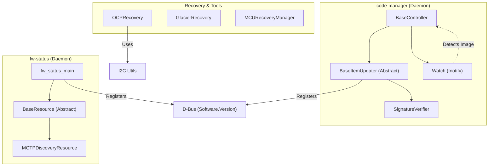

<!-- source: DeepWiki mcp.deepwiki.com · repo NVIDIA/nvidia-code-mgmt · page 1 Overview · fetched 2026-10-26 -->

# Overview

Relevant source files

The following files were used as context for generating this wiki page:

- [README.md](README.md)
- [meson.build](meson.build)
- [meson_options.txt](meson_options.txt)
- [nvidia_igx/README.md](nvidia_igx/README.md)
- [services/meson.build](services/meson.build)
- [src/main.cpp](src/main.cpp)
- [src/meson.build](src/meson.build)
- [test/test_fw_status_main.cpp](test/test_fw_status_main.cpp)

The `nvidia-code-mgmt` repository provides a comprehensive firmware management system for NVIDIA hardware components. It encompasses firmware update orchestration, health monitoring, and recovery operations through a modular architecture integrated into the OpenBMC ecosystem.

For detailed information on the architectural building blocks, see [System Components](#1.1). For details on how the system is compiled and tailored for specific hardware, see [Build System and Configuration](#1.2).

## System Purpose and Scope

The system is designed to handle the full lifecycle of firmware across diverse hardware, including Power Supply Units (PSUs), FPGAs, CPLDs, PCIe Retimers, and specialized NVIDIA platforms like IGX.

1.  **Update Mechanisms**: Orchestrates image discovery, signature verification, and flashing via the `code-manager` service.
2.  **Status Monitoring**: Tracks resource health and operational status (e.g., via MCTP or GPIO) using the `fw-status` service.
3.  **Recovery Operations**: Provides specialized tools for hardware fault handling, including OCP recovery, Glacier crisis recovery, and USB-based recovery.

Sources: [README.md:1-4](), [src/main.cpp:162-264](), [meson.build:52-183]()

## High-Level Architecture

The system is organized into two primary daemons and a set of specialized recovery tools, all communicating over D-Bus and utilizing standard OpenBMC interfaces.

### Service Orchestration Diagram
This diagram maps the high-level system functions to the primary C++ classes and service entities defined in the codebase.

Sources: [src/main.cpp:160-264](), [src/base_controller.hpp:20-20](), [src/base_item_updater.hpp:11-13](), [src/signature_verifier.hpp:12-12](), [test/test_fw_status_main.cpp:63-63]()

## Functional Modules

### 1. Firmware Update System (`code-manager`)
The `code-manager` service handles the lifecycle of a firmware update. It monitors specific directories for new images, validates them, and triggers device-specific update logic. It utilizes a `BaseItemUpdater` [src/base_item_updater.cpp:11-13]() to provide a common D-Bus interface for all hardware types.

*   **Discovery**: Uses `Watch` [src/watch.cpp:8-8]() to monitor `IMG_UPLOAD_DIR_BASE` [meson.build:46-46]().
*   **Validation**: Employs `SignatureVerifier` [src/signature_verifier.cpp:12-12]() to ensure image integrity.
*   **Execution**: Launches systemd units (e.g., `psu-update@.service` [meson.build:61-61]()) to perform the actual flashing.

For details, see [System Components](#1.1).

### 2. Status Monitoring (`fw-status`)
The `fw-status` service tracks the health of hardware components. It supports multiple discovery and monitoring methods:
*   **MCTP**: Monitoring via Management Component Transport Protocol [test/test_fw_status_main.cpp:7-7]().
*   **GPIO**: Monitoring hardware pins for status changes [test/test_fw_status_main.cpp:5-5]().

### 3. Recovery Systems
Specialized recovery tools are included to handle "bricked" or unresponsive hardware:
*   **OCP Recovery**: Implementation of the Open Compute Project recovery protocol for GPUs [src/main.cpp:198-203]().
*   **Glacier Recovery**: Crisis recovery for ERoT and GPIO-controlled devices [src/main.cpp:240-245]().
*   **USB RCM**: Recovery mode for devices accessible via USB [src/main.cpp:91-93]().

## Code Entity Mapping
The following table bridges the hardware support mentioned in documentation to the specific `Meson` options and C++ classes that implement them.

| Hardware Feature | Meson Option | Implementation Class |
| :--- | :--- | :--- |
| **PSU** | `PSU_SUPPORT` | `PSUItemUpdater` [src/main.cpp:162-167]() |
| **FPGA** | `FPGA_SUPPORT` | `FPGAItemUpdater` [src/main.cpp:168-173]() |
| **PCIe Retimer** | `RT_SUPPORT` | `ReTimerItemUpdater` [src/main.cpp:181-188]() |
| **CPLD** | `CPLD_SUPPORT` | `CPLDItemUpdater` [src/main.cpp:174-180]() |
| **GPU Recovery** | `GPU_OCP_RECOVERY_SUPPORT` | `OCPRecovery` [src/main.cpp:198-203]() |
| **Debug Tokens** | `DEBUG_TOKEN_SUPPORT` | `DebugTokenInstallItemUpdater` [src/main.cpp:246-257]() |

Sources: [meson_options.txt:12-208](), [src/main.cpp:160-264]()

## Build and Configuration
The project uses the Meson build system [meson.build:1-12](). Many features are optional and must be enabled at build time via `meson_options.txt`. This allows the same codebase to support different NVIDIA platforms (e.g., HGX vs. IGX) by toggling specific updaters and monitoring resources.

For details, see [Build System and Configuration](#1.2).

Sources: [meson.build:1-12](), [meson_options.txt:1-240]()

---

