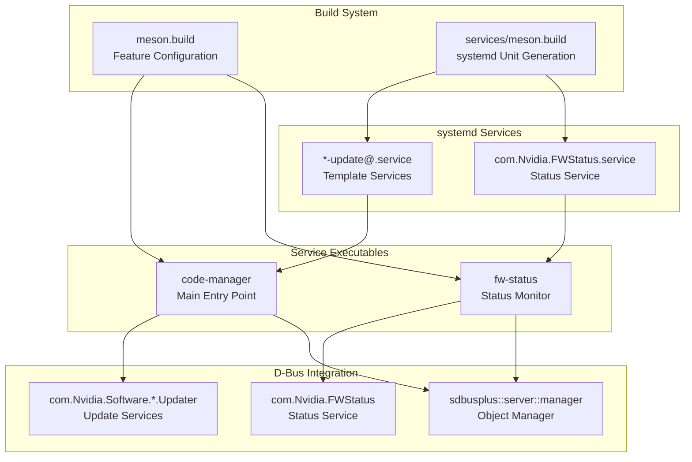
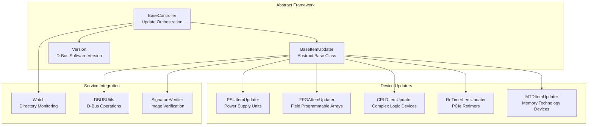
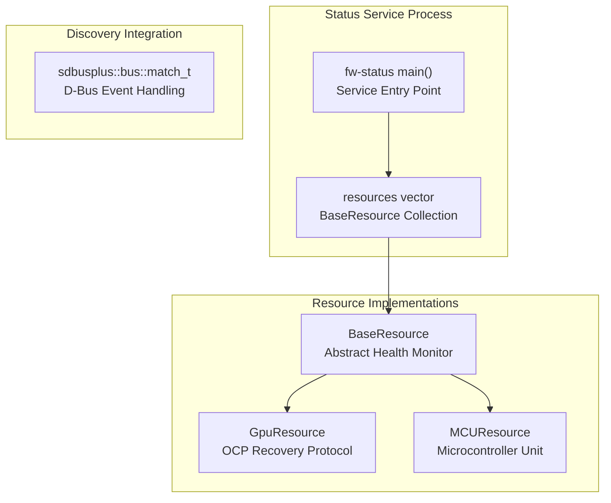
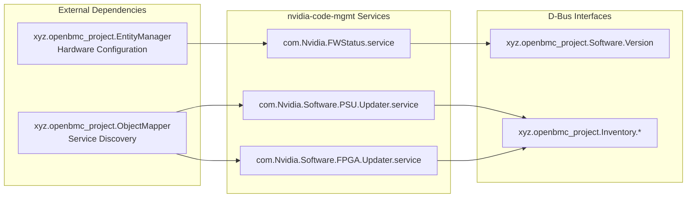

<!-- source: DeepWiki mcp.deepwiki.com · repo NVIDIA/nvidia-code-mgmt · page 1.1 System Components · fetched 2026-10-26 -->

# System Components

Relevant source files

The following files were used as context for generating this wiki page:

- [meson.build](meson.build)
- [meson_options.txt](meson_options.txt)
- [services/com.Nvidia.FWStatus.service](services/com.Nvidia.FWStatus.service)
- [services/meson.build](services/meson.build)
- [src/base_controller.cpp](src/base_controller.cpp)
- [src/base_controller.hpp](src/base_controller.hpp)
- [src/main.cpp](src/main.cpp)
- [src/meson.build](src/meson.build)
- [test/test_fw_status_main.cpp](test/test_fw_status_main.cpp)

This document provides an overview of the major system components within the nvidia-code-mgmt repository, including the core service framework, firmware update system, status monitoring infrastructure, and their relationships within the OpenBMC ecosystem.

## Core Service Framework

The nvidia-code-mgmt system is built around two primary service executables that integrate with the OpenBMC D-Bus infrastructure and systemd service management.

The `code-manager` executable serves as the primary firmware update service, instantiated with different command-line arguments to support various hardware types [src/main.cpp:108-150](). The `BaseController` class [src/base_controller.hpp:33-90]() orchestrates the update process while `BaseItemUpdater` [src/base_item_updater.hpp]() subclasses handle device-specific logic.

**Sources:** [src/main.cpp:97-282](), [meson.build:1-329](), [services/meson.build:1-253](), [src/base_controller.hpp:33-90]()

## Firmware Update System Architecture

The firmware update system implements a modular architecture where device-specific updaters inherit from common base classes and integrate with the D-Bus software management interfaces.

Each updater type is conditionally compiled based on feature flags defined in `meson_options.txt` [meson_options.txt:1-253](). The `main()` function in `code-manager` instantiates the appropriate updater based on the `-u` command-line argument [src/main.cpp:162-282](), enabling a single executable to support multiple hardware types. For instance, the `PSUItemUpdater` is used when `updater == "PSU"` [src/main.cpp:163-166]().

**Sources:** [src/main.cpp:131-282](), [src/base_controller.hpp:33-90](), [src/base_item_updater.hpp](), [meson.build:52-243](), [meson_options.txt:1-253]()

## Status Monitoring System

The `fw-status` service implements comprehensive hardware status monitoring through resource abstraction and communication protocols.

The status monitoring system is managed by the `com.Nvidia.FWStatus.service` [services/com.Nvidia.FWStatus.service:1-12](), which runs the `fw-status` binary [services/com.Nvidia.FWStatus.service:8](). It tracks hardware health across various components like MCUs and GPUs, often using MCTP or I2C interfaces.

**Sources:** [test/test_fw_status_main.cpp:63-64](), [services/com.Nvidia.FWStatus.service:1-12](), [meson_options.txt:1-10]()

## Communication Infrastructure

The system implements multiple communication layers to interface with hardware devices and integrate with the OpenBMC D-Bus ecosystem.

| Component | Class/Interface | Purpose |
|-----------|----------------|---------|
| D-Bus Integration | `DBUSUtils` | Property retrieval, service discovery, systemd control [src/dbusutils.cpp]() |
| Image Monitoring | `Watch` | Inotify-based monitoring of directories for new firmware images [src/watch.cpp]() |
| Versioning | `Version` | Implementation of `xyz.openbmc_project.Software.Version` [src/version.cpp]() |
| Hardware Access | `I2C`, `GPIO`, `USB` | Low-level hardware communication [test/test_fw_status_main.cpp:5-11]() |

**Sources:** [src/dbusutils.cpp](), [src/watch.cpp](), [src/version.cpp](), [test/test_fw_status_main.cpp:1-11]()

## Service Dependency Architecture

The nvidia-code-mgmt system integrates with OpenBMC through systematic service dependencies and D-Bus interface implementations.

Service activation and configuration are handled via Meson, which defines bus names and service files for each component [meson.build:52-115](). For example, `PSU_BUSNAME_UPDATER` is defined as `com.Nvidia.Software.PSU.Updater` [meson.build:59]().

**Sources:** [meson.build:52-115](), [services/meson.build:1-253]()

## Build-Time Configuration System

The Meson build system provides extensive feature flags that control which components are compiled and configured for specific hardware platforms.

| Feature Flag | D-Bus Service | Update Service | Hardware Interface |
|--------------|---------------|----------------|-------------------|
| `PSU_SUPPORT` | `com.Nvidia.Software.PSU.Updater` | `psu-update@.service` | `xyz.openbmc_project.Inventory.Item.PowerSupply` [meson.build:57-61]() |
| `FPGA_SUPPORT` | `com.Nvidia.Software.FPGA.Updater` | `fpga-update@.service` | `xyz.openbmc_project.Inventory.Item.Chassis` [meson.build:68-73]() |
| `RT_SUPPORT` | `com.Nvidia.Software.RT.Updater` | `rt-update@.service` | `xyz.openbmc_project.Inventory.Item.PCIeDevice` [meson.build:95-100]() |
| `CPLD_SUPPORT` | `com.Nvidia.Software.CPLD.Updater.` | `cpld-update@.service` | `xyz.openbmc_project.Inventory.Item.Chassis` [meson.build:83-88]() |
| `ORIN_FLASH_SUPPORT` | `com.Nvidia.Software.ORIN.Updater` | `orin-update@.service` | `xyz.openbmc_project.Inventory.Item.Chassis` [meson.build:121-126]() |

Each feature flag controls compilation of specific source files in `src/meson.build` [src/meson.build:15-110]() and installation of systemd unit files in `services/meson.build` [services/meson.build:18-253]().

**Sources:** [meson.build:52-243](), [services/meson.build:7-253](), [meson_options.txt:1-253](), [src/meson.build:15-110]()

---

