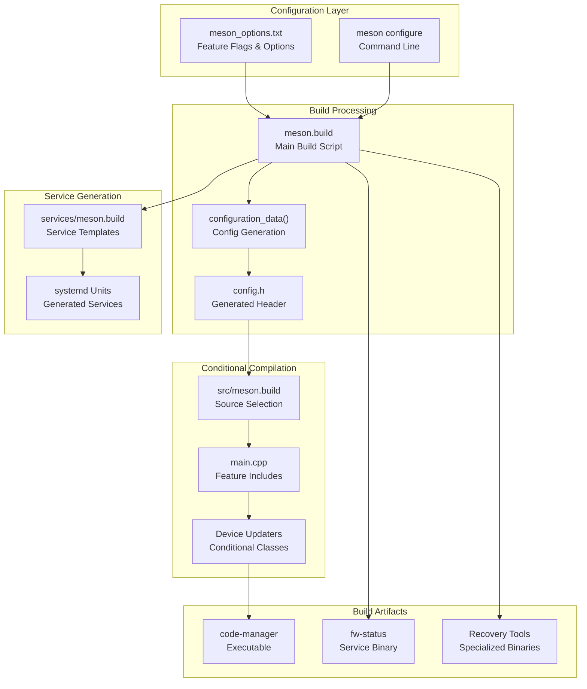
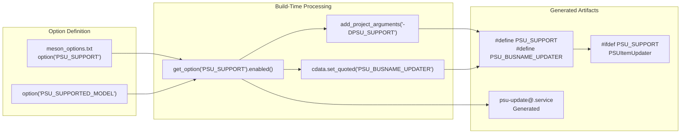
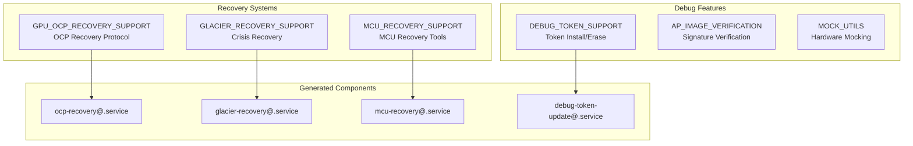
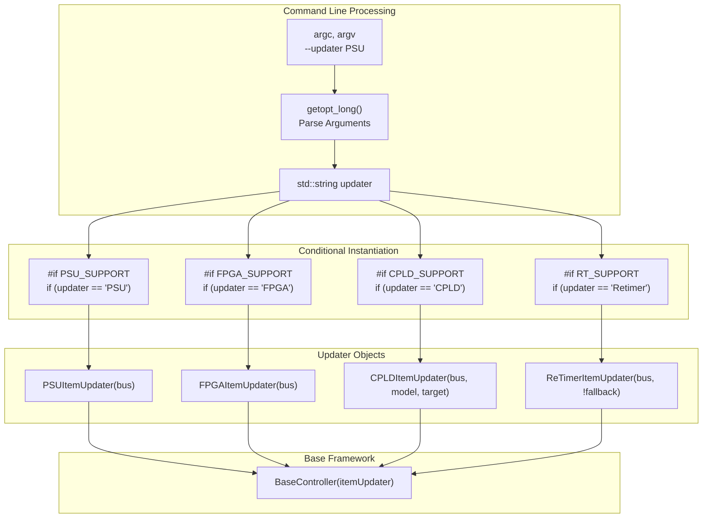
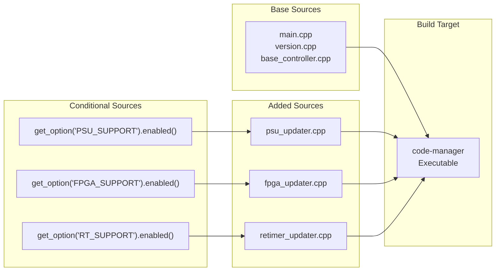
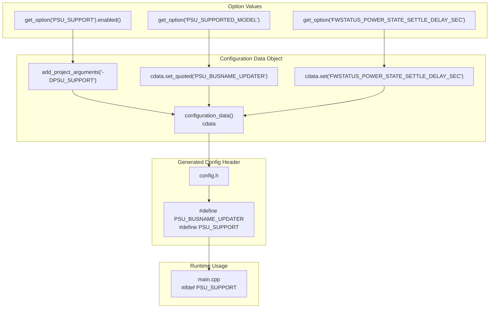
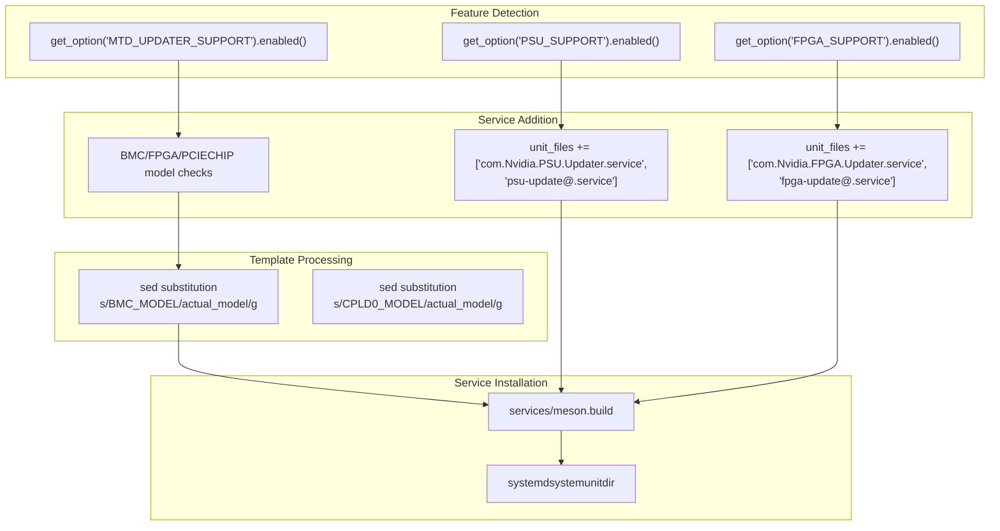
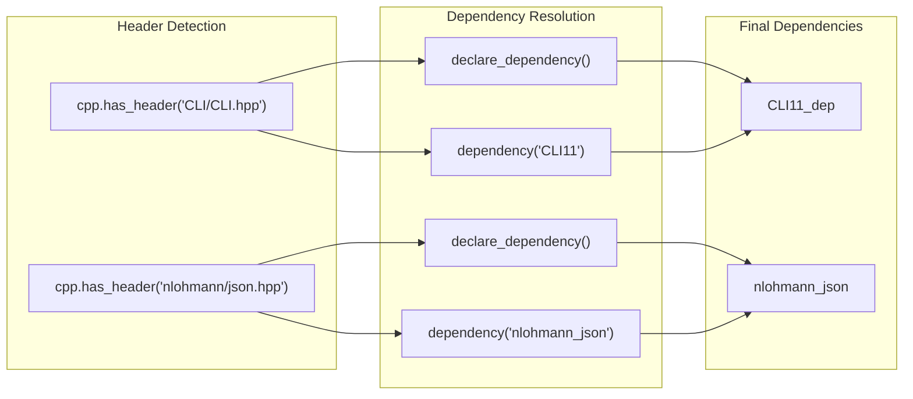

<!-- source: DeepWiki mcp.deepwiki.com · repo NVIDIA/nvidia-code-mgmt · page 1.2 Build System and Configuration · fetched 2026-10-26 -->

# Build System and Configuration

Relevant source files

The following files were used as context for generating this wiki page:

- [fw-status/cpld_resource.cpp](fw-status/cpld_resource.cpp)
- [fw-status/cpld_resource.hpp](fw-status/cpld_resource.hpp)
- [fw-status/meson.build](fw-status/meson.build)
- [fw-status/usb_rcm_resource.hpp](fw-status/usb_rcm_resource.hpp)
- [meson.build](meson.build)
- [meson_options.txt](meson_options.txt)
- [services/meson.build](services/meson.build)
- [src/main.cpp](src/main.cpp)
- [src/meson.build](src/meson.build)
- [test/lsan.supp](test/lsan.supp)
- [test/meson.build](test/meson.build)
- [test/test_fw_status_main.cpp](test/test_fw_status_main.cpp)
- [test/test_fw_status_mctp_discovery.cpp](test/test_fw_status_mctp_discovery.cpp)

This document covers the Meson-based build system and configuration management for the nvidia-code-mgmt repository. It explains how hardware support options are enabled, how conditional compilation works, and how the build system generates appropriate service files and configuration headers for different deployment scenarios.

For information about the runtime service architecture and D-Bus interfaces, see [System Services and Deployment](#6). For details about individual hardware updater implementations, see [Device-Specific Updaters](#2.3).

## Meson Build System Overview

The nvidia-code-mgmt project uses Meson as its primary build system, providing flexible configuration through feature flags and string options. The build system supports conditional compilation of hardware-specific components, automated service file generation, and comprehensive dependency management.

**Build System Architecture**

Sources: [meson.build:1-329](), [meson_options.txt:1-353](), [src/main.cpp:97-282]()

## Configuration Options and Hardware Support

The build system provides extensive configuration options organized into logical categories. Each hardware component can be independently enabled or disabled, with associated model specifications and service parameters.

### Hardware Component Options

| Component | Feature Flag | Model Option | Service Names |
|-----------|-------------|--------------|---------------|
| PSU Support | `PSU_SUPPORT` | `PSU_SUPPORTED_MODEL` | `com.Nvidia.PSU.Updater.service`, `psu-update@.service` |
| FPGA Support | `FPGA_SUPPORT` | `FPGA_SUPPORTED_MODEL` | `com.Nvidia.FPGA.Updater.service`, `fpga-update@.service` |
| CPLD Support | `CPLD_SUPPORT` | `CPLD_SUPPORTED_MODEL` | `com.Nvidia.CPLD.Updater.service`, `cpld-update@.service` |
| Retimer Support | `RT_SUPPORT` | `RT_SUPPORTED_MODEL` | `com.Nvidia.RT.Updater.service`, `rt-update@.service` |

**Configuration Processing Flow**

Sources: [meson.build:52-62](), [meson_options.txt:12-20](), [src/main.cpp:162-167]()

### Recovery and Debugging Options

The build system includes specialized options for recovery operations and debugging capabilities:

Sources: [meson.build:185-201](), [meson.build:226-233](), [meson.build:240-246]()

## Conditional Compilation System

The build system implements conditional compilation through preprocessor directives, allowing fine-grained control over included functionality based on configuration options.

### Main Entry Point Conditional Logic

The `main.cpp` file demonstrates the conditional compilation pattern used throughout the codebase:

Sources: [src/main.cpp:21-32](), [src/main.cpp:162-188]()

### Source File Inclusion Pattern

The `src/meson.build` file demonstrates how source files are conditionally included based on feature flags:

Sources: [src/meson.build:4-30]()

## Configuration Data Generation

The build system generates a comprehensive `config.h` header file containing all configuration constants and paths used by the runtime components.

### Configuration Categories

| Category | Configuration Keys | Purpose |
|----------|-------------------|---------|
| D-Bus Interface Names | `VERSION_IFACE`, `PSU_INVENTORY_IFACE` | Standard OpenBMC and NVIDIA interfaces |
| Service Bus Names | `PSU_BUSNAME_UPDATER`, `FPGA_BUSNAME_UPDATER` | Component-specific D-Bus names |
| Inventory Paths | `RT_INVENTORY_PATH`, `RT_SW_VERSION_PATH` | Hardware discovery paths |
| Update Services | `PSU_UPDATE_SERVICE`, `FPGA_UPDATE_SERVICE` | systemd service templates |
| File Paths | `IMG_UPLOAD_DIR_BASE` | Firmware image upload locations |
| Timeouts | `RT_UPDATE_TIMEOUT`, `SEP_TIMEOUT` | Operation timeout values |

**Configuration Generation Process**

Sources: [meson.build:36-62](), [src/meson.build:1]()

## Service File Generation

The build system automatically generates systemd service files based on enabled features, with support for template services and model-specific configurations.

### Service Generation Logic

Sources: [services/meson.build:18-177](), [services/meson.build:193-231]()

## Build Dependencies and Linking

The build system manages a comprehensive set of dependencies required for firmware management operations:

### Core Dependencies

| Dependency | Purpose | Usage |
|------------|---------|--------|
| `systemd` | Service management | systemd unit file generation |
| `phosphor-logging` | OpenBMC logging | Structured logging via `lg2` and `log` |
| `sdbusplus` | D-Bus communication | Primary IPC mechanism |
| `nlohmann_json` | JSON parsing | Configuration file processing |
| `libusb-1.0` | USB communication | USB RCM and recovery protocols |
| `libudev` | Device monitoring | Hardware event detection |

### Optional Dependencies

The build system conditionally includes dependencies based on environment availability:

Sources: [meson.build:21-31](), [fw-status/meson.build:24-25](), [fw-status/meson.build:59]()

---

