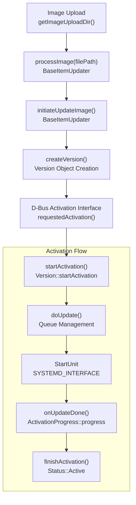
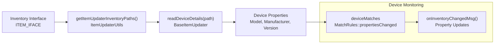
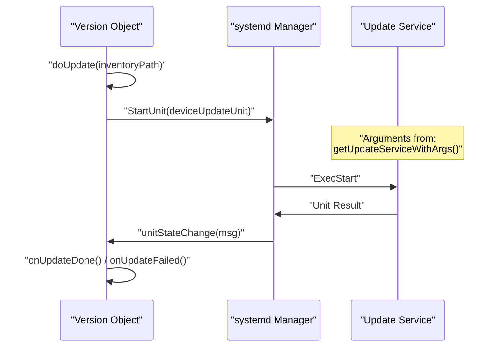
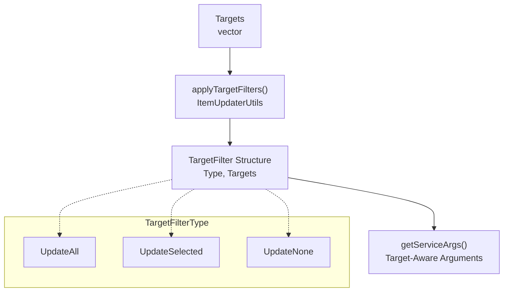
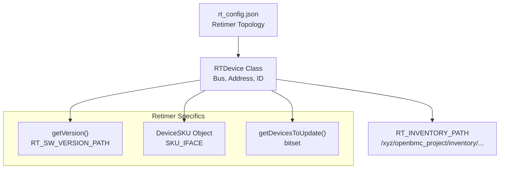

<!-- source: DeepWiki mcp.deepwiki.com · repo NVIDIA/nvidia-code-mgmt · page 2 Firmware Update System · fetched 2026-10-26 -->

# Firmware Update System

<details>
<summary>Relevant source files</summary>

The following files were used as context for generating this wiki page:

- [src/activation_listener.hpp](src/activation_listener.hpp)
- [src/base_item_updater.cpp](src/base_item_updater.cpp)
- [src/base_item_updater.hpp](src/base_item_updater.hpp)
- [src/retimer_updater.cpp](src/retimer_updater.cpp)
- [src/retimer_updater.hpp](src/retimer_updater.hpp)
- [src/version.cpp](src/version.cpp)
- [src/version.hpp](src/version.hpp)

</details>


## Purpose and Scope

The Firmware Update System provides a comprehensive framework for managing firmware updates across NVIDIA hardware components. This system handles device discovery, version management, image verification, update orchestration, and progress tracking through standardized D-Bus interfaces integrated with systemd services.

The system supports multiple device types including PSUs, FPGAs, CPLDs, Retimers, and MTD devices. For hardware status monitoring and recovery operations, see [Firmware Status Monitoring](#3). For communication protocols and D-Bus utilities, see [Communication Infrastructure](#5).

## System Architecture

The firmware update system is built around a layered architecture with device-agnostic base classes and device-specific implementations.

### Core Architecture Overview

```mermaid
graph TB
    subgraph "D-Bus Layer"
        VERSION_DBUS["SoftwareVersion<br/>xyz.openbmc_project.Software.Version"]
        ACTIVATION_DBUS["Version Inherit<br/>xyz.openbmc_project.Software.Activation"]
        PROGRESS_DBUS["ActivationProgress<br/>xyz.openbmc_project.Software.ActivationProgress"]
        DELETE_DBUS["Delete<br/>xyz.openbmc_project.Object.Delete"]
    end
    
    subgraph "Core Framework"
        BASE_UPDATER["BaseItemUpdater<br/>Abstract Base Class"]
        VERSION_CLASS["Version<br/>Activation Lifecycle Manager"]
        ACTIVATION_LISTENER["ActivationListener<br/>Interface"]
        ITEM_UPDATER_UTILS["ItemUpdaterUtils<br/>Interface"]
    end
    
    subgraph "Device Implementations"
        RT_UPDATER["ReTimerItemUpdater"]
        PSU_UPDATER["PSUItemUpdater"]
        FPGA_UPDATER["FPGAItemUpdater"]
        CPLD_UPDATER["CPLDItemUpdater"]
    end
    
    subgraph "System Integration"
        SYSTEMD_SERVICES["systemd Update Services"]
        IMAGE_MONITOR["File System Monitoring"]
        INVENTORY_SYSTEM["Device Inventory"]
    end
    
    BASE_UPDATER --> VERSION_CLASS
    VERSION_CLASS --> VERSION_DBUS
    VERSION_CLASS --> ACTIVATION_DBUS
    VERSION_CLASS --> PROGRESS_DBUS
    VERSION_CLASS --> DELETE_DBUS
    
    BASE_UPDATER --> RT_UPDATER
    BASE_UPDATER --> PSU_UPDATER
    BASE_UPDATER --> FPGA_UPDATER
    BASE_UPDATER --> CPLD_UPDATER
    
    VERSION_CLASS --> SYSTEMD_SERVICES
    BASE_UPDATER --> IMAGE_MONITOR
    BASE_UPDATER --> INVENTORY_SYSTEM
    
    BASE_UPDATER -.-> ACTIVATION_LISTENER
    BASE_UPDATER -- "implements" --> ITEM_UPDATER_UTILS
```



**Sources:** [src/base_item_updater.hpp:47-51](), [src/version.hpp:71-76](), [src/version.hpp:102-118](), [src/retimer_updater.hpp:81-88]()

### Update Flow Architecture



**Sources:** [src/base_item_updater.cpp:50-64](), [src/version.cpp:75-97](), [src/version.cpp:122-155](), [src/version.cpp:222-232]()

## Base Framework Components

### BaseItemUpdater Abstract Class

The `BaseItemUpdater` class provides the foundational framework for all device-specific updaters. It implements the core update lifecycle, device discovery, and D-Bus integration patterns. For details, see [Base Updater Framework](#2.1).

| Component | Purpose | Key Methods |
|-----------|---------|-------------|
| Device Discovery | Enumerate compatible devices | `getItemUpdaterInventoryPaths()`, `readExistingFirmWare()` |
| Image Processing | Handle uploaded firmware images | `processImage()`, `initiateUpdateImage()` |
| Version Management | Create and manage version objects | `createVersion()`, `erase()` |
| Inventory Monitoring | Track device presence and properties | `onInventoryChanged()`, `readDeviceDetails()` |

The class defines pure virtual methods that device implementations must override:

```cpp
virtual std::string getVersion(const std::string& inventoryPath) const = 0;
virtual std::string getManufacturer(const std::string& inventoryPath) const = 0;
virtual std::string getModel(const std::string& inventoryPath) const = 0;
virtual std::string getServiceArgs(const std::string& inventoryPath,
                                   const std::string& imagePath, 
                                   const std::string& version,
                                   const TargetFilter& targetFilter) const = 0;
```

**Sources:** [src/base_item_updater.hpp:47-136](), [src/base_item_updater.cpp:50-125](), [src/activation_listener.hpp:76-189]()

### Version Class and Activation Lifecycle

The `Version` class manages the complete firmware activation lifecycle through D-Bus interfaces. It implements multiple OpenBMC standard interfaces for software management. For details, see [Version Management and Activation](#2.2).

```mermaid
stateDiagram-v2
    [*] --> Ready: "Version Object Created"
    Ready --> Activating: "RequestedActivation::Active"
    Activating --> Active: "finishActivation()"
    Activating --> Failed: "onUpdateFailed()"
    Active --> [*]: "Delete::delete_()"
    Failed --> [*]: "Delete::delete_()"
    
    note right of Activating: "systemd unit execution<br/>unitStateChange monitoring<br/>UpdateTimeout management"
```

The `Version` class integrates several D-Bus interfaces:

| Interface | Implementation Class | Purpose |
|-----------|---------------------|---------|
| `xyz.openbmc_project.Software.Activation` | `VersionInherit` | Activation state management |
| `xyz.openbmc_project.Software.ActivationProgress` | `ActivationProgress` | Update progress reporting |
| `xyz.openbmc_project.Object.Delete` | `Delete` | Version object cleanup |
| `com.nvidia.Software.UpdateTimeout` | `VersionInherit` | Firmware update timeout tracking |

**Sources:** [src/version.hpp:71-76](), [src/version.hpp:152-167](), [src/version.cpp:61-97](), [src/version.cpp:157-187]()

## Device Discovery and Inventory Integration

### Inventory Path Resolution

Device updaters integrate with the OpenBMC inventory system to discover compatible hardware and retrieve device properties.



**Sources:** [src/base_item_updater.cpp:84-105](), [src/base_item_updater.cpp:166-175](), [src/base_item_updater.hpp:516-520]()

### UUID and Model Mapping

The system maintains a mapping between device UUIDs, models, and manufacturers to support proper image routing and compatibility validation.

```cpp
// Mapping expected string format <Manufacture>:<Model>:<UUID>
void insertToUUIDMap(const std::string& uuid, const std::string& model, 
                     const std::string& manufacture);
// Retrieve UUID for device compatibility
std::string getUUID(const std::string& model, const std::string& manufacture) const;
```

**Sources:** [src/base_item_updater.hpp:79-88](), [src/base_item_updater.hpp:252-262]()

## Update Execution and Service Integration

### Systemd Service Orchestration

Updates are executed through systemd services that are dynamically configured with device-specific arguments. The `Version` class coordinates service execution and monitors completion.



The service execution includes:

- **Service Name Generation**: `getUpdateService(inventoryPath)` creates systemd unit names with encoded arguments.
- **Progress Monitoring**: `unitStateChange` D-Bus match monitors `newStateResult` for "done" or "failed".
- **Timeout Handling**: `cancelInProgressUpdate()` provides failure detection and service termination.
- **Queue Management**: `deviceQueue` handles sequential device updates for multi-device components.

**Sources:** [src/version.cpp:99-120](), [src/version.cpp:122-155](), [src/version.cpp:189-220]()

### Target Filtering and Selective Updates

The system supports selective device updates through target filtering mechanisms. For details, see [Device-Specific Updaters](#2.3).



**Sources:** [src/activation_listener.hpp:43-59](), [src/activation_listener.hpp:124-126](), [src/base_item_updater.hpp:490-514]()

## Device-Specific Implementation Example

### ReTimerItemUpdater Implementation

The `ReTimerItemUpdater` demonstrates the device-specific implementation pattern for PCIe Retimers. For details, see [Retimer Updater](#2.3.4).

#### Device Configuration and Discovery



#### Service Argument Generation

The retimer updater supports both individual and batch update modes:

```cpp
// ReTimerItemUpdater::getServiceArgs
if (updateAllTogether())
{
    std::string devicesBits = getDevicesToUpdate(targetFilter);
    args += std::to_string(invs[0]->getBus()); // pull first device bus
    args += devicesBits;                        // bitset of devices to update
    args += imagePath;                          // image path
}
```

**Sources:** [src/retimer_updater.hpp:81-139](), [src/retimer_updater.hpp:184-207](), [src/retimer_updater.hpp:218-245](), [src/retimer_updater.cpp:33-56]()

### Configuration Integration

Device updaters integrate with JSON configuration files and compile-time defines to support different hardware platforms:

| Configuration Source | Purpose | Example |
|---------------------|---------|---------|
| JSON Config Files | Runtime device enumeration | `rt_config.json` via `rtcommonutils::loadJSONFile` |
| Compile Defines | Build-time feature selection | `RT_SUPPORTED_MODEL`, `RT_UPDATE_SERVICE` |
| D-Bus Properties | Runtime device properties | `VERSION_IFACE`, `SKU_IFACE` from inventory |

**Sources:** [src/retimer_updater.hpp:96-102](), [src/retimer_updater.cpp:45-48](), [src/retimer_updater.cpp:82-84]()

---

