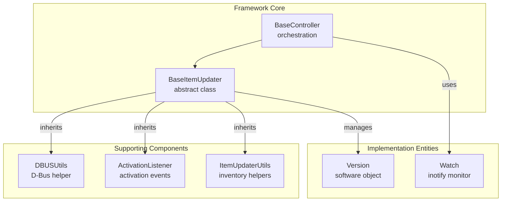
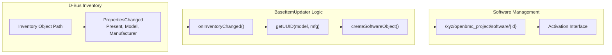
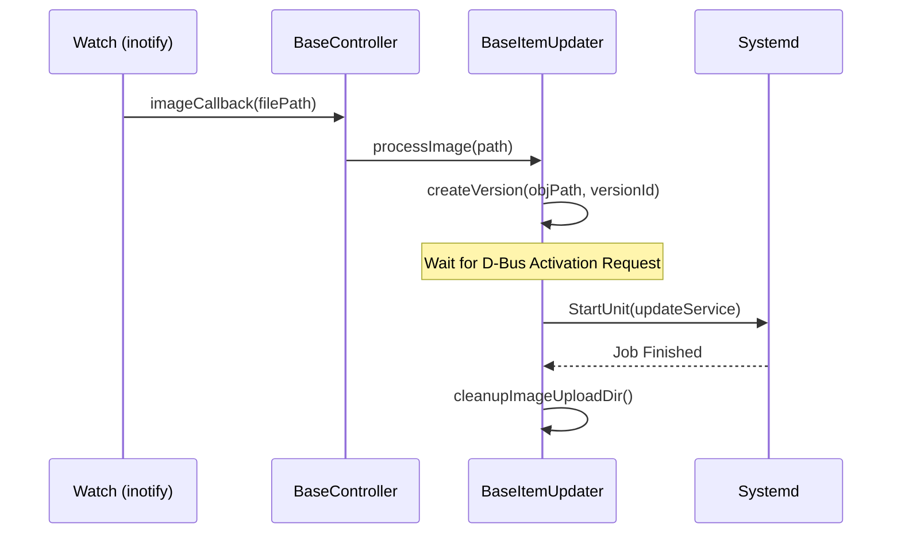

<!-- source: DeepWiki mcp.deepwiki.com · repo NVIDIA/nvidia-code-mgmt · page 2.1 Base Updater Framework · fetched 2026-10-26 -->

# Base Updater Framework

Relevant source files

The following files were used as context for generating this wiki page:

- [src/base_controller.cpp](src/base_controller.cpp)
- [src/base_controller.hpp](src/base_controller.hpp)
- [src/base_item_updater.cpp](src/base_item_updater.cpp)
- [src/base_item_updater.hpp](src/base_item_updater.hpp)
- [src/watch.cpp](src/watch.cpp)

The Base Updater Framework provides the foundational architecture for all firmware update operations in the `nvidia-code-mgmt` system. This framework defines abstract interfaces and orchestration mechanisms that enable device-specific updaters to implement consistent firmware management patterns across different hardware types.

## Framework Architecture

The framework consists of two primary components: the `BaseItemUpdater` abstract class that defines the updater interface, and the `BaseController` class that orchestrates the update process.

Title: Core Framework Class Relationship

Sources: [src/base_item_updater.hpp:47-51](), [src/base_controller.hpp:33-48](), [src/base_controller.cpp:47-73]()

## BaseItemUpdater Abstract Class

The `BaseItemUpdater` class serves as the base for all device-specific updaters. It abstracts underlying device implementations, performs updates via systemd services, and manages D-Bus objects representing firmware versions [src/base_item_updater.hpp:41-46]().

### Core Abstract Methods

Device-specific updaters must implement several pure virtual methods to provide hardware context:

| Method | Purpose | File Reference |
|--------|---------|----------------|
| `getVersion()` | Retrieve current firmware version from device | [src/base_item_updater.hpp:252-252]() |
| `getManufacturer()` | Get device manufacturer from inventory | [src/base_item_updater.hpp:261-261]() |
| `getModel()` | Get device model from inventory | [src/base_item_updater.hpp:257-257]() |
| `getServiceArgs()` | Generate systemd service arguments for the update tool | [src/base_item_updater.hpp:333-333]() |

### Device Discovery and UUID Mapping

The framework maintains a mapping between hardware characteristics (Manufacturer, Model) and Unique Identifiers (UUID) to support multi-device scenarios. This is initialized via the `supportedDevices` string in the constructor, which expects the format `<Manufacture>:<Model>:<UUID>` [src/base_item_updater.hpp:81-86]().

Title: Inventory to Software Object Mapping

Sources: [src/base_item_updater.cpp:127-164](), [src/base_item_updater.cpp:177-248](), [src/base_item_updater.hpp:72-89]()

### Image Processing Pipeline

When a new image is detected, the framework follows a standardized pipeline:
1. **Detection**: The `Watch` class triggers the `processImage` callback [src/watch.cpp:122-127]().
2. **Identification**: `getIdProperty` generates a unique ID based on the image path [src/base_item_updater.cpp:50-61]().
3. **Update Initiation**: `initiateUpdateImage` creates a `Version` object with `Status::Active` (for existing firmware) or `Status::Ready` (for new uploads) [src/base_item_updater.cpp:62-63]().
4. **Activation**: When a user sets `RequestedActivation` to `Active`, the `onReqActivationChanged` handler is triggered [src/base_item_updater.cpp:250-255]().
5. **Execution**: The framework starts the systemd service returned by `getUpdateServiceWithArgs` [src/base_item_updater.cpp:278-284]().

## BaseController Orchestration

The `BaseController` class manages the lifecycle of the updater service, including initial firmware discovery and ongoing file system monitoring.

### Controller Responsibilities

- **Initial Discovery**: `processExistingImages()` calls `readExistingFirmWare()` to populate D-Bus with currently installed versions [src/base_controller.cpp:96-101]().
- **File Watching**: `startWatching()` initializes the `Watch` class to monitor directories for incoming image files via `inotify` [src/base_controller.cpp:75-95]().
- **Image Validation**: `processImage()` verifies that the file is a regular file and has a valid stem (version string) before passing it to the updater [src/base_controller.cpp:47-73]()

Title: Update Orchestration Flow

Sources: [src/base_controller.cpp:47-73](), [src/watch.cpp:122-133](), [src/base_item_updater.cpp:250-284]()

## D-Bus Integration Patterns

The framework implements comprehensive D-Bus signal monitoring to react to system changes:

| Signal / Method | Role | File Reference |
|-----------------|------|----------------|
| `onInventoryChangedMsg` | Reacts to hardware being added or replaced | [src/base_item_updater.cpp:166-175]() |
| `onReqActivationChangedMsg` | Detects user requests to start a firmware update | [src/base_item_updater.cpp:250-255]() |
| `newDeviceAdded` | Handles `InterfacesAdded` signals for dynamic device discovery | [src/base_item_updater.cpp:335-342]() |

## Configuration and Extensibility

The framework is designed for extensibility through virtual method overrides:

- **Verification**: `needVerify()` determines if signature verification is required before update [src/base_item_updater.hpp:513-516]().
- **Batch Updates**: `updateTogether()` indicates if multiple devices of the same type should be updated in a single service call [src/base_item_updater.hpp:219-222]().
- **Validation**: `pathIsValidDevice()` allows device-specific logic to filter which inventory paths are relevant to the updater [src/base_item_updater.hpp:478-482]().

Sources: [src/base_item_updater.hpp:63-89](), [src/base_item_updater.hpp:478-546]()

---

