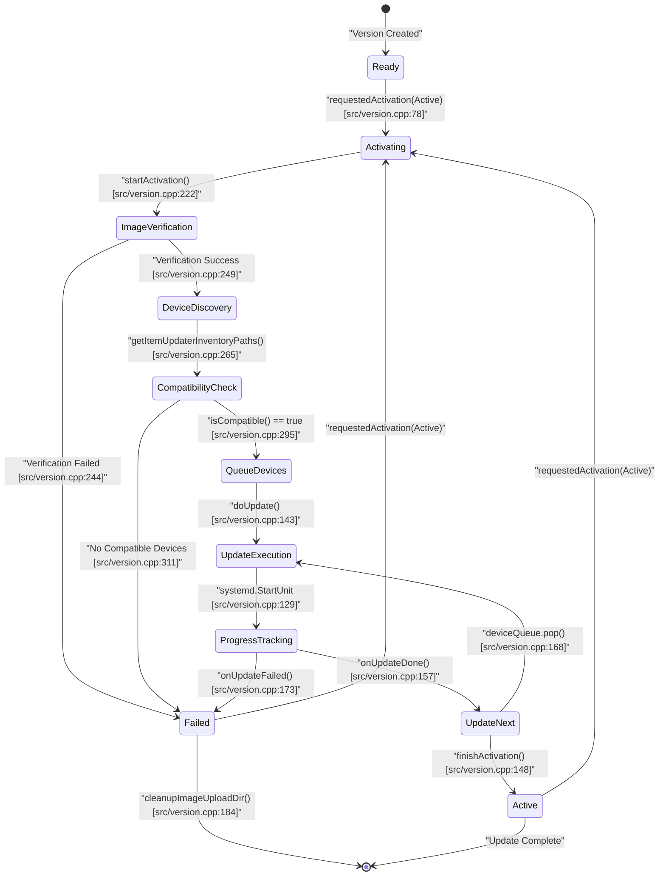
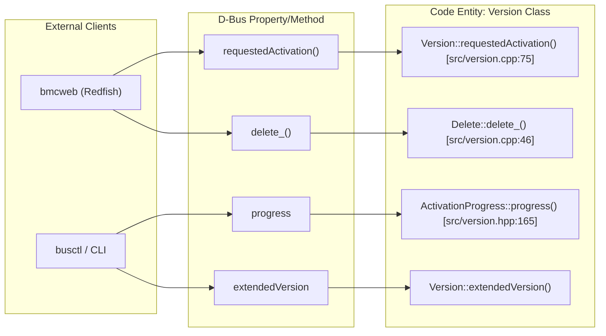

<!-- source: DeepWiki mcp.deepwiki.com · repo NVIDIA/nvidia-code-mgmt · page 2.2 Version Management and Activation · fetched 2026-10-26 -->

# Version Management and Activation

Relevant source files

The following files were used as context for generating this wiki page:

- [src/activation_listener.hpp](src/activation_listener.hpp)
- [src/retimer_updater.cpp](src/retimer_updater.cpp)
- [src/retimer_updater.hpp](src/retimer_updater.hpp)
- [src/signature_verifier.cpp](src/signature_verifier.cpp)
- [src/signature_verifier.hpp](src/signature_verifier.hpp)
- [src/version.cpp](src/version.cpp)
- [src/version.hpp](src/version.hpp)
- [test/test_base_updater_controller.cpp](test/test_base_updater_controller.cpp)
- [test/test_signature_verifier.cpp](test/test_signature_verifier.cpp)
- [test/test_version.cpp](test/test_version.cpp)

This document covers the `Version` class and software activation lifecycle that forms the core of the firmware update system. The `Version` class manages firmware images, coordinates device updates, tracks progress, and provides D-Bus interfaces for external clients to monitor and control firmware updates. For information about device-specific update implementations, see [Device-Specific Updaters](#2.3). For details about the base updater framework, see [Base Updater Framework](#2.1).

## Version Class Architecture

The `Version` class serves as the central coordinator for firmware update operations, implementing multiple D-Bus server interfaces to provide standardized access to version information, activation control, and file management. It inherits from `VersionInherit`, which aggregates multiple OpenBMC standard interfaces.

### Version Entity Relationship
The following diagram bridges the natural language concept of "Version Management" to the code entities defined in `src/version.hpp`.

```mermaid
graph TB
    subgraph "Code Entity: Version Class"
        Version["Version [src/version.hpp:246]"]
        VersionInherit["VersionInherit [src/version.hpp:71]"]
        DBUSUtils["DBUSUtils [src/dbusutils.hpp]"]
    end
    
    subgraph "D-Bus Server Interfaces (Inherited)"
        UUID["xyz::openbmc_project::Common::server::UUID"]
        Activation["xyz::openbmc_project::Software::server::Activation"] 
        ExtendedVersion["xyz::openbmc_project::Software::server::ExtendedVersion"]
        FilePath["xyz::openbmc_project::Common::server::FilePath"]
        UpdateTimeout["com::nvidia::Software::server::UpdateTimeout"]
    end
    
    subgraph "Associated Component Objects"
        ActivationProgress["ActivationProgress [src/version.hpp:152]"]
        UpdatePolicy["UpdatePolicy [src/version.hpp:210]"]
        Delete["Delete [src/version.hpp:177]"]
        SoftwareVersion["SoftwareVersion [src/version.hpp:102]"]
    end
    
    subgraph "Interface Logic Providers"
        ItemUpdaterUtils["ItemUpdaterUtils [src/activation_listener.hpp:76]"]
        ActivationListener["ActivationListener [src/activation_listener.hpp:61]"]
    end
    
    Version --> VersionInherit
    Version --> DBUSUtils
    VersionInherit --> UUID
    VersionInherit --> Activation
    VersionInherit --> ExtendedVersion
    VersionInherit --> FilePath
    VersionInherit --> UpdateTimeout
    
    Version --> ActivationProgress
    Version --> UpdatePolicy
    Version --> Delete
    Version --> ItemUpdaterUtils
    Version --> ActivationListener
```

Sources: [src/version.hpp:68-85](), [src/version.hpp:246-300](), [src/version.hpp:152-167](), [src/version.hpp:210-222](), [src/version.hpp:177-202]()

## Activation State Machine

The firmware activation process follows a defined state machine that transitions through multiple phases, from initial request via D-Bus to final completion or failure. The state transitions are primarily managed in `Version::activation` and `Version::requestedActivation`.

Sources: [src/version.cpp:61-97](), [src/version.cpp:122-155](), [src/version.cpp:157-187](), [src/version.cpp:222-264](), [src/version.cpp:265-313]()

## D-Bus Interface Integration

The `Version` class exposes firmware update functionality through standardized OpenBMC D-Bus interfaces. This allows tools like `bmcweb` (Redfish) or `busctl` to interact with the update process.

| Interface | Purpose | Key Properties/Methods |
|-----------|---------|----------------------|
| `xyz.openbmc_project.Software.Activation` | Control activation state | `activation`, `requestedActivation()` |
| `xyz.openbmc_project.Software.ExtendedVersion` | Detailed version info | `extendedVersion` |
| `xyz.openbmc_project.Software.ActivationProgress` | Update progress (%) | `progress` |
| `xyz.openbmc_project.Common.UUID` | Unique ID for the image | `uuid` |
| `xyz.openbmc_project.Common.FilePath` | Local path to firmware image | `path` |
| `xyz.openbmc_project.Software.UpdatePolicy` | Configuration for update | `targets`, `forceUpdate` |

### Data Flow: Client to Code Entity
This diagram maps D-Bus interactions to specific member functions in the `Version` class.

Sources: [src/version.hpp:68-82](), [src/version.cpp:46-52](), [src/version.cpp:75-97](), [src/version.hpp:152-167]()

## Signature Verification

If configured via `ItemUpdaterUtils::needVerify()`, the system utilizes the `SignatureVerifier` class to validate images before activation.

*   **Logic**: `Version::startActivation` calls `itemUpdaterUtils->doVerify(path())` [src/version.cpp:240]().
*   **Implementation**: `SignatureVerifier` parses a `Metadata` structure [src/signature_verifier.hpp:37-84]() from the beginning of the image and validates SHA-384 hashes and ECDSA signatures [src/signature_verifier.cpp:118-200]().
*   **Hardware Compatibility**: The verifier checks `apSkuId`, `pciVendorId`, and other hardware identifiers within the metadata [src/signature_verifier.hpp:75-79]().

Sources: [src/version.cpp:235-245](), [src/signature_verifier.cpp:118-167](), [src/signature_verifier.hpp:37-84]()

## Progress Tracking and Status Management

The activation process provides progress tracking through the `ActivationProgress` interface. Progress is updated incrementally as each device in the `deviceQueue` is processed.

*   **Initialization**: Progress starts at 10% upon successful image verification [src/version.cpp:252]().
*   **Incremental Steps**: The `progressStep` is calculated as `80 / deviceCount` [src/version.cpp:319]().
*   **Updates**: `onUpdateDone()` increments the D-Bus `progress` property [src/version.cpp:165-166]().
*   **Completion**: `finishActivation()` sets progress to 100% and activation status to `Active` [src/version.cpp:351-352]().

Sources: [src/version.cpp:157-171](), [src/version.cpp:250-253](), [src/version.cpp:315-321](), [src/version.cpp:349-354]()

## Target Filtering and Device Selection

The system supports flexible device selection through `TargetFilter`, allowing updates to be applied to specific devices or all discovered devices.

*   **Filter Types**: `UpdateNone`, `UpdateSelected`, `UpdateAll` [src/activation_listener.hpp:43-48]().
*   **Selection**: `ReTimerItemUpdater::getDevicesToUpdate` uses a `std::bitset` to map target strings (e.g., "RT0") to specific hardware indices [src/retimer_updater.hpp:184-207]().
*   **Compatibility**: `Version::isCompatible` verifies that the device's `model` and `manufacturer` match the values expected by the `Version` object [src/version.cpp:265-288]().

Sources: [src/activation_listener.hpp:43-59](), [src/version.cpp:265-313](), [src/retimer_updater.hpp:184-207]()

## Integration with Device Updaters

The `Version` class coordinates with device-specific updaters through the `ItemUpdaterUtils` abstract interface. This decoupling allows the same activation logic to support Retimers, PSUs, FPGAs, and CPLDs.

*   **Service Orchestration**: `Version::doUpdate` retrieves the systemd unit name via `getUpdateService` [src/version.cpp:125]() and starts it using the `StartUnit` D-Bus method on `org.freedesktop.systemd1` [src/version.cpp:128-131]().
*   **Timeout Management**: A timer is started using `itemUpdaterUtils->getTimeout()` to ensure updates do not hang indefinitely [src/version.cpp:132]().
*   **Signal Handling**: `Version::unitStateChange` listens for `JobRemoved` signals from systemd to determine when a specific device update has finished [src/version.cpp:99-120]().

Sources: [src/version.cpp:99-141](), [src/activation_listener.hpp:76-189](), [src/retimer_updater.hpp:220-259]()

---

