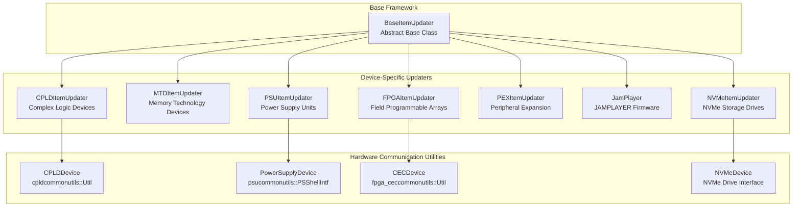
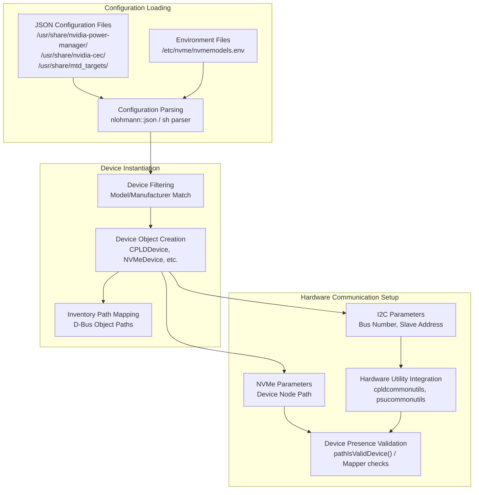
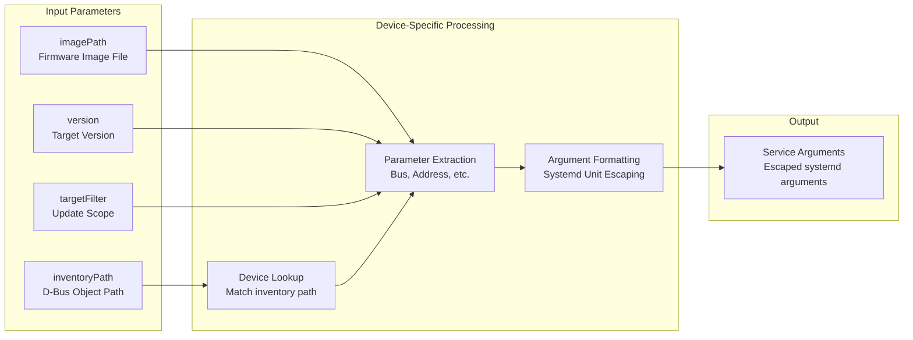

<!-- source: DeepWiki mcp.deepwiki.com · repo NVIDIA/nvidia-code-mgmt · page 2.3 Device-Specific Updaters · fetched 2026-10-26 -->

# Device-Specific Updaters

<details>
<summary>Relevant source files</summary>

The following files were used as context for generating this wiki page:

- [services/com.Nvidia.NVMe.Updater.service](services/com.Nvidia.NVMe.Updater.service)
- [services/nvme-update@.service](services/nvme-update@.service)
- [src/cpld_updater.hpp](src/cpld_updater.hpp)
- [src/fpga_updater.hpp](src/fpga_updater.hpp)
- [src/jamplayer.hpp](src/jamplayer.hpp)
- [src/mtd_updater.hpp](src/mtd_updater.hpp)
- [src/nvme_updater.cpp](src/nvme_updater.cpp)
- [src/nvme_updater.hpp](src/nvme_updater.hpp)
- [src/pex_updater.hpp](src/pex_updater.hpp)
- [src/psu_updater.hpp](src/psu_updater.hpp)

</details>


This section covers the hardware-specific updater implementations that handle firmware updates for different types of devices in the NVIDIA firmware management system. Each device-specific updater inherits from the `BaseItemUpdater` framework and implements specialized logic for device discovery, version retrieval, and update execution.

For information about the base updater framework architecture, see [Base Updater Framework](#2.1). For details on version management and activation lifecycle, see [Version Management and Activation](#2.2).

## Overview and Common Architecture

All device-specific updaters follow a consistent architectural pattern built on top of the `BaseItemUpdater` abstract class. They implement device-specific logic for hardware communication, configuration parsing, and update service integration while maintaining a common D-Bus interface for external clients.

### Updater Class Hierarchy



Sources: [src/cpld_updater.hpp:136-151](), [src/mtd_updater.hpp:38-56](), [src/psu_updater.hpp:91-105](), [src/fpga_updater.hpp:72-85](), [src/pex_updater.hpp:35-47](), [src/jamplayer.hpp:36-43](), [src/nvme_updater.hpp:89-111]()

## Device Discovery and Configuration

Device-specific updaters implement a consistent pattern for discovering and configuring hardware devices through JSON configuration files, environment files, and hardware utility libraries.

### Configuration-Based Device Discovery Flow



Sources: [src/cpld_updater.hpp:153-222](), [src/psu_updater.hpp:107-143](), [src/fpga_updater.hpp:87-124](), [src/mtd_updater.hpp:60-161](), [services/com.Nvidia.NVMe.Updater.service:9-25](), [src/nvme_updater.hpp:187-220]()

### Device Configuration Examples

| Updater Type | Configuration Source | Key Parameters | Hardware Interface |
|--------------|-------------------|----------------|-------------------|
| CPLD | `/usr/share/nvidia-power-manager/cpld_config.json` | Bus, Address, ImageSelect, CPLDDeviceNo | I2C via `cpldcommonutils::Util` |
| PSU | `/usr/share/nvidia-power-manager/psu_config.json` | I2cBus, I2cSlaveAddress, Index | I2C via `psucommonutils::PSShellIntf` |
| FPGA | `/usr/share/nvidia-cec/cec_config.json` | Bus, Address, Index | I2C via `fpga_ceccommonutils::Util` |
| MTD | `/usr/share/mtd_targets/{mtdName}.json` | Path, Offset, VersionSize | File system operations |
| NVMe | `/etc/nvme/nvmemodels.env` | Model Name, Target Instance | `/dev/nvmeXnX` via `nvme-fw-update` |

## Common Interface Implementation

All device-specific updaters implement a set of common virtual methods from `BaseItemUpdater` that provide hardware abstraction for the update framework.

### Core Interface Methods

Each updater implements these key methods:

- **`getVersion(inventoryPath)`** - Retrieves current firmware version from hardware or D-Bus properties [src/nvme_updater.cpp:95-110]()
- **`getManufacturer(inventoryPath)`** - Returns device manufacturer string [src/nvme_updater.cpp:112-128]()
- **`getModel(inventoryPath)`** - Returns device model identifier, often parsing composite strings [src/nvme_updater.cpp:130-173]()
- **`getServiceArgs(inventoryPath, imagePath, version, targetFilter)`** - Generates systemd service arguments for update execution [src/nvme_updater.hpp:159-162]()

### Service Arguments Generation Pattern



Sources: [src/cpld_updater.hpp:289-324](), [src/psu_updater.hpp:179-203](), [src/fpga_updater.hpp:162-185](), [src/mtd_updater.hpp:231-251](), [src/nvme_updater.hpp:159-162]()

### Service Arguments Examples

Different updaters generate service arguments specific to their update mechanisms:

**CPLD Updater Arguments:**
```
\x20{BusNumber}\x20{ImageSelect}\x20{ImagePath}\x20{CPLDDeviceNum}\x20{Version}
```

**NVMe Updater Arguments:**
Uses an environment file at `/run/nvidia-nvme-update/%i.env` to pass `${FW_IMAGE}`, `${FW_VERSION}`, and `${FW_TARGETS}` to the `nvme-fw-update` utility.

Sources: [src/cpld_updater.hpp:301-319](), [src/psu_updater.hpp:191-198](), [services/nvme-update@.service:7-8]()

## Authentication and Verification

Device-specific updaters support optional firmware image authentication through configurable verification mechanisms.

### Authentication Implementation Pattern

Most updaters support compile-time authentication features:

- **CPLD**: `VERIFY_CPLD` with `PUBKEY_CPLD` public key [src/cpld_updater.hpp:223-228]()
- **MTD/PCIe Chip**: `VERIFY_PCIECHIP` with `PUBKEY_PCIECHIP` public key [src/mtd_updater.hpp:131-137]()
- **JamPlayer**: `VERIFY_JAMPLAYER` with `PUBKEY_JAMPLAYER` public key [src/jamplayer.hpp:45-81]()

The `needVerify()` method determines if verification is required based on:
1. Non-empty public key configuration
2. Presence of `/var/check_signature` file [src/jamplayer.hpp:197-201]()

## Special Updater Characteristics

### NVMe Updater Multi-Instance Support

The `NVMeItemUpdater` supports multiple instances based on drive models. The `com.Nvidia.NVMe.Updater.service` parses `/etc/nvme/nvmemodels.env` and spawns separate `code-manager` instances for each model found [services/com.Nvidia.NVMe.Updater.service:9-25](). It also implements:
- **Composite Model Extraction**: Extracts the specific model from strings like "Manufacturer:Model:UUID" [src/nvme_updater.cpp:185-210]().
- **Target Validation**: Strips "FW_" prefixes from inventory names to identify raw drive names [src/nvme_updater.cpp:245-253]().

### MTD Updater Unique Features

The `MTDItemUpdater` has several distinctive characteristics:
- **File-based version reading** from MTD device files at configurable offsets [src/mtd_updater.hpp:81-84]().
- **Asset interface integration** for manufacturer property publishing [src/mtd_updater.hpp:115-121]().
- **Inventory support disabled** (`inventorySupported()` returns `false`) [src/mtd_updater.hpp:282-285]().

### JamPlayer Target Filtering

The `JamPlayer` updater implements sophisticated target filtering logic:
- Supports `TargetFilterType::UpdateAll` for system-wide updates [src/jamplayer.hpp:143-145]().
- Checks for specific `JAMPLAYER_NAME` in target filter lists [src/jamplayer.hpp:144-145]().
- Generates `EXECUTE` or `IGNORE` arguments based on filter matching [src/jamplayer.hpp:149-157]().

### CPLD Power Management Integration

The `CPLDItemUpdater` includes power-aware device management:
- **Power-on device detection** from JSON configuration (`PowerOnDevice` flag) [src/cpld_updater.hpp:204-205]().
- **Conditional software object creation** based on power state [src/cpld_updater.hpp:205-210]().
- **Inventory mapping** with power state tracking [src/cpld_updater.hpp:211]().

---

