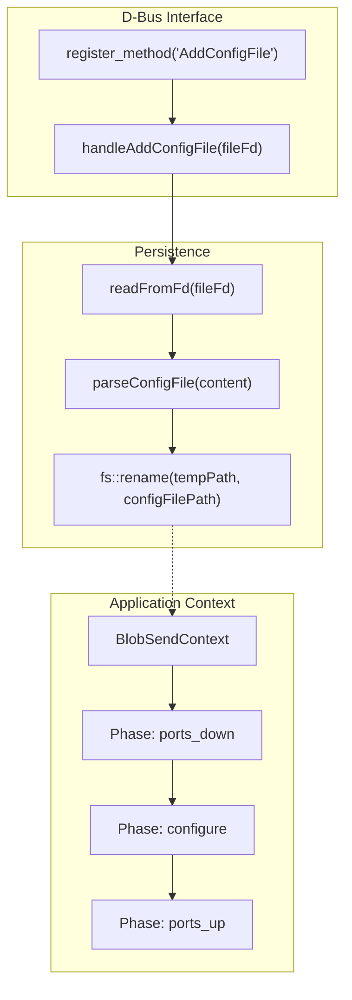
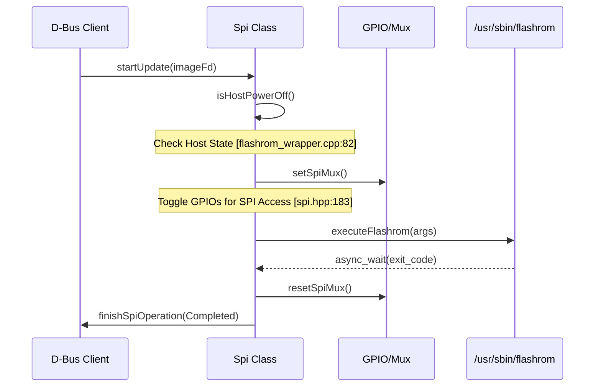

<!-- source: DeepWiki mcp.deepwiki.com · repo NVIDIA/nvidia-code-mgmt · page 2.5 Specialized Platform Updaters · fetched 2026-10-26 -->

# Specialized Platform Updaters

Relevant source files

The following files were used as context for generating this wiki page:

- [flashrom-wrapper/README.md](flashrom-wrapper/README.md)
- [flashrom-wrapper/flashrom_wrapper.cpp](flashrom-wrapper/flashrom_wrapper.cpp)
- [flashrom-wrapper/spi.hpp](flashrom-wrapper/spi.hpp)
- [nvidia_igx/igx_fuse/meson.build](nvidia_igx/igx_fuse/meson.build)
- [nvidia_igx/igx_fuse/services/igx-fuse-version.service](nvidia_igx/igx_fuse/services/igx-fuse-version.service)
- [nvidia_igx/igx_fuse/services/meson.build](nvidia_igx/igx_fuse/services/meson.build)
- [nvidia_igx/igx_fuse/src/igx_fuse.hpp](nvidia_igx/igx_fuse/src/igx_fuse.hpp)
- [nvidia_igx/igx_fuse/src/igx_fuse_manager.cpp](nvidia_igx/igx_fuse/src/igx_fuse_manager.cpp)
- [nvidia_igx/igx_fuse/src/igx_fuse_manager.hpp](nvidia_igx/igx_fuse/src/igx_fuse_manager.hpp)
- [nvidia_igx/igx_fuse/src/igx_fuse_util.hpp](nvidia_igx/igx_fuse/src/igx_fuse_util.hpp)
- [nvidia_igx/igx_fuse/src/main.cpp](nvidia_igx/igx_fuse/src/main.cpp)
- [nvidia_igx/igx_fuse/src/meson.build](nvidia_igx/igx_fuse/src/meson.build)
- [nvidia_igx/orin/services/igx-orin-version.service](nvidia_igx/orin/services/igx-orin-version.service)
- [nvidia_igx/orin/src/main.cpp](nvidia_igx/orin/src/main.cpp)
- [nvidia_igx/orin/src/orin.hpp](nvidia_igx/orin/src/orin.hpp)
- [nvidia_igx/orin/src/orin_manager.cpp](nvidia_igx/orin/src/orin_manager.cpp)
- [nvidia_igx/orin/src/orin_manager.hpp](nvidia_igx/orin/src/orin_manager.hpp)
- [nvidia_igx/orin/src/orin_util.hpp](nvidia_igx/orin/src/orin_util.hpp)
- [nvidia_igx/smcu/services/igx-smcu-version.service](nvidia_igx/smcu/services/igx-smcu-version.service)
- [nvidia_igx/smcu/src/smcu.hpp](nvidia_igx/smcu/src/smcu.hpp)
- [nvidia_igx/smcu/src/smcu_manager.cpp](nvidia_igx/smcu/src/smcu_manager.cpp)
- [nvidia_igx/smcu/src/smcu_manager.hpp](nvidia_igx/smcu/src/smcu_manager.hpp)
- [nvswitch-config/README.md](nvswitch-config/README.md)
- [nvswitch-config/main.cpp](nvswitch-config/main.cpp)
- [nvswitch-config/meson.build](nvswitch-config/meson.build)
- [nvswitch-config/nvswitch_config_manager.cpp](nvswitch-config/nvswitch_config_manager.cpp)
- [nvswitch-config/nvswitch_config_manager.hpp](nvswitch-config/nvswitch_config_manager.hpp)
- [services/com.Nvidia.ORIN.Updater.service](services/com.Nvidia.ORIN.Updater.service)
- [services/com.Nvidia.Software.NVSwitchConfig.Updater.service](services/com.Nvidia.Software.NVSwitchConfig.Updater.service)
- [services/com.Nvidia.Switchtec.Fuse.service](services/com.Nvidia.Switchtec.Fuse.service)
- [services/orin-update@.service](services/orin-update@.service)
- [services/switchtec-fuser@.service](services/switchtec-fuser@.service)
- [src/igx_fuse_updater.hpp](src/igx_fuse_updater.hpp)
- [src/orin_updater.cpp](src/orin_updater.cpp)
- [src/spi_programmer.cpp](src/spi_programmer.cpp)
- [src/spi_programmer.hpp](src/spi_programmer.hpp)
- [src/switchtec_fuse.cpp](src/switchtec_fuse.cpp)
- [src/switchtec_fuse.hpp](src/switchtec_fuse.hpp)

This section documents the platform-specific firmware update implementations for NVIDIA-specific hardware architectures, including NVIDIA IGX (Orin and SMCU), NVSwitch configuration management, CPU SPI flash programming, and Switchtec fuse management. These updaters often involve complex dependencies such as host power state monitoring, GPIO-based multiplexer control, and asynchronous process orchestration.

## NVIDIA IGX (Orin and SMCU) Management

The NVIDIA IGX platform management involves tracking and reporting firmware versions for the Orin Application Processor and the System Microcontroller Unit (SMCU). These managers dynamically detect the platform type (e.g., Thor vs. Orin) to establish the correct inventory and software paths.

### Implementation and Data Flow
The `ORINManager` initializes the `Orin` device class, which inherits from standard OpenBMC inventory and version interfaces [nvidia_igx/orin/src/orin.hpp:38-43](). It uses a `Util` helper to query the platform name [nvidia_igx/orin/src/orin_manager.cpp:30-31]().

1.  **Platform Detection**: The `Util::getPlatformName()` function identifies the specific IGX hardware [nvidia_igx/orin/src/orin_manager.cpp:31]().
2.  **Inventory Registration**: Based on the platform (Thor, Orin, or Host), it constructs the D-Bus inventory path [nvidia_igx/orin/src/orin_manager.cpp:34-47]().
3.  **Version Reporting**: The `VersionInterface` class publishes the `xyz.openbmc_project.Software.Version` interface [nvidia_igx/orin/src/orin.hpp:52-68]().

### IGX Management Structure
| Component | Class / Service | Responsibility |
| :--- | :--- | :--- |
| **Orin Manager** | `ORINManager` | Orchestrates Orin inventory and version objects [nvidia_igx/orin/src/orin_manager.cpp:25]() |
| **Orin Device** | `Orin` | Implements Asset and OperationalStatus interfaces [nvidia_igx/orin/src/orin.hpp:73]() |
| **Version Service** | `igx-orin-version.service` | Systemd unit for managing Orin version reporting |

**Sources:** [nvidia_igx/orin/src/orin_manager.cpp:25-56](), [nvidia_igx/orin/src/orin.hpp:38-128]()

---

## NVSwitch Configuration Management

The `NVSwitchConfigManager` provides a mechanism to manage and apply configuration blobs to NVSwitch devices. Unlike standard firmware updates, this involves a multi-phase application process (ports down, configure, ports up).

### Blob Application Lifecycle
The manager handles configuration files via D-Bus methods and persists them to the BMC filesystem.

*   **AddConfigFile**: Receives a file descriptor, validates the content, and stores it at a persistent path [nvswitch-config/nvswitch_config_manager.cpp:103-196]().
*   **BlobSendContext**: A structure used to track the state of an asynchronous configuration chain, including the current phase and success/failure counts [nvswitch-config/nvswitch_config_manager.cpp:55-72]().

### Configuration Logic Diagram
Title: NVSwitch Configuration Data Flow

**Sources:** [nvswitch-config/nvswitch_config_manager.cpp:55-196](), [nvswitch-config/nvswitch_config_manager.hpp:1-50]()

---

## CPU SPI Flash Programming

The `SPIProgrammer` and `flashrom-wrapper` provide low-level access to CPU SPI devices. This system is used for raw firmware flashing and variable SPI management on platforms like GB200.

### Key Constraints and Safety
*   **Power State Dependency**: Operations are only permitted if the host power is **OFF** [flashrom-wrapper/README.md:12-13]().
*   **Mux Management**: The system controls SPI multiplexers via GPIOs to switch access between the CPU and the BMC [flashrom-wrapper/spi.hpp:178-191]().
*   **Automatic Cleanup**: If host power is turned ON during an operation, the service must deactivate muxes to allow the CPU to boot [flashrom-wrapper/README.md:14-16]().

### Flashrom Wrapper Execution
The `Spi` class encapsulates `flashrom` execution using `boost::process::v2`. It supports `Erase`, `Read`, and `Write` operations [flashrom-wrapper/spi.hpp:70-75]().

### Implementation Details
*   **Device Discovery**: `SPIProgrammer` populates SPI software objects by watching Entity Manager for interfaces matching `xyz.openbmc_project.Configuration.SPI` [src/spi_programmer.hpp:37-40]().
*   **Timing Map**: The system maintains a `chipTimingMap` to estimate operation durations for different flash chips (e.g., MX66U1G45G) [flashrom-wrapper/flashrom_wrapper.cpp:27-32]().

**Sources:** [flashrom-wrapper/flashrom_wrapper.cpp:27-193](), [flashrom-wrapper/spi.hpp:68-130](), [src/spi_programmer.cpp:33-102]()

---

## Switchtec Fuse Management

The `SwitchtecFuse` updater manages the security state (fusing) of Switchtec PCIe switches. It integrates with the `BaseItemUpdater` framework but implements custom version retrieval via CLI tools.

### Implementation Patterns
*   **Version Retrieval**: Instead of PLDM or MCTP, it executes `switchtec mfg info` via a pipe to extract the "Secure State" of the device [src/switchtec_fuse.cpp:35-53]().
*   **Dynamic Updates**: It monitors `CurrentHostState` on `/xyz/openbmc_project/state/host0`. When the host enters the `Running` state, it triggers a version refresh [src/switchtec_fuse.hpp:48-69]().
*   **Service Integration**: The `com.Nvidia.Software.Switchtec.Updater` bus name is registered by the `code-manager` service with the `-u SWITCHTEC` argument [services/com.Nvidia.Switchtec.Fuse.service:11-16]().

### Specialized Updater Summary
| Feature | Implementation | File Reference |
| :--- | :--- | :--- |
| **Mux Control** | GPIO-based `setSpiMux` / `resetSpiMux` | [flashrom-wrapper/spi.hpp:183-191]() |
| **CLI Wrapper** | `popen` for `switchtec` utility | [src/switchtec_fuse.cpp:41]() |
| **Process Mgmt** | `boost::process::v2` for `flashrom` | [flashrom-wrapper/flashrom_wrapper.cpp:137]() |
| **EM Integration** | `MatchRules::interfacesAdded` for SPI config | [src/spi_programmer.cpp:80-82]() |

**Sources:** [src/switchtec_fuse.hpp:36-74](), [src/switchtec_fuse.cpp:35-63](), [services/com.Nvidia.Switchtec.Fuse.service:1-20]()

---

