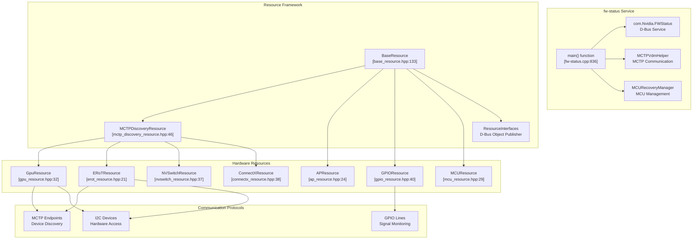
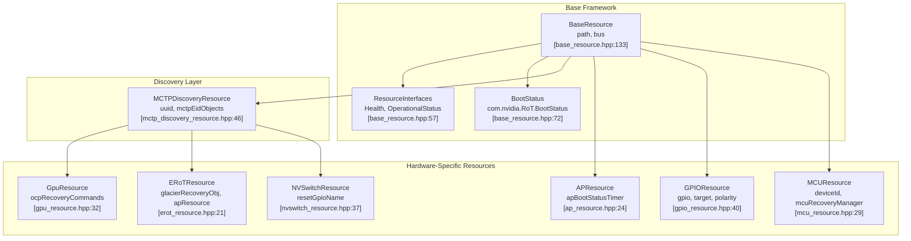

<!-- source: DeepWiki mcp.deepwiki.com · repo NVIDIA/nvidia-code-mgmt · page 3 Firmware Status Monitoring · fetched 2026-10-26 -->

# Firmware Status Monitoring

Relevant source files

The following files were used as context for generating this wiki page:

- [fw-status/base_resource.hpp](fw-status/base_resource.hpp)
- [fw-status/connectx_resource.hpp](fw-status/connectx_resource.hpp)
- [fw-status/erot_resource.cpp](fw-status/erot_resource.cpp)
- [fw-status/fw-status.cpp](fw-status/fw-status.cpp)
- [fw-status/gpio_resource.cpp](fw-status/gpio_resource.cpp)
- [fw-status/gpio_resource.hpp](fw-status/gpio_resource.hpp)
- [fw-status/gpu_resource.hpp](fw-status/gpu_resource.hpp)
- [fw-status/mcu_resource.hpp](fw-status/mcu_resource.hpp)
- [fw-status/nvlinkmgmt_nic_resource.hpp](fw-status/nvlinkmgmt_nic_resource.hpp)
- [fw-status/nvswitch_resource.hpp](fw-status/nvswitch_resource.hpp)
- [fw-status/usb_rcm_resource.cpp](fw-status/usb_rcm_resource.cpp)
- [src/connectx_recovery.hpp](src/connectx_recovery.hpp)
- [test/test_fw_status_glacier_gpio.cpp](test/test_fw_status_glacier_gpio.cpp)

## Purpose and Scope

The Firmware Status Monitoring system provides comprehensive health tracking and operational status management for NVIDIA hardware components. This system implements a resource-based architecture that monitors various hardware devices including GPUs, Application Processors (APs), Embedded Root of Trust (ERoT) devices, GPIO-controlled components, and Microcontroller Units (MCUs). The monitoring is performed through multiple communication protocols including MCTP (Management Component Transport Protocol), I2C, and GPIO interfaces.

For information about firmware updates and version management, see [Firmware Update System](#2). For recovery operations and fault handling, see [Recovery Systems](#4).

## System Architecture

The firmware status monitoring system centers around the `fw-status` service, which implements a resource-based monitoring framework. Each monitored hardware component is represented as a resource object that publishes health and operational status information via D-Bus interfaces.

### Service Architecture

Sources: [fw-status/fw-status.cpp:1-108](), [fw-status/base_resource.hpp:133-146](), [fw-status/mctp_discovery_resource.hpp:46-52]()

## Resource Base Framework

The monitoring system implements a hierarchical resource framework with `BaseResource` as the foundation class. This framework provides standardized health tracking and D-Bus interface publication for all monitored hardware components.

For details, see [Resource Base Framework](#3.1).

### Resource Class Hierarchy

Sources: [fw-status/base_resource.hpp:57-146](), [fw-status/mctp_discovery_resource.hpp:46-52](), [fw-status/gpu_resource.hpp:32-54](), [fw-status/erot_resource.hpp:21-49]()

### Health and Status Management

The `BaseResource` class provides standardized methods for managing device health and operational status through D-Bus interfaces:

| Method | Purpose | D-Bus Interface |
|--------|---------|-----------------|
| `health(value)` | Sets device health status [base_resource.hpp:154]() | `xyz.openbmc_project.State.Decorator.Health` |
| `state(value)` | Sets operational status [base_resource.hpp:182]() | `xyz.openbmc_project.State.Decorator.OperationalStatus` |
| `getObjectPath()` | Returns D-Bus object path [base_resource.hpp:221]() | N/A |
| `deleteDbusObject()` | Removes D-Bus object [base_resource.hpp:209]() | N/A |

Health states include `OK`, `Warning`, and `Critical`. Operational states include `Enabled`, `Disabled`, `UnavailableOffline`, `StandbyOffline`, and `Absent`.

Sources: [fw-status/base_resource.hpp:154-224]()

## MCTP-Based Resource Discovery

The `MCTPDiscoveryResource` class extends `BaseResource` to provide MCTP endpoint discovery and monitoring capabilities. This class serves as the foundation for resources that communicate via MCTP protocol, such as GPUs and ERoTs.

For details, see [MCTP-Based Resource Discovery](#3.2).

### MCTP Discovery Process

The discovery process maintains mappings between MCTP services and endpoint objects, enabling resources to monitor device availability:
- **Service Discovery**: Queries ObjectMapper for services implementing the MCTP Endpoint interface.
- **UUID Matching**: Filters endpoints based on configured UUID.
- **State Monitoring**: Watches for `Enabled` property changes on endpoint objects.

Sources: [fw-status/mctp_discovery_resource.hpp:46-152]()

## Hardware Resource Types

The firmware status monitoring system supports multiple hardware resource types, each with specialized monitoring and communication capabilities.

### Application Processor (AP) Monitoring
`APResource` tracks the health of application processors, often coordinating with an ERoT. It monitors boot status and handles recovery timeouts. For details, see [Application Processor Monitoring](#3.3).

Sources: [fw-status/ap_resource.hpp:24-40]()

### Enhanced Root of Trust (ERoT) Monitoring
`ERoTResource` provides monitoring for Embedded Root of Trust devices using the Glacier Crisis Recovery integration and MCTP-based boot status queries. For details, see [Enhanced Root of Trust Monitoring](#3.4).

Sources: [fw-status/erot_resource.cpp:21-49]()

### GPIO-Based Monitoring
`GPIOResource` monitors hardware status via GPIO lines. It supports both interrupt-driven and polling modes to detect fatal errors or ready signals. For details, see [GPIO-Based Monitoring](#3.5).

Sources: [fw-status/gpio_resource.cpp:95-152]()

### MCU Resource Management
`MCUResource` manages Microcontroller Units through the MCU recovery manager, tracking health via USB device enumeration and recovery mode status. For details, see [MCU Resource Management](#3.6).

Sources: [fw-status/mcu_resource.hpp:29-51]()

## Entity Manager Integration

The firmware status monitoring system integrates with Entity Manager for dynamic configuration discovery and resource instantiation.

### Configuration Discovery Process

The `fw-status` service parses managed objects from Entity Manager to instantiate the appropriate resource types:

| Configuration Interface | Resource Class |
|-------------------------|----------------|
| `...Configuration.OCPRecovery` | `GpuResource` [fw-status.cpp:53-54]() |
| `...Configuration.GlacierCrisisRecovery` | `ERoTResource` [fw-status.cpp:55-56]() |
| `...Configuration.GPIORecovery` | `GPIOResource` [fw-status.cpp:57-58]() |
| `...Configuration.MCURecovery` | `MCUResource` [fw-status.cpp:59-60]() |
| `...Configuration.NVSwitchRecovery` | `NVSwitchResource` [fw-status.cpp:63-64]() |
| `...Configuration.ConnectXRecovery` | `ConnectXResource` [fw-status.cpp:61-62]() |

Sources: [fw-status/fw-status.cpp:51-72]()

### Power State Handling
The service monitors chassis power states via `xyz.openbmc_project.State.Chassis`. When a power transition occurs, a settle delay (configured by `FWSTATUS_POWER_STATE_SETTLE_DELAY_SEC`) is applied before re-checking device health to allow hardware to stabilize.

Sources: [fw-status/fw-status.cpp:80-100]()

---

