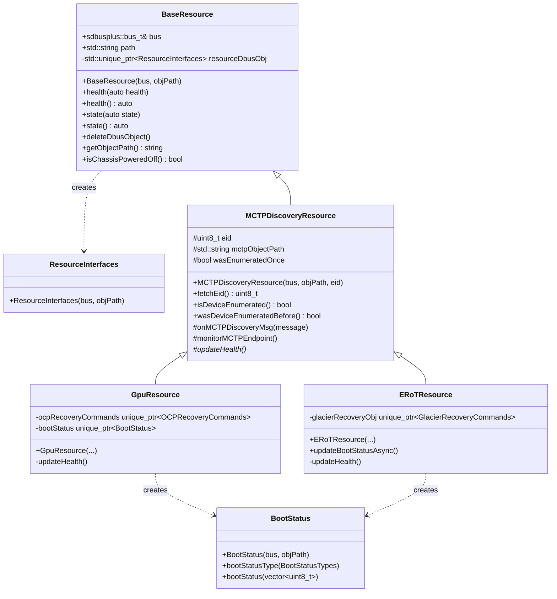
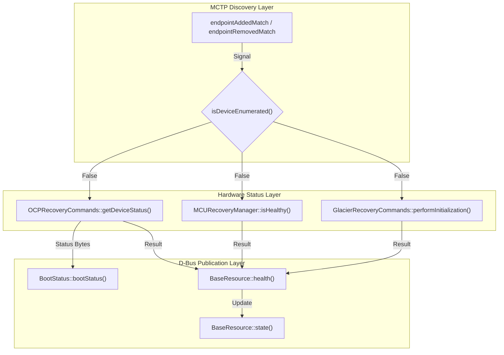

<!-- source: DeepWiki mcp.deepwiki.com · repo NVIDIA/nvidia-code-mgmt · page 3.1 Resource Base Framework · fetched 2026-10-26 -->

# Resource Base Framework

Relevant source files

The following files were used as context for generating this wiki page:

- [fw-status/ap_resource.cpp](fw-status/ap_resource.cpp)
- [fw-status/ap_resource.hpp](fw-status/ap_resource.hpp)
- [fw-status/base_resource.cpp](fw-status/base_resource.cpp)
- [fw-status/base_resource.hpp](fw-status/base_resource.hpp)
- [fw-status/connectx_resource.hpp](fw-status/connectx_resource.hpp)
- [fw-status/erot_resource.cpp](fw-status/erot_resource.cpp)
- [fw-status/erot_resource.hpp](fw-status/erot_resource.hpp)
- [fw-status/gpu_resource.hpp](fw-status/gpu_resource.hpp)
- [fw-status/mctp_discovery_resource.cpp](fw-status/mctp_discovery_resource.cpp)
- [fw-status/mctp_discovery_resource.hpp](fw-status/mctp_discovery_resource.hpp)
- [fw-status/mcu_resource.hpp](fw-status/mcu_resource.hpp)
- [fw-status/nvlinkmgmt_nic_resource.hpp](fw-status/nvlinkmgmt_nic_resource.hpp)
- [fw-status/nvswitch_resource.hpp](fw-status/nvswitch_resource.hpp)
- [fw-status/usb_rcm_resource.cpp](fw-status/usb_rcm_resource.cpp)
- [src/connectx_recovery.hpp](src/connectx_recovery.hpp)

The Resource Base Framework is the foundation of the firmware status monitoring system in the NVIDIA Code Management System. It provides a unified abstraction for representing, monitoring, and reporting the health status of various hardware components. This framework defines a common interface for interacting with resources, regardless of how they are monitored (via MCTP, GPIO, USB, etc.), enabling a consistent approach to firmware health monitoring and recovery orchestration.

## Class Architecture

The framework is built around a core class hierarchy that enables extensibility while maintaining a consistent interface for health status reporting.

### Core Class Hierarchy

Sources: [fw-status/base_resource.hpp:133-148](), [fw-status/mctp_discovery_resource.hpp:43-58](), [fw-status/gpu_resource.hpp:32-53](), [fw-status/erot_resource.hpp:55-81]()

## Core Components

### BaseResource
The `BaseResource` class is the abstract foundation. It manages the D-Bus representation of a hardware component's health and operational state [fw-status/base_resource.hpp:133-146]().

*   **Lazy Initialization**: D-Bus objects are created on-demand when health or state is first set [fw-status/base_resource.hpp:154-161]().
*   **Health and State**: It wraps the `xyz.openbmc_project.State.Decorator.Health` and `OperationalStatus` interfaces [fw-status/base_resource.hpp:32-35]().
*   **Chassis Awareness**: Includes utility to check if the chassis is powered off, which influences health reporting (e.g., reporting `UnavailableOffline` instead of `Critical` when power is absent) [fw-status/base_resource.hpp:226-229]().

### ResourceInterfaces
A concrete implementation of the standard OpenBMC State Decorator interfaces [fw-status/base_resource.hpp:57-64](). It uses `action::emit_interface_added` to ensure the D-Bus object is published immediately upon instantiation [fw-status/base_resource.hpp:61-62]().

### BootStatus
Implements the `com.nvidia.RoT.BootStatus` D-Bus interface [fw-status/base_resource.hpp:72-79](). This allows resources to publish raw status vectors (e.g., OCP status codes or ERoT boot bits) to a chassis object path [fw-status/gpu_resource.hpp:65-67]().

### SetRecoveryModeInterface
Provides a D-Bus method `setRecoveryMode` that triggers a hardware-specific recovery callback [fw-status/base_resource.hpp:87-103](). This is used by `GpuResource`, `ConnectXResource`, and `NVSwitchResource` to allow manual or automated triggers for force-recovery via I2C or GPIO [fw-status/gpu_resource.hpp:139-157](), [fw-status/nvswitch_resource.hpp:111-128]().

## MCTPDiscoveryResource Foundation

The `MCTPDiscoveryResource` class extends `BaseResource` for any device identified by a Management Component Transport Protocol (MCTP) Endpoint ID (EID) [fw-status/mctp_discovery_resource.hpp:43-55]().

### Discovery Mechanism
It monitors the MCTP daemon (`au.com.codeconstruct.MCTP1`) for the appearance or disappearance of endpoints matching its assigned EID [fw-status/mctp_discovery_resource.hpp:28-33]().

1.  **Initial Discovery**: On construction, it searches existing MCTP objects for a matching EID [fw-status/mctp_discovery_resource.cpp:22-46]().
2.  **Dynamic Monitoring**: It maintains `sdbusplus::bus::match_t` objects for `InterfacesAdded` and `InterfacesRemoved` signals on the MCTP service path [fw-status/mctp_discovery_resource.cpp:56-117]().
3.  **State Tracking**:
    *   `isDeviceEnumerated()`: Returns true if the device currently has an active MCTP object path [fw-status/mctp_discovery_resource.hpp:77-80]().
    *   `wasDeviceEnumeratedBefore()`: Tracks if the device was ever seen, helping distinguish between a device that failed to boot (`Absent`) and one that crashed after being functional (`UnavailableOffline`) [fw-status/mctp_discovery_resource.hpp:92-95]().

Sources: [fw-status/mctp_discovery_resource.cpp:48-118](), [fw-status/mctp_discovery_resource.hpp:98-117]()

## Health Monitoring Patterns

Concrete resources implement the virtual `updateHealth()` method to reconcile MCTP connectivity with out-of-band (OOB) status checks.

### Logic Flow: Natural Language to Code Entity Space

The following diagram maps the logical health assessment process to the specific code entities involved in a typical MCTP-based resource (e.g., `GpuResource` or `MCUResource`).

Sources: [fw-status/gpu_resource.hpp:168-185](), [fw-status/mcu_resource.hpp:64-138](), [fw-status/erot_resource.cpp:88-163](), [fw-status/mctp_discovery_resource.cpp:62-117]()

### Implementation Examples

| Resource Type | Status Check Mechanism | Code Reference |
| :--- | :--- | :--- |
| **GpuResource** | OCP Recovery Protocol via I2C | [fw-status/gpu_resource.hpp:168-185]() |
| **ERoTResource** | Glacier Crisis Recovery + MCTP VDM BootStatus | [fw-status/erot_resource.cpp:100-163]() |
| **MCUResource** | MCURecoveryManager (USB/LibUSB) | [fw-status/mcu_resource.hpp:89-138]() |
| **USBRcmResource** | Udev Monitoring + recovery_status script | [fw-status/usb_rcm_resource.cpp:110-171]() |
| **APResource** | Coordinated check via associated ERoTResource | [fw-status/ap_resource.cpp:30-54]() |

### The "Degraded" vs "Critical" Pattern
A common pattern across these resources is the handling of functional but unreachable devices:
*   If a device is reachable via OOB (e.g., I2C/USB) and reports it is healthy, but the **MCTP EID is missing**, the resource is marked `Health: Critical` and `State: Degraded` [fw-status/mcu_resource.hpp:117-125](), [fw-status/erot_resource.cpp:156-162]().
*   If the device reports it is in **Recovery Mode**, it is marked `Health: Critical` and `State: StandbyOffline` [fw-status/mcu_resource.hpp:107-115](), [fw-status/gpu_resource.hpp:192-200]().

## Specialized Resource Interactions

### AP and ERoT Coordination
The `APResource` (Application Processor) does not always have its own OOB recovery path. Instead, it relies on an `ERoTResource` (Embedded Root of Trust) to query boot status [fw-status/ap_resource.hpp:57-59](). 

1.  `APResource::updateHealth()` triggers an asynchronous update [fw-status/ap_resource.cpp:30-54]().
2.  It calls `erotResource->updateBootStatusAsync()` to fetch the latest bits via MCTP Vendor Defined Messages (VDM) [fw-status/ap_resource.cpp:114-117]().
3.  It checks specific bits (e.g., `AP0_BOOT_COMPLETE_TIMEOUT_BIT`) to determine if the AP is in recovery [fw-status/ap_resource.cpp:157-165]().

Sources: [fw-status/ap_resource.cpp:56-102](), [fw-status/erot_resource.hpp:33-35]()

---

