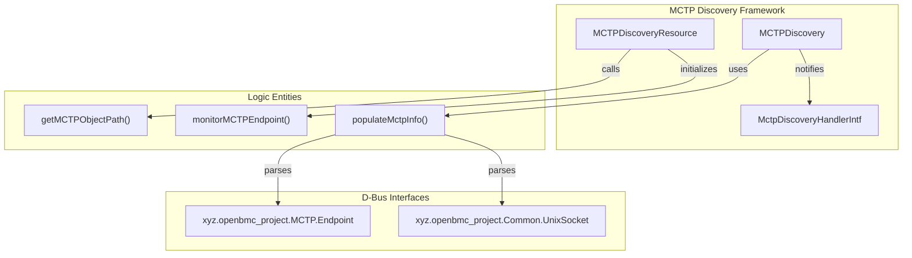
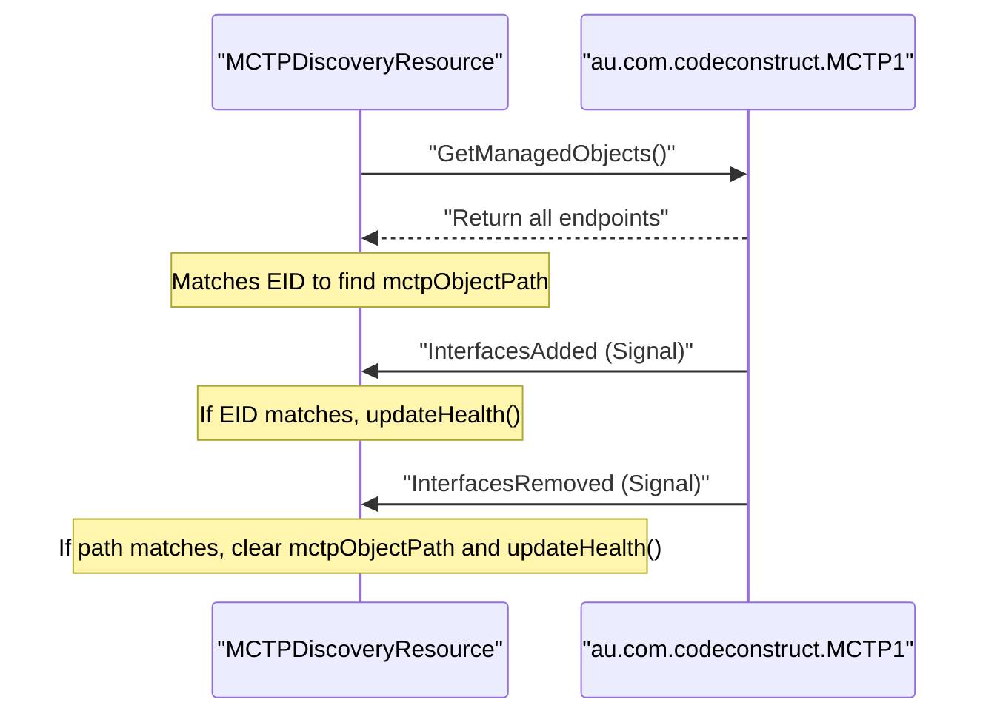
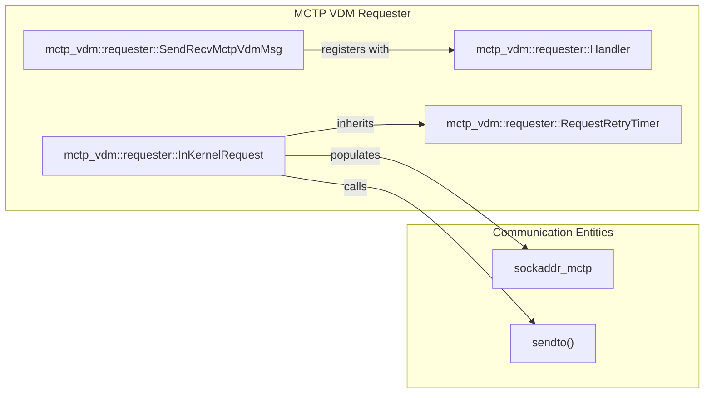
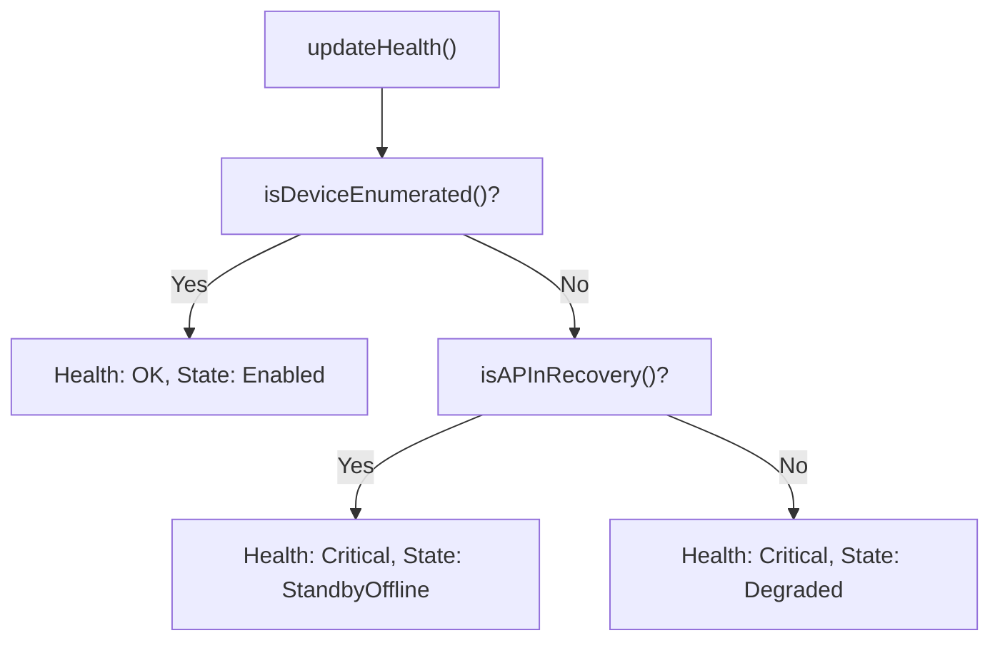

<!-- source: DeepWiki mcp.deepwiki.com · repo NVIDIA/nvidia-code-mgmt · page 3.2 MCTP-Based Resource Discovery · fetched 2026-10-26 -->

# MCTP-Based Resource Discovery

Relevant source files

The following files were used as context for generating this wiki page:

- [fw-status/ap_resource.cpp](fw-status/ap_resource.cpp)
- [fw-status/ap_resource.hpp](fw-status/ap_resource.hpp)
- [fw-status/erot_resource.hpp](fw-status/erot_resource.hpp)
- [fw-status/mctp_discovery_resource.cpp](fw-status/mctp_discovery_resource.cpp)
- [fw-status/mctp_discovery_resource.hpp](fw-status/mctp_discovery_resource.hpp)
- [fw-status/mctp_util/handler.hpp](fw-status/mctp_util/handler.hpp)
- [fw-status/mctp_util/mctp_endpoint_discovery.cpp](fw-status/mctp_util/mctp_endpoint_discovery.cpp)
- [fw-status/mctp_util/mctp_endpoint_discovery.hpp](fw-status/mctp_util/mctp_endpoint_discovery.hpp)
- [fw-status/mctp_util/mctp_vdm_helper.cpp](fw-status/mctp_util/mctp_vdm_helper.cpp)
- [fw-status/mctp_util/mctp_vdm_helper.hpp](fw-status/mctp_util/mctp_vdm_helper.hpp)
- [fw-status/mctp_util/request.hpp](fw-status/mctp_util/request.hpp)
- [fw-status/mctp_util/socket_handler.cpp](fw-status/mctp_util/socket_handler.cpp)
- [fw-status/mctp_util/socket_handler.hpp](fw-status/mctp_util/socket_handler.hpp)
- [fw-status/mctp_util/socket_manager.hpp](fw-status/mctp_util/socket_manager.hpp)
- [fw-status/mctp_util/types.hpp](fw-status/mctp_util/types.hpp)
- [fw-status/mctp_util/utils.cpp](fw-status/mctp_util/utils.cpp)
- [fw-status/mctp_util/utils.hpp](fw-status/mctp_util/utils.hpp)

## Purpose and Scope

This document describes the MCTP (Management Component Transport Protocol) based resource discovery system within the firmware status monitoring framework. The system provides endpoint discovery, communication protocols, and the `MCTPVdmHelper` system for vendor-defined message handling and device enumeration.

For information about the base resource framework that MCTP discovery builds upon, see [Resource Base Framework](#3.1). For details on specific resource implementations that use MCTP discovery, see [Application Processor Monitoring](#3.3) and [Enhanced Root of Trust Monitoring](#3.4).

## MCTP Discovery Architecture

The MCTP discovery system consists of components that work together to discover, monitor, and communicate with MCTP endpoints. It supports both active polling and signal-based discovery.

### Natural Language to Code Entity Space: Discovery
Title: MCTP Discovery Logic Mapping

Sources: [fw-status/mctp_discovery_resource.hpp:43-58](), [fw-status/mctp_util/mctp_endpoint_discovery.hpp:36-104](), [fw-status/mctp_util/mctp_endpoint_discovery.cpp:100-158]()

## MCTPDiscoveryResource Class

The `MCTPDiscoveryResource` class extends `BaseResource` to provide MCTP endpoint discovery and monitoring capabilities for specific EIDs. It maintains the link between a physical resource and its MCTP representation on D-Bus.

### Key Implementation Details

| Function | Purpose |
|-----------|---------|
| `getMCTPObjectPath()` | Iterates through `au.com.codeconstruct.MCTP1` managed objects to find the path matching a specific EID. [fw-status/mctp_discovery_resource.cpp:22-46]() |
| `monitorMCTPEndpoint()` | Sets up `sdbusplus::bus::match_t` for `interfacesAdded` and `interfacesRemoved` on the MCTP service path. [fw-status/mctp_discovery_resource.cpp:48-118]() |
| `isDeviceEnumerated()` | Returns true if `mctpObjectPath` is not empty, indicating the endpoint is active in the system. [fw-status/mctp_discovery_resource.hpp:77-80]() |

### Endpoint Monitoring Flow

The `MCTPDiscoveryResource` monitors MCTP endpoints through D-Bus signal matching:

Sources: [fw-status/mctp_discovery_resource.cpp:48-118](), [fw-status/mctp_discovery_resource.hpp:28-33]()

## MCTP VDM Communication

The MCTP VDM (Vendor Defined Messages) system provides structured communication using NVIDIA-specific message formats, primarily for querying device status.

### MCTPVdmHelper and Requester System

The `MCTPVdmHelper` facilitates higher-level operations like `queryBootStatus` by coordinating the `requester::Handler` and `mctp_socket::Handler`.

### Natural Language to Code Entity Space: VDM Requester
Title: MCTP VDM Requester Components

Sources: [fw-status/mctp_util/handler.hpp:92-123](), [fw-status/mctp_util/request.hpp:48-69](), [fw-status/mctp_util/request.hpp:142-205]()

### VDM Message Structure

The VDM messages follow NVIDIA's message format defined in `MsgHeader`:

| Field | Purpose |
|-------|---------|
| `iana` | NVIDIA IANA identifier (0x192, big-endian). [fw-status/mctp_util/mctp_vdm_helper.cpp:67-67]() |
| `instanceId` | Generated by `instanceIdMgr` to track request/response pairs. [fw-status/mctp_util/mctp_vdm_helper.cpp:69-69]() |
| `commandCode` | Command identifier (e.g., 0x05 for `queryBootStatus`). [fw-status/mctp_util/mctp_vdm_helper.cpp:71-71]() |

## Socket Management

The `mctp_socket::Handler` manages the lifecycle of sockets used for MCTP communication.

### Socket Activation and Deactivation

The system optimizes resource usage by activating sockets only when needed for communication with specific EIDs.

- **`activateSockets(eids)`**: Initializes the physical socket (e.g., `AF_MCTP`) and registers it with the `mctp_socket::Manager`. [fw-status/mctp_util/socket_handler.hpp:85-128]()
- **`deactivateSocket(eid)`**: Removes the EID registration. If no other EIDs are using that specific communication path (checked via `checkActiveEndpoints`), the socket is closed. [fw-status/mctp_util/socket_handler.hpp:143-157]()
- **`InKernelRequest::send()`**: Uses `sendto` with `AF_MCTP` family and `MCTP_TAG_OWNER`. [fw-status/mctp_util/request.hpp:181-203]()

Sources: [fw-status/mctp_util/socket_handler.hpp:38-157](), [fw-status/mctp_util/request.hpp:181-203]()

## Request Handling and Retries

The `mctp_vdm::requester::Handler` manages the state of outgoing requests, including timeouts and retries.

- **`RequestKey`**: Uniquely identifies a request using EID, Instance ID, Type, and Command. [fw-status/mctp_util/handler.hpp:52-64]()
- **`RequestRetryTimer`**: An abstract base class that manages a `sdbusplus::Timer` for retries. [fw-status/mctp_util/request.hpp:48-69]()
- **Instance ID Expiry**: If a response isn't received within the `instanceIdExpiryInterval` (default 15s), the request is cleaned up. [fw-status/mctp_util/handler.hpp:115-123](), [fw-status/mctp_util/handler.hpp:149-170]()

Sources: [fw-status/mctp_util/handler.hpp:40-189](), [fw-status/mctp_util/request.hpp:41-136]()

## Integration with Health Monitoring

The MCTP discovery system integrates with specific resource types like `APResource` and `ERoTResource` to provide real-time health status.

### Example: AP Health and MCTP Correlation

The `APResource` uses MCTP enumeration status as a primary health indicator:

Sources: [fw-status/ap_resource.cpp:119-150](), [fw-status/ap_resource.hpp:91-94]()

- **Boot Status Query**: `ERoTResource` uses `mctpVdmHelper->updateBootStatusAsync()` to poll the hardware for specific status bits (e.g., `AP0_BOOT_COMPLETE_BIT`). [fw-status/erot_resource.hpp:34-46](), [fw-status/erot_resource.hpp:113-144]()
- **Retry Mechanism**: If a device is in recovery, the system uses `sdbusplus::Timer` to re-evaluate health after a timeout (e.g., `maxBootCompleteTimeout`). [fw-status/ap_resource.cpp:87-94]()

Sources: [fw-status/ap_resource.cpp:56-102](), [fw-status/erot_resource.hpp:113-144]()

---

