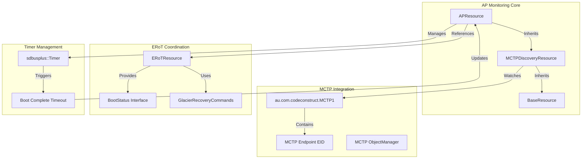
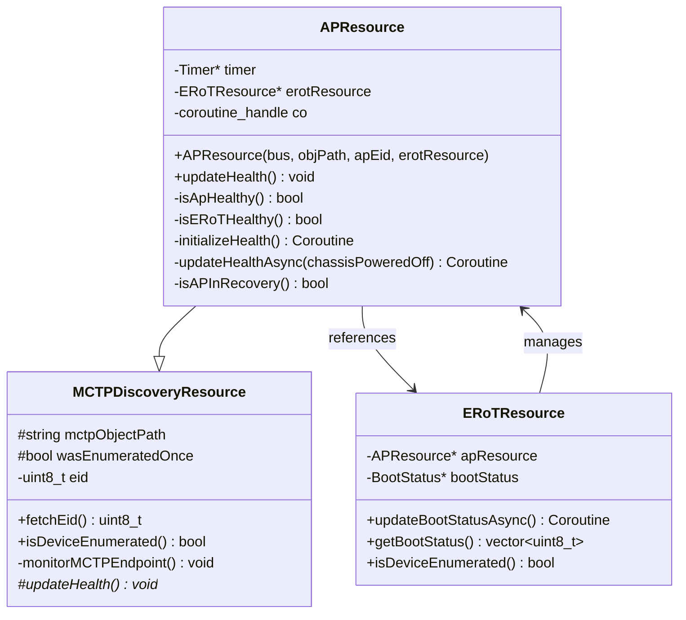
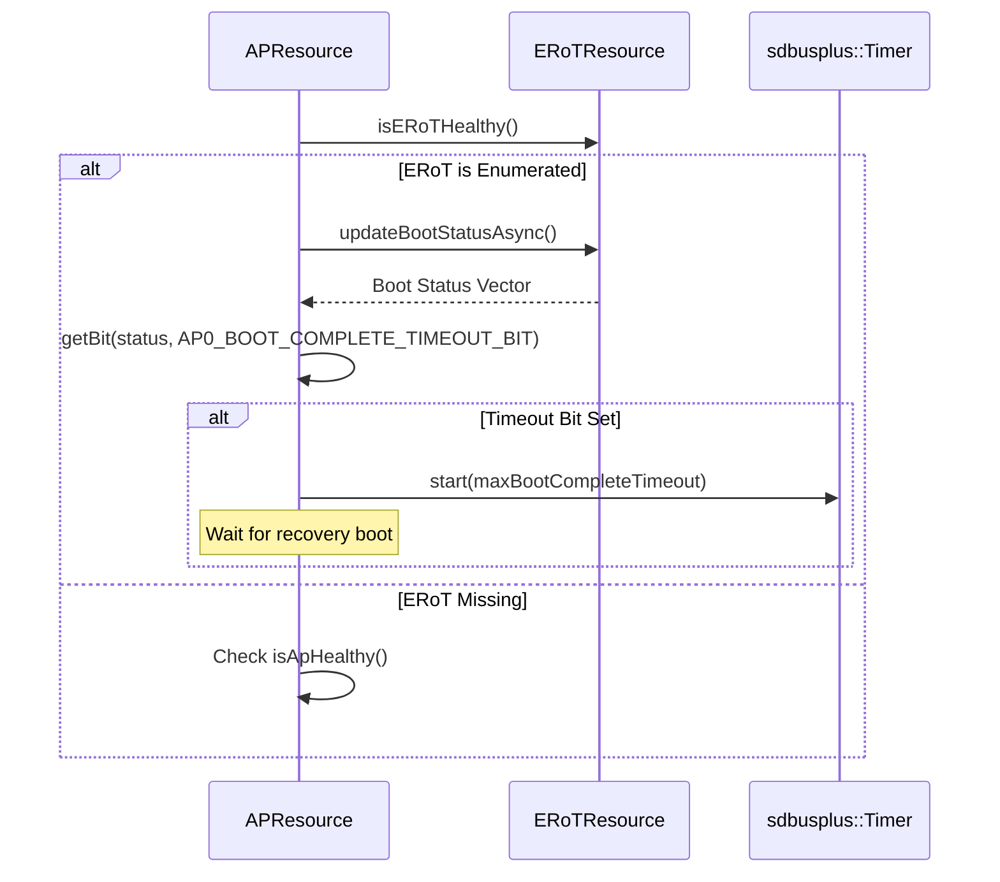

<!-- source: DeepWiki mcp.deepwiki.com · repo NVIDIA/nvidia-code-mgmt · page 3.3 Application Processor Monitoring · fetched 2026-10-26 -->

# Application Processor Monitoring

Relevant source files

The following files were used as context for generating this wiki page:

- [fw-status/ap_resource.cpp](fw-status/ap_resource.cpp)
- [fw-status/ap_resource.hpp](fw-status/ap_resource.hpp)
- [fw-status/erot_resource.hpp](fw-status/erot_resource.hpp)
- [fw-status/mctp_discovery_resource.cpp](fw-status/mctp_discovery_resource.cpp)
- [fw-status/mctp_discovery_resource.hpp](fw-status/mctp_discovery_resource.hpp)
- [test/test_fw_status_resources.cpp](test/test_fw_status_resources.cpp)
- [test/test_mctp_discovery_resource.cpp](test/test_mctp_discovery_resource.cpp)

The Application Processor (AP) monitoring system provides health tracking and status management for Application Processor firmware components through MCTP endpoint discovery and coordination with Embedded Root of Trust (ERoT) devices. This system monitors AP boot status, manages recovery timeouts, and publishes health information via D-Bus interfaces.

For Enhanced Root of Trust monitoring details, see [Enhanced Root of Trust Monitoring](#3.4). For broader firmware status monitoring concepts, see [Firmware Status Monitoring](#3).

## System Architecture

The AP monitoring system operates as a resource class that integrates with the MCTP discovery framework and coordinates with ERoT resources to provide comprehensive Application Processor health monitoring. It inherits from `MCTPDiscoveryResource` to leverage standard MCTP endpoint watching capabilities.

### Component Relationship Diagram

The following diagram illustrates how the `APResource` class interacts with MCTP discovery and the ERoT monitoring logic.

Sources: [fw-status/ap_resource.hpp:45-46](), [fw-status/mctp_discovery_resource.hpp:43-44](), [fw-status/erot_resource.hpp:55-56]()

### Class Structure

The `APResource` class manages the lifecycle of AP health monitoring, utilizing coroutines for non-blocking D-Bus and MCTP operations.

Sources: [fw-status/ap_resource.hpp:45-129](), [fw-status/mctp_discovery_resource.hpp:43-136](), [fw-status/erot_resource.hpp:148-164]()

## MCTP Endpoint Discovery and Monitoring

Discovery is handled by the `MCTPDiscoveryResource` base class, which monitors the MCTP Object Manager for endpoint additions and removals.

### Endpoint Discovery Process

1.  **Initial Scan**: Upon construction, `getMCTPObjectPath` queries the MCTP service (`au.com.codeconstruct.MCTP1`) via `GetManagedObjects` to find an endpoint matching the target EID [fw-status/mctp_discovery_resource.cpp:22-46]().
2.  **Dynamic Monitoring**: It sets up D-Bus matches for `InterfacesAdded` and `InterfacesRemoved` on the MCTP Object Manager path [fw-status/mctp_discovery_resource.cpp:48-118]().
3.  **State Tracking**:
    *   `mctpObjectPath`: Stores the current D-Bus path of the MCTP endpoint. If empty, the device is considered not enumerated [fw-status/mctp_discovery_resource.hpp:77-80]().
    *   `wasEnumeratedOnce`: Tracks if the device was ever seen during the service lifetime [fw-status/mctp_discovery_resource.hpp:93-95]().

Sources: [fw-status/mctp_discovery_resource.cpp:22-118](), [fw-status/mctp_discovery_resource.hpp:28-33]()

## Health State Management

The AP resource determines health based on a combination of MCTP enumeration and ERoT boot status bits.

| Condition | Health Property | State Property | Logic |
| :--- | :--- | :--- | :--- |
| **Chassis Off** | `Warning` | `UnavailableOffline` | Detected via `erotResource->isChassisPoweredOff()` [fw-status/ap_resource.cpp:107-112]() |
| **Healthy** | `OK` | `Enabled` | `isApHealthy()` returns true (MCTP endpoint is enumerated) [fw-status/ap_resource.cpp:119-124]() |
| **In Recovery** | `Critical` | `StandbyOffline` | MCTP endpoint missing AND `AP0_BOOT_COMPLETE_TIMEOUT_BIT` is set in ERoT [fw-status/ap_resource.cpp:136-141]() |
| **Degraded** | `Critical` | `Degraded` | MCTP endpoint missing but NOT in recovery [fw-status/ap_resource.cpp:142-147]() |
| **ERoT Missing** | `Critical` | `UnavailableOffline` | Neither ERoT nor AP MCTP endpoints are found [fw-status/ap_resource.cpp:126-134]() |

Sources: [fw-status/ap_resource.cpp:105-150](), [fw-status/ap_resource.hpp:91-94]()

## Boot Status Monitoring and Recovery Timeout

The system implements a timeout mechanism to allow the AP sufficient time to complete its boot process before declaring a recovery failure.

### Timeout Configuration

The total timeout is calculated to account for multiple slots and retry attempts:

*   **`maxBootCompleteTimeoutPerAttempt`**: 120 seconds [fw-status/ap_resource.hpp:31]()
*   **`numberOfSlots`**: 2 [fw-status/ap_resource.hpp:32]()
*   **`maxAttemptsPerSlot`**: 3 [fw-status/ap_resource.hpp:33]()
*   **`maxBootCompleteTimeout`**: 720 seconds (120 * 2 * 3) [fw-status/ap_resource.hpp:34-35]()

### Recovery Detection Logic

The AP is considered "In Recovery" if the MCTP endpoint is missing and the ERoT reports a boot timeout.

Sources: [fw-status/ap_resource.cpp:87-102](), [fw-status/ap_resource.cpp:157-165](), [fw-status/erot_resource.hpp:35]()

## Asynchronous Operations (Coroutines)

The monitoring system uses `mctp_vdm::requester::Coroutine` to handle asynchronous tasks without blocking the main event loop.

*   **`initializeHealth()`**: Triggered at construction. It checks the chassis power state and initiates the first health assessment [fw-status/ap_resource.cpp:56-102]().
*   **`updateHealthAsync()`**: The core logic for assessing health. It awaits the ERoT boot status update before evaluating AP health [fw-status/ap_resource.cpp:104-150]().
*   **`updateBootStatusAsync()`**: Defined in `ERoTResource`, this coroutine performs the actual MCTP VDM communication to fetch boot status from the ERoT hardware [fw-status/erot_resource.hpp:113]().

Sources: [fw-status/ap_resource.cpp:30-54](), [fw-status/ap_resource.cpp:104-112](), [fw-status/erot_resource.hpp:113-144]()

---

