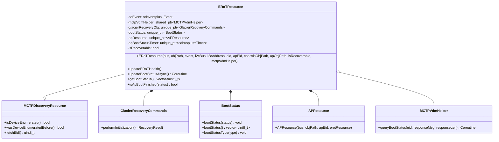
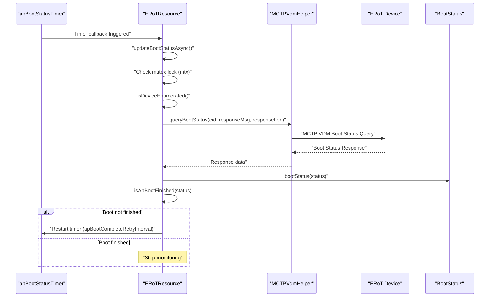
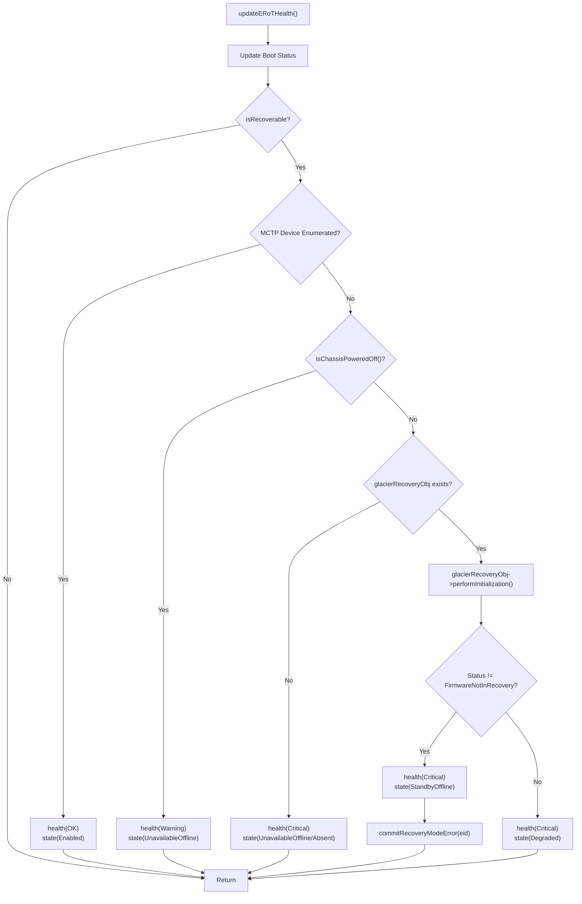
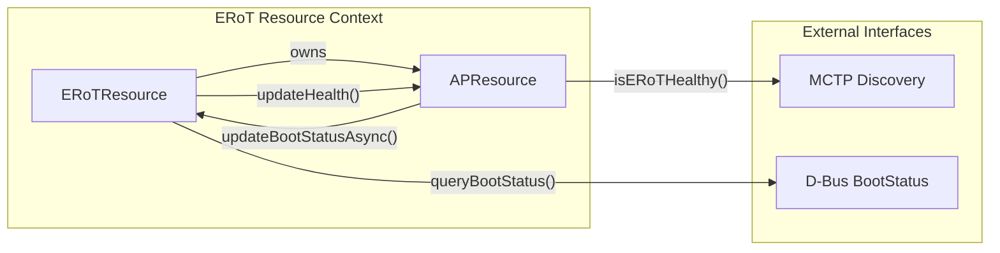

<!-- source: DeepWiki mcp.deepwiki.com · repo NVIDIA/nvidia-code-mgmt · page 3.4 Enhanced Root of Trust Monitoring · fetched 2026-10-26 -->

# Enhanced Root of Trust Monitoring

Relevant source files

The following files were used as context for generating this wiki page:

- [fw-status/ap_resource.cpp](fw-status/ap_resource.cpp)
- [fw-status/ap_resource.hpp](fw-status/ap_resource.hpp)
- [fw-status/base_resource.hpp](fw-status/base_resource.hpp)
- [fw-status/connectx_resource.hpp](fw-status/connectx_resource.hpp)
- [fw-status/erot_resource.cpp](fw-status/erot_resource.cpp)
- [fw-status/erot_resource.hpp](fw-status/erot_resource.hpp)
- [fw-status/gpu_resource.hpp](fw-status/gpu_resource.hpp)
- [fw-status/mctp_discovery_resource.cpp](fw-status/mctp_discovery_resource.cpp)
- [fw-status/mctp_discovery_resource.hpp](fw-status/mctp_discovery_resource.hpp)
- [fw-status/mcu_resource.hpp](fw-status/mcu_resource.hpp)
- [fw-status/nvlinkmgmt_nic_resource.hpp](fw-status/nvlinkmgmt_nic_resource.hpp)
- [fw-status/nvswitch_resource.hpp](fw-status/nvswitch_resource.hpp)
- [fw-status/usb_rcm_resource.cpp](fw-status/usb_rcm_resource.cpp)
- [src/connectx_recovery.hpp](src/connectx_recovery.hpp)
- [test/test_fw_status_resources.cpp](test/test_fw_status_resources.cpp)

Enhanced Root of Trust (ERoT) Monitoring provides comprehensive status tracking and health assessment for Embedded Root of Trust devices within the firmware management system. This component monitors boot status, coordinates recovery operations, and manages associated Application Processor resources.

For information about Application Processor monitoring, see [Application Processor Monitoring](#3.3). For details about Glacier Crisis Recovery operations, see [Glacier Crisis Recovery](#4.2). For MCTP communication infrastructure, see [MCTP Communication Layer](#5.2).

## ERoT Resource Architecture

The `ERoTResource` class serves as the primary component for monitoring Enhanced Root of Trust devices, providing boot status tracking, health assessment, and integration with recovery systems. It inherits from `MCTPDiscoveryResource` to leverage standard MCTP endpoint monitoring.

### ERoT Resource Architecture Diagram

Sources: [fw-status/erot_resource.hpp:55-193](), [fw-status/erot_resource.cpp:21-49](), [fw-status/mctp_discovery_resource.hpp:43-136]()

## Boot Status Monitoring

The ERoT monitoring system implements asynchronous boot status tracking through MCTP Vendor Defined Message (VDM) communication, providing real-time visibility into device boot progress and completion status.

### Boot Status Query Flow

The boot status monitoring process uses coroutines for asynchronous operation:

| Component | Function | Purpose |
|-----------|----------|---------|
| `updateBootStatusAsync()` | [fw-status/erot_resource.cpp:165-195]() | Coroutine for async boot status queries via MCTP VDM |
| `isApBootFinished()` | [fw-status/erot_resource.cpp:74-86]() | Checks AP boot completion status bits |
| `apBootStatusTimer` | [fw-status/erot_resource.cpp:44-48]() | Timer for periodic boot status checks |
| `apBootCompleteRetryInterval` | [fw-status/erot_resource.hpp:33]() | Interval for polling boot status (10 seconds) |

Sources: [fw-status/erot_resource.cpp:165-195](), [fw-status/erot_resource.cpp:74-86](), [fw-status/erot_resource.hpp:33-35]()

## Health Assessment and Recovery Integration

The ERoT monitoring system performs comprehensive health assessment by evaluating MCTP connectivity, device enumeration status, and recovery state through `GlacierRecoveryCommands` integration.

### ERoT Health Assessment Flow

The health assessment evaluates multiple factors:

| Health Status | Operational State | Condition |
|---------------|-------------------|-----------|
| `OK` | `Enabled` | MCTP device enumerated |
| `Warning` | `UnavailableOffline` | MCTP not enumerated and chassis powered off |
| `Critical` | `StandbyOffline` | Device in recovery mode (determined by Glacier protocol) |
| `Critical` | `Degraded` | Device healthy via I2C but MCTP connectivity missing |
| `Critical` | `Absent` | Glacier object missing and device never enumerated before |

Sources: [fw-status/erot_resource.cpp:88-163](), [fw-status/erot_resource.hpp:186-192]()

## Application Processor (AP) Coordination

The `ERoTResource` manages an associated `APResource` object, coordinating health updates between the Root of Trust and the primary processor.

### AP Monitoring Integration

The `APResource` health depends on the ERoT's ability to communicate:
- `isERoTHealthy()`: Checks if the ERoT MCTP endpoint is enumerated [fw-status/ap_resource.cpp:152-155]().
- `isAPInRecovery()`: Checks if `AP0_BOOT_COMPLETE_TIMEOUT_BIT` is set in the ERoT boot status [fw-status/ap_resource.cpp:157-165]().

Sources: [fw-status/ap_resource.cpp:152-165](), [fw-status/erot_resource.cpp:39]()

## Configuration and Initialization

ERoT resources support two initialization patterns based on whether the device is recoverable via I2C.

### Constructor Variants

| Constructor | Parameters | Use Case |
|-------------|------------|----------|
| Full Constructor | `bus, objPath, event, i2cBus, i2cAddress, eid, apEid, chassisObjPath, apObjPath, isRecoverable, mctpVdmHelper` | Recoverable devices with associated AP monitoring [fw-status/erot_resource.cpp:21-49](). |
| Minimal Constructor | `bus, objPath, event, eid, chassisObjPath, isRecoverable, mctpVdmHelper` | Monitoring-only ERoT without AP resource or I2C recovery [fw-status/erot_resource.cpp:51-72](). |

Both constructors initialize:
- `BootStatus` object with `ERoTBootStatus` type [fw-status/erot_resource.cpp:37-38]().
- Health status as `OK` and state as `Enabled` [fw-status/erot_resource.cpp:41-42]().
- `apBootStatusTimer` for periodic status polling [fw-status/erot_resource.cpp:44-48]().

Sources: [fw-status/erot_resource.cpp:21-72](), [fw-status/base_resource.hpp:47]()

## Status Reporting and Integration

The ERoT monitoring system publishes status information through D-Bus interfaces and coordinates with other system components for comprehensive hardware management.

### Boot Status Bit Analysis

The system analyzes boot status using specific bit positions defined in the ERoT specification:

| Bit Position | Constant | Meaning |
|--------------|----------|---------|
| `5` | `AP0_BOOT_COMPLETE_BIT` | AP boot process finished [fw-status/erot_resource.hpp:34](). |
| `27` | `AP0_BOOT_COMPLETE_TIMEOUT_BIT` | AP boot process timed out [fw-status/erot_resource.hpp:35](). |

The helper function `getBit` [fw-status/erot_resource.hpp:37-46]() is used to extract these status bits from the raw status vector returned by the device.

Sources: [fw-status/erot_resource.hpp:33-46](), [fw-status/erot_resource.cpp:74-86]()

---

