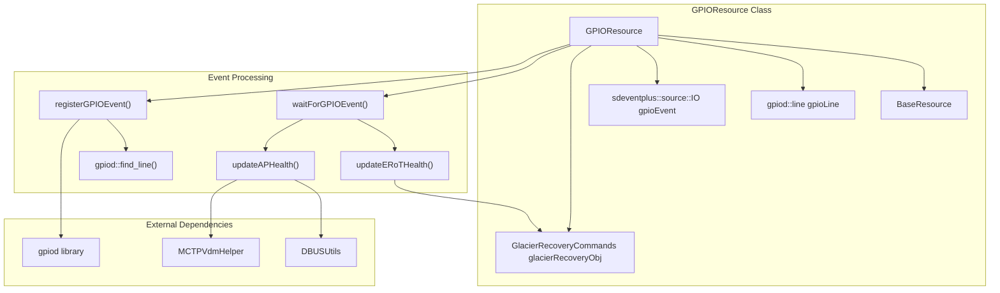
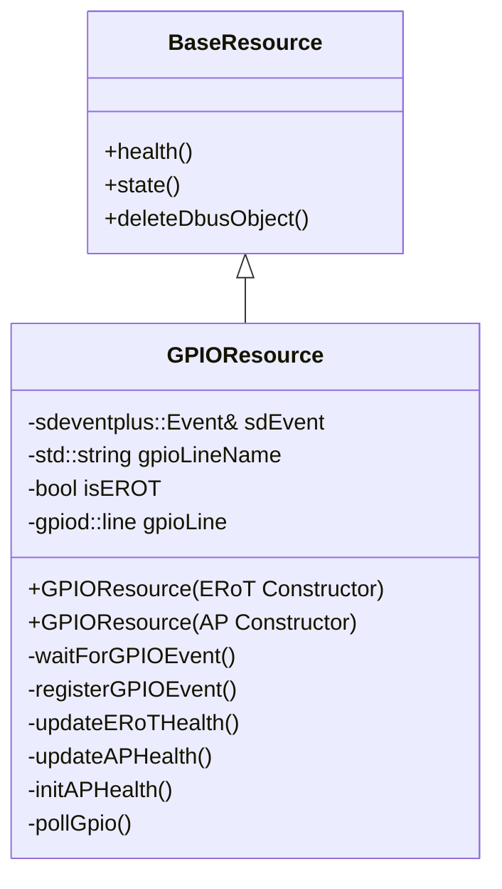
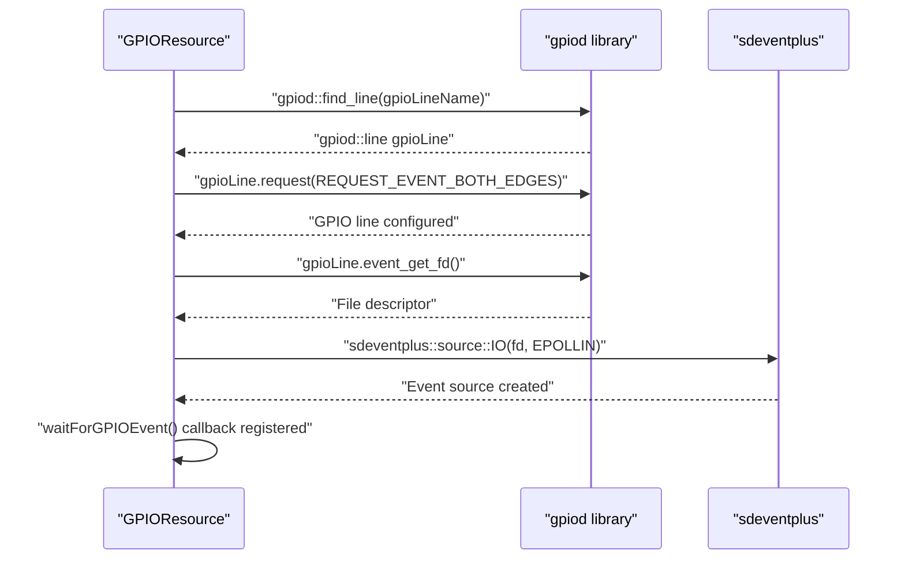
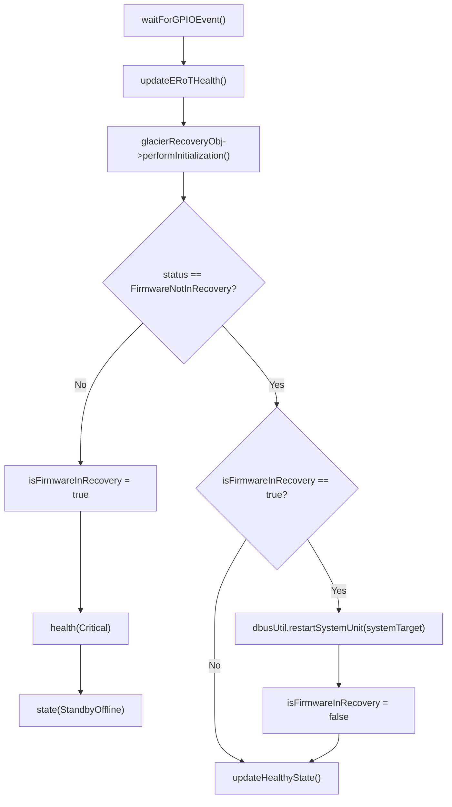
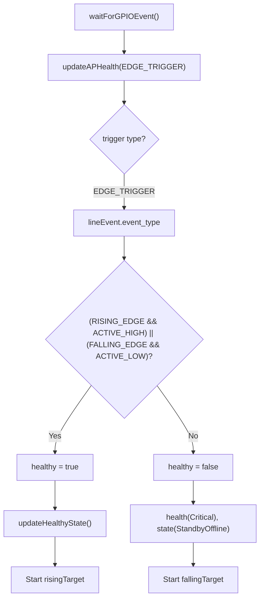
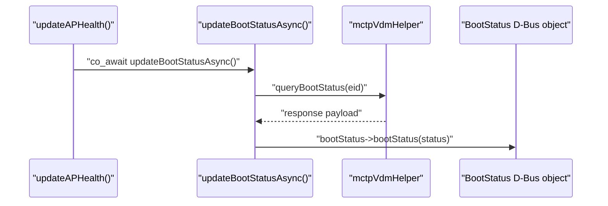

<!-- source: DeepWiki mcp.deepwiki.com · repo NVIDIA/nvidia-code-mgmt · page 3.5 GPIO-Based Monitoring · fetched 2026-10-26 -->

# GPIO-Based Monitoring

Relevant source files

The following files were used as context for generating this wiki page:

- [fw-status/cpld_resource.cpp](fw-status/cpld_resource.cpp)
- [fw-status/cpld_resource.hpp](fw-status/cpld_resource.hpp)
- [fw-status/fw-status.cpp](fw-status/fw-status.cpp)
- [fw-status/gpio_resource.cpp](fw-status/gpio_resource.cpp)
- [fw-status/gpio_resource.hpp](fw-status/gpio_resource.hpp)
- [fw-status/meson.build](fw-status/meson.build)
- [fw-status/usb_rcm_resource.hpp](fw-status/usb_rcm_resource.hpp)
- [test/test_fw_status_glacier_gpio.cpp](test/test_fw_status_glacier_gpio.cpp)

## Purpose and Scope

This document describes the GPIO-Based Monitoring subsystem, which is a component of the firmware status monitoring framework. This subsystem uses GPIO (General Purpose Input/Output) signals to monitor the health and status of various hardware components in the system. It supports monitoring both Enhanced Root of Trust (ERoT) devices and Application Processors (AP), with different monitoring strategies for each type of device.

For information about other monitoring approaches, see [MCTP-Based Monitoring](3.2) and [Application Processor Monitoring](3.3).

## Overview

The GPIO-Based Monitoring subsystem implements the `GPIOResource` class to monitor hardware component health using GPIO line events. The system supports two distinct monitoring modes:

1.  **ERoT Device Monitoring** - Monitors ERoT devices using GPIO fatal error signals combined with Glacier Crisis Recovery protocol validation [fw-status/gpio_resource.cpp:109-112]().
2.  **Application Processor Monitoring** - Tracks AP health via GPIO ready/status signals with configurable polarity and edge/level triggering [fw-status/gpio_resource.cpp:146-152]().

The implementation uses the `libgpiocxx` library for GPIO line management and integrates with systemd for service orchestration based on GPIO state changes [fw-status/gpio_resource.cpp:187-198]().

### GPIO Monitoring Architecture

Sources: [fw-status/gpio_resource.hpp:37-138](), [fw-status/gpio_resource.cpp:166-199]()

## Components and Architecture

The GPIO-Based Monitoring subsystem is implemented by the `GPIOResource` class which monitors GPIO signals and updates the health status of hardware components accordingly. This class inherits from `BaseResource` and is part of the firmware status monitoring framework [fw-status/gpio_resource.hpp:40-41]().

Sources: [fw-status/gpio_resource.hpp:37-138]()

### Key Classes and Functions

#### GPIOResource Class

The `GPIOResource` class implements GPIO-based hardware monitoring with the following core functionality:

| Method | Purpose | Used For |
| :--- | :--- | :--- |
| `waitForGPIOEvent()` | GPIO event callback handler [fw-status/gpio_resource.cpp:166-199]() | Both ERoT and AP |
| `registerGPIOEvent()` | GPIO line setup and event registration [fw-status/gpio_resource.cpp:234-269]() | Both ERoT and AP |
| `updateERoTHealth()` | ERoT health assessment via Glacier protocol [fw-status/gpio_resource.cpp:389-425]() | ERoT only |
| `updateAPHealth()` | AP health assessment via GPIO state [fw-status/gpio_resource.cpp:427-526]() | AP only |
| `initAPHealth()` | Initial AP health status setup [fw-status/gpio_resource.cpp:528-545]() | AP only |
| `pollGpio()` | Polling-based GPIO check [fw-status/gpio_resource.cpp:324-343]() | ERoT Polling mode |
| `requestGPIOInputLine()` | Configures line for polling [fw-status/gpio_resource.cpp:302-322]() | ERoT Polling mode |

Sources: [fw-status/gpio_resource.hpp:113-210](), [fw-status/gpio_resource.cpp:102-152]()

## GPIOResource Initialization and Operation

The `GPIOResource` class is initialized with different parameters depending on whether it's monitoring an ERoT device or an Application Processor.

### GPIO Line Management and Event Registration

The `GPIOResource` class uses the `gpiod` library for GPIO line management with specific request configurations:

Sources: [fw-status/gpio_resource.cpp:234-269]()

## ERoT Device Monitoring

For ERoT devices, the monitoring is done using a dedicated GPIO signal (typically a FATAL_ERROR pin) and the Glacier Crisis Recovery protocol [fw-status/gpio_resource.hpp:58-59](). When the GPIO signal indicates a state change, the system uses the Glacier protocol to verify if the device is in recovery mode [fw-status/gpio_resource.cpp:389-425]().

### ERoT Health Monitoring Implementation

The ERoT monitoring constructor creates a `GlacierRecoveryCommands` instance and uses it to validate device recovery status [fw-status/gpio_resource.cpp:109-112]():

Sources: [fw-status/gpio_resource.cpp:389-425](), [fw-status/gpio_resource.cpp:102-125]()

## Application Processor Monitoring

For Application Processors, the monitoring is done using GPIO signals that indicate the boot or operational status of the processor [fw-status/gpio_resource.hpp:83-86](). The system responds to both edge (rising/falling) transitions of the GPIO [fw-status/gpio_resource.cpp:187-190]().

### AP Health Monitoring Implementation

The AP monitoring supports edge trigger modes with configurable GPIO polarity [fw-status/gpio_resource.cpp:427-526]():

Sources: [fw-status/gpio_resource.cpp:427-526](), [fw-status/gpio_resource.cpp:127-152]()

## Configuration and Service Integration

The GPIO-Based Monitoring is configured through Entity Manager. The `fw-status` service queries these configurations (interface `xyz.openbmc_project.Configuration.CPLDGPIOMonitor`) during startup [fw-status/fw-status.cpp:71-72]().

### Configuration Parameters

| Parameter | Type | Class Member | Used For |
| :--- | :--- | :--- | :--- |
| `GPIO` | string | `gpioLineName` | GPIO line name [fw-status/gpio_resource.hpp:116]() |
| `I2CBus` | uint64 | `i2cBus` | ERoT Glacier protocol I2C bus [fw-status/gpio_resource.cpp:96]() |
| `I2CAddress` | uint64 | `i2cAddress` | ERoT Glacier protocol I2C address [fw-status/gpio_resource.cpp:97]() |
| `Target` | string | `systemTarget` | ERoT systemd unit for recovery [fw-status/gpio_resource.hpp:117]() |
| `RisingTarget` | string | `risingTarget` | AP systemd unit for rising edge [fw-status/gpio_resource.hpp:118]() |
| `FallingTarget` | string | `fallingTarget` | AP systemd unit for falling edge [fw-status/gpio_resource.hpp:119]() |
| `Polarity` | string | `polarity` | GPIO polarity (`ActiveHigh`/`ActiveLow`) [fw-status/gpio_resource.cpp:49-65]() |
| `MonitorMode` | string | `monitorMode` | Monitoring mode (`Interrupt`/`Polling`) [fw-status/gpio_resource.cpp:31-47]() |

Sources: [fw-status/gpio_resource.cpp:95-152](), [fw-status/gpio_resource.hpp:114-138]()

## Boot Status Monitoring and MCTP Integration

For AP devices, the `GPIOResource` maintains boot status through MCTP VDM queries [fw-status/gpio_resource.cpp:485-500](). The boot status functionality uses coroutines for asynchronous MCTP communication [fw-status/gpio_resource.hpp:138]():

Sources: [fw-status/gpio_resource.cpp:485-500](), [fw-status/gpio_resource.cpp:557-610]()

## Error Handling

The GPIO-Based Monitoring system includes error handling for various scenarios:

1.  **GPIO Line Availability** - If a GPIO line becomes unavailable (e.g., `ENODEV`), the system clears the event source and starts a retry timer [fw-status/gpio_resource.cpp:171-181]().
2.  **Registration Retries** - If initial GPIO registration fails, a `gpioRetryTimer` is used to attempt re-registration every 5 seconds [fw-status/gpio_resource.cpp:27-28](), [fw-status/gpio_resource.cpp:271-285]().
3.  **Glacier Protocol Errors** - Errors during Glacier initialization or status queries are logged, and the device state is updated based on the last known or default failure states [fw-status/gpio_resource.cpp:389-425]().

Sources: [fw-status/gpio_resource.cpp:171-185](), [fw-status/gpio_resource.cpp:271-300]()

## Summary

The GPIO-Based Monitoring subsystem provides a mechanism for monitoring hardware component health using physical GPIO signals. It supports both ERoT devices (via Glacier protocol validation) and Application Processors (via edge/level detection), integrating these hardware signals into the OpenBMC D-Bus health and operational status ecosystem.

---

