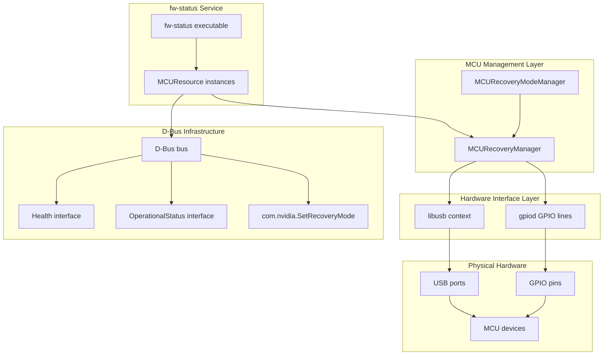
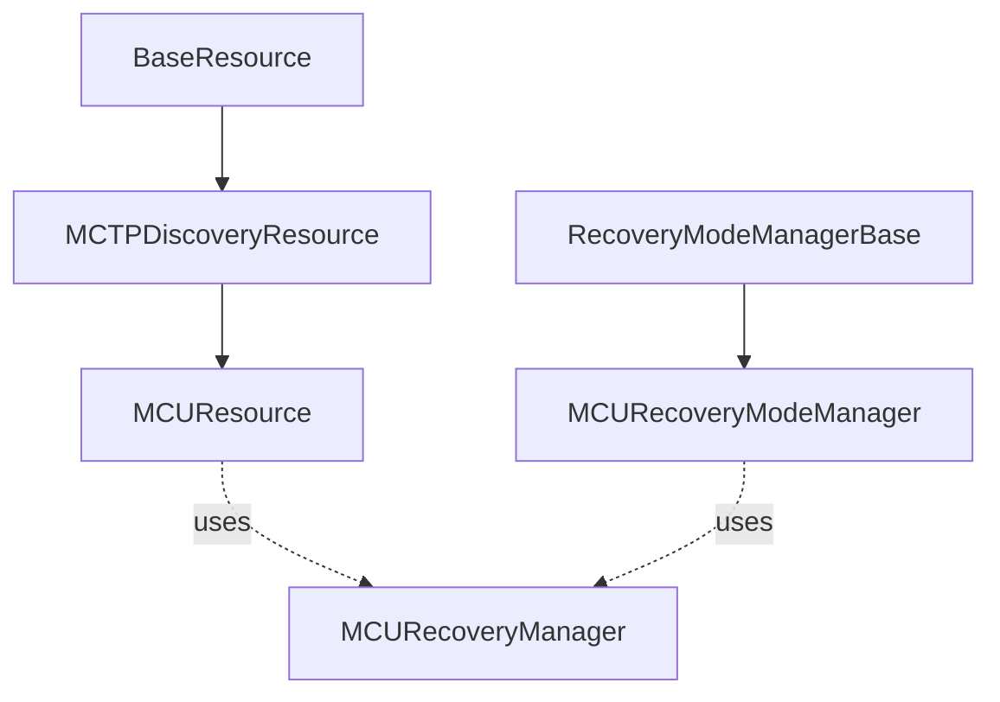
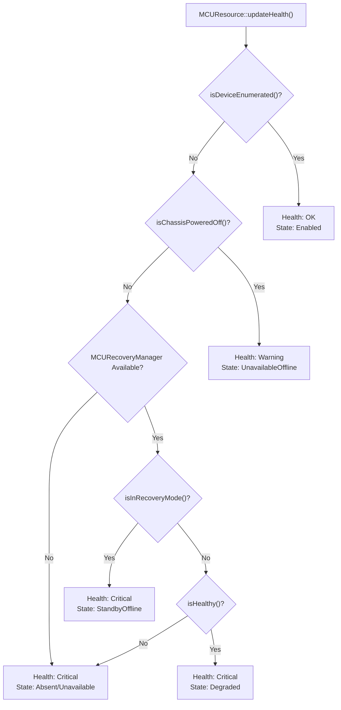

<!-- source: DeepWiki mcp.deepwiki.com · repo NVIDIA/nvidia-code-mgmt · page 3.6 MCU Resource Management · fetched 2026-10-26 -->

# MCU Resource Management

Relevant source files

The following files were used as context for generating this wiki page:

- [fw-status/base_resource.hpp](fw-status/base_resource.hpp)
- [fw-status/connectx_resource.hpp](fw-status/connectx_resource.hpp)
- [fw-status/erot_resource.cpp](fw-status/erot_resource.cpp)
- [fw-status/force_recovery/mcu_recovery_mode_manager.cpp](fw-status/force_recovery/mcu_recovery_mode_manager.cpp)
- [fw-status/force_recovery/mcu_recovery_mode_manager.hpp](fw-status/force_recovery/mcu_recovery_mode_manager.hpp)
- [fw-status/force_recovery/recovery_mode_manager_base.hpp](fw-status/force_recovery/recovery_mode_manager_base.hpp)
- [fw-status/force_recovery/usbrcm_recovery_manager.cpp](fw-status/force_recovery/usbrcm_recovery_manager.cpp)
- [fw-status/force_recovery/usbrcm_recovery_manager.hpp](fw-status/force_recovery/usbrcm_recovery_manager.hpp)
- [fw-status/gpu_resource.hpp](fw-status/gpu_resource.hpp)
- [fw-status/mcu_resource.hpp](fw-status/mcu_resource.hpp)
- [fw-status/nvlinkmgmt_nic_resource.hpp](fw-status/nvlinkmgmt_nic_resource.hpp)
- [fw-status/nvswitch_resource.hpp](fw-status/nvswitch_resource.hpp)
- [fw-status/udev_monitor.cpp](fw-status/udev_monitor.cpp)
- [fw-status/udev_monitor.hpp](fw-status/udev_monitor.hpp)
- [fw-status/usb_rcm_resource.cpp](fw-status/usb_rcm_resource.cpp)
- [src/connectx_recovery.hpp](src/connectx_recovery.hpp)
- [test/test_fw_status_misc.cpp](test/test_fw_status_misc.cpp)

The MCU Resource Management system provides health monitoring and recovery capabilities for Microcontroller Unit (MCU) devices within the NVIDIA firmware management infrastructure. This system operates as part of the `fw-status` service and integrates USB device enumeration, GPIO-based hardware control, and firmware recovery protocols to maintain MCU device operational status.

For information about other hardware resource types, see [Application Processor Monitoring](3.3), [Enhanced Root of Trust Monitoring](3.4), and [GPIO-Based Monitoring](3.5). For details about the recovery tools used by this system, see [MCU Recovery Management](4.3).

## System Architecture

The MCU Resource Management system consists of components that extend the base monitoring framework to handle MCU-specific discovery and recovery logic.

### MCU Resource Management Architecture

Sources: [fw-status/mcu_resource.hpp:23-56](), [fw-status/force_recovery/mcu_recovery_mode_manager.hpp:18-34]()

### MCU Resource Class Hierarchy

The `MCUResource` class inherits from `MCTPDiscoveryResource`, which in turn inherits from `BaseResource`. This hierarchy provides standardized D-Bus interfaces for health and operational status.

Sources: [fw-status/mcu_resource.hpp:29-32](), [fw-status/force_recovery/mcu_recovery_mode_manager.hpp:18-20](), [fw-status/base_resource.hpp:127-133]()

## Health Monitoring and Status Management

The `MCUResource` class implements MCU-specific health assessment by overriding the `updateHealth()` function. It relies on a shared `MCURecoveryManager` to query the physical state of the hardware.

### Health Assessment Logic

The health assessment logic follows a prioritized flow, checking MCTP enumeration, chassis power state, and device-level recovery status.

Sources: [fw-status/mcu_resource.hpp:64-138]()

### Status Definitions

| Health | State | Condition |
| :--- | :--- | :--- |
| `OK` | `Enabled` | Device is enumerated via MCTP [fw-status/mcu_resource.hpp:98-105]() |
| `Warning` | `UnavailableOffline` | MCTP not found but Chassis is Powered Off [fw-status/mcu_resource.hpp:70-76]() |
| `Critical` | `StandbyOffline` | Device is detected in Recovery Mode [fw-status/mcu_resource.hpp:107-114]() |
| `Critical` | `Degraded` | Device is "Healthy" (accessible) but MCTP is missing [fw-status/mcu_resource.hpp:117-125]() |
| `Critical` | `Absent` | Device is not accessible and was never seen before [fw-status/mcu_resource.hpp:135-137]() |

## Force Recovery Coordination

The system provides a mechanism to force an MCU into recovery mode via the `com.nvidia.SetRecoveryMode` D-Bus interface. This is orchestrated by the `MCURecoveryModeManager`.

### Recovery Mode Execution

When the `setRecoveryMode()` method is called on the D-Bus interface, the following sequence occurs:

1.  **Interface Invocation**: The `RecoveryModeManagerBase::setRecoveryMode()` function is triggered [fw-status/force_recovery/recovery_mode_manager_base.hpp:56-60]().
2.  **GPIO Initialization**: The manager calls `mcuRecoveryManager->initGpioLines()` to take control of the physical pins [fw-status/force_recovery/mcu_recovery_mode_manager.cpp:39-44]().
3.  **Mode Entry**: The manager executes `mcuRecoveryManager->enterRecoveryMode(deviceId)` to manipulate the Reset and Recovery pins [fw-status/force_recovery/mcu_recovery_mode_manager.cpp:47]().
4.  **GPIO Release**: Pins are released back to their default state via `releaseGpioLines()` [fw-status/force_recovery/mcu_recovery_mode_manager.cpp:50]().
5.  **Post-Recovery Callback**: If registered, a callback is executed to immediately refresh the resource health [fw-status/force_recovery/recovery_mode_manager_base.hpp:79-91]().

Sources: [fw-status/force_recovery/mcu_recovery_mode_manager.cpp:25-64](), [fw-status/force_recovery/recovery_mode_manager_base.hpp:56-92]()

## Related MCU-like Resources

Several other resources follow similar monitoring and recovery patterns using GPIOs and specialized status registers:

*   **ConnectXResource**: Monitors ConnectX network controllers. It uses the `CXBootStatus` type and implements `SetRecoveryMode` using Reset and Flash-Not-Present (FNP) GPIOs [fw-status/connectx_resource.hpp:38-75]().
*   **NVLinkMgmtNicResource**: Monitors NVLink management NICs. It reuses the `CXBootStatus` type as these devices are part of the ConnectX family [fw-status/nvlinkmgmt_nic_resource.hpp:68-72]().
*   **NVSwitchResource**: Manages NVSwitch health using `NVSwitchBootStatus` and coordinates recovery via GPIO-based FNP assertion [fw-status/nvswitch_resource.hpp:55-74]().
*   **USBRcmResource**: Handles devices that recover via USB RCM (Recovery Mode). It integrates with `UdevMonitor` to trigger health updates when USB devices are plugged in [fw-status/usb_rcm_resource.cpp:25-44]().

Sources: [fw-status/connectx_resource.hpp:38-75](), [fw-status/nvlinkmgmt_nic_resource.hpp:34-77](), [fw-status/nvswitch_resource.hpp:31-74](), [fw-status/usb_rcm_resource.cpp:25-44]()

---

