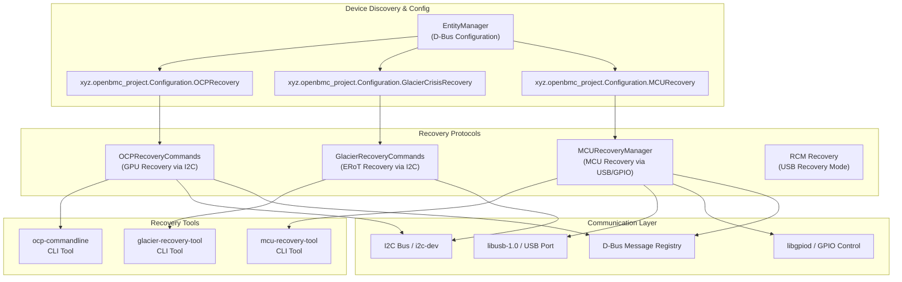
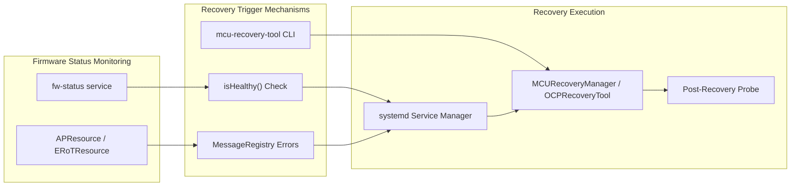

<!-- source: DeepWiki mcp.deepwiki.com · repo NVIDIA/nvidia-code-mgmt · page 4 Recovery Systems · fetched 2026-10-26 -->

# Recovery Systems

<details>
<summary>Relevant source files</summary>

The following files were used as context for generating this wiki page:

- [recovery_tool/mcu_recovery_tool/mcu_recovery_interfaces.cpp](recovery_tool/mcu_recovery_tool/mcu_recovery_interfaces.cpp)
- [recovery_tool/mcu_recovery_tool/mcu_recovery_manager.cpp](recovery_tool/mcu_recovery_tool/mcu_recovery_manager.cpp)
- [recovery_tool/mcu_recovery_tool/mcu_recovery_manager.hpp](recovery_tool/mcu_recovery_tool/mcu_recovery_manager.hpp)
- [recovery_tool/mcu_recovery_tool/utils.cpp](recovery_tool/mcu_recovery_tool/utils.cpp)
- [recovery_tool/ocp_recovery_tool/recovery_commands.cpp](recovery_tool/ocp_recovery_tool/recovery_commands.cpp)
- [recovery_tool/ocp_recovery_tool/recovery_commands.hpp](recovery_tool/ocp_recovery_tool/recovery_commands.hpp)
- [recovery_tool/ocp_recovery_tool/recoverytool_interface.cpp](recovery_tool/ocp_recovery_tool/recoverytool_interface.cpp)
- [recovery_tool/ocp_recovery_tool/recoverytool_utils.cpp](recovery_tool/ocp_recovery_tool/recoverytool_utils.cpp)
- [recovery_tool/ocp_recovery_tool/recoverytool_utils.hpp](recovery_tool/ocp_recovery_tool/recoverytool_utils.hpp)
- [test/fw_status_fakes/mcu_recovery_manager.hpp](test/fw_status_fakes/mcu_recovery_manager.hpp)

</details>


This document covers the comprehensive recovery system architecture supporting hardware fault handling across NVIDIA firmware components. The recovery systems provide automated mechanisms for restoring functionality to failed hardware components including GPU devices, Embedded Root of Trust (ERoT) modules, and microcontroller units (MCU) through various recovery protocols.

For information about firmware update mechanisms, see [Firmware Update System](#2). For hardware status monitoring that triggers recovery operations, see [Firmware Status Monitoring](#3).

## Recovery System Architecture

The recovery systems implement four distinct recovery protocols, each optimized for specific hardware component types and failure scenarios. The architecture provides both automated recovery through systemd services and manual recovery through command-line interfaces.



**Sources:** [recovery_tool/ocp_recovery_tool/recovery_commands.hpp:122-135](), [recovery_tool/mcu_recovery_tool/mcu_recovery_manager.hpp:119-136](), [recovery_tool/mcu_recovery_tool/utils.cpp:30-34]()

## Common Recovery Framework

All recovery protocols share common infrastructure components for device discovery, error reporting, and status validation. The recovery systems integrate with the broader firmware management ecosystem through D-Bus interfaces and systemd service management.

| Component | Purpose | Interface / Class |
|-----------|---------|-----------|
| `EntityManager` | Device configuration discovery | `xyz.openbmc_project.EntityManager` |
| `MessageRegistry` | Standardized error reporting | `mcu_recovery_manager::MessageRegistry` |
| `DBUSUtils` | D-Bus property access | `nvidia::software::updater::DBUSUtils` |
| `MCUInfo` | Hardware metadata (GPIOs, I2C, USB) | `mcu_recovery_manager::MCUInfo` |

**Recovery Operation States:**

```mermaid
stateDiagram-v2
    [*] --> DeviceDiscovery
    DeviceDiscovery --> StatusCheck: probeI2cAddress / libusb_get_device_descriptor
    StatusCheck --> RecoveryNeeded: Device Error / RecoveryMode
    StatusCheck --> Operational: Device Healthy
    RecoveryNeeded --> InitializeRecovery: enterRecoveryMode (GPIO Straps)
    InitializeRecovery --> TransferFirmware: sendIndirectDataCommand / blhost
    TransferFirmware --> ActivateRecovery: RecoveryImageSelection::ActivateImage
    ActivateRecovery --> ValidateRecovery: isHealthy check
    ValidateRecovery --> Operational: Success
    ValidateRecovery --> RecoveryFailed: Failure
    RecoveryFailed --> [*]
    Operational --> [*]
```

**Sources:** [recovery_tool/mcu_recovery_tool/mcu_recovery_manager.cpp:99-137](), [recovery_tool/ocp_recovery_tool/recovery_commands.cpp:68-89](), [recovery_tool/mcu_recovery_tool/mcu_recovery_manager.hpp:193-213]()

## Sub-System Overviews

### OCP Recovery Protocol
The OCP (Open Compute Project) recovery protocol is primarily used for GPU devices. It utilizes I2C communication to check `DeviceStatus` [recovery_tool/ocp_recovery_tool/recoverytool_utils.hpp:49-64](), transfer firmware images via indirect data commands, and trigger resets. The implementation supports both standard Linux I2C and CP2112 bridge controllers.

For details, see [OCP Recovery Protocol](#4.1).

### Glacier Crisis Recovery
Glacier Crisis Recovery provides a specialized path for ERoT (Enhanced Root of Trust) and GPIO-controlled devices. It focuses on unlocking I2C devices and performing initialization procedures required when the primary boot flow fails.

For details, see [Glacier Crisis Recovery](#4.2).

### MCU Recovery Management
The `MCURecoveryManager` handles Microcontroller Units via USB or I2C. It manages hardware straps using `libgpiod` to force devices into recovery mode [recovery_tool/mcu_recovery_tool/mcu_recovery_manager.cpp:227-236]() and uses tools like `blhost` for firmware transfer. It supports automated discovery via Entity Manager [recovery_tool/mcu_recovery_tool/utils.cpp:116-185]().

For details, see [MCU Recovery Management](#4.3).

### USB RCM Recovery
The USB Recovery Mode (RCM) tool is used for NVIDIA devices accessible via USB. It handles device enumeration, ECID retrieval, and parses progress codes to monitor the low-level recovery state of the SoC.

For details, see [USB RCM Recovery](#4.4).

## Recovery Protocol Integration

The recovery systems integrate with the overall firmware management architecture through standardized interfaces and error handling mechanisms.



**Sources:** [recovery_tool/mcu_recovery_tool/mcu_recovery_manager.cpp:139-161](), [recovery_tool/ocp_recovery_tool/recoverytool_interface.cpp:157-195](), [recovery_tool/mcu_recovery_tool/mcu_recovery_interfaces.cpp:28-60]()

---

