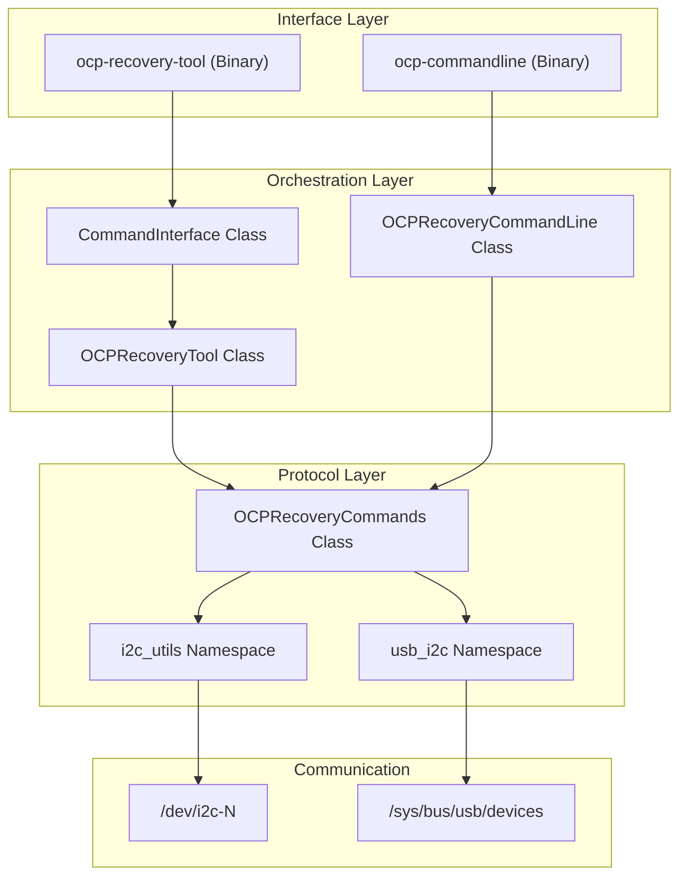
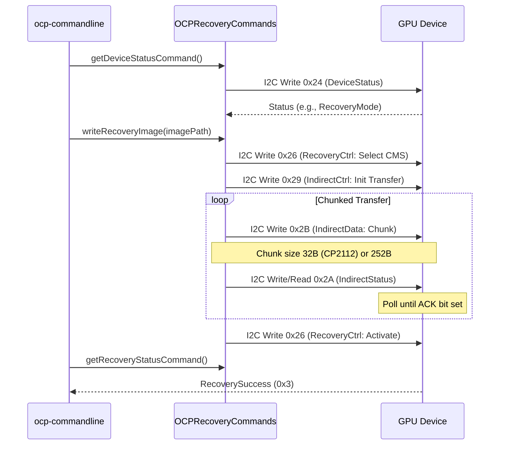

<!-- source: DeepWiki mcp.deepwiki.com · repo NVIDIA/nvidia-code-mgmt · page 4.1 OCP Recovery Protocol · fetched 2026-10-26 -->

# OCP Recovery Protocol

Relevant source files

The following files were used as context for generating this wiki page:

- [recovery_tool/common/i2c_utils.cpp](recovery_tool/common/i2c_utils.cpp)
- [recovery_tool/common/i2c_utils.hpp](recovery_tool/common/i2c_utils.hpp)
- [recovery_tool/ocp_recovery_tool/README.md](recovery_tool/ocp_recovery_tool/README.md)
- [recovery_tool/ocp_recovery_tool/meson.build](recovery_tool/ocp_recovery_tool/meson.build)
- [recovery_tool/ocp_recovery_tool/ocp_commandline.cpp](recovery_tool/ocp_recovery_tool/ocp_commandline.cpp)
- [recovery_tool/ocp_recovery_tool/recovery_commandline.cpp](recovery_tool/ocp_recovery_tool/recovery_commandline.cpp)
- [recovery_tool/ocp_recovery_tool/recovery_commandline.hpp](recovery_tool/ocp_recovery_tool/recovery_commandline.hpp)
- [recovery_tool/ocp_recovery_tool/recovery_commands.cpp](recovery_tool/ocp_recovery_tool/recovery_commands.cpp)
- [recovery_tool/ocp_recovery_tool/recovery_commands.hpp](recovery_tool/ocp_recovery_tool/recovery_commands.hpp)
- [recovery_tool/ocp_recovery_tool/recoverytool_interface.cpp](recovery_tool/ocp_recovery_tool/recoverytool_interface.cpp)
- [recovery_tool/ocp_recovery_tool/recoverytool_interface.hpp](recovery_tool/ocp_recovery_tool/recoverytool_interface.hpp)
- [recovery_tool/ocp_recovery_tool/recoverytool_utils.cpp](recovery_tool/ocp_recovery_tool/recoverytool_utils.cpp)
- [recovery_tool/ocp_recovery_tool/recoverytool_utils.hpp](recovery_tool/ocp_recovery_tool/recoverytool_utils.hpp)
- [recovery_tool/ocp_recovery_tool/usb_i2c_mapper.cpp](recovery_tool/ocp_recovery_tool/usb_i2c_mapper.cpp)
- [recovery_tool/ocp_recovery_tool/usb_i2c_mapper.hpp](recovery_tool/ocp_recovery_tool/usb_i2c_mapper.hpp)
- [services/com.Nvidia.OCP.GPU.Recovery.service](services/com.Nvidia.OCP.GPU.Recovery.service)
- [services/ocp-recovery@.service](services/ocp-recovery@.service)
- [src/ocp_recovery.cpp](src/ocp_recovery.cpp)
- [src/ocp_recovery.hpp](src/ocp_recovery.hpp)

## Purpose and Scope

The OCP Recovery Protocol implementation provides a standardized mechanism for recovering unresponsive or corrupted GPU devices using the Open Compute Project (OCP) recovery specification. This system facilitates low-level communication over I2C or USB-to-I2C bridges to query device health, force recovery modes, and transfer firmware images to restore device functionality.

## OCP Recovery Architecture

The OCP Recovery architecture is divided into low-level protocol command implementation, high-level orchestration, and command-line interfaces for both manual and automated operations.

### Component Relationship

The following diagram illustrates how the different code entities interact to perform recovery operations.

**OCP Recovery Entity Map**

Sources: 
[recovery_tool/ocp_recovery_tool/recovery_commands.hpp:122-123](), [recovery_tool/ocp_recovery_tool/recoverytool_utils.hpp:140-141](), [recovery_tool/ocp_recovery_tool/recovery_commandline.hpp:155-156](), [recovery_tool/ocp_recovery_tool/recoverytool_interface.hpp:27-28]()

### Key Classes and Roles

*   **`OCPRecoveryCommands`**: Implements the raw OCP recovery protocol commands (DeviceID, DeviceStatus, IndirectData, etc.) as defined in the OCP specification. It manages I2C file descriptors and transaction retries. [recovery_tool/ocp_recovery_tool/recovery_commands.hpp:122-297]()
*   **`OCPRecoveryTool`**: Provides a JSON-based interface for recovery operations, typically used by the `ocp-recovery-tool` binary for diagnostic output. [recovery_tool/ocp_recovery_tool/recoverytool_utils.hpp:140-211]()
*   **`OCPRecoveryCommandLine`**: Orchestrates automated recovery flows, including status checking and image selection, integrated with the OpenBMC message registry for logging. [recovery_tool/ocp_recovery_tool/recovery_commandline.hpp:155-234]()
*   **`i2c_utils`**: Provides low-level wrappers for `ioctl(fd, I2C_RDWR, ...)` to perform atomic write-read transactions required by the protocol. [recovery_tool/common/i2c_utils.hpp:36-82]()

## Protocol Implementation

The protocol relies on specific command codes and state transitions to manage the firmware transfer process.

### OCP Recovery Commands
| Command | Code | Description |
| :--- | :--- | :--- |
| `DeviceID` | 0x23 | Retrieves device identification (PCI Vendor, IANA, etc.) |
| `DeviceStatus` | 0x24 | Queries health status and boot failure reason codes |
| `Reset` | 0x25 | Triggers device reset or forces recovery mode |
| `RecoveryCtrl` | 0x26 | Selects recovery image source and activation |
| `RecoveryStatus` | 0x27 | Reports current recovery phase (e.g., Awaiting Image) |
| `IndirectCtrl` | 0x29 | Prepares the device for indirect data transfer |
| `IndirectStatus` | 0x2A | Polls device readiness for the next data chunk |
| `IndirectData` | 0x2B | Transfers a chunk of the firmware image |

Sources: [recovery_tool/ocp_recovery_tool/recovery_commands.hpp:48-58]()

### Recovery Status States
The `RecoveryStatus` enum tracks the device's progress through the recovery lifecycle:
*   `NotInRecoveryMode` (0x0)
*   `AwaitingRecoveryImg` (0x1)
*   `BootingRecoveryImg` (0x2)
*   `RecoverySuccess` (0x3)
*   `RecoveryFailed` (0xC)
*   `RecoveryImgAuthFailed` (0xD)

Sources: [recovery_tool/ocp_recovery_tool/recoverytool_utils.hpp:120-130]()

## Recovery Data Flow

The recovery process involves transferring firmware images (typically CMS0 and CMS1) in small chunks to accommodate I2C buffer limits.

**Recovery Sequence Logic**

Sources: [recovery_tool/ocp_recovery_tool/recovery_commands.cpp:209-249](), [recovery_tool/ocp_recovery_tool/recovery_commands.cpp:413-470]()

### Chunk Management
The system adjusts `chunkSize` based on the hardware interface. If `GPU_OCP_RECOVERY_COMPAT_CP2112` is defined (for USB-to-I2C bridges), the chunk size is limited to 32 bytes to ensure reliability across the bridge; otherwise, it defaults to 252 bytes. [recovery_tool/ocp_recovery_tool/recovery_commands.hpp:129-135]()

## System Integration

### D-Bus Discovery
The `ocp-commandline` tool uses `DBUSUtils` to query the `xyz.openbmc_project.EntityManager` for objects implementing the `xyz.openbmc_project.Configuration.OCPRecovery` interface. This allows the tool to automatically discover the I2C bus and slave address for every OCP-capable device in the system. [recovery_tool/ocp_recovery_tool/ocp_commandline.cpp:17-21](), [recovery_tool/ocp_recovery_tool/ocp_commandline.cpp:133-176]()

### USB-I2C Mapping
For platforms where the recovery interface is exposed via a USB-to-I2C bridge (like the CP2112), the `usb_i2c` utility maps the physical USB port path to the logical I2C bus number. [recovery_tool/ocp_recovery_tool/usb_i2c_mapper.cpp:28-119]()

### Firmware Update Integration
The `OCPRecovery` class extends `BaseItemUpdater`, allowing the OCP recovery process to be triggered via the standard OpenBMC software update flow. It monitors specific directories for image uploads and generates service arguments for the recovery binaries. [src/ocp_recovery.hpp:22-37](), [src/ocp_recovery.hpp:90-102]()

## Command-line Tools

### ocp-recovery-tool
A diagnostic tool that outputs JSON responses for various protocol commands.
*   **Usage**: `ocp-recovery-tool [Command] -b [Bus] -s [Address]`
*   **Subcommands**: `GetDeviceID`, `GetDeviceStatus`, `SetForceRecoveryMode`, `PerformRecovery`, `GetCMSLogs`. [recovery_tool/ocp_recovery_tool/recoverytool_interface.cpp:41-241]()

### ocp-commandline
An automated tool for platform-level recovery.
*   **Usage**: `ocp-commandline [image_paths] [options]`
*   **Integration**: Uses the `MessageRegistry` to log standardized Redfish events like `RecoveryStarted` and `RecoverySuccessful` to the system log. [recovery_tool/ocp_recovery_tool/ocp_commandline.cpp:202-230](), [recovery_tool/common/message_registry.cpp:363-371]()

Sources:
[recovery_tool/ocp_recovery_tool/recovery_commands.cpp:1-533]()
[recovery_tool/ocp_recovery_tool/recoverytool_utils.cpp:1-445]()
[recovery_tool/ocp_recovery_tool/ocp_commandline.cpp:1-230]()
[src/ocp_recovery.hpp:1-177]()

---

