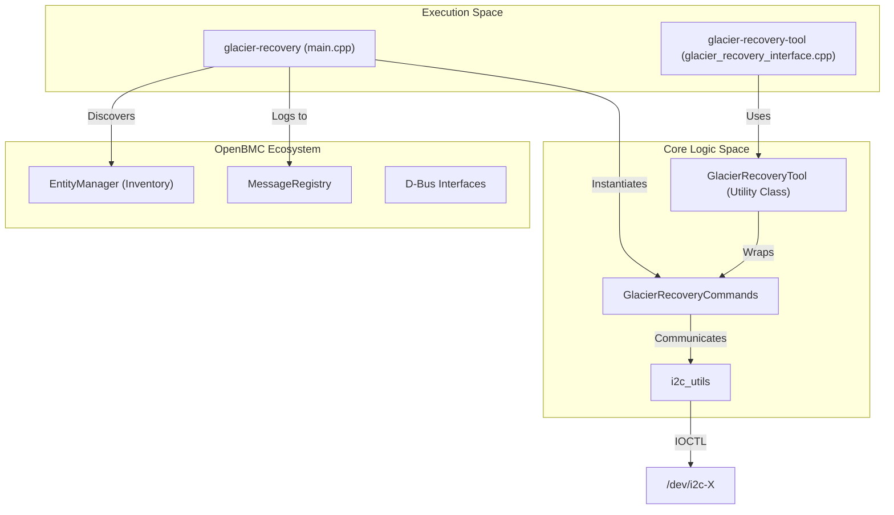
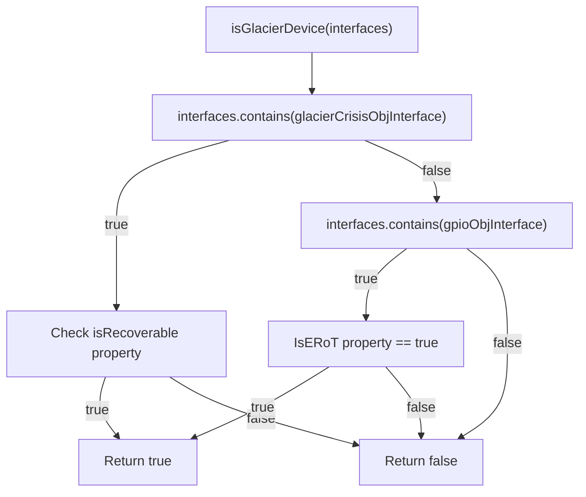
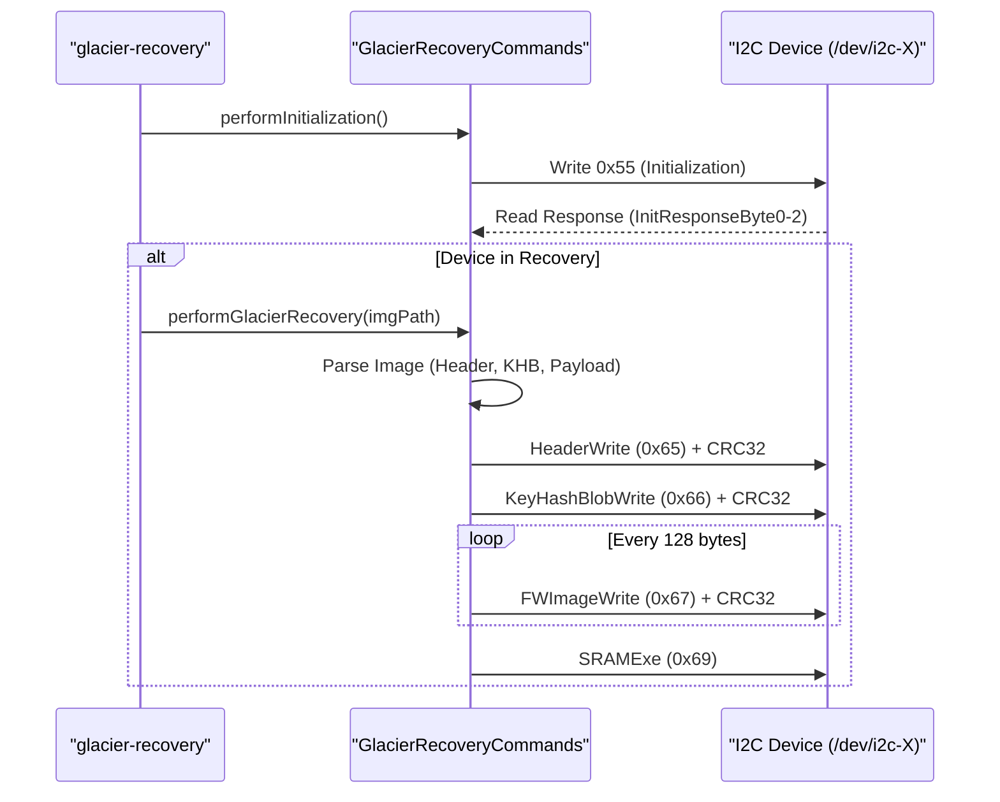

<!-- source: DeepWiki mcp.deepwiki.com · repo NVIDIA/nvidia-code-mgmt · page 4.2 Glacier Crisis Recovery · fetched 2026-10-26 -->

# Glacier Crisis Recovery

Relevant source files

The following files were used as context for generating this wiki page:

- [recovery_tool/glacier_recovery_tool/glacier_recovery_commands.cpp](recovery_tool/glacier_recovery_tool/glacier_recovery_commands.cpp)
- [recovery_tool/glacier_recovery_tool/glacier_recovery_commands.hpp](recovery_tool/glacier_recovery_tool/glacier_recovery_commands.hpp)
- [recovery_tool/glacier_recovery_tool/glacier_recovery_interface.cpp](recovery_tool/glacier_recovery_tool/glacier_recovery_interface.cpp)
- [recovery_tool/glacier_recovery_tool/glacier_recovery_interface.hpp](recovery_tool/glacier_recovery_tool/glacier_recovery_interface.hpp)
- [recovery_tool/glacier_recovery_tool/glacier_recovery_utils.cpp](recovery_tool/glacier_recovery_tool/glacier_recovery_utils.cpp)
- [recovery_tool/glacier_recovery_tool/glacier_recovery_utils.hpp](recovery_tool/glacier_recovery_tool/glacier_recovery_utils.hpp)
- [recovery_tool/glacier_recovery_tool/main.cpp](recovery_tool/glacier_recovery_tool/main.cpp)
- [recovery_tool/glacier_recovery_tool/meson.build](recovery_tool/glacier_recovery_tool/meson.build)
- [services/com.Nvidia.GlacierRecovery.Updater.service](services/com.Nvidia.GlacierRecovery.Updater.service)
- [services/glacier-recovery@.service](services/glacier-recovery@.service)
- [src/glacier_crisis_recovery.hpp](src/glacier_crisis_recovery.hpp)

The Glacier Crisis Recovery system provides firmware recovery capabilities for ERoT (Embedded Root of Trust) and GPIO-controlled devices that have entered a crisis state. This system uses I2C communication protocols to perform low-level recovery operations when standard firmware update mechanisms fail. The recovery process includes device discovery through EntityManager, I2C device unlocking for FPGA-hidden devices, initialization procedures, firmware image flashing, and recovery validation.

For OCP protocol-based GPU recovery, see [OCP Recovery Protocol](#4.1). For general MCU recovery operations, see [MCU Recovery Management](#4.3).

## System Architecture

The Glacier Crisis Recovery system consists of a core command-line utility (`glacier-recovery`) and a secondary tool (`glacier-recovery-tool`) for manual diagnostics. It integrates with the OpenBMC D-Bus infrastructure for device discovery and status reporting.

**Sources:** [recovery_tool/glacier_recovery_tool/main.cpp:1-247](), [recovery_tool/glacier_recovery_tool/glacier_recovery_interface.cpp:1-152](), [recovery_tool/glacier_recovery_tool/glacier_recovery_utils.hpp:18-61]()

## Device Discovery and Configuration

The recovery tool discovers target devices through `EntityManager` by querying for specific D-Bus configuration interfaces. Devices are identified as recoverable ERoT devices based on their interface properties.

| Property | Interface | Purpose |
|----------|-----------|---------|
| `I2CBus` | `glacierCrisisObjInterface` / `gpioObjInterface` | I2C bus number for device communication [recovery_tool/glacier_recovery_tool/main.cpp:36-37]() |
| `I2CAddress` | `glacierCrisisObjInterface` / `gpioObjInterface` | I2C slave address for the device [recovery_tool/glacier_recovery_tool/main.cpp:38-39]() |
| `isRecoverable` | `xyz.openbmc_project.Configuration.GlacierCrisisRecovery` | Boolean flag indicating device recovery capability [recovery_tool/glacier_recovery_tool/main.cpp:52-58]() |
| `HiddenByFPGA` | Configuration interfaces | Indicates if device requires I2C unlocking [recovery_tool/glacier_recovery_tool/main.cpp:113-114]() |
| `IsERoT` | `xyz.openbmc_project.Configuration.GPIORecovery` | Identifies device as Embedded Root of Trust [recovery_tool/glacier_recovery_tool/main.cpp:61-62]() |

The `isGlacierDevice` function determines device eligibility by checking for supported interfaces and recovery flags:

**Sources:** [recovery_tool/glacier_recovery_tool/main.cpp:19-23](), [recovery_tool/glacier_recovery_tool/main.cpp:44-68]()

## Recovery Protocol Implementation

The `GlacierRecoveryCommands` class implements the low-level I2C protocol used for crisis recovery.

### Command Structure
The protocol uses a specific set of commands defined in the `RecoveryCommand` enum [recovery_tool/glacier_recovery_tool/glacier_recovery_commands.hpp:39-49]():
- `Initialization` (0x55): Prepares the device for recovery.
- `HeaderWrite` (0x65): Writes the image header.
- `KeyHashBlobWrite` (0x66): Writes the KHB (Key Hash Blob).
- `FWImageWrite` (0x67): Writes the actual firmware payload.
- `SRAMExe` (0x69): Triggers the BootROM to authenticate and execute the image.
- `ShowHiddenERoTs` (0x60): Unlocks devices behind an FPGA.

### CRC32 Validation
Every command packet includes a CRC32 checksum (IEEE 802.3 standard) to ensure data integrity over the I2C bus [recovery_tool/glacier_recovery_tool/glacier_recovery_commands.cpp:21-73]().

**Sources:** [recovery_tool/glacier_recovery_tool/glacier_recovery_commands.hpp:39-112](), [recovery_tool/glacier_recovery_tool/glacier_recovery_commands.cpp:75-135]()

## Recovery Result Codes and Error Handling

The recovery system uses strongly-typed result codes through the `RecoveryResult` enumeration [recovery_tool/glacier_recovery_tool/glacier_recovery_commands.hpp:67-90]().

| RecoveryResult | Meaning |
|----------------|---------|
| `Ok` | Operation successful [recovery_tool/glacier_recovery_tool/glacier_recovery_commands.cpp:90]() |
| `CRCFailure` | CRC check failed on command parameters [recovery_tool/glacier_recovery_tool/glacier_recovery_commands.cpp:94]() |
| `InvalidCommandSignature` | Authentication check failed using Platform Command Key [recovery_tool/glacier_recovery_tool/glacier_recovery_commands.cpp:104]() |
| `FirmwareNotInRecovery` | Device is not in Crisis/Recovery state [recovery_tool/glacier_recovery_tool/glacier_recovery_commands.cpp:106]() |
| `SRAMCmdFailed` | Execution of recovery image in SRAM failed [recovery_tool/glacier_recovery_tool/glacier_recovery_commands.cpp:120]() |

The error handling strategy includes:
- **Timing Workaround**: A 1-second sleep is added between consecutive ERoT recoveries on the same bus to prevent bus contention issues [recovery_tool/glacier_recovery_tool/main.cpp:161-165]().
- **Post-Recovery Validation**: After flashing, the tool retries initialization up to 3 times to confirm the device has exited recovery mode and booted normally [recovery_tool/glacier_recovery_tool/main.cpp:180-186]().

**Sources:** [recovery_tool/glacier_recovery_tool/glacier_recovery_commands.cpp:86-135](), [recovery_tool/glacier_recovery_tool/main.cpp:130-180]()

## Integration with code-manager

The Glacier Recovery system is integrated into the `code-manager` service via the `GlacierRecovery` class [src/glacier_crisis_recovery.hpp:13]().

- **D-Bus Service**: `com.Nvidia.Software.GlacierRecovery.Updater` [src/glacier_crisis_recovery.hpp:26]()
- **Systemd Unit**: `glacier-recovery@.service` [services/glacier-recovery@.service:1-10]()
- **Update Logic**: When an update is triggered for a Glacier device, `code-manager` invokes the recovery utility with the firmware image path as a service argument [src/glacier_crisis_recovery.hpp:67-80]().

**Sources:** [src/glacier_crisis_recovery.hpp:13-116](), [services/com.Nvidia.GlacierRecovery.Updater.service:1-14](), [services/glacier-recovery@.service:1-10]()

---

