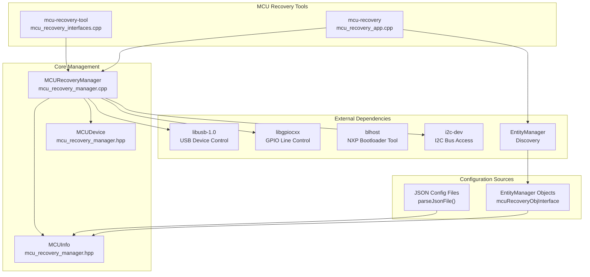
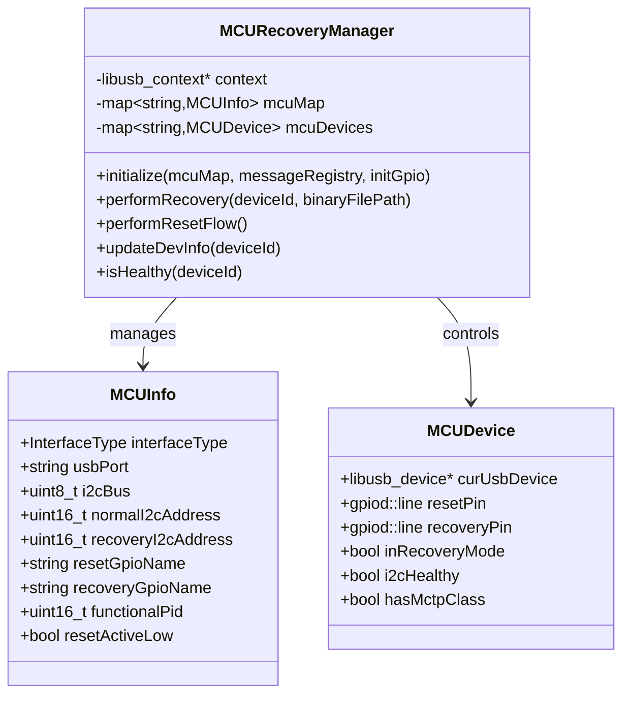
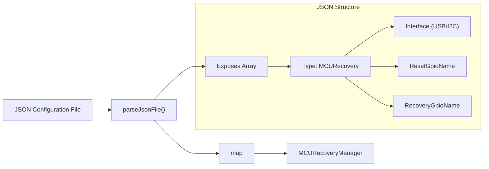
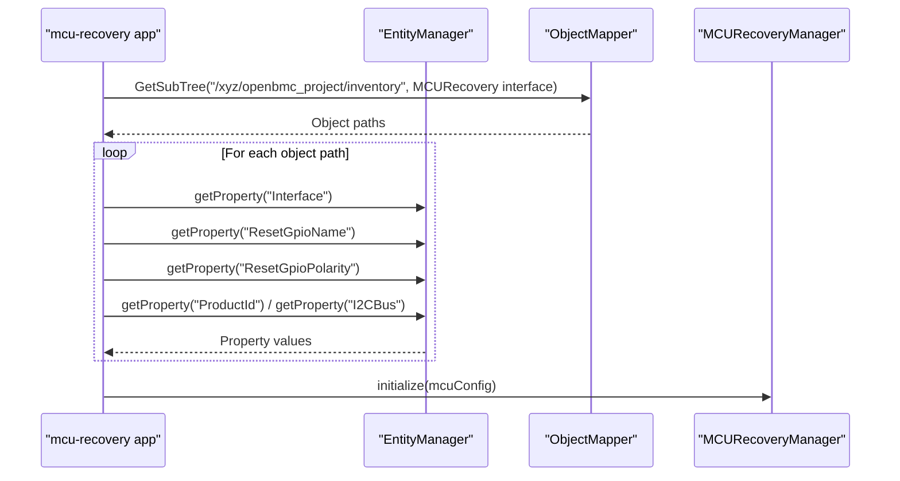
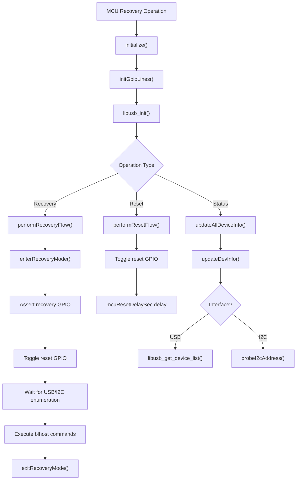
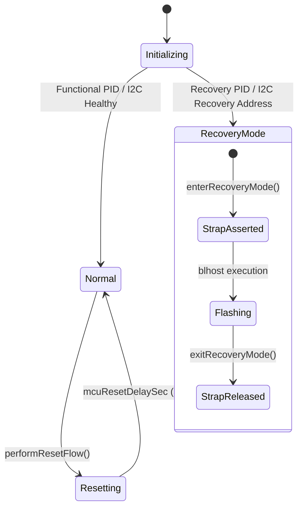
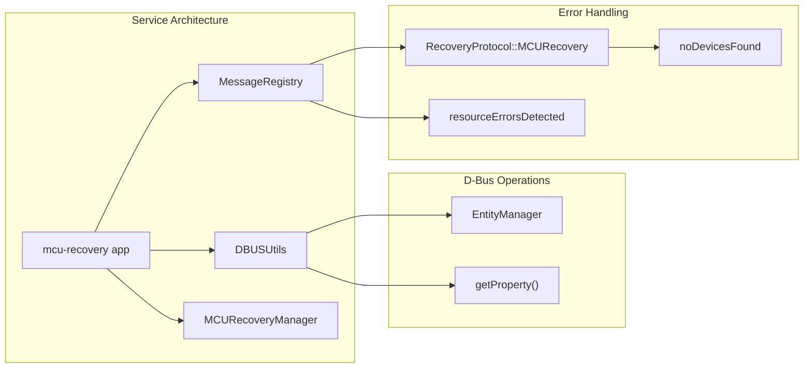

<!-- source: DeepWiki mcp.deepwiki.com · repo NVIDIA/nvidia-code-mgmt · page 4.3 MCU Recovery Management · fetched 2026-10-26 -->

# MCU Recovery Management

Relevant source files

The following files were used as context for generating this wiki page:

- [recovery_tool/mcu_recovery_tool/README.md](recovery_tool/mcu_recovery_tool/README.md)
- [recovery_tool/mcu_recovery_tool/mcu_recovery_app.cpp](recovery_tool/mcu_recovery_tool/mcu_recovery_app.cpp)
- [recovery_tool/mcu_recovery_tool/mcu_recovery_interfaces.cpp](recovery_tool/mcu_recovery_tool/mcu_recovery_interfaces.cpp)
- [recovery_tool/mcu_recovery_tool/mcu_recovery_manager.cpp](recovery_tool/mcu_recovery_tool/mcu_recovery_manager.cpp)
- [recovery_tool/mcu_recovery_tool/mcu_recovery_manager.hpp](recovery_tool/mcu_recovery_tool/mcu_recovery_manager.hpp)
- [recovery_tool/mcu_recovery_tool/meson.build](recovery_tool/mcu_recovery_tool/meson.build)
- [recovery_tool/mcu_recovery_tool/utils.cpp](recovery_tool/mcu_recovery_tool/utils.cpp)
- [recovery_tool/mcu_recovery_tool/utils.hpp](recovery_tool/mcu_recovery_tool/utils.hpp)
- [services/com.Nvidia.MCURecovery.Starter.service](services/com.Nvidia.MCURecovery.Starter.service)
- [services/com.Nvidia.MCURecovery.Updater@.service](services/com.Nvidia.MCURecovery.Updater@.service)
- [services/mcu-recovery@.service](services/mcu-recovery@.service)
- [src/mcu_recovery.cpp](src/mcu_recovery.cpp)
- [test/fw_status_fakes/mcu_recovery_manager.hpp](test/fw_status_fakes/mcu_recovery_manager.hpp)

## Purpose and Scope

The MCU Recovery Management system provides comprehensive recovery capabilities for Microcontroller Unit (MCU) devices within the NVIDIA firmware management infrastructure. This system handles firmware recovery operations over **USB** and **I2C** interfaces, GPIO-controlled device reset mechanisms, and integration with the broader system service architecture.

This document covers the MCU-specific recovery tools, device enumeration, and recovery workflows. For GPU recovery operations, see [4.1 OCP Recovery Protocol](). For ERoT crisis recovery, see [4.2 Glacier Crisis Recovery](). For MCU status monitoring integration, see [3.6 MCU Resource Management]().

## System Architecture

The MCU Recovery Management system consists of two main executables and a core management library that coordinates recovery operations across multiple MCU devices.

### Core Components Architecture

Sources: [recovery_tool/mcu_recovery_tool/meson.build:1-52](), [recovery_tool/mcu_recovery_tool/mcu_recovery_manager.hpp:119-124](), [recovery_tool/mcu_recovery_tool/README.md:25-35]()

### Device Management Data Structures

The system uses two key data structures to manage MCU device information and runtime state:

| Structure | Purpose | Key Fields |
|-----------|---------|------------|
| `MCUInfo` | Static device configuration | `interfaceType`, `usbPort`, `i2cBus`, `resetGpioName`, `functionalPid` |
| `MCUDevice` | Runtime device state | `curUsbDevice`, `resetPin`, `recoveryPin`, `inRecoveryMode`, `i2cHealthy` |

Sources: [recovery_tool/mcu_recovery_tool/mcu_recovery_manager.hpp:70-89](), [recovery_tool/mcu_recovery_tool/mcu_recovery_manager.hpp:99-108](), [recovery_tool/mcu_recovery_tool/mcu_recovery_manager.hpp:119-146]()

## Device Configuration and Discovery

### Static Configuration via JSON

The CLI tool supports JSON-based configuration where device information is parsed from configuration files. The system looks for objects with `Type: "MCURecovery"` in the `Exposes` array.

Sources: [recovery_tool/mcu_recovery_tool/utils.hpp:38-43](), [recovery_tool/mcu_recovery_tool/README.md:92-95]()

### Dynamic Discovery via EntityManager

The system service integrates with EntityManager for dynamic device discovery, querying D-Bus objects with the `xyz.openbmc_project.Configuration.MCURecovery` interface.

Sources: [recovery_tool/mcu_recovery_tool/utils.cpp:44-64](), [recovery_tool/mcu_recovery_tool/utils.cpp:116-210](), [recovery_tool/mcu_recovery_tool/mcu_recovery_app.cpp:48-62]()

## Recovery Operations

### Recovery Flow Management

The MCU recovery system supports multiple operational modes through distinct workflows. It utilizes `blhost` (NXP bootloader host tool) for flashing SB3/SB4 images.

| Operation | CLI Command | Method | Purpose |
|-----------|-------------|--------|---------|
| Device Recovery | `PerformRecovery` | `performRecoveryFlow()` | Flash firmware via `blhost receive-sb-file` |
| Force Reset | `ForceReset` | `performResetFlow()` | Toggle reset GPIO for all configured MCUs |
| Status Query | `GetDeviceStatus` | `updateAllDeviceInfo()` | Query device health via USB PIDs or I2C probing |
| Force Recovery | `SetForceRecovery` | `enterRecoveryMode()` | Assert recovery strap and toggle reset |

Sources: [recovery_tool/mcu_recovery_tool/mcu_recovery_interfaces.cpp:41-104](), [recovery_tool/mcu_recovery_tool/mcu_recovery_manager.hpp:134-179](), [recovery_tool/mcu_recovery_tool/mcu_recovery_manager.cpp:163-201]()

### Interface Specific Recovery

The manager supports two primary hardware interfaces:

1.  **USB Recovery**: Uses `libusb-1.0` for device enumeration and matching by `USBPort` path. Recovery is performed by flashing SB3/SB4 images using NXP's `blhost` utility.
2.  **I2C Recovery**: Probes for devices at `normalI2cAddress` and `recoveryI2cAddress` using `I2C_SMBUS_QUICK` via `ioctl`.

Sources: [recovery_tool/mcu_recovery_tool/mcu_recovery_manager.cpp:99-137](), [recovery_tool/mcu_recovery_tool/mcu_recovery_manager.hpp:58](), [recovery_tool/mcu_recovery_tool/mcu_recovery_manager.hpp:193-213]()

## System Service Integration

### D-Bus Integration and Message Registry

The system service version (`mcu-recovery`) integrates with the OpenBMC D-Bus infrastructure and includes error reporting through the `MessageRegistry`.

Sources: [recovery_tool/mcu_recovery_tool/mcu_recovery_app.cpp:47-67](), [recovery_tool/mcu_recovery_tool/utils.cpp:30-33]()

### Systemd Services

The system utilizes template services to manage recovery for different MCU targets:

*   **`com.Nvidia.MCURecovery.Starter.service`**: A oneshot service that iterates through `INSTANCE_COUNT` and starts individual updaters.
*   **`com.Nvidia.MCURecovery.Updater@.service`**: The template service that executes `code-manager -u MCURecovery` for a specific target.

Sources: [services/com.Nvidia.MCURecovery.Starter.service:1-28](), [services/com.Nvidia.MCURecovery.Updater@.service:1-20]()

---

