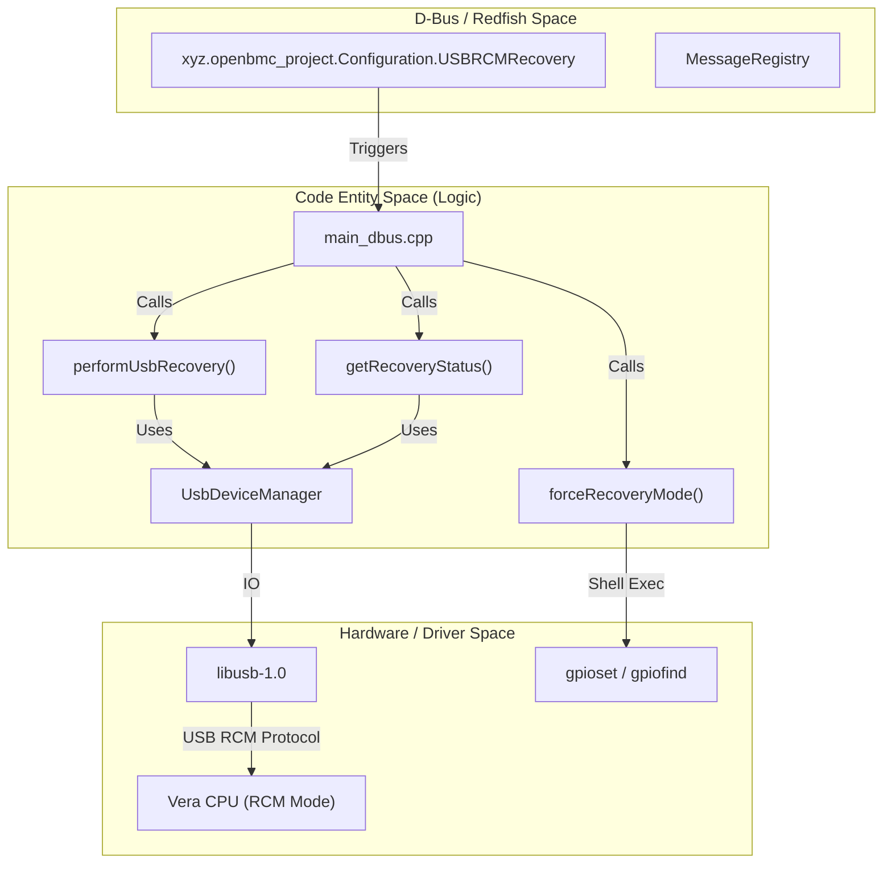
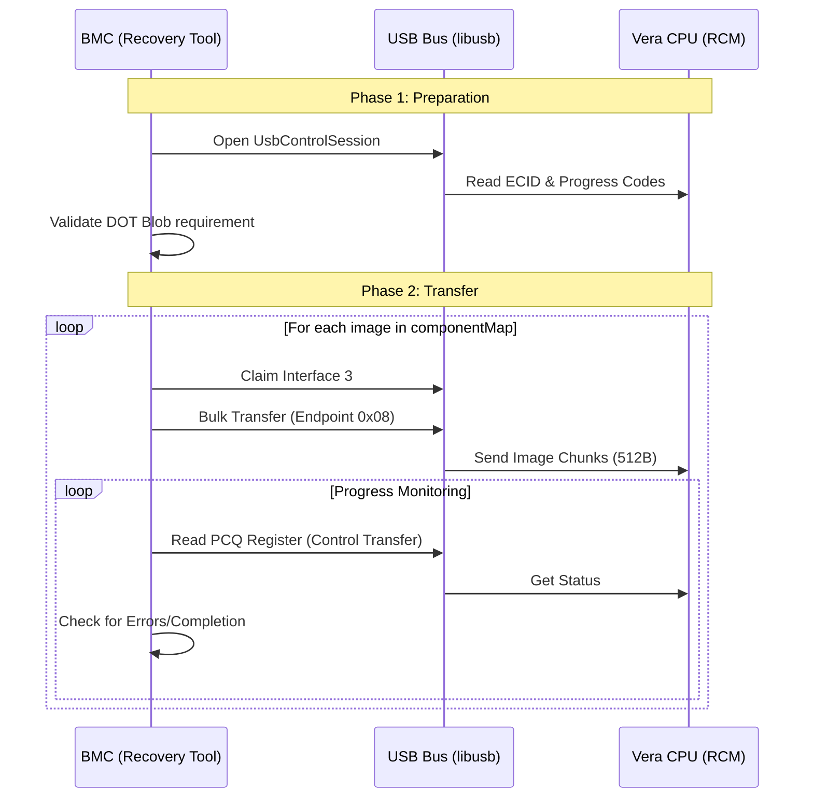

<!-- source: DeepWiki mcp.deepwiki.com · repo NVIDIA/nvidia-code-mgmt · page 4.4 USB RCM Recovery · fetched 2026-10-26 -->

# USB RCM Recovery

Relevant source files

The following files were used as context for generating this wiki page:

- [fw-status/force_recovery/recovery_mode_manager_base.hpp](fw-status/force_recovery/recovery_mode_manager_base.hpp)
- [fw-status/force_recovery/usbrcm_recovery_manager.cpp](fw-status/force_recovery/usbrcm_recovery_manager.cpp)
- [fw-status/force_recovery/usbrcm_recovery_manager.hpp](fw-status/force_recovery/usbrcm_recovery_manager.hpp)
- [recovery_tool/usbrcm_recovery_tool/README.md](recovery_tool/usbrcm_recovery_tool/README.md)
- [recovery_tool/usbrcm_recovery_tool/ecid_parser.hpp](recovery_tool/usbrcm_recovery_tool/ecid_parser.hpp)
- [recovery_tool/usbrcm_recovery_tool/force_recovery.cpp](recovery_tool/usbrcm_recovery_tool/force_recovery.cpp)
- [recovery_tool/usbrcm_recovery_tool/force_recovery.hpp](recovery_tool/usbrcm_recovery_tool/force_recovery.hpp)
- [recovery_tool/usbrcm_recovery_tool/get_recovery_status.cpp](recovery_tool/usbrcm_recovery_tool/get_recovery_status.cpp)
- [recovery_tool/usbrcm_recovery_tool/get_recovery_status.hpp](recovery_tool/usbrcm_recovery_tool/get_recovery_status.hpp)
- [recovery_tool/usbrcm_recovery_tool/main.cpp](recovery_tool/usbrcm_recovery_tool/main.cpp)
- [recovery_tool/usbrcm_recovery_tool/main_dbus.cpp](recovery_tool/usbrcm_recovery_tool/main_dbus.cpp)
- [recovery_tool/usbrcm_recovery_tool/meson.build](recovery_tool/usbrcm_recovery_tool/meson.build)
- [recovery_tool/usbrcm_recovery_tool/perform_rcm_recovery.cpp](recovery_tool/usbrcm_recovery_tool/perform_rcm_recovery.cpp)
- [recovery_tool/usbrcm_recovery_tool/perform_rcm_recovery.hpp](recovery_tool/usbrcm_recovery_tool/perform_rcm_recovery.hpp)
- [recovery_tool/usbrcm_recovery_tool/progress_code_parser.hpp](recovery_tool/usbrcm_recovery_tool/progress_code_parser.hpp)
- [recovery_tool/usbrcm_recovery_tool/progress_code_queue.cpp](recovery_tool/usbrcm_recovery_tool/progress_code_queue.cpp)
- [recovery_tool/usbrcm_recovery_tool/progress_code_queue.hpp](recovery_tool/usbrcm_recovery_tool/progress_code_queue.hpp)
- [recovery_tool/usbrcm_recovery_tool/usb_device_manager.cpp](recovery_tool/usbrcm_recovery_tool/usb_device_manager.cpp)
- [recovery_tool/usbrcm_recovery_tool/usb_device_manager.hpp](recovery_tool/usbrcm_recovery_tool/usb_device_manager.hpp)
- [recovery_tool/usbrcm_recovery_tool/usb_io.cpp](recovery_tool/usbrcm_recovery_tool/usb_io.cpp)
- [services/com.Nvidia.USBRCMRecovery.Updater.service](services/com.Nvidia.USBRCMRecovery.Updater.service)
- [services/usb-rcm-recovery@.service](services/usb-rcm-recovery@.service)

The USB Recovery Mode (RCM) recovery system provides tools and services for managing NVIDIA devices that are accessible via USB RCM. This system is responsible for device enumeration, health status monitoring through boot progress codes, handling security requirements via ECID/DOT blobs, and orchestrating the transfer of recovery firmware images.

### System Architecture Overview

The USB RCM recovery infrastructure consists of a standalone CLI tool (`usbrcm-recovery-tool`) and a D-Bus integrated service (`usb-rcm-recovery`) [recovery_tool/usbrcm_recovery_tool/meson.build:26-56](). It leverages `libusb-1.0` for low-level communication with target devices [recovery_tool/usbrcm_recovery_tool/meson.build:21]().

#### Data Flow and Entity Mapping
The following diagram illustrates the relationship between the D-Bus service, the recovery tool logic, and the physical hardware.

**USB RCM Recovery Entity Mapping**

Sources: [recovery_tool/usbrcm_recovery_tool/main_dbus.cpp:45-48](), [recovery_tool/usbrcm_recovery_tool/perform_rcm_recovery.cpp:77-78](), [recovery_tool/usbrcm_recovery_tool/force_recovery.cpp:190-201](), [recovery_tool/usbrcm_recovery_tool/usb_device_manager.cpp:35-51]()

---

### Device Management and Enumeration

The system identifies target devices by their USB Vendor ID (`0x0955`) and Product ID (`0x7410`) [recovery_tool/usbrcm_recovery_tool/usb_device_manager.cpp:23-24]().

#### RAII Wrappers
To ensure safe resource management, the tool uses several RAII classes:
*   `UsbContext`: Manages `libusb_context` lifetime [recovery_tool/usbrcm_recovery_tool/usb_device_manager.hpp:25-55]().
*   `UsbDevice`: Manages `libusb_device` reference counting [recovery_tool/usbrcm_recovery_tool/usb_device_manager.hpp:197-224]().
*   `UsbControlSession`: Opens a device for Control Transfers (Endpoint 0) without claiming interfaces, used for reading ECIDs and progress codes [recovery_tool/usbrcm_recovery_tool/usb_device_manager.hpp:72-121]().
*   `UsbDeviceHandle`: Opens a device and claims `INTERFACE_RECOVERY` (Interface 3) for bulk image transfers [recovery_tool/usbrcm_recovery_tool/usb_device_manager.hpp:135-189]().

#### RCM Mode Validation
A device is considered to be in valid RCM mode only if it presents the correct VID/PID and contains a recovery interface (Interface 3) with the recovery endpoint (`0x08`) [recovery_tool/usbrcm_recovery_tool/usb_device_manager.cpp:166-238]().

Sources: [recovery_tool/usbrcm_recovery_tool/usb_device_manager.cpp:23-26](), [recovery_tool/usbrcm_recovery_tool/usb_device_manager.hpp:58-59]()

---

### Progress Code and ECID Handling

Recovery status is determined by reading 32-bit boot progress codes and the 256-bit Electronic Chip ID (ECID) from the device.

#### Boot Progress Codes
The `ProgressCodeParser` decodes 32-bit values into human-readable information:
*   **Bits 31:30**: Code Type (Progress, Error, Debug) [recovery_tool/usbrcm_recovery_tool/progress_code_parser.hpp:37-43]().
*   **Bits 29:24**: Package Class (e.g., CPU 0 or CPU 1) [recovery_tool/usbrcm_recovery_tool/progress_code_parser.hpp:45-51]().
*   **Bits 23:16**: SubClass (PSC_ROM, PSC_FMC, etc.) [recovery_tool/usbrcm_recovery_tool/progress_code_parser.hpp:53-88]().
*   **Bits 5:0**: Operation code specific to the SubClass [recovery_tool/usbrcm_recovery_tool/progress_code_parser.hpp:90-105]().

#### ECID and DOT Blob Requirements
The ECID determines if a device requires a Device Owner Token (DOT) blob for recovery.
*   **DOT Blob Required**: If `BSI_OEM_KEY_VALID` (bit 1 of byte 28) is not set AND the `OPT_OWNERSHIP_STATUS` fuse count (9-bit field in bytes 20-21) is ODD [recovery_tool/usbrcm_recovery_tool/ecid_parser.hpp:92-115]().
*   **Nibble Swapping**: The ECID serial format has nibbles reversed; `swapNibbles` is used to correct the numeric value before fuse count interpretation [recovery_tool/usbrcm_recovery_tool/ecid_parser.hpp:51-89]().

Sources: [recovery_tool/usbrcm_recovery_tool/progress_code_parser.hpp:34-252](), [recovery_tool/usbrcm_recovery_tool/ecid_parser.hpp:16-178]()

---

### Recovery Execution Flow

The recovery process involves transferring multiple firmware components in a specific order defined by `componentMap` [recovery_tool/usbrcm_recovery_tool/main_dbus.cpp:54-65]().

#### Recovery Procedure Logic
**Image Transfer State Machine**

Sources: [recovery_tool/usbrcm_recovery_tool/perform_rcm_recovery.cpp:331-480](), [recovery_tool/usbrcm_recovery_tool/main_dbus.cpp:182-225](), [recovery_tool/usbrcm_recovery_tool/usb_io.cpp:64-91]()

#### Transfer Parameters
*   **Endpoint**: `0x08` (Bulk OUT) [recovery_tool/usbrcm_recovery_tool/perform_rcm_recovery.cpp:30-31]().
*   **Chunk Size**: 512 Bytes for optimal throughput [recovery_tool/usbrcm_recovery_tool/perform_rcm_recovery.cpp:33]().
*   **Timeout**: 30 seconds for bulk transfers [recovery_tool/usbrcm_recovery_tool/perform_rcm_recovery.cpp:32]().

---

### Force Recovery Mechanism

Force recovery is triggered via GPIO manipulation to strap the CPU into RCM mode during boot.

#### GPIO Phasing
To ensure all CPUs in multi-socket systems sample the correct strap state, the tool uses a phased approach [recovery_tool/usbrcm_recovery_tool/force_recovery.cpp:219-225]():
1.  **Assert All Resets**: Hold all target CPUs in reset.
2.  **Program All Straps**: Set `FORCED_RECOVERY_L`, `BOOT_DEV_SEL`, and `RECOVERY_TYPE` pins [recovery_tool/usbrcm_recovery_tool/force_recovery.cpp:103-116]().
3.  **Release All Resets**: Allow CPUs to boot and sample the new strap values.

#### Supported Configurations
The system supports three primary hardware configurations [recovery_tool/usbrcm_recovery_tool/force_recovery.cpp:23-28]():
*   `c2`: MGX single board (Prefix: `B0_M1_CPU`).
*   `c1g2`: Strata single board (Prefix: `BRD0_CPU`).
*   `c2g4`: Strata dual board (Prefix: `BRD0_CPU` and `BRD1_CPU`).

Sources: [recovery_tool/usbrcm_recovery_tool/force_recovery.cpp:13-145](), [fw-status/force_recovery/recovery_mode_manager_base.hpp:23-99]()

---

