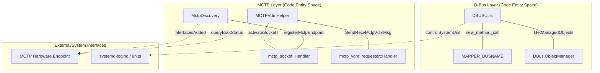
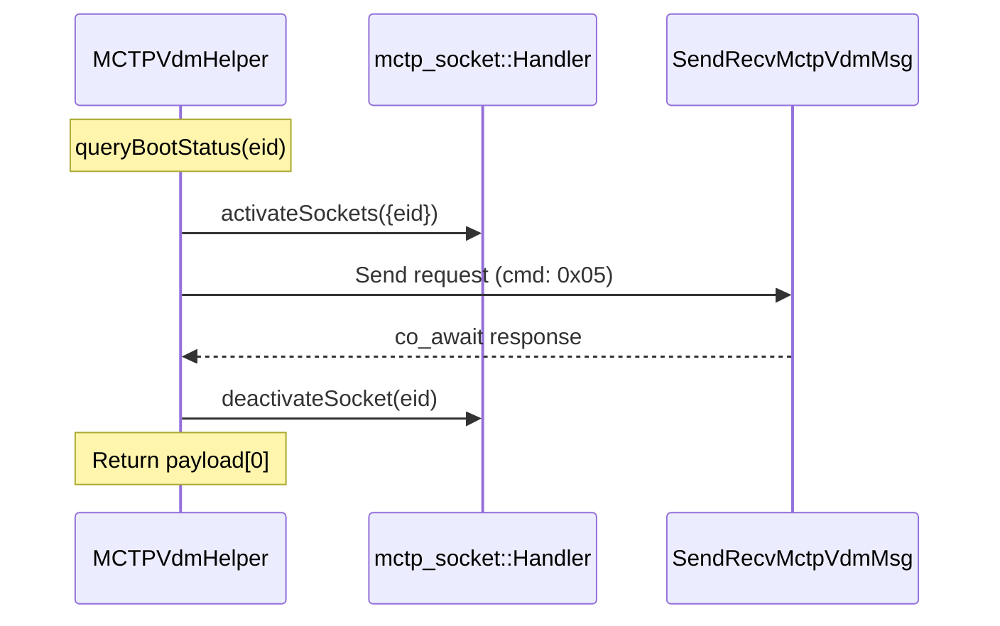

<!-- source: DeepWiki mcp.deepwiki.com · repo NVIDIA/nvidia-code-mgmt · page 5 Communication Infrastructure · fetched 2026-10-26 -->

# Communication Infrastructure

Relevant source files

The following files were used as context for generating this wiki page:

- [fw-status/mctp_util/mctp_endpoint_discovery.cpp](fw-status/mctp_util/mctp_endpoint_discovery.cpp)
- [fw-status/mctp_util/mctp_endpoint_discovery.hpp](fw-status/mctp_util/mctp_endpoint_discovery.hpp)
- [fw-status/mctp_util/mctp_vdm_helper.cpp](fw-status/mctp_util/mctp_vdm_helper.cpp)
- [fw-status/mctp_util/mctp_vdm_helper.hpp](fw-status/mctp_util/mctp_vdm_helper.hpp)
- [services/com.Nvidia.RT.Updater.service](services/com.Nvidia.RT.Updater.service)
- [src/dbusutils.cpp](src/dbusutils.cpp)
- [src/dbusutils.hpp](src/dbusutils.hpp)

The Communication Infrastructure is a foundational layer of the NVIDIA Code Management System that enables inter-process communication between different components of the system. This page provides an overview of the primary communication mechanisms used throughout the codebase: D-Bus and MCTP (Management Component Transport Protocol). For information about system-specific implementations built on top of this infrastructure, see [Firmware Update System](#2) and [Firmware Status Monitoring](#3).

## Overview

The NVIDIA Code Management System relies on two key communication protocols to enable interaction between system components and with external hardware:

1.  **D-Bus** - Used for inter-process communication within the BMC.
2.  **MCTP (Management Component Transport Protocol)** - Used for communicating with hardware devices like FPGAs, CPLDs, and other components.

These communication mechanisms are implemented through several utility classes that provide abstractions for sending and receiving messages, managing connections, and handling errors.

### Communication Architecture

The following diagram bridges the natural language space of system components to the code entities responsible for communication.

Sources: [src/dbusutils.hpp:74-242](), [fw-status/mctp_util/mctp_vdm_helper.cpp:29-35](), [fw-status/mctp_util/mctp_endpoint_discovery.hpp:49-67]()

## D-Bus Communication

D-Bus is an inter-process communication (IPC) system used extensively to exchange messages between different processes running on the BMC. The codebase uses `sdbusplus` for these interactions.

### D-Bus Utilities

The `DBUSUtils` class provides a comprehensive set of utilities for D-Bus communication. It encapsulates common operations into a reusable interface.

**For details, see [D-Bus Interfaces and Utilities](#5.1).**

| Method | Code Reference | Purpose |
| :--- | :--- | :--- |
| `getinventoryPath` | [src/dbusutils.cpp:52-64]() | Retrieves paths from the Mapper subtree for a specific interface. |
| `getProperty` | [src/dbusutils.hpp:125-144]() | Template wrapper for retrieving D-Bus properties with type casting. |
| `getManagedObjects` | [src/dbusutils.cpp:209-224]() | Invokes `GetManagedObjects` on a service's ObjectManager path. |
| `controlSystemUnit` | [src/dbusutils.cpp:287-301]() | Communicates with `org.freedesktop.systemd1` to manage services. |

Sources: [src/dbusutils.hpp:74-242](), [src/dbusutils.cpp:52-301]()

## MCTP Communication Layer

Management Component Transport Protocol (MCTP) is used for communication with hardware devices like FPGAs and ERoT (Enhanced Root of Trust) modules. The infrastructure supports discovery and Vendor Defined Message (VDM) handling.

**For details, see [MCTP Communication Layer](#5.2).**

### Endpoint Discovery

The `MctpDiscovery` class monitors the D-Bus path `/xyz/openbmc_project/mctp` for new interfaces. When an endpoint is added, it triggers `discoverEndpoints` to register the new hardware in the `mctp_socket::Handler` [fw-status/mctp_util/mctp_endpoint_discovery.cpp:160-171]().

### Vendor Defined Messages (VDM)

The `MCTPVdmHelper` class handles NVIDIA-specific VDM communication. It uses an `InstanceIdMgr` to track MCTP instance IDs and a `requester::Handler` to manage the request/response lifecycle [fw-status/mctp_util/mctp_vdm_helper.cpp:29-35]().

Sources: [fw-status/mctp_util/mctp_vdm_helper.cpp:37-87](), [fw-status/mctp_util/mctp_endpoint_discovery.hpp:49-103]()

## Message Registry and Error Reporting

The communication layer includes standardized methods for reporting hardware and communication errors back to the BMC's logging system. `DBUSUtils` provides `createMessageRegistryResourceErrors` which maps internal failures to the `ResourceEvent.1.0.ResourceErrorsDetected` message ID [src/dbusutils.hpp:66-68](), [src/dbusutils.cpp:273-285]().

**For details, see [Message Registry and Error Reporting](#5.3).**

Sources: [src/dbusutils.hpp:225-227](), [src/dbusutils.cpp:273-285]()

---

