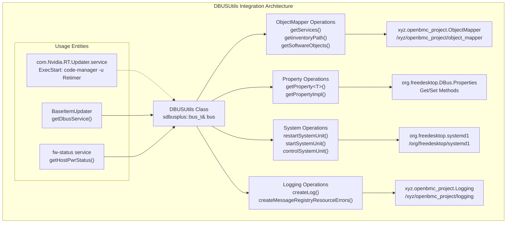
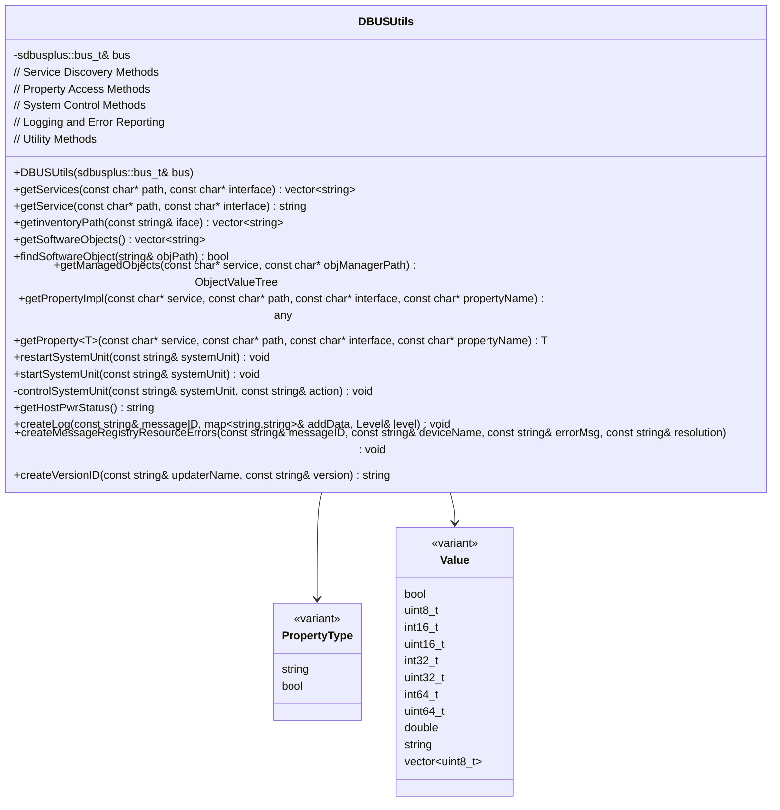
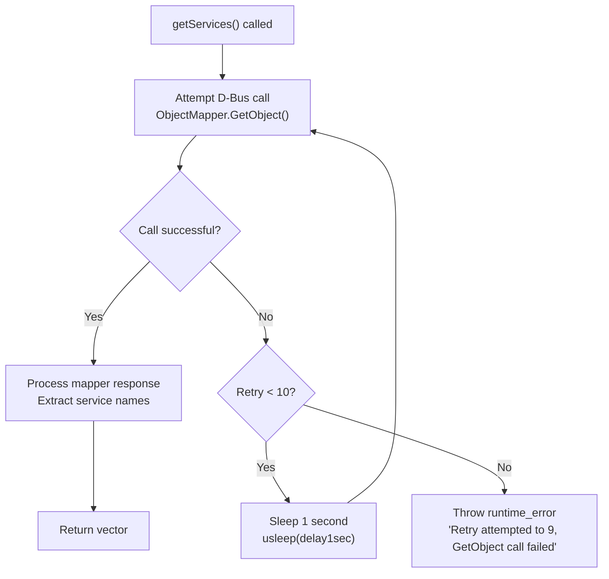
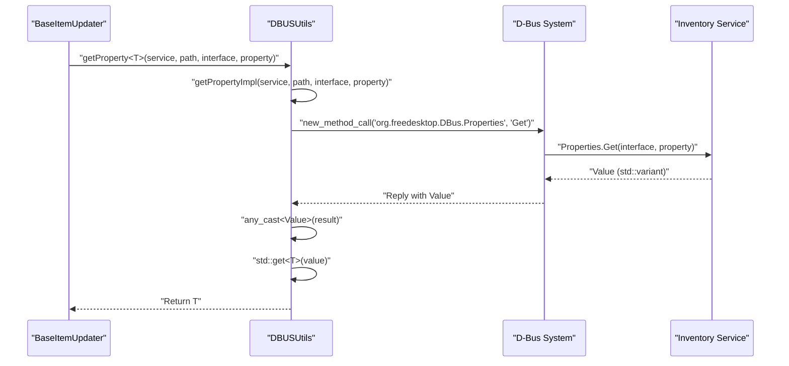

<!-- source: DeepWiki mcp.deepwiki.com · repo NVIDIA/nvidia-code-mgmt · page 5.1 D-Bus Interfaces and Utilities · fetched 2026-10-26 -->

# D-Bus Interfaces and Utilities

<details>
<summary>Relevant source files</summary>

The following files were used as context for generating this wiki page:

- [services/com.Nvidia.RT.Updater.service](services/com.Nvidia.RT.Updater.service)
- [src/dbusutils.cpp](src/dbusutils.cpp)
- [src/dbusutils.hpp](src/dbusutils.hpp)
- [test/fw_status_fakes/dbusutils.hpp](test/fw_status_fakes/dbusutils.hpp)
- [test/test_dbusutils_realbus.cpp](test/test_dbusutils_realbus.cpp)

</details>


This document details the D-Bus utility functions and integration patterns used throughout the NVIDIA Code Management System. The `DBUSUtils` class provides the primary interface for D-Bus operations including property retrieval, service discovery, systemd unit control, and standardized logging mechanisms.

## 1. D-Bus Utility Integration Architecture

The `DBUSUtils` class serves as the central interface for D-Bus operations across all components in the NVIDIA Code Management System. It abstracts common D-Bus patterns and provides consistent interfaces for service discovery, property management, and system control.



Sources: [src/dbusutils.hpp:74-84](), [src/dbusutils.cpp:52-123](), [services/com.Nvidia.RT.Updater.service:11-14]()

## 2. DBUSUtils Class Interface

The `DBUSUtils` class provides a comprehensive set of utility methods for D-Bus operations. It encapsulates common patterns used throughout the codebase and provides type-safe property access with error handling.



Sources: [src/dbusutils.hpp:47-52](), [src/dbusutils.hpp:74-242](), [src/dbusutils.cpp:52-212]()

## 3. Service Discovery and Object Enumeration

The `DBUSUtils` class provides comprehensive service discovery capabilities used throughout the firmware update system. These methods interact with the OpenBMC `ObjectMapper` service to locate and enumerate D-Bus objects.

### 3.1 Service Discovery Methods

| Method | Purpose | Common Use Cases |
|--------|---------|------------------|
| `getServices(path, interface)` | Find all services implementing an interface at a path | Locate updater services, find inventory providers | [src/dbusutils.cpp:125-171]() |
| `getService(path, interface)` | Get the first service implementing an interface | Quick service lookup, single service scenarios | [src/dbusutils.cpp:173-181]() |
| `getinventoryPath(iface)` | Get all inventory paths with a specific interface | Device discovery, compatibility checking | [src/dbusutils.cpp:52-64]() |
| `getSoftwareObjects()` | List all software version objects | Version management, update status | [src/dbusutils.cpp:183-194]() |
| `getManagedObjects(service, path)` | Get all objects managed by a service | Bulk object retrieval, service enumeration | [src/dbusutils.cpp:209-212]() |

### 3.2 Service Discovery Implementation

Service discovery includes retry logic with exponential backoff to handle service startup delays:



The retry mechanism handles common startup scenarios where services may not be immediately available:

```cpp
// From getServices() implementation
const int maxRetry = 10;
const int delay1sec = 1000000;
for (int retry = 0; retry < maxRetry; retry++)
{
    try
    {
        auto mapperResponseMsg = bus.call(mapper);
        // Process response...
        return ret;
    }
    catch (const sdbusplus::exception::SdBusError& ex)
    {
        // Log and retry...
        if (retry == 9)
        {
            throw std::runtime_error("Retry attemped to 9,GetObject call failed");
        }
    }
    usleep(delay1sec);
}
```

Sources: [src/dbusutils.cpp:132-169](), [src/dbusutils.hpp:148-152]()

## 4. Property Management and Type-Safe Access

The `DBUSUtils` class provides type-safe property access with comprehensive error handling. The property system uses C++ templates to ensure type safety while maintaining flexibility for different property types.

### 4.1 Property Access Architecture



### 4.2 Property Type System

The property system supports a comprehensive set of D-Bus types through the `Value` variant:

| C++ Type | D-Bus Type | Usage Examples |
|----------|------------|----------------|
| `bool` | BOOLEAN | Enable/disable states, flags |
| `std::string` | STRING | Version strings, device names, paths |
| `uint8_t`, `uint16_t`, `uint32_t`, `uint64_t` | UINT variants | IDs, counts, enumeration values |
| `int16_t`, `int32_t`, `int64_t` | INT variants | Status codes, error values |
| `double` | DOUBLE | Measurements, thresholds |
| `std::vector<uint8_t>` | ARRAY of BYTE | Binary data, raw values |

Sources: [src/dbusutils.hpp:47-49](), [src/dbusutils.hpp:125-144](), [src/dbusutils.cpp:102-123]()

## 5. System Control and Unit Management

The `DBUSUtils` class provides systemd unit control capabilities through D-Bus interfaces. This allows the firmware management system to coordinate with system services and manage update processes.

### 5.1 System Control Methods

| Method | systemd Action | Purpose |
|--------|----------------|---------|
| `startSystemUnit(unit)` | `StartUnit` | Launch update services, recovery tools |
| `restartSystemUnit(unit)` | `RestartUnit` | Restart failed services, reload configurations |
| `controlSystemUnit(unit, action)` | Generic action | Low-level systemd control |

Sources: [src/dbusutils.hpp:196-209](), [src/dbusutils.hpp:239-240]()

### 5.2 systemd Integration Flow

The system control methods use `call_noreply` to avoid blocking on systemd operations, which is critical for maintaining service responsiveness during updates.

```cpp
// From controlSystemUnit() implementation
void DBUSUtils::controlSystemUnit(const std::string& systemUnit,
                                  const std::string& action) const noexcept
{
    try
    {
        auto msg = bus.new_method_call(
            "org.freedesktop.systemd1", "/org/freedesktop/systemd1",
            "org.freedesktop.systemd1.Manager", action.c_str());
        msg.append(systemUnit.c_str(), "replace");
        bus.call_noreply(msg);
    }
    catch (const sdbusplus::exception::SdBusError& e)
    {
        lg2::error("Failed to send {ACTION} request to {UNIT}", "ACTION",
                   action, "UNIT", systemUnit);
    }
}
```

Sources: [src/dbusutils.cpp:236-252](), [test/fw_status_fakes/dbusutils.hpp:117-126]()

## 6. Logging and Error Reporting

The `DBUSUtils` class provides standardized logging mechanisms that integrate with the OpenBMC logging infrastructure and message registry system.

### 6.1 Logging Methods

| Method | Purpose |
|--------|---------|
| `createLog()` | Generic D-Bus log entry creation via `xyz.openbmc_project.Logging.Create` |
| `createMessageRegistryResourceErrors()` | Specific helper for `ResourceEvent.1.0.ResourceErrorsDetected` events |

### 6.2 Implementation Details

The `createMessageRegistryResourceErrors` function formats data specifically for Redfish-compatible message registries:

```cpp
// From src/dbusutils.cpp:287-301
void DBUSUtils::createMessageRegistryResourceErrors(
    const std::string& messageID, const std::string& deviceName,
    const std::string& errorMsg, const std::string& resolution) const
{
    std::map<std::string, std::string> addData;
    Level level = Level::Critical;
    addData["REDFISH_MESSAGE_ID"] = messageID;
    addData["REDFISH_MESSAGE_ARGS"] = (deviceName + "," + errorMsg);
    addData["namespace"] = "FWUpdate";
    if (!resolution.empty())
    {
        addData["xyz.openbmc_project.Logging.Entry.Resolution"] = resolution;
    }
    createLog(messageID, addData, level);
}
```

Sources: [src/dbusutils.cpp:263-301](), [src/dbusutils.hpp:219-227](), [src/dbusutils.hpp:66-68]()

## 7. Version ID Generation

The `createVersionID` utility provides a standardized way to generate unique identifiers for firmware versions by stripping non-alphanumeric characters and combining the updater name with the version string.

```cpp
// From src/dbusutils.cpp:66-84
std::string DBUSUtils::createVersionID(const std::string& updaterName,
                                       const std::string& version)
{
    if (version.empty() || updaterName.empty())
    {
        log<level::ERR>("Error version is empty");
        return {};
    }
    std::string chars = ".";
    std::string stripped = updaterName + "_" + version;
    for (char c : chars)
    {
        stripped.erase(std::remove(stripped.begin(), stripped.end(), c),
                       stripped.end());
    }
    return stripped;
}
```

Sources: [src/dbusutils.cpp:66-84](), [src/dbusutils.hpp:100-101]()

---

