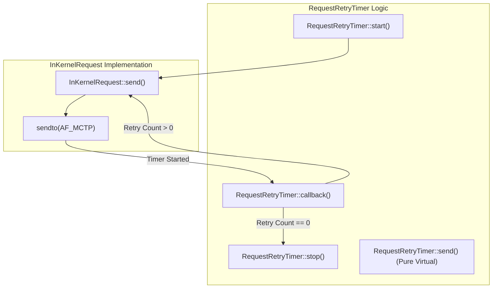
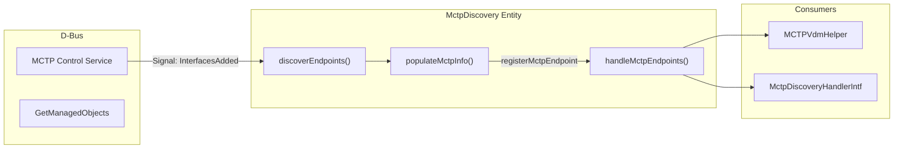
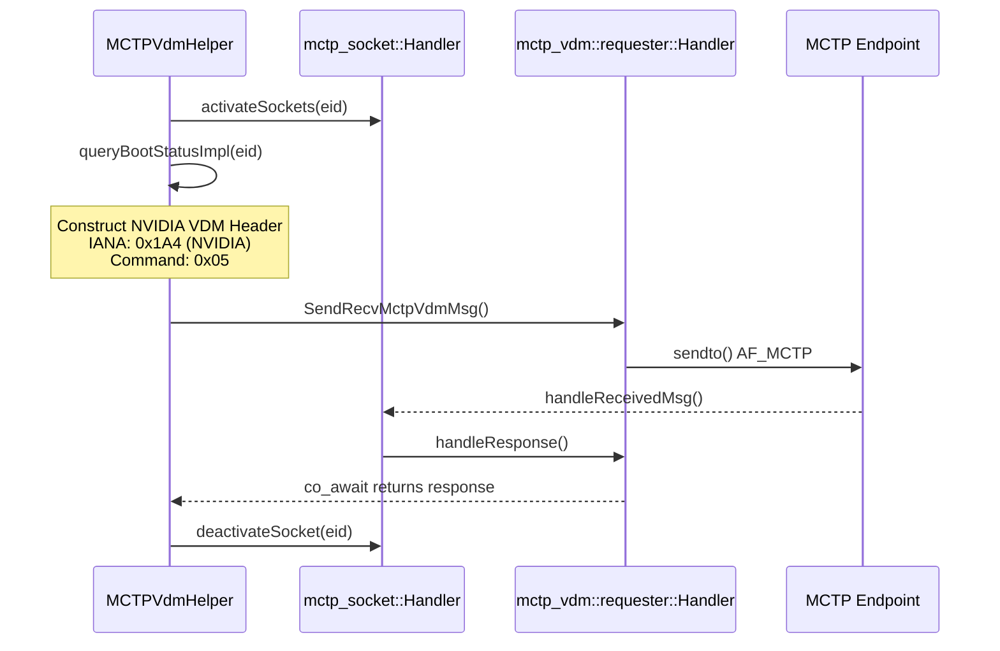

<!-- source: DeepWiki mcp.deepwiki.com · repo NVIDIA/nvidia-code-mgmt · page 5.2 MCTP Communication Layer · fetched 2026-10-26 -->

# MCTP Communication Layer

<details>
<summary>Relevant source files</summary>

The following files were used as context for generating this wiki page:

- [fw-status/mctp_util/handler.hpp](fw-status/mctp_util/handler.hpp)
- [fw-status/mctp_util/mctp_endpoint_discovery.cpp](fw-status/mctp_util/mctp_endpoint_discovery.cpp)
- [fw-status/mctp_util/mctp_endpoint_discovery.hpp](fw-status/mctp_util/mctp_endpoint_discovery.hpp)
- [fw-status/mctp_util/mctp_vdm_helper.cpp](fw-status/mctp_util/mctp_vdm_helper.cpp)
- [fw-status/mctp_util/mctp_vdm_helper.hpp](fw-status/mctp_util/mctp_vdm_helper.hpp)
- [fw-status/mctp_util/request.hpp](fw-status/mctp_util/request.hpp)
- [fw-status/mctp_util/socket_handler.cpp](fw-status/mctp_util/socket_handler.cpp)
- [fw-status/mctp_util/socket_handler.hpp](fw-status/mctp_util/socket_handler.hpp)
- [fw-status/mctp_util/socket_manager.hpp](fw-status/mctp_util/socket_manager.hpp)
- [fw-status/mctp_util/utils.cpp](fw-status/mctp_util/utils.cpp)
- [fw-status/mctp_util/utils.hpp](fw-status/mctp_util/utils.hpp)

</details>


This document covers the Management Component Transport Protocol (MCTP) communication infrastructure used throughout the `nvidia-code-mgmt` system. The MCTP layer provides reliable message transport for Vendor Defined Messages (VDM) between the BMC and various hardware components including ERoT devices, GPUs, and other MCTP endpoints.

For D-Bus interface patterns and utilities, see [D-Bus Interfaces and Utilities](#5.1). For error reporting and message formatting, see [Message Registry and Error Reporting](#5.3).

## Architecture Overview

The MCTP communication layer implements a flexible architecture supporting both daemon-based and in-kernel communication modes. The system uses a centralized `Handler` to manage the lifecycle of MCTP VDM request messages, including instance ID expiration, retries, and response matching.

### Natural Language to Code Entity Space: Core Infrastructure

```mermaid
graph TB
    subgraph "High-Level Interface"
        MCTPVdmHelper["MCTPVdmHelper"]
        queryBootStatus["MCTPVdmHelper::queryBootStatus()"]
        queryBootStatusImpl["MCTPVdmHelper::queryBootStatusImpl()"]
    end
    
    subgraph "Request Management"
        RequestRetryTimer["requester::RequestRetryTimer<br/>(Base Class)"]
        InKernelRequest["requester::InKernelRequest<br/>(AF_MCTP Mode)"]
        ReqHandler["requester::Handler<br/>(Lifecycle Manager)"]
    end
    
    subgraph "Socket Management"
        SockHandler["mctp_socket::Handler<br/>(Connection Logic)"]
        SockManager["mctp_socket::Manager<br/>(FD Registry)"]
    end
    
    subgraph "Discovery"
        MctpDiscovery["mctp_vdm::MctpDiscovery"]
        MctpDiscoveryHandlerIntf["MctpDiscoveryHandlerIntf"]
    end
    
    MCTPVdmHelper -->|uses| ReqHandler
    MCTPVdmHelper -->|uses| SockHandler
    ReqHandler -->|owns| InKernelRequest
    InKernelRequest --|> RequestRetryTimer
    SockHandler -->|uses| SockManager
    MctpDiscovery -->|notifies| MctpDiscoveryHandlerIntf
    MCTPVdmHelper --|> MctpDiscoveryHandlerIntf
    
    style MCTPVdmHelper fill:#f9f9f9
    style ReqHandler fill:#f9f9f9
    style SockHandler fill:#f9f9f9
```

Sources: [fw-status/mctp_util/mctp_vdm_helper.hpp:78-98](), [fw-status/mctp_util/handler.hpp:92-123](), [fw-status/mctp_util/socket_handler.hpp:42-62](), [fw-status/mctp_util/mctp_endpoint_discovery.hpp:49-67]()

## Request Management System

The request management system provides reliable message delivery with automatic retry mechanisms. The `mctp_vdm::requester::Handler` class manages the registration of requests and matches incoming responses using a `RequestKey`.

### Request Lifecycle and Retries

The `RequestRetryTimer` abstract base class defines the retry logic framework, handling the number of retries and wait intervals.



Sources: [fw-status/mctp_util/request.hpp:48-136](), [fw-status/mctp_util/request.hpp:181-203]()

### Request Identification
Requests are uniquely identified by a `RequestKey` to match responses:
*   **EID**: MCTP Endpoint ID [fw-status/mctp_util/handler.hpp:54]()
*   **Instance ID**: MCTP VDM instance ID [fw-status/mctp_util/handler.hpp:55]()
*   **Type**: MCTP VDM Message type [fw-status/mctp_util/handler.hpp:56]()
*   **Command**: MCTP VDM command [fw-status/mctp_util/handler.hpp:57]()

## Socket Management Framework

The `mctp_socket::Handler` manages the lifecycle of sockets used for communication. It supports multi-EID communication over shared sockets where applicable.

### Endpoint and Socket Mapping

| Class | Role | Key Functions |
|-------|------|---------------|
| `mctp_socket::Manager` | Registry for EID to File Descriptor mapping | `registerEndpoint`, `getSocket` [fw-status/mctp_util/socket_manager.hpp:35-70]() |
| `mctp_socket::Handler` | Logic for activating and initializing sockets | `activateSockets`, `initSocket` [fw-status/mctp_util/socket_handler.hpp:85-128]() |

### Socket Initialization (In-Kernel)
The `initSocket` implementation for in-kernel MCTP creates a `SOCK_DGRAM` socket using the `AF_MCTP` family and binds it to the VDM message type [fw-status/mctp_util/socket_handler.cpp:55-85]().

## Endpoint Discovery

The `MctpDiscovery` class monitors D-Bus for new MCTP endpoints by watching the `xyz.openbmc_project.MCTP.Endpoint` interface [fw-status/mctp_util/mctp_endpoint_discovery.cpp:42-46]().

### Discovery Data Flow



Sources: [fw-status/mctp_util/mctp_endpoint_discovery.cpp:160-182](), [fw-status/mctp_util/mctp_endpoint_discovery.cpp:100-158]()

## VDM Helper System

The `MCTPVdmHelper` provides high-level MCTP operations with coroutine-based asynchronous interfaces. It integrates socket management, request handling, and instance ID management.

### Boot Status Query Flow

The primary use case for `MCTPVdmHelper` is querying the boot status of ERoT devices using NVIDIA-specific VDM commands.



Sources: [fw-status/mctp_util/mctp_vdm_helper.cpp:37-59](), [fw-status/mctp_util/mctp_vdm_helper.cpp:62-87]()

### NVIDIA VDM Message Format
The implementation constructs messages with the following parameters:
*   **IANA**: `nvidiaIANA` (0x1A4) [fw-status/mctp_util/mctp_vdm_helper.cpp:67]()
*   **Command Code**: `0x05` (Query Boot Status) [fw-status/mctp_util/mctp_vdm_helper.cpp:71]()
*   **Message Type**: `nvidiaMsgType` [fw-status/mctp_util/mctp_vdm_helper.cpp:70]()

## Utility Classes

| Class | Purpose | Source |
|-------|---------|--------|
| `utils::CustomFD` | RAII wrapper for file descriptors to ensure they are closed on destruction. | [fw-status/mctp_util/utils.hpp:36-61]() |
| `mctp_vdm::InstanceIdMgr` | Manages the generation and expiration of MCTP instance IDs per EID. | [fw-status/mctp_util/handler.hpp:20]() |
| `utils::printBuffer` | Debugging utility to log Tx/Rx buffers in hex format. | [fw-status/mctp_util/utils.cpp:27-68]() |

Sources: [fw-status/mctp_util/utils.hpp:1-102](), [fw-status/mctp_util/handler.hpp:83-91]()

---

