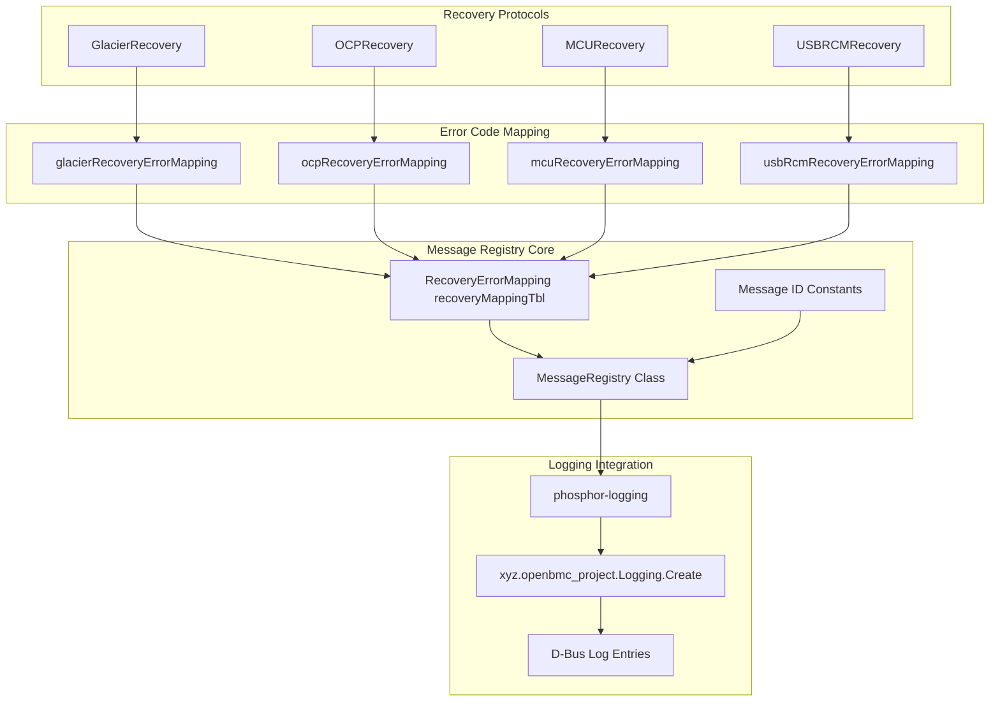
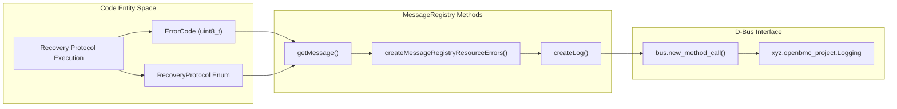

<!-- source: DeepWiki mcp.deepwiki.com · repo NVIDIA/nvidia-code-mgmt · page 5.3 Message Registry and Error Reporting · fetched 2026-10-26 -->

# Message Registry and Error Reporting

Relevant source files

The following files were used as context for generating this wiki page:

- [recovery_tool/common/message_registry.cpp](recovery_tool/common/message_registry.cpp)
- [recovery_tool/common/message_registry.hpp](recovery_tool/common/message_registry.hpp)
- [test/fw_status_fakes/message_registry.hpp](test/fw_status_fakes/message_registry.hpp)
- [test/glacier_main_fakes/message_registry.hpp](test/glacier_main_fakes/message_registry.hpp)

This page documents the standardized message registry and error reporting system that provides centralized error code mapping, message formatting, and resolution guidance across all recovery protocols in the `nvidia-code-mgmt` system. The message registry translates protocol-specific error codes into human-readable messages and actionable resolutions, integrating with OpenBMC's `phosphor-logging` framework for consistent error reporting.

## System Architecture

The message registry system provides a centralized approach to error reporting across multiple recovery protocols. The `MessageRegistry` class serves as the primary interface for creating standardized log entries and mapping protocol-specific error codes to descriptive messages.

### Message Registry Architecture

Sources: [recovery_tool/common/message_registry.hpp:8-43](), [recovery_tool/common/message_registry.cpp:6-27]()

### Error Code Flow and Message Resolution

Sources: [recovery_tool/common/message_registry.cpp:6-27](), [recovery_tool/common/message_registry.cpp:52-83](), [recovery_tool/common/message_registry.cpp:85-115]()

## Error Code Mapping System

The message registry maintains separate error mappings for each recovery protocol, allowing protocol-specific error codes to be translated into standardized messages and resolutions.

### Recovery Protocol Types

The system supports multiple recovery protocols, each with its own error code space:

| Protocol | Enum Value | Purpose |
|----------|------------|---------|
| `GlacierRecovery` | 0x0 | Glacier Crisis Recovery protocol errors |
| `OCPRecoveryStatusError` | 0x1 | OCP recovery status-related errors |
| `OCPRecoveryProtocolError` | 0x2 | OCP protocol communication errors |
| `OCPDeviceStatusCode` | 0x3 | OCP device status code errors |
| `OCPRecovery` | 0x4 | General OCP recovery errors |
| `MCURecovery` | 0x5 | MCU recovery protocol errors |
| `USBRCMRecovery` | 0x6 | USB Recovery Mode protocol errors |

Sources: [recovery_tool/common/message_registry.hpp:32-41]()

### Error Mapping Structure

Each error mapping associates error codes with message-resolution pairs:

*   **`ErrorCode`**: `std::uint8_t` representing the raw error value from the hardware or protocol.
*   **`MessageMapping`**: A `std::pair` containing the human-readable `Message` and the actionable `Resolution`.
*   **`ErrorMapping`**: An `unordered_map` linking `ErrorCode` to its `MessageMapping`.
*   **`RecoveryErrorMapping`**: A top-level `unordered_map` linking `RecoveryProtocol` to its specific `ErrorMapping`.

Sources: [recovery_tool/common/message_registry.hpp:21-26](), [recovery_tool/common/message_registry.hpp:43]()

### Common Error Codes

The system defines common error codes used across multiple protocols:

| Error Code | Value | Description |
|------------|-------|-------------|
| `deviceRecoveryFailed` | 0x70 | Generic recovery failure |
| `deviceNotResponding` | 0x71 | Device communication failure |
| `noDevicesFound` | 0x72 | No devices available for recovery |

Sources: [recovery_tool/common/message_registry.hpp:28-30]()

## Protocol-Specific Error Handling

### Glacier Recovery Error Codes

The Glacier protocol defines codes for CRC failures, payload issues, and signature mismatches.

| Error Code | Enum Name | Value |
|------------|-----------|-------|
| `IllegalPayloadLength` | `GlacierRecoveryErrorCode::IllegalPayloadLength` | 0x1 |
| `CRCFailure` | `GlacierRecoveryErrorCode::CRCFailure` | 0x2 |
| `InvalidCommandSignature` | `GlacierRecoveryErrorCode::InvalidCommandSignature` | 0x6 |

Sources: [recovery_tool/common/message_registry.hpp:45-55]()

### OCP Recovery Error Codes

The OCP (Open Compute Project) recovery protocol provides detailed boot failure reason codes:

| Error Code | Mnemonic | Description |
|------------|----------|-------------|
| 0x0 | BFNF | No Boot Failure detected |
| 0x1 | BFGHWE | Generic hardware error |
| 0x3 | BFSTF | Self-test failure |
| 0x4 | BFCD | Corrupted/missing critical data |
| 0x8 | BFFIMC | Missing/corrupt boot loader firmware image |
| 0x11 | FR | Forced Recovery |

Sources: [recovery_tool/common/message_registry.hpp:57-84]()

### MCU Recovery Error Codes

Specific to microcontroller unit operations via tools like `blhost`:

| Error Code | Enum Value | Description |
|------------|------------|-------------|
| 0x1 | `CmdExecFailed` | Command execution failed |
| 0x2 | `DevNotProvisioned` | Device is not provisioned |
| 0x7 | `SbFileWriteFailed` | Secure Binary file write failed |

Sources: [recovery_tool/common/message_registry.hpp:114-124]()

### USB RCM Recovery Error Codes

This protocol covers both general USB communication and PSC (Processor Security Controller) ROM/FMC errors:

| Category | Range | Examples |
|----------|-------|----------|
| General USB RCM | 0x01-0x1F | `DeviceNotFound` (0x01), `Timeout` (0x0C) |
| PSC ROM Errors | 0x20-0x4F | `PscRomBootImageLoadFail` (0x29), `PscRomErotGrantFail` (0x24) |
| PSC FMC Errors | 0x50-0x6F | `PscFmcFuseCrcFailed` (0x51), `PscFmcSvnCheckFailed` (0x5B) |

Sources: [recovery_tool/common/message_registry.hpp:126-196]()

## MessageRegistry Class Implementation

### Core Methods

The `MessageRegistry` class provides the logic for D-Bus logging integration.

*   **`createLog`**: Internal helper that performs the D-Bus call to `xyz.openbmc_project.Logging.Create` [recovery_tool/common/message_registry.cpp:6-27]().
*   **`createMessageRegistry`**: Logs standard lifecycle events like `recoveryStarted` or `recoverySuccessful` [recovery_tool/common/message_registry.cpp:29-50]().
*   **`getMessage`**: Performs the lookup in `recoveryMappingTbl` using the `RecoveryProtocol` and `ErrorCode` [recovery_tool/common/message_registry.cpp:52-83]().
*   **`createMessageRegistryResourceErrors`**: Orchestrates the lookup and logging for complex resource errors, including Redfish-compatible message IDs and resolutions [recovery_tool/common/message_registry.cpp:85-115]().

### Message ID Constants

Standardized Redfish-style message IDs used for external reporting:

| Constant | Value |
|----------|-------|
| `firmwareNotInRecovery` | "NvidiaUpdate.1.0.FirmwareNotInRecovery" |
| `recoverySuccessful` | "NvidiaUpdate.1.0.RecoverySuccessful" |
| `recoveryStarted` | "NvidiaUpdate.1.0.RecoveryStarted" |
| `enterDOTRecovery` | "NvidiaUpdate.1.0.EnterDOTRecovery" |
| `resourceErrorsDetected` | "ResourceEvent.1.0.ResourceErrorsDetected" |

Sources: [recovery_tool/common/message_registry.hpp:13-19]()

## Error Reporting Workflow

The reporting flow ensures that hardware-level errors are enriched with context before reaching the system log.

1.  **Detection**: A recovery tool (e.g., `USBRCMRecovery`) encounters an error code (e.g., `0x29` for PSC ROM Boot Image Load Fail).
2.  **Resolution**: The tool calls `createMessageRegistryResourceErrors`.
3.  **Mapping**: `getMessage()` finds the entry for `USBRCMRecovery` + `0x29` in the registry table.
4.  **Enrichment**: The system adds `REDFISH_MESSAGE_ID`, `REDFISH_MESSAGE_ARGS` (device name and error string), and `xyz.openbmc_project.Logging.Entry.Resolution` to the D-Bus message.
5.  **Logging**: `createLog()` sends the data to the OpenBMC logging service.

Sources: [recovery_tool/common/message_registry.cpp:85-115](), [recovery_tool/common/message_registry.cpp:13-27]()

---

