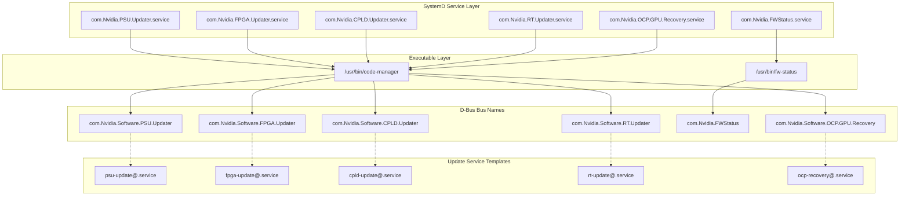
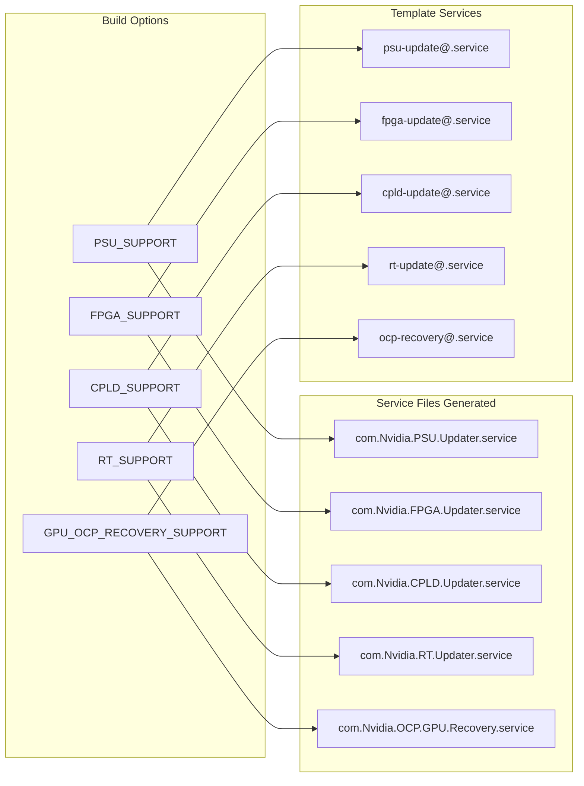
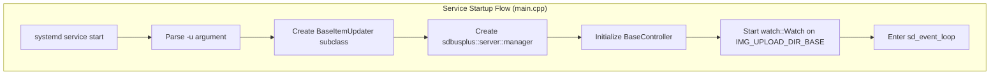
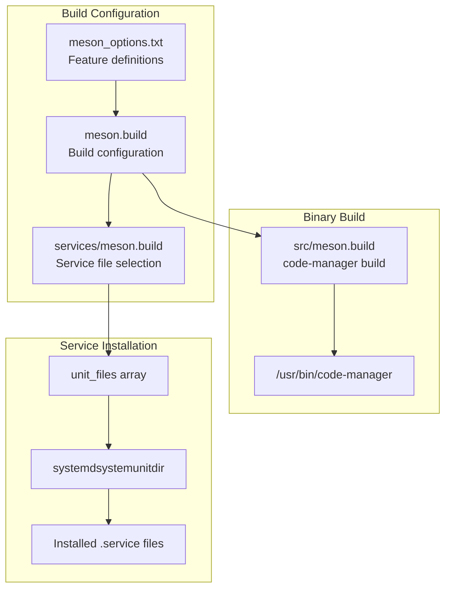

<!-- source: DeepWiki mcp.deepwiki.com · repo NVIDIA/nvidia-code-mgmt · page 6 System Services and Deployment · fetched 2026-10-26 -->

# System Services and Deployment

Relevant source files

The following files were used as context for generating this wiki page:

- [meson.build](meson.build)
- [meson_options.txt](meson_options.txt)
- [services/com.Nvidia.FWStatus.service](services/com.Nvidia.FWStatus.service)
- [services/meson.build](services/meson.build)
- [src/main.cpp](src/main.cpp)
- [src/meson.build](src/meson.build)
- [test/test_fw_status_main.cpp](test/test_fw_status_main.cpp)

This document covers the systemd service architecture, deployment configuration, and service lifecycle management for the `nvidia-code-mgmt` system. It details how the `code-manager` and `fw-status` services are configured, deployed, and managed within the OpenBMC ecosystem.

For information about the specific updater implementations and their functionality, see [Device-Specific Updaters](#2.3). For details about the D-Bus interfaces these services expose, see [D-Bus Interfaces and Utilities](#5.1).

## Service Architecture Overview

The `nvidia-code-mgmt` system deploys as a collection of systemd services that provide firmware update and monitoring capabilities. The architecture consists of two primary service categories: `code-manager` services for firmware updates and `fw-status` services for hardware monitoring.

Sources: [meson.build:52-185](), [services/meson.build:3-253](), [src/main.cpp:162-245]()

## Code Manager Service Configuration

The `code-manager` executable serves as the foundation for all firmware update services. Each hardware type is supported through a dedicated systemd service that launches `code-manager` with specific parameters. For details, see [Code Manager Services](#6.1).

### Service Generation and Build Configuration

The build system dynamically generates systemd service files based on enabled hardware support options defined in `meson_options.txt`. The configuration uses feature flags to determine which services to install via `services/meson.build`.

Sources: [meson_options.txt:12-210](), [services/meson.build:18-66]()

### Main Entry Point and Updater Selection

The `code-manager` executable uses command-line arguments to determine which updater implementation to instantiate. The `main` function parses the `-u` (updater) argument and creates the appropriate `BaseItemUpdater` subclass.

| Updater Argument | Class Instantiated | Bus Name Macro |
|------------------|-------------------|----------------------|
| `PSU` | `PSUItemUpdater` | `PSU_BUSNAME_UPDATER` |
| `FPGA` | `FPGAItemUpdater` | `FPGA_BUSNAME_UPDATER` |
| `CPLD` | `CPLDItemUpdater` | `CPLD_BUSNAME_UPDATER` |
| `Retimer` | `ReTimerItemUpdater` | `RT_BUSNAME_UPDATER` |
| `OCP` | `OCPRecovery` | N/A (Internal) |

Sources: [src/main.cpp:129-245](), [meson.build:59-98]()

### Service Dependencies and Configuration

Each code-manager service is configured with specific D-Bus bus names and service dependencies. The services use a common pattern of requesting D-Bus names and initializing watch directories for firmware images.

Sources: [src/main.cpp:129-282](), [meson.build:46-46]()

## Status Monitoring Services

The `fw-status` service provides hardware status monitoring and resource health tracking. For details, see [Status Monitoring Services](#6.2).

### FW-Status Service Architecture

The `fw-status` service is implemented as a standalone executable defined in `fw-status/fw-status.cpp`. It manages multiple resource types and integrates with recovery managers.

| Component | Responsibility | Source Reference |
|-----------|---------------|-------------------|
| `com.Nvidia.FWStatus.service` | Systemd unit definition | [services/com.Nvidia.FWStatus.service:1-12]() |
| `fw-status` | Main binary entry point | [test/test_fw_status_main.cpp:63-63]() |
| `MCURecoveryManager` | Coordination of MCU recovery | [test/test_fw_status_main.cpp:8-8]() |

Sources: [services/com.Nvidia.FWStatus.service:1-12](), [services/meson.build:3-5]()

## Build System Integration

The Meson build system orchestrates service deployment through conditional compilation and service file generation.

### Service Installation Process

Sources: [meson.build:14-17](), [services/meson.build:1-253](), [src/meson.build:112-126]()

### Configuration Data Generation

The build system generates a `config.h` file containing preprocessor definitions for service names, D-Bus interfaces, and hardware-specific configurations.

| Configuration Category | Example Definitions | Source |
|----------------------|-------------------|--------|
| D-Bus Bus Names | `PSU_BUSNAME_UPDATER`, `FPGA_BUSNAME_UPDATER` | [meson.build:59-71]() |
| Service Names | `PSU_UPDATE_SERVICE`, `FPGA_UPDATE_SERVICE` | [meson.build:61-73]() |
| Inventory Interfaces | `PSU_INVENTORY_IFACE`, `FPGA_INVENTORY_IFACE` | [meson.build:55-68]() |

Sources: [meson.build:36-185](), [src/meson.build:1-1]()

---

