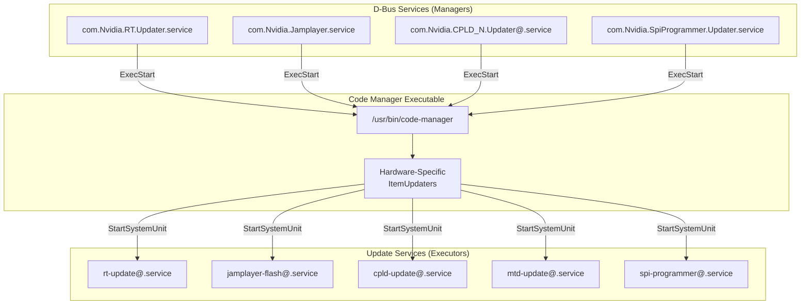
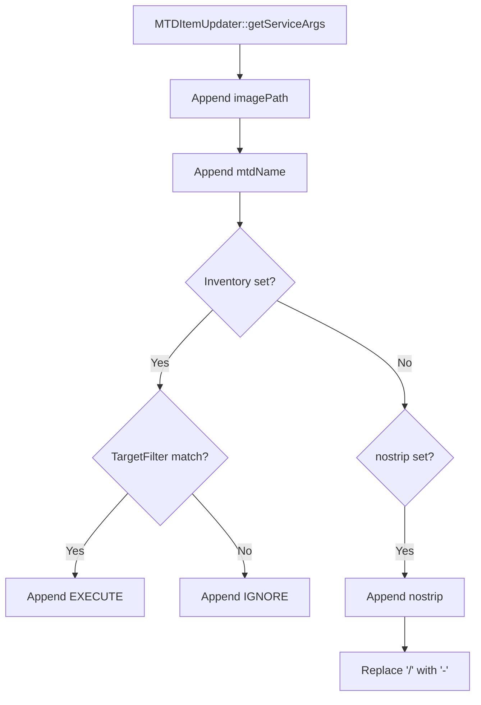

<!-- source: DeepWiki mcp.deepwiki.com · repo NVIDIA/nvidia-code-mgmt · page 6.1 Code Manager Services · fetched 2026-10-26 -->

# Code Manager Services

Relevant source files

The following files were used as context for generating this wiki page:

- [.clang-format](.clang-format)
- [services/com.Nvidia.CPLD_N.Starter.service](services/com.Nvidia.CPLD_N.Starter.service)
- [services/com.Nvidia.CPLD_N.Updater@.service](services/com.Nvidia.CPLD_N.Updater@.service)
- [services/com.Nvidia.Jamplayer.service](services/com.Nvidia.Jamplayer.service)
- [services/com.Nvidia.MTD.Updater.bmc.service](services/com.Nvidia.MTD.Updater.bmc.service)
- [services/com.Nvidia.MTD.Updater.fpga1.service](services/com.Nvidia.MTD.Updater.fpga1.service)
- [services/com.Nvidia.RT.Updater.service](services/com.Nvidia.RT.Updater.service)
- [services/com.Nvidia.SEP.Updater.service](services/com.Nvidia.SEP.Updater.service)
- [services/com.Nvidia.SpiProgrammer.Updater.service](services/com.Nvidia.SpiProgrammer.Updater.service)
- [services/cpld-update@.service](services/cpld-update@.service)
- [services/jamplayer-flash@.service](services/jamplayer-flash@.service)
- [services/mtd-update@.service](services/mtd-update@.service)
- [services/rt-update-direct@.service](services/rt-update-direct@.service)
- [services/rt-update@.service](services/rt-update@.service)
- [services/sep-update@.service](services/sep-update@.service)
- [services/spi-programmer@.service](services/spi-programmer@.service)
- [src/dbusutils.cpp](src/dbusutils.cpp)
- [src/dbusutils.hpp](src/dbusutils.hpp)
- [src/mtd_updater.cpp](src/mtd_updater.cpp)
- [src/sep_updater.cpp](src/sep_updater.cpp)

## Purpose and Scope

This document covers the systemd service architecture for the code-manager system, including service configuration, D-Bus bus name registration, and the relationship between build-time configuration options and deployed services. The code-manager services provide firmware update capabilities for various NVIDIA hardware components through a modular, hardware-specific updater framework.

For information about the base updater framework and device-specific implementations, see 2.1 Base Updater Framework and 2.3 Device-Specific Updaters. For details about the firmware status monitoring services, see 6.2 Status Monitoring Services.

## Service Architecture Overview

The code-manager system deploys multiple systemd services based on build-time configuration. Each hardware component type has its own D-Bus service and corresponding systemd update service that handles the actual firmware update process.

Sources: [services/com.Nvidia.RT.Updater.service:11-14](), [services/com.Nvidia.Jamplayer.service:9-12](), [services/com.Nvidia.CPLD_N.Updater@.service:10-19](), [services/com.Nvidia.SpiProgrammer.Updater.service:9-12](), [src/dbusutils.hpp:206-209]()

## Service Types and Component Mapping

The code-manager executable supports multiple updater types through command-line arguments. Each service type maps to specific hardware components and uses dedicated D-Bus bus names.

### D-Bus Service Mapping

| Component Type | Command Line Argument | D-Bus Bus Name |
|----------------|-----------------------|----------------|
| Retimer | `-u Retimer` | `com.Nvidia.Software.RT.Updater` |
| JamPlayer | `-u JAMPLAYER` | `com.Nvidia.Software.Jamplayer.Updater` |
| CPLD | `-u CPLD -i %i -m $MODEL` | `com.Nvidia.Software.CPLD.Updater.%i` |
| SPI Programmer | `-u SPIProgrammer` | `com.Nvidia.Software.SPIProgrammer.Updater` |

Sources: [services/com.Nvidia.RT.Updater.service:11-14](), [services/com.Nvidia.Jamplayer.service:9-12](), [services/com.Nvidia.CPLD_N.Updater@.service:16-19](), [services/com.Nvidia.SpiProgrammer.Updater.service:9-12]()

## Service Arguments and Parameters

Different updater types require specific command-line arguments and configuration parameters. The `MTDItemUpdater::getServiceArgs` function demonstrates how arguments are constructed for the underlying update scripts.

### Argument Construction Logic
The `getServiceArgs` function prepares a string of arguments (using `\x20` as space delimiters) to be passed to systemd units.

Sources: [src/mtd_updater.cpp:96-135]()

### Update Executor Services

| Service | Executable | Purpose |
|---------|------------|---------|
| `cpld-update@.service` | `cpldupdate` | Flashes CPLD logic based on `EXECUTE`/`IGNORE` flags. [services/cpld-update@.service:8-19]() |
| `mtd-update@.service` | `mtdupdate.sh` | Flashes MTD partitions. [services/mtd-update@.service:8-19]() |
| `jamplayer-flash@.service` | `jamplayer-update.sh` | Updates FPGA over JTAG using Jam STAPL. [services/jamplayer-flash@.service:8-8]() |
| `rt-update@.service` | `updateRetimerFw` | Updates PCIe Retimer firmware. [services/rt-update@.service:9-9]() |
| `spi-programmer@.service` | `spi-programmer.sh` | Raw SPI flash programming utility. [services/spi-programmer@.service:8-8]() |

## D-Bus Integration and Bus Names

The `DBUSUtils` class provides the infrastructure for services to interact with the system bus and manage systemd units.

### Key D-Bus Operations
- **Unit Control**: Services can start or restart systemd units via `startSystemUnit` and `restartSystemUnit`, which internally call `controlSystemUnit`. [src/dbusutils.hpp:196-209]()
- **Service Discovery**: The `getService` and `getServices` methods allow the code-manager to find which D-Bus service owns a specific object path and interface. [src/dbusutils.cpp:125-181]()
- **Object Mapping**: `getSoftwareObjects` uses the D-Bus Mapper to find all objects implementing the `VERSION_IFACE`. [src/dbusutils.cpp:183-194]()

### Version ID Generation
The `createVersionID` function generates a unique D-Bus-friendly identifier for software versions by concatenating the updater name and version string, then stripping characters like ".". [src/dbusutils.cpp:66-84]()

## Service Dependencies and Lifecycle

### Startup Dependencies
Many code-manager services depend on `pldmd.service` and `obmc-mapper.target` to ensure the communication infrastructure is ready before the updaters attempt to discover hardware.

- **Retimer**: Specifically waits for `nvidia-fpga-ready.target` before starting. [services/com.Nvidia.RT.Updater.service:3-17]()
- **SPI Programmer**: Specifically waits for `xyz.openbmc_project.EntityManager` to ensure hardware configuration is available. [services/com.Nvidia.SpiProgrammer.Updater.service:3-15]()

### Lifecycle Management
The services are generally configured with `Restart=always` to ensure high availability of the update management interface. [services/com.Nvidia.RT.Updater.service:12](), [services/com.Nvidia.CPLD_N.Updater@.service:17]().

Sources: [services/com.Nvidia.RT.Updater.service:1-18](), [services/com.Nvidia.Jamplayer.service:1-16](), [services/com.Nvidia.SpiProgrammer.Updater.service:1-16]()

---

