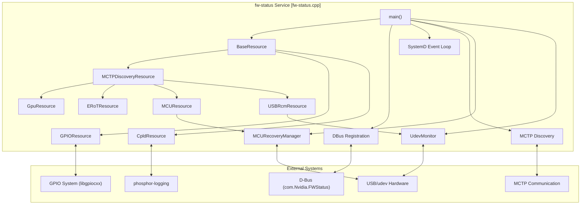
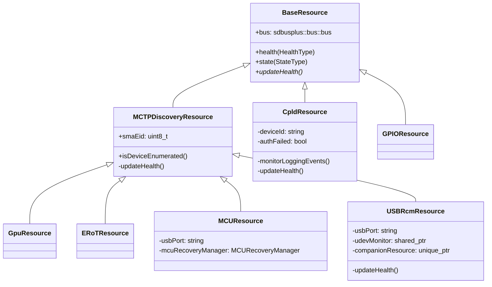
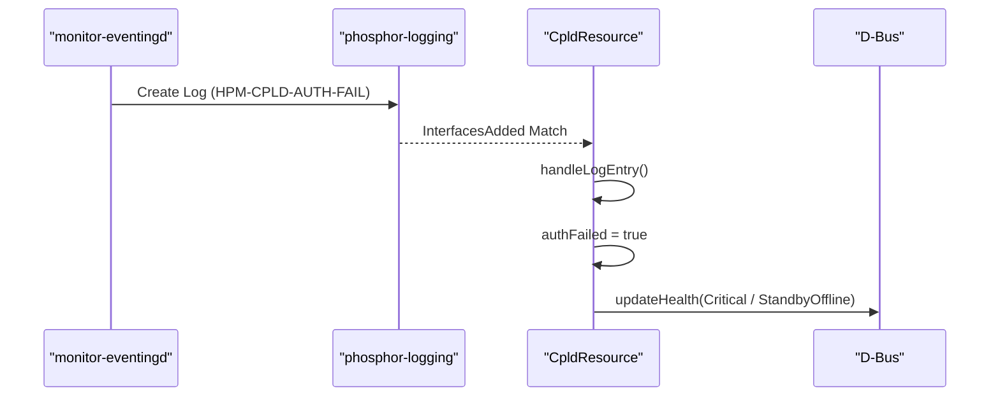

<!-- source: DeepWiki mcp.deepwiki.com · repo NVIDIA/nvidia-code-mgmt · page 6.2 Status Monitoring Services · fetched 2026-10-26 -->

# Status Monitoring Services

<details>
<summary>Relevant source files</summary>

The following files were used as context for generating this wiki page:

- [fw-status/cpld_resource.cpp](fw-status/cpld_resource.cpp)
- [fw-status/cpld_resource.hpp](fw-status/cpld_resource.hpp)
- [fw-status/meson.build](fw-status/meson.build)
- [fw-status/usb_rcm_resource.hpp](fw-status/usb_rcm_resource.hpp)
- [services/com.Nvidia.FWStatus.service](services/com.Nvidia.FWStatus.service)
- [services/com.Nvidia.MCURecovery.Starter.service](services/com.Nvidia.MCURecovery.Starter.service)
- [services/com.Nvidia.MCURecovery.Updater@.service](services/com.Nvidia.MCURecovery.Updater@.service)
- [services/mcu-recovery@.service](services/mcu-recovery@.service)
- [src/mcu_recovery.cpp](src/mcu_recovery.cpp)

</details>


## Purpose and Overview

The Status Monitoring Services component (implemented as `fw-status`) provides a framework for real-time monitoring of firmware health across various hardware resources in the NVIDIA Code Management System. It detects resource failures, publishes health status via D-Bus interfaces, and can trigger recovery actions when issues are detected.

This system complements the firmware update functionality by providing continuous monitoring of hardware components after updates have been applied.

## System Architecture

The Status Monitoring Services are built around a modular resource monitoring framework that adapts to different hardware components using various monitoring mechanisms, including specialized MCU recovery management and CPLD authentication tracking.

### High-Level Architecture



Sources: [fw-status/fw-status.cpp:1-682](), [fw-status/meson.build:27-57](), [services/com.Nvidia.FWStatus.service:1-12]()

## Resource Monitoring Framework

The monitoring framework is built on a class hierarchy that defines interfaces and behaviors for different types of resources.

### Resource Class Hierarchy



Sources: [fw-status/base_resource.hpp:1-179](), [fw-status/cpld_resource.hpp:45-93](), [fw-status/usb_rcm_resource.hpp:41-84](), [fw-status/mctp_discovery_resource.hpp:1-152]()

### Specialized Resource Types

1.  **CpldResource**: Monitors CPLD health via two signals:
    *   **Auth Failure**: Consumes `phosphor-logging` entries with ID `HPM-CPLD-AUTH-FAIL` generated by `monitor-eventingd`.
    *   **SMA Availability**: Tracks the MCTP endpoint availability of the SMA/MCU managing the CPLD.
    *   Sources: [fw-status/cpld_resource.hpp:29-44](), [fw-status/cpld_resource.cpp:38-40]()
2.  **USBRcmResource**: Represents a resource whose recovery status is determined through the USB RCM Recovery Protocol (specifically for NVIDIA Vera CPU devices).
    *   Creates a primary and a companion D-Bus object to represent multi-component hardware.
    *   Integrates with `UdevMonitor` to track USB device events.
    *   Sources: [fw-status/usb_rcm_resource.hpp:27-40](), [fw-status/usb_rcm_resource.cpp:57-60]()
3.  **MCUResource**: Monitors Microcontroller Units using the `MCURecoveryManager` to assess health via USB interface classification (MCTP vs HID/Recovery mode).
    *   Sources: [fw-status/mcu_resource.hpp:29-101]()

## Monitoring Mechanisms

### Logging-Based Monitoring (CPLD)

`CpldResource` uses D-Bus match rules to observe `xyz.openbmc_project.Logging.Entry` objects. It specifically looks for `AdditionalData` containing `HPM-CPLD-AUTH-FAIL`.



Sources: [fw-status/cpld_resource.cpp:162-181](), [fw-status/cpld_resource.cpp:104-135]()

### USB and Udev Monitoring

The `UdevMonitor` class (used by `USBRcmResource`) listens for kernel udev events to detect hardware insertion/removal in real-time.

*   **Action**: Tracks `add` and `remove` events for USB devices.
*   **Identification**: Uses the USB port path (e.g., `1-1.1.1.2`) to map physical hardware to D-Bus resources.
*   Sources: [fw-status/usb_rcm_resource.cpp:73-84](), [fw-status/usb_rcm_resource.hpp:77-83]()

## MCU Recovery Manager Integration

The `MCURecoveryManager` provides the logic for hardware-level recovery of MCUs.

### Recovery Service Lifecycle

The MCU recovery system utilizes a specialized starter service to manage multiple instances:

1.  **Starter Service**: `com.Nvidia.MCURecovery.Starter.service` reads `/etc/mcurecovery/mcurecovery.env` and iterates through `INSTANCE_COUNT` to start individual updaters.
2.  **Updater Service**: `com.Nvidia.MCURecovery.Updater@.service` executes the `code-manager` with the `-u MCURecovery` flag for a specific instance.
3.  **Recovery Tool**: `mcu-recovery@.service` executes the standalone `/usr/bin/mcu-recovery` utility.

Sources: [services/com.Nvidia.MCURecovery.Starter.service:8-24](), [services/com.Nvidia.MCURecovery.Updater@.service:9-20](), [services/mcu-recovery@.service:1-9]()

### MCU Recovery Logic (`MCURecoveryManager`)

| Feature | Implementation |
| :--- | :--- |
| **Discovery** | Uses `libusb` to scan for devices with specific Vendor/Product IDs. |
| **Mode Detection** | Differentiates between "Normal" (MCTP) and "Recovery" (HID/blhost) based on USB descriptors. |
| **GPIO Control** | Toggles Reset and Recovery pins via `libgpiocxx` to force devices into specific states. |
| **Firmware Loading** | Uses `blhost` protocol to transfer SB3 firmware images during recovery. |

Sources: [recovery_tool/mcu_recovery_tool/mcu_recovery_manager.cpp:189-271](), [fw-status/meson.build:48-49]()

## D-Bus Interface Summary

The `fw-status` service publishes the following interfaces:

| Interface | Properties / Purpose |
| :--- | :--- |
| `xyz.openbmc_project.State.Decorator.Health` | `Health` (OK, Critical) |
| `xyz.openbmc_project.State.Decorator.OperationalStatus` | `State` (Enabled, StandbyOffline, Absent) |
| `com.nvidia.RoT.BootStatus` | Detailed boot/recovery status codes |
| `xyz.openbmc_project.Common.UUID` | Unique identifier for the hardware component |

Sources: [fw-status/base_resource.hpp:29-42](), [fw-status/cpld_resource.cpp:92]()

## Build Configuration

The `fw-status` executable is defined in Meson, linking various recovery sub-projects into a single monitoring daemon.

```meson
executable(
    'fw-status',
    sources: source_files,
    dependencies: [
        phosphor_logging,
        sdbusplus,
        libusb_dep,
        libudev_dep,
        nlohmann_json,
    ],
    install: true
)
```

Sources: [fw-status/meson.build:62-81]()

---

