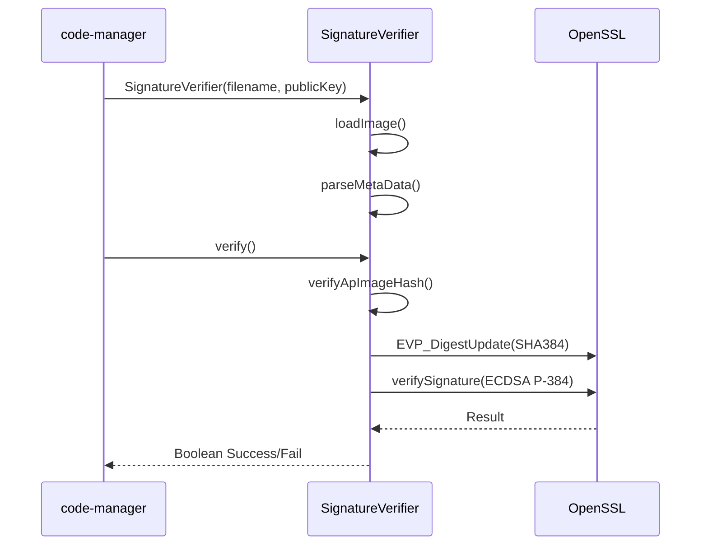

<!-- source: DeepWiki mcp.deepwiki.com · repo NVIDIA/nvidia-code-mgmt · page 7 Security and Key Management · fetched 2026-10-26 -->

# Security and Key Management

<details>
<summary>Relevant source files</summary>

The following files were used as context for generating this wiki page:

- [dot-keyd/src/dbus_installer.cpp](dot-keyd/src/dbus_installer.cpp)
- [dot-keyd/src/dot-keyd.cpp](dot-keyd/src/dot-keyd.cpp)
- [dot-keyd/src/dot_installer.hpp](dot-keyd/src/dot_installer.hpp)
- [src/signature_verifier.cpp](src/signature_verifier.cpp)
- [src/signature_verifier.hpp](src/signature_verifier.hpp)
- [test/test_signature_verifier.cpp](test/test_signature_verifier.cpp)

</details>


The `nvidia-code-mgmt` repository implements a multi-layered security architecture to ensure the integrity and authenticity of firmware across NVIDIA hardware components. This includes managing Device Ownership Transfer (DOT) keys, verifying firmware signatures before deployment, protecting SPI flash regions, and orchestrating secure pre-boot diagnostic sequences.

### Security Architecture Overview

The security subsystem bridges high-level D-Bus requests with low-level hardware security primitives. The following diagram maps these logical security functions to their primary code entities.

**Security System Entity Map**
```mermaid
graph TD
    subgraph "D-Bus / API Layer"
        [dot-keyd] --> ["dot_installer.hpp"]
        [code-manager] --> ["signature_verifier.hpp"]
    end

    subgraph "Logic & Validation"
        ["dot_installer.hpp"] -- "Orchestrates" --> ["DbusInstaller"]
        ["dot_installer.hpp"] -- "Orchestrates" --> ["HmcInstaller"]
        ["signature_verifier.hpp"] -- "Validates" --> ["Metadata"]
    end

    subgraph "Hardware Interface"
        ["DbusInstaller"] -- "Sets" --> ["DOTCAKInitialization"]
        ["SignatureVerifier"] -- "Checks" --> ["P384_ECDSA_SIGNATURE_LEN"]
    end

    style [dot-keyd] stroke-dasharray: 5 5
    style [code-manager] stroke-dasharray: 5 5
```
**Sources:** [dot-keyd/src/dot_installer.hpp:96-179](), [src/signature_verifier.hpp:37-84]()

---

## 7.1 DOT Key Management Daemon
The `dot-keyd` service is responsible for the installation and lifecycle management of Device Ownership Transfer (DOT) keys, specifically Customer Authorization Keys (CAK) and Leaf Authorization Keys (LAK). It ensures that only authorized owners can perform sensitive operations on the hardware.

The service supports multiple installation flows via the `DotInstaller` template pattern [dot-keyd/src/dot_installer.hpp:96-101]():
*   **HMC Installer**: Integration for Hardware Management Console-based key delivery.
*   **D-Bus Installer**: A mechanism for installing keys via OpenBMC D-Bus interfaces, often used during manufacturing or manual ownership transfer [dot-keyd/src/dbus_installer.cpp:172-188]().
*   **Key Storage**: Validated keys are stored in a local key-store on the BMC filesystem [dot-keyd/src/dot-keyd.cpp:58-100]().

For details, see [DOT Key Management Daemon](#7.1).

**Sources:** [dot-keyd/src/dot-keyd.cpp:58-100](), [dot-keyd/src/dot_installer.hpp:96-101](), [dot-keyd/src/dbus_installer.cpp:172-188]()

---

## 7.2 Firmware Signature Verification
Before any firmware update is applied, the `SignatureVerifier` class validates the authenticity of the image. It uses OpenSSL to perform SHA-384 hashing and ECDSA P-384 signature checks against the image metadata [src/signature_verifier.cpp:22-35]().

**Firmware Verification Flow**

**Sources:** [src/signature_verifier.cpp:65-84](), [src/signature_verifier.cpp:118-167](), [src/signature_verifier.hpp:37-84]()

The verifier checks both the global image signature and individual Application Processor (AP) image hashes defined in the `Metadata` structure [src/signature_verifier.cpp:118-125]().

For details, see [Firmware Signature Verification](#7.2).

**Sources:** [src/signature_verifier.cpp:22-35](), [src/signature_verifier.cpp:118-125](), [src/signature_verifier.hpp:37-84]()

---

## 7.3 SPI Flash Programming and Write Protection
This subsystem handles raw access to SPI flash devices, which store critical boot firmware. It includes a `flashrom-wrapper` for executing SPI operations and a dedicated `spi-programmer` service.

Key security features include:
*   **Write Protection**: Management of SPI status registers to hardware-lock specific flash regions.
*   **Safe Programming**: Ensuring that updates do not compromise the bootability of the system by validating regions before and after writes.

For details, see [SPI Flash Programming and Write Protection](#7.3).

---

## 7.4 Pre-Boot Diagnostics
The `PreBootDiag` service orchestrates diagnostic sessions that occur before the main CPU boot sequence. This is critical for identifying hardware failures in a secure environment before the full operating system takes control.

The service manages:
*   **Boot Chain Control**: Using GPIOs to halt or redirect the CPU boot flow into diagnostic modes.
*   **Post-Code Monitoring**: Tracking progress codes emitted by the hardware during the early boot phases.
*   **NSM Configuration**: Asynchronously configuring NVIDIA Services Over MCTP (NSM) parameters required for diagnostic tools.

For details, see [Pre-Boot Diagnostics](#7.4).

---

